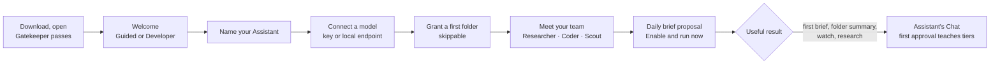
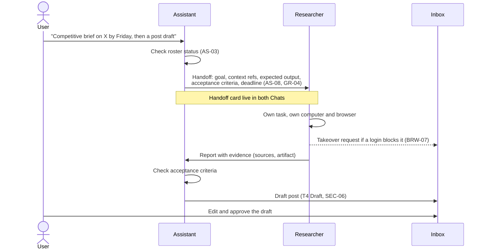
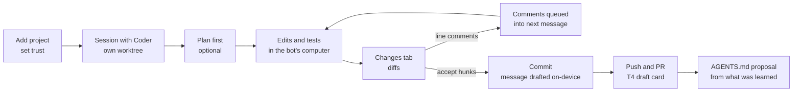
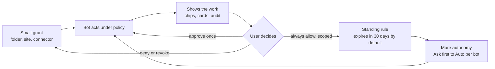
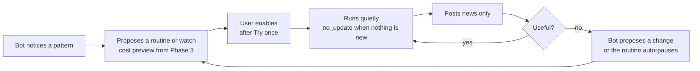
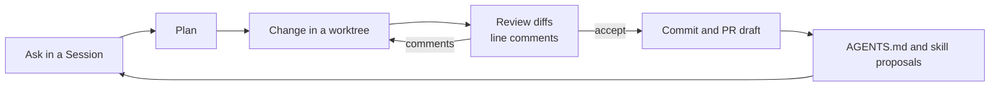

# Product

**Status:** Draft 4 · 2026-10-20 · updated 2026-10-23 for [D44](decisions.md#d44)–[D89](decisions.md#d89)
**Updated 2026-10-23 for [D91](decisions.md#d91):** Kuvo GitHub source may be inspected and copied/adapted for this personal/noncommercial project under applicable terms, without a separate observer or paid-lawyer gate. Inspection, selective reuse and a personal fork are options, not a selected fork or frontend replacement. No layout, phase/drop scope or D87 date changes here.
**Updated 2026-10-23 for [D92](decisions.md#d92) and [D93](decisions.md#d93):** Viticci-led assistant interactions + Kuvo workbench depth define one coherent Apple-native family, judged by Memoshi scenarios rather than exact competitor screenshots. The builder and coding agents implement with user design review and required QA; no mandatory designer or fixed paid allocation remains. Estimates, cuts, feature placements and D87 dates stay unchanged; no savings or new paid commitment is assumed.
**Updated 2026-11-13 for [D106](decisions.md#d106)–[D122](decisions.md#d122):** Two ways of working are both first-class: through the Assistant, or driving bots and sessions directly. Cognitio's design leads the shell on every device, rebuilt in Memoshi's own code, in place of D92's hierarchy. v1.0 now holds Apps beside the chat, mail, calendar and the other built-in panes, search and a connector catalog, bot-to-bot messages, Groups, Goals, external coding agents and team mode, voice, and Bot computers, Cloud computers and Remote machines; milestones M1–M3 name its gates, and v1.0 is estimated for Fri 2030-09-27 after 197 plan weeks. Journeys J10–J15, the Voice target and the milestone gates are new; the drops, v1.1 and v2 keep only what the decisions did not move. "Mini app" is now App ([D119](decisions.md#d119)); identifiers are unchanged.
**Owns:** Vision and positioning, first users and jobs, core journeys, product loops, scope per release, success metrics and how we measure them, the pricing hypothesis, differentiation.
**Depends on:** [MASTER_PLAN.md](MASTER_PLAN.md), [decisions.md](decisions.md), [feature-catalog.md](feature-catalog.md), [02-experience.md](02-experience.md), [05-bots-and-assistant.md](05-bots-and-assistant.md), [10-roadmap.md](10-roadmap.md), [AMENDMENT_2026-11-13.md](AMENDMENT_2026-11-13.md)

This document says what Memoshi is for and how we will know it works. The binding vocabulary, scope and targets are in [MASTER_PLAN.md](MASTER_PLAN.md) and [decisions.md](decisions.md); this document adds depth. Feature IDs such as `AS-08` refer to [feature-catalog.md](feature-catalog.md). Screen-level flows belong to [02-experience.md](02-experience.md); the journeys here are product-level: who, why, in what order, and what counts as success.

---

## 1. Vision and positioning

### 1.1 One line

> **Your Assistant and its team of bots, on your Mac, iPhone and iPad.**

### 1.2 Vision

A builder on a Mac should have what an executive has: a chief of staff who knows them and a team that does the work. In Memoshi that is the **Assistant**, a pinned bot that knows the user, triages what needs them and hands work to **bots**. Each bot has a name, a face, a job, its own memory, its own **computer** and its own **browser**. Bots work on schedules and triggers, in the user's **projects** (including code), inside budgets, and they ask before anything risky. It runs on the user's Mac, iPhone and iPad with the user's models and keys, and the same bots are on every device ([D1](decisions.md#d1), [D47](decisions.md#d47), [D49](decisions.md#d49)).

**Two ways of working, both first-class ([D109](decisions.md#d109)).**
- **Through the Assistant.** The user talks to the Assistant, which coordinates the team. It orchestrates lightly: it does small things itself (answers, memory, to-dos, lookups) and hands anything long-running or code-running to a bot or to a session's lead through a Handoff, and every Handoff is visible.
- **Directly.** The user drives bots and sessions themselves, as in a workbench: a bot's Chat or a coding Session.

Neither is a fallback for the other. The same bots, policy, Cards and budgets serve both, and every journey in [§3](#3-core-journeys) can start either way.

Since [D106](decisions.md#d106)–[D116](decisions.md#d116) the team also works in the user's mail and calendar, builds **Apps** in a pane beside the chat and changes them on request, talks in a voice call, and can each have a computer of its own that the user can watch ([§5.1](#51-v10-phases-04-197-plan-weeks)).

### 1.3 Category

Memoshi is in the **always-on AI teammates** category: named, persistent bots you message like contacts. Each one works on a computer, remembers, runs routines and asks before risky actions. Grok Bot fixed the shape on 2026-08-11, and Meta Muse, Microsoft Autopilot, Manus Cue and OpenAI Dots followed within seven weeks ([landscape §1](../research/agentic-workspace-landscape/README.md#1-executive-summary)). Memoshi takes the **local, governed** position in that category: the user's own Mac, iPhone and iPad are the computers, the user's keys are the models, and every bot is isolated and accountable.

### 1.4 Wedge

**Grok Bot's team, without the shared computer, the model lock or the vendor cloud, plus a real workbench.**

Why this wedge wins builders first:

1. **They already have keys and local models.** Big-lab products run only in vendor clouds and accept no user models ([landscape §1](../research/agentic-workspace-landscape/README.md#1-executive-summary)). Grok Bot has "no customer-facing model picker" and no BYO keys ([profile](../research/agentic-workspace-landscape/projects/grok-bot.md#weaknesses-and-risks)).
2. **Isolation is a felt problem.** Grok Bot runs all of a user's bots on one Firecracker microVM and tells users not to treat separate bots as a security boundary ([profile](../research/agentic-workspace-landscape/projects/grok-bot.md#security-and-trust-model)). Open-source rosters default to Full access, and the incidents follow ([landscape §1](../research/agentic-workspace-landscape/README.md#1-executive-summary)).
3. **Always-on is expensive in the cloud and free on your own devices.** A cloud sandbox kept awake costs about $120–175 per bot-month; per-bot local sandboxes, and the local Bot computers of Phase 2, cost nothing extra ([cost model](../research/agentic-workspace-landscape/landscape/execution-environments.md#3-cost-model-for-n-always-on-bots)). A Cloud computer is the user's choice per bot from Phase 2, and shows its cost before it starts ([D113](decisions.md#d113)).
4. **Builders want the team and the workbench in one place.** No roster product ships a real review loop: Grok Bot, Rakazo and OpenMausBot have no diff UI ([Grok Bot](../research/agentic-workspace-landscape/projects/grok-bot.md#capabilities-in-detail), [Rakazo](../research/agentic-workspace-landscape/projects/rakazo.md#capabilities-in-detail), [OpenMausBot](../research/agentic-workspace-landscape/projects/openmausbot.md#capabilities-in-detail)). Kuvo Code has the loop but a noncommercial license ([profile](../research/agentic-workspace-landscape/projects/kuvo-code.md)).

The entry jobs are cheap and immediate: a morning brief, a model-free watch on a page or CI run, a research brief and, from Phase 1, mail triage and the week view ([J10](#j10-mail-and-calendar-triage)). Coding follows in the same app once a project is granted ([J1](#j1-first-launch-to-first-useful-result), [J6](#j6-a-coding-session-with-review)).

### 1.5 Positioning statement

For **builders on a Mac** who run work and life through agents, **Memoshi** is the native app for Mac, iPhone and iPad where **one Assistant runs a persistent team of bots** that browse, watch, research, handle mail and calendar, build Apps beside the chat and code in your projects, and where you can equally drive any bot or session yourself. Unlike Grok Bot and the big-lab agents, it runs **on your own devices with your models and keys**, with the same bots on each, gives **every bot its own sandboxed computer and browser**, and **shows cost before you spend it**. Unlike open-source rosters, it is **safe by default**: one policy engine outside the model, drafts before anything is sent, and memory you can see and edit.

### 1.6 The field at a glance

Facts as of 2026-10-20, from the linked research profiles. Prices are monthly. The Memoshi row was updated on 2026-11-13 for [D106](decisions.md#d106)–[D122](decisions.md#d122); the other rows were not re-surveyed.

| Product | Shape | Models | Where bots work | Default safety | Team | Coding | Price, license |
|---|---|---|---|---|---|---|---|
| [Grok Bot](../research/agentic-workspace-landscape/projects/grok-bot.md) | Hosted roster in a messenger: Electron desktop, iOS, Android, Slack | Vendor only: no picker, no keys, no local | One microVM per user, shared by all bots | Model-based Auto Review; Ask-first and Always-allow rules; draft cards; network allow-all | Groups of 2–6, handoffs, Team Bots | Partial; heavy coding goes to Cursor Cloud Agents; no diff UI | In X Premium $30, Super $100, Ultra $200 ([plans](../research/agentic-workspace-landscape/projects/grok-bot.md#pricing-and-plan-matrix-as-of-2026-10-20)); proprietary |
| [OpenAI Dots](../research/agentic-workspace-landscape/projects/openai-dots.md) | One named agent inside ChatGPT; Slack | GPT-6 Astra only | Cloud VM (Linux and Chrome) per dot | Four levels (act, act if pre-approved, ask, hand off) plus a reviewer outside the dot | One dot per user; teams planned | Starts Codex tasks | First dot in ChatGPT Pro $100, $200, $500 (press); proprietary |
| [Meta Muse](../research/agentic-workspace-landscape/projects/meta-muse.md) | One agent per person; apps, WhatsApp, a Mac app | Muse Spark only | Linux VM per user behind the host-side Sentinel | Sentinel decides allow, deny or ask for every action and network call | None | No IDE; separate CLI | Free, $20, $100; proprietary |
| [OpenClaw](../research/agentic-workspace-landscape/projects/openclaw.md) / [Hermes](../research/agentic-workspace-landscape/projects/hermes-agent.md) | Self-hosted daemons reached through about 34 and 27 chat channels; Hermes adds an Electron "Bot Mode" | BYO keys (about 70 and 42 providers), some sign-ins, local | OpenClaw: host, sandbox off by default. Hermes: many backends; per-bot screens are "a tool-level fence ... not an OS one" | Exec modes and pairing codes; Hermes asks for risky commands and denies unattended ones | Experimental groups; Hermes rooms of 2–6 | Partial; Hermes has git review and worktrees | Free, MIT; Hermes models via Nous Portal $0–200 |
| [Rakazo](../research/agentic-workspace-landscape/projects/rakazo.md) | Self-hostable Grok-style platform; web, Electron, mobile | Subscriptions, keys, local; per bot | Pluggable sandboxes; a shared Team Computer by default, a Private Computer opt-in | Shell and files never ask; sends, deletes and secrets ask | Groups, handoffs, child bots | PRs via Cursor cloud agents; no diff UI | Self-host free; hosted unpriced; Apache-2.0 |
| [OpenMausBot](../research/agentic-workspace-landscape/projects/openmausbot.md) | Electron "messenger of bots" over 22 engine drivers, mostly coding CLIs | The user's CLI subscriptions, keys, local | Per bot: host, local container, cloud VM or VPS | Full access by default | Rooms, a Chief of Staff bot | Partial; no diff UI | App free; Cloud $15, $49, $99; Apache-2.0 (`enterprise/` source-available) |
| [Kuvo Code](../research/agentic-workspace-landscape/projects/kuvo-code.md) | Native SwiftUI Mac app on opencode, with bots | Through opencode | The user's Mac or an SSH server; worktrees only, no sandbox | Approve All by default | Groups, one speaker at a time | PR-style review with line comments | Free for personal use; PolyForm Noncommercial |
| [Aiden Agent](../research/agentic-workspace-landscape/projects/aiden-agent.md) | Electron workspace on Pi with Grok-style bots | Pi providers, local | Host; the bot home is "not a sandbox in Full mode" | Full access for bots | No groups | Worktrees and diffs | Free, MIT |
| [Noodle](../research/agentic-workspace-landscape/projects/noodle.md) | Native Swift Mac messenger wrapping 7 CLIs | CLIs, local; a Hub that lends subscriptions | Seatbelt sandbox per bot; VMs opt-in | Auto-approve inside the sandbox; no approval UI | Goal-driven groups | Patch review view | Free, Apache-2.0 |
| [Lorca](../research/agentic-workspace-landscape/projects/lorca.md) | Go desktop and phones over an end-to-end encrypted relay; bots run on the user's Runners | Keys; ChatGPT and Grok sign-ins | The Runner, as the user, no OS sandbox | Model-based auto-review, allowing by default since 1.0.17 | Rooms of 1–6, silent PASS, hop caps | Delegated to other agents; no diff view | Free, GPL-3.0 |
| **Memoshi v1** | Native Mac, iPhone and iPad apps: an Assistant and its team, the same bots on every device; Apps that bots build beside the chat; voice | The user's keys, local models; Sign in with ChatGPT in open-source builds; Claude through Claude Code on the Mac ([D108](decisions.md#d108)); Foundation Models for small jobs | This Mac (sandboxed) per bot on the Mac; the in-app environment on iPhone and iPad; a Bot computer or a Cloud computer per bot from Phase 2, and Remote machines in Phase 3 ([D113](decisions.md#d113)) | One policy engine outside the model: T0–T5; new bots start in Ask first, with drafts for every T4 action; Bypass by opt-in | The Assistant delegates by Handoff; bot-to-bot messages under a grant and an 8-hop cap (Phase 1); groups of 2–6 with a lead and caps, and Goals (Phase 2) ([D109](decisions.md#d109)) | Projects, worktrees, review with line comments, PR drafts; external coding agents and optional team mode on the Mac (Phase 2, [D110](decisions.md#d110)) | Free app (pricing open, [D40](decisions.md#d40)); Apache-2.0 original core ([D33](decisions.md#d33)); no Kuvo- or Cognitio-derived code in the repository ([D106](decisions.md#d106)) |

### 1.7 What we learn and where we differ

| Product | Strength we match or borrow | Gap | Memoshi's answer |
|---|---|---|---|
| Grok Bot | Coworker UX: roster, typed cards, groups, take control, teach a task; about six releases a week; 4.7–4.9 stars in app stores | Shared computer; model lock; bot-to-bot loops burned weekly allowances; the meter shows only a percentage ([weaknesses](../research/agentic-workspace-landscape/projects/grok-bot.md#weaknesses-and-risks)) | Per-bot computers ([D16](decisions.md#d16)), with a Bot computer or Cloud computer each from Phase 2 ([D113](decisions.md#d113)); the user's models; budgets and cost preview ([D25](decisions.md#d25)); the 8-hop cap, with bot-to-bot messages from Phase 1 and Groups from Phase 2 ([D24](decisions.md#d24), [D109](decisions.md#d109)) |
| OpenAI Dots | Rule vocabulary; a reviewer outside the agent; self-scheduled wakes | $100 floor; one dot; memory users cannot edit item by item; Pro not offered in the EEA, UK or Switzerland | A team behind one Assistant; editable memory with provenance; a free app with the user's keys |
| Meta Muse | Host-side enforcement with stand-in tokens; user-designed avatar; notifies only when "meaningfully new" | One agent; model lock; trains on user trajectories by default; a Mac zero-day | The same out-of-model enforcement on every device ([D9](decisions.md#d9)); telemetry off by default ([D28](decisions.md#d28)) |
| OpenClaw, Hermes | Channel breadth; memory consolidation; very large communities | Host-by-default execution; CVE-2026-25253 and 341 malicious ClawHub skills; heavy churn | Sandbox by default; skill review and pinning (CON-10, CON-13); a native app |
| Rakazo | Computer seam, approval by verb, origin rules, portable workspace | Postgres and Docker self-host; containers reach the LAN and cloud metadata by default; shell never asks | The same patterns on one Mac; private-range egress blocked (SEC-25) |
| OpenMausBot | Uses subscriptions users already pay for; computer chosen per bot | Full access by default; bots stop when the laptop sleeps unless the user pays for Cloud | Safe defaults; bots that carry on from the iPhone or iPad ([D49](decisions.md#d49)); Claude through Claude Code as a bot's model on the Mac from Phase 1 ([D108](decisions.md#d108)); external coding agents behind policy ([D11](decisions.md#d11), [D110](decisions.md#d110)) and a computer chosen per bot from Phase 2; Remote machines and the always-on Mac host in Phase 3 ([D113](decisions.md#d113)) |
| Kuvo Code | Native three-pane shell, the review loop, model-free watches, sign-in cards | Noncommercial license; no sandbox; Approve All; bots need the app open | Cognitio, the user's Kuvo-derived Mac app, is the design reference for the whole shell, workbench included, rebuilt in Memoshi's own code with no Kuvo- or Cognitio-derived source, asset or string ([D106](decisions.md#d106)); [D91](decisions.md#d91)'s permitted reuse is not taken for the interface. memoshid keeps working when the app quits ([D12](decisions.md#d12)) |
| Aiden Agent | Motion and restraint; bounded memory; persona in the record | Full access; Electron; no groups; one maintainer | Aiden-level motion in SwiftUI in the existing later design pass ([D43](decisions.md#d43), amended by [D92](decisions.md#d92)); isolation; Groups in Phase 2 ([D109](decisions.md#d109)) |
| Noodle | Native per-bot Seatbelt sandbox; a starter team that introduces itself | No approvals; lending subscriptions through the Hub likely breaks provider terms | Approvals and drafts; no credential lending ([D10](decisions.md#d10)) |
| Lorca | Quiet group protocol; relay-blind pairing; auto-pause | No OS sandbox; GPL; model review allows by default | Sandboxed computers; deterministic rules before any model review |

**Design lead ([D106](decisions.md#d106)).** Cognitio, the user's Kuvo-derived Mac app, is the reference for the shell on Mac, iPad and iPhone: card window, sidebar, transcript, composer, bot identity and editor, side panel, workbench and settings. Viticci's grammar stays for native Apple-data cards, Apps and phone navigation. The interface is written new in Memoshi as one SwiftUI codebase for the three devices, with AppKit or UIKit only where a surface needs it. No Kuvo- or Cognitio-derived source file, asset or string enters this repository; Cognitio's running app and source are read as a behaviour reference, not translated file by file. Cognitio continues in its own repository, as that reference and as the oracle for capability ports ([D107](decisions.md#d107)). This supersedes [D92](decisions.md#d92)'s hierarchy (a Viticci-led assistant with a Kuvo-informed workbench) and [D94](decisions.md#d94)'s preview as the lead reference. That preview is frozen at git tag `design-preview-2026-11-13`; the new shell starts from Cognitio's layout and reuses Memoshi's own tokens and avatar set where they fit. The layouts themselves belong to [02-experience.md](02-experience.md), [03-design-system.md](03-design-system.md) and [design-reference.md](../specs/design-reference.md).

**Design acceptance and ownership ([D92](decisions.md#d92), [D93](decisions.md#d93), [D106](decisions.md#d106)).** D106 replaces D92's hierarchy, not its way of judging. Review still accepts journeys rather than screenshots: the personal-resource, delegation, project-review and App journeys ([J4](#j4-the-assistant-delegates-to-a-bot-with-a-handoff), [J6](#j6-a-coding-session-with-review), [J10](#j10-mail-and-calendar-triage) and [J11](#j11-a-bot-builds-an-app-pane) among them), across relevant devices and states as their phases deliver them. Same-state visual comparisons and measurements are evidence, not a parity score. Acceptance judges usability, consistent semantic tokens, honest state/actions, VoiceOver, keyboard access, Dynamic Type, Reduce Motion, contrast and existing performance budgets. Because Cognitio's source may not be copied, each surface needs a written behaviour description before it is built ([D106](decisions.md#d106)); who writes each one, and when, is open (item 11 of the [scope amendment's open items](AMENDMENT_2026-11-13.md#8-open-items)). The builder and coding agents implement against user-approved references, and the user reviews design; required design QA remains. Targeted outside artwork, accessibility or polish help is optional only for a concrete identified gap with separately approved scope/cost, not a hiring or payment dependency or an assumed calendar saving ([D93](decisions.md#d93)).

### 1.8 Where competitors beat us, and our response

| They are ahead on | Who | Our response |
|---|---|---|
| A phone app on day one | Grok Bot (4.9 stars from 12K iOS ratings; 1M+ Android downloads), Dots, Muse | The iPhone and iPad app ships in v1, with the same bots running on every device ([D47](decisions.md#d47), [D49](decisions.md#d49)); actionable notifications and the menu bar on the Mac |
| Work continues while the laptop sleeps | Every cloud product | Bots carry on from the iPhone or iPad while the Mac sleeps, because the lease moves between devices; work that needs Mac tools waits for the Mac ([D49](decisions.md#d49)). From Phase 3 an always-on Mac host can run the team while the laptop sleeps, and Remote machines arrive with it; Cloud computers come in Phase 2 ([D113](decisions.md#d113)) |
| Channel breadth | OpenClaw (about 34 channels), Hermes (about 27) | Telegram first in v1.1, then Slack, iMessage and email in v2 ([D37](decisions.md#d37)); WhatsApp not planned |
| Using the subscription a user already pays for | OpenMausBot, Noodle, Lorca and other CLI wrappers | API keys, local models and Sign in with ChatGPT in open-source builds ([D54](decisions.md#d54)); Claude through the user's own Claude Code, as a bot's model on the Mac in Phase 1 and as a coding worker in Phase 2 ([D108](decisions.md#d108)); Codex app-server and ACP agents as workers in Phase 2 ([D11](decisions.md#d11), [D110](decisions.md#d110)); never an Anthropic, Google or Meta subscription sign-in inside the app ([D10](decisions.md#d10), [D108](decisions.md#d108)) |
| Frontier model built in | Dots, Muse, Grok Bot | Provider-agnostic; the user picks per bot (MOD-04) |
| Windows and Linux | Grok Bot, OpenMausBot, Hermes | Not in v1; exploration in v2 ([D31](decisions.md#d31)) |

---

## 2. First users and segments

### 2.1 Who first

**Builders on a Mac** ([D3](decisions.md#d3)): developers, technical founders, technical operators and product-minded builders. They bring API keys or local models, grant folders deliberately, and want both a team and a workbench, which is why the two ways of working are both first-class ([D109](decisions.md#d109), [§1.2](#12-vision)). New users start in **Guided** mode; **Developer** mode is opt-in; both use the same objects ([D3](decisions.md#d3)). Every new bot starts in **Ask first** in both ([D52](decisions.md#d52)). D3's Developer mode is not [D114](decisions.md#d114)'s plugin developer mode, the Mac-only setting for compiled Swift plugins (CH-44).

The research has no hard numbers on who uses these products. Stated targets range from individual developers ([Kuvo Code](../research/agentic-workspace-landscape/projects/kuvo-code.md#what-it-is), [Lorca](../research/agentic-workspace-landscape/projects/lorca.md#what-it-is)) to mass consumers ([Meta Muse](../research/agentic-workspace-landscape/projects/meta-muse.md#what-it-is)). Platform signals favor the Mac: Rakazo reports 130 Mac and 16 Linux desktop downloads with no Windows build ([profile](../research/agentic-workspace-landscape/projects/rakazo.md#traction-and-momentum)). The segment split below is [INFERENCE] until the waitlist survey before a public release (O13) measures it ([§6.4](#64-what-we-measure-before-a-public-release)).

### 2.2 Segments

| Segment | Who | What wins them | What loses them | Default mode | First-week bots |
|---|---|---|---|---|---|
| **Developer** | Senior engineer, solo or on a team, using Memoshi for personal leverage | Review loop, worktrees, real terminal, Code Mode, local models; driving sessions directly; external coding agents and team mode from Phase 2 ([D110](decisions.md#d110)) | Slow diffs; approvals that interrupt flow; any host-direct write | Developer | Coder, Scout (CI watch), Researcher |
| **Technical founder** | Runs product, code and company admin | One Assistant across work and life: brief, mail and calendar, drafts, research, code | Noise; surprise spend; anything sent without them | Guided, then Developer | Researcher, Correspondent, Coder, Scout |
| **Technical operator** | SRE, devops, data or IT operator | Watches, routines, audit, budgets; Bot computers from Phase 2; Remote machines and the always-on Mac host in Phase 3 ([D113](decisions.md#d113)) | Unbounded autonomy; weak audit; bots that stop when the laptop sleeps | Developer | Scout; Operator, with a Bot computer from Phase 2 |
| **Product-minded builder** | PM or designer who codes a little | Guardrails, plain-language cards, previews, artifacts; Apps that a bot builds on request ([D114](decisions.md#d114)) | Terminal-only setup; jargon | Guided | Researcher, Coder (in a sample project), Scout |

**Not the v1 target** ([MASTER_PLAN §4](MASTER_PLAN.md#4-who-it-is-for)): non-technical consumers as a market (but no bot workflow may require code), enterprise admins (SSO, SCIM, DLP), teams sharing bots (v2), and Windows or Linux users.

### 2.3 Jobs to be done

The first seven jobs come from [MASTER_PLAN §4](MASTER_PLAN.md#4-who-it-is-for); jobs 8–11 are trust jobs every segment shares, job 12 is the phone and tablet job, and job 13 is quant research with Python ([D60](decisions.md#d60)) [INFERENCE]. Jobs 14–18 are the jobs behind the journeys that [D109](decisions.md#d109)–[D116](decisions.md#d116) add; their wording is [INFERENCE]. "From" gives the phase.

| # | When… | I want… | So that… | In Memoshi | Key IDs | From |
|---|---|---|---|---|---|---|
| 1 | I start my day | a brief on what changed and what needs me | I act on the right things first | The Assistant's daily brief and the Inbox | AS-04, IN-01 | Ph 1 |
| 2 | I own a repo | it kept green, new issues triaged, CI breaks reported | I fix problems before users see them | A bot attached to the project with a CI watch | PR-04, CODE-11, RT-09 | Ph 2 |
| 3 | I have a feature to build | a bot to build it in my project and show me the diff | I ship faster without losing control | A project Session with the review loop | PR-03, CODE-01–CODE-08 | Ph 2 |
| 4 | a topic matters to me | a weekly brief that remembers what I already know | I stay current in minutes | A Researcher with a browser, memory and a routine | BRW-02, MEM-06, RT-02 | Ph 1 |
| 5 | email piles up | replies drafted, never sent without me | I clear mail in one pass | A Correspondent with the `mail.*` tools, the Mail pane and Drafts; tidying under a standing rule ([J10](#j10-mail-and-calendar-triage)) | CON-08, AP-15, SEC-28, SEC-06 | Ph 1, 3 |
| 6 | a page, price or status matters | to hear only when it changes | I don't check by hand or pay a model to check | A model-free watch that wakes its bot on change | RT-09, RT-05 | Ph 1 |
| 7 | a web chore takes many steps | a bot to do it in its own browser | I get the result, not the chore | A bot with its own browser; from Phase 2 a Bot computer or Cloud computer that I can watch ([J13](#j13-watching-a-bot-in-its-own-computer)) | BRW-03, CMP-06, V2-02 | Ph 1, 2 |
| 8 | a bot hits a login or CAPTCHA | to step in for a moment | the work continues without me redoing it | Takeover and Hand back | BRW-06, BRW-07, BRW-12, BRW-15 | Ph 1, 2, 3 |
| 9 | a bot is about to act for me | to see what, why and with which memory | I trust it with more next time | Approval and draft cards, standing rules | SEC-04, SEC-05, MEM-10 | Ph 1 |
| 10 | a routine will run all month | to know what it will cost | I never get a surprise bill | Per-bot cap now; budgets and cost preview | BU-07, BU-03, BU-04 | Ph 1, 3 |
| 11 | I told a bot something once | it to remember, and to let me fix what it remembers | I never repeat myself or fight stale facts | Governed memory with provenance | MEM-01–MEM-09 | Ph 1 |
| 12 | I'm away from my Mac | to talk to my bots and decide their cards from my iPhone or iPad | nothing waits until I'm back at my desk | The same bots on every device, with approvals and drafts on the phone ([J9](#j9-carry-on-from-the-iphone-or-ipad)) | IOS-01, DEV-06, DEV-11 | Ph 3 |
| 13 | I test a market or data idea | a bot to run the analysis or backtest in Python and keep it in a notebook | I check ideas with real code and charts, on any device | Python in the bot's sandbox on the Mac and through Pyodide on iPhone and iPad; native notebooks; long runs on the Mac | PY-01–PY-04 | Ph 2, 3 |
| 14 | my week fills up | to see it in one place and have a bot prepare and move things | I keep my time without living in a calendar | The Calendar pane with the Calendar, Reminders and Contacts tools ([J10](#j10-mail-and-calendar-triage)) | AP-14, AP-16, AP-21 | Ph 1, 3 |
| 15 | I need a small tool that does not exist | a bot to build it beside the chat and change it when I ask | the tool fits my work | An App: a page App first, a Swift App later ([J11](#j11-a-bot-builds-an-app-pane), [D114](decisions.md#d114)) | CH-33, CH-37, CH-22, CH-23 | Ph 1, 2, 3 |
| 16 | my hands or eyes are busy | to talk to a bot and hear the result | I don't need the keyboard to get work done | A voice call that hands work to the bot's queue ([J12](#j12-a-voice-call-that-hands-work-over)) | V2-09, VO-05, VO-06 | Ph 2, 3 |
| 17 | a change is too big for one session | a lead, helpers and reviewers to carry it | nothing lands on a failing check | Team mode in a project, with external coding agents as workers ([J14](#j14-team-mode-coding)) | CODE-18–CODE-20, R11-08–R11-10 | Ph 2 |
| 18 | I care about an outcome, not the steps | a bot to work toward it on its own and record what it decided | I check the result and the log | A Goal with criteria and a decision log ([J15](#j15-a-goal), [D109](decisions.md#d109)) | GR-13 | Ph 2 |

### 2.4 Scenarios

Illustrative people, not research subjects.

**Mira, technical founder of a two-person startup (Guided, then Developer).**
- 08:00: the Assistant's brief lists three investor emails, a failing CI run and a competitor price change. Each item links to its source (AS-04).
- The Correspondent has drafted the three replies; on her iPhone, Mira edits one and sends all three from the Inbox (CON-08, SEC-06, DEV-11).
- In the Mail pane the Correspondent has archived and labelled the newsletters under the standing rule Mira gave it for that account; she undoes one (AP-15, SEC-28, [D118](decisions.md#d118)).
- The Scout's model-free watch on the competitor's pricing page fired once, after the change held past the debounce window; it spent no model tokens until then (RT-09).
- She asks the Assistant for a pricing memo by Friday. The Assistant hands it to the Researcher with a Handoff that carries acceptance criteria and the deadline, and tracks it until the memo arrives (AS-08).
- The Coder, attached to the repo, opens a Session for the CI failure; Mira reviews a 40-line diff with two line comments and accepts it (CODE-02–CODE-04).

**Deniz, senior iOS developer (Developer).**
- Grants two repos; trusts one and restricts the other (PR-02).
- Runs two Sessions in parallel, each on its own worktree (CODE-06): the Coder, in Auto, on the trusted repo, and a second coding bot in Ask first on the restricted one, since each bot has one permission mode (SEC-03).
- Reviews with line comments that ride along with the next message (CODE-03), then turns the accepted diff into a draft PR (CODE-08).
- A weekly Researcher routine digests Swift Evolution proposals and remembers which ones Deniz already read (MEM-06, RT-02).
- For a larger refactor he turns on team mode in the trusted repo: a lead in its own worktree, Claude Code as a worker, several reviewers, and a landing gate that fast-forwards only after the project's checks pass (CODE-18, CODE-19, R11-09, [D110](decisions.md#d110)).

**Sam, technical operator (Developer).**
- Answers his bots from his iPhone while the laptop sleeps (Phase 3). A routine that needs the Mac's tools waits for the Mac, unless a Mac mini hosts the team as the always-on Mac host, which arrives in the same phase with Remote machines (DEV-06, CMP-13, R11-07, [D113](decisions.md#d113)).
- A bot exports a monthly report from a vendor portal in its own browser. It asks Sam to take over for 2FA, then finishes (BRW-06, BRW-07).
- From Phase 2 that bot has a Bot computer of its own; Sam watches it work in the live view, and from Phase 3 takes over from his iPhone (CMP-06, CMP-09, BRW-15; [J13](#j13-watching-a-bot-in-its-own-computer)).
- Sets a per-bot cap for that bot; at 80% a warning card arrives, and at 100% the bot stops cleanly (BU-07).
- Audits a week of decisions by bot and tier (SEC-13).

**Priya, product-minded builder (Guided).**
- Onboards without a terminal and opens the sample project (ON-09).
- Her bots stay in Ask first: every write and command asks first, in plain language (SEC-03, SEC-04, AP-04).
- The Coder builds a prototype page, which she sees in Preview (TP-04).
- She asks the Researcher for a tracker of the interviews she has run. It builds a page App in a side-panel tab and adds a column when she asks (CH-33, CH-37; [J11](#j11-a-bot-builds-an-app-pane)).
- After three approvals of the same test command she taps "Always allow next time" for this project (SEC-05).

---

## 3. Core journeys

Each journey lists its goal, steps, success measure and the features it needs. Phases follow [MASTER_PLAN §12](MASTER_PLAN.md#12-roadmap-at-a-glance). J1–J9 are Draft 4's journeys, brought up to date. J10–J15 are the journeys that [D109](decisions.md#d109)–[D116](decisions.md#d116) add; their success statements quote the milestone exits in the [scope amendment §3](AMENDMENT_2026-11-13.md#3-milestones). Each journey can be reached in either way of working: through the Assistant, or by talking to the bot or session directly ([§1.2](#12-vision)).

### J1. First launch to first useful result

**Goal:** a useful result within 10 minutes of first launch for ≥ 60% of new users ([MASTER_PLAN §14](MASTER_PLAN.md#14-success-metrics)), a cohort target measured at a public release (O13); in v1, moderated first-run sessions check the flow ([D67](decisions.md#d67)). **Phase:** 1; the coding path from Phase 2.

Screen-level steps are in [02-experience.md §10.1](02-experience.md#101-onboarding); this is the product view of the same flow.

1. **Install** from a signed, notarized download (DIST-02). The app registers memoshid and the login item (SH-01).
2. **Welcome:** one sentence and a Guided or Developer switch; Guided is the default (SH-12).
3. **Name your Assistant** and pick its avatar (ON-01). The Assistant is created on This Mac (sandboxed), never with a Bot computer by default (AS-01).
4. **Connect a model** (ON-02): paste an API key with a live test, or use a detected local endpoint (Ollama, LM Studio, MLX). The step says who bills for usage. Keys go to Keychain (MOD-02). From Phase 1 a bot on the Mac can also take Claude through the user's own installed and signed-in Claude Code (MOD-11); Memoshi starts no Anthropic sign-in, and that usage shows as price unknown ([D108](decisions.md#d108)). How onboarding offers it belongs to [02-experience.md §10.1](02-experience.md#101-onboarding).
5. **Grant a first folder** (ON-03), or skip. One sentence explains the sandbox: bots see only folders the user grants, and every new bot starts in Ask first, so it asks before it writes or runs anything ([D52](decisions.md#d52)).
6. **Meet your team** (ON-04): Researcher, Coder and Scout are pre-checked templates; Correspondent and Operator are one click away ([05-bots-and-assistant.md](05-bots-and-assistant.md), O7). The Coder attaches to the onboarding folder. Each bot introduces itself when its Chat is first opened.
7. **First routine:** a daily brief proposal with its per-run cap (AS-04, RT-07, RT-12). **Enable and run now** produces the first brief immediately; notification permission is requested here, in context (AP-02).
8. **First useful result** in the Assistant's Chat (SH-08): the first brief or a folder summary. Suggested next tasks follow (ON-05): "Watch this page and tell me when it changes", "Research a topic and keep a brief" and, once a repo is granted, "Explain this repo" or "Fix this failing test". The first approval card carries a plain-language explainer of tiers, modes, Cards and the Inbox (ON-08).
9. **Getting to know the user:** over the first conversations the Assistant asks a few profile questions (what the user works on, when they want the brief); the answers become memory proposals (AS-02, MEM-03).

A **useful result** is any of these explicit signals: the user marks a run Useful, accepts a proposal (routine, watch, memory or bot), sends a Draft, accepts a diff, or saves or exports an artifact ([§6](#6-success-metrics)). Reading a reply is not enough.

**Failure paths:**
- An invalid key keeps the user on the model step with the provider's error. Skipping the step leaves an error card that says no model is connected.
- Offline, an available allowed local model can answer; without one or a reachable runner, messages wait persistently for connection rather than inventing an answer ([D88](decisions.md#d88)). Foundation Models writes titles only where available, with AP-04's deterministic fallback otherwise.
- With no folder granted, the Assistant still works from its own home.
- With the Mac below macOS 27 or not on Apple silicon, the installer refuses with a clear message (DIST-07).

### J2. Create a bot

**Goal:** a working bot with a recorded job in under a minute. **Phase:** 1; on iPhone and iPad from Phase 3; the Bot computer and Cloud computer options come in Phase 2 ([D113](decisions.md#d113)).

1. **Entry points:** "+" in the Bots section, ⌘K "New bot", a bot proposal card from the Assistant (AS-06), or importing a `bot.md` (EXP-01).
2. **From a template** (ON-06): the job, persona and suggested grants are prefilled. Grants arrive as proposals, never applied silently.
3. **By conversation** (BOT-05): the user picks a name and avatar. The bot's first message asks "What's my job?", and the answer is stored as its job and shown under its name.
4. **Defaults** ([D16](decisions.md#d16), [D18](decisions.md#d18)):
   - computer: This Mac (sandboxed) on the Mac, limited to the bot's home folder (CMP-03, CMP-04), and the in-app environment on iPhone and iPad (IOS-03). From Phase 2 the user may pick a Bot computer or a Cloud computer for the bot instead, and the bot keeps its home and browser profile when it moves ([D113](decisions.md#d113));
   - browser: its own WebKit profile on each device (BRW-02, BRW-13);
   - permission mode: Ask first, in Guided and Developer mode alike (SEC-03, [D52](decisions.md#d52));
   - grants: no folders, connectors or sites;
   - model: the user's default;
   - spend: the default per-bot cap (BU-07).
5. **Later changes** apply on the next request, without recreating the conversation (BOT-03, BOT-04). If the bot suggests a change to its own persona, the suggestion becomes a card with version history (BOT-07).

**Success:** the bot is created and its job recorded in < 1 minute; its first run succeeds on This Mac.

### J3. Set a routine and a watch

**Goal:** proactive help that stays quiet unless there is news. **Phase:** 1; triggers from local webhooks (RT-13) and connector events (RT-14) from Phase 2 on the Mac ([D112](decisions.md#d112)); cost preview from Phase 3.

**Routine.**
1. The user says "Every weekday at 8, brief me on X", or a bot proposes a routine after noticing a pattern (RT-07).
2. The proposal card shows the trigger (cron or RRULE with time zone, at least 5 minutes apart; RT-02), instructions, computer, run limits (RT-12) and, from Phase 3, a cost preview (BU-04).
3. **Try once** runs a trial before enabling (RT-07).
4. Each run reaches the user only through `post_update`. A quiet run ends with `no_update`: no notification and no Chat line; it appears only in the routine's run history (RT-05). A run with news posts one summary line in the bot's Chat (RT-06).
5. Missed-run and concurrency policies prevent stampedes after sleep (RT-10). Repeated failures or a week without the user pause the routine (RT-11).

**Watch.**
1. "Tell me when the pricing page changes." The Scout proposes a model-free HTTP watch with a selector, an interval and a debounce (RT-09).
2. Checks spend no model tokens. A change that reverts within the debounce window wakes nothing.
3. A stable change wakes the bot with a typed before/after event. The bot decides whether it is news, then posts or ends with `no_update`.

**Success:** a routine set up in < 2 minutes (RT-03); ≤ 10% of notifying runs without news ([MASTER_PLAN §14](MASTER_PLAN.md#14-success-metrics)); zero model spend between watch changes.

### J4. The Assistant delegates to a bot with a Handoff

**Goal:** the user asks once and the Assistant gets it done through the right bot, visibly. **Phase:** 1, for Handoffs from the user or the Assistant to a single bot, because they carry the product thesis ([D24](decisions.md#d24)), and for bot-to-bot messages (GR-06) under the grant, the 8-hop cap and budgets ([D109](decisions.md#d109)). Groups follow in Phase 2 ([J5](#j5-group-work)).

1. The user asks the Assistant for an outcome with a deadline.
2. The Assistant orchestrates lightly ([D109](decisions.md#d109)): it does small things itself (answers, memory, to-dos, lookups) and hands anything long-running or code-running to a bot or to a session's lead. Here it checks who is free and suited (AS-03), then creates a **Handoff** to the Researcher (AS-08). Delegation is always a Handoff, and every Handoff is visible ([MASTER_PLAN §5](MASTER_PLAN.md#rules)).
3. The Handoff card is live in both Chats. It reaches the Inbox only when the user is needed: input required, failed, expired, or a third delivery after two revisions ([05-bots-and-assistant.md](05-bots-and-assistant.md)).
4. The Researcher works in its own task, on its own computer and browser, within its own grants. A Handoff never widens them ([D27](decisions.md#d27)).
5. If the Researcher asks a question, the Assistant answers it itself when the user already gave the answer; otherwise the question card reaches the user with a recommended pick (CH-42, [D109](decisions.md#d109)).
6. The Researcher reports back with evidence. The Assistant checks the acceptance criteria and drafts the post as a Draft card.
7. The user can cancel, reassign or extend the Handoff at any time (GR-08).
8. With the `bot_messaging` grant, the Researcher may message another bot itself, for example to ask the Scout for a number. The receiving run has origin kind `bot`, uses only its own grants and counts against the 8-hop cap (GR-06, [D109](decisions.md#d109), [D121](decisions.md#d121)).

**The direct way.** The user can equally open the Researcher's Chat and ask it there. Nothing in this journey requires going through the Assistant ([D109](decisions.md#d109)).

**Success:** the Handoff closes with evidence that meets its criteria; the user sees its status at every moment; no bot ever does another bot's work silently.

### J5. Group work

**Goal:** several bots finish a shared goal without loops or noise. **Phase:** 2 on the Mac; the Group surfaces reach iPhone and iPad in Phase 3 (IOS-07, [D109](decisions.md#d109)). Groups moved from v1.1 into v1.0 with [D24](decisions.md#d24)'s rules unchanged; shared rooms with other people (GR-12) stay in v1.1. A Group's goal is its stated purpose (GR-01), not the Goal object of [J15](#j15-a-goal).

1. The user creates a Group of 2–6 bots with one lead and a goal, for example "Ship the docs-site redesign" with the Coder as lead and the Researcher and Scout as members (GR-01).
2. The lead posts a plan; each assignment is a Handoff in the Plan & handoffs tab (GR-03, GR-04).
3. Members work in their own tasks and report back. A member with nothing to add passes silently (GR-02).
4. Limits hold: at most 4 rounds per user message and at most 8 bot-to-bot hops per thread, with a loop guard (GR-05).
5. A pending approval or question pauses the group without spending tokens (GR-07). A group budget stops the group at 100%. Group budgets ship with Groups, in Phase 2 ([D25](decisions.md#d25), [D109](decisions.md#d109)); they do not wait for Phase 3's per-routine budgets and cost preview (BU-03, BU-04).
6. The lead sums up; artifacts and diffs link from the summary.

**Success:** every Handoff is closed; no cap is breached; spend stays within the group budget.

### J6. A coding session with review

**Goal:** first accepted diff within 10 minutes of opening a project for ≥ 50% of builders ([MASTER_PLAN §14](MASTER_PLAN.md#14-success-metrics)), a cohort target measured at a public release (O13); in v1, timed sessions with builders new to Memoshi check the flow ([D67](decisions.md#d67)). **Phase:** 2.

1. **Add a project** and set its trust level (PR-01, PR-02). The Coder attaches to it (PR-04).
2. **Start a Session** (PR-03). It gets its own worktree and branch (CODE-06).
3. Optionally **plan first** with `/plan`, which proposes without running anything above T0 (CH-18, [D52](decisions.md#d52)).
4. The bot **edits and runs tests** in its own computer through Pi's coding tools (CODE-01, CODE-10). In Ask first, writes and commands ask; in Auto, they run inside the project.
5. **Review** in the Changes tab (CODE-02). Line comments queue into the next message (CODE-03); the bot revises.
6. **Accept** per hunk, file or all (CODE-04). A checkpoint exists before every turn (CODE-05).
7. **Commit** only accepted hunks, with a message drafted on-device (CODE-07).
8. **Push and open a PR** through a draft card (CODE-08).
9. What the bot learned about the repo becomes an `AGENTS.md` proposal (MEM-11).

**Workers, team mode and self-checks ([D110](decisions.md#d110)).** From Phase 2, on the Mac, the work of a session may be done by an external coding agent (Codex app-server, Claude Code or an ACP agent; R11-08–R11-10) whose every tool call passes Memoshi policy, and its diffs enter the same review loop. A project may also turn on team mode (CODE-18, [J14](#j14-team-mode-coding)). Before it reports done, a bot looks at what it made: the diff, or a screenshot of a web preview (CH-38).

**Success:** the first accepted hunk or commit within 10 minutes of adding the project; zero host-direct writes (CODE-01).

### J7. Taking over a bot's browser or computer

**Goal:** the user steps in for a login, CAPTCHA, 2FA or payment and the bot continues. **Phase:** 1 (WebKit browser on the Mac); the end of Phase 2 (Bot computer and Chromium, then Cloud computer); 3 (WebKit on iPhone and iPad, and watching and taking over from iPhone and iPad a browser or computer that another device hosts, BRW-15) ([D113](decisions.md#d113)). Watching a bot work in its own computer is [J13](#j13-watching-a-bot-in-its-own-computer).

1. **Trigger:** the bot sends a takeover request card and notification (BRW-07), or the user, watching the live view, decides to step in (BRW-05, CMP-09).
2. **Take over** pauses the bot, which issues no actions until Hand back (BRW-06, BRW-12). The view can be detached into its own window ([D19](decisions.md#d19)).
3. The user acts: signs in, solves the CAPTCHA or enters a code. A sign-in card can instead fill saved credentials from Keychain without the model seeing them (BRW-04).
4. Payments are T5 and need typed confirmation (SEC-07, SEC-08).
5. **Hand back** resumes the bot with a note of what changed, such as "signed in; now on the billing page" ([D19](decisions.md#d19)).

**Success:** zero bot actions during takeover; the paused task resumes and completes.

### J8. Triaging the Inbox

**Goal:** clear everything that needs the user in one pass, from anywhere. **Phase:** 1 on the Mac; 3 on iPhone and iPad. The Inbox holds what bots need from the user; the user's own mail is in the Mail pane ([J10](#j10-mail-and-calendar-triage)).

1. **Entry:** the sidebar badge, a notification, the menu bar, the morning brief or the iPhone and iPad app (SH-07, SH-10, AP-02, IOS-01).
2. The Inbox groups items by kind, bot and urgency (IN-04). The Assistant's triage summary sits on top (AS-05).
3. **Decisions by kind:**

| Item | Actions | IDs |
|---|---|---|
| Approval | Approve once, "Always allow next time" in a chosen scope, or deny and say why; it expires to denied | SEC-04, SEC-05, IN-05 |
| Draft | Edit, send, discard | SEC-06 |
| Question or form | Answer, which resumes the task; a question carries a recommended pick ([D109](decisions.md#d109)) | CH-10, CH-42 |
| Proposal (memory, routine, bot) or grant request | Accept or decline | MEM-03, RT-07, AS-06, BOT-09 |
| Handoff that needs the user | Answer, extend, reassign or cancel | AS-08, GR-08 |
| Takeover request; sign-in or secure form | Take over and Hand back; fill from Keychain or in the page | BRW-04, BRW-06, BRW-07 |
| Budget warning or budget stop | Raise the cap or keep paused | BU-07, BU-05 |
| News (run summary) | Open; mark Useful or Not useful | IN-03, RT-06 |
| Error, failure or pause | Retry or resume | IN-02 |
| Resume (an interrupted step) | Run again, Skip or Mark as done, after the tool's outcome check could not tell ([D51](decisions.md#d51)) | CH-11 |

4. Approvals and drafts are decided one at a time; only dismiss and snooze work in batch (IN-04). Everything works from the keyboard (IN-06).
5. Approve, deny and reply also work from notifications and from any paired device (AP-02, DEV-11); the decision is the same event either way.

**Success:** the median time to decide an approval falls week over week; no approval expires unseen; zero batch approvals.

### J9. Carry on from the iPhone or iPad

**Goal:** the same bots, with live state, cards and approvals, on the phone and tablet, whether or not the Mac is awake; when neither the runner nor an allowed model is reachable, messages wait safely for connection ([D47](decisions.md#d47), [D49](decisions.md#d49), [D88](decisions.md#d88)). **Phase:** 3; the downloaded phone model (MOD-09) remains Drop 2. Phase 3 also brings the mail tools and built-in panes, App panes, voice, and watching a bot's computer to iPhone and iPad ([J10](#j10-mail-and-calendar-triage)–[J13](#j13-watching-a-bot-in-its-own-computer)).

1. **Install** the iPhone and iPad app on your own devices from an internal TestFlight build, which CI refreshes before each 90-day expiry, or straight from Xcode ([D67](decisions.md#d67)). The App Store waits for a public release (O13).
2. **Pair** by scanning a QR code on the Mac. It carries a one-time key; both devices authenticate each other, and the key is never reusable. Any paired device can revoke a lost one (DEV-02).
3. **Links** are chosen automatically and are all end-to-end encrypted: direct on the same network or a tailnet, then Memoshi's relay, then the user's iCloud (DEV-03–DEV-05, [D48](decisions.md#d48)).
4. **Every bot is there:** its history, cards and status stream to the phone live, and catch up from the log after time offline (DEV-07).
5. **Talk from the phone.** Each conversation has its own store and lease. An awake, reachable runner keeps it: the phone forwards messages and streams the answer, without taking the lease just because the user switched devices. An unreachable runner can fail over under the lease rules; an idle conversation rebalances to the bot's awake, reachable home Mac (DEV-06, [D73](decisions.md#d73), [D74](decisions.md#d74), [D83](decisions.md#d83)).
6. **Tools run where they live.** A step that needs the Mac's shell or files runs on the Mac over the link. While the Mac sleeps, the step shows "Waiting for your Mac" under the normal approval expiry (DEV-08).
7. **When the runner is unreachable,** distinguish that from losing the internet. If an allowed model is available, a real side thread may answer under the existing side-thread rules; fully disconnected answers require an available on-device model. Otherwise **Waiting for connection** keeps messages in the device-local unsent queue across restart, with their original `requestId` and **Cancel** before delivery. Waiting starts no model turn, tool call or effect, takes no lease and writes no authoritative conversation history. On reconnect, uncanceled messages use the normal idempotent forwarding path to the current confirmed runner, under current grants, budgets and recovery holds, for one normal delivery. They are not completed side threads and generate no summary. A real side thread instead rejoins with an allowed-model summary and its exact recorded effect list (DEV-09, [D88](decisions.md#d88)).
8. **Decide anywhere.** Approvals, drafts and Resume cards work on every device, and the first answer settles them everywhere (DEV-11).

**Bots on Claude Code.** A bot whose model is Claude through Claude Code has the Mac as its runner. From iPhone and iPad its messages forward to the Mac ([D73](decisions.md#d73)) and wait while the Mac is unreachable ([D88](decisions.md#d88)) ([D108](decisions.md#d108)).

**Success:** hand-overs and replicas meet O10's targets on every link; no split history, no duplicated effect, and no store with two writers (DEV-06, DEV-07). DEV-09 stays Phase 3 P0: the reference iPhone's airplane-mode gate proves queue retention across restart, cancellation, no execution while queued, and one delivery on reconnect with the original `requestId`. A separate available-model case proves real side-thread reconciliation. Drop 2 additionally proves offline answers with a downloaded model and the same queue fallback without it ([D88](decisions.md#d88)).

**If iOS misses the Pi_Swift gate,** the phone and tablet are remote screens for bots on the Mac in v1; local execution and failover onto them wait for v1.1 ([D46](decisions.md#d46)). Forwarding and the app-owned waiting queue still apply; queuing does not require a local engine ([D88](decisions.md#d88)).

### J10. Mail and calendar triage

**Goal:** clear mail in one pass and keep the week in view, with nothing sent that the user did not see. **Phase:** 1 on the Mac; 3 on iPhone and iPad (CON-20, AP-11, AP-21; [D116](decisions.md#d116)).

1. **Connect mail.** Gmail, Microsoft 365 or IMAP, several accounts at once, over the providers' own interfaces. Tokens stay in Keychain by reference and traffic passes the egress gateway (CON-08). Calendar, Reminders and Contacts come through Apple's frameworks (AP-14) ([D116](decisions.md#d116)).
2. **The panes.** Mail, Calendar, Reminders merged with Tasks, Contacts, Notes (Markdown files) and Files with the Library (AP-15–AP-20) are built-in Apps on the same contract as the ones bots build, so a bot can drive and extend them ([D114](decisions.md#d114), [D116](decisions.md#d116)). What the user does in the Mail pane is the user's own action and never asks ([D118](decisions.md#d118)).
3. **Triage.** The user asks a bot, for example the Correspondent, to go through the mail, or asks the Assistant, which hands it off. The bot reads with `mail.list`, `mail.thread` and `mail.search`. All message content carries the untrusted label ([policy.md §6](../specs/policy.md#6-exposure-rule)).
4. **Tidy.** `mail.archive`, `mail.label` and the rest of the `mail.organize` class (mark read or unread, move, star) are T3. The bot asks the first time; a standing rule may then cover it per bot and per mail account for up to 90 days. Every change is audited and can be undone (SEC-28, [D118](decisions.md#d118)).
5. **Reply.** The bot prepares replies with `mail.draft`. `mail.send` is T4 and a Draft, which the user edits and sends, except where the user let that bot send mail by itself ([D116](decisions.md#d116)). That exception never applies to a run started by incoming mail or other outside content ([D57](decisions.md#d57)).
6. **Destroy.** Delete, unsubscribe and changes to filters or mail forwarding are T5: typed confirmation when attended in Ask first and Auto, allowed and logged when attended in Bypass, and denied in every run nobody is watching (SEC-07, [D118](decisions.md#d118); [policy.md](../specs/policy.md) §3.1, §4.7).
7. **Mail that arrives.** In a run started by an arriving email, `mail.organize` runs only under a standing rule the user set for that trigger, and is otherwise denied ([D118](decisions.md#d118)).
8. **The week.** The Calendar pane shows the week (AP-16). A bot reads and changes events, reminders and contacts through the Calendar, Reminders and Contacts tools (AP-14): reads at their tier, writes as the bot's mode requires.

**Success:** M1's exit, "Inbox triage and the week view are used daily". No message is sent without a Draft unless the user turned on that bot's send-by-itself switch, and never in a run that outside content started. Every tidy change can be undone. The tiers are normative in [policy.md](../specs/policy.md).

### J11. A bot builds an App pane

**Goal:** a working pane beside the chat in one conversation, changed on request. **Phase:** 1 for page Apps on the Mac; 2 for Swift Apps on the Mac; 3 for App panes, page Apps and Swift Apps on iPhone and iPad (CH-23) ([D114](decisions.md#d114), [D115](decisions.md#d115)).

1. **Ask.** The user asks a bot for a tool, for example "keep a tracker of the papers I'm reading".
2. **Build.** In Phase 1 the bot writes a page App (CH-37): a sandboxed web page with the tool bridge and a permission list. The user approves the permission list of each version, and a version written after untrusted content waits for approval before it first runs ([D114](decisions.md#d114)).
3. **Self-check.** Before it reports done, the bot looks at a rendered snapshot of what it built (CH-38, [D110](decisions.md#d110)).
4. **Open.** The bot opens the App with `view.open` (CH-33, CH-35): a side-panel tab beside the chat on Mac and iPad, full screen on iPhone, or inline; sheet, window and full screen remain. `view.close`, `view.arrange` and `view.list` complete the set, and layout is kept per device. The `view.*` tools change only what is shown and are T0 ([D121](decisions.md#d121)).
5. **Use.** What the user selects in the pane travels with the next message, once, behind a removable chip (CH-36). The App exports functions to the bot as a Code Mode namespace (CH-34). Calling one is T0, and every tool call the function makes is classified on its own, inside the App's approved permission list ([D121](decisions.md#d121)).
6. **Change.** "Add a column for the date." The bot publishes a new version, and the App keeps its saved data.
7. **Reach.** The App may add a side-panel tab, a row under Apps, a ⌘K command, the look of its own function calls in the transcript, a widget and an App Intent, and nothing else ([§5.5](#55-non-goals)). It belongs to the bot that made it, or to all the user's bots by grant (CH-39); project-scoped Apps, kept in the project folder behind a trust prompt, come in Phase 2 (CH-43).
8. **Later.** From Phase 2 a Swift App (CH-22) can replace the page App and keep its data, and the bot hears a digest of what the user did in the App (CH-31). App background jobs and widgets come in Drop 1 (CH-26, CH-27).

**Success:** M1's exit, "A bot builds a working pane in one conversation and changes it on request"; M2's, "A Swift App replaces a page App and keeps its data". No tool call from an App falls outside its approved permission list.

**Not this journey:** compiled Swift plugins and Full access on this Mac exist only inside plugin developer mode (CH-44, [D114](decisions.md#d114)), on the Mac, from Phase 2. Building or loading a plugin there is T5 and attended only ([D121](decisions.md#d121)).

### J12. A voice call that hands work over

**Goal:** talk to a bot, have the work done through its normal queue, and hear the result. **Phase:** 2 on the Mac (V2-09); 3 on iPhone and iPad (VO-05) ([D111](decisions.md#d111)).

1. **Start a call** with a bot. On iPhone, from Phase 3, also from the Action Button, on an iPhone that has one, or the Start Voice Chat App Intent; a Live Activity shows the call (VO-06).
2. **Pick the engine,** per bot or per call. The cloud realtime voice (xAI by default, OpenAI selectable, on the user's key) sends audio off the device, and the interface says so. The on-device engine (Apple's speech recognition and system voices, with an optional downloadable open voice) works offline ([D111](decisions.md#d111), [D120](decisions.md#d120)). A cloud voice session is T3 and granted per bot; the on-device engine is T0 ([D121](decisions.md#d121)).
3. **Talk.** The voice session only listens and speaks. It can open views, and it reads an answer back before it commits it (VO-03).
4. **Hand over.** Work is handed to the bot's normal queue as the user's message, so policy, Cards and budgets apply unchanged: an approval or a Draft that comes out of a call is the same card as one from a typed message.
5. **Hear the result.** The result is spoken back.
6. **After the call.** One call runs at a time. A finished call leaves a card with its length and transcript.

With voice come reading a reply aloud (VO-01), voice memos from bots (VO-02), and a spoken narrator for background events (VO-04), which is off until the user turns it on ([D111](decisions.md#d111)). Dictation (AP-03) is unchanged and is Phase 1.

**Success:** M2's exit, "A call hands work to a bot and speaks the result"; turn gaps meet the Voice target in [§6.2](#62-the-binding-targets-with-methods); M3 adds "a voice call from the Action Button".

### J13. Watching a bot in its own computer

**Goal:** a bot finishes a web chore in its own computer while the user watches and can step in. **Phase:** the end of Phase 2 for Bot computers, then Cloud computers; 3 for Remote machines and for watching and taking over from iPhone and iPad ([D113](decisions.md#d113)).

1. **Choose the computer** per bot: This Mac (sandboxed), a Bot computer or a Cloud computer. A bot keeps its home and browser profile when it moves. From Phase 3 a Remote machine over SSH is a further choice (CMP-13).
2. **A Bot computer** is a Linux VM for that one bot, with a desktop and Chromium (CMP-06, BRW-11). It sleeps when idle (CMP-08).
3. **A Cloud computer** (V2-02) sits behind the same seam (E2B by default; Orgo and Daytona selectable). Its cost estimate is always shown before it starts: on the approval card where the mode asks, otherwise as a non-blocking notice. Starting one is T3, its charges count against the bot's budget, and the budget gate applies in every mode ([D120](decisions.md#d120), [D121](decisions.md#d121)). It is treated like a Bot computer only with a provider whose egress control Memoshi has verified; otherwise the Remote machine rules apply ([policy.md §3.7](../specs/policy.md#37-network)).
4. **Watch.** The live view shows the bot's desktop and browser while it works (CMP-09). The bot may work the screen itself (R11-12): GUI input inside a Bot or Cloud computer is T2 ([D121](decisions.md#d121)).
5. **Step in.** Take over pauses the bot, and Hand back resumes it with a note of what changed ([J7](#j7-taking-over-a-bots-browser-or-computer)).
6. **From the phone.** From Phase 3 the user watches and takes over from iPhone and iPad (BRW-15).
7. **Isolation holds.** Each bot has its own computer; a shared computer is only ever the user's explicit choice ([D16](decisions.md#d16)).

**Success:** M2's exit, "A bot finishes a web chore in its own computer while watched"; M3's, "a bot's computer watched and taken over from the phone". Zero bot actions during takeover. Wake meets the Computers target in [§6.2](#62-the-binding-targets-with-methods).

### J14. Team-mode coding

**Goal:** a larger change is built by a lead with helpers, reviewed through several lenses, and lands only after its checks pass. **Phase:** 2, on the Mac; the team-mode surfaces reach iPhone and iPad in Phase 3 (IOS-07) ([D110](decisions.md#d110)).

1. **Turn on team mode** (CODE-18) for a project. It is optional per project and sits beside direct sessions ([J6](#j6-a-coding-session-with-review)).
2. **Lead.** Each piece of work gets a lead bot in its own worktree.
3. **Helpers.** Helper tasks build.
4. **Workers.** A worker may be an external coding agent, on the Mac only: Codex app-server (R11-08), Claude Code (R11-09) or an ACP agent (R11-10). Every tool call still passes Memoshi policy ([D11](decisions.md#d11)). An agent whose kit needs a JavaScript runtime, Cursor's today, stays out ([D46](decisions.md#d46)).
5. **Review.** Several reviewers, each with a different lens, are merged into one verdict (CODE-20).
6. **Land.** The landing gate (CODE-19) is a program, not a model. It merges, runs the project's checks, reruns a failing check once, and only then fast-forwards. It adds a condition to the user's review and removes none ([07-coding.md](07-coding.md) §9.5).
7. **Compare.** Attempts (R11-15) run the same task in several worktrees and keep one.

**Success:** M2's exit, "A team-mode change lands only after its checks pass". No fast-forward happens with a failing check.

### J15. A Goal

**Goal:** the user states an outcome once and a bot works toward it hands-off. **Phase:** 2; the Goal surfaces reach iPhone and iPad in Phase 3 (IOS-07) ([D109](decisions.md#d109)).

1. **State the outcome** and its criteria. A Goal (GR-13) is a new object: an outcome with criteria.
2. **A bot works toward it hands-off,** inside its budgets and the normal policy. Goals run under the unattended regime ([D121](decisions.md#d121)), so in Ask first and Auto a T4 action arrives as a Draft, in Bypass it is sent at once with the Draft recorded, and a T5 action is denied in every mode ([D27](decisions.md#d27), [D52](decisions.md#d52); [policy.md](../specs/policy.md) §4.3).
3. **It keeps a log** of each decision it took, so the user can see afterwards what the bot decided along the way.

**Success:** the criteria are met inside the bot's budgets, and every decision the bot took is in the log. The Goal object is specified in [object-model.md](../specs/object-model.md) by the spec review (rule 4); this document adds no fields to it.

---

## 4. Product loops

### 4.1 Trust loop

The user grants a little, sees the work, and grants more. Autonomy grows only through explicit, scoped and expiring decisions.

- **Mechanics:** approval cards with plain-language risk and the memory used (SEC-04, MEM-10); standing rules by scope, attendance and expiry (SEC-05); the permissions overview (SEC-14); the audit log (SEC-13); memory proposals and the nightly consolidation diff (MEM-03, MEM-09).
- **Guardrails:**
  - In Ask first and Auto, T4 actions are always Drafts and T5 always needs typed confirmation (SEC-06, SEC-07). The one exception: `mail.send` is T4 and a Draft, except where the user let that bot send mail by itself ([D116](decisions.md#d116)), and never in a run that outside content started ([D57](decisions.md#d57)). Bypass is a deliberate per-bot switch: it skips draft cards, but money, credentials, the bot's own permissions, unknown tools and code-running file patches still need a card, and runs started by outside content keep their drafts ([D52](decisions.md#d52), [D57](decisions.md#d57)).
  - Standing rules never cover T4 or T5. Tidying a mailbox (`mail.organize`) is T3 so that a standing rule can cover it, per bot and per mail account, for up to 90 days; sending stays T4 and a Draft, with the exception above, and delete, unsubscribe and filter or forwarding changes stay T5 (SEC-28, [D118](decisions.md#d118)).
  - Runs started by a trigger or another bot never escalate without an attended user decision (SEC-09). In a run started by an arriving email, `mail.organize` runs only under a standing rule the user set for that trigger, and a bot's send-by-itself switch never applies ([D57](decisions.md#d57), [D116](decisions.md#d116), [D118](decisions.md#d118)).
  - An App's functions run inside the permission list the user approved for that version, and a version written after untrusted content waits for approval before it first runs ([D114](decisions.md#d114)).
  - Once a task has read private data, new hosts and form submits ask; with untrusted content as well, network standing rules are suspended (SEC-24).
- **Signals:** approval rate per tier; standing rules created and reused; draft send-as-is rate; revocations; incidents (target 0).

### 4.2 Proactivity loop

Bots notice, propose, run quietly and post only news. User feedback tunes what they do next.

- **Mechanics:** routine and watch proposals (RT-07, RT-09); quiet runs (RT-05); Useful / Not useful on news (IN-03); auto-pause (RT-11); quiet hours (IN-07); the per-bot cap, then budgets and cost preview (BU-07, BU-03, BU-04).
- **Guardrails:** schedules are at least 5 minutes apart (RT-02); per-run caps apply (RT-12); a trigger cannot change instructions, grants or the roster ([D23](decisions.md#d23)).
- **Signals:** share of notifying runs without news (target ≤ 10%); Useful rate; routines still enabled after 14 days; cost per useful run; auto-pauses.

### 4.3 Review loop

Work arrives as reviewable change, and what is learned flows into project memory, so the next session starts better.

- **Mechanics:** worktrees (CODE-06); the Changes tab with line comments (CODE-02, CODE-03); per-hunk accept (CODE-04); checkpoints (CODE-05); commit and PR drafts (CODE-07, CODE-08); project memory (MEM-11); a reviewer subagent (CODE-15) and review by another bot through a Handoff (CODE-12), both from Phase 2; in team mode, several reviewers with different lenses merged into one verdict and a landing gate that is a program, not a model (CODE-19, CODE-20; [J14](#j14-team-mode-coding)); and the bot's own self-check before it reports done, from Phase 1 for Apps and previews (CH-38, [D110](decisions.md#d110)).
- **Signals:** time to first accepted diff; review rounds per accepted diff; share of diffs accepted without edits; `AGENTS.md` proposals accepted.

---

## 5. Releases and non-goals

### 5.1 v1.0: Phases 0–4, 197 plan weeks

"The Assistant, a team, a workbench, a computer and a browser per bot, on Mac, iPhone and iPad" ([MASTER_PLAN §11](MASTER_PLAN.md#11-scope), [D47](decisions.md#d47)), and now also what [D106](decisions.md#d106)–[D116](decisions.md#d116) moved in from the drops, v1.1 and v2: Apps beside the chat, mail and calendar, voice, Groups and Goals, external coding agents and team mode, and a Bot computer or Cloud computer per bot. Nothing left v1.0 ([D117](decisions.md#d117)). v1 is built for the user's own Macs, iPhones and iPads; a public release, through the App Store or otherwise, is decided after v1.0 (O13, [D67](decisions.md#d67)).

Milestones replace the single v1.0 gate ([D117](decisions.md#d117)). Phases keep their numbers; M1, M2 and M3 name the gates at the ends of Phases 1, 2 and 4; v1.0 is M3 passed. The calendar is [D122](decisions.md#d122)'s estimate, carried in [10-roadmap.md](10-roadmap.md): 197 plan weeks to v1.0, where [D87](decisions.md#d87) had 105 and a gate on Fri 2028-11-24. A gate review may re-date a later phase by a note. v1.0 still carries the foundations that the two drops in [§5.2](#52-drop-1-and-drop-2-between-v10-and-v11) build on.

| Phase | Plan weeks | Gate (estimate) | What it is |
|---|---|---|---|
| Phase 0 | 5 (W1–W5) | Phase 0 gate, Fri 2026-11-27 (unchanged) | Foundations and spikes |
| Phase 1 | 46 (W6–W51) | **M1**, Fri 2027-10-29 | Mac: Assistant, bots, Apps, personal information |
| Phase 2 | 83 (W52–W134) | **M2**, Fri 2029-06-29 | Mac: workbench, teams, voice, bot computers |
| Phase 3 | 55 (W135–W189) | Phase 3 gate, Fri 2030-08-02 | iPhone, iPad, devices |
| Phase 4 | 8 (W190–W197) | **M3**, the v1.0 gate, Fri 2030-09-27 | Hardening |

| Area | In v1.0 | Why it is in v1.0 | Domains |
|---|---|---|---|
| Assistant and team | The Assistant as a light orchestrator: it does small things itself and hands the rest off through Handoffs ([D109](decisions.md#d109)); roster with avatar states; Chats, Cards (native and generated, [D53](decisions.md#d53)), the Inbox and a global Tasks view (IN-08); Handoffs to single bots; bot-to-bot messages under a grant, the 8-hop cap and budgets (GR-06); Groups of 2–6 with one lead; Goals (GR-13); governed memory; routines, wakes, watches; triggers from connector events and local webhooks; a budget floor, then budgets for routines and Handoffs, with cost preview; subscription plan meters (BU-08); skills; `bot.md` | The thesis: one Assistant that runs a team, with governed memory and visible cost ([white space](../research/agentic-workspace-landscape/README.md#6-white-space-memoshi-can-own)); [D109](decisions.md#d109) adds bots that talk to each other and the second, direct way of working | AS, BOT, CH, IN, MEM, RT, GR, BU, CON, EXP |
| Apps and generated interface | Three layers ([D115](decisions.md#d115)): native cards from the block catalog, with the `tabs` block, aligned with A2UI and streamed as the model writes (Phase 1); bot-written SwiftUI-style Swift that Memoshi's Swift engine compiles and runs, with no JIT, under time and memory limits, for live cards inline in conversations and for Swift Apps (the Mac in Phase 2, iPhone and iPad in Phase 3); and a sandboxed web page for page Apps and interactive artifacts (Phase 1) and for screens that connectors provide (Phase 2). Native diagrams, charts and math (Phase 1). An App has versions, saved data and an "Ask the bot to change it" box, and by [D114](decisions.md#d114) also a pane beside the chat (a side-panel tab on Mac and iPad, full screen on iPhone, or inline, besides sheet, window and full screen), functions it exports to the bot, the `view.*` tools and selection carry. It belongs to the bot that made it or, by grant, to all the user's bots; project-scoped Apps come in Phase 2. The sandbox, a permission list per version, per-value tracking and publish-time migrations stay; each device compiles Swift source locally until Drop 1's signed bytecode cache. On the Mac only, plugin developer mode ([D114](decisions.md#d114)), off by default, adds compiled Swift plugins in a separate helper process and a per-App Full access on this Mac (Phase 2) | Bots build and extend the app under policy ([D114](decisions.md#d114)); page Apps and catalog cards let them build before the Swift engine lands ([D68](decisions.md#d68), [D115](decisions.md#d115)) | CH, TP |
| Personal information | Typed `mail.*` tools for Gmail, Microsoft 365 and IMAP, several accounts at once; the Calendar, Reminders and Contacts tools through Apple's frameworks; built-in panes for Mail, Calendar, Reminders merged with Tasks, Contacts, Notes (Markdown files) and Files with the Library, written against the App contract so bots can drive and extend them: the Mac in Phase 1, iPhone and iPad in Phase 3. A bot prepares a Draft and the user sends it, except where the user let that bot send mail by itself; tidying a mailbox is a lighter class that a standing rule can cover ([D116](decisions.md#d116), [D118](decisions.md#d118)) | M1's outcome is the daily Mac app for chat, bots, mail and calendar ([scope amendment §3](AMENDMENT_2026-11-13.md#3-milestones)) | CON, AP, SEC |
| Tools and reach | `web_search` and `x_search`, with source links shown as chips, and a built-in connector catalog with connect cards (Phase 1); Composio as an optional route, off by default, and image and video generation (Phase 2); each on the user's own key, with a default provider that can be swapped ([D112](decisions.md#d112), [D120](decisions.md#d120)) | The compared products ship them, and none had a plan row ([D112](decisions.md#d112)) | CON |
| Voice | A voice call with a bot on one of two engines, chosen per bot or per call: a cloud realtime voice (xAI by default, OpenAI selectable) and an on-device engine that works offline. The call only listens and speaks: work goes to the bot's normal queue and the result is spoken back. With it: reading a reply aloud, voice memos, voice navigation with read-back and an optional narrator. The Mac in Phase 2; iPhone and iPad in Phase 3, with the Action Button, a Live Activity and the Start Voice Chat intent ([D111](decisions.md#d111), [D120](decisions.md#d120)) | Moved in from v2; the compared products ship voice in this shape ([D111](decisions.md#d111)) | V2, VO |
| Computers and browsers | This Mac (sandboxed) for every bot on the Mac; the in-app environment, with typed tools and a shell front end, on iPhone and iPad, plus an optional emulated Linux computer through iSH; a WebKit browser per bot on every device, with live view and takeover; sign-in cards; secrets by reference; egress allowlists. From the end of Phase 2, a Bot computer (a Linux VM per bot with a desktop and Chromium, live view, takeover, sleep when idle) and then a Cloud computer behind the same seam (E2B by default, cost shown before it starts), chosen per bot, with GUI computer use inside both. In Phase 3, Remote machines over SSH, the always-on Mac host, and watching and taking over a bot's browser or computer from iPhone and iPad ([D113](decisions.md#d113), [D120](decisions.md#d120)) | Isolation by default is the clearest contrast with a shared computer ([D16](decisions.md#d16), [D50](decisions.md#d50)); iSH gives iPhone and iPad a real shell with packages ([D69](decisions.md#d69)); each bot gets a computer that can be watched ([D113](decisions.md#d113)) | CMP, BRW, SEC, IOS, R11, V2 |
| Devices | The universal iPhone and iPad app with Pi_Swift inside; pairing; direct, relay and iCloud links; every bot on every device, with a stable runner, store and lease per conversation, live replicas, real side threads when an allowed model is available, and a persistent waiting queue otherwise; push and approvals on every device | Bots that run across devices without promising an offline answer when no model is available ([D47](decisions.md#d47), [D48](decisions.md#d48), [D73](decisions.md#d73), [D74](decisions.md#d74), [D88](decisions.md#d88)) | IOS, DEV |
| Workbench | Projects and sessions; Pi coding tools in the bot's computer; Changes review with line comments; terminal and preview; worktrees, commit and PR; bots attached to projects. On the Mac, also external coding agents as workers (Codex app-server, Claude Code, ACP agents) with every tool call under Memoshi policy; optional team mode per project (a lead per worktree, helpers, parallel reviewers and a code-only landing gate); Attempts; and a self-check before a bot reports done ([D110](decisions.md#d110)) | Builders are the first user ([D3](decisions.md#d3)); we build Memoshi with Memoshi from Phase 2 ([MASTER_PLAN §15](MASTER_PLAN.md#15-top-risks)) | PR, CODE, TP, R11 |
| Python and notebooks | Python with NumPy, pandas, SciPy and Matplotlib in each bot's This Mac sandbox, and through Pyodide in the in-app environment on iPhone and iPad, with long runs on the Mac; `.ipynb` notebooks in a native view on every device, which bots read, write and run | The user's quant research, backtests and notebooks ([D60](decisions.md#d60)) | PY |
| Engine and models | Pi_Swift on every device: durable conversations, tasks and subagents; Code Mode's pinned `quickjs.wasm`, with wasm2c for shipping and WasmKit as reference/compatibility fallback, never JavaScriptCore ([D89](decisions.md#d89)); MCP with OAuth; API keys, local endpoints and Sign in with ChatGPT in open-source builds; Claude through Claude Code as the model of any bot on the Mac ([D108](decisions.md#d108)); model roles with ordered fallback lists (Phase 2); Foundation Models for small jobs; dictation | Durable work that survives restarts, and small context through Code Mode and deferred tools ([D44](decisions.md#d44), [D46](decisions.md#d46), [D8](decisions.md#d8), [D54](decisions.md#d54)) | CH, CON, MOD, AP |
| Shell | Cognitio's design leads on Mac, iPad and iPhone, rebuilt in Memoshi's own code as one SwiftUI codebase ([D106](decisions.md#d106)): on the Mac a card window with sidebar, conversation and side panel, tabs and split view; iPad layouts with a sidebar and split view; design and motion, ⌘K, menu bar, notifications, onboarding with a starter team, Guided and Developer | Native craft is part of the product ([D29](decisions.md#d29), [D31](decisions.md#d31), [D56](decisions.md#d56)) | SH, AP, ON |
| Trust and ship | Policy tiers, the Ask first, Auto and Bypass modes, and audit, with policy classes for every tool the decisions add ([D118](decisions.md#d118), [D121](decisions.md#d121)); Resume cards; data export; Developer ID (G2 certificates), notarization and Sparkle on the Mac; internal TestFlight or Xcode builds on the user's own iPhone and iPad, with no App Store or App Review in v1 ([D67](decisions.md#d67)); in Phase 4, the security review of mail, Apps, voice and bot computers | Trust is the open lane in the category ([landscape §1](../research/agentic-workspace-landscape/README.md#1-executive-summary)) | SEC, EXP, DIST |

**Inside v1.0, the order matters** ([10-roadmap.md](10-roadmap.md)):
- **Phase 1** (Mac, gate M1) makes bots useful every day with no project open ([D2](decisions.md#d2)). It has the shell on Cognitio's design ([D106](decisions.md#d106)); the Assistant delegating to single bots through Handoffs ([D24](decisions.md#d24)) and bot-to-bot messages (GR-06, [D109](decisions.md#d109)); the Inbox and a global Tasks view (IN-08); memory, routines, wakes and watches; the budget floor and subscription plan meters (BU-08); streamed catalog cards (CH-19) with the tabs block (CH-25), and native diagrams, charts and math (CH-41, [D115](decisions.md#d115)); the App contract (CH-33–CH-36, CH-39, CH-40), page Apps (CH-37), interactive artifacts (TP-07) and the snapshot self-check (CH-38; [D110](decisions.md#d110), [D114](decisions.md#d114)); `web_search` (CON-15), `x_search` (CON-16) and the connector catalog (CON-14) ([D112](decisions.md#d112)); the `mail.*` tools (CON-08) with their policy classes (SEC-28), the Calendar, Reminders and Contacts tools (AP-14) and the six built-in panes (AP-15–AP-20) ([D116](decisions.md#d116), [D118](decisions.md#d118)); Claude through Claude Code as a model (MOD-11, [D108](decisions.md#d108)); and a pause for every bot when a provider reports a rate limit (BU-09, [D117](decisions.md#d117)).
- **Phase 2** (Mac, gate M2) adds the workbench; Python and notebooks on the Mac (PY-01, PY-02); the core Swift engine with live Swift cards and Swift Apps (CH-21, CH-22, CH-24), including permission lists, per-value tracking and migrations; the digest of what the user did in an App (CH-31), project-scoped Apps (CH-43), plugin developer mode (CH-44) and screens provided by connectors (CH-45) ([D114](decisions.md#d114), [D115](decisions.md#d115)); Groups (GR-01–GR-03, GR-05, GR-07, GR-09–GR-11) and Goals (GR-13) ([D109](decisions.md#d109)); external coding agents (R11-08–R11-10), team mode (CODE-18–CODE-20) and Attempts (R11-15) ([D110](decisions.md#d110)); voice on the Mac (V2-09, VO-01–VO-04) ([D111](decisions.md#d111)); local webhook triggers (RT-13), connector event triggers (RT-14), Composio (CON-19), and image and video generation (CON-17, CON-18) ([D112](decisions.md#d112)); model roles with fallback lists (MOD-12) and the smaller items the amendment adopts (MEM-12, RT-15, MOD-13, MOD-14) ([D117](decisions.md#d117)); and, at the end, Bot computers, after their engine spike (CMP-01, CMP-06–CMP-12, CMP-15–CMP-20, BRW-11, BRW-12), then Cloud computers (V2-02), with GUI computer use inside both (R11-12) ([D113](decisions.md#d113)). App background jobs, widgets, the signed bytecode cache, the rest of Swift and rich styling wait for Drop 1.
- **Phase 3** adds the iPhone and iPad app, device links and bots on every device, including DEV-09's persistent no-model waiting and model-available side threads, budgets for routines and Handoffs with cost preview, Python and notebooks on iPhone and iPad (PY-03, PY-04), the core Swift engine there (CH-23) and the iSH computer (IOS-06). The decisions add, on iPhone and iPad: the mail tools and the six panes (CON-20, AP-21; [D116](decisions.md#d116)); App panes and page Apps, with CH-23 ([D114](decisions.md#d114)); voice, with the Action Button, a Live Activity and the Start Voice Chat intent (VO-05, VO-06; [D111](decisions.md#d111)); the Groups, Goals and team-mode surfaces (IOS-07; [D109](decisions.md#d109), [D110](decisions.md#d110)); and watching and taking over a bot's browser or computer (BRW-15). Phase 3 also brings Remote machines over SSH (CMP-13, CMP-14) and the always-on Mac host (R11-07) ([D113](decisions.md#d113)). MOD-09 remains Drop 2 ([D88](decisions.md#d88)).
- **Phase 4** (gate M3, v1.0) hardens, and reviews the security of the larger surface: mail, Apps, voice and bot computers ([D117](decisions.md#d117)).

Spend is bounded from Phase 1 by the budget floor: a per-run cap for unattended runs ($1 by default) and a monthly stop per bot (RT-12, BU-07; [D25](decisions.md#d25)). Usage on a subscription through Claude Code shows as price unknown, never as free (BU-08, [D108](decisions.md#d108)).

**Before a public release (O13), not in v1** ([D67](decisions.md#d67)): App Review readiness (IOS-05) and the App Store part of DIST-08; a public beta, and the metrics that need its cohorts (the activation and retention targets, opt-in rates); the source offer for the iPhone and iPad app, which is a GPL-3.0 combined work once it links iSH ([D69](decisions.md#d69)). Rights/legal review before public/commercial redistribution must resolve the terms of any material actually retained; it is not a paid-lawyer prerequisite to private work ([D91](decisions.md#d91)), and [D106](decisions.md#d106) keeps Kuvo- and Cognitio-derived code out of the repository, so the PolyForm question no longer arises for the interface. The decisions of 2026-11-13 add two checks: Claude Code's terms ([D108](decisions.md#d108)), and the mail providers' review of apps that read mail [INFERENCE: from the scope amendment's open item 8; verify].

### 5.2 Drop 1 and Drop 2: between v1.0 and v1.1

Two feature drops follow v1.0 ([D87](decisions.md#d87)). Each has its own gate review and ships as an update on v1.0's channels. The user chose staged drops over one later gate, so that v1.0's foundations come first and the drops add features without rework. Their sizes and dates are now [D122](decisions.md#d122)'s estimates. The drops keep what [D106](decisions.md#d106)–[D116](decisions.md#d116) did not move ([D117](decisions.md#d117)): the digest of what the user did in an App (CH-31) left Drop 1 for Phase 2 ([D114](decisions.md#d114)), and takeover from any device (BRW-15) left Drop 2 for Phase 3 ([D113](decisions.md#d113)).

| Drop | Plan weeks and gate | What it adds | IDs |
|---|---|---|---|
| Drop 1: App power | 10 (W198–W207); gate Fri 2030-12-06 | App background jobs and widgets on Mac, iPhone and iPad; the signed bytecode cache; the rest of Swift (the program's own generics, actors, `async let` and task groups); rich styling in Apps; a kit that adapts by device | CH-26–CH-30, CH-32 |
| Drop 2: devices and polish | 9 (W208–W216); gate Fri 2031-02-21 | The open model on the iPhone or iPad while the Mac is away; browser sign-ins synced between devices; coding on iPhone and iPad; notebook extras (HTML and Plotly outputs, co-editing, folder sync); live Apple-data cards; the visual task and artifact views, live QuickAsk drafts and the Apple tools, adopted from NEXT_VERSION ([D86](decisions.md#d86)) | MOD-09, BRW-14, CODE-17, PY-05, AP-12, TP-10, AS-10, AP-13 |

### 5.3 v1.1: Phase 5, reach

v1.1 starts Mon 2031-02-24, after Drop 2, and is sized at the v1.0 gate ([D122](decisions.md#d122)). It keeps what [D106](decisions.md#d106)–[D116](decisions.md#d116) did not move into v1.0 ([D117](decisions.md#d117)).

| Feature | Why it waits for v1.1 | IDs |
|---|---|---|
| Shared rooms: the user, other people and bots work together; routing picks who answers and never grants permission, a rule from v1.0 | Adopted by [D86](decisions.md#d86) to arrive with Groups; they stay in v1.1 now that Groups are in Phase 2 ([D109](decisions.md#d109)) | GR-12 |
| Telegram | The universal first channel; it needs origin rules proven first ([D37](decisions.md#d37), O6) | R11-06 |
| Teach by demonstration | Needs a stable browser tool API and skills | R11-11 |
| Public webhooks through the relay | v1 webhooks are local only: a loopback receiver, the CLI and Shortcuts ([D23](decisions.md#d23)) | R11-14 |

**Moved into v1.0 on 2026-11-13:** Bot computers and their engine spike (CMP-01, CMP-06–CMP-12, CMP-15–CMP-20, BRW-11, BRW-12; the end of Phase 2), GUI computer use inside them (R11-12; Phase 2), Remote machines over SSH (CMP-13, CMP-14) and the always-on Mac host (R11-07) (both Phase 3) ([D113](decisions.md#d113)); bot-to-bot messages (GR-06; Phase 1) and Groups (GR-01–GR-03, GR-05, GR-07, GR-09–GR-11; Phase 2) ([D109](decisions.md#d109)); external coding agents (R11-08–R11-10; Phase 2, Mac only) ([D110](decisions.md#d110)); and Attempts (R11-15; Phase 2) ([D117](decisions.md#d117)). Earlier, native Apps (R11-16) and the emulated Linux computer (R11-17) moved into v1 as CH-22, CH-23 and IOS-06 ([D68](decisions.md#d68), [D69](decisions.md#d69)).

### 5.4 v2: Phase 6 and later, shared and ambient

Team bots with private per-person notes; bot email addresses and more channels (Slack, iMessage, email); sharing and a bot gallery; the hosted, paid offer; Windows and Linux exploration ([MASTER_PLAN §11](MASTER_PLAN.md#11-scope); V2-01, V2-03–V2-08, V2-11–V2-13; V2-10, encrypted sync, is retired because devices sync in v1.0). These need more hosted services than v1's relay, multi-person identity or a second platform. Cloud computers (V2-02) and voice conversation (V2-09) moved into v1.0: Cloud computers in Phase 2 ([D113](decisions.md#d113)), voice on the Mac in Phase 2 and on iPhone and iPad in Phase 3 ([D111](decisions.md#d111)).

### 5.5 Non-goals

**Not in v1** ([MASTER_PLAN §4](MASTER_PLAN.md#4-who-it-is-for)):
- Windows, Linux and the web as app platforms.
- Non-technical consumer onboarding as a target market.
- Enterprise compliance (SSO, SCIM, DLP).
- Teams and shared bots: bots that several people share (v2). Groups ([D109](decisions.md#d109)) and team mode ([D110](decisions.md#d110)) are one user's own bots working together, and are in v1.0.
- The App Store on any device: v1 is for the user's own devices, and a public release is O13 ([D32](decisions.md#d32), [D67](decisions.md#d67)).
- A model lab.
- A no-code app builder as the product. Bots build Apps for the user on request ([D114](decisions.md#d114)); that is a feature of the team, not the category Memoshi competes in ([§1.3](#13-category)).
- Reselling model tokens.

**No longer deferred** ([D117](decisions.md#d117)): voice conversation ([D111](decisions.md#d111)); bot-to-bot messages and Groups ([D109](decisions.md#d109)); Bot computers, Cloud computers, Remote machines and the always-on Mac host ([D113](decisions.md#d113)); external coding agents ([D110](decisions.md#d110)). All are in v1.0, at the phases in [§5.1](#51-v10-phases-04-197-plan-weeks). The non-goals above did not change: teams and shared bots, enterprise compliance, Windows and Linux, and the App Store stay out of v1.

**Never, unless a new decision says otherwise:**
- An Anthropic, Google or Meta subscription sign-in inside the app, and the Codex CLI client-ID flow ([D10](decisions.md#d10), [D54](decisions.md#d54)). Sign in with ChatGPT is allowed in open-source builds. Claude through the user's own installed and signed-in Claude Code is allowed on the Mac: Memoshi starts no Anthropic sign-in, never reads, stores or forwards Claude credentials and ships no Anthropic client ID ([D108](decisions.md#d108)).
- WhatsApp ([D37](decisions.md#d37)).
- Full access or a shared computer as a default ([D16](decisions.md#d16)). Full access on this Mac exists only as a switch the user sets for a single App or plugin inside plugin developer mode on the Mac, after a typed confirmation, and it is badged wherever it appears. It is a per-App setting, not a permission mode; no tool, bot, App or plugin can turn it on, and neither Full access on this Mac nor plugin developer mode exists on iPhone or iPad ([D114](decisions.md#d114), [D121](decisions.md#d121)).
- Changing the signed core at run time. Changing Memoshi itself is coding work on its repository ([D114](decisions.md#d114)).
- Content in telemetry ([D28](decisions.md#d28)).
- Requesting Full Disk Access, or reading other apps' databases ([D56](decisions.md#d56)).
- Grok Bot or MemoBot assets/code, or third-party artwork without established rights, including Kuvo or Viticci art ([D33](decisions.md#d33)). [D91](decisions.md#d91) makes Kuvo GitHub code inspection/copy/adaptation a specific personal/noncommercial exception, not permission for art or other nonpermissive products; third-party captures/media and personal data stay outside both repos. [D106](decisions.md#d106) does not take that exception for the interface: no Kuvo- or Cognitio-derived source file, asset or string enters this repository, and Cognitio is read as a behaviour reference only.

**Guardrail:** a new sidebar section requires a first-class object ([principle 12](MASTER_PLAN.md#3-principles)). Tasks, Handoffs and routines live inside conversations and the inspector, not in new sections. The built-in Mail, Calendar, Tasks, Notes, Contacts and Files panes are Apps on [D114](decisions.md#d114)'s contract, not sections ([D116](decisions.md#d116), [D119](decisions.md#d119)). An App may add only a side-panel tab, a row under Apps, a ⌘K command, the look of its own function calls in the transcript, a widget and an App Intent; never an approval, draft, sign-in or purchase card, a permission sheet, the composer or the title bar ([D114](decisions.md#d114)). The global Tasks view that Phase 1 adds (IN-08, [scope amendment §4.2](AMENDMENT_2026-11-13.md#42-assistant-bots-and-teamwork-d109)) is one view of every bot's Tasks and Handoffs, not a new object; where it opens belongs to [02-experience.md](02-experience.md).

---

## 6. Success metrics

### 6.1 How we measure without watching users

Telemetry is off by default and never carries content ([D28](decisions.md#d28)). Every metric therefore comes from one of five sources:

| Source | What it gives | Limits |
|---|---|---|
| **Opt-in telemetry** | Content-free counters and timings: IDs, durations, error kinds, event kinds such as "approval decided" or "diff accepted" | Skewed toward engaged users; always report the opt-in rate next to the metric |
| **Beta cohorts** (at a public release, O13) | Testers asked to opt in when they enroll, with explicit, revocable consent | Early adopters, not the market; none in v1, which is for the user's own devices ([D67](decisions.md#d67)) |
| **Test harnesses** | Perf CI on the baseline Mac, chaos (kill and resume), the red-team suite, soak runs with fake providers and fake external services | Synthetic; must be kept close to real use |
| **Research** | Moderated usability sessions, at least 5 per round, since fewer are too few to judge a metric ([D86](decisions.md#d86)); interviews; surveys, with NPS only from a public release (O13) | Small samples |
| **Dogfood** | The builder's event logs, and the optional friendly alpha's, from Phase 2 on ([D45](decisions.md#d45), [D67](decisions.md#d67)) | Our habits, not users' |

Raw events go only to the user's own devices, end-to-end encrypted ([D48](decisions.md#d48)); nothing reaches us unless the user has opted in. The telemetry schema and pipeline belong to [04-architecture.md](04-architecture.md).

### 6.2 The binding targets, with methods

Targets are from [MASTER_PLAN §14](MASTER_PLAN.md#14-success-metrics); this section adds the definition and method for each. Gates use [D122](decisions.md#d122)'s names: **M1** is the gate at the end of Phase 1, **M2** at the end of Phase 2, and **M3**, the v1.0 gate, at the end of Phase 4. "Every phase gate" means the Phase 0 gate, M1, M2, the Phase 3 gate and M3. The Voice row is V2-09's acceptance target, which [D111](decisions.md#d111) moved into v1.0.

| Metric | Target | Definition | Method | Gate |
|---|---|---|---|---|
| Activation | ≥ 60% of new users | First useful-result signal ([J1](#j1-first-launch-to-first-useful-result)) within 10 minutes of the first app launch | Opt-in telemetry: relative timestamps of first launch and the first signal; plus moderated first-run sessions | Phase 1 dogfood; M1 (moderated sessions); a public release (O13) |
| Activation (builders) | ≥ 50% | First accepted hunk or commit within 10 minutes of adding a project | Telemetry: project added, then first accept; plus timed usability tasks on fixture repos | M2; a public release (O13) |
| First token | < 1.5 s p50, < 3 s p95 (provider permitting) | Send pressed to first streamed token on screen | Client-side timer by provider. Our own overhead (daemon receipt to provider request) is reported separately, so provider latency is not blamed on us. Perf CI against a local model | Every phase gate |
| Switch conversation | < 150 ms | Selection to first frame of the transcript | Perf CI with the 1,000-, 5,000- and 20,000-message transcript fixtures ([03 §12.4](03-design-system.md#124-transcript-first)); telemetry p95 | Every phase gate |
| Cold launch | < 2 s | Process start to interactive sidebar and conversation | Perf CI on the baseline Mac; telemetry | Every phase gate |
| Durability | ≥ 99% resume on macOS and iOS; zero duplicated external side effects | A kill mid-task (memoshid on the Mac; the app on iPhone and iPad), followed by successful resume | Chaos harness: random kill points across scripted tasks, including Code Mode scripts, MCP calls, cross-device tool calls and lease hand-overs. Fake external services count requests by idempotency key. Phase 0: 50 of 50 on each OS (the S1 gate, [D46](decisions.md#d46)); Phase 4: 1,000 kills | Phase 0; M3 |
| Safety | 0 T4/T5 actions without an approval or draft in Ask first and Auto bots; 0 money or credential actions without a card in any mode ([D52](decisions.md#d52)); 0 T4 actions without a draft in runs started by outside content, an arriving email included, in any mode ([D57](decisions.md#d57), [D116](decisions.md#d116)) | Execution of a T4 or T5 tool with no decision record in an Ask first or Auto bot, of a money or credential action with no card in any bot, or of a T4 tool with no draft in a run that outside content started. Mail sent by a bot the user let send mail by itself ([D116](decisions.md#d116)) is not a violation | Red-team suite (SEC-15) on every build. In production, the policy engine checks the invariant; a violation crashes the run and reports an error kind | Every build |
| Proactivity | ≤ 10% of notifying runs without news | A notifying run is one that produced a notification or news item. It counts as without news if marked Not useful, or dismissed unopened within 24 h | Local event log; opt-in telemetry counts | M1; M3 |
| Cost | 0 overruns beyond the hard stop (one in-flight model call tolerated) | Spend above a cap or budget at period end | Soak tests with a fake provider at known prices; in production the usage ledger checks every period and reports violations as an error kind | M1 (BU-07); the Phase 3 gate |
| Computers | < 5 s p50 wake [INFERENCE; validate in the VM spike at the start of the Bot computer work in Phase 2] | Wake request to the first pi-env round trip ([06](06-computers-and-browsers.md)) | Computer service timers in perf CI on the baseline Mac; telemetry | The VM spike at the start of the Bot computer work in Phase 2; M2 ([D113](decisions.md#d113), [D122](decisions.md#d122)) |
| Voice | Turn gaps < 500 ms p50 and < 1 s p95 with the cloud realtime engine on the baseline Mac (V2-09's target, [D111](decisions.md#d111)); the on-device engine's target is set by measurement | A turn gap in a live call, as V2-09's acceptance states it; the exact start and end points are fixed with the voice work [INFERENCE: set in Phase 2] | Timers in the voice session on the baseline Mac [INFERENCE: set in Phase 2]; the on-device engine is measured first and then given a target | M2 for the Mac; iPhone and iPad follow in Phase 3 with no target set yet ([open question 9](#10-open-questions)) |
| Retention | WAU/MAU ≥ 45% | Active means at least one user-initiated action (message or decision) that day; routine runs alone do not count | Opt-in telemetry with an anonymous install ID; beta cohort curves | A public release (O13) |
| Quality | ≥ 99.5% crash-free sessions | App launch to quit without a crash; memoshid crashes counted separately | Opt-in crash reports (SEC-17) | M3 |
| Accessibility | WCAG 2.2 AA pass | Audit of every v1 surface | Structured audit plus VoiceOver scripts per surface at each gate (SH-14, SH-18) | M3 |

**Milestone gates ([D117](decisions.md#d117), [D122](decisions.md#d122)).** Milestones replace the single v1.0 gate: each ends with a gate review as before, and v1.0 is M3 passed. The dates are estimates, and a gate review may re-date a later phase by a note. The exits below are the short form in the [scope amendment §3](AMENDMENT_2026-11-13.md#3-milestones); the full exit criteria belong to [10-roadmap.md](10-roadmap.md).

| Gate | Closes | Estimated date | Exit (short) | Targets above that it checks |
|---|---|---|---|---|
| **M1** | Phase 1, 46 plan weeks. Mac: Assistant, bots, Apps, personal information | Fri 2027-10-29 | The builder uses Memoshi instead of Cognitio for chat and bots. The Assistant delegates through Handoffs. A bot builds a working pane in one conversation and changes it on request. Inbox triage and the week view are used daily. No T4 action without a card outside Bypass, except mail sent by a bot the user lets send mail by itself ([D116](decisions.md#d116)) | Activation (moderated sessions), Proactivity, Cost (BU-07), and the every-gate targets |
| **M2** | Phase 2, 83 plan weeks. Mac: workbench, teams, voice, bot computers | Fri 2029-06-29 | First accepted diff within 10 minutes for a new project. A team-mode change lands only after its checks pass. A call hands work to a bot and speaks the result. A bot finishes a web chore in its own computer while watched. A Swift App replaces a page App and keeps its data | Activation (builders), Computers, Voice, and the every-gate targets |
| **M3**, the v1.0 gate | Phase 3, 55 plan weeks (iPhone, iPad, devices; its own gate Fri 2030-08-02), then Phase 4, 8 plan weeks (hardening) | Fri 2030-09-27 | Phase 3's and Phase 4's exits, plus: a voice call from the Action Button; a bot's computer watched and taken over from the phone; a bot running on a Mac mini while the laptop sleeps | Cost (at the Phase 3 gate), Durability, Proactivity, Quality, Accessibility, and the every-gate targets |

### 6.3 Product metrics we add

These are proposed, not binding, and come only from the local event logs on the user's own devices; NPS waits for a public release (O13, [D86](decisions.md#d86)). Targets are [INFERENCE] and are reset after the first month of v1 use, and again at a public release (O13).

| Metric | Why it matters | Definition and method | Starting target |
|---|---|---|---|
| Delegation share | Tests the thesis: one Assistant runs a team. Driving a bot or a session directly is equally first-class ([D109](decisions.md#d109)), so this is a share to watch, not one to maximize | Share of non-routine bot runs started by an Assistant Handoff (from Phase 1); local event log | ≥ 30% by week 4 |
| Team size | Bots must be worth keeping | Median active bots per active user at day 30, including the Assistant | ≥ 4 |
| Useful rate | Proactive output must be welcome | Useful marks ÷ (Useful + Not useful) on news (IN-03) | ≥ 60% |
| Trust progression | The trust loop works | Share of users with at least one standing rule by week 2; approvals per active day falling with zero incidents | ≥ 40%; falling |
| Draft send-as-is | Drafts are close to right | Drafts sent without edits ÷ drafts sent | ≥ 50% |
| Review quality | The review loop converges | Accepted-without-edit share (Draft 3 target ≥ 60%); review rounds per accepted diff | ≥ 60%; ≤ 2 rounds |
| Watch precision | Watches wake bots for real changes | Watch wakes that end in a news post ÷ watch wakes | ≥ 50% |
| Cost-preview accuracy | Users trust the number | Share of actual run costs that fall inside their previewed range after two weeks; the preview is a calibrated range from model prices and past runs (BU-04, [D86](decisions.md#d86)) | ≥ 80% |
| Takeover completion | Human help actually unblocks work | Takeovers that end in Hand back and task completion ÷ takeovers | ≥ 90% |
| Memory health | Governance without churn | Memory proposal acceptance; consolidation undo rate | ≥ 50%; ≤ 10% |

### 6.4 What we measure before a public release

Listed here so the roadmap can schedule it:

- **Waitlist survey:** segment, macOS version (the [D31](decisions.md#d31) revisit threshold), API keys versus subscriptions only, willingness to pay for relay, Cloud computers and sync.
- **Moderated first-run rounds:** one at M1 (J1) and one at M2 (J6), each of at least 5 sessions ([D86](decisions.md#d86)).
- **Dogfood spend report:** median monthly model spend of the starter team, from the Phase 1 usage ledger (BU-01).

---

## 7. Pricing hypothesis

**Status: open** ([D40](decisions.md#d40), O1). Decide before a public release (O13).

### 7.1 The recommended default

- The app is **free**, with an Apache-2.0 original open core ([D33](decisions.md#d33)). Users bring their own keys and models. No Kuvo- or Cognitio-derived source file, asset or string enters the repository ([D106](decisions.md#d106)), so [D91](decisions.md#d91)'s permitted reuse is not taken for the interface and brings no PolyForm Noncommercial terms with it; D106 keeps a public or paid release possible (O13 stays open).
- A paid **Memoshi Cloud** may come later: Cloud computers billed through Memoshi, encrypted sync and team bots (V2-13). In v1.0 a Cloud computer runs on the user's own provider key, and the user pays that provider ([D113](decisions.md#d113), [D120](decisions.md#d120)). The hosted relay runs from v1; whether it stays free is open, now that iCloud offers a free path (O11, [D48](decisions.md#d48)).
- **Never resell tokens in v1** ([D40](decisions.md#d40)).

### 7.2 What the market charges

As of 2026-10-20, from the [business-model survey](../research/agentic-workspace-landscape/README.md#59-business-models) and profiles:

| Product | Price per month | Model |
|---|---|---|
| Grok Bot | X Premium $30, Super $100, Ultra $200; weekly pool plus top-ups | Bundled in a subscription |
| OpenAI Dots | ChatGPT Pro $100, $200, $500 (press) | Bundled |
| Meta Muse | Free, $20, $100 with weekly token limits | Freemium |
| MausBot Cloud (OpenMausBot) | $15, $49, $99; Team $169, Business $599 | Free app plus hosted always-on |
| OpenBot | EU hosting from EUR 20 | Free app plus hosting |
| Hermes | Nous Portal $0–200; Hermes Cloud billed daily from credits | Open source plus credits |
| multica | Per human seat; agents never take seats | Seats |
| OpenClaw, Aiden Agent, Noodle, Lorca | Free | No paid tier, or a free hosted relay quota (Lorca: 5 GiB) |

### 7.3 Hypothesis

All figures in this section are [INFERENCE] and only illustrate the shape.

| Tier | Includes | Price shape | When |
|---|---|---|---|
| **Memoshi** (free) | Everything in v1, including the self-hostable relay and the iCloud link | $0; the user pays model providers directly, and the providers of search, cloud voice, image and video generation and Cloud computers where a bot uses them, each on the user's own key ([D120](decisions.md#d120)) | v1 |
| **Memoshi Cloud** | Hosted relay and push (free and capped during a public beta, O11); later encrypted sync | Flat, low (about $8–12 per month) | Decided with O1 and O11 before a public release (O13) |
| **Cloud computers through Memoshi** | In v1.0 a Cloud computer sits behind the computer seam on the user's own provider key, with its cost shown before it starts ([D113](decisions.md#d113), [D120](decisions.md#d120)). This tier would bill it through Memoshi instead (V2-13) | Provider cost plus margin, metered. Reference: about $4–14 per bot-month when paused while idle, $120–175 if kept awake ([cost model](../research/agentic-workspace-landscape/landscape/execution-environments.md#3-cost-model-for-n-always-on-bots)) | v2 |
| **Team** | Team bots, shared budgets | Per human seat; bots never take seats (multica precedent) | v2 |

**Why this shape:**
- Local-first means the free app has almost no marginal cost to us, so the app itself can be the distribution.
- A free app with the user's keys undercuts $30–$500 bundles for builders who already pay providers.
- Paid tiers sell what the user's own devices cannot do: a hosted relay, always-on cloud compute and sharing.

**What the user actually pays** is model spend. Memoshi makes it visible from Phase 1 (BU-01, BU-07) and predictable from Phase 3 (BU-04). Phase 1 dogfood will publish the median monthly model spend of the starter team; today that number is unknown. Search, cloud voice, image and video generation and Cloud computers add provider spend on the user's own keys ([D120](decisions.md#d120)): a Cloud computer shows a cost preview before it starts and its charges count against the bot's budget, and image and video generation is budgeted like a model call ([D121](decisions.md#d121)). Usage on a subscription through Claude Code shows as price unknown, never as free ([D108](decisions.md#d108)).

### 7.4 Risks

- Conversion is low when the core is free; the relay and Cloud tiers must be clearly worth paying for.
- The hosted relay has operating and abuse costs from v1 ([D48](decisions.md#d48), O11).
- A paid tier on the Mac needs a payment provider outside the App Store [INFERENCE]. For the iPhone and iPad app, each App Store storefront's payment rules are re-checked at O13, before any public release ([D86](decisions.md#d86)).
- Once it links iSH, the iPhone and iPad app is a GPL-3.0 combined work: any public release must offer its source and can hold no closed-source code ([D69](decisions.md#d69)).
- [D106](decisions.md#d106) keeps Kuvo- and Cognitio-derived code out of the repository, which removes the collision its rationale names between Kuvo's PolyForm Noncommercial terms and the GPL-linked iPhone and iPad app. Should any such material be retained after all, it keeps its own terms even if the engine is replaced, and rights/legal review must resolve them before public/commercial redistribution ([D91](decisions.md#d91)).
- Sign in with ChatGPT in open-source builds ([D54](decisions.md#d54)) changes the economics for users without API keys; a paid or hosted build first needs OpenAI's interest form.
- Users who hold only a Claude subscription can use Claude on the Mac through their own installed and signed-in Claude Code: as a bot's model from Phase 1 and as a coding worker from Phase 2 ([D108](decisions.md#d108)). The route rests on Anthropic's terms, which are re-checked before any public release (O13). A terms change can remove it; API keys and the other providers stay.
- One xAI key is the default for X search, cloud voice, images and video ([D120](decisions.md#d120)). That is convenient and a dependency: every default is swappable, and each gets a short measured comparison, with prices and terms re-read, before the phase that ships it.
- A public release that reads Gmail or Microsoft 365 mail may need those providers' review of the app [INFERENCE: from the scope amendment's open item 8; verify].

---

## 8. Differentiation and moats

### 8.1 Differentiators and how we prove them

From [MASTER_PLAN §1](MASTER_PLAN.md#1-the-product); the last row comes from the [scope amendment's target](AMENDMENT_2026-11-13.md#1-target) and [D114](decisions.md#d114):

| Differentiator | Proof in the product | Copy difficulty [INFERENCE] |
|---|---|---|
| One assistant that runs a team | The Assistant's brief, triage, proposals and Handoffs with evidence, all from Phase 1 (AS-01–AS-06, AS-08); bot-to-bot messages from Phase 1 (GR-06), Groups and Goals (GR-13) from Phase 2 ([D109](decisions.md#d109)). The same bots and sessions can be driven directly, which is equally first-class | Medium: rosters can add a lead bot, but governed delegation plus user memory is a model change for them |
| Isolation by default, cheaply | Every bot in a sandbox: This Mac (sandboxed) or the in-app environment; escape suite at 100% (CMP-03, IOS-03); from Phase 2, Bot computers that sleep when idle (CMP-08) and Cloud computers that show their cost before they start, each chosen per bot and never shared unless the user says so ([D113](decisions.md#d113)) | High for cloud products, whose economics depend on shared or paused compute |
| Governed memory | Provenance, validity windows, proposals, consolidation diffs with undo (MEM-01–MEM-09) | Medium |
| Cost before spend | Per-bot cap from Phase 1; cost preview and budgets from Phase 3; model-free watches (BU-07, BU-04, RT-09) | Low to medium; easy to copy, rarely done |
| Native, local, yours | Native Mac, iPhone and iPad apps; the user's keys; bots run on the user's devices, with end-to-end-encrypted links; telemetry off (AP-01, MOD-02, SEC-16) | High for Electron and cloud-first teams |
| A real workbench | Worktrees, the review loop and PR drafts inside the same app as the team (CODE-01–CODE-08); from Phase 2 also external coding agents behind Memoshi policy (R11-08–R11-10) and optional team mode, whose landing gate is a program, not a model (CODE-18, CODE-19; [D110](decisions.md#d110)) | Medium |
| Apps that bots build, under policy | A bot builds a pane beside the chat in one conversation and changes it on request ([J11](#j11-a-bot-builds-an-app-pane)): page Apps from Phase 1 (CH-33, CH-37), Swift Apps from Phase 2 (CH-22); sandboxed, with a permission list per version that the user approves and policy on every call ([D114](decisions.md#d114)) | Medium: agents that write plugins for their own interface exist (Pi's p2, Ultimate), but they run that code unsandboxed with no approval step ([D114](decisions.md#d114)'s rationale) |

### 8.2 Moats

Honest assessment [INFERENCE]:

1. **Trust record.** Safe defaults, zero T4 or T5 actions without a card, and a clean security history are hard to retrofit onto products that ship Full access. This is the main moat, and every safety gate protects it.
2. **Accumulated team and memory.** Bots, routines and governed memory build up value over months. We lower lock-in on purpose with `bot.md` export ([D26](decisions.md#d26)); users stay for trust and quality, not because they are trapped.
3. **Native craft.** Performance budgets, motion and Apple platform integration on Mac, iPhone and iPad (notifications, App Intents, Foundation Models, the Apple frameworks as typed tools, Apple's speech recognition and voices for the on-device voice engine ([D111](decisions.md#d111)); Virtualization.framework under Bot computers from Phase 2, O2's default, [D113](decisions.md#d113)) are expensive for web-stack competitors to match.
4. **Local cost structure.** With almost no cloud cost per user (the hosted relay is the exception, O11), a free app is sustainable, and paid tiers sell only what the user's devices cannot do.
5. **Open core and formats.** Apache-2.0, `bot.md` and templates invite contributions without opening the door to forks of hosted services ([D33](decisions.md#d33)).

**Not moats:** the Pi engine (anyone can embed it), feature lists (the category copies weekly; GitHub finds 2,011 "grok bot" repos created after 2026-08-11, [landscape §3](../research/agentic-workspace-landscape/README.md#3-market-map)), and model quality.

### 8.3 Threats

| Threat | Signal to watch | Response |
|---|---|---|
| Apple ships an agent team in macOS or iOS | WWDC and OS betas | Lean into cross-provider models, isolation per bot and the workbench; integrate App Intents rather than compete with them |
| Grok Bot or Dots adds local execution or BYO keys | Changelogs (Grok ships about six releases a week) | Compete on isolation, governed memory, cost preview and the review loop |
| Kuvo Code adds a commercial license and a team layer | Kuvo releases | Original Memoshi code under Apache-2.0, with no Kuvo- or Cognitio-derived source file, asset or string in the repository ([D106](decisions.md#d106)); the Assistant-led home remains the baseline, with direct work on bots and sessions beside it ([D109](decisions.md#d109)) |
| Pi_Swift lags upstream Pi or breaks between updates | Pi's `main` and Pi_Swift's upstream delta | Pi_Swift's sync runbook and pin, our adapter and contract tests, and D46's gate and fallbacks ([D44](decisions.md#d44), [D46](decisions.md#d46)) |
| App Review rejects the iPhone and iPad app (only at a public release, O13) | App Review feedback, once a store release is chosen | Not a v1 risk: v1 installs through internal TestFlight or Xcode ([D67](decisions.md#d67)). Before a store release, IOS-05's review readiness returns: every feature, the shell commands, live cards, Apps and the iSH computer included, is documented in the app and the review notes ([D56](decisions.md#d56)) |
| Name conflict | `felinics/Memoh` (AGPL-3.0, same concept) | Trademark check before brand work ([D34](decisions.md#d34)) |
| A provider changes the terms of a route we rely on | Anthropic's terms for Claude Code inside another product ([D108](decisions.md#d108)); the mail providers' review of apps that read mail [INFERENCE: from the amendment's open items; verify]; xAI's terms and prices, since one xAI key is the default for X search, cloud voice, images and video ([D120](decisions.md#d120)) | Each is one route among several: API keys, the other providers and IMAP stay. Terms and prices are re-read before the phase that ships a default and again before a public release (O13) ([scope amendment §9](AMENDMENT_2026-11-13.md#9-risks-added-or-raised)) |

---

## 9. Principles in practice

How each principle in [MASTER_PLAN §3](MASTER_PLAN.md#3-principles) shows up, and what it rules out.

| # | Principle | In the product | We refuse | IDs |
|---|---|---|---|---|
| 1 | The Assistant is the front door; bots are the team; projects are the work | The app opens to the Assistant's Chat; the Assistant does small things itself, proposes bots and delegates by Handoff; coding happens in project Sessions. Driving a bot or a session directly is the second way of working and just as first-class ([D109](decisions.md#d109), [§1.2](#12-vision)) | A bot gallery or dashboard as home | SH-08, AS-06, AS-08, PR-03 |
| 2 | Every bot is a someone | Name, face, job, memory, computer and browser; the first message asks its job | Anonymous workers; subagents dressed up as bots (they stay child tasks) | BOT-03, BOT-05, CH-15 |
| 3 | Isolation by default | Every bot gets This Mac (sandboxed) on the Mac and the in-app environment on iPhone and iPad, with its own home and browser; from Phase 2 the user may give a bot a Bot computer or a Cloud computer instead ([D113](decisions.md#d113)); sharing a computer is an explicit choice | Full access by default; one VM for all bots | CMP-03, BRW-02, CMP-17 |
| 4 | Safety lives outside the model | One engine on `beforeTool` and `afterTool`, nested calls included; deterministic rules first | LLM-only review; the UI as the trust boundary | SEC-01, SEC-02, SEC-18 |
| 5 | Show the work | Tool chips, Code Mode cards, costs, the audit log, memory citations on cards | Hidden tool calls; results without evidence | CH-04, CH-05, SEC-13, MEM-10 |
| 6 | Durable by default | Work runs in memoshid with windows closed, and in a background task on iPhone and iPad; kill and resume; replay-safe work resumes on its own, and anything that could repeat a side effect gets an outcome check, then a Resume card ([D42](decisions.md#d42), [D51](decisions.md#d51)) | Silent re-runs of side effects | RT-01, CH-01, CH-11 |
| 7 | Proactive, not noisy | `no_update`, model-free watches, quiet hours, auto-pause | A model call every 30 minutes by default; notifications without news | RT-05, RT-09, IN-07, RT-11 |
| 8 | Native first | One SwiftUI codebase for Mac, iPad and iPhone, with AppKit or UIKit only where a surface needs it ([D106](decisions.md#d106)); Liquid Glass only on the functional layer; native cards, JSON cards from the catalog and live Swift cards, all drawn by native components; web views only for content and, sandboxed, for page Apps, interactive artifacts and screens that connectors provide ([D115](decisions.md#d115)) | A web shell; HTML or web code in catalog cards; native code loaded at run time, except compiled Swift plugins in plugin developer mode's separate helper process on the Mac ([D114](decisions.md#d114)) | AP-01, TP-06, CH-19, CH-24 |
| 9 | Motion with meaning | Motion shows state, causality and progress; idle UI is still apart from avatar states; Reduce Motion everywhere | Decorative loops; state shown by motion alone | SH-05, BOT-06, SH-14 |
| 10 | Local-first, your models | Keys, local models, Sign in with ChatGPT in open-source builds and, on the Mac, Claude through the user's own Claude Code ([D108](decisions.md#d108)); bots run on the user's devices, and our relay and iCloud carry only end-to-end-encrypted data; telemetry off. Where a bot uses the cloud realtime voice, the interface says that audio leaves the device ([D111](decisions.md#d111)) | Reselling tokens; an Anthropic, Google or Meta subscription sign-in inside the app | MOD-02, MOD-03, SEC-16, DIST-03 |
| 11 | Progressive disclosure | Guided by default, Developer opt-in, same objects; every new bot in Ask first | Separate apps for beginners and experts; expert features hidden for good | SH-12, ON-08 |
| 12 | Every feature earns its surface | Six sidebar sections, plus Groups from Phase 2 ([D109](decisions.md#d109)), all first-class objects; tasks and handoffs live in conversations and the inspector; the built-in Mail, Calendar, Tasks, Notes, Contacts and Files panes are Apps, not sections ([D116](decisions.md#d116), [D119](decisions.md#d119)) | New sidebar sections for features | SH-07 |

---

## 10. Open questions

1. **Pricing (O1, O11, [D40](decisions.md#d40)).** Is free app plus Memoshi Cloud the model, and does the hosted relay stay free now that iCloud offers a free path? Decide before a public release (O13), using the waitlist survey (willingness to pay for relay and push, Cloud computers, sync) and interviews.
2. **Delegation quality.** Handoffs to single bots ship in Phase 1. What acceptance-criteria format makes the Assistant's Handoffs reliable enough that users stop checking every result? Define it in [05-bots-and-assistant.md](05-bots-and-assistant.md); measure it with delegation share and revisions per Handoff.
3. **Useful-result signals.** Is the J1 signal set (Useful mark, accepted proposal, sent draft, accepted diff, saved artifact) the right activation definition? Validate in the first usability round.
4. **Subscription-only users.** What share of target users has a Claude or ChatGPT subscription but no API key? It decides how much the Claude Code route ([D108](decisions.md#d108)) and Phase 2's external coding agents ([D110](decisions.md#d110)) matter, now that Sign in with ChatGPT ships in open-source builds ([D54](decisions.md#d54)). Measure in the waitlist survey.
5. **macOS 27 floor.** [D31](decisions.md#d31) is revisited if more than 25% of interested users are still on macOS 26. Measure in the waitlist survey.
6. **Laptop sleep.** What share of routine runs is missed because the Mac slept? Missed-run events (RT-10) answer it. The number used to set the priority of the always-on Mac host (R11-07) and Cloud computers (V2-02) after v1.0; both are in v1.0 now, in Phase 3 and Phase 2 ([D113](decisions.md#d113)), and it still says how much each matters if a gate review has to cut.
7. **Name (O8, [D34](decisions.md#d34)).** The trademark check and the `Memoh` conflict are unresolved.
8. **Metrics for the new journeys.** [J10](#j10-mail-and-calendar-triage)–[J15](#j15-a-goal) take their success statements from the milestone exits ([§6.2](#62-the-binding-targets-with-methods)), but [§6.3](#63-product-metrics-we-add) proposes no product metric for them yet. Propose them from the local event log at M1 (mail and calendar, Apps) and at M2 (voice, Bot computers, team mode, Goals) [INFERENCE: the split].
9. **Voice targets beyond the cloud engine on the Mac.** [D111](decisions.md#d111) applies V2-09's target to the cloud engine and leaves the on-device engine's target to measurement. No target exists yet for iPhone and iPad [INFERENCE: set in Phase 3].
10. **Two things called developer.** [D3](decisions.md#d3)'s Guided and Developer modes change inspector density and which advanced settings show (SH-12), on every device. [D114](decisions.md#d114)'s Mac-only setting, off by default, for compiled Swift plugins and Full access on this Mac (CH-44) is a different thing. **Settled 2026-11-13:** every document writes "plugin developer mode" for the second, and the Guided/Developer interface level keeps its name. Where the setting sits in the interface belongs to [02-experience.md](02-experience.md).
11. **Public-release prerequisites the decisions added (O13).** The mail providers' review of apps that read mail, and Claude Code's terms ([D108](decisions.md#d108)); both are open items 8 and 9 of the [scope amendment](AMENDMENT_2026-11-13.md#8-open-items).

## 11. Sources

- Binding contract: [MASTER_PLAN.md](MASTER_PLAN.md), [decisions.md](decisions.md).
- Landscape: [README](../research/agentic-workspace-landscape/README.md) §§1, 3, 4, 5.4, 5.6, 5.7, 5.9 and 6; [OSS long tail §5](../research/agentic-workspace-landscape/landscape/oss-long-tail.md#5-patterns); [always-on agents timeline](../research/agentic-workspace-landscape/landscape/always-on-agents-timeline.md#observations); [execution environments §3](../research/agentic-workspace-landscape/landscape/execution-environments.md#3-cost-model-for-n-always-on-bots); [agent harnesses](../research/agentic-workspace-landscape/landscape/agent-harnesses.md); [in-house assets](../research/agentic-workspace-landscape/landscape/in-house-assets.md).
- Product profiles: [Grok Bot](../research/agentic-workspace-landscape/projects/grok-bot.md), [OpenAI Dots](../research/agentic-workspace-landscape/projects/openai-dots.md), [Meta Muse](../research/agentic-workspace-landscape/projects/meta-muse.md), [OpenClaw](../research/agentic-workspace-landscape/projects/openclaw.md), [Hermes Agent](../research/agentic-workspace-landscape/projects/hermes-agent.md), [Rakazo](../research/agentic-workspace-landscape/projects/rakazo.md), [OpenMausBot](../research/agentic-workspace-landscape/projects/openmausbot.md), [Kuvo Code](../research/agentic-workspace-landscape/projects/kuvo-code.md), [Aiden Agent](../research/agentic-workspace-landscape/projects/aiden-agent.md), [Noodle](../research/agentic-workspace-landscape/projects/noodle.md), [Lorca](../research/agentic-workspace-landscape/projects/lorca.md).
- Draft 3 (superseded): `~/Documents/Memoshi-Plan/MASTER_PLAN.md` §§2, 3 and 10 (positioning, segments and metrics adapted from Draft 3 `MASTER_PLAN.md`); `docs/03-feature-catalog.md`; the [Draft 3 build audit](../research/agentic-workspace-landscape/landscape/in-house-assets.md#draft-3-build).
- In-house: [Apollo](../research/agentic-workspace-landscape/landscape/in-house-assets.md#apollo) (MIT) and the [2026-10-17 blueprint](../research/prior/apollo-zeron-unpeel-2026-10-17.md), the source of "memory is evidence, not authority".
- Historical Kuvo behavior reference for the 2026-10-20 draft: https://www.kuvo.run/llms-full.txt (bots, watches, review loop, takeover). [D91](decisions.md#d91) later permitted GitHub source inspection and personal/noncommercial copy/adaptation, and [P0-19](phase-0.md#tickets) recorded the Viticci-led assistant + Kuvo workbench reference/reuse assessment under [D92](decisions.md#d92). Since 2026-11-13, [D106](decisions.md#d106) makes Cognitio the design lead and keeps Kuvo- and Cognitio-derived source, assets and strings out of this repository; D92's hierarchy is history.
- Grok Bot behavior remains ideas-only: [grok-bot-measured/behavior.md](../research/prior/grok-bot-measured/behavior.md) (cards, automations; secondary source, no assets used).
- Pi Durable 1.3.0 README (local copy; upstream https://github.com/earendil-works/pi), read for the 2026-10-20 draft. The engine is now Pi_Swift, which follows upstream `main` ([D44](decisions.md#d44)).
- Decisions [D44](decisions.md#d44)–[D87](decisions.md#d87) (2026-10-22) and the research behind them: the [Viticci full record](../research/2026-10-21-viticci-full-record-sep-oct.md), the [follow-ups](../research/2026-10-22-viticci-followups.md) and the [Python and native generative UI research](../research/2026-10-22-python-and-native-generative-ui.md).
- Decisions [D106](decisions.md#d106)–[D122](decisions.md#d122) (2026-11-13), the [scope amendment](AMENDMENT_2026-11-13.md) that summarizes them, and the research behind them: the [merge assessment](../research/2026-11-12-memoshi-cognitio-bot-hq-merge.md) and the [generative interface survey](../research/2026-11-11-generative-ui-sota.md).
