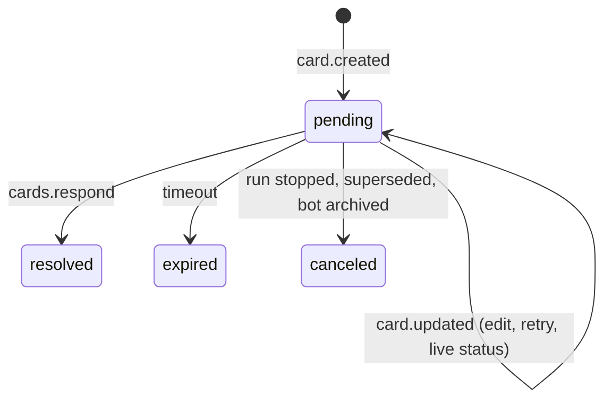
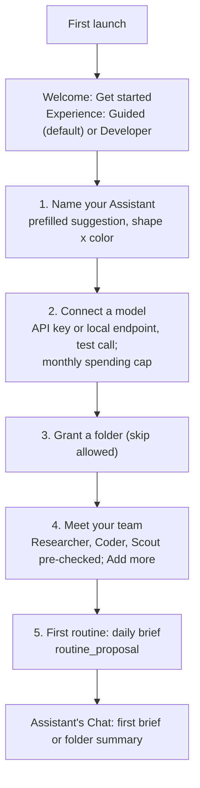
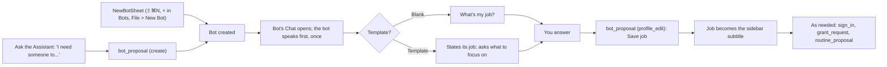
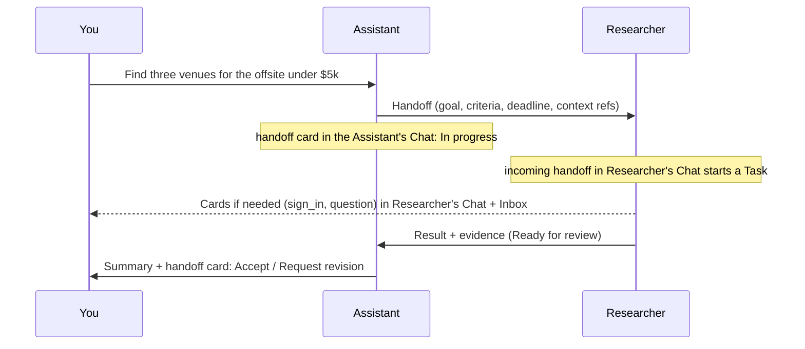
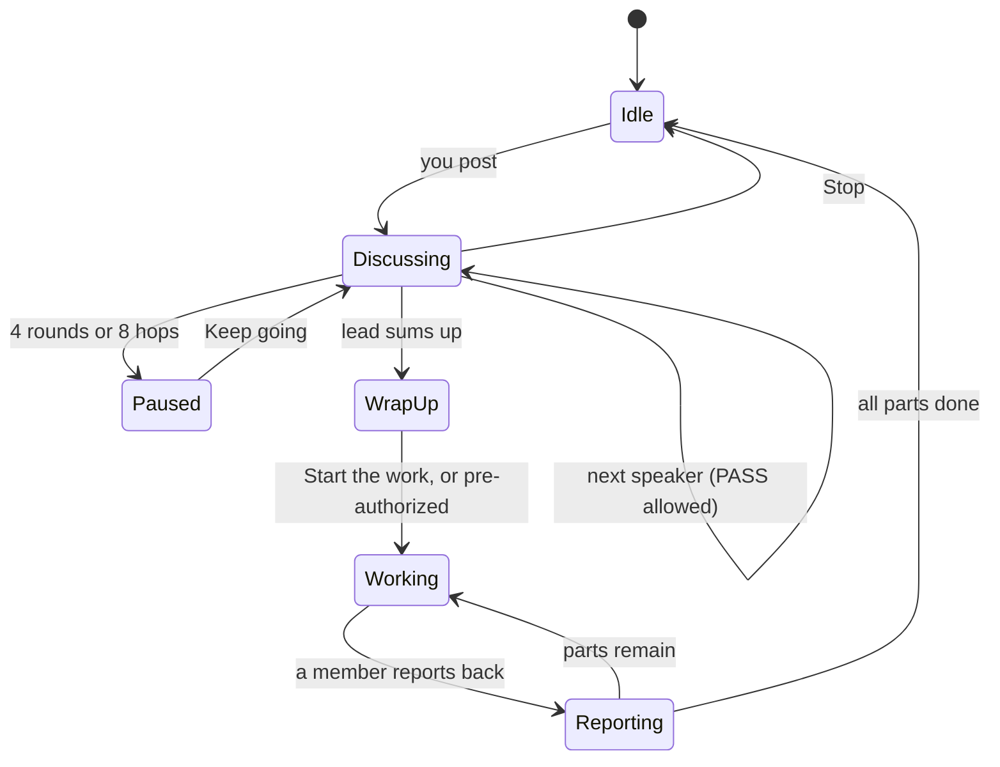
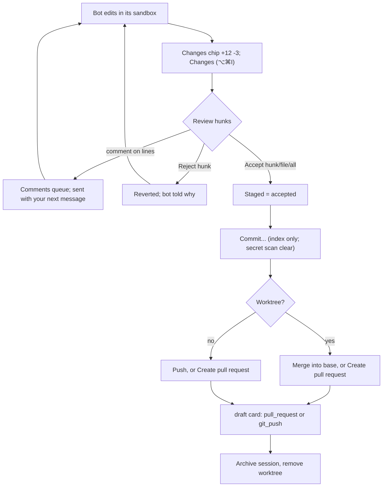
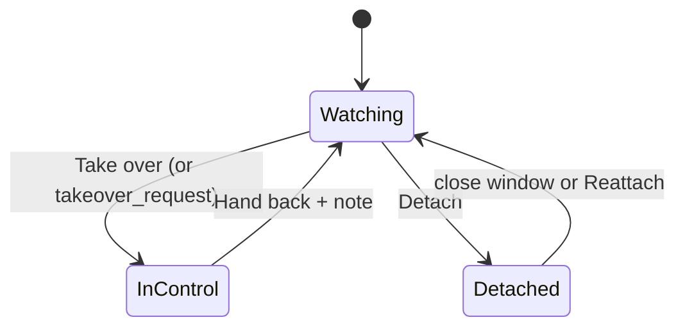
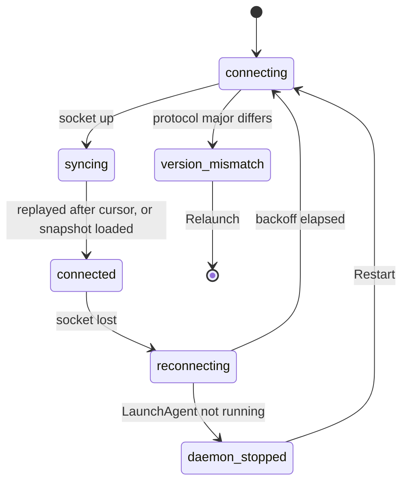

# Experience: Information Architecture and Flows

**Status:** Draft 4 · 2026-10-20; updated 2026-10-23 for [D44](decisions.md#d44)–[D93](decisions.md#d93); updated 2026-11-13 for [D106](decisions.md#d106)–[D122](decisions.md#d122): Cognitio's shell as the design lead, the tabbed side panel with App panes and the built-in panes, conversation tabs and split view, the steps line and reasoning caption, recommended picks, the Tasks view, bot-to-bot messages in Phase 1, Groups and Goals in Phase 2, voice, search and connect cards, a computer chosen per bot, team mode, plugin developer mode, the Mail pane's rules, and the stages of [D117](decisions.md#d117) and [D122](decisions.md#d122)
**Owns:** Information architecture, surfaces and flows: the window, the iPhone and iPad app, sidebar, conversation, composer, the Card catalog, the side panel with its inspector tabs, App panes and built-in panes, the Inbox and the Tasks view, voice surfaces, onboarding, global surfaces, the keyboard map, UI states and accessible paths. Visuals and motion live in [03-design-system.md](03-design-system.md).
**Depends on:** [MASTER_PLAN.md](MASTER_PLAN.md), [decisions.md](decisions.md), [AMENDMENT_2026-11-13.md](AMENDMENT_2026-11-13.md), [03-design-system.md](03-design-system.md), [05-bots-and-assistant.md](05-bots-and-assistant.md), [06-computers-and-browsers.md](06-computers-and-browsers.md), [07-coding.md](07-coding.md), [08-security-and-privacy.md](08-security-and-privacy.md), [09-platform-macos.md](09-platform-macos.md), [../specs/object-model.md](../specs/object-model.md), [../specs/events.md](../specs/events.md), [../specs/protocol.md](../specs/protocol.md), [../specs/policy.md](../specs/policy.md)

---

## 1. Scope and principles

This doc covers what is where, how it behaves, and how a user gets from intent to outcome, on the Mac and in the iPhone and iPad app (§3.6; [D47](decisions.md#d47)). Colors, type, motion and control sizes are in [03](03-design-system.md), policy decisions in [policy](../specs/policy.md), and wire formats in [protocol](../specs/protocol.md).

**Design lead ([D106](decisions.md#d106), superseding [D92](decisions.md#d92)'s hierarchy and [D94](decisions.md#d94)'s preview as the lead).** Cognitio, the user's Mac app, is the reference for the shell on Mac, iPad and iPhone: the card window (§3), sidebar (§4), transcript (§5), composer (§6), bot identity and editor (§10.2, §10.3), side panel (§9), workbench (§9.4, §10.6) and settings (§11.7). Viticci's observed interaction grammar stays the lead for native Apple-data cards (§7.20), Apps (§10.11) and phone navigation (§3.6). The shell is written new in Memoshi's own code, as one SwiftUI codebase shared by the three devices, with AppKit or UIKit only where a surface needs it. No Kuvo- or Cognitio-derived source file, asset or string enters the repository. Policy, privacy and accessibility remain binding ([D27](decisions.md#d27), [D28](decisions.md#d28), [D30](decisions.md#d30)).

**Reference, not reuse ([D106](decisions.md#d106), [D107](decisions.md#d107), amending [D91](decisions.md#d91)).** Cognitio's running app and source are read as a behaviour reference; code is not translated file by file, and the Kuvo code reuse that D91 permits is not taken for the interface. Each surface needs a written behaviour description before it is built; who writes each one, and when, is open ([AMENDMENT §8](AMENDMENT_2026-11-13.md#8-open-items), item 11). [`../specs/design-reference.md`](../specs/design-reference.md) is the reference record ([P0-19](phase-0.md#tickets); [03 §1](03-design-system.md#1-decisions-in-this-doc)). The Viticci-style Mac and iPhone preview that D94 led is frozen at git tag `design-preview-2026-11-13`; the new shell starts from Cognitio's layout and reuses Memoshi's own tokens and avatar set where they fit.

**Implementation and review ([D93](decisions.md#d93)).** The builder and coding agents implement against user-approved references; the user reviews design, and [design QA](03-design-system.md#design-qa) remains required. No designer hire, fixed contractor days or payment is a prerequisite. Targeted outside artwork, accessibility or polish help is optional for a concrete identified gap and separately chosen scope/cost; its removal establishes no saved builder days or earlier delivery.

**Current layouts and sequencing.** This doc states behaviour: what is where, and what each control does. Where a layout detail has not been decided against Cognitio's shell, the passage says what happens and is marked `[INFERENCE: set in the design review]`; pane widths, row metrics and the sketches below are working values until that review ([03](03-design-system.md)). The phone tabs (§3.6) follow Viticci's grammar and remain the working design, as do the sidebar order (§4.1) and Memoshi's own avatar geometry. The [Viticci-guided design review](../research/2026-10-23-design-direction-review.md) still supplies the observed grammar for Apple-data cards, Apps and phone navigation, not approval to adopt every screenshot feature. Grok- and Aiden-inspired presentation, such as the pinned avatar grid and sections (§4.2), stays in the existing [design-pass backlog](03-design-system.md#design-pass-backlog). Stages follow [D117](decisions.md#d117) and [D122](decisions.md#d122): Phase 1 ends at gate M1, Phase 2 at M2 and Phase 4 at M3, which is v1.0 (§14).

**Two ways of working ([D109](decisions.md#d109)).** Talking to the Assistant, which coordinates the team, and driving bots and sessions directly, as in a workbench, are both first-class. The app opens to the Assistant, and every bot, session, pane and computer can be reached and steered without going through it.

1. **Home is the Assistant.** The app opens to the Assistant's Chat, and the Inbox is ⌘1 away ([D2](decisions.md#d2)).
2. **One spine.** Chats, Sessions and Groups share one transcript, one composer and one Card system. A conversation has exactly one composer; split view (§3.2) shows two conversations, each with its own. There is no second sidebar.
3. **Decisions are Cards.** A Card appears in the conversation where it arose and in the Inbox, on every paired device ([D49](decisions.md#d49)). Notifications, the menu bar extra and widgets are shortcuts to the same Card, never its only record ([MASTER_PLAN §5, rule 5](MASTER_PLAN.md#rules)).
4. **Context beside, not instead.** The side panel shows the object behind the conversation and the panes opened beside it (§9). Tools never resize or reflow the transcript. Aiden's audit puts it as "keep the conversation stable while tools and context appear around it" ([Aiden UI audit](https://github.com/sambitcreate/aiden-agent/blob/main/docs/chatgpt-desktop-ui-inspiration.md)).
5. **Show the work, quietly.** Tool calls fold into one steps line per turn of work (§5.3). Quiet runs never notify ([D8](decisions.md#d8), [D23](decisions.md#d23)).
6. **Same surfaces, two depths.** Guided and Developer differ only in their defaults ([D3](decisions.md#d3)). Developer is an interface level. **Plugin developer mode** ([D114](decisions.md#d114), §10.16) is a separate, Mac-only setting for compiled plugins, off in both.
7. **Keyboard-complete, and never color- or motion-only** ([D30](decisions.md#d30)).
8. **No dead controls.** A control that cannot work says why and how to fix it. The [measured Grok Bot contract](../research/prior/grok-bot-measured/behavior.md) (secondary) has the same rule: "All visible actions must work or show a precise missing-credential/OS-capability error".

### 1.1 Shared names (agreed with their owners)

| Kind | Names | Owner |
|---|---|---|
| Card kinds | `approval`, `draft`, `question`, `form`, `secure_form`, `sign_in`, `purchase`, `handoff`, `routine_proposal`, `memory_proposal`, `bot_proposal`, `grant_request`, `budget_warning`, `budget_stop`, `run_summary`, `error`, `takeover_request`, `resume`, `setup_checklist` ([D82](decisions.md#d82)), `apple_data`, `generated`: 21 kinds today. Every kind except `generated` is a native card ([D53](decisions.md#d53)). From Phase 2 a 22nd, `voice_call` [INFERENCE: set in Phase 2], is the call card a finished voice call leaves ([D111](decisions.md#d111); [cards.md §8.3](../specs/cards.md#83-the-call-card), §10.13). A connect card ([D112](decisions.md#d112)) is the `sign_in` card's connector variant (§7.8), not a kind of its own ([cards.md §8.1](../specs/cards.md#81-connect-cards)). | [object-model](../specs/object-model.md) |
| Card status | `pending` → `resolved` (with an outcome) \| `expired` \| `canceled` | [object-model](../specs/object-model.md) |
| Bot fields | `status`: `idle`, `working`, `needs_you`, `has_news`, `asleep`, `watching`, `paused`, `error`. Overlays: `takenOver`, `computerState`, `unreadCount`, `nextWakeAt`, `pauseReason` (`user`, `away`, `budget`). `permissionMode`: `ask_first` (the default), `auto`, `bypass` ([D52](decisions.md#d52)). `lifecycle`: `active`, `archived`, `deleted`. | [object-model](../specs/object-model.md) |
| Session and task fields | Session `plan` (on with `/plan`, [D52](decisions.md#d52)). Task `waitingOn` adds `outcome_check` and `device` ([D49](decisions.md#d49), [D51](decisions.md#d51)). | [object-model](../specs/object-model.md) |
| Devices | Platforms `mac`, `iphone`, `ipad`; links `direct`, `relay`, `icloud` ([D48](decisions.md#d48)); each conversation's **runner** and its **lease** with a fencing epoch ([D74](decisions.md#d74)), **replicas**, and **side threads** (`SideThread`: `open`, `joining`, `joined`) ([D49](decisions.md#d49)) | [object-model](../specs/object-model.md), [protocol](../specs/protocol.md) |
| Events the UI consumes | `card.created`, `card.updated`, `card.resolved`, `card.expired`, `card.canceled`, `card.seen`; `inbox.changed` (badge counts only); `system.resync_required` (UI-only; triggers an `inbox.list` pull); `bot.status_changed`; `task.created`, `task.started`, `task.status_changed`, `task.progress`, `task.finished`; `routine.fired`, `routine.skipped`; `handoff.created`, `handoff.status_changed`; `takeover.started`, `takeover.ended`; `draft.*`; `approval.*` | [events](../specs/events.md) |
| Tools named in this doc | `web_search`, `x_search` ([D112](decisions.md#d112)); `mail.list`, `mail.thread`, `mail.search`, `mail.draft`, `mail.send`, `mail.archive`, `mail.label` ([D116](decisions.md#d116)); `view.open`, `view.close`, `view.arrange`, `view.list` and the existing `mini_app` tool ([D114](decisions.md#d114)). Their classes and tiers are [D118](decisions.md#d118)'s and [D121](decisions.md#d121)'s. | [policy](../specs/policy.md) |
| Decision call | `cards.respond {cardId, action, payload?, requestId}`. It is the only call for every card, from every surface. Errors: `card_resolved`, `card_expired`. | [protocol](../specs/protocol.md) |
| Connection states (the Mac app and memoshid, §12.4) | `connecting`, `syncing`, `connected`, `reconnecting`, `daemon_stopped`, `version_mismatch` | [protocol](../specs/protocol.md) |
| Components | `SidebarRow`, `BotAvatar`, `AvatarGrid`, `StatusGlyph`, `BypassBadge`, `InboxRow`, `MessageBubble`, `StreamingText`, `ThinkingShimmer`, `ActivityTicker`, `ToolChip`, `ToolGroup`, `TaskChip`, `SubagentChip`, `CodeModeCard`, `RunSummaryLine`, `Card` and per-kind native cards (`ApprovalCard` … `TakeoverCard`, `ResumeCard`, `AppleDataCard`), generated cards (block catalog in [03](03-design-system.md)), `CardReceipt`, `Composer`, `ModelPicker`, `ModePicker`, `DictationPill`, `QueueTray`, `InspectorTabBar`, `LiveView`, `CommandPalette`, `NewBotSheet`, `QuickAsk`, `Toast`, `Banner`, `ScrollToLatest`, `StartFreshChip`, `ModeChangePrompt`, `FromMemoryNote`, `ItemConflictBanner`, `RecoveryKeySheet`; the notebook view: `NotebookView`, `NotebookCell`, `CellOutput`, `CellRunState`, `KernelPicker`; Apps: `MiniAppChip`, `MiniAppChrome`, `VersionSwitcher`, `ChangeBox`, `ProgramStatusStrip`, `MiniAppInfoSheet`, `PermissionListSheet`, `AskBotSheet`, `MiniAppWidget`; added for [D106](decisions.md#d106)–[D116](decisions.md#d116): `StepsLine`, `ReasoningCaption`, `SelectionChip`, `SourceChip`, `ConnectCard`, `AppPaneChrome`, `FullAccessBadge`, `ComputerChooser`, `CallBar`, `CallCard` | [03](03-design-system.md) |

## 2. Where every object lives

Every first-class object ([MASTER_PLAN §5](MASTER_PLAN.md#5-vocabulary-and-object-model)) has a primary surface plus a keyboard or palette path. The keys and panes below are the Mac's; the iPhone and iPad app reaches the same objects through the navigation in §3.6.

| Object | Primary surface | Also from | Keys |
|---|---|---|---|
| **Assistant** | Sidebar, pinned under the Inbox. The app opens to its Chat. | QuickAsk in the menu bar extra; App Intent `AskAssistantIntent`; notifications | ⌘2 |
| **Bot** | Sidebar › Bots → its Chat; inspector › Profile | Assistant › Team; Group › Members | ⌘3–⌘9 (pinned); ⇧⌘N to create; palette `@` |
| **Chat** | Click a bot (its home thread) | Inbox "Open in conversation"; notifications | palette `@` |
| **Project** | Sidebar › Projects → Project home | ⌘O; drop a folder on the window or Dock icon | palette `#` |
| **Session** | Sidebar › project › sessions; the **Sessions** section for sessions without a project | Inbox; Tasks; menu bar "Working now" | ⌘N, ⌥⌘N |
| **Group** (Phase 2, [D109](decisions.md#d109)) | Sidebar › Groups | Bot context menu "New Group with…" | palette |
| **Task** | Task chips; the Tasks view, across every bot (§8.5, IN-08); inspector › Tasks (session) or Team (Assistant) | Routine run history; menu bar "Working now" | palette |
| **Goal** (Phase 2, GR-13, [D109](decisions.md#d109)) | With the bot that works toward it: its criteria and decision log (§10.15) [INFERENCE: its surface is set in the design review] | The Tasks view; Assistant › Team | palette |
| **Handoff** | Handoff cards; Group › Plan & handoffs | Assistant › Team › Delegations; Inbox (ready for your review) | ⌘J |
| **Routine** | Bot › Routines | `routine_proposal`; run summary lines; App Intent `RunRoutineIntent` | palette "Run routine…" |
| **Watch** | Bot › Routines › Watches | Subtitle "Watching 2"; "Watch fired" lines | palette |
| **Wake** | Bot › Routines › Wakes | Subtitle "Asleep until 9:00"; "Woke up" lines | palette |
| **Computer** | Bot › Computer, where you choose the bot's computer (§10.2, [D113](decisions.md#d113)) | Sidebar footer › Computers; session computer chip; Settings › Computers | palette |
| **Browser** | Bot › Browser; Session › Browser/Preview | Detached window; `sign_in` "Show page"; `takeover_request` | ⌥⌘B |
| **Memory** | Bot › Memory; Assistant › Memory (user scope); Project home (project scope); Group › Files (team notes) | `memory_proposal`; Settings › Memory | palette `?` |
| **Connector** | Settings › Connectors, with the connector catalog (§10.14, CON-14); Bot › Library | Connect cards (`sign_in`), `grant_request`; `@` in the composer | palette |
| **Skill** | Settings › Skills; Bot › Library; Project home | `/` in the composer | `/` |
| **Card** | Conversation (inline, plus the needs-you dock) | Inbox; notifications; menu bar extra | ⌘J |
| **Approval** | `approval` card | Inbox › Approvals; notifications; standing rules in Profile › Access | ⌘J |
| **Draft** | `draft` card | Inbox › Drafts; notification "Review" | ⌘J |
| **Artifact** | Transcript chips; Session › Artifacts; Bot › Library | Artifact window | palette |
| **App** (built in, or made by a bot; [D119](decisions.md#d119)) | Sidebar › Apps; a side-panel tab beside the conversation (§9.1, CH-33, [D114](decisions.md#d114)); Bot › Library › Apps | Its chip in the conversation; a sheet, a window or full screen; Spotlight; Siri and Shortcuts (`OpenMiniAppIntent`); from Drop 1, its widgets | palette "Open App…", and the commands the App adds |
| **Inbox** | Sidebar top | Menu bar extra; Dock badge; widget; App Intent `ShowInboxIntent` | ⌘1 |
| **Budget** | Profile › Budget; routine and group editors | Budget cards; footer › Usage; menu bar extra; Settings › Budgets & Usage | palette |
| **Grant** | Profile › Access | `grant_request`, `bot_proposal` (`grant_change`); Settings › Policy | palette |

## 3. Window

### 3.1 Anatomy

```
+---------------------------------------------------------------------------------------------+
| (o)(o)(o) [sidebar] < >  [avatar] Scout - watches competitor pricing     [⌘K]  [side panel] |  toolbar
+-------------------+--------------------------------------------------+----------------------+
| [Search]      [+] |  transcript                                      | Profile .. Mail Notes|
| Inbox           3 |    bot message .................................  |                      |
| (A) Assistant     |    [Worked for 2m · 7 steps       >]              |   tab content        |
| BOTS              |    +------------------------------------------+  |                      |
|  (S) (R) (C)      |    | Approval  T2  Run `npm test` in acme-web |  |                      |
|  (L)              |    +------------------------------------------+  |                      |
|  Research         |                                                  |                      |
|   (B) Bree        |    [needs-you dock / QueueTray]                  |                      |
| GROUPS (Phase 2)  |    +------------------------------------------+  |                      |
|  Launch crew      |    | Message Scout...                         |  |                      |
| PROJECTS          |    | [Sonnet v] [Ask first v] [+] [mic] [^]   |  |                      |
|  v acme-web       |    +------------------------------------------+  |                      |
|     fix login *   |                                                  |                      |
| SESSIONS          |                                                  |                      |
|  Tax questions    |                                                  |                      |
| APPS              |                                                  |                      |
|  Chores           |                                                  |                      |
|-------------------|                                                  |                      |
| This Mac $1.24  * |                                                  |                      |
+-------------------+--------------------------------------------------+----------------------+
```

The window is Cognitio's card window, rebuilt (SH-06, [D106](decisions.md#d106)): a sidebar, the conversation with conversation tabs, and a tabbed side panel, with split view for a second conversation (§3.2). "Card window" names the window's look, which [03](03-design-system.md) owns; it has nothing to do with Cards (§7). The sketch shows the arrangement only [INFERENCE: metrics and the tab strip's layout are set in the design review].

### 3.2 Panes

Values come from the layout tokens in [03](03-design-system.md).

| Pane | Default | Range | Collapse |
|---|---|---|---|
| Sidebar | 280 pt | 240–360 pt. Dragging below 200 pt snaps to a 64 pt rail (Inbox, Assistant, pinned bots, footer icons). | ⌃⌘S |
| Conversation | Flexible | At least 480 pt. Content column up to 760 pt; prose capped at 72 ch. | Never |
| Side panel | 380 pt | 320–560 pt | ⌥⌘0. Becomes an overlay in narrow windows. It holds tabs: the inspector tabs, App panes and the built-in panes (§9.1). |
| Conversation tabs (SH-06) | One tab | Open conversations as tabs in the window. Open tabs restore with the window [INFERENCE: the tab bar's layout and keys are set in the design review]. | n/a |
| Split view (SH-06) | Off | A second conversation beside the first, each with its own transcript, dock and composer. The half you last worked in has the focus and takes the conversation keys. **Swap** exchanges the halves [INFERENCE: widths and controls are set in the design review]. | **Close Split View** returns to one conversation. In a narrow window the second conversation gives way first (§3.4). A split view restores with the window, as tabs do. |
| Window | n/a | At least 1040 × 700 pt | n/a |
| Composer | One line | Grows to 40% of the conversation height, then scrolls | n/a |

### 3.3 Toolbar (unified title bar, glass chrome)

The toolbar is also the conversation header. It always starts with the sidebar toggle and Back/Forward (⌘[ / ⌘]).

| Context | Title area | Trailing |
|---|---|---|
| Bot's or Assistant's Chat | Avatar, name, job line (Assistant: "Today" line), status; the `BypassBadge` when the bot is in Bypass (§6.3) | Mode chip (Ask first, Auto or Bypass; opens the `ModePicker`); computer chip (level and state); browser chip while a page is open; side panel toggle |
| Session | Title (rename inline); `project › branch` (branch menu); worktree badge; lead avatar, with the `BypassBadge` when the lead is in Bypass; a Plan chip while Plan is on (§6.3) | Run (⌘R); Changes chip `+12 −3`; computer chip; side panel toggle |
| Session without a project | Title, lead avatar | Computer chip, side panel toggle |
| Group (Phase 2, [D109](decisions.md#d109)) | Name; member avatars, lead first with a Lead badge; "Round 2 of 4" while talking | Side panel toggle |
| Inbox | "Inbox" and the active filter | Triage with Assistant; side panel toggle |
| Project home | Name, location (This Mac; a Remote machine from Phase 3, [D113](decisions.md#d113)), branch | New Session; side panel toggle |

An App never adds to the title bar ([D114](decisions.md#d114), §10.11). From Phase 2, a voice call shows its call bar while it is live (§10.13) [INFERENCE: whether the bar sits in the toolbar is set in the design review].

### 3.4 Narrow windows

1. The conversation never collapses.
2. When the window is narrower than sidebar + 480 pt + side panel, the side panel overlays the trailing edge. A split view gives way before that: its second conversation hides until there is room again [INFERENCE: the order is set in the design review]. The conversation behind it stays interactive, because users watch live views while typing. Esc (with focus in the overlay) or ⌥⌘0 closes the overlay.
3. If space is still short, the sidebar drops to the rail.
4. Each conversation remembers whether its side panel is open and which tab is showing, as Kuvo does per session ([panel docs](https://www.kuvo.run/code/docs/panel/)). Widths are remembered per context kind. Layout is kept per device, including what a bot arranged with the view tools (§9.1, [D114](decisions.md#d114)).
5. Full screen, Split View and Stage Manager follow the same rules.

### 3.5 Other windows and sheets

- **Main window.** One by default. **Open in New Window** works on any conversation. With every window closed, the app keeps running in the menu bar ([D12](decisions.md#d12)). The card window has conversation tabs (SH-06, [D106](decisions.md#d106)); macOS window tabs keep working beside them [INFERENCE: the tab bar's layout and keys are set in the design review].
- **Detached live view** (§10.8), **artifact window** (sandboxed web view, JavaScript off by default, CSP; adapted from Draft 3 ArtifactPreview), **App windows** (an App opened in its own window, §10.11), **Settings window** (⌘,; §11.7).
- **Sheets:** New Bot, New Group (Phase 2), Add/Edit Project, the routine editor, the rule-scope sheet, the raise-budget sheet, the Bypass confirmation (§6.3), the computer chooser (§10.2), an App opened as a sheet and its permission list (§10.11), the **Full access on this Mac** confirmation (Phase 2, Mac only, §10.16), and delete confirmations.
- **Onboarding** runs full-window on first launch (§10.1).

### 3.6 iPhone and iPad

One universal iPhone and iPad app ships in v1, with the same bots, Chats, Cards and Inbox as the Mac ([D47](decisions.md#d47), [D49](decisions.md#d49)). It arrives in Phase 3 (iPhone, iPad and devices). Cognitio's shell leads here too, from the same SwiftUI codebase as the Mac, and Viticci's grammar leads phone navigation: platform-native adaptive navigation rather than a desktop layout shrunk to a phone ([D106](decisions.md#d106), [03](03-design-system.md)). The four phone tabs and iPad split-view rules below remain the working layouts. Where Groups, the Tasks view, Apps and the built-in panes sit among the phone's tabs is [INFERENCE: set in the design review]. §5–§8 apply unless this section says otherwise.

- **iPhone: four tabs.**
  - **Assistant** (the default tab): the Assistant's Chat, so the app opens on it, as on the Mac ([D2](decisions.md#d2)).
  - **Bots:** the roster in the sidebar's order (§4.1, §4.2). A tap opens the bot's Chat. The toolbar holds New Bot (+) and Settings.
  - **Inbox:** the badge counts decisions waiting; filters and groups as in §8.1. Swipe actions cover Done, Later and Mark unread. Deciding a card always opens it, and approvals and drafts are decided one at a time (§8.3).
  - **Projects:** projects with their sessions, plus sessions without a project, to follow and steer work that runs on the Mac.
- **Conversation.** The navigation bar shows the bot's avatar, name, status and mode chip (§3.3). Tapping it opens the bot's inspector tabs (§9.2, §9.3) as a sheet. The composer keeps the model and mode pickers, attach and dictation. While the bot works, Send steers; holding Send offers Queue and Send now (§6.6).
- **Approvals.** Cards render inline, dock above the composer and appear in the Inbox, as on the Mac (§7.1). A notification opens the exact card. Approving from a notification needs the device unlocked; on every device, T4 and T5 approvals ask for Face ID, Touch ID or the passcode, and T5 cards also ask for the typed token (§7.2, §7.3).
- **iPad: sidebar and split view.** The sidebar keeps the Mac's order (§4.1). A wide window shows three columns, sidebar, conversation and side panel, as on the Mac (§3.2), and App panes and the built-in panes open as side-panel tabs ([D114](decisions.md#d114)). As the window narrows (portrait, Split View, Stage Manager), the side panel becomes a sheet, then the sidebar collapses; the conversation never does (§3.4). With a hardware keyboard, the iPad takes the §11.2 shortcuts that iPadOS does not reserve, checked in Phase 3.
- **State from other devices.** Each bot's live state shows on every device. A message you type here goes to that conversation's runner, and its answer streams back; one bot can be active here and on your Mac at once. Forwarding, "Waiting for your Mac", hand-overs, persistent **Waiting for connection** messages and real side threads when an allowed model is available are in §12.6 ([D88](decisions.md#d88)).
- **Background.** If you leave the app during a turn, the turn keeps running in a system task that shows its progress (`BGContinuedProcessingTask`), and committed turns resume at the next launch ([D46](decisions.md#d46)).
- **Computer.** On iPhone and iPad a bot works in the in-app environment: its folder, folders you link, and a shell front end generated from its typed tools ([D50](decisions.md#d50)). From Phase 3 you can also give a bot an **Emulated Linux** computer (iSH): a real Linux shell with packages, Git, SSH and Python, slower and heavier than the in-app environment. It is chosen in Profile › computer level, which asks for a typed grant ([D69](decisions.md#d69), IOS-06). Mac-only tools, such as the real shell, Mac files, Mac-only command-line tools and local models, run on the Mac (§12.6). A bot whose model is Claude through Claude Code has the Mac as its runner: its messages forward to the Mac and wait while the Mac is unreachable ([D108](decisions.md#d108), [D73](decisions.md#d73), [D88](decisions.md#d88)).
- **A bot's other computers.** From Phase 3 you can watch and take over a bot's browser, its Bot computer or its Cloud computer from here, and a bot may work on a Remote machine or be hosted by an always-on Mac (§10.8, [D113](decisions.md#d113); BRW-15, CMP-13, CMP-14, R11-07).
- **Python and notebooks.** A bot's Python on iPhone and iPad is Pyodide, bundled with the app. Long runs, and packages only the Mac can run, go to the Mac. Notebooks open in the same native view as on the Mac and run on the device that holds them, or on your Mac when they import packages only the Mac can run; from Drop 2 their folder syncs to the device that runs them (§10.10, [D60](decisions.md#d60), [D82](decisions.md#d82), [D87](decisions.md#d87)).
- **Apps and live cards.** Apps arrive here in Phase 3: page Apps, and Swift Apps and live cards from the same Swift source as on the Mac ([D114](decisions.md#d114), [D115](decisions.md#d115); CH-20, CH-23). An App's pane opens full screen on iPhone and as a side-panel tab or full screen on iPad; Apps also open from Spotlight, Siri and Shortcuts. From Drop 1 the kit adapts to the device: lighter on iPhone, where a part the program marks Mac-only shows a lighter fallback ([D81](decisions.md#d81), [D87](decisions.md#d87)); from Drop 1 Apps also run their background jobs here when this device runs the App's conversation and iOS grants background time, and offer Home Screen widgets (§10.11, [D68](decisions.md#d68), [D71](decisions.md#d71), [D87](decisions.md#d87)). Plugin developer mode and **Full access on this Mac** do not exist on iPhone or iPad (§10.16).
- **Built-in panes.** Mail, Calendar, Reminders and Tasks, Contacts, Notes, and Files and Library arrive here in Phase 3, with the `mail.*` tools (§10.12, [D116](decisions.md#d116); AP-21, CON-20).
- **Voice.** Voice calls arrive here in Phase 3 with both engines. On an iPhone that has one, the Action Button starts a call; a Live Activity shows the call while it runs, and the Start Voice Chat App Intent starts one from Siri and Shortcuts (§10.13, [D111](decisions.md#d111); VO-05, VO-06).
- **Groups, Goals and team mode.** Their surfaces arrive here in Phase 3, after the Mac's in Phase 2 (§10.5, §10.15; IOS-07; [D109](decisions.md#d109), [D110](decisions.md#d110)).
- **Pairing.** Settings › Devices on a device you already use shows a one-time QR code, which expires after 5 minutes or as soon as you close it. The new device scans it, a handshake keyed by the code adds it to your devices' encrypted group, and every bot appears with its history ([D48](decisions.md#d48), [D82](decisions.md#d82), §11.7). If no old device is left, the new device uses the recovery key from iCloud Keychain instead: it joins your devices' encrypted group and reads the iCloud sync log, so every bot comes back with its history ([D79](decisions.md#d79)).
- **If iOS misses the gate.** If Pi_Swift misses the Phase 0 gate on iOS, this app ships as a remote screen for bots that run on the Mac, with the same navigation and Cards and nothing running on the device ([D46](decisions.md#d46)).
- **First launch and coding** ([D85](decisions.md#d85)). On a first launch, the welcome screen leads with **Pair with your Mac**, with **Set up here** beside it, which runs the onboarding of §10.1 on this device. From Drop 2, a coding session shows Changes and Files, with Accept, review comments and Commit, which run on the Mac through typed calls, and its Terminal mirrored read-only (CODE-17, [D87](decisions.md#d87); [07 §5.2](07-coding.md#52-how-tools-reach-the-bots-computer)).

## 4. Sidebar

### 4.1 Order (binding, [MASTER_PLAN §6](MASTER_PLAN.md#6-experience-at-a-glance))

1. **Top strip.**
   - **Search** filters rows across sections and lists message matches under "In conversations". It is the only place archived items appear.
   - **New (+):** New Session ⌘N, New Session (No Project) ⌥⌘N, New Bot… ⇧⌘N, New Group… (Phase 2), Open Folder as Project… ⌘O, Import Bot… ([D26](decisions.md#d26)).
2. **Inbox.**
3. **Assistant** (pinned).
4. **Bots:** pinned grid → user sections → unsectioned → "Archived (n)".
5. **Groups** (Phase 2, GR-01, [D109](decisions.md#d109)).
6. **Projects** → sessions (Phase 2, with the workbench).
7. **Sessions:** sessions without a project ([D2](decisions.md#d2)). Per [D4](decisions.md#d4), "Chat" always means a bot's home thread, so this section is never labeled "Chats".
8. **Apps** (SH-07): the built-in Apps (Mail, Calendar, Reminders and Tasks, Contacts, Notes, Files and Library; §10.12, [D116](decisions.md#d116)) and your Apps from every bot (§10.11), pinned ones first, then the rest by last use ([D82](decisions.md#d82)) [INFERENCE: placement, and where the built-in Apps sort]. This Memoshi section uses the same tokens and navigation language as the rest of the sidebar ([D81](decisions.md#d81), [D106](decisions.md#d106)).
9. **Footer:** Computers · Devices · Usage · Settings.

The **Tasks view** (§8.5, IN-08) is reached from the sidebar, with a count of tasks waiting on you [INFERENCE: its row's place in this order is set in the design review].

Clicking a section header folds it. Hovering shows **+** and **⋯** (sorting, Show archived, and New Section… for Bots). An empty section shows one line with one action and no decorative suggestions (Aiden's [PRODUCT.md](https://github.com/sambitcreate/aiden-agent/blob/main/PRODUCT.md) anti-references): "Put 2–6 bots in a room · New Group" (Phase 2), or "Open a folder · ⌘O". The Sessions section stays hidden until its first session exists.

### 4.2 Rows

Heights and paddings are in [03](03-design-system.md).

| Row | Content | Behavior |
|---|---|---|
| Inbox | Tray icon, a decision count (`inbox.changed`), a dot for unread news, and a clock when an item expires within 10 min | ⌘1. The number always means "decisions waiting"; news never raises it. |
| Assistant | 28 pt `BotAvatar`, the chosen name, brief status ("Brief ready · 3 bots working") | Always second. It cannot be unpinned, archived or deleted ([D20](decisions.md#d20)). ⌘2. |
| Pinned grid (`AvatarGrid`) | 40 pt avatars in 72 pt tiles, three per row, with the name below and badges on the corner | Drag to reorder; ⌘3–⌘9. The three-column grid comes from the [measured Grok Bot](../research/prior/grok-bot-measured/behavior.md) (280 px sidebar); the art is our own. |
| Section | A user-named, collapsible header | A bot appears in exactly one place: pinned, in one section, or unsectioned (under "Other", shown only once sections exist). Moving a pinned bot into a section unpins it, as Grok Bot does. Deleting a section ungroups its bots. |
| Bot row | 20 pt avatar and name, with the `BypassBadge` after the name when the bot is in Bypass (§6.3). The subtitle shows the unread preview, else the status text, else the job (Kuvo's pattern). | Badges: unread count, time |
| Group row (Phase 2) | Stacked avatars (up to 3), name, protocol status ("Discussing · round 2 of 4", "Working · 2 of 3 parts") or the last message | Badges |
| Project row | Disclosure arrow, folder or host glyph, name, dirty dot, working glyph, aggregated badge | A click opens the Project home (§9.7). The arrow expands: pinned sessions, then the 5 most recent, then "Show all (n)". |
| Session row | `StatusGlyph`, title, the lead avatar when it is not the project default, worktree badge, time | Tooltip: lead and branch |
| Session row (no project) | `StatusGlyph`, title, lead avatar, time | Listed under **Sessions**: the 10 most recent, then "Show all". **Move to Project…** carries the conversation over ([Kuvo sessions](https://www.kuvo.run/code/docs/sessions/)). |
| App row | The App's icon, its symbol on a colored tile ([D82](decisions.md#d82)), and its name; the subtitle names the bot that made it, or says that all your bots may use it (CH-39, [D114](decisions.md#d114)); a built-in App has no bot. An App with **Full access on this Mac** carries the `FullAccessBadge` (§10.16). | A click opens the App as a pane: a side-panel tab beside the conversation in view on the Mac and iPad, full screen on iPhone. Open as Sheet, Open in Window, Full Screen and the per-App **Always open this way** preference stay one click away (§10.11; [D114](decisions.md#d114), [D85](decisions.md#d85), [D68](decisions.md#d68)) [INFERENCE: which place is the default is set in the design review]. Pinning it in Bot › Library keeps it at the top of the section. |

### 4.3 Footer

| Item | Shows | Click |
|---|---|---|
| Computers | In Phase 1, This Mac (sandboxed), with a warning glyph when any bot's sandbox needs attention. From the end of Phase 2, "2 awake" counts awake Bot computers ([D113](decisions.md#d113)). | A popover with each computer's state label from [06](06-computers-and-browsers.md): Setting up, Off, Waking, Awake, Going to sleep, Asleep, Unreachable, Needs attention. With Bot computers (end of Phase 2) it also shows RAM, the awake cap ("2 of 3 awake"), and Wake / Put to Sleep / Open Bot. Cloud computers (Phase 2, after Bot computers) and Remote machines (Phase 3) are listed with the same state labels; a Cloud computer also shows what it has cost [INFERENCE: set in Phase 2]. |
| Devices | Your paired devices [INFERENCE: what the item shows is set in the design review] | Opens Settings › Devices (§11.7) |
| Usage | "$1.24 today" (tokens when prices are unknown) and a ring for the budget closest to its limit. Usage on a subscription, such as Claude through Claude Code, shows as price unknown, never as free ([D108](decisions.md#d108)). | A popover: today and the last 7 days, top spenders, budgets near their limit, subscription plan meters (Phase 1, BU-08; [AMENDMENT §4.2](AMENDMENT_2026-11-13.md#42-assistant-bots-and-teamwork-d109)), Open Usage |
| Settings | Gear | ⌘, |
| Daemon | Shown only when not `connected` | Connection details and Restart (§12.4) |

### 4.4 Bot status, overlays and session glyphs

`Bot.status` is derived. Precedence: `error` > `needs_you` > `working` > `paused` > `has_news` > `watching` > `asleep` > `idle` ([object-model](../specs/object-model.md)). Each status has a glyph and text as well as motion ([03](03-design-system.md)). The motion adapts Kuvo's: the avatar "bounces while it works, hops and glows when it needs you, cheers when it has news… sleeps until its next wake-up… keeps a lookout while it watches" ([Kuvo bots](https://www.kuvo.run/code/docs/bots/)).

| Status | When | Subtitle | VoiceOver |
|---|---|---|---|
| `error` | Something failed and needs attention (an `error` card is pending) | "Needs attention: model key rejected" | "Scout, needs attention: model key rejected" |
| `needs_you` | Any pending Card from this bot's work | "Needs you: approve npm test +2" | "Scout, needs you: approve npm test. 3 items." |
| `working` | A running task, in the foreground or background | "Working: reading pricing page", or "2 tasks" | "Scout, working: reading pricing page" |
| `paused` | `pauseReason` is `user`, `away` (7 days without you) or `budget`; or you are in control of its browser or computer (`takenOver`) | "Paused", "Paused: a week without you", "Paused: budget reached", "Paused while you're in control" | "Scout, paused: budget reached" |
| `has_news` | Unread output (`post_update`, or a run that has news) | First line of the unread message | "Scout, has news: 3 prices changed" |
| `watching` | Active watches, and nothing above applies | "Watching 2 pages" | "Scout, watching 2 pages" |
| `asleep` | `nextWakeAt` is set, and nothing above applies | "Asleep until 9:00" | "Scout, asleep until 9:00 AM" |
| `idle` | None of the above | Job line | "Scout, idle. Watches competitor pricing." |

Overlays, shown on top of the status:

| Overlay | Source | Shown as | VoiceOver suffix |
|---|---|---|---|
| In control | `takenOver` | A hand badge, plus a Banner: "You're in control of Scout's browser" | "you are in control" |
| Offline | `computerState` is `error`, `stopped` or `unreachable` while work waits | An offline badge | "computer offline" |
| Unread | `unreadCount` | A count badge | "4 unread" |
| Bypass | `permissionMode` is `bypass` | The `BypassBadge`, wherever the bot appears ([D52](decisions.md#d52)) | "Bypass" |

Session rows, in a project or under **Sessions**, use the `StatusGlyph`, following Kuvo's ([sessions](https://www.kuvo.run/code/docs/sessions/)):

| Glyph | Meaning |
|---|---|
| Working (animated, static under Reduce Motion) | A task is running |
| Needs you (hand) | A Card is pending |
| Failed (exclamation mark) | The last run failed |
| Unread (dot) | Finished while you were elsewhere |
| Queued | Messages are queued, or the queue is paused after Stop |

Sessions also carry badges: worktree, Remote machine (Phase 3, [D113](decisions.md#d113)), and Routine (for sessions a routine opened).

### 4.5 Context menus

| Row | Items |
|---|---|
| Bot | Open Chat; Open Profile; Pin / Unpin; Move to Section ▸; Mark as Unread; Rename (inline); Mute Notifications; Mode ▸ (Ask first, Auto, Bypass…); Pause ▸ (After Current Task / Now) or Resume; Run Routine ▸; Wake Now; New Group with This Bot… (Phase 2); Duplicate…; Export bot.md…; Archive…; Delete… |
| Group (Phase 2) | Open; Edit Group…; Mark as Unread; Mute; Pause Meetings; Archive…; Delete… |
| Project | Open Project Home; New Session; Edit Project…; Open In ▸ (Finder, Terminal, editor); Remove from Memoshi… (files untouched) |
| Session | Open; Open in New Window; Rename; Pin to Top; Mark as Unread; Move to Project… (sessions without a project); Copy as Markdown; Export… (Phase 3, EXP-03); Archive… (offers worktree removal, [07](07-coding.md)); Delete… |
| App | Open (as a pane, or the way its **Always open this way** preference says); Open as Sheet; Open in Window; Full Screen; Pin / Unpin; Show in Library; Archive…; Delete… [INFERENCE: item names, and which items a built-in App offers, are set in the design review] |

The [measured Grok Bot](../research/prior/grok-bot-measured/behavior.md) bot menu has seven actions: Pin, Move to new section, Mark as Unread, Rename, Copy conversation ID, Hide/Restore, Delete. Ours swaps Hide for Archive and adds Mode, Pause, Duplicate and Export ([D21](decisions.md#d21), [D26](decisions.md#d26), [D52](decisions.md#d52)). Duplicate copies the profile, skills and routines (left disabled), never history or memory, as Grok Bot's does ([Grok bots](https://docs.x.ai/grok-bot/bots)).

## 5. Conversation

### 5.1 Transcript items

| Item | Rendering |
|---|---|
| User message | `MessageBubble` with attachments, quotes and review-comment chips. Long pastes show their first lines and "Show more". |
| Bot message | `StreamingText`: Markdown, tables, math, and code blocks with a language label and Copy. Groups show the speaker on every message; Chats show the avatar once per run. |
| Thinking | Collapsed as "Thought for 12 s", with a per-conversation toggle (CH-16). Developer can expand it; Guided hides it. While the model reasons, the live reasoning caption says what it is thinking about (§5.2). |
| Steps line | `StepsLine`: one line for a turn's work, such as "Worked for 2m · 7 steps", which folds open to the turn's tool chips (§5.3) |
| Tool chips | `ToolChip` and `ToolGroup` (§5.3) |
| Code Mode | `CodeModeCard` (§5.5) |
| Tasks, subagents | `TaskChip`, `SubagentChip` (§5.4) |
| Cards | Native cards from the Card catalog (§7), including Apple data (§7.20), and generated cards: JSON cards, which stream as the model writes them, and live cards (§7.21) ([D53](decisions.md#d53), [D68](decisions.md#d68), [D115](decisions.md#d115)) |
| Artifact or file chip | Opens in inspector › Artifacts, Library or Files, or in a window. Under a reply, "Edited 3 files" lists that turn's changes (Kuvo). |
| Python run | A `ToolChip` ("Ran Python · 8 s") with its printed output, tables and figures folded under it. Figures and files the run saved appear as artifact chips; a notebook run links to its notebook (§10.10) |
| App chip | `MiniAppChip`: the App's icon (its symbol on a colored tile) and name, "Version 6 · Made by Scout" and **Open**, posted when a bot makes or changes an App (§10.11) |
| App function call | A bot's call to a function an App exports. It looks the way that App draws its own calls, from the call's structured details, and otherwise shows as a `ToolChip` (CH-34, CH-40; [D114](decisions.md#d114), §10.11) |
| Source chips | `SourceChip`: the source links of a `web_search` or `x_search` result, under the reply that used them (§10.14; CON-15, CON-16; [D112](decisions.md#d112)) |
| Message from another bot | A Handoff from one bot to another (Phase 1, GR-06): a `handoff` card at both ends, with the sender's avatar and the hop number (§7.10, §10.4; [D109](decisions.md#d109)) |
| Call card, voice memo | From Phase 2: `CallCard`, the `voice_call` card [INFERENCE: set in Phase 2] left by a finished voice call, with its length and transcript; and a voice memo from a bot, played in place (§10.13; V2-09, VO-02; [D111](decisions.md#d111)) |
| System line | Muted one-liners: "Woke up · <note>" and "Watch fired: <name> changed" (only to open a run with news, §5.6), "Mode changed to Auto", "Model changed", "Earlier messages were compacted", "Started fresh with a handoff note", "Interrupted at <step>", "Continuing on your iPhone" (a hand-over after the runner went out of reach, §12.6) |
| Run summary line | `RunSummaryLine` (§5.6) |
| Shell line | A `!command` you ran (Developer, sessions) and its output. The bot sees both with your next message (Kuvo). |
| Review comment | file:line plus the comment, sent from Changes |
| Web content | Previews, artifacts, MCP Apps and page Apps in a sandboxed web view ([D29](decisions.md#d29), [D53](decisions.md#d53)), with Expand (Kuvo). A click may answer the bot but never grants anything. Diagrams, charts, tables and math are drawn natively instead (CH-41, [D115](decisions.md#d115), §7.21), and native Apps are Swift Apps (§10.11). |
| Member report (Groups, Phase 2) | A compact bubble: a summary plus evidence chips (diff, artifact, link, test result). Expanding it opens the member's task transcript ([05](05-bots-and-assistant.md)). |
| Unread divider | Marks where you left off and stays put while you read, even as new messages arrive (the frozen unread boundary from the [measured Grok Bot](../research/prior/grok-bot-measured/behavior.md)) |

### 5.2 Streaming and activity

- **Streaming.** `StreamingText` uses the streaming reveal from [03](03-design-system.md), adapted from Aiden's MIT-licensed `streaming-reveal.ts`. Pi Durable commits partial output at most every 100 ms ([pi-durable README](https://github.com/earendil-works/pi), "Watching a Conversation"); the UI interpolates between commits, and earlier content never shifts.
- **Scrolling.** The view stays pinned to the bottom only while the user is there. Otherwise a `ScrollToLatest` pill appears.
- **`ThinkingShimmer`** shows only while the model is generating and no text is visible yet.
- **Reasoning caption** (`ReasoningCaption`; Phase 1, [D106](decisions.md#d106), [AMENDMENT §4.1](AMENDMENT_2026-11-13.md#41-shell-and-conversation-d106)). While the model reasons, one line says what the bot is thinking about. It is taken from the reasoning stream, its bold title or its first sentence ([merge assessment §5.2](../research/2026-11-12-memoshi-cognitio-bot-hq-merge.md#5-gap-lists)), and changes as the reasoning moves on. It is presentation only: it adds nothing to the conversation, and when the turn moves on it gives way to "Thought for 12 s" (§5.1). A model that returns no reasoning shows no caption. Whether Guided shows it is [INFERENCE: set in the design review].
- **Streamed cards.** A JSON card appears block by block as the model writes it, and the app validates each block as it arrives (§7.21; CH-19, [D115](decisions.md#d115)).
- **`ActivityTicker`** is one line under the latest message during a run: "Running npm test · 12 s", "Waiting for your approval", "Waiting for your Mac" (§12.6), "Answering on your Mac" (§12.6), "Checking whether it happened" (§5.7), "Model busy, retrying in 8 s".
- **Context meter.** Developer always sees it; Guided sees it at 80% and above. It is computed from `pi.usage` and the model's context window; Draft 3's version misled ([audit](../research/agentic-workspace-landscape/landscape/in-house-assets.md#draft-3-build)). A click shows the numbers and cost, plus **Compact now** (Pi `compact`) and **Start fresh with a note…** (Pi `reset(<handoff note>)`).
- **Start fresh?** Memoshi never resets a Chat by itself: compaction and memory keep it going. After a Chat has been idle for at least 6 hours, a **Start fresh?** chip (`StartFreshChip`) above the composer offers the same reset [INFERENCE: placement]; only you reset ([D78](decisions.md#d78)).

### 5.3 Tool chips

- **Steps line** (`StepsLine`; [D106](decisions.md#d106), [AMENDMENT §4.1](AMENDMENT_2026-11-13.md#41-shell-and-conversation-d106)). A turn's work folds into one line: "Worked for 2m · 7 steps". While the turn runs, the line counts time and steps and names the current step. Opening it shows the turn's groups and chips in order. How View › Tool Details' three settings map onto it is [INFERENCE: set in the design review].
- **Grouping.** Inside it, consecutive calls fold into one `ToolGroup` line: "Ran 3 commands, read 5 files, opened 2 pages" (Kuvo). While the group runs, the current step shows below it.
- **A `ToolChip`** shows the verb and object ("Ran npm test · exit 1", "Clicked [3] Sign up"), a computer badge when the call is not on the bot's default computer, a device badge when it ran on another device ("on your Mac", [D49](decisions.md#d49)), the policy outcome (allowed by tier, allowed in Bypass, approved by you, allowed by rule, denied, blocked by Plan), and the duration.
- **Expanding a chip** shows the exact arguments, the output (truncated, with "Open full output"), screenshots, the cost, and **Why was this allowed?**, which links to the rule and the audit entry. A T4 call that ran in Bypass also links its recorded draft ([D52](decisions.md#d52)).
- **Display settings.** View › Tool Details offers *Every step*, *Summary line* (default) or *Count only*. Guided leads with a plain-language label; Developer shows the exact command.
- **Blocked calls.** In a session with Plan on, a call above T0 becomes a chip with the reason and **Build it**, not a card (§6.3, [policy](../specs/policy.md)).

### 5.4 Task and subagent chips

- **`TaskChip`** appears when work outlives the turn or is delegated. It shows the status, title, assignee avatar, elapsed time and cost. It opens inspector › Tasks in sessions, or a task sheet elsewhere. Every task is also listed in the Tasks view (§8.5).
- **`SubagentChip`** gives one row per child conversation: the role ("explore", "reviewer"), the task, the current step, then "14 steps · 41 s · $0.03". A click opens the child transcript read-only (Kuvo's pattern; the child is found through the call's `details`, pi-durable example 22).
- **Subagent Cards** appear in the parent conversation with their path: "From Scout › reviewer".
- **Stop.** Stop ends foreground children. Background children (example 23, persistent subagents) read "continues in background" and have their own Stop.

### 5.5 Code Mode card

`CodeModeCard` shows one `codemode` call: a QuickJS script whose tool calls run as nested calls ([pi-durable README](https://github.com/earendil-works/pi), "Code Mode"). Pi_Swift runs the same pinned upstream `quickjs.wasm` through wasm2c in shipping builds, with WasmKit as reference and compatibility fallback, not JavaScriptCore ([D89](decisions.md#d89)); the card's policy and recovery semantics do not depend on the backend.

- **Header:** "Ran a script · 12 calls · 3 tools · 2.4 s · $0.01". Status: running (live count), done, failed or resumed.
- **Tabs:**
  - **Script:** read-only JavaScript with Copy.
  - **Calls:** each nested `ToolChip` with its own policy outcome. Blocked or pending calls stand out. Their approvals carry `call.parent` ("inside a script by Scout", [D9](decisions.md#d9)).
  - **Output:** what reached the model.
- **App functions.** The runtime installs the functions an App exports as a Code Mode namespace, and their code runs in the App's sandbox (CH-34, [D114](decisions.md#d114); §10.11). A script's calls to them list under Calls like any nested call (`app.call`, T0), and each tool call a function makes is decided on its own, inside the App's approved permission list ([D121](decisions.md#d121)).
- **Resume marker:** "Resumed after restart · 7 earlier calls reused", from the code-mode journal.
- **Actions:** Copy script, Stop, Open in Tasks.
- **Guided vs Developer.** Guided shows a collapsed plain-language summary ("Checked 12 issues using GitHub"). Developer opens on Script.

### 5.6 Run summary lines

Only a run with news posts a line in its bot's Chat ([MASTER_PLAN rule 2](MASTER_PLAN.md#rules); RT-06). Background runs speak only through `post_update`. A quiet run ends with `no_update` and leaves no Chat line, notification or Inbox item ([D8](decisions.md#d8), [D23](decisions.md#d23); RT-05). Every run, quiet or not, is listed in Bot › Routines › history.

| Outcome | In the Chat | Inbox and notification |
|---|---|---|
| News | `RunSummaryLine` ("Morning brief · 7:00 · 3 items · 41 s · $0.04"), then the update and the expanded `run_summary` card | Inbox › News; notifies per the routine's setting |
| Quiet (`no_update`) | Nothing. History shows "7:00 · nothing new". | Never |
| Failed, and you must act | The `error` card | Inbox › Failures |
| Failed and retrying, or skipped (`routine.skipped`) | Nothing. History shows the reason ("Skipped 7:00 · previous run still going"). | Never |
| Project work | The line links the session it opened or reused | As for News |

A woken or watch-triggered run with news opens its line with "Woke up · <note>" or "Watch fired: <name> changed" (Kuvo's wake marker).

### 5.7 Interruption and recovery

After a crash or restart, or when a conversation's runner stops mid-step (a Mac that sleeps, a phone app that was killed; §12.6), the engine resumes pending tasks ([D42](decisions.md#d42), [D49](decisions.md#d49), [D51](decisions.md#d51)). `replay: "safe"` tools rerun; other interrupted calls return "interrupted" ([pi-durable README](https://github.com/earendil-works/pi), "Tools").

- **Resumed by itself:** a replay-safe step (idempotent or keyed) reruns, and a system line reads "Interrupted at <step> · resumed".
- **May have happened:** a step with side effects, cut off before its outcome was recorded, shows in place as **"Interrupted: may have happened"**.
  1. **Outcome check.** If its tool declares one ([D50](decisions.md#d50)), such as "does the reminder exist?" or "is the message in Sent?", that read-only check runs at once. The ticker reads "Checking whether it happened" (`waitingOn = outcome_check`).
  2. **A definite answer** settles it with no card. If the step happened, the bot records it and continues ("Checked: it happened · continued"). If not, the step runs again under normal policy, so it may still ask ("Checked: it didn't happen · running again").
  3. **Otherwise,** a Resume card (`resume`, §7.19) shows what may have happened and what will run next, with **Run again**, **Skip** and **Mark as done**.
- **What the bot is told.** However an interrupted step settles, its tool result tells the bot that it was interrupted, when, and how it settled: rerun, checked, run again, skipped or marked done. The bot then re-checks the state before relying on it ([D82](decisions.md#d82)).
- **On every device.** The card appears in the bot's Chat, in the Inbox and as a notification, on every device, and it resolves once ([D49](decisions.md#d49)).
- **After a failover.** Before any external effect runs, the runner copies its intent to another device or the relay. A device that takes over after a failure therefore treats that step as "may have happened" and runs its outcome check instead of the effect ([D73](decisions.md#d73)).
- **In every mode.** Bypass never skips it: it guards against doing something twice, not against a permission ([D52](decisions.md#d52)).
- **The thread waits.** While a step is being recovered, its whole thread holds: the conversation and the tasks it started wait until the step is settled. After the link to a bot's computer is lost, nothing retries on its own; an interrupted call follows the steps above instead ([D79](decisions.md#d79)).

The explicit Resume follows Aiden's pattern ([bots rework §6.4](https://github.com/sambitcreate/aiden-agent/blob/main/docs/superpowers/specs/2026-10-07-bots-rework-design.md)), adopted as [D42](decisions.md#d42) and narrowed by D51's outcome check. No side effect silently runs twice ([MASTER_PLAN principle 6](MASTER_PLAN.md#3-principles)).

### 5.8 Message actions

- **Your messages:** Copy; Edit and resend (the last message, before any reply); from Phase 2, New Session From Here (a new conversation that starts from this point, with its own store and lease, [D80](decisions.md#d80); CODE-05; in a session, **Fork from here**, below); **Hand off to…** (GR-08), which starts a Handoff from you to a bot with the message as context.
- **Bot messages:** Copy; Reply (quotes it into the composer); Remember… (you pick the scope; your own writes need no proposal); Retry (failed replies, optionally with another model); from Phase 2 on the Mac and Phase 3 on iPhone and iPad, **Read Aloud**, which speaks the reply (§10.13; VO-01, [D111](decisions.md#d111)).
- **In sessions:** each turn is a checkpoint ([D77](decisions.md#d77); CODE-05, Phase 2). A turn offers **Restore files**, **Restore conversation** and **Restore both**, which return the files, the conversation or both to just before that turn, and **Fork from here**, which starts a new session, with its own store and lease, from that point and leaves this one as it is ([D80](decisions.md#d80)). Restoring files first saves the current files as a checkpoint, so the restore can be undone ([07 §6.2](07-coding.md#62-diff-pipeline)).

## 6. Composer

### 6.1 Anatomy

```
[QueueTray: 2 waiting   Steer | Send now | Edit | Delete]
[needs-you dock: Approval T2 - Run `npm test`    1 of 2  < >]
+--------------------------------------------------------------+
| Reply to Scout: "the price on page 3..."                 [x] |  quote chips
| [Mail: 2 messages selected]                              [x] |  selection chip (§6.4)
| [report.pdf] [page.png] [3 review comments]                  |  attachments
| Message Scout...                                             |  text (Markdown)
| [Scout - Sonnet v] [Ask first v] [+] [mic] (ctx)  [send/stop]|  control row
+--------------------------------------------------------------+
```

### 6.2 Bot and model picker

| Context | Picker | A change applies to |
|---|---|---|
| Bot's or Assistant's Chat | The bot (fixed), its model and effort | This conversation until reset. **Make default for Scout** edits the record, which is rendered into every request ([D7](decisions.md#d7)). |
| New session | Lead bot (bots attached to the project, or the Assistant), model, **Local \| Worktree** ([07](07-coding.md)), computer | The session |
| Existing session | Model (the lead is fixed) | The session |
| New session without a project | Lead (default: the Assistant) and model | The session |
| Group (Phase 2) | None; `@` addresses members | n/a |

The `ModelPicker` shows capability tags (vision, tools, reasoning, local), a price hint per million tokens, and effort (low, medium or high) where the model supports it. Unavailable models are disabled with a reason ("Key missing", "Ollama not running"). A change during a run applies from the next request.

**Claude through Claude Code** (Phase 1, Mac; MOD-11, [D108](decisions.md#d108)). When you have installed Claude Code and signed in to it with its own `claude auth login`, the picker offers it as a model for any bot on the Mac. Memoshi starts no Anthropic sign-in and never reads those credentials; without the program or its sign-in, the row is disabled with the reason (principle 8). Its usage shows as price unknown, never as free. A bot on it has the Mac as its runner (§3.6).

**External coding agents** (Phase 2, Mac; [D110](decisions.md#d110)). A session's work may be done by Codex app-server, Claude Code or an ACP agent (R11-08–R11-10); [07](07-coding.md) owns how one is chosen. Their tool calls show as the same chips and Cards, because every call still passes Memoshi policy ([D11](decisions.md#d11)).

### 6.3 Mode

Each bot has one permission mode, the same in all its conversations and on every device ([D52](decisions.md#d52)). Tier behavior is owned by [policy](../specs/policy.md).

| Mode | Shown as | Notes |
|---|---|---|
| **Ask first** | "Asks before it writes files, runs commands or reaches out. Drafts anything it would send." | Every new bot starts here, in Guided and Developer alike. Reads (T0) run; T1–T3 ask; T4 is a draft card; T5 asks with typed confirmation. |
| **Auto** | "Writes and runs in its sandbox without asking. Still asks before reaching out and drafts anything it would send." | Inside its sandbox, granted folders and allowed sites, T0–T2 run; T3 asks; T4 is a draft card; T5 asks with typed confirmation. A one-time consequence line appears when you switch to it. |
| **Bypass** | "Acts without asking. Still asks before it spends money, uses a sign-in or changes its own permissions." | No approval or draft cards, except for spending money; using, revealing or granting a credential (sign-in cards); changes to the bot's own permissions, grants, instructions or persona, which stay proposals; unknown tools; and patches to files that run code outside the sandbox ([D57](decisions.md#d57)). T4 actions run without a draft card, except in runs started by outside content, and the draft is still recorded and audited. Sites beyond the allowlist are allowed and logged. |

- **Where it shows.** The `ModePicker` sits in the composer's control row (CH-06), in the bot's header (§3.3) and in Profile › Access (§9.2). All three show and change the same per-bot mode; in a session they show the lead's. A change applies from the bot's next tool call. Moving a bot to Auto or Bypass while it has cards pending asks once, for example "Apply Auto to 3 pending cards?" (`ModeChangePrompt`): **Yes** decides them under the new mode, and **No** leaves them pending ([D78](decisions.md#d78)). You can change it on any device, offline included; if two devices change it at once, the lower mode wins until you raise it again on a device that has seen the lower one (§12.6, [D73](decisions.md#d73)).
- **Bypass is a deliberate switch.** It is off by default. Choosing it opens a confirmation that names the risks: a prompt injection in a web page or an email can make the bot send, post, delete or reach a new site without a card, while the sandbox, grants, budgets and audit log limit and record the damage. **Turn On Bypass** has no default key (§7.2). A bot cannot switch itself: a change to its own mode stays a proposal.
- **The Bypass badge** (`BypassBadge`, [03](03-design-system.md)) then marks the bot wherever it appears: rows, headers, card origins, Inbox rows and notifications (§4.4).
- **The same in every mode:** the sandbox and granted folders; every denial, including the untrusted regime's; budgets; the audit log; Resume cards (§5.7); the origin rule ([D23](decisions.md#d23)); approval expiry and standing rules. Runs started by a trigger follow their regime in [policy](../specs/policy.md). The approval card is identical in every mode.
- **Plan** is a session option for coding, not a mode. `/plan` turns it on for the session (`Session.plan`): the bot proposes and runs nothing above T0. A blocked call shows the chip "Blocked by Plan" (§5.3). While Plan is on, a Plan chip shows in the composer, and **Build it** turns Plan off and starts ([07](07-coding.md)).
- **Read-only** is no longer a mode. It is a property of a grant, such as a read-only folder. In an attended run, a write to a read-only folder raises a `grant_request` card (§7.14, [policy](../specs/policy.md)).

### 6.4 Attach, mention, command

- **Attach** with the paperclip, ⇧⌘A, drag or paste. Files are copied into the conversation's attachment store. Inside a project, folders are referenced by path. Outside a project, attaching a folder raises a `grant_request` card ("Give Scout access to ~/Taxes?"; read or read-write; this conversation or until revoked), so access is never granted silently (CH-08).
- **`@`** mentions files, bots, groups, routines and connectors. In the Assistant's Chat, `@Scout` asks the Assistant to hand off to Scout; in a Group it addresses a member. A mention is never authority; the [measured Grok Bot contract](../research/prior/grok-bot-measured/behavior.md) states the same: "Mention labels are not authority".
- **`/`** (Phase 2, CH-18) offers skills (bot, project and global) and the commands `/compact`, `/reset` (start fresh from a handoff note), `/plan` (sessions; Plan, §6.3), `/review` (sessions) and `/remember`.
- **Selection carry** (`SelectionChip`; Phase 1, CH-36, [D114](decisions.md#d114)). What you select in a side-panel pane, such as text, rows, messages or events, travels with your next message, once. The composer shows it as a removable chip that names the pane and the selection. Remove the chip and the message goes without it; after you send, the chip is gone. The bot receives the selection as content from that pane with its exposure labels, so selected mail reaches it as untrusted content ([D116](decisions.md#d116)).
- **`!`** (Developer, sessions) runs a shell command in the session's computer under your authority. It is audited, and the bot sees the output with your next message.

### 6.5 Dictation pill

The mic button, or ⌘D in the composer (Grok Bot uses ⌘D too, [chat docs](https://docs.x.ai/grok-bot/chat-and-collaboration)), starts on-device SpeechAnalyzer dictation ([D41](decisions.md#d41)).

- **`DictationPill`** replaces the control row. It shows "Listening", elapsed time, and a level meter from the measured microphone input. Partial text streams into the field.
- **Finishing.** Done or Return keeps the text for editing; Esc restores the previous text. Auto-send is off.
- **Errors** show inline, such as a denied microphone with **Open System Settings**.
- **Microphone sharing.** Dictation never shares the microphone with a voice call (§10.13; measured Grok Bot contract). Dictation itself is unchanged by [D111](decisions.md#d111) (AP-03).

### 6.6 Steer, queue, stop

Kuvo's semantics ([sessions](https://www.kuvo.run/code/docs/sessions/)) map onto Pi Durable's busy inbox ([README](https://github.com/earendil-works/pi), "Busy Conversations"):

| Key | Bot idle | Bot working |
|---|---|---|
| Return | Send | **Steer.** Delivered at the next step (`whenBusy: "steer"`, after the current tool round). |
| ⌘Return | Send | **Queue.** Runs after the current run (a follow-up). |
| ⇧Return | New line | New line |
| ⌘. (or Esc in an empty composer) | n/a | **Stop.** Aborts the run. Queued messages pause until **Resume queue**, and the run's pending approvals become `canceled`. |

- **`QueueTray` rows** admitted to a running conversation are labeled Steering or Queued. Actions: **Steer**, **Send now** (stops the current step, then sends), **Edit** (also ↑ in an empty composer), **Delete**. Device-local messages not yet delivered because neither the runner nor an allowed model is reachable instead read **Waiting for connection**, with **Cancel**; they offer no Steer or Send now until normal delivery (§6.7, §12.6).
- **Receipts** describe admission, not reading: "Steering the current run", "Queued to run next", or "Saved to the conversation; the run ended before it could use it". The wording is adapted from Aiden's MIT-licensed [busy-controls audit](https://github.com/sambitcreate/aiden-agent/blob/main/docs/chat-composer-busy-controls.md).
- **In a Group** (Phase 2), a message sent mid-discussion steers the speaking bot.
- **Side question** (Phase 1, [AMENDMENT §4.1](AMENDMENT_2026-11-13.md#41-shell-and-conversation-d106)). While a bot works, you can ask it something without steering or queueing: the question does not change what the run is doing [INFERENCE: its command, and where the answer shows, are set in the design review]. It is not a side thread, which is a device that cannot reach the runner answering by itself (§12.6).
- **From a voice call** (Phase 2). What you ask for in a call enters this same queue as your message, so steering, queueing, Cards and budgets work as they do when you type (§10.13, [D111](decisions.md#d111)).

### 6.7 Unsent text and history

Unsent composer text, attachment references and picker choices are app-local UI state, stored per conversation in the app's preferences. This is not a Draft, which is a staged external action. Text the user has not sent survives switching conversations and relaunching and is never auto-sent after a reconnect. In an empty composer, ↑ and ↓ walk through queued messages, then sent ones.

**Sent but waiting for connection** ([D88](decisions.md#d88)). If the user presses Send when neither the conversation's runner nor an available allowed model can be reached, the existing device-local unsent/outbox path persists that message and its original client `requestId`, then clears the composer. It survives restart and stays visibly **Waiting for connection**, with **Cancel** before delivery. This is not admission to the runner's busy inbox, a model turn or a side thread; it takes no lease, writes no authoritative conversation history and runs no tools or effects. On reconnect, uncanceled messages use the normal forwarding and idempotent submission path to the current confirmed runner, preserving `requestId` and current grants, budgets and recovery holds. Reconnect or relaunch must not create a second submission identity; a canceled message has nothing left to send. No answer or model-written summary is fabricated for waiting messages, and unknown outcomes still follow §5.7.

## 7. Cards

Every kind in this catalog except `generated` is a native card: hand-built in SwiftUI and never generated. Generated cards show everything else (§7.21; [D53](decisions.md#d53)).

### 7.1 Anatomy, lifecycle and placement

- **Header:** the kind glyph and label ("Draft · Email"); the origin, as a bot avatar (with the `BypassBadge` when the bot is in Bypass) or a path ("Scout › reviewer › script") with a trigger badge ("From routine: Morning brief", "From Lens"); a tier badge; the time; and an expiry countdown.
- **Body:** fields for the kind, with the exact payload for anything that has an external effect. Guided leads with a plain-language line. A T3–T5 card whose task read untrusted web or email content carries an exposure note ("Prepared after reading web or email content", SEC-24; `ExposureNote` in [03](03-design-system.md)). A T4 or T5 card whose arguments come only from memory says "From memory, not re-checked" (`FromMemoryNote`) and offers **Check now**, which reads the source afresh, for example looks up the contact, before you approve ([D78](decisions.md#d78)).
- **Footer:**
  - the actions, with the primary action trailing;
  - **Why?**, showing the rule, the bot's reason and the audit entry;
  - **Open task**.
- **Resolved:** the card collapses to a `CardReceipt` that stays in the transcript ("Allowed once by you · 10:42", "Sent · View", "Expired · denied · Always allow next time").



- **One resolution.** A card resolves once across all surfaces and devices. A late answer gets `card_resolved` ("Already answered in the Inbox at 10:42"). The conversation's runner re-validates every answer: still pending, not expired, arguments unchanged ([protocol](../specs/protocol.md), [09](09-platform-macos.md), [D49](decisions.md#d49)). An answer you give while the runner is out of reach waits on your device only until the card expires: it applies if the card is still pending when the runner is reached; otherwise it is dropped, and the card reads "Your answer lapsed; the card expired" ([D73](decisions.md#d73)).
- **Failures stay pending.** A failed send or sign-in keeps the card `pending`, with an error and Retry under the same request id.
- **Placement.** A card renders inline at its point in the transcript. While it is pending, the oldest pending card of the focused conversation also docks above the composer ("1 of 3", with arrows). The two are the same instance: acting on one resolves the other. This follows Kuvo, which puts asks above the composer.
- **Focus.** New cards never take focus from the composer. They are announced politely (§13.2). ⌘J focuses the next pending card anywhere, in Inbox order.
- **Never drawn by an App.** Approval, draft, sign-in and purchase cards and permission sheets are always Memoshi's own. An App's pane cannot draw them or stand in for them; a card an App's action raises shows in the conversation, in the Inbox and over the pane, as a native card ([D114](decisions.md#d114), §10.11).
- **Groups** (Phase 2) never show approvals, drafts or sign-ins inline. They show a needs-you reference chip that opens the card in the member's conversation or the Inbox ([05](05-bots-and-assistant.md)). Grok Bot also keeps approvals and drafts out of groups ([chat docs](https://docs.x.ai/grok-bot/chat-and-collaboration)).

### 7.2 Confirmation levels

The levels come from [policy](../specs/policy.md). Settings the user changes directly in the inspector are never typed; they are not proposals.

| Level | Keys | Applies to |
|---|---|---|
| **Default** | Return runs the primary action | Approvals at T1–T2; question; form; secure_form; a one-time sign-in; handoff (Open work); budget_warning; run_summary; error (its fix); takeover_request (Take over); the first job and persona a new bot proposes in its Chat right after creation, before any untrusted exposure ([policy](../specs/policy.md)) |
| **Deliberate** (no default key) | Click, or ⌘Return | Approvals at T3; Send on drafts; routine and watch proposals that need no new grants; memory_proposal (except `project_file`); plain grants (folder, browser site, connector read, public network domain, bot messaging, memory read); bot_proposal (`create`) with default grants; budget_stop (Raise budget…); resume (all three actions, §7.19) |
| **Typed:** "Type {token} to confirm" | ⌘Return once the token matches (case-insensitive, trimmed, paste allowed) | Approvals at T5, approval `patch`, and purchases (the token is the amount or the target). Also, with the bot's name as the token: bot_proposal (`profile_edit`) after creation; memory_proposal (`project_file`); grants of spend, connector write access, computer level, and whole personal folders such as ~/Documents or ~/Desktop; skill installs or enables (`skill_change`); a new bot with non-default grants. Account grants (including "sign in on its own") use the account label as the token, and private network domains use the host ([policy §10.4](../specs/policy.md#104-typed-confirmation)). From Phase 2 on the Mac, also building or loading a plugin in plugin developer mode (`plugin.install`, T5, attended only) and turning on **Full access on this Mac** for one App or plugin, which only you can do (§10.16; [D114](decisions.md#d114), [D121](decisions.md#d121)) The token is the plugin's or App's name ([policy §10.4](../specs/policy.md#104-typed-confirmation)) [INFERENCE there: set in Phase 2]. |
| **Esc** | Deny | approval, purchase, grant_request. On budget_stop, Esc means Keep paused. On any other card it returns focus to the composer. |

**Face ID, Touch ID or passcode.** On every device, a T4 or T5 approval, such as Send on a draft, a purchase or a sign-in, also asks for Face ID, Touch ID or the device passcode before it acts ([D75](decisions.md#d75)).

### 7.3 Catalog at a glance

Notification actions follow [policy](../specs/policy.md) and [09](09-platform-macos.md). Banners show only the first two actions, and clicking the body opens the card. Inline actions that approve require the device to be unlocked. "Always allow" is never offered from a notification.

| Kind | Purpose | Inbox filter | Expires | Notification actions |
|---|---|---|---|---|
| `approval` | Decide on one tool call | Approvals | Always: 30 min attended, 10 min unattended or untrusted (configurable in Developer); T5 always 10 min, in every regime ([MASTER_PLAN §10](MASTER_PLAN.md#10-safety-at-a-glance)) | Allow once + Deny for attended T1–T2 when the payload fits; otherwise Open |
| `draft` | Review a staged T4 action | Drafts | Only past `validUntil`; drafts from unattended runs get 7 days | Review + Discard; never Send |
| `question` | Choose an answer | Questions | Optional | Reply + Open |
| `form` | Give non-secret values | Questions | Optional | Open |
| `secure_form` | Give a secret the model never sees | Questions | Yes, short | Open |
| `sign_in` | Sign in to a site or connector | Questions | When the page changes | Open |
| `purchase` | Spend money (T5) | Approvals | 10 min, like every T5 approval | Open |
| `handoff` | Track and accept a delegation | News (ready for your review) | Deadline | Open |
| `routine_proposal` | Approve a routine or watch | Proposals | No | Open |
| `memory_proposal` | User or team memory; consolidation; project instruction files | Proposals | No | Open |
| `bot_proposal` | Create a bot; edit a profile; change grants | Proposals | No | Open |
| `setup_checklist` | Finish an imported bot's setup: what it still needs, which the app lists (§10.3, [D82](decisions.md#d82)) [INFERENCE: its Inbox, expiry and notification rules] | None: never in the Inbox | No | None |
| `grant_request` | A capability an attended run needs now | Approvals | 30 min | Open |
| `budget_warning` | 80% of a budget used | News | No | Open |
| `budget_stop` | 100%: work stopped | Approvals | At period reset | Open |
| `run_summary` | A run has news | News | No | Reply + Open |
| `error` | A failure that needs you | Failures | No | Retry (only if idempotent) + Open |
| `takeover_request` | A step only you can do | Questions | 30 min attended, 10 min unattended or untrusted, then the bot gives up ([06 §9.4](06-computers-and-browsers.md#94-bot-requested-takeover)) | Open |
| `resume` | Decide on a step that may have happened (§5.7) | Failures | No | Open |
| `apple_data` | Show Reminders, Calendar, Music, Weather, Maps, Contacts or Photos data | None: content, never in the Inbox | No | None |
| `generated` | Show anything else: a JSON card drawn from the block catalog, or a live card run by the Swift engine | None: content, never in the Inbox | No | None |

That is 21 kinds today. From Phase 2 a 22nd, `voice_call` [INFERENCE: set in Phase 2], is the call card that a finished voice call leaves: a native display card, never pending and never in the Inbox ([cards.md §8.3](../specs/cards.md#83-the-call-card), §10.13, [D111](decisions.md#d111)). A connect card ([D112](decisions.md#d112)) is a `sign_in` card for a connector (§7.8), not a kind of its own ([cards.md §8.1](../specs/cards.md#81-connect-cards)).

### 7.4 Approval (`approval`)

A decision on one tool call that the policy marked "ask" under the bot's permission mode ([D9](decisions.md#d9), [D27](decisions.md#d27), [D52](decisions.md#d52)). Approvals are never implicit. In Bypass, only money, credentials, changes to the bot's own permissions, unknown tools and patches to files that run code outside the sandbox still ask (§6.3, [D57](decisions.md#d57)).

- **Fields:**
  - the tool and verb;
  - the exact payload: the command with its working directory, a diff, a URL, or MCP arguments;
  - the computer, and the device when the call runs on another one ([D49](decisions.md#d49));
  - for starting a Cloud computer (`computer.cloud_start`, T3; Phase 2, V2-02), its cost estimate. The estimate always shows before a Cloud computer starts: on this card where the bot's mode asks, otherwise as a notice that does not block; the budget gate applies in every mode ([D113](decisions.md#d113), [D121](decisions.md#d121));
  - a tier badge (T1–T5);
  - the origin: bot › subagent › script via `call.parent`, plus the trigger (you, a routine, a watch, another bot);
  - the bot's reason and the rule that matched, including the exposure rule that tightens a run after it reads untrusted content (SEC-24);
  - the memory the task used: the entries it read, with stale ones flagged (MEM-10, SEC-04);
  - a plain-language risk line (Foundation Models with a deterministic fallback, [D10](decisions.md#d10));
  - the expiry.
- **Actions:**
  - **Allow once** (`allow_once`).
  - **Allow for this task** (`allow_task`).
  - **Always allow…** (`always_allow`) opens a sheet for the rule.
    - Scope: this session, this project, this routine, or this bot everywhere.
    - Expiry (`expiresInDays`): 1, 7, 30 (default) or 90 days; never forever.
    - Guided offers only this project or this bot, and 1, 7 or 30 days ([policy §4.6](../specs/policy.md#46-guided-and-developer)).
    - At T3, a network rule adds the host to the bot's allowed sites.
    - For tidying mail (`mail.organize`, T3), a rule covers one bot and one mail account, for at most 90 days (SEC-28, [D118](decisions.md#d118), §10.12).
  - **Deny** (`deny`), with an optional "Tell Scout why".
  - At T5 the card offers only Allow once (typed) and Deny.
- **States:** pending → resolved (allowed once, for this task, or by rule; or denied) | expired (meaning denied) | canceled (the run stopped). An expired T1–T3 card offers only **Always allow next time**, which saves the rule without running the call. The idea comes from Grok Bot's expired cards ([approvals](https://docs.x.ai/grok-bot/approvals-security-and-privacy)).
- **Elsewhere:**
  - Inbox › Approvals; the notification and the menu bar extra (§7.3); widgets only open the app ([D41](decisions.md#d41)).
  - Standing rules live in Profile › Access. The Inbox offers renewal before a recently used rule expires.
- **Grouping:** concurrent pending approvals from one parent, such as one script, render as one grouped card. Each row is still decided on its own; there is no batch decision ([policy](../specs/policy.md), IN-04).
- **Variant `patch`:** a diff to a host-exec file that a bot may never write itself, such as `.git/hooks/*`, `.envrc` or `.vscode/tasks.json` ([policy](../specs/policy.md)). You apply it with typed confirmation and **Allow once** only; it never becomes a standing rule.

### 7.5 Draft (`draft`)

A staged T4 external action. In Ask first and Auto it is never sent without the user, even from an unattended run (draft-before-send, from boop and Grok Bot), with one exception: mail from a bot you let send mail by itself (**Mail**, below). A bot in Bypass sends T4 actions with no draft card; the draft is still recorded and audited, and the call's chip links it (§5.3, [D52](decisions.md#d52)). Every draft lists the memory entries its task read, with stale ones flagged (MEM-10). The binding list of kinds is in [object-model](../specs/object-model.md); coding payloads are in [07](07-coding.md).

**Mail** (CON-08, SEC-28; [D116](decisions.md#d116), [D118](decisions.md#d118)). Mail a bot sends, replies to or forwards with `mail.send` is T4 and a Draft, except where you let that bot send mail by itself ([D116](decisions.md#d116)). The draft is an `email` draft, which you send; the Mail pane shows the same draft in its thread (§10.12). Letting a bot send by itself never applies to a run started by incoming mail or other outside content, where the draft card always shows ([D57](decisions.md#d57)).

| `draftKind` | Fields | Primary |
|---|---|---|
| `email` | From account; to, cc, bcc; subject; body; attachments; thread | Send |
| `message` | Connector and account; recipient or channel; body; thread | Send |
| `post` | Platform and account; text; media; audience | Post |
| `calendar` | Create, update or cancel; calendar, title, time and zone, attendees, location, notes; before and after for updates | Create / Update / Cancel event |
| `git_push` | Remote, branch, commits | Push |
| `pull_request` | Title, body, head → base, draft flag, reviewers; pushing the branch is included | Create pull request |
| `issue` | Repository; `op` is create, comment or update; title or body; labels; assignee | Create / Comment / Update |
| `connector_action` | Connector, account, tool and verb, exact arguments | Run |
| `browser_action` | A consequential step in the bot's browser (T4): the site and its verified origin, the element and action (submit, click), the form values, and a page screenshot. **Send** releases the held call. | Send |

- **Actions:**
  - the primary action (`send`);
  - **Edit** in place: what you edit is what is sent, and the bot is told what changed;
  - **Ask to revise**;
  - **Later** (snooze);
  - **Discard** (`discard`, after a confirmation).
- **States:** pending (editing; "Sending · will not send twice") → resolved (sent with a receipt link, or discarded) | expired (only past `validUntil`; drafts from unattended runs get 7 days) | canceled (superseded by a newer draft). A failed send stays pending with Retry under the same idempotency key. Drafts outlive the run that made them; sending starts a fresh task.
- **Keys:** ⌘Return sends; ⌘⌫ discards.
- **Elsewhere:** Inbox › Drafts; the notification (Review, Discard); the menu bar extra shows a count only.

### 7.6 Question (`question`)

Structured clarification, one question at a time ("1 of 3"), with single or multiple selection. Precedents: Kuvo, Aiden's A–E quick replies, and the 2–26 options of the [measured Grok Bot](../research/prior/grok-bot-measured/behavior.md).

- **Fields:** the prompt; 2–N options, each with optional detail; the bot's recommended pick, marked on its option (CH-42, [D109](decisions.md#d109)); the selection rule (single, or multiple with a minimum and maximum); an optional "Other…" text answer; optional attachments.
- **Actions:**
  - **Pick** with a click or 1–9. A single-choice question submits on pick.
  - **Submit.**
  - **Other…**
  - **Skip:** the bot proceeds with the default it stated.
  - **Dismiss all.**
- **States:** pending → resolved (answered or skipped) | expired | canceled. An answer never approves a tool call.
- **Answered by the Assistant** ([D109](decisions.md#d109)). When you have already given the answer, the Assistant answers a bot's question itself and the card does not reach you; the bot's conversation shows the answer as the Assistant's [INFERENCE: how it is shown, and how you correct it, are set in the design review]. Otherwise the card reaches you with the recommended pick. Whoever answers, an answer never approves a tool call.
- **Elsewhere:** Inbox › Questions; the notification offers Reply and Open; the menu bar extra.

### 7.7 Form (`form`) and secure form (`secure_form`)

- **Form:** several non-secret values in one step, one form per step (as in Grok Bot).
  - **Fields:** typed fields (text, number, date, choice, toggle, file), required marks, values prefilled from memory with their source, and the destination ("Scout will fill these into checkout on example.com"). The card says the bot sees the values.
  - **Actions:** Submit, Skip, Cancel. Validation is inline.
  - **States:** pending → resolved (submitted or skipped) | expired | canceled.
- **Secure form:** a secret the model never sees ([D18](decisions.md#d18)).
  - **Fields:**
    - masked inputs;
    - the destination: a Keychain item, a connector, or a page field with its verified origin;
    - **Save to Keychain for Scout**, on by default for keys and off for one-time codes;
    - **Use saved**.
  - **What the card promises:** "Goes to <destination>. Not added to the conversation or shown to the model." The transcript records only "Secret provided for <label>".
  - **Answered on another device:** a value bound for a page field travels MLS-encrypted to the runner's browser, which fills it in ([D85](decisions.md#d85)).
  - **Actions:** Submit, Cancel.
  - **States:** pending → resolved | expired (a short window) | canceled. It can never be answered from a notification or the menu bar extra.
- **Elsewhere:** Inbox › Questions. Notifications only open the app.

### 7.8 Sign-in (`sign_in`)

Gets the bot signed in while the model never sees credentials (Kuvo's pattern, [browsing](https://www.kuvo.run/code/docs/browsing/); [D18](decisions.md#d18)). It is always a native card, and it asks in every mode, Bypass included. A sign-in button on a generated card opens this card (§7.21; [D52](decisions.md#d52), [D53](decisions.md#d53)).

- **Site:**
  - the verified origin;
  - the engine label: "WebKit · in Memoshi" on every device; "Chromium · in Bot computer" from the end of Phase 2 ([06](06-computers-and-browsers.md), [D113](decisions.md#d113));
  - a saved-password picker, or username and password fields;
  - a code field when the site asks for one;
  - **Let Scout sign in here on its own next time**. This is a standing account grant, so it asks you to type the account label ([policy §10.4](../specs/policy.md#104-typed-confirmation)).

  Credentials go straight into the page. Answered on another device, they travel MLS-encrypted to the runner's browser, which fills them in ([D85](decisions.md#d85)).
- **Connector:** the connector, the account, the requested scopes, and which bots get it. **Connect…** uses the system web-auth session (MCP OAuth via `pi-mcp`). The card shows live status. This is the **connect card** (`ConnectCard`; Phase 1, CON-14, [D112](decisions.md#d112)): when a bot needs a connector from the built-in catalog, one tap on **Connect** starts the connection, the token stays in Keychain by reference, and the bot continues when the card resolves (§10.14). Composio (Phase 2, CON-19, off by default) carries a notice that it holds your tokens on its servers (§10.14).
- **Actions:** Sign in / Connect; Show page; Do it myself (takeover, §10.8); Cancel.
- **States:** pending → resolved (signed in or connected) | canceled.
  - A wrong password keeps the card pending and shows the site's error.
  - If the page navigated or its fields changed, nothing is filled and the bot asks again (Kuvo).
- **Elsewhere:** Inbox › Questions; the menu bar extra.

### 7.9 Purchase (`purchase`)

Spending money, always at T5 (the purchase card is a Grok Bot idea). It is always a native card, and it asks in every mode, Bypass included. A purchase button on a generated card opens this card (§7.21; [D52](decisions.md#d52), [D53](decisions.md#d53)).

- **Fields:**
  - the merchant and its verified origin;
  - line items;
  - the total, with tax, shipping and currency;
  - the payment method, by reference ("Visa ··4242, Keychain");
  - delivery details;
  - the spend grant remaining and the budget impact;
  - the memory the task used, with stale entries flagged (MEM-10);
  - the cancellation terms;
  - the expiry.
- **Actions:** **Approve purchase** ("Type 48.20 to confirm"); **Deny**; **Ask a question**; **Do it myself**.
- **States:** pending → resolved (approved, then completed with a receipt artifact or failed; or denied) | expired | canceled.
- **Elsewhere:** Inbox › Approvals. It is never actionable from the menu bar extra or a widget.

### 7.10 Handoff (`handoff`)

Tracks, steers and accepts a delegation ([D24](decisions.md#d24)).

- **Fields:**
  - from → to, and for a Handoff between bots its hop number against the cap of 8 ([D109](decisions.md#d109), §10.4);
  - goal;
  - context references: messages, files, artifacts, memory;
  - expected output;
  - acceptance criteria, as a checklist;
  - deadline;
  - status: Open, Working, Needs input, Delivered (ready for your review), Sent back (`revise`), Accepted, Declined, Failed, Canceled or Expired (the `status` enum in [object-model](../specs/object-model.md));
  - evidence;
  - cost, against the handoff's own cap when the delegator set one (never above the receiving bot's remaining budget, [D25](decisions.md#d25));
  - the linked Task.
- **Actions:** **Open work**; **Accept** or **Request revision…** when you are the reviewer (at most 2 revisions, [05](05-bots-and-assistant.md)); **Reassign…** and **Extend deadline…** (GR-08); **Cancel handoff** (stops its Task); **Start the work**, for a group plan awaiting authorization (Kuvo; Groups, Phase 2).
- **States:** the card is pending while it awaits you. Otherwise it is a live status card that resolves when the handoff ends.
- **Elsewhere:** Inbox › News when it is ready for your review; Group › Plan & handoffs (Phase 2); Assistant › Team › Delegations.

### 7.11 Routine proposal (`routine_proposal`)

A proposed routine, watch, or change to one ([D23](decisions.md#d23); the pattern comes from Aiden and Rakazo).

- **Fields:**
  - name and owner;
  - **trigger:** in words ("Weekdays at 8:30"). Developer also sees the exact rule: cron or RRULE with a time zone, an interval, a one-time run, a connector event (from Phase 2 on the Mac; RT-14, [D112](decisions.md#d112)), or a webhook. A webhook shows its own path on the loopback-only receiver and its signing secret, with Copy URL and Rotate secret. In v1 it is reachable only from this Mac; public senders arrive through the relay in v1.1 ([D13](decisions.md#d13), [D23](decisions.md#d23));
  - for a watch: the check (a command, HTTP request, file or feed) and its interval;
  - what it does, and the skills and connectors it uses;
  - output and when it notifies (by default, only when there is news);
  - **approval boundary:** what it drafts and what it asks;
  - budget per run and per period;
  - **cost preview** per run and per month, estimated from model prices and past runs, with a confidence label ([D25](decisions.md#d25); BU-04, from Phase 3). Before Phase 3 the card shows the per-run cap (RT-12, default $1) and the bot's monthly cap (BU-07);
  - missed-run, concurrency and auto-pause policies;
  - for edits, a diff.
- **Actions:**
  - **Enable.**
  - **Try once:** one real run before enabling, behind a warning (RT-07; Grok Bot's [routine docs](https://docs.x.ai/grok-bot/skills-routines-and-automations) give the same warning).
  - **Edit…**
  - **Not now:** hidden for 7 days.
  - **Decline.**

  If the routine needs new grants, the card lists them, and each follows its own confirmation level. A bot may have at most 2 proposals pending ([05](05-bots-and-assistant.md)).
- **States:** pending → resolved (enabled or declined) | canceled.
- **Elsewhere:** Inbox › Proposals.

### 7.12 Memory proposal (`memory_proposal`)

Memory writes that need the user ([D22](decisions.md#d22)). A bot writing to its own scope never raises a card.

- **Write variant:** one entry for the user or team scope.
  - **Fields:** content, author, provenance link, validity window, visibility, and the scan result. A flagged entry (secret-like or injection-like) cannot be saved as-is.
  - **Actions:** Save; Edit then save; Reject.
- **Consolidation variant:** the nightly pass, ported from boop with its three stages: proposer, adversary and judge ([D22](decisions.md#d22), MEM-09). User-, team- and project-scope changes arrive as one batched card. Bot-scope changes apply at once and appear in Memory › Consolidation history with one-click Undo for 30 days. A pass may change at most 20% of a scope's active entries.
  - **Fields:** per scope, the add, merge, supersede (closes the old entry's validity), expire ("no longer true") and prune operations, each with provenance.
  - **Actions:** Apply all; Apply selected; Reject all; Review later.
- **Project file variant** (`project_file`): a diff to a project instruction file such as `AGENTS.md`, `CLAUDE.md` or a project `SKILL.md` (MEM-11).
  - **Actions:** Apply (typed, with the bot's name); Edit; Reject.
  - **Unattended runs:** they cannot apply it ([policy](../specs/policy.md)).
- **States:** pending → resolved (saved, partly applied, or rejected) | canceled.
- **Elsewhere:** Inbox › Proposals. User-scope writes notify; consolidation never does.

### 7.13 Bot proposal (`bot_proposal`)

Four operations ([05](05-bots-and-assistant.md)): `create`, `profile_edit`, `grant_change`, `skill_change`. A bot never edits its own profile ([D21](decisions.md#d21)).

- **`create`:**
  - **Fields:** look, name, job, a persona excerpt, model and effort, computer level, browser, requested grants (none apply until you accept), suggested routines (left disabled), budget, and the Assistant's reason.
  - **Actions:** Create bot; Edit first… (opens a prefilled `NewBotSheet`); Not now.
- **`profile_edit`:**
  - **Fields:** a versioned diff of the job, persona or instructions, with the reason and source.
  - **Actions:** Save; Edit; Reject; History.
- **`grant_change`:**
  - **Fields:** a standing grant change that no run is waiting on. It lists added and removed capabilities with their scopes.
  - **Actions:** Apply; Edit scope…; Reject.
- **`skill_change`:**
  - **Fields:** add, update, enable or disable; scope (bot or global); the skill's name, files, scripts and content hash (CON-10).
  - **Actions:** Apply (typed, §7.2); Reject.
  - **User installs:** an install you start from Settings › Skills (a folder or URL) shows the same review as a sheet, not a Card, because it is your own action. Project-skill edits arrive as a `memory_proposal` (`project_file`).
- **Imports:** the grants and routines in an imported `bot.md` also arrive as proposals (EXP-01).
- **States:** pending → resolved | canceled.
- **Elsewhere:** Inbox › Proposals.

### 7.14 Grant request (`grant_request`)

An attended run needs a capability now: a folder, a connector account, a computer level, a browser site, a network domain, spend, or messaging another bot (Phase 1, GR-06; [D109](decisions.md#d109)). The decisions of 2026-11-13 add two: a cloud voice session, granted per bot because audio leaves the device (`voice.cloud`, Phase 2; [D121](decisions.md#d121)), and making an App usable by all your bots, not only the bot that made it (Phase 1; [D114](decisions.md#d114)).

- **Fields:**
  - the capability and its exact scope;
  - what changes, in words ("Scout will be able to read ~/Documents/Taxes");
  - the duration: this task, until revoked, or until a date;
  - the reason and tier;
  - alternatives ("Attach the files instead").
- **Actions:** **Grant**; **Grant for this task only**; **Edit scope…** (narrows the path, domain or amount); **Deny**.
- **States:** pending → resolved (granted or denied) | expired | canceled. Grants are revoked in Profile › Access.
- **Unattended runs never ask** ([D23](decisions.md#d23), [policy](../specs/policy.md)). They post an `error` card (`blocked_missing_grant`) with **Grant…**, and the grant applies to future runs.
- **Variant `project_trust`:** a bot's T1+ call hits a restricted project, which must be trusted before the bot may write or run anything there; trusting it also loads its instruction files (PR-02, [07](07-coding.md)). Actions: **Trust**, **Trust for unattended work**, **Deny**.

### 7.15 Budget warning and budget stop (`budget_warning`, `budget_stop`)

Budgets are set in [D25](decisions.md#d25). Phase 1 ships the budget floor: the monthly stop per bot (BU-07) and the account-wide monthly cap set in onboarding (§10.1, [D84](decisions.md#d84)), with both cards, and the per-run cap for unattended runs (RT-12, default $1), which raises an `error` card (`limit_reached`, `run_cap`, §7.17) instead of a budget card. Full budgets for routines and Handoffs, with cost previews, arrive in Phase 3 (BU-03, BU-04). Groups arrive in Phase 2 ([D109](decisions.md#d109)), and group budgets ship with them (GR-01, [D25](decisions.md#d25)); they do not wait for BU-03. From Phase 2, what a Cloud computer costs and what image and video generation cost count against the bot's budget ([D121](decisions.md#d121)).

| | `budget_warning` | `budget_stop` |
|---|---|---|
| Purpose | The account-wide cap, or a bot, routine or Handoff budget (group budgets from Phase 2, with Groups), has reached 80% | It has reached 100%. The run ends cleanly with a summary at the next safe point, where at most one model call already in flight may finish ([MASTER_PLAN §14](MASTER_PLAN.md#14-success-metrics)), and the affected routines pause (BU-05). |
| Fields | Scope and period; used vs. limit; pace ("at this pace, the limit is reached Thursday"); top consumers | What stopped and what is waiting; used vs. limit; when the period resets |
| Actions | Open usage; Adjust budget…; Dismiss | **Raise budget…** (a sheet with the new limit or a one-time extra amount, and a projection); **Keep paused** |
| States | pending → resolved (acknowledged) | pending → resolved (raised or kept paused). Resolves on its own when the period resets. |
| Elsewhere | Inbox › News; one notification per scope per period | Inbox › Approvals; the menu bar extra's Usage section |

### 7.16 Run summary (`run_summary`)

A finished run or long task that has news: a routine, a wake, a watch-triggered run, a completed handoff, a group wrap-up (Phase 2), or the daily brief.

- **Fields:** title; trigger; start and end; outcome; highlights (the `post_update` text); artifacts; changed items; cost and duration; links to the transcript and to any session it opened.
- **Daily brief** ([05](05-bots-and-assistant.md)): Needs you (the top 5 items), Overnight, Today, Spend, and Suggestions. At most 300 words. It notifies only when Needs you is not empty. The brief is an unattended run, so it cannot create proposals. Each suggestion (at most 3) is plain text with **Set it up**, which sends a prefilled message to the Assistant; that attended turn creates the proposal card.
- **Actions:** **Open**; **Reply** (continues in the bot's Chat with a quote); **Useful / Not useful** (IN-03; the feedback reaches the routine's next run); **Done**; **Mute this routine**.
- **States:** pending until seen. Opening it, or **Done**, emits `card.seen` and clears it from the Inbox.
- **Elsewhere:** Inbox › News; the notification offers Reply and Open, per the routine's notification setting.

### 7.17 Needs-you error (`error`)

A failure that needs the user. Failures that need nothing from the user stay as transcript lines.

- **Variants** ([object-model](../specs/object-model.md)):
  - `run_failed`: a run or task failed, or its routine auto-paused after repeated failures (RT-11). An interrupted step that may have happened raises a `resume` card instead (§7.19).
  - `fault`: something outside the run is wrong. Examples: a rejected model key or no model at all, an expired connector token, an unreachable computer, a missing system permission, or a provider outage that lasts past its retries.
  - `blocked_missing_grant`: see §7.14.
  - `limit_reached`: work is held at a cap, and one primary action releases it. The `limit` is one of:
    - `wake_chain`: the sixth chained wake (§10.7); the action is **Allow 5 more**.
    - `run_cap`: a per-run limit ("Limit reached", RT-12); the action is **Raise cap**.
    - `group_cap`: a group's round, hop or loop guard (GR-05; Groups, Phase 2); the action is **Keep going**. From Phase 1 the 8-hop cap also holds a chain of Handoffs between bots outside a Group (§10.4), under the same `limit` name ([object-model §4.18](../specs/object-model.md#418-card-crd_)).

    Resolving the card resumes the held work, or changes the cap.
- **Fields:** what happened, in plain words; what has stopped; the likely cause; how to fix it. Developer also sees the error code, task id and last log lines, with Copy.
- **Actions:** the fix (Reconnect…, Open Settings › Models, Wake computer (with Bot computers, from the end of Phase 2), Grant…, Retry); Dismiss; Copy details.
- **States:** pending → resolved (fixed or dismissed). The card resolves on its own when the condition clears. The bot shows status `error` until then.
- **Elsewhere:** Inbox › Failures.

### 7.18 Takeover request (`takeover_request`)

A step only the user can do in the bot's browser or computer (a Bot computer or a Cloud computer, from the end of Phase 2; [D113](decisions.md#d113)): a CAPTCHA, a passkey, a two-step push, or a payment confirmation ([D19](decisions.md#d19)). Sign-ins use `sign_in` instead ([06](06-computers-and-browsers.md)).

- **Fields:** the browser or computer; the site and its verified origin; what to do; what the bot does next; how long it has waited.
- **Actions:**
  - **Take over** opens the live view in the side panel or its window and gives you control; from Phase 3 it also works from iPhone and iPad (§10.8).
  - **Hand back** (with an optional note) appears while you are in control.
  - **Can't now:** the bot retries later or reports back.
  - **Cancel task.**
- **States:** pending (it reads "You're in control · 2:14" while you are in control) → resolved (handed back or declined) | expired (the bot gave up) | canceled. The bot carries the `takenOver` overlay while you are in control.
- **Elsewhere:** Inbox › Questions; the menu bar extra.

### 7.19 Resume (`resume`)

A step that may have happened, which its outcome check could not settle (§5.7; [D42](decisions.md#d42), [D51](decisions.md#d51)). It is a native card ([D53](decisions.md#d53)), and it appears in every mode, Bypass included ([D52](decisions.md#d52)).

- **Title:** "Interrupted: may have happened".
- **Fields:** the step, with its exact payload and the device it ran on; what may have happened; what the check found ("The check couldn't tell"), or that the tool has no check; what will run next; the task.
- **Actions:**
  - **Run again** (`run_again`): the step runs again under normal policy, so it may still ask.
  - **Skip** (`skip`): the bot continues without the step and is told it was skipped.
  - **Mark as done** (`mark_done`): you confirm it happened; the bot records that and continues.
- **States:** pending → resolved (run again, skipped or marked done) | canceled (the task was stopped). It never expires.
- **Elsewhere:** the bot's Chat, Inbox › Failures, and a notification that only opens the card, on every device ([D49](decisions.md#d49)).
- **Confirmation level:** Deliberate, with no default key, for all three actions, because Run again may repeat a side effect (§7.2).

### 7.20 Apple data (`apple_data`)

Hand-built native cards for Apple data from the bot's run: Reminders, Calendar, Music, Weather, Maps, Contacts and Photos (`variant`; [D53](decisions.md#d53)). They are never generated, and they keep Viticci's grammar ([D106](decisions.md#d106)).

- **What they show:** the items a run read or changed through its typed Apple tools, such as today's reminders or a moved event ([D50](decisions.md#d50)). From Drop 2, each card is a live view of its item, after [NEXT_VERSION](NEXT_VERSION.md)'s resource views: it shows the item's current state and updates when the item changes ([D79](decisions.md#d79); AP-12, [D87](decisions.md#d87)).
- **Actions** on the data, such as completing a reminder, are tool calls under policy. In Ask first and Auto, a write (T4) arrives as a `draft` card ([policy](../specs/policy.md)).
- **Writes check first** ([D79](decisions.md#d79); AP-12, Drop 2). Before any write, the card re-reads the item. If it changed elsewhere since the bot read it, the card shows an `ItemConflictBanner` ("Changed in Reminders since Scout read it") with the current state, instead of overwriting it. A write that timed out is marked **Outcome unknown** and, like any unknown outcome, is never retried on its own (§5.7).
- **Where the data comes from:** Reminders, Calendar and Contacts (synced by iCloud), Weather and Maps can be read on any device; the others run on a device whose OS has the framework ([D49](decisions.md#d49), [D50](decisions.md#d50)).
- **Lifecycle:** content in the transcript, like a bot message: never pending, never in the Inbox, and no expiry.
- **Look:** per variant, in [03](03-design-system.md).
- **Panes.** Calendar, Reminders and Contacts also have built-in panes (§10.12). Whether a card opens its item in the pane is [INFERENCE: set in the design review].
- **Phase:** the Calendar, Reminders and Contacts cards on the Mac in Phase 1, with their tools (AP-14, split from AP-10 by [D116](decisions.md#d116)); Music, Weather, Maps and Photos on the Mac in Phase 2 (AP-10); iPhone and iPad in Phase 3 (AP-11); live views in Drop 2 (AP-12).

### 7.21 Generated card (`generated`)

Everything that is neither a decision nor Apple data, such as flights, comparisons, plans and dashboards ([D53](decisions.md#d53)).

- **How it is made.** Generated interface has three layers ([D115](decisions.md#d115), amending [D53](decisions.md#d53) and [D68](decisions.md#d68)).
  1. A **JSON card** (`{ catalogVersion, blocks }`) uses Memoshi's catalog of 26 SwiftUI blocks ([cards.md §3](../specs/cards.md#3-block-catalog-version-1)): text, list, table, chart, map, image, tabs, form fields, buttons, progress and the like. The catalog is aligned with the open A2UI standard, and the card streams: blocks appear as the model writes them, and the app validates each as it arrives and draws it natively on Mac, iPhone and iPad. There is no code, HTML or script in it. Whether the schema stays D53's, mapped to A2UI, or becomes A2UI's is open ([AMENDMENT §8](AMENDMENT_2026-11-13.md#8-open-items), item 4).
  2. A **live card** is a small SwiftUI-style program that Memoshi's Swift engine runs, with state, timers and tool calls under policy ([cards.md §11](../specs/cards.md#11-the-swift-engine)).
  3. A **sandboxed web page** shows page Apps (§10.11, CH-37), interactive artifacts (TP-07) and the screens that connectors provide (MCP Apps, CH-45); it keeps the web-content rules of §5.1.

  Diagrams, charts and math are drawn natively: Mermaid diagrams with Pele_Swift and charts with Swift Charts (CH-41, [D115](decisions.md#d115)). Charts use the catalog's `chart` block; `diagram` and `math` blocks are not among the 26 and are proposed as a minor catalog version ([cards.md §3.1](../specs/cards.md#31-diagrams-charts-and-math)). The block catalog is in [03](03-design-system.md); the schema is `docs/specs/cards.md`.
- **Placement.** Inline in the transcript, like a bot message. It is content: never pending, never in the Inbox, and no expiry. When the bot posts a newer version of a card, the old one collapses to a one-line **Updated** link to the new one, and its buttons are disabled ([D81](decisions.md#d81)).
- **Changing a card where it stands.** A bot can also update a JSON card it posted, such as a progress card or a table that gains rows. The card keeps its place and frame; the update streams like a first post and ends in `card.updated`, so every device redraws it. A newer card that replaces the old one is still the way to make it the newest entry, and live cards are only ever replaced ([cards.md §2.2](../specs/cards.md#22-updating-a-card-in-place)).
- **Actions.** A button names an action, a tool call or a message, which passes policy like any other call. An action above the bot's mode therefore raises a native approval or draft card. A purchase or sign-in button opens the native `purchase` or `sign_in` card, drawn by the app (§7.8, §7.9).
- **Data.** A JSON card shows data from the bot's run and cannot fetch anything by itself. Numbers, money, dates and times arrive as typed values that the app formats in your locale; a value the bot can only give as text is marked as text and shown as written ([D81](decisions.md#d81)). A live card fetches only through the bot's tools, within its approved permission list and under policy (§10.11).
- **Trust.** Its text is model text, so it renders as content, never as chrome or as a native decision card ([03 §2.2](03-design-system.md#22-principles), principle 6). Text may carry inline bold, italic and code, and links: https only, with the link's domain shown, opening in the in-app browser. Text never carries images ([D81](decisions.md#d81)).
- **Versions.** The catalog is versioned, and a bot writes against the newest catalog that its conversation's runner knows. A block this device cannot draw, or one that fails validation, shows a plain fallback row in its place, with **Update Memoshi** when a newer app version would draw it, and the bot is told which blocks failed ([D81](decisions.md#d81)).
- **Web widgets.** Charts and tables planned as web widgets (CH-17) are blocks here. Web content keeps its roles (§5.1).
- **Tabs.** A `tabs` block shows a row of tabs, such as Hours and Days on a forecast, or Summary, Trades and Chart on a backtest. Switching is local to your device and sends nothing to the bot (CH-25). Each device remembers the last tab you chose on a card, without syncing it ([D81](decisions.md#d81)).
- **Accessibility.** Every block has an accessibility label, and a chart carries a text summary (§13.2).
- **Phase:** JSON cards, streamed, with the `tabs` block, native diagrams, charts and math, and interactive artifacts on the Mac in Phase 1 (CH-19, CH-25, CH-41, TP-07; [D115](decisions.md#d115)); live cards (CH-21) and connector-provided screens (CH-45) on the Mac in Phase 2; cards on iPhone and iPad in Phase 3 (CH-20, CH-23). Generated motion and shader effects, and 3D views, wait for later design passes (EXPL-13, EXPL-14). Apps are in §10.11.

## 8. Inbox

The Inbox is the single "needs you" queue ([MASTER_PLAN §5](MASTER_PLAN.md#5-vocabulary-and-object-model)). It is a projection over Cards: every pending card, plus unread `run_summary` cards. Display cards (`apple_data`, `generated` and, from Phase 2, the call card) never enter it, and neither does the `setup_checklist` card, which stays in the bot's Chat (§7.3) [INFERENCE]. Every paired device shows the same Inbox ([D49](decisions.md#d49)). The client derives it from `card.*` events and takes the badge from `inbox.changed`. Snapshots are pulled, never pushed. When `events.subscribe` answers `resync`, or `system.resync_required` arrives, the client calls `inbox.list`, which returns `asOf.seq`, and then applies the `card.*` events after that sequence ([events](../specs/events.md), [protocol](../specs/protocol.md)).

### 8.1 Layout

- **Filter bar:** All · Approvals · Drafts · Questions · Proposals · News · Failures, each with a count. Secondary filters: bot, project, and origin (you, routine, watch, another bot).
- **List groups:**
  - **Expiring soon** (within the hour, with countdowns);
  - **Needs a decision**;
  - **News**;
  - **Done today**, collapsed. It keeps resolved and expired cards for 24 hours, so "Always allow next time" stays reachable.
- **`InboxRow`:** origin avatar, kind, a one-line summary, the source conversation, age and expiry.
- **Selection** expands a row into the full card, with the bot message that preceded it. Return opens the card in its conversation.
- **Side panel:** its inspector shows the item's context. That is the origin bot's status and current task, the task's steps so far, and, for approvals, the rule and similar past decisions.

Precedents: Gemini Spark's Ready / Needs attention / In progress filters ([profile](../research/agentic-workspace-landscape/projects/gemini-spark.md)), OpenBot's "Needs you" group ([profile](../research/agentic-workspace-landscape/projects/openbot.md)), and Lorca's cross-bot Attention list ([profile](../research/agentic-workspace-landscape/projects/lorca.md)).

### 8.2 Keyboard triage (list focused)

| Key | Action |
|---|---|
| J / K, ↓ / ↑ | Next / previous |
| Space | Expand or collapse in place |
| Return | Open in its conversation |
| A | Allow once on an attended T1–T2 approval; on anything else, expand |
| D | Deny or dismiss (drafts ask first) |
| E | Done (news, acknowledged failures) |
| H | Later (snooze). Proposals, news and drafts only; never approvals, which expire. |
| U | Mark unread |
| X; ⇧↑ / ⇧↓; ⌘A | Select; extend the selection; select all in the filter |
| Z | Undo the last Done, Later or Unread (5 s). Decisions cannot be undone. |

### 8.3 Batch actions

Batch actions never decide an approval or a draft; those are decided one at a time (IN-04):

- Done, Dismiss (news and failures) and Mark unread are always available.
- Later is available unless the selection includes approvals.
- Not now applies when every item is a proposal.
- Never batched: allowing or denying approvals, sending or discarding drafts, purchases, grants, enabling routines, creating bots, secrets, sign-ins and Resume cards.

### 8.4 Triage with Assistant

The Assistant groups related items ("These 4 approvals are the same `npm install` in 2 sessions"), suggests answers to bots' questions, links duplicates, and orders items by consequence. It posts the result as a `run_summary` in its Chat with deep links ([D20](decisions.md#d20)). It cannot decide an approval or send a draft, because it cannot bypass policy (AS-05). A bot's question that you have already answered never reaches the Inbox: the Assistant answers it (§7.6, [D109](decisions.md#d109)).

### 8.5 Tasks view

One view of every bot's Tasks and Handoffs, with status and owner, across all bots, sessions and routines (Phase 1, IN-08; [D117](decisions.md#d117), [AMENDMENT §4.2](AMENDMENT_2026-11-13.md#42-assistant-bots-and-teamwork-d109)). It is a view over Tasks and the Inbox, not a second queue: a task that waits on you links its Card, and the Card is still decided as a Card (§7.1).

- **What it lists:** running and waiting tasks, then recently finished ones. Each row has the task's status (the statuses of §9.4's Tasks tab), what it waits on, its assignee, the conversation it belongs to, elapsed time and cost.
- **Actions:** Open (its conversation, at the task), Cancel, Retry and Open transcript, as in inspector › Tasks.
- **Not the Inbox.** The Inbox badge keeps its own meaning, decisions waiting (§4.2).
- **Layout.** Where the view opens (the conversation area or a side-panel tab), its sidebar row and count of tasks waiting on you, its filters and grouping (by bot, project, Group or Goal), and its relation to the Reminders and Tasks pane (§10.12) are [INFERENCE: set in the design review].

<a id="9-inspector"></a>
## 9. Side panel and inspector

The **side panel** is the window's trailing pane ([D106](decisions.md#d106)). It holds tabs. The **inspector** is the set of tabs that show the object behind the focused conversation (§9.2–§9.6), so "inspector › Profile" in this doc means that tab in the side panel.

### 9.1 Rules

| Tab kind | Shows | Opened by | Stage |
|---|---|---|---|
| Inspector tabs | The bot, Assistant, session or Group behind the conversation (§9.2–§9.6), with live views, notebooks and artifacts inside them | The context | Phase 1; session tabs in Phase 2; Group tabs in Phase 2 |
| App pane | One App's view: a page App, or a Swift App (§10.11) | You, from the sidebar, a chip or ⌘K; or the App's bot, with `view.open` | Phase 1 for page Apps (CH-33, CH-37); Phase 2 for Swift Apps on the Mac (CH-22); iPad in Phase 3 (CH-23) ([D114](decisions.md#d114)) |
| Built-in pane | Mail, Calendar, Reminders and Tasks, Contacts, Notes, or Files and Library (§10.12) | You, or a bot with `view.open` | Phase 1 on the Mac (AP-15–AP-20); iPad in Phase 3 (AP-21) ([D116](decisions.md#d116)) |

On iPhone a pane opens full screen instead of as a tab ([D114](decisions.md#d114)). Whether the inspector tabs and the pane tabs share one strip, and how many pane tabs stay open, are [INFERENCE: set in the design review].

1. **Tab sets follow the context.** Bot and Group tabs are fixed. Session tabs appear only when they have content, except Changes, which is always present in git projects (Draft 3's rule: never six empty tabs). Whether a pane tab belongs to one conversation or stays open across conversations is [INFERENCE: set in the design review].
2. **Keys.** ⇧⌘[ and ⇧⌘] cycle tabs, pane tabs included. Direct keys: ⌥⌘I Changes, ⌥⌘F Files, ⌃\` a new terminal, ⌥⌘B Browser (Kuvo's [map](https://www.kuvo.run/code/docs/shortcuts/)).
3. **Live state persists.** Terminals, pages, live views and panes keep running behind other tabs.
4. **The side panel never steals focus.** When a bot opens a page or file, its tab gets a dot. The tab comes forward only if Settings › General › "Bring the side panel forward when a bot browses" is on.
5. **View tools** (CH-35, [D114](decisions.md#d114)). A bot opens, closes, arranges and lists panes with `view.open`, `view.close`, `view.arrange` and `view.list`. They change only what is shown (`self.state`, T0; [D121](decisions.md#d121)) and never move keyboard focus (rule 4). Layout is kept per device. Whether a pane a bot opens comes to the front by itself is [INFERENCE: set in the design review].
6. **Selection carries** (CH-36). What you select in a pane goes with your next message, once, behind a removable chip in the composer (§6.4).
7. **What an App may add** (CH-33, [D114](decisions.md#d114)). A side-panel tab, a row under Apps, a ⌘K command, the look of its own function calls in the transcript, a widget and an App Intent. Never: approval, draft, sign-in or purchase cards, permission sheets, the composer or the title bar.
8. **Split view is separate.** Split view puts a second conversation in the conversation area (§3.2); the side panel stays one pane [INFERENCE: how the panel follows the focused half is set in the design review].

### 9.2 Bot: Profile · Memory · Routines · Computer · Browser · Files · Library

| Tab | Contents |
|---|---|
| **Profile** | **Identity:** look (shape × color), name, job (1–3 sentences), persona (Markdown, at most 4,000 characters, versioned), model and effort, computer (§10.2) and computer level, browser (engine and allowed sites), and from Phase 2 its voice: the engine, cloud realtime or on-device, and the voice it speaks with (§10.13, [D111](decisions.md#d111)). From Drop 2, for a bot on a local model on the Mac, **When your Mac is away** chooses what answers while the Mac is out of reach: a small open model on this iPhone or iPad (the default; private and offline; downloaded on first use and sized per device, §11.7), Apple's on-device model where the device has one, a cloud model you pick, or waiting for the Mac ([D74](decisions.md#d74), [D80](decisions.md#d80), [D87](decisions.md#d87)). **Budget:** monthly USD and tokens, a per-run cap, a usage ring. **Access**, the canonical grants list: the permission mode (Ask first, Auto or Bypass, with the `ModePicker`, §6.3); folders (read-only or read-write), connectors and accounts, mail accounts with their tidy rules and the per-bot **Send mail by itself** switch, off by default (§10.12), computer level, sites, spend, which bots it may message, cloud voice (Phase 2), and standing "Always allow" rules with scope, expiry and Renew. Each grant can be revoked. Edits made on any device, offline included, merge when devices meet, and a revoked grant or a lowered mode wins over a concurrent loosening (§12.6, [D73](decisions.md#d73)). **Devices:** where each of its conversations runs now (its runner) and on which paired devices (§12.6), and its **home device**, which you pin here: when several awake devices hold the data and the grant a call needs, the home device comes first, then one on mains power ([D82](decisions.md#d82)); a home Mac also serves the bot's Mac-only tools when another device runs its conversation, and gets its idle conversations back ([D83](decisions.md#d83)). **Also:** skills; template and version; **History** (every profile revision, covering job, persona, grants and the other profile fields, with diff and Restore); notifications (all, needs-you only, or none); "Keep running while I'm away"; Export bot.md…; Pause, Archive, Delete. Field list from [05](05-bots-and-assistant.md). Edits apply at once, because the record is rendered into every request ([D7](decisions.md#d7)). |
| **Memory** | What this bot can read: its own scope, plus the team and user scopes it is granted. FTS5 search. Filters: scope, author, validity, visibility. Each entry shows its provenance link and validity, with Edit, Delete, Pin and **No longer true** (closes the validity window). Also: pending proposals, **Consolidation history** (bot-scope changes, each with Undo for 30 days, MEM-09), and the load budget ("41 of 64 entries", [D22](decisions.md#d22)). |
| **Routines** | **Routines:** trigger, next run, last result, budget, toggle, Run now, Edit, Pause, history (quiet runs included). **Watches:** the check, interval, last result, **Check now** (shows what the check sees, as in Kuvo), Pause, Remove. **Wakes:** time, repeat, the note to self, **Wake now**, Cancel. **Pause all**. |
| **Computer** | Level and state label ([06](06-computers-and-browsers.md)). **This Mac (sandboxed):** no desktop view. Instead it shows a sandbox summary (home folder, grants, network allowlist), the bot's Python (version and packages, [D60](decisions.md#d60)), running processes, and the command log with output. **iPhone and iPad:** the in-app environment ([D50](decisions.md#d50)): the bot's folder, linked folders, its Python (the bundled Pyodide and its packages), and the command log of its shell front end. **Emulated Linux** (iSH, Phase 3, [D69](decisions.md#d69)): the optional extra computer on iPhone and iPad, with its installed packages, storage used, its running processes, the command log, Start and Stop, and **Reset image…**, which asks for typed confirmation ([D85](decisions.md#d85)). **Bot computer** (end of Phase 2, [D113](decisions.md#d113)): a `LiveView` of the VM desktop (Watching, Take over, Detach), resources, Sleep and Wake. **Cloud computer** (Phase 2, after Bot computers; V2-02): the same live view and takeover, with its provider, its state and what it has cost; its cost estimate shows before it starts (§10.2). **Remote machine** (Phase 3): host, connection, latency, processes. **Change computer…** (from the end of Phase 2) opens the `ComputerChooser` (§10.2) and asks for a grant; the bot keeps its home and browser profile when it moves ([D113](decisions.md#d113)). |
| **Browser** | The live browser profile, labeled "WebKit · in Memoshi" on every device, or "Chromium · in Bot computer" from the end of Phase 2 ([D113](decisions.md#d113)). Tabs; Watching, Take over and Hand back; Detach; a camera button that puts a screenshot into the message (Kuvo); allowed sites; saved sign-ins and the "sign in on its own" list; Clear data. From Drop 2, a bot signed in on one device is signed in on all: its browser cookies sync between your devices, end to end encrypted ([D75](decisions.md#d75), [D87](decisions.md#d87)). |
| **Files** | The bot's home folder and granted folders as roots. A tree, a filter, and a viewer (highlighted code, rendered Markdown, Quick Look); notebooks open in the notebook view (§10.10). Reveal in Finder; **Add to message** (`@path:lines`). |
| **Library** | **Skills** (enable from global), **Connectors** (granted accounts, status, Connect…, and the connector catalog, §10.14), **Apps** (the bot's Apps with their versions: Open, Pin, Archive, Delete; §10.11), **Knowledge** (notes and files you pin), **Artifacts** (what it made outside sessions; TP-08). The [measured Grok Bot](../research/prior/grok-bot-measured/behavior.md) Library is similar. |

### 9.3 Assistant: Today · Team, then the Bot tabs

The Assistant is a bot ([D20](decisions.md#d20)). Two special tabs come first. At narrow widths, Computer, Browser, Files and Library fold into a "More" menu.

- **Today:** the latest brief (§7.16), kept live.
  - Needs you: counts per filter and the top items.
  - Overnight: runs with news, watches that fired, handoffs delivered.
  - Today: the calendar and deadlines if granted, and routines and wakes due in the next 24 h with estimated cost.
  - Spend: yesterday and today against budgets.
  - Suggestions: at most 3, each with **Set it up** (§7.16).
- **Team:** every bot with its status and overlays, current task, next wake, budget use and computer state. Rows can be sorted and offer Open, Message and Pause. **Delegations** lists open handoffs, those between bots included (Phase 1, [D109](decisions.md#d109)). From Phase 2 the tab also lists Groups and Goals with their state [INFERENCE: set in the design review].
- **Memory:** opens on the **user** scope, the profile the Assistant owns. Writes to it always arrive as proposals ([D22](decisions.md#d22)).

The Assistant has no Bot computer by default; its Computer tab shows This Mac (sandboxed) on the Mac and the in-app environment on iPhone and iPad ([D20](decisions.md#d20), [D50](decisions.md#d50)).

### 9.4 Session: Changes · Files · Terminal · Browser/Preview · Tasks · Artifacts

| Tab | Contents |
|---|---|
| **Changes** | Specified in [07](07-coding.md), after Kuvo's review loop ([changes](https://www.kuvo.run/code/docs/changes/)). **Header:** branch, `Since <baseRef>`, ahead/behind, worktree badge, checks (the last test or run here, and CI on a pushed branch). **Scope:** Uncommitted (default for Local) · Staged · Unstaged · Since <baseRef> (default for Worktree) · This session (bot-authored writes only, with a per-file author chip: bot, you, or an external agent). **Per file:** fold, Stage, Unstage, Discard (confirmed), and a protected-file badge for `AGENTS.md`, CI config, lockfiles and `.env*`. Untracked files are listed separately. **Per hunk:** **Accept** (stages it) and **Reject** (reverts it; the bot hears why). **Comments:** click **+** next to a line number to comment. Comments queue into the next message, and the composer shows "3 comments". **Secret scan:** a warning on added lines blocks commit. **Footer:** **Commit…** (commits only the index, with a suggested message); **Accept all & commit**; a branch menu (Push, Create pull request, Merge into <baseRef>), where Push and PR always produce a `draft`; **Review** (a read-only reviewer subagent posts bot line comments, each with **Add to queue**). During a merge or rebase, a **Conflicts** section offers **Ask Scout to resolve** or manual resolution; a conflict is never resolved silently (CODE-09). |
| **Files** | The project tree with git badges, a filter, Open Quickly (⇧⌘O), a viewer, **Add to message** (`@src/app.ts:4-6`), and Open in editor; notebooks open in the notebook view (§10.10) |
| **Terminal** | Your login shell in the session's folder or worktree, on the session's computer, as a real PTY. Commands the bot left running show as read-only "(bot)" tabs with Output and Stop, and a folded bar over the composer mirrors them (Kuvo). In Guided, this tab sits under "More". |
| **Browser/Preview** | The dev-server preview: detected ports, ⌘R, device widths. Also the lead's browser tabs for this session, with Watching and Take over. |
| **Tasks** | A tree of tasks and subagents with status (Pending, Running, Waiting on…, Completing, Done, Failed, Canceled), assignee, duration, cost and children. Cancel, Retry, Open transcript. From Pi's task graph ([README](https://github.com/earendil-works/pi), "Task Graph"). |
| **Artifacts** | Documents, pages, small apps, charts, file sets and diff bundles, in a sandboxed viewer, with Open in Window, Export and Reveal |

### 9.5 Session without a project

Files (a scratch folder in the lead bot's home), Browser, Tasks and Artifacts. Changes and Terminal appear once the session moves into a project.

### 9.6 Group: Members · Plan & handoffs · Files

**Phase 2 on the Mac ([D109](decisions.md#d109)); iPhone and iPad in Phase 3.** [D24](decisions.md#d24)'s rules are unchanged, and this design ships with Groups.

| Tab | Contents |
|---|---|
| **Members** | 2–6 bots, each with status, role, a Lead badge, and what it is doing now. Add, Remove, Make lead. **Settings:** goal; budget; "Meets on a schedule", a routine owned by the lead that posts to the group ([D23](decisions.md#d23)); the limits, read-only: 4 rounds per message, 8 bot-to-bot hops per thread ([D24](decisions.md#d24)). |
| **Plan & handoffs** | **Protocol strip:** You post → Lead plans → Members respond (passing allowed) → Lead wraps up → Work happens in each member's own conversation → Reports return. The current step is highlighted. **Counters:** "Round 2 of 4 · 5 of 8 hops". **Plan:** the lead's assignments (member avatar, goal, status pill, deadline, dependencies such as "waits for Research"), mirrored from the plan in the thread ([05](05-bots-and-assistant.md)). **Handoffs:** a timeline of `handoff` cards. |
| **Files** | The group's shared folder and team-scope notes |

### 9.7 Project home

Clicking a project row opens a full-width overview of the project:

- **Sessions:** active, archived, and those a routine opened.
- **Attached bots:** the default lead, and who may start sessions or watch CI.
- **Project memory:** `AGENTS.md`, a protected file whose bot edits arrive as `memory_proposal` (`project_file`) cards (MEM-11), plus project-scope entries.
- **Project skills** (CON-11).
- **Commands:** run and worktree setup.
- **Trust level:** restricted, trusted, or trusted for unattended work (PR-02, [07](07-coding.md)). A bot that needs more trust asks with `grant_request` (`project_trust`).
- **Computer:** This Mac (sandboxed); from the end of Phase 2, a bot's VM through virtiofs; from Phase 3, a Remote machine path ([D113](decisions.md#d113)).
- **Team mode** (Phase 2, optional; §10.15, CODE-18, [D110](decisions.md#d110)): on or off for this project.
- **Project Apps** (Phase 2, CH-43): Apps kept in the project folder, which run only after a trust prompt ([D114](decisions.md#d114)).
- **New Session** composer.

Project memory and settings earn their surface here.

## 10. Flows

### 10.1 Onboarding

Goal: at least 60% of new users get a useful result within 10 minutes ([MASTER_PLAN §14](MASTER_PLAN.md#14-success-metrics)). The steps follow [05](05-bots-and-assistant.md).



| Step | What happens |
|---|---|
| Welcome | One sentence, **Get started**, and a Guided/Developer switch. On the Mac, memoshid registers and starts; if macOS asks the user to approve the login item, a one-line explainer offers **Open Login Items** ([09](09-platform-macos.md)). Instead of these steps, a new device can pair with one already set up and receive every bot (§3.6); on iPhone and iPad the welcome screen leads with **Pair with your Mac**, with **Set up here** beside it ([D85](decisions.md#d85)). |
| 1. Name | A name field prefilled with a suggestion; left empty, the name is "Assistant". A 96 pt `BotAvatar` with shape and color swatches and Shuffle. |
| 2. Model | Paste an API key (stored in Keychain, then a test call) or pick a detected local endpoint (Ollama, LM Studio, MLX). **Sign in with ChatGPT** uses ChatGPT plan usage in open-source, locally hosted builds; a paid or hosted build offers it only after OpenAI's interest form ([D54](decisions.md#d54)). API keys still cover images and voice, which plan usage does not. Memoshi never shows a subscription sign-in for Anthropic, Google or Meta ([D10](decisions.md#d10), [D54](decisions.md#d54)). Claude is still offered on the Mac through Claude Code: if the user has installed it and signed in with its own `claude auth login`, it is listed as a model, and Memoshi neither starts that sign-in nor reads its credentials ([D108](decisions.md#d108), §6.2). Foundation Models handle small jobs by themselves ([D41](decisions.md#d41)). Then the user sets a **monthly spending cap** for all bots together: the account-wide cap over every bot's own budget, a safety net for spend on the user's own keys, which Settings › Budgets & Usage changes later ([D84](decisions.md#d84)). **Skip** leaves an `error` card (`fault`: no model). |
| 3. Folder | "Bots work in a sandbox on this Mac and see only folders you grant." A git repository becomes a Project with the Assistant as default lead. Granting a whole personal folder such as ~/Documents asks for typed confirmation ([policy](../specs/policy.md)). Developer also offers **Try the sample project** (ON-09, Phase 2). |
| 4. Team | The Assistant introduces itself. **Researcher**, **Coder** (attached to the step-3 folder) and **Scout** are pre-checked; **Correspondent** and **Operator** are under Add more. Each row shows the bot's job and computer (This Mac (sandboxed)). Checked bots are created on Continue. That is the user's own action, so there are no proposal cards. Each bot introduces itself when you first open its Chat. |
| 5. Routine | A `routine_proposal` for the daily brief (default 08:00 local) with its per-run cap; the cost preview arrives in Phase 3 (BU-04). **Enable and run now** produces the first brief immediately. Notification permission is requested here, in context. |
| Landing | The Assistant's Chat shows the first brief or a folder summary. The first approval card, whenever it comes, carries a one-time plain-language explainer of tiers, modes, Cards and the Inbox (ON-08). |

Guided and Developer use the same objects and surfaces and differ only in defaults ([D3](decisions.md#d3)). Switch anytime in Settings › General.

| Aspect | Guided | Developer |
|---|---|---|
| Onboarding | "Choose a folder you'd like help with"; one recommended model | "Open a repository"; model list, effort, per-role defaults; side panel open on Today |
| New bots' permission mode | Ask first | Ask first ([D52](decisions.md#d52)) |
| Tool chips, Code Mode, thinking | Plain-language summaries; Code Mode collapsed; thinking hidden | Exact commands; Code Mode opens on Script; thinking expandable |
| Terminal and `!` | Terminal under "More"; `!` off | Visible; on |
| Changes | Summary of changed files first | Full diff first |
| Side panel | Collapsed until it has something to show | Open; remembers its width |
| Model picker | Recommended model per bot | Full list, effort, per-message override |
| Schedules and rules | Plain-language editors and presets | Cron/RRULE fields and the full rule editor |
| Cost | Per-run summaries | Per-turn cost, tokens, context meter |
| Card bodies | Plain-language line first | Exact payload first |

### 10.2 Creating a bot



```
+---------------------------------------------------------+
| New Bot                                                 |
|   [ 96 pt avatar ]    Name [ Scout                   ]  |
|                       [Shuffle]                         |
|   Shape   ( 12 shapes )                                 |
|   Color   ( 12 colors )                                 |
|   Start from  (o) Blank  ( ) Researcher  ( ) Coder      |
|               ( ) Scout  ( ) Correspondent ( ) Operator |
|   Works on  This Mac (sandboxed)                        |
|   > Advanced: model and effort, budget, browser sites   |
|                                  [Cancel]  [Create]     |
+---------------------------------------------------------+
```

- **Look.** 12 shapes × 12 colors with two-eyed faces, drawn in our own geometry ([03](03-design-system.md)). The inspiration is Grok Bot's 13 × 11 New Bot sheet, measured at 440 × 579 px ([measured Grok Bot](../research/prior/grok-bot-measured/behavior.md), secondary). Its assets are never copied ([D29](decisions.md#d29)). The swatch grids take arrow keys, and Space selects.
- **Fast path.** ⇧⌘N then Return creates a blank bot with a shuffled look.
- **Templates** prefill the name, look, job, persona, suggested connectors and an optional routine ([05](05-bots-and-assistant.md)).
- **Works on** shows This Mac (sandboxed) on the Mac and the in-app environment on iPhone and iPad ([D16](decisions.md#d16), [D50](decisions.md#d50)). No bot defaults to Full access ([D16](decisions.md#d16)).
- **Choosing a computer** (`ComputerChooser`; CMP-05, [D113](decisions.md#d113)). From the end of Phase 2, **Works on** and Profile › Computer › **Change computer…** let you choose per bot: This Mac (sandboxed) or a Bot computer; a Cloud computer joins the list later in Phase 2, and a Remote machine in Phase 3. Each choice says what it is. A Cloud computer always shows its cost estimate before it starts (`computer.cloud_start`, T3; [D121](decisions.md#d121)): on the approval card where the bot's mode asks, otherwise as a notice that does not block; the budget gate applies in every mode. It is treated like a Bot computer only for a provider whose egress control Memoshi has verified; otherwise the Remote machine rules apply ([policy §3.7](../specs/policy.md#37-network)). The Cloud provider is a setting: E2B by default, with Orgo and Daytona selectable ([D120](decisions.md#d120)). A bot keeps its home and browser profile when it moves. Every bot has its own computer; a shared one is only ever your explicit choice ([D16](decisions.md#d16)). On a Mac that cannot keep another VM awake, the Bot computer row says why (principle 8; the caps are O4's, in [06](06-computers-and-browsers.md)).
- **Permission mode.** Every new bot starts in Ask first; you change it later in its header or Profile (§6.3, [D52](decisions.md#d52)).
- **Intro turn.** The bot speaks first, once, when you first open its Chat. It is generated then rather than at creation, so a starter team doesn't fire several model calls at once (low effort, capped at $0.05, [05](05-bots-and-assistant.md)). A blank bot says "Hi, I'm Nova. What's my job?", following Kuvo's job-first onboarding: "What you tell it is its job" ([bots](https://www.kuvo.run/code/docs/bots/)). A template bot states its job and asks one or two tailoring questions, such as Scout's "What should I keep an eye on?".
- **Saving the job.** The bot never writes its own job ([D21](decisions.md#d21)). It posts a `bot_proposal` (`profile_edit`) card reading "Save job: …". For this first job (and persona), proposed in the bot's Chat right after creation and before any untrusted exposure, saving is a single click; later bot-proposed edits require typing the bot's name (§7.2). The bot may then post at most 2 routine or watch proposals that fit the job.

### 10.3 Profile editor and roster management

The profile editor is the inspector's Profile tab (§9.2).

| Operation | How | Result |
|---|---|---|
| Pin | Context menu, or drag into the grid | Joins the grid; ⌘3–⌘9 follow grid order |
| Sections | New Section…; rename inline; delete; collapse; drag to order | A bot sits in at most one section. Deleting a section ungroups its bots. |
| Reorder | Drag, or Bot › Move Up/Down (⌥⌘↑ / ⌥⌘↓) | The order persists |
| Pause | Context menu, Profile, or App Intent `PauseBotIntent` | Triggers and incoming handoffs are held, but its Chat still works. **Now** also stops the current task. Status `paused`, `pauseReason` `user`. |
| Archive | Context menu or Profile | `lifecycle` becomes `archived`: the bot moves to "Archived (n)", its Chat becomes read-only, its triggers stop, and its VM, if it has one (from the end of Phase 2), shuts down. Its data is kept. Restore brings it back. |
| Delete | A sheet lists everything that will be erased, offers **Export bot.md first**, and asks "Type Scout to confirm" | `lifecycle` becomes `deleted`, and the bot stays in Trash for 30 days on every device, restorable from any of them; **Empty Trash** purges it everywhere at once ([D74](decisions.md#d74)). After that, memory, browser data, the VM disk (from the end of Phase 2), Keychain items and transcripts are purged. The home folder goes to the macOS Trash ([05](05-bots-and-assistant.md)). |
| Duplicate, export, import | Context menu; File › Import Bot… | Duplicates leave routines disabled. `bot.md` exports memory only on opt-in ([D26](decisions.md#d26)). The import review sheet offers the file's permission mode with Ask first selected; Auto applies when you pick it, and Bypass only after its confirmation. An imported bot's Chat then shows a setup checklist card (`setup_checklist`) that the app builds, listing what is still missing, such as connectors to set up, pending grant requests, missing skills or a model that fell back to the default, and the bot's intro turn only restates its job ([D82](decisions.md#d82)). |

### 10.4 Delegating through the Assistant



Each hop shows as a handoff card at both ends, so no bot silently does another's work ([MASTER_PLAN rule 4](MASTER_PLAN.md#rules)). A bot that hands off to another bot needs the bot-messaging grant. Without it, an attended run raises a `grant_request`; an unattended run raises an `error` card (`blocked_missing_grant`).

**The Assistant orchestrates lightly** ([D109](decisions.md#d109)). It does small things itself: answers, memory, to-dos and lookups. Anything long-running or code-running it hands to a bot, or to a session's lead, through a Handoff, and every Handoff is visible as a card. When a bot asks something you have already answered, the Assistant answers it; otherwise the question card reaches you with a recommended pick (§7.6). You can always go straight to the bot or the session instead (§1).

**Bot-to-bot messages** (Phase 1; GR-06, [D109](decisions.md#d109)). Bots have no free-form messages between them: every exchange is a Handoff, or from Phase 2 a post in a Group ([05](05-bots-and-assistant.md) §7.6).

- **Grant.** The sending bot needs the bot-messaging grant for the receiving bot, listed and revoked in Profile › Access (§9.2). The Assistant holds it for every bot.
- **What you see.** The `handoff` card at both ends, with the sender's avatar and the hop number. The receiving bot works in its own conversation, with its own grants and budget, and its Cards reach you from there.
- **Cap.** At most 8 bot-to-bot hops per thread without a message from you. At the cap the chain holds, and one `error` card (`limit_reached`, §7.17) offers **Keep going**.
- **Authority.** Text from another bot is a request, never authority; the receiving run has origin kind `bot` ([object-model](../specs/object-model.md)) and takes the strictest regime and mode in its chain ([policy](../specs/policy.md); `bot.handoff`, T0, [D121](decisions.md#d121)).

**Phasing** ([D24](decisions.md#d24), [D109](decisions.md#d109)): Handoffs from you or the Assistant to one bot, and bot-to-bot messages under the grant, the hop cap and budgets, ship in Phase 1. Groups come in Phase 2 (§10.5). Shared rooms with other people (GR-12) stay in v1.1.

### 10.5 Groups

**Phase 2 on the Mac ([D109](decisions.md#d109), GR-01–GR-03, GR-05, GR-07, GR-09–GR-11); the same surfaces on iPhone and iPad in Phase 3.** [D24](decisions.md#d24)'s rules are unchanged: 2–6 bots with one lead, at most 4 rounds per message from you and at most 8 bot-to-bot hops per thread. This design ships with Groups.

**Create** a group from **+** next to Groups, from the palette, or by ⌘-clicking bots and choosing "New Group with 3 Bots". The sheet asks for:

- a name;
- a shared goal;
- 2–6 members (the picker disables at six);
- a lead (the Assistant may lead);
- a budget;
- an optional "Meets on a schedule".

The protocol limits are shown, read-only.

**The conversation:**

- **Turns.** One bot speaks at a time. The lead goes first unless someone is `@`-mentioned (Kuvo).
- **Passes** never render. Developer shows a faint "2 passed" under the round ([05](05-bots-and-assistant.md)).
- **Counter.** Above the composer: "Round 2 of 4 · 5 of 8 hops" ([D24](decisions.md#d24); after Lorca's PASS and round caps).
- **At a cap,** a system line appears ("Paused after 4 rounds", "Paused: 8 bot hops" or "Stopped: same request repeated") with **Keep going**, which counts as a new user message, or **Stop** ([05](05-bots-and-assistant.md)). The same pause is one Inbox item, an `error` card (`limit_reached`, `group_cap`; GR-05).
- **Waiting.** While a member waits on you, the group waits too and spends no tokens (GR-07).
- **Stopping.** Esc or ⌘. stops the discussion. Stopping the group or the lead's task cancels every open Handoff in the exchange ([05](05-bots-and-assistant.md)).

**Wrap-up.**

- The lead posts a summary and its plan: one assignment per member (avatar, goal, status pill, deadline), each backed by a `handoff`. The plan updates in place ([05](05-bots-and-assistant.md)).
- If you have already authorized the work, the parts start. Otherwise **Start the work** dispatches them all (Kuvo).
- Each part runs in the member's own conversation. A needs-you chip shows when the member waits on you, and the member's report (a summary plus evidence chips) returns to the group as Delivered.



### 10.6 Projects, sessions and review

**Add a project** with ⌘O, by dropping a folder on the window or the Dock icon, or with **+** next to Projects. The sheet asks for:

- the folders (one primary, plus others);
- a name;
- the location (This Mac; a Remote machine and a path from Phase 3, [D113](decisions.md#d113));
- the default lead;
- the trust level: **Trust** or **Open restricted** (PR-02, [07](07-coding.md)); trusted for unattended work is turned on later in project settings;
- the run command;
- the worktree setup command.

**New Session** (⌘N) picks the lead bot, **Local | Worktree** (the branch is `memoshi/<bot-slug>/<session-slug>`, [07](07-coding.md)) and the computer. Foundation Models write the title after the first message ([D10](decisions.md#d10)).



For the activation metric, the first accepted diff is the first Accept or Commit that contains lines the bot wrote ([07](07-coding.md)).

This is the direct way of working ([D109](decisions.md#d109)). From Phase 2 a project may also turn on team mode (§10.15), and a session may be worked by an external coding agent (§6.2; [D110](decisions.md#d110)).

### 10.7 Routines, watches and wakes

- **Routines and watches** reach the user as a `routine_proposal`, which the user approves ([D23](decisions.md#d23), [05](05-bots-and-assistant.md)); the cost preview joins it in Phase 3. Users can also create routines directly in Bot › Routines, with no proposal; the routine editor shows the same fields (RT-03).
- **Triggers.** Besides schedules, a routine can start from a local webhook (Phase 2, RT-13) or a connector event (Phase 2 on the Mac, RT-14; [D112](decisions.md#d112)). Runs started that way are untrusted-origin runs ([policy](../specs/policy.md)).
- **Wakes** are self-scheduled and need no card. They show as the `asleep` subtitle.
- **Wake-chain limit** ([05](05-bots-and-assistant.md)): after 5 chained wakes with no event from the user, the next wake is held. The bot posts an `error` card (`limit_reached`, `wake_chain`): "Scout wants to keep checking back on X (5 wake-ups so far)", with **Allow 5 more**.
- **Auto-pause.** Repeated failures pause the routine and raise one `error` (`run_failed`) item (RT-11). A week without the user pauses the bot (`pauseReason` `away`). On day 6, one notification reads "Bots pause tomorrow", with **Keep running**. The Profile toggle "Keep running while I'm away" exempts a bot ([05](05-bots-and-assistant.md)).
- **Origin limits.** Runs started by a trigger never change instructions, grants or the roster; their proposals wait in the Inbox ([D23](decisions.md#d23)).
- **Where they run.** Routines, watches and wakes run on an awake Mac when one is available. On a phone or tablet a run may start late, and a routine that needs Mac tools waits for the Mac (§12.6, [D49](decisions.md#d49)).

### 10.8 Live view and takeover

Specified in [06 §9](06-computers-and-browsers.md#9-live-view-and-takeover).

- **Where live views appear:**
  - inspector › Browser, for every bot;
  - inspector › Computer, for Bot computers (from the end of Phase 2) and Cloud computers (Phase 2, after them) ([D113](decisions.md#d113));
  - a detached window.

  This Mac (sandboxed) and the in-app environment on iPhone and iPad have no desktop view. Bot computers, with their live view and takeover, come at the end of Phase 2 on the Mac; Cloud computers follow in Phase 2 behind the same seam; and GUI computer use inside either arrives with them (R11-12; `computer.input`, T2; [D113](decisions.md#d113), [D121](decisions.md#d121)). From Phase 3, watching and taking over a bot's browser or computer also work from iPhone and iPad: the host streams its screen and takes your input ([06 §9.1](06-computers-and-browsers.md#91-surfaces), BRW-15, [D83](decisions.md#d83), [D113](decisions.md#d113)).
- **Watching (default).** An input shield ignores your clicks and keys, and **Take over** is the only control. Grok Bot opens in Watching mode the same way ([profile](../research/agentic-workspace-landscape/projects/grok-bot.md)).
- **Take over** (⌃⌘T):
  - the bot's next call to that browser or computer waits until you hand back, and a call already in flight there is canceled after 2 s. A browser takeover does not hold the bot's other tools; a computer takeover (from the end of Phase 2) includes the VM's browser ([06 §9.3](06-computers-and-browsers.md#93-take-over-and-hand-back));
  - the bot shows as paused, and a held call shows its task as waiting;
  - `takeover.started` fires and the `takenOver` overlay appears;
  - a Banner reads "You're in control of Scout's browser · Hand back".
- **Hand back** (⌃⌘T again, or the Banner):
  - an optional "What changed?" note;
  - the held call resumes, and its result starts with your note plus an automatic change summary; if no call is waiting, both reach the task as a follow-up input. For a browser: URL and title before and after, tabs, downloads, sign-ins. For a VM (from the end of Phase 2): how long you held it, the front window title, Chromium URLs;
  - `takeover.ended` fires.
- **Nothing is recorded:** no video, and keystrokes are never logged.
- **From iPhone and iPad** (Phase 3, BRW-15; [D113](decisions.md#d113)). A bot's browser, Bot computer or Cloud computer opens in a live view on the phone or tablet. It starts in Watching; **Take over** and **Hand back**, with its note, work as on the Mac, and your touches and keys go to the host. The bot shows the same `takenOver` overlay on every device. The view is full screen on iPhone [INFERENCE: the iPad placement and the controls' layout are set in the design review].
- **Detach** (View › Detach Live View) opens a window titled "Scout · Browser" or "Scout · Computer", with Watching, Take over, Hand back, zoom, and Float on top. Browser views detach from Phase 1 (BRW-05), VM views from the end of Phase 2 (CMP-09, [D113](decisions.md#d113)). Each target has a single live view, so its side-panel tab shows a "Showing in window" placeholder with **Reattach**. Closing the window reattaches it.



### 10.9 Memory and budgets

- **Memory.** Bot › Memory and Assistant › Memory (user scope) apply your edits directly; Settings › Memory edits the user, team and project scopes ([05](05-bots-and-assistant.md)). **No longer true** closes an entry's validity instead of deleting it ([D22](decisions.md#d22)). Proposals arrive as cards. Each night, bot-scope consolidation applies with Undo, and other scopes arrive as one card (MEM-09). Search through the palette (`?`). Memory syncs across devices entry by entry; a whole scope is never overwritten ([D49](decisions.md#d49)).
- **Budgets.**
  - **Set** them in Profile › Budget, the routine editor or, for group budgets from Phase 2 (GR-01), the group settings; defaults, and the account-wide monthly cap set in onboarding ([D84](decisions.md#d84)), are in Settings › Budgets & Usage.
  - **See** them in the footer ring, the menu bar extra, Today › Spend, and, from Phase 3, every routine's cost preview.
  - **Act** on the cards: `budget_warning` at 80% and `budget_stop` at 100% ([D25](decisions.md#d25)).

### 10.10 Python and notebooks

Bots, and you, use Python on every device ([D60](decisions.md#d60); PY-01 to PY-04): on the Mac, the bot's own Python in its This Mac sandbox; on iPhone and iPad, Pyodide bundled with the app. Long runs, and packages only the Mac can run (numba, vectorbt), go to the Mac.

- **Opening a notebook.** An `.ipynb` from Files (Bot › Files, Session › Files), Library, an artifact chip or an attachment opens in `NotebookView`, a native view, never a web page: in the side panel, with **Open in Window**, on the Mac; full screen on iPhone; in the side panel or full screen on iPad. Opening never runs a cell.
- **Cells.** Markdown cells read as text; code cells show their code with syntax colors and edit in place. Add, move and delete cells, with Undo. A cell a bot changed carries its avatar chip.
- **Run controls.** Run a cell with ⇧Return or its Run button; the header has Run all, Stop and Restart. Each cell shows its `CellRunState`: queued, running with its elapsed time, done with its execution count, failed or interrupted. Your runs are your own actions, like ⌘R: audited, with no approval, and still inside the bot's sandbox ([policy §3.8](../specs/policy.md#38-python-and-notebooks)).
- **Which Python.** The `KernelPicker` in the header shows where the cells run: "This Mac" on the Mac; "This iPhone" (or "This iPad") or "Your Mac" on iPhone and iPad. A notebook runs on the device that holds it, and on your Mac when its imports need packages only the Mac can run; a phone or tablet can also send any notebook it holds to the Mac. From Drop 2, when the cells run on another device, the notebook's folder syncs there first, sending only files that changed, and the outputs sync back ([D82](decisions.md#d82), [D87](decisions.md#d87)). While the Mac is unreachable a run waits ("Waiting for your Mac", §12.6). The kernel's memory is not kept: after a restart, a crash or a hand-over it starts empty, so the notebook marks its saved outputs stale and offers **Run all above** in one tap ([D82](decisions.md#d82)).
- **Outputs.** Text and errors in monospace, tables as native tables and figures as images, all drawn natively. Long output folds. Any output type the view cannot draw shows a plain fallback with Copy; from Drop 2, HTML outputs render in the same sandboxed web view as artifacts, and Plotly figures with a bundled plotly.js ([D85](decisions.md#d85), [D87](decisions.md#d87)).
- **The bot and the notebook.** Bots read, write and run notebooks through tools. A bot's cell runs pass policy as T2 commands: Ask first asks with the cells' code on the card, and Auto runs them. Each run is a `ToolChip` in the conversation ("Ran 3 cells in momentum.ipynb · 12 s") that links to the notebook, and its edits show in the open notebook as they land. From Drop 2, when you and the bot change the same cell at once, your edit wins, and the bot's change appears on that cell as a proposal ([D85](decisions.md#d85), [D87](decisions.md#d87)).
- **Where Python results appear.** In the conversation: the run's `ToolChip` with its output; figures and files the run saved, as artifact chips (Session › Artifacts, Bot › Library); and, when the bot sums up, a generated card with metrics, tables and saved figures (§7.21; [cards.md §11.9](../specs/cards.md#119-examples)). Background runs report through run summary lines (§5.6). Large data stays in files, never in the transcript.
- **On iPhone and iPad.** Python starts on first use ("Starting Python…"). A run on the device stops when the app leaves the foreground, unless a system task holds it; long runs are offered **Run on your Mac**, and their results arrive when the device reconnects.
- **Untrusted notebooks.** A notebook from a download or from another person opens like any other, but its text is content to the bot, never instructions, and nothing in it runs until you or the bot runs it ([08](08-security-and-privacy.md)).
- **Phase:** the Mac in Phase 2 (PY-01, PY-02); iPhone and iPad in Phase 3 (PY-03, PY-04); HTML and Plotly outputs, co-editing and folder sync in Drop 2 (PY-05, [D87](decisions.md#d87)).

<a id="1011-mini-apps-and-live-cards"></a>
### 10.11 Apps and live cards

An **App** is built in (§10.12) or made by a bot ([D119](decisions.md#d119)). A bot makes one of two kinds ([D114](decisions.md#d114)): a **page App**, a sandboxed web page with the same tool bridge and permission list (Phase 1, CH-37; [cards.md §12.7](../specs/cards.md#127-web-mini-apps)), or a **Swift App**, which Memoshi's Swift engine runs natively (Phase 2 on the Mac, Phase 3 on iPhone and iPad). A Swift App can replace a page App and keep its data. Bots also make live cards in Swift, on the same engine ([D68](decisions.md#d68), [D71](decisions.md#d71), [D72](decisions.md#d72); [cards.md §11](../specs/cards.md#11-the-swift-engine) and [§12](../specs/cards.md#12-swift-mini-apps); CH-21 to CH-24, CH-26 and CH-27). Where a bullet below speaks of compiling, it describes Swift Apps and live cards.

- **What an App is** (CH-33–CH-36, [D114](decisions.md#d114)). Versioned views, saved data and a permission list, as before, plus four things: a pane beside the chat; functions it exports to its bot; view tools with which the bot opens and arranges panes (§9.1); and your selection in a pane travelling with your next message (§6.4).

- **Live cards** sit in the transcript like any generated card (§7.21), but they are programs: a countdown that ticks, a list you can tick off, prices that refresh through a tool. Their state lasts while the app runs. A newer card from the bot replaces one: the old card collapses to a one-line **Updated** link, and its buttons are disabled. Like an App, a live card keeps a log of its output and errors that its bot reads; you see it only in Developer, the interface level ([D81](decisions.md#d81)).
- **Making an App.** When a bot publishes an App, the conversation shows a `MiniAppChip`: its icon, name, "Version 1 · Made by Scout" and **Open**. The icon is an SF Symbol on a colored tile, Shortcuts-style; the bot picks both, and you can change either in the info sheet ([D82](decisions.md#d82)). An App may span several files, and the bot edits one file at a time. A file that does not compile shows nothing new; the bot gets the errors and fixes it. Publishing also draws the program's `#Preview` blocks off screen as a smoke test, and their errors go to the bot too ([D81](decisions.md#d81)). Before it reports an App or a card done, the bot looks at a rendered snapshot of what it made (Phase 1, CH-38; [D110](decisions.md#d110)); the check shows among the turn's steps (§5.3).
- **Opening it.** **Open** shows the App in one of its places ([D114](decisions.md#d114), which reverses this doc's earlier refusal of a side pane; [D85](decisions.md#d85), [D68](decisions.md#d68)):
  - a **pane** beside the chat: a side-panel tab on the Mac and iPad (§9.1), full screen on iPhone;
  - a **sheet** over its conversation, a **window** of its own, or **full screen**;
  - **inline** in the transcript.

  The per-App **Always open this way** setting keeps your choice ([D85](decisions.md#d85)). Which place the Mac and iPad use until you choose is [INFERENCE: set in the design review]. In a sheet or window, the `MiniAppChrome` holds the name, the bot's avatar, the `VersionSwitcher` ("Version 6 of 6"), an info button and Done, and the `ChangeBox` sits at its foot ([03 §8.7](03-design-system.md#87-mini-app-chrome)). In the side panel, the `AppPaneChrome` carries the same name, version, info button and `ChangeBox` [INFERENCE: its layout is set in the design review].
- **Functions** (CH-34, CH-40; [D114](decisions.md#d114)). An App exports named functions to its bot. The runtime installs them as a Code Mode namespace and replaces them in place when a version is published; the function's code runs in the App's sandbox ([cards.md §12.9](../specs/cards.md#129-the-app-contract-panes-places-functions-and-selection)). A call is `app.call`, T0, and each tool call the function makes is decided on its own, inside the App's approved permission list ([D121](decisions.md#d121)). In the transcript, the call looks the way the App draws its own calls, and otherwise shows as a `ToolChip` (§5.1).
- **What it may add to** (CH-33, [D114](decisions.md#d114)). A side-panel tab, a row under Apps, a ⌘K command, the look of its own function calls in the transcript, a widget and an App Intent, each from the phase its surface ships. Never: approval, draft, sign-in or purchase cards, permission sheets, the composer or the title bar. Those stay Memoshi's, so an App can never pass for Memoshi's own controls.
- **Whose it is** (CH-39, CH-43; [D114](decisions.md#d114)). An App belongs to the bot that made it. By a grant, which you give in the info sheet [INFERENCE: placement], all your bots may use it (Phase 1). From Phase 2, a project's Apps live in the project folder and run only after a trust prompt (§9.7).
- **Its look.** Inside its canvas, an App may style itself with its own colors, fonts, shapes, gradients and animations, and from Drop 1 richly: shadows, materials, overlays, Canvas drawing, SF Symbol rendering modes and images from the bot's files (CH-30, [D87](decisions.md#d87)). Its text must pass a contrast check when it compiles, and it follows your Dynamic Type size and Reduce Motion setting automatically. Live cards keep the semantic look of generated cards (§7.21; [cards.md §11.5](../specs/cards.md#115-the-component-kit)). From Drop 1 the kit adapts to the device: richer on the Mac and lighter on iPhone, and a part the program marks Mac-only shows a lighter fallback on iPhone ([D81](decisions.md#d81); CH-32).
- **Where Apps live.** The sidebar's **Apps** section, with the built-in Apps and your Apps from every bot (§4.1); a tab in the side panel while one is open (§9.1); the chip in the conversation where the bot made it; Bot › Library › **Apps**, where you can pin them; ⌘K ("Open App…"); on iPhone, the bot's profile sheet; and on every device, Spotlight, Siri and Shortcuts, which open an App by name (§11.6, [D81](decisions.md#d81)).
- **Permission list.** The compiler lists every tool and web host a version can call. When a live card or App first appears, you approve that list in the `PermissionListSheet`, which names risky abilities plainly at the top, such as "Run shell commands on your Mac" or "Change its own code" ([cards.md §11.11](../specs/cards.md#1111-permission-lists)). With **Not now**, the runner refuses the calls you have not approved, and the `ProgramStatusStrip` offers **Review** to see the list again [INFERENCE]. A new version that adds to the list asks again, with the additions marked. Within the list, the program may call any tool its bot can call, and each call is decided by the bot's mode, grants and policy, as the bot's own call would be; the runner refuses any call outside the list.
- **Ask the bot to change it.** Type in the `ChangeBox` ("Ask Scout to change it"). The request goes to the bot's conversation with a reference to the version on screen. A version you asked for there switches in by itself when it is ready; any other new version arrives as "Version 7 is ready · Switch", so nothing changes under your hands ([D81](decisions.md#d81)). If a new version adds to the permission list, or the bot wrote it after reading untrusted content, the `PermissionListSheet` shows before it runs. Earlier versions open as previews, and **Restore** makes one current again.
- **Saved data.** An App keeps its data on every device, with no fixed size limit. You can change it on any device, offline included: edits apply at once and merge per item and per field when devices meet ([D73](decisions.md#d73)), and while a device is offline the strip says "Saved on this iPhone; syncs when you're back online". When a new version changes the shape of its saved data, publishing checks it against the stored data: new fields get defaults, and a renamed or removed field needs a migration the bot writes. Without one, the publish fails and the bot gets the error with a fix, as for a compile error, so you see nothing new. Snapshots of earlier data stay as a safety net, and the runner also takes one before each write the bot makes to the data ([D81](decisions.md#d81); [cards.md §12.3](../specs/cards.md#123-saved-data)).
- **Who acts.** A tap in the App is your action, attended, but it is not an approval: what it asks for still shows native cards over the App and in the Inbox (§7). What the program does on its own, on a timer, when it opens or, from Drop 1, in a background job, is unattended, like a routine's run. Such a call that policy blocks shows in the `ProgramStatusStrip` with **Allow for this App** (**Allow for this card** on a live card); from Drop 1, a background job's blocked call shows there the next time you open the App, and also posts one item in the Inbox ([D81](decisions.md#d81); [policy §10.7](../specs/policy.md#107-live-cards-and-mini-apps)). The bot does not see each call: from Phase 2, at its next turn it gets a short digest of what you did in its Apps, and calls from timers and jobs stay in the activity log unless they fail ([D81](decisions.md#d81); CH-31, moved from Drop 1 by [D114](decisions.md#d114)).
- **Asking the bot.** A button may put a question to the bot with `bot.ask`. An inline confirm sheet in the program (`AskBotSheet`) shows the exact text, with **Send** and **Edit**, and the `ExposureNote` when the text holds untrusted content. Nothing reaches the bot until you send it ([D81](decisions.md#d81)).
- **Background jobs** (Drop 1, CH-26, [D87](decisions.md#d87)). An App may declare refresh jobs that run on a schedule or when data it uses changes. The runner of the App's conversation runs them with no screen: on the Mac in a sandboxed helper process with no secrets, never in memoshid; on iPhone and iPad inside the app, when it is that runner and iOS grants background time. Jobs follow the unattended rules and budgets, and they save data and send notifications through tools. A job's notification comes from its bot, and tapping it opens the App [INFERENCE]. The info sheet lists each job with its trigger and its last run ([cards.md §12.4](../specs/cards.md#124-background-jobs)).
- **Widgets** (Drop 1, CH-27, [D87](decisions.md#d87)). An App may offer widgets for the Home Screen on iPhone and iPad and the desktop on the Mac (WidgetKit). You add one from the system's widget gallery: Memoshi's **App** widget, then the App and which of its widgets to show [INFERENCE: one configurable widget]. It draws the App's saved data with its cached bytecode, and tapping it opens the App ([cards.md §12.5](../specs/cards.md#125-widgets)).
- **Info sheet.** The info button opens the `MiniAppInfoSheet`: its icon, which you can change there, versions with their notes, the files the App spans, its permission list, how much data it holds, the device that last ran it and its recent tool calls; whose it is, and the grant that lets all your bots use it; from Drop 1, also its background jobs and widgets; in Developer, the interface level, each file's source and the log; and, on a Mac with plugin developer mode on, the **Full access on this Mac** switch (§10.16).
- **Errors.** A run-time error switches off the handler that hit it and shows in the strip with its line and **Ask Scout to fix it**; the rest of the App keeps running. The bot also gets one automatic attempt to fix each version, within its budget, and after that a fix is yours to ask for. Three failures in a minute stop the App with "This App stopped" and the same button ([D81](decisions.md#d81); [cards.md §11.8](../specs/cards.md#118-the-interpreter-and-its-limits)). On the Mac, each bot's live cards and Apps run in one sandboxed engine helper with no secrets, files or network, so a helper crash stops only that bot's programs; on iPhone and iPad each program runs in the app in its own interpreter ([D78](decisions.md#d78)).
- **Untrusted content.** A version written by a task that read untrusted content, such as web or email content, needs your approval before its first run: the `PermissionListSheet` shows what changed and its permission list, with the `ExposureNote` (SEC-24). Its T4 actions keep draft cards in every mode, Bypass included ([cards.md §12.2](../specs/cards.md#122-versions-and-ask-the-bot-to-change-it)). With mail in the product, this is the rule that stops an email from steering a bot into changing an App unseen ([D114](decisions.md#d114), [D116](decisions.md#d116)).
- **Built-in Apps** (Mail, Calendar, Reminders and Tasks, Contacts, Notes, Files and Library) are written against the same contract, so bots can drive and extend them (§10.12). Memoshi's signed core is never changed at run time; changing Memoshi itself is coding work on its repository ([D114](decisions.md#d114)).
- **Phase:** the App contract (pane, exported functions, view tools, selection carry), page Apps, the grant that lets all your bots use an App, App-drawn function calls and the bot's snapshot check, on the Mac in Phase 1 (CH-33–CH-40; [D114](decisions.md#d114), [D110](decisions.md#d110)). Live cards and Swift Apps with the core Swift language, permission lists, per-value tracking and publish-time migrations, the bot's digest (CH-31), project Apps (CH-43) and plugin developer mode (CH-44), on the Mac in Phase 2 (CH-21, CH-22, CH-24). Apps as panes, page Apps, live cards and Swift Apps on iPhone and iPad in Phase 3 (CH-23). Each device compiles source locally in v1.0. Background jobs, App widgets, the signed bytecode cache, the rest of Swift, rich styling and the adapted kit arrive in Drop 1 (CH-26–CH-30, CH-32, [D87](decisions.md#d87)).

### 10.12 Built-in panes: Mail, Calendar, Reminders and Tasks, Contacts, Notes, Files and Library

Six built-in Apps, hand-built in native code on the App contract of §10.11 ([D116](decisions.md#d116), [D114](decisions.md#d114); AP-15–AP-20 on the Mac, AP-21 on iPhone and iPad). Each opens as a side-panel tab on the Mac and iPad and full screen on iPhone, sits under Apps in the sidebar, and can be driven by a bot: the bot opens it with the view tools, calls its functions, and receives what you select in it (§6.4, §9.1). On the Mac in Phase 1; on iPhone and iPad in Phase 3.

| Pane | Shows | Bots reach it through |
|---|---|---|
| **Mail** (AP-15) | Your mail accounts, several at once: Gmail, Microsoft 365 and IMAP. Lists, threads, search, and drafts, a bot's drafts included | `mail.list`, `mail.thread`, `mail.search`, `mail.draft`, `mail.send`, `mail.archive`, `mail.label` (CON-08; on iPhone and iPad, CON-20) |
| **Calendar** (AP-16) | The calendars the system has, through Apple's frameworks, with a week view | The Calendar tools (AP-14) |
| **Reminders and Tasks** (AP-17) | Your reminders, through Apple's frameworks, merged with Tasks in one pane | The Reminders tools (AP-14); Tasks (§8.5) |
| **Contacts** (AP-18) | Your contacts, through Apple's frameworks | The Contacts tools (AP-14) |
| **Notes** (AP-19) | Notes kept as Markdown files | File tools [INFERENCE: set in Phase 1] |
| **Files and Library** (AP-20) | A bot's files and granted folders, with the Library (§9.2; CMP-04, TP-06) | File tools [INFERENCE: set in Phase 1] |

Each pane's layout is [INFERENCE: set in the design review], and so is how the Reminders and Tasks pane relates to the Tasks view (§8.5).

**What you do yourself** in the Mail pane is your own action and never asks ([D118](decisions.md#d118)).

**What a bot may do with your mail, as you see it** (SEC-28; [D116](decisions.md#d116), [D118](decisions.md#d118); the classes and tiers are [policy](../specs/policy.md)'s):

| The bot wants to | You see |
|---|---|
| Read: list, open a thread, search (`mail.read`, T3) | A T3 call under the bot's mode and standing rules, like any other (§6.3). What it read counts as untrusted content from then on. |
| Prepare a draft (`mail.stage`, T3) | The same. The draft appears in the thread in the Mail pane; nothing is sent. |
| Tidy: archive or un-archive, mark read or unread, label or un-label, move between folders, star (`mail.organize`, T3) | The first time, an approval card. **Always allow…** can then cover tidying for one bot and one mail account for at most 90 days (§7.4). Every change is audited and can be undone [INFERENCE: where Undo sits is set in the design review]. |
| Send, reply or forward (`mail.send`, T4) | A Draft, except where you let that bot send mail by itself: the `email` draft card in the conversation and in Inbox › Drafts, and the same draft in the thread. You send it (§7.5). |
| Delete, unsubscribe, or change filters or mail forwarding (`mail.destroy`, T5) | When you are attending: in Ask first and Auto, an approval with typed confirmation, every time (§7.2); in Bypass it is allowed and logged ([policy §4.7](../specs/policy.md#47-bypass), [D52](decisions.md#d52)). In a run nobody is attending, such as a routine, a Goal or a run an arriving email started, it is denied in every mode ([policy §4.3–§4.4](../specs/policy.md#43-unattended-originrootkind--routine-wake-watch)). |

- **Send mail by itself.** You may let a trusted bot send mail by itself, per bot, in Profile › Access (§9.2). It is off by default. It never applies to a run started by incoming mail or other outside content: there the draft card always shows ([D57](decisions.md#d57)).
- **Runs started by an arriving email** or other outside content tidy only under a standing rule you set for that trigger; otherwise the change is denied, and the denial shows as a chip (§5.3).
- **Untrusted content.** All message content carries the untrusted label. After a bot reads mail, its T3–T5 cards carry the exposure note (§7.1, SEC-24), and an App version it writes afterwards waits for your approval (§10.11).
- **Mail through an MCP connector** keeps the connector rules: archive, label, mark and move are connector writes at T4, so they arrive as drafts. The lighter tidy class belongs only to the built-in `mail.*` tools, whose effects Memoshi can verify and undo ([D118](decisions.md#d118)).
- **Calendar, Reminders and Contacts.** A bot's write is a T4 draft in Ask first and Auto, as for Apple-data cards (§7.20).

### 10.13 Voice

Voice calls with a bot, in v1.0 ([D111](decisions.md#d111)): on the Mac in Phase 2 (V2-09, VO-01–VO-04), on iPhone and iPad in Phase 3 (VO-05, VO-06). Dictation (§6.5) is separate and unchanged.

- **Shape.** A voice session only listens and speaks. What you ask for is handed to the bot's normal queue as your message (§6.6), so policy, Cards and budgets apply unchanged, and the result is spoken back. One call at a time.
- **Two engines,** chosen per bot (§9.2) or per call. The **cloud realtime** engine runs on your key, xAI by default with OpenAI selectable; audio leaves the device, and the interface says so wherever the call shows. Using it is granted per bot (`voice.cloud`, T3). The **on-device** engine uses Apple's speech recognition and system voices, with an optional downloadable open voice, and works offline (T0) ([D120](decisions.md#d120), [D121](decisions.md#d121)).
- **Call bar** (`CallBar`). While a call is live it shows the bot, the elapsed time, the engine, the notice that audio leaves the device when it does, Mute and End. It stays in view while you move around the app [INFERENCE: its place and form are set in the design review].
- **Starting a call.** From the bot's conversation, the Conversation menu and ⌘K on the Mac [INFERENCE: the control's place is set in the design review]. On an iPhone that has one: the Action Button; and the Start Voice Chat App Intent from Siri and Shortcuts (Phase 3, VO-06).
- **During a call.** The bot's conversation fills in as it would if you typed: your requests as messages, the steps line, and Cards. A Card is still decided on the Card; speech never approves anything [INFERENCE: follows from D111's "Cards apply unchanged"; confirmed in Phase 2].
- **Views and read-back** (VO-03). The voice bot can open views for you with the view tools (§9.1), and it reads an answer back before it commits it.
- **Call card** (`CallCard`). A finished call leaves a card in the bot's conversation with its length and its transcript: a native display card of kind `voice_call` [INFERENCE: set in Phase 2] ([cards.md §8.3](../specs/cards.md#83-the-call-card)).
- **Read aloud** (VO-01). Any bot reply can be spoken (§5.8).
- **Voice memos** (VO-02). A bot can leave a spoken message; it plays in place in the transcript [INFERENCE: whether its text shows beside it is set in the design review].
- **Narrator** (VO-04). An optional voice that speaks background events. It is off until you turn it on in Settings (§11.7) [INFERENCE: which events it speaks is set in Phase 2].
- **On iPhone** (VO-06). A Live Activity shows the call while it runs [INFERENCE: its contents are set in the design review].
- **Targets.** For the cloud engine, turn gaps under 500 ms p50 and 1 s p95 (V2-09); the on-device target is set by measurement.

### 10.14 Search and connectors

- **Search** (Phase 1; CON-15, CON-16; [D112](decisions.md#d112)). `web_search` and `x_search` are typed tools. You pick the web search provider and its key in Settings: the bot's own model's built-in search when it has one, otherwise Exa, with Brave Search, Tavily and Parallel selectable; `x_search` uses your xAI key ([D120](decisions.md#d120)). A search is a T3 call (`search.web`), and what it returns is untrusted content ([D121](decisions.md#d121)).
- **Source chips** (`SourceChip`). Results carry their source links. The reply that used them shows each source as a chip with its site; a click opens the link.
- **A missing key.** A search that lacks its key says which key is missing and how to add it (principle 8).
- **Connector catalog** (Phase 1, CON-14). A built-in catalog over MCP, in Settings › Connectors and Bot › Library [INFERENCE: placement]. Each entry connects with one tap, and tokens stay in Keychain by reference.
- **Connect card** (`ConnectCard`). When a bot needs a connector you have not connected, it posts the `sign_in` card's connector form (§7.8). One tap on **Connect** runs the sign-in, the card resolves, and the bot continues.
- **Composio** (Phase 2, CON-19). An optional route for connectors the catalog lacks. It is off by default, and turning it on shows a notice that Composio holds your tokens on its servers [INFERENCE: where else the notice repeats is set in Phase 2].
- **Connector events** start routines from Phase 2 on the Mac (§7.11, §10.7; RT-14).
- **Image and video generation** (Phase 2; CON-17, CON-18). Tools on your provider key, xAI by default with OpenAI and Google selectable. A call is T3 (`media.generate`) and is budgeted like a model call ([D120](decisions.md#d120), [D121](decisions.md#d121)). What it makes arrives as artifact chips (§5.1) [INFERENCE: set in Phase 2].

### 10.15 Goals and team mode

**Goals** (GR-13; Phase 2 on the Mac; their surfaces on iPhone and iPad in Phase 3, IOS-07; [D109](decisions.md#d109)). A Goal is an outcome with criteria that a bot works toward hands-off, inside its budgets and the normal policy, keeping a log of each decision it took.

- **What you see:** the outcome, its criteria, and the log of each decision the bot took [INFERENCE: how progress, state and spend are shown is set in the design review; the record's criteria, `status` and `budgetId` are in [object-model.md §4.36](../specs/object-model.md#436-goal-gol_)].
- **How it runs.** A Goal runs under the unattended regime ([D121](decisions.md#d121)), and [policy §4.3](../specs/policy.md#43-unattended-originrootkind--routine-wake-watch) owns what each mode does there: in Ask first and Auto what it would send arrives as drafts, and it never asks for a grant. Whatever needs you reaches the Inbox (§7.14, §8).
- **Stopping.** Stop All Bots stops a Goal's runs with everything else (§11.4) [INFERENCE: a Goal's own pause and end controls are set in the design review].
- **Layout.** Where a Goal is made and shown is [INFERENCE: set in the design review]; this doc lists it with the bot that works toward it (§2) and in the Tasks view (§8.5).

**Team mode** (CODE-18; Phase 2, Mac; optional per project and beside direct sessions; [D110](decisions.md#d110)). It is turned on per project, in the Project home (§9.7) [INFERENCE: placement]. [07](07-coding.md) owns how it works; you see:

- **A lead bot per piece of work,** in its own worktree, shown with the worktree badge (§4.2).
- **Helper tasks** that build, listed under the lead's work (§5.4, §8.5).
- **Reviewers** (CODE-20), several, each with a different lens, whose findings arrive as one merged verdict.
- **The landing gate** (CODE-19), which is a program, not a model: it merges, runs the project's checks, reruns a failing check once, and only then fast-forwards. You see whether the change landed, or which check stopped it.
- **Attempts** (R11-15, Phase 2): the same task run in several worktrees and compared.
- **Layout.** How leads, helpers, the verdict, the gate's result and the comparison are drawn is [INFERENCE: set in the design review].

Team mode's surfaces reach iPhone and iPad in Phase 3 (IOS-07).

### 10.16 Plugin developer mode and Full access on this Mac

**Plugin developer mode** is a Mac-only setting, off by default, in Phase 2 (CH-44, [D114](decisions.md#d114)). It is not the Developer interface level of §10.1 ([D3](decisions.md#d3)), and neither it nor Full access on this Mac is a permission mode (§6.3, [D52](decisions.md#d52)). Neither exists on iPhone or iPad.

- **Turning it on.** In Settings › Advanced [INFERENCE: placement]. The setting says what it allows.
- **What it allows.** A bot may write compiled Swift plugins. They run in a separate helper process, never in memoshid or the app. Building or loading one is a T5 action (`plugin.install`): attended only, with typed confirmation ([D121](decisions.md#d121), §7.2).
- **Full access on this Mac.** Inside plugin developer mode you may switch one App or one plugin to Full access on this Mac, which removes its sandbox. Only you can turn it on, in a confirmation that names the risks and asks you to type; no tool, bot, App or plugin can turn it on.
- **The badge.** An App or plugin with Full access on this Mac carries the `FullAccessBadge` wherever it appears: its row under Apps, its side-panel tab, its chip, the Library, its info sheet and ⌘K. It never relies on color alone (principle 7).
- **Turning it off** takes effect at once, per App or plugin, or for all by turning plugin developer mode off [INFERENCE: set in Phase 2].
- **Not a computer level.** Full access on this Mac belongs to one App or plugin. Memoshi has no "Full access" computer level ([D16](decisions.md#d16); [06 §2.1](06-computers-and-browsers.md#21-levels-and-defaults), rule 2; §10.2).

## 11. Global surfaces

The palette, keyboard map, menus and menu bar extra are the Mac's; the iPad takes shortcuts as §3.6 says. Notifications, App Intents and Settings apply on every device.

### 11.1 Command palette (⌘K)

- **One field, mixed results:**
  - **Go to:** the Inbox, the Tasks view, the Assistant, bots (each opens its Chat), groups, projects, sessions and Apps, the built-in panes included.
  - **Actions:** every menu command, with its shortcut.
  - **App commands:** a command an App adds (CH-33, [D114](decisions.md#d114)). It shows with the App's icon and name, and with the `FullAccessBadge` when the App has Full access on this Mac, so it never passes for one of Memoshi's own.
  - **Search:** messages, memory, project files, artifacts and routines.
  - **Settings pages.**
  - **Ask the Assistant:** the last result sends what you typed to the Assistant's Chat (AS-09).
- **Prefixes:** `@` bots and groups; `#` projects and sessions; `>` actions; `?` messages and memory.
- **Empty state:** recent conversations and items that need you.
- **Keys:** Return opens; ⌘Return opens in a new window; Esc closes. ⇧⌘F opens the palette scoped to search.

The palette sections come from Draft 3. Kuvo's palette also finds files and settings, and Grok Bot has a search palette.

### 11.2 Keyboard shortcut map

These defaults avoid macOS system shortcuts such as ⌥⌘M (Minimize All) and ⌥⌘D (Dock hiding). Each one also has a menu item and a palette entry, and Settings › Keyboard Shortcuts lists them all.

| Area | Shortcut | Action |
|---|---|---|
| Navigate | ⌘K / ⇧⌘F | Palette / search everything |
| | ⌘1 / ⌘2 / ⌘3–⌘9 | Inbox / Assistant / pinned bots 1–7 |
| | ⌘J | Next item that needs you |
| | Menu and ⌘K; no default key [INFERENCE: keys are set in the design review] | The Tasks view (§8.5) |
| | ⌘[ / ⌘] | Back / Forward |
| | ⌥↑ / ⌥↓ | Previous / next conversation in sidebar order |
| | ⌥⇧↑ / ⌥⇧↓ | Previous / next unread or needs-you conversation |
| | ⌃Tab / ⌃⇧Tab | Cycle recent conversations. In a window with native tabs, the system's Show Next / Previous Tab keeps these keys. |
| Create | ⌘N / ⌥⌘N / ⇧⌘N | New Session / New Session (No Project) / New Bot… |
| | ⌘O / ⇧⌘O | Open Folder as Project… / Open Quickly |
| Layout | ⌃⌘S / ⌥⌘0 | Sidebar / side panel |
| | ⇧⌘[ / ⇧⌘] | Previous / next side-panel tab, App panes and built-in panes included |
| | Menu and ⌘K; no default key [INFERENCE: keys are set in the design review] | Conversation tabs: new, close, next and previous; Split View on or off, Swap; open Mail, Calendar, Reminders and Tasks, Contacts, Notes, or Files and Library; open an App as a pane |
| | ⌥⌘I / ⌥⌘F / ⌥⌘B / ⌃\` | Changes / Files / Browser / new terminal |
| | F6 / ⌥⌘\` / ⇧⌥⌘\` | Cycle panes / next pane / previous pane, as in Xcode ([D85](decisions.md#d85)) |
| | ⌘R / ⌘U | Run the project's run / test command ([07](07-coding.md)) |
| Compose | Return / ⌘Return / ⇧Return | Send or steer / queue / new line |
| | ⌘. (Esc in an empty composer) | Stop |
| | ↑ (empty composer) | Edit the last queued or sent message |
| | ⌘L | Focus the composer; with text selected elsewhere, add it to the message |
| | ⇧⌘A / ⌘D / ⇧⌘M | Attach / Dictation / Model picker |
| | ⌥⌘1–⌥⌘3 | The bot's mode: Ask first / Auto / Bypass… (Bypass opens its confirmation, §6.3) |
| | ⌘F | Find in conversation |
| Cards | Return / ⌘Return / Esc / 1–9 / ⌘⌫ | Per confirmation level (§7.2); options; discard a draft |
| Inbox list | J K Space Return A D E H U X Z | §8.2 |
| Changes | J / K, A / R, ⇧A, C, ⌘Return | Next / previous hunk, accept / reject hunk, accept file, comment, Commit… |
| Live view | ⌃⌘T | Take over / Hand back, for a browser and, from the end of Phase 2, a Bot or Cloud computer |
| Voice (Phase 2) | Menu and ⌘K; no default key [INFERENCE: keys are set in the design review] | Start or end a call, Mute, Read Aloud (§10.13) |
| Bots | ⌥⌘↑ / ⌥⌘↓ | Move the selected bot |
| Application | ⌘, / ⌘W | Settings / close the window (the app keeps running) |

<a id="113-app-menus"></a>
### 11.3 Application menus

Every action is also in the menu bar, which serves VoiceOver and Full Keyboard Access:

- **Memoshi:** About, Settings…, Check for Updates…, Stop All Bots… (SEC-22), Quit.
- **File:** New Session, New Session (No Project), New Bot…, New Group… (Phase 2), Open Folder as Project…, Import Bot…, Export Conversation… (Phase 3, EXP-03), Close.
- **Edit:** standard items and Find (Find…, Find Next, Find Previous, Use Selection for Find). The standard Find and Replace (⌥⌘F) and Jump to Selection (⌘J) items are left out, because §11.2 assigns those keys.
- **View:** Sidebar, Side Panel, side-panel tabs, conversation tabs, Split View, Tool Details ▸, Detach Live View, Full Screen.
- **Conversation:** Send, Queue, Stop, Plan (sessions), Model…, Attach…, Dictation, Next Card, Take Over/Hand Back, Run, Run Tests, New Terminal; from Phase 2, Start Voice Call and Read Aloud.
- **Bot:** Open Chat, Profile, Pin, Move to Section ▸, Mode ▸, Pause/Resume, Run Routine ▸, Wake Now, Duplicate…, Export bot.md…, Archive…, Delete….
- **Go:** Inbox, Tasks, Assistant, Pinned Bots ▸, Back, Forward, Next/Previous Conversation, Next Needs You, Palette, Search.
- **Window:** standard items and detached live views.
- **Help:** Memoshi Help, Keyboard Shortcuts, Export Diagnostics…, Report an Issue….

### 11.4 Menu bar extra

The menu bar extra keeps running when windows close ([D12](decisions.md#d12)).

- **Icon:** the Memoshi glyph, with a number when something needs you. The number means the signal never depends on color alone.
- **Popover:**
  1. **QuickAsk:** a field that sends to the Assistant's Chat and shows a short reply preview with Open. An optional global hotkey, unassigned by default and set in Settings › General, opens the popover with this field focused. From Drop 2, as you type, QuickAsk also picks and fills a typed draft, and its action button submits exactly that draft through policy; typing never calls a tool, and no keystroke goes to a remote model unless a disclosed setting allows it (AS-10, [D86](decisions.md#d86), [D87](decisions.md#d87)).
  2. **Needs you:** the top 5 items. Inline actions follow the notification rules (§7.3).
  3. **Working now:** each running bot's activity, with Stop.
  4. **Usage today** against budgets ([D25](decisions.md#d25)).
  5. **Computers:** awake VMs and RAM (from the end of Phase 2, [D113](decisions.md#d113)).
  6. **Stop All Bots…** (confirmed): aborts every run on every device and pauses routines, wakes and watches until you resume (SEC-22, [D75](decisions.md#d75)). Then Open Memoshi and Settings.

### 11.5 Notifications

- **Per-kind actions** are listed in §7.3.
- **Grouping:** one thread per bot ("3 more from Scout").
- **What never notifies:** quiet runs. The daily brief notifies only when Needs you is non-empty.
- **Levels and quiet hours** (IN-07): per bot, everything, needs-you only, or nothing. During quiet hours, notifications are held; held items wait in the Inbox and appear in the next brief. Focus modes are respected.
- **Time-sensitive** delivery is reserved for attended approvals that block a task, and for budget hard stops ([09 §5.5](09-platform-macos.md#55-notifications)).
- **Content:** the start of the message or the card summary, never a secret. On iPhone and iPad, pushes and iCloud wake-ups carry no content ([D48](decisions.md#d48)); the app adds the text on the device, in a notification service extension that decrypts it.
- **Clicking** a notification opens the exact card. A card answered on one device clears its notification on the others.
- **App background jobs** (Drop 1) notify through tools, as their bot (§10.11).
- **Narrator** (Phase 2, VO-04, [D111](decisions.md#d111)): an optional voice that speaks background events, off until you turn it on (§10.13).
- **Dock badge:** mirrors the Inbox decision count, as Kuvo's does. On iPhone and iPad, the app icon badge does the same.

### 11.6 App Intents, Spotlight, widgets

- **App Intents** (Phase 2, AP-05; owned by [09](09-platform-macos.md)): `AskAssistantIntent`, `MessageBotIntent`, `RunRoutineIntent`, `ShowInboxIntent` ("Open Inbox"), `GetBotStatusIntent`, `OpenBotIntent`, `OpenProjectIntent`, `OpenSessionIntent`, `OpenMiniAppIntent`, `NewSessionIntent`, `PauseBotIntent`, `GetTodayBriefIntent`. The last returns the brief's text only when Settings › Privacy › "Share content with Shortcuts" is on. `OpenMiniAppIntent` lets Siri and Shortcuts open an App by name ([D81](decisions.md#d81)). A Start Voice Chat intent starts a call with a bot on iPhone and iPad in Phase 3 (VO-06, [D111](decisions.md#d111); [09](09-platform-macos.md) names it). An App may also add an App Intent of its own ([D114](decisions.md#d114)).
  - Work started from an intent counts as a trigger origin, so it cannot escalate, and its approvals surface as Cards ([D41](decisions.md#d41)).
  - These follow [Apollo's](../research/agentic-workspace-landscape/landscape/in-house-assets.md#apollo) intents (Ask, Start Task, Pause Work, Run Automation, Review Approvals).
- **Spotlight** (Phase 3, AP-06) indexes titles only, App names included, so an App opens from Spotlight ([D81](decisions.md#d81)).
- **Widgets** (Phase 3, AP-07) show the Inbox count, Today, and the bots that are working. For approvals they only open the app.
- **App widgets** (Drop 1, CH-27, [D87](decisions.md#d87)) show an App's saved data, and a tap opens the App (§10.11).
- **Action Button and Live Activity** (iPhone, Phase 3, VO-06, [D111](decisions.md#d111)): on an iPhone that has one, the Action Button starts a voice call, and a Live Activity shows the call while it runs (§10.13).

### 11.7 Settings

Settings is a window with a sidebar and search:

| Section | Contents |
|---|---|
| General | Guided/Developer; appearance, including Frosted or Solid ([D85](decisions.md#d85), [03 §3](03-design-system.md#liquid-glass)); launch at login and background work; **Mac sleep** (Mac): while runs are active on mains power, Memoshi keeps the Mac from idle sleep by default, though the display may still sleep, and on battery it does not; one setting changes both ([D77](decisions.md#d77), [06 §10.2](06-computers-and-browsers.md#102-battery-and-thermal)); side panel auto-forward; QuickAsk hotkey; approval expiry times (Developer; T5 stays at 10 min); Stop All Bots |
| Models | Providers and keys (Keychain), local endpoints, defaults, and from Phase 2 model roles with ordered fallback lists (MOD-12, [D117](decisions.md#d117)), Foundation Models use; Sign in with ChatGPT in open-source builds ([D54](decisions.md#d54)); on the Mac, Claude through Claude Code when it is installed and signed in, with no Anthropic sign-in in Memoshi (MOD-11, [D108](decisions.md#d108)); sign-ins to OpenRouter and Radius, which create usage-billed keys ([D79](decisions.md#d79)); on iPhone and iPad from Drop 2, **When your Mac is away**: the small open model that answers by default for bots on a local Mac model, downloaded on first use and sized per device (about 1.7B parameters on the iPhone 14 Pro, about 4B on the iPad [INFERENCE]), with its download size shown, and Apple's on-device model where the device has one ([D80](decisions.md#d80), [D87](decisions.md#d87)) |
| Search, voice and media ([D112](decisions.md#d112), [D111](decisions.md#d111), [D120](decisions.md#d120)) [INFERENCE: which section holds these is set in the design review] | The web search provider and key, and X search on your xAI key (Phase 1). Voice (Phase 2): the default engine for calls, cloud realtime (xAI, or OpenAI) or on-device (Apple's recognition and system voices, and the optional open voice to download), and the narrator, off by default. Image and video generation providers: xAI, OpenAI or Google (Phase 2). |
| Assistant & Bots | New-bot defaults; archived bots; Trash: deleted bots and conversations with their days left, **Restore** and **Empty Trash**, the same on every device ([D74](decisions.md#d74)); Import bot.md |
| Devices | Paired devices, each with its platform, link (direct, relay or iCloud) and last contact; **Add Device…** (a one-time QR code that adds the new device to your devices' encrypted group); **Revoke**, from any paired device, which erases that device's copies of your bots' data and browser sessions by withdrawing its keys ([D75](decisions.md#d75)); **Recovery Key…**, which opens the `RecoveryKeySheet` to create a recovery key that Memoshi keeps in iCloud Keychain, so a new device can join your devices' encrypted group and read the iCloud sync log when no old device is left ([D79](decisions.md#d79), §3.6); the relay (on or off; Memoshi's hosted relay or your own) and iCloud (on or off). With both off, devices sync only when directly connected ([D48](decisions.md#d48)). Your bots' stores stay out of device backups and come back from your other devices or iCloud ([D79](decisions.md#d79)); on your only device, with both off, they are kept in its device backups instead ([D80](decisions.md#d80)). |
| Memory | The user, team and project scopes ([05](05-bots-and-assistant.md)); consolidation schedule and history |
| Computers | This Mac sandbox; Bot computers (image, size, awake cap, [O4](decisions.md#open-decisions); from the end of Phase 2); Cloud computers (the provider: E2B by default, Orgo or Daytona; Phase 2, [D120](decisions.md#d120)); Remote machines (Phase 3) ([D113](decisions.md#d113)) |
| Browsers | Sign-ins per bot, "sign in on its own" lists, site defaults, site data |
| Connectors | The connector catalog (Phase 1, §10.14); MCP servers and app connections, accounts, a grants-by-bot matrix; mail accounts for Gmail, Microsoft 365 and IMAP ([D116](decisions.md#d116)) [INFERENCE: placement]; Composio, off by default, with its notice (Phase 2, [D112](decisions.md#d112)) |
| Skills | Global skills |
| Policy & Audit | Tier defaults per permission mode (Ask first, Auto, Bypass); standing rules (scope, expiry, renewal); user deny rules (Developer, Phase 2, SEC-26); the permissions overview (SEC-14); the audit log |
| Budgets & Usage | The account-wide monthly cap, set in onboarding ([D84](decisions.md#d84)); caps, budgets by bot and routine, and by group from Phase 2 (GR-01); subscription plan meters (Phase 1, BU-08); history |
| Notifications | Per category and per bot; quiet hours; Dock badge |
| Privacy & Data | Telemetry (off by default, [D28](decisions.md#d28)); "Share content with Shortcuts" (off by default, [09](09-platform-macos.md)); offline mode (Phase 3, SEC-19); data and memory export; diagnostics export |
| Accessibility | "Animate bot avatars" (on by default; off stops every avatar loop, [03](03-design-system.md)); "Read as it streams" for VoiceOver (§13.2) |
| Advanced | memoshid status, Restart and logs; event-log pruning; flags; on the Mac from Phase 2, plugin developer mode, off by default (§10.16, CH-44, [D114](decisions.md#d114)) [INFERENCE: placement] |

**Secrets.** Model keys, connector tokens and saved sign-ins live in Keychain and sync to your other devices through iCloud Keychain, end to end encrypted by Apple. Each secret's sheet, opened from Settings › Models, Connectors or Browsers, has a **This device only** switch that keeps that secret on this device ([D75](decisions.md#d75)).

## 12. States

### 12.1 Empty and loading

- **Empty states** are one sentence and one action, and never fabricate activity (the [measured Grok Bot](../research/prior/grok-bot-measured/behavior.md): "Empty conversations never fabricate activity"):
  - Inbox: "Nothing needs you."
  - Changes: "No changes yet."
  - Tasks: "No tasks in this session."
  - A bot's Browser: "No page open · Open a page".
  - A new bot's Chat is never empty, because the bot speaks first.
- **Loading:**
  - Lists and transcript pages show skeletons shaped like the rows they replace. Static labels never shimmer; shimmer means generation (Aiden's motion inventory).
  - Older messages load before you reach the top, without jumping the view (Kuvo).
  - A waking Bot computer (from the end of Phase 2) shows "Waking" and the elapsed time. The target is under 5 s p50 ([MASTER_PLAN §14](MASTER_PLAN.md#14-success-metrics)).

### 12.2 Errors

- **Inline.** Errors appear next to what failed. They say what happened, what still works and what to do, and offer Copy details (a Draft 3 rule).
- **Blocking errors** become `error` cards.
- **Transient errors** use a `Toast`: top center under the toolbar, one action, never the only record of an approval or a destructive action ([03](03-design-system.md)).

### 12.3 Offline and model reachability

Model reachability (`models.status`, per provider), internet reachability and the conversation runner's reachability are separate from the daemon connection ([protocol](../specs/protocol.md), [D88](decisions.md#d88)). No internet does not preclude an available local model; an unreachable runner does not preclude an allowed cloud model. Without either a reachable runner or an available allowed model, user messages wait as in §6.7 and §12.6.

| Condition | The user sees | Still works |
|---|---|---|
| No internet | A Banner, "Offline: cloud models and browsing paused". If no runner or allowed local model is reachable, sent messages read **Waiting for connection**, with **Cancel**, rather than showing generation. | Available allowed local models; local files and review; This Mac work that needs no network; from Phase 2, voice calls on the on-device engine (§10.13) |
| Provider busy or down | The ticker reads "Model busy, retrying in 8 s". When retries run out, an `error` (`fault`) card offers another model. | Other providers |
| Key rejected | An `error` (`fault`) card with Open Settings › Models | Other models |
| Provider reports a rate limit (Phase 1, BU-09; [AMENDMENT §5](AMENDMENT_2026-11-13.md#5-smaller-items-adopted-with-d117)) | Every bot pauses, and **Play** resumes them [INFERENCE: the wording and where it shows are set in the design review] | Reading, review and your own actions |
| Mac out of reach, for a bot whose model is Claude through Claude Code ([D108](decisions.md#d108)) | On iPhone and iPad its messages forward to the Mac and wait: "Waiting for your Mac" (§12.6) | Other bots |
| Remote machine (Phase 3) or Cloud computer (Phase 2) down | Computer state "Unreachable"; waiting work gets the offline overlay | Other computers |
| Offline mode (chosen in Settings, Phase 3, SEC-19) | A Banner, "Offline mode: local models only"; without an available allowed local model or reachable runner, sent messages stay **Waiting for connection** | Local files and review; This Mac work with available allowed local models |

### 12.4 Daemon connection

On the Mac only. iPhone and iPad run the engine inside the app, so they have no daemon connection (§12.6, [D46](decisions.md#d46)).

memoshid's SQLite is the Mac app's source of truth, and the app keeps no on-disk cache of daemon data in v1 ([protocol](../specs/protocol.md)). Every device keeps its own SQLite and replicas ([D49](decisions.md#d49)).



| State | UI |
|---|---|
| `connecting` | Chrome, skeletons, and "Starting memoshid…". The target is usable in under 2 s ([MASTER_PLAN §14](MASTER_PLAN.md#14-success-metrics)). |
| `syncing` | Content visible but read-only, with a thin progress line |
| `connected` | Nothing shown |
| `reconnecting` | A Banner, "Reconnecting to memoshid…". The transcript stays readable from memory, and composer text is kept. Send persists a device-local **Waiting for connection** message with **Cancel** (§6.7), rather than dispatching a turn; card actions are disabled ("Waiting for memoshid"). Normal delivery resumes through the same `requestId` after reconnect. |
| `daemon_stopped` | A Banner, "memoshid isn't running · Restart". Work resumes durably; interrupted turns follow §5.7. |
| `version_mismatch` | A Banner, "Memoshi is finishing an update · Relaunch" |

### 12.5 Object states

| State | Effect |
|---|---|
| Bot `paused` | Chat still works. A Banner reads "Paused: <reason> · Resume", and routines show as held. |
| Bot `archived` | Read-only Chat with "Archived · Restore". The bot appears in search only. |
| Bot `deleted`, or a deleted conversation | Shown only in Settings › Assistant & Bots › Trash, on every device, with Restore and the days left; **Empty Trash** purges it everywhere ([D74](decisions.md#d74)) |
| `budget_stop` pending | The card docks above the composer. Sending warns that it would exceed the budget. |
| Computer asleep (Bot computers, from the end of Phase 2) | The chip shows "Asleep". A message queues and wakes it. |
| Project folder missing | "Folder not found · Locate…" |

### 12.6 Other devices and side threads

Every bot runs on every paired device. Each conversation, a Chat or a Session, has one runner at a time, so one bot can be active on two devices at once, such as a Session on your Mac while you chat with it on your iPhone ([D49](decisions.md#d49), [D74](decisions.md#d74)). An awake, reachable runner keeps its conversation: other devices forward your messages to it, and the lease moves only when it cannot be reached ([D73](decisions.md#d73)), or back to an awake Mac when the conversation is idle, so routines and Mac tools run there again ([D74](decisions.md#d74)). Its live state streams to every device over the direct, relay or iCloud link ([D48](decisions.md#d48)). These states show wherever the bot appears.

| State | When | What you see |
|---|---|---|
| Running elsewhere | Another device holds the conversation's lease | Live state as usual. Profile › Devices names the runner ("Running on your Mac"). |
| Forwarded | You message the bot from a device that is not the conversation's runner | Your message goes to the runner, and its answer streams here, with a quiet note in the ticker: "Answering on your Mac". The lease stays where it is. |
| Waiting for a device | A step needs a tool that lives on a device that is out of reach (`waitingOn = device`) | The subtitle and ticker read "Waiting for your Mac". The step waits under the normal approval expiry. If that passes, the call never runs: the bot is told the Mac was out of reach (`device_unreachable`), never that it was denied, so it can retry, reschedule or ask ([D82](decisions.md#d82)). |
| Runner out of reach | The runner sleeps, or its app was killed | After a short timeout (O10), another device takes the lease, an awake Mac first, and continues from the last committed step ("Continuing on this iPhone"). A step that was in flight follows §5.7: its intent was copied before any effect, so the new runner checks its outcome instead of repeating it. |
| Provisional runner | The lease moved over a direct link while iCloud and the relay are out of reach | The bot reads, thinks and drafts, but takes no external action until iCloud or the relay confirms its lease; the subtitle and ticker read "Drafting only until iCloud or the relay confirms". |
| Update needed | This device's Memoshi is older than the previous version | Its bots show read-only, with a Banner and **Update Memoshi**, and it never runs a conversation. A device one version behind still works as usual ([D74](decisions.md#d74)). |
| Catching up | A device comes back online | A thin progress line, as in `syncing` (§12.4), while it catches up from the log |
| Waiting for connection | Neither the conversation's runner nor an available allowed model is reachable | Sent messages stay in the persistent device-local queue with **Cancel**, retaining their original `requestId` across restart. No assistant answer, thinking indicator or side-thread divider appears. |
| Side thread | This device can neither reach the runner nor take the lease, but an allowed model is available | A real model turn may answer here under the existing side-thread rules (below); full disconnection requires an available on-device model. |

**Waiting and reconnecting** ([D88](decisions.md#d88)). Waiting is the app-owned unsent/outbox path (§6.7), not a second scheduler: no authoritative-store write, lease acquisition, model turn, tool call or effect happens while queued. On reconnect, each uncanceled message is delivered normally to the current confirmed runner with its original `requestId`, through the existing idempotent forwarding path and under current grants, budgets and recovery holds. It is not joined as a completed side thread and creates no summary. DEV-09 stays Phase 3 P0: on the reference iPhone, airplane mode proves persistence across restart, cancellation, no queued execution and one reconnect delivery. Available-model side-thread reconciliation is a separate case; Drop 2's MOD-09 adds actual offline answers with a downloaded model and tests the same queue fallback without one.

**Side threads.**
- **When the runner is out of reach.** With an available allowed model, a Banner reads "Runner unavailable · Scout is answering in a side thread on this iPhone". Use "Offline" only when connectivity is actually absent; then an on-device model must be available. The side thread is a child conversation with its own store on this device (`SideThread`, `open`). Each conversation, a Chat or a Session, has at most one open side thread; further messages may execute there while an allowed model remains available, otherwise they wait in the device-local queue rather than producing an answer ([D82](decisions.md#d82), [D88](decisions.md#d88)). Executed messages show under a "Side thread" divider. A step that needs another device's tools waits ("Waiting for your Mac"). Cards raised there are answered on this device ([D82](decisions.md#d82)).
- **Joining.** When the devices reconnect (`joining`, then `joined`), a real side thread joins the conversation's history as one entry the runner sees, with its results, and memory written there syncs. An available allowed model writes the summary, followed by the exact effect list built from the side thread's recorded tool calls; a missing model is not replaced with a fabricated summary ([D82](decisions.md#d82), [D88](decisions.md#d88)). Every device shows that entry as one row, "Side thread on iPhone · 4 messages", which opens the side thread read-only, like a `SubagentChip` (§5.4): once joined, the side thread replicates read-only to every device, like other conversations ([D82](decisions.md#d82)). Unsent messages instead take the normal delivery path above.
- **Histories never merge.** Conversation histories are never merged: each has one writer, the runner.

**Settings and App data merge.** Bot settings, routines, skills and other configuration can be edited on any device, offline included, and merge field by field when devices meet. Restrictive changes win: a revoked grant, a lowered mode, a paused routine or Stop All Bots beats a concurrent loosening, until you loosen again on a device that has seen it. An App's saved data merges per item and per field (§10.11). Side-panel layout, including what a bot arranged with the view tools, is kept per device and does not merge ([D114](decisions.md#d114)). Card answers, approvals and drafts still go to the runner (§7.1; [D73](decisions.md#d73)).

**Background work.** Routine history names the device that ran each run (§10.7).

## 13. Accessibility of flows

The standard is WCAG 2.2 AA, full keyboard access and VoiceOver ([D30](decisions.md#d30)), on the Mac and in the iPhone and iPad app. Contrast, focus rings and the Reduce Motion forms are in [03](03-design-system.md).

### 13.1 Keyboard paths

| Flow | Path |
|---|---|
| Approve | ⌘J, read, then Return (T1–T2), ⌘Return (T3, or T5 after typing the token), or Esc |
| Triage | ⌘1, then J/K, Space, and A / D / E / H |
| Create a bot | ⇧⌘N, type a name, arrows through the swatches, Return. In the Chat: answer, ⌘J, Return to save the job. |
| Review a diff | ⌥⌘I, then J/K, then A / R / C, then ⌘Return to commit, then ⌘J to the `pull_request` draft, then ⌘Return |
| Take over | ⌘J to the `takeover_request`, Return (focus enters the live view), do the step, ⌃⌘T, type a note, Return |
| Switch mode | ⌥⌘1–⌥⌘3, or ⌘K "Mode" |

- **Focus order:** sidebar → transcript → dock → composer → side panel. In split view the second conversation's transcript, dock and composer follow the first's [INFERENCE: tuned in the Phase 1 audit].
- **F6** cycles panes, and ⌥⌘\` moves to the next pane and ⇧⌥⌘\` to the previous, as in Xcode ([D85](decisions.md#d85)); Phase 1 checks both against Full Keyboard Access.
- **Return of focus:** when a sheet, popover or overlay closes, focus goes back to where it came from.

### 13.2 VoiceOver

- **Avatars** read "<Name>, <status>[: <detail>][, <overlay>]", using the labels in §4.4. Status never depends on color or motion alone.
- **Cards** are grouped elements: "<Kind> from <origin>, <tier>, <summary>, expires in <n> minutes". Their actions are named buttons. T5 fields read "Type 48.20 to confirm".
- **Announcements:**
  - A card in the focused conversation is announced politely ("Scout needs you: approve npm test").
  - Cards elsewhere coalesce into one announcement per 10 s ("2 items need you"), tuned in the Phase 1 audit.
  - A run's completion is announced once.
  - Streaming text is announced when the message finishes. An option reads it paragraph by paragraph as it streams.
  - **Waiting for connection** is announced as a saved, not delivered, message with an available **Cancel** action, not as a running or completed model turn (§12.6).
- **Session rows** read like "fix login, needs you, worktree, Scout, 4 minutes ago".
- **Live views** are labeled "<Name>'s browser, watching" or "…, you are in control". Their contents are only as accessible as the page or guest system.
- **Web content and charts** carry a text summary, and every block of a generated card has a label (§7.21).
- **Steps line and reasoning caption.** The steps line reads its text and state ("Worked for 2 minutes, 7 steps, collapsed") and opens like any disclosure. The reasoning caption is not announced each time it changes [INFERENCE: tuned in the Phase 1 audit].
- **Panes and the selection chip.** Every side-panel tab has a name. The selection chip reads the pane and what is selected, and its remove button is named (§6.4).
- **Voice and badges.** The call bar's controls are named, and it says when audio leaves the device. The badge for Full access on this Mac reads those words in full (§10.16).

### 13.3 Motion, transparency, contrast

- **Reduce Motion:** every animated status and card entrance has a static form that carries the same state.
- **Reduce Transparency** makes the chrome opaque.
- **Increase Contrast** strengthens the glyphs and badges that carry state.

## 14. Phasing of surfaces

The phases follow [MASTER_PLAN §12](MASTER_PLAN.md#12-roadmap-at-a-glance); [10-roadmap.md](10-roadmap.md) is authoritative. Phases keep their numbers, and milestones name the gates ([D117](decisions.md#d117), [D122](decisions.md#d122)): M1 at the end of Phase 1 (Fri 2027-10-29), M2 at the end of Phase 2 (Fri 2029-06-29) and M3, which is v1.0, at the end of Phase 4 (Fri 2030-09-27). The dates are estimates. Moved and new rows carry the IDs of the revised [feature-catalog](feature-catalog.md).

| Phase | Surfaces | Feature IDs ([feature-catalog](feature-catalog.md)) |
|---|---|---|
| 0 Foundations and spikes | Shell and daemon skeleton, protocol and event stream, tokens and motion primitives, avatar prototype, connection states, and the spikes: S1 the Pi_Swift gate on macOS and iOS, S2 devices, S3 the WebKit browser on Mac and iOS, S4 This Mac's sandbox, S5 the ship path, S6 Pyodide on iPhone | SH-01–SH-05, BOT-01, CH-01, BRW-01, CMP-02, SEC-01 |
| 1 Mac: Assistant, bots, Apps, personal information (gate M1) | Cognitio's shell rebuilt ([D106](decisions.md#d106)): the card window with sidebar, conversation, conversation tabs, tabbed side panel and split view (SH-06); the transcript with the steps line and reasoning caption; Assistant-led home, roster, bot inspector, bot Chats and sessions without a project, composer (steer, queue, side question, dictation, selection chip), per-bot permission modes with the Bypass badge, Code Mode cards, the Card framework and Inbox, question cards with a recommended pick, the Tasks view, Resume cards with outcome checks, Handoffs from you or the Assistant to one bot, bot-to-bot messages under the grant and hop cap ([D109](decisions.md#d109)), the budget floor (per-run cap, monthly stop per bot and the account-wide monthly cap, with their cards), subscription plan meters and the pause on a provider's rate limit, routines, wakes and watches, WebKit browser with live view, detach and takeover, artifact viewer and interactive artifacts, streamed JSON cards with the `tabs` block, native diagrams, charts and math ([D115](decisions.md#d115)), the App contract with App panes, page Apps and the sidebar's Apps section ([D114](decisions.md#d114), §10.11), the built-in panes with the `mail.*` tools and the Calendar, Reminders and Contacts tools and cards ([D116](decisions.md#d116), §10.12), `web_search` and `x_search` with source chips, the connector catalog with connect cards ([D112](decisions.md#d112), §10.14), Claude through Claude Code as a model ([D108](decisions.md#d108)), onboarding, notifications, menu bar extra, palette, keyboard map, Stop All Bots | SH-06–SH-15, AS-01–AS-06, AS-08, AS-09, BOT-02–BOT-10, CH-02–CH-16, CH-19, CH-25, CH-33–CH-42, IN-01–IN-08, MEM-01–MEM-10, RT-01–RT-12, GR-04, GR-06, GR-08, BU-01, BU-02, BU-07–BU-09, BRW-02–BRW-10, CMP-03–CMP-05, TP-06, TP-07, CON-08, CON-14–CON-16, MOD-11, ON-01–ON-08, AP-01–AP-04, AP-14–AP-20, SEC-22, SEC-28 |
| 2 Mac: workbench, teams, voice, bot computers (gate M2) | Projects, sessions, Project home, the session inspector, coding drafts, the review loop, checkpoints, sample project; external coding agents, team mode with its reviewers and landing gate, and Attempts ([D110](decisions.md#d110), §10.15); Groups with Plan & handoffs and group budgets, and Goals ([D109](decisions.md#d109), §10.5, §10.15); the core Swift engine with live cards and Swift Apps on the Mac, with permission lists, per-value tracking and migrations, the bot's digest, project Apps, and plugin developer mode with Full access on this Mac ([D114](decisions.md#d114), §10.11, §10.16); screens that connectors provide; voice on the Mac: calls with the call bar and call card, read aloud, voice memos and the narrator ([D111](decisions.md#d111), §10.13); the VM spike, Bot computers, then Cloud computers, with the computer chooser, live view, takeover and GUI computer use ([D113](decisions.md#d113), §10.2, §10.8); connector event triggers, Composio, and image and video generation ([D112](decisions.md#d112), §10.14); the Music, Weather, Maps and Photos tools with their cards; model roles with fallback lists and the developer view of what the model was sent ([D117](decisions.md#d117)); Python and the notebook view on the Mac (§10.10), slash commands, global search, multiple windows, App Intents, local webhook triggers | PR-01–PR-09, CODE-01–CODE-11, CODE-14, CODE-18–CODE-20, TP-01–TP-05, TP-08, TP-09, MEM-11, ON-09, CH-17, CH-18, CH-21, CH-22, CH-24, CH-31, CH-43–CH-45, PY-01, PY-02, SH-16, SH-17, AP-05, AP-10, RT-13, RT-14, GR-01–GR-03, GR-05, GR-07, GR-09–GR-11, GR-13, R11-08–R11-10, R11-12, R11-15, CMP-01, CMP-06–CMP-12, CMP-15–CMP-20, BRW-11, BRW-12, CON-17–CON-19, MOD-12, MOD-13, V2-02, V2-09, VO-01–VO-04 |
| 3 iPhone, iPad, devices | The iPhone and iPad app (§3.6); pairing, device links, replicas, forwarding to the stable runner, failover, persistent **Waiting for connection** messages, real side threads when an allowed model is available, and settings that merge across devices (§12.6); push and phone approvals; full budgets for routines and Handoffs with cost previews; Spotlight, built-in status/Inbox widgets (AP-07), transcript export; Pyodide and the notebook view on iPhone and iPad (§10.10); core live cards and full-screen Apps on iPhone and iPad (§10.11); the emulated Linux computer, iSH (§3.6); the built-in panes and `mail.*` tools on iPhone and iPad ([D116](decisions.md#d116)); Apps as panes and page Apps ([D114](decisions.md#d114)); voice with the Action Button, the Live Activity and the Start Voice Chat intent ([D111](decisions.md#d111)); Remote machines and the always-on Mac host, and watching and taking over a bot's browser or computer from iPhone and iPad ([D113](decisions.md#d113), §10.8); the Groups, Goals and team mode surfaces ([D109](decisions.md#d109), [D110](decisions.md#d110)). MOD-09 remains Drop 2 | IOS-01–IOS-04, IOS-06, IOS-07, DEV-02–DEV-12, BU-03–BU-06, AP-06, AP-07, AP-21, EXP-03, PY-03, PY-04, CH-20, CH-23, CON-20, CMP-13, CMP-14, R11-07, BRW-15, VO-05, VO-06 |
| 4 Hardening (gate M3; v1.0) | Accessibility audit, performance budgets | SH-18, SH-19 |
| Drop 1: App power | App background jobs and widgets on Mac, iPhone and iPad; the signed bytecode cache; the rest of Swift; rich styling, and the kit adapted to each device (§3.6, §10.11) ([D87](decisions.md#d87)); the bot's digest moved to Phase 2 ([D114](decisions.md#d114)) | CH-26–CH-30, CH-32 |
| Drop 2: devices and polish | Coding on iPhone and iPad, with Changes, Files and the mirrored Terminal (§3.6); notebook HTML and Plotly outputs, co-editing and folder sync (§10.10); browser sign-ins on every device (§9.2); takeover from another device moved to Phase 3 ([D113](decisions.md#d113)); live Apple-data cards (§7.20); **When your Mac is away** and its open model on the phone (§9.2, §11.7); live QuickAsk drafts (§11.4); the visual task and artifact views ([NEXT_VERSION §10](NEXT_VERSION.md#10-workspaces-artifacts-and-visual-task-views)); the Apple tools proposal ([D86](decisions.md#d86), [D87](decisions.md#d87)) | CODE-17, PY-05, BRW-14, AP-12, MOD-09, AS-10, TP-10, AP-13 |
| 5 v1.1 | Shared rooms with other people (GR-12), and the rest of what D106–D116 did not move ([D117](decisions.md#d117)); [10-roadmap.md](10-roadmap.md) lists it | GR-12 |

Phase 1 includes Handoffs from the user or the Assistant to one bot, and the budget floor, per the amended [D24](decisions.md#d24) and [D25](decisions.md#d25), and bot-to-bot messages per [D109](decisions.md#d109). AS-07 (suggest-a-bot) is retired in [feature-catalog](feature-catalog.md); AS-08 replaces it. Native Apple data cards (§7.20) arrive with their Apple tools, Calendar, Reminders and Contacts in Phase 1 and the rest in Phase 2 ([D116](decisions.md#d116)), and become live views of their items in Drop 2 (AP-12, [D87](decisions.md#d87)).

## 15. Adapted from Draft 3

Adapted from Draft 3 `docs/01-kuvo-design-base.md` (section numbers below are Draft 3's):

- **Kept:** the three-pane shell with an opaque content area (§3); the Inbox as a smart view and no Routines section (§11.1); inline blocking approvals and expandable script cards (§11.2); only tabs with content, Changes first, a persistent Terminal (§11.3); one context-aware composer (§11.4); Guided and Developer as defaults over the same surfaces, with one approval card (§11.6); plain-language errors and approval announcements (§13).
- **Changed:** the sidebar now leads with the Inbox and the Assistant ([D2](decisions.md#d2)); Agents became Bots, with a pinned grid; Machines moved into the footer as Computers; a routine run with news posts a line instead of opening a session; inspector tab sets are per context; queueing and dictation are in v1; Read-only is a property of a grant, not a mode ([D52](decisions.md#d52)); sizes come from the new tokens.
- **Provisional.** Draft 3's Kuvo audit has no recorded method. Its unverified values remain provisional: P0-19's planned `docs/specs/design-reference.md` records named source revisions and paths or observed runtime evidence, and adopting a value also requires Memoshi scenario, accessibility and performance review (§1; [D91](decisions.md#d91), [D106](decisions.md#d106)). Source permission or a match to Kuvo does not validate the old audit or make that value Memoshi's final token.

## Open questions

1. **Conversation rewind.** Settled by [D77](decisions.md#d77): each coding turn is a checkpoint, and you can restore its files, its conversation or both, or fork a new session from it (§5.8).
2. **The Assistant answering bots.** Settled by [D109](decisions.md#d109): it answers a bot's question itself when you already gave the answer; otherwise the question card reaches you with a recommended pick (§7.6, §10.4). How its answer is shown and corrected is for the design review.
3. **Read-only group turns** (Phase 2). Should group discussion turns be read-only, as in Kuvo? [D24](decisions.md#d24) is silent; [05](05-bots-and-assistant.md) decides.
4. **Sidebar rail timing.** Is the 64 pt rail Phase 1 work or Phase 4 polish?
5. **Accessibility tuning.** The F6 pane cycle and announcement coalescing need the Phase 1 audit.
6. **A conversation tab bar.** Settled by [D106](decisions.md#d106) and SH-06: the shell takes Cognitio's conversation tabs, and open tabs restore with the window. Their layout and keys are for the design review (§3.5).
7. **Mode changes and pending cards.** Settled by [D78](decisions.md#d78): Memoshi asks once; Yes decides the pending cards under the new mode, and No leaves them pending (§6.3).
8. **Secrets and takeover across devices.** Settled by [D85](decisions.md#d85) and [D83](decisions.md#d83): a sign-in or secure form answered on one device travels MLS-encrypted to the runner's browser, which fills it in (§7.7, §7.8). Watching and taking over a bot's browser or computer from iPhone and iPad arrives in Phase 3 (BRW-15, [D113](decisions.md#d113); §10.8).
9. **The iPhone and iPad app's first launch and project tabs.** Settled by [D85](decisions.md#d85): in v1.0 the welcome screen leads with **Pair with your Mac**, with **Set up here** beside it. Drop 2 adds a coding session's Changes and Files, with Accept, comments and Commit run on the Mac, and its Terminal mirrored read-only (§3.6, CODE-17, [D87](decisions.md#d87)).
10. **The Resume card's confirmation level.** Settled by [D85](decisions.md#d85): Deliberate, with no default key, for all three actions (§7.19).
11. **Notebook edits from two sides.** Settled by [D85](decisions.md#d85), shipping in Drop 2 (PY-05, [D87](decisions.md#d87)): your edit wins, and the bot's concurrent change appears as a proposal on that cell (§10.10).
12. **Rich notebook outputs.** Settled by [D85](decisions.md#d85), shipping in Drop 2 (PY-05, [D87](decisions.md#d87)): HTML outputs render in the artifacts' sandboxed web view, and Plotly figures with a bundled plotly.js; other output types the view cannot draw, such as ipywidgets, keep the plain fallback (§10.10).
13. **Where Apps open.** [D114](decisions.md#d114) adds the pane beside the chat, a side-panel tab on the Mac and iPad and full screen on iPhone, to [D85](decisions.md#d85)'s sheet, window and full screen, and so reverses this doc's earlier refusal of a side pane (§10.11). Still open, for the design review: which place the Mac and iPad use until the per-App setting says otherwise.
14. **The iSH base image.** Settled by [D83](decisions.md#d83): Alpine's base image ships in the app, and `apk` updates each bot's copy under policy ([D69](decisions.md#d69)).
15. **The side panel's tab strip.** Do the inspector tabs and the pane tabs share one strip? Does a pane tab belong to one conversation or stay open across them? Does a pane a bot opens come to the front by itself (§9.1)? Design review ([D106](decisions.md#d106), [D114](decisions.md#d114)).
16. **The Tasks view and the Reminders and Tasks pane.** The amendment adds a global Tasks view (IN-08, [D117](decisions.md#d117)) and [D116](decisions.md#d116) a pane that merges Reminders with Tasks (AP-17). Are they one surface or two, and where does the Tasks view sit in the sidebar (§8.5, §10.12)? Design review.
17. **Default keys.** Conversation tabs, split view, the Tasks view, the built-in panes and voice have menu items and palette entries but no default keys yet (§11.2). Design review.
18. **Voice surfaces.** The call bar's place, the control that starts a call, whether a live transcript shows during a call, the Live Activity's contents and which events the narrator speaks (§10.13). Design review, before the voice work in Phase 2.
19. **Goals and team mode.** Where a Goal is made and shown, and how team mode's leads, helpers, verdict and landing gate are drawn (§10.15). Design review, with [05](05-bots-and-assistant.md) and [07](07-coding.md).
20. **Card kinds.** Settled on 2026-11-13: the call card's kind is `voice_call`, from Phase 2 ([cards.md §8.3](../specs/cards.md#83-the-call-card)) [INFERENCE: the name is set in Phase 2], and a connect card is the `sign_in` card with `variant: connector`, not a kind of its own ([cards.md §8.1](../specs/cards.md#81-connect-cards)). The hop cap keeps the `limit` name `group_cap` outside a Group, from Phase 1 ([object-model §4.18](../specs/object-model.md#418-card-crd_); §7.17).
21. **Phone navigation.** Where Groups, the Tasks view, Apps and the built-in panes sit among the four phone tabs (§3.6). Design review, before Phase 3.
22. **"Developer" twice.** Settled on 2026-11-13 as a wording rule for every document: Developer stays the name of the interface level of [D3](decisions.md#d3), and [D114](decisions.md#d114)'s Mac-only setting is written "plugin developer mode" (§10.16).
23. **Behaviour descriptions.** Who writes each surface's description from Cognitio, and when ([AMENDMENT §8](AMENDMENT_2026-11-13.md#8-open-items), item 11). Until one exists, the passages marked `[INFERENCE: set in the design review]` stand as working designs.

## Sources

- **Contract:** [MASTER_PLAN.md](MASTER_PLAN.md), [decisions.md](decisions.md), [AMENDMENT_2026-11-13.md](AMENDMENT_2026-11-13.md).
- **Names and rules agreed with sibling owners on 2026-10-20:** [03](03-design-system.md), [04](04-architecture.md), [05](05-bots-and-assistant.md), [06](06-computers-and-browsers.md), [07](07-coding.md), [08](08-security-and-privacy.md), [09](09-platform-macos.md), [object-model](../specs/object-model.md), [events](../specs/events.md), [protocol](../specs/protocol.md), [policy](../specs/policy.md).
- **Feature IDs:** [feature-catalog.md](feature-catalog.md).
- **Research:**
  - [Viticci-guided design review](../research/2026-10-23-design-direction-review.md): observed assistant/resource/activity/App grammar selected by [D92](decisions.md#d92) and kept by [D106](decisions.md#d106) for Apple-data cards, Apps and phone navigation, with evidence and device caveats retained;
  - [merge assessment](../research/2026-11-12-memoshi-cognitio-bot-hq-merge.md): what Cognitio, bot-hq, Pi's p2 and Ultimate contribute, and the decisions it led to (D106–D116);
  - [generative-interface survey](../research/2026-11-11-generative-ui-sota.md), behind [D115](decisions.md#d115);
  - profiles: [Kuvo Code](../research/agentic-workspace-landscape/projects/kuvo-code.md), [Grok Bot](../research/agentic-workspace-landscape/projects/grok-bot.md), [Aiden Agent](../research/agentic-workspace-landscape/projects/aiden-agent.md), [Lorca](../research/agentic-workspace-landscape/projects/lorca.md), [Noodle](../research/agentic-workspace-landscape/projects/noodle.md), [OpenAI Dots](../research/agentic-workspace-landscape/projects/openai-dots.md), [Gemini Spark](../research/agentic-workspace-landscape/projects/gemini-spark.md), [OpenBot](../research/agentic-workspace-landscape/projects/openbot.md);
  - [landscape README §5–§6](../research/agentic-workspace-landscape/README.md);
  - [in-house audit](../research/agentic-workspace-landscape/landscape/in-house-assets.md).
- **Cognitio** (`~/Projects/Cognitio`): the behaviour reference for the shell under [D106](decisions.md#d106) and [D107](decisions.md#d107). It is read, never copied: no source file, asset or string of it enters this repository.
- **Kuvo Code docs and [GitHub source](https://github.com/serhatandic/kuvo-code)** (source-informed reference and personal/noncommercial code reuse permitted by [D91](decisions.md#d91) under applicable PolyForm Noncommercial 1.0.0 terms, notices and provenance; no code imported in this update, and under [D106](decisions.md#d106) that reuse is not taken for the interface; docs fetched 2026-10-20 via [llms-full.txt](https://www.kuvo.run/llms-full.txt)): [sessions](https://www.kuvo.run/code/docs/sessions/), [changes](https://www.kuvo.run/code/docs/changes/), [panel](https://www.kuvo.run/code/docs/panel/), [browsing](https://www.kuvo.run/code/docs/browsing/), [bots](https://www.kuvo.run/code/docs/bots/), [shortcuts](https://www.kuvo.run/code/docs/shortcuts/).
- **Grok Bot docs** (ideas only, proprietary; fetched 2026-10-20): [bots](https://docs.x.ai/grok-bot/bots), [chat and collaboration](https://docs.x.ai/grok-bot/chat-and-collaboration), [computer and apps](https://docs.x.ai/grok-bot/computer-and-apps), [approvals](https://docs.x.ai/grok-bot/approvals-security-and-privacy), [skills and routines](https://docs.x.ai/grok-bot/skills-routines-and-automations).
- **Aiden Agent** (MIT): [PRODUCT.md](https://github.com/sambitcreate/aiden-agent/blob/main/PRODUCT.md), [UI audit and motion inventory](https://github.com/sambitcreate/aiden-agent/blob/main/docs/chatgpt-desktop-ui-inspiration.md), [busy controls](https://github.com/sambitcreate/aiden-agent/blob/main/docs/chat-composer-busy-controls.md), [bots rework design](https://github.com/sambitcreate/aiden-agent/blob/main/docs/superpowers/specs/2026-10-07-bots-rework-design.md). Local 0.36.1 checkout: `~/Memoshi/aiden-agent`.
- **Pi Durable 1.3.0 README:** local copy at `~/Documents/Memoshi-Plan/.spike/pi-durable/package/README.md`; upstream [earendil-works/pi](https://github.com/earendil-works/pi).
- **Measured Grok Bot behavior** (secondary, 0.71.2; a behavior reference only, no assets copied): [behavior.md](../research/prior/grok-bot-measured/behavior.md) and [CONTEXT.md](../research/prior/grok-bot-measured/CONTEXT.md); originals in `~/Projects/MemoBot/spec/`.
- **Apollo App Intents:** [in-house audit, Apollo](../research/agentic-workspace-landscape/landscape/in-house-assets.md#apollo); `~/Memo/apollo-agent/ios/ApolloClient/Sources/ApolloSystemSurfaces/ApolloSystemActions.swift`.
- **Draft 3** (superseded): `~/Documents/Memoshi-Plan/docs/01-kuvo-design-base.md`, `docs/03-feature-catalog.md`, `specs/events.md`.
