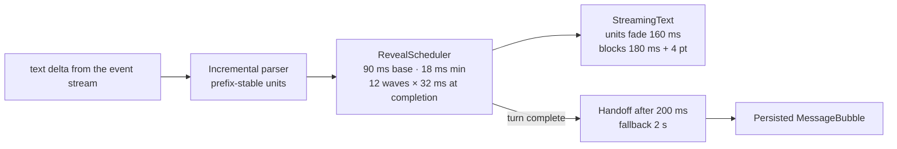

# Memoshi Design System

**Status:** Draft 4 · 2026-10-20; updated through [D94](decisions.md#d94) on 2026-10-25; updated on 2026-11-13 for [D106–D122](decisions.md#d106): Cognitio's design leads the shell on every device and is rebuilt in Memoshi's own code from behaviour described in words ([D106](decisions.md#d106)); Memoshi's tokens and avatar set stay, and the D106 update changes no token number; [D127](decisions.md#d127) corrects the avatar name-text colors for contrast (token file `4.0.0-draft.11`, §10.3); the earlier Viticci-style preview is frozen at git tag `design-preview-2026-11-13`; §8 gains the side-panel tab strip and pane chrome for Apps, the selection chip, the steps line and reasoning caption, the voice call bar and call card, the connect card, source chips, the computer chooser, the live view frame for Bot and Cloud computers and the Full access on this Mac badge; §12.4 states that the transcript is built and measured first; stages follow [D117](decisions.md#d117) and [D122](decisions.md#d122).
**Owns:** Visual language, materials, color, type, layout, iconography, components, the motion system, the avatar system, accessibility, appearance parity, performance budgets and design QA for Memoshi on the Mac, iPhone and iPad; the token source [`../specs/design-tokens.json`](../specs/design-tokens.json).
**Depends on:** [MASTER_PLAN.md](MASTER_PLAN.md) · [decisions.md](decisions.md) ([D29](decisions.md#d29), [D30](decisions.md#d30), [D31](decisions.md#d31), [D33](decisions.md#d33), [D41](decisions.md#d41), [D43](decisions.md#d43), [D47](decisions.md#d47), [D52](decisions.md#d52), [D53](decisions.md#d53), [D55](decisions.md#d55), [D56](decisions.md#d56), [D60](decisions.md#d60), [D61](decisions.md#d61), [D106](decisions.md#d106), [D107](decisions.md#d107), [D109](decisions.md#d109)–[D116](decisions.md#d116), [D119](decisions.md#d119), [D121](decisions.md#d121), [D127](decisions.md#d127)) · [AMENDMENT_2026-11-13.md](AMENDMENT_2026-11-13.md) · [02-experience.md](02-experience.md) · [05-bots-and-assistant.md](05-bots-and-assistant.md) · [07-coding.md](07-coding.md) · [08-security-and-privacy.md](08-security-and-privacy.md) · [09-platform-macos.md](09-platform-macos.md) · [phase-0.md](phase-0.md) · [../specs/design-tokens.json](../specs/design-tokens.json) · [../specs/design-reference.md](../specs/design-reference.md) · [../specs/object-model.md](../specs/object-model.md) · [../specs/policy.md](../specs/policy.md)

[02-experience.md](02-experience.md) decides what is where and how flows work. This doc decides how it looks, moves and performs. Token names in `code` refer to [`design-tokens.json`](../specs/design-tokens.json); numbers here and there must match, and the JSON wins if they ever differ.

---

## 1. Decisions in this doc

**Baseline and sequencing ([D106](decisions.md#d106), superseding [D92](decisions.md#d92)'s hierarchy and [D94](decisions.md#d94)'s preview as the lead).**
- **v1.0: Cognitio's design leads the shell on Mac, iPad and iPhone.** Cognitio is the user's own Mac app and continues in its own repository ([D107](decisions.md#d107)). It is the reference for the card window, sidebar, transcript, composer, bot identity and editor, side panel, workbench and settings. Viticci's [observed interaction grammar](../research/2026-10-23-design-direction-review.md#3-observed-ui-patterns-worth-discussing) stays for native Apple-data cards, Apps and phone navigation. Both draw from one set of tokens and components: this is one family, not two skins.
  - **The reference is behaviour described in words.** Each surface gets a written description of how Cognitio's surface looks and behaves before it is built, and the surface is then written new in Memoshi. Cognitio's running app and source may be read to write that description; code is not translated file by file, and no Kuvo- or Cognitio-derived source file, asset or string enters this repository. This amends [D91](decisions.md#d91): the Kuvo code reuse it permits is not taken for the interface. Who writes each description, and when, is open ([Open questions](#open-questions) 7; [amendment §8](AMENDMENT_2026-11-13.md#8-open-items), item 11).
  - **One codebase.** The interface is one SwiftUI codebase shared by the three devices, with AppKit or UIKit only where a surface needs it (§8).
  - **Memoshi's tokens and avatar set are kept.** The new shell starts from Cognitio's layout and reuses the tokens in [`design-tokens.json`](../specs/design-tokens.json) and the avatar set (§10) where they fit. The D106 update changes no numeric token; [D127](decisions.md#d127), decided the same day, separately corrects the avatar name-text colors for contrast (§10.3). A value that a rebuilt surface needs and the tokens lack is added through the pipeline in §15 [INFERENCE: set in the design review].
  - **The earlier preview is frozen.** The Viticci-style Mac and iPhone preview that D94 selected is kept at git tag `design-preview-2026-11-13`, and [design-reference.md](../specs/design-reference.md) remains its record. It is no longer the lead.
  - **Permissive dependencies** stay usable from their original upstreams, not from Cognitio's forks: SwiftTerm, Textual, WhisperKit and the usage-meter library that UsageKit forks.
  - Unverified values, including Draft 3's unknown-method Kuvo audit (§2.3), remain provisional; matching a reference is not adoption.
  - The Assistant, Inbox, Handoffs, Bypass badge, Resume, native Apple data and generated cards, Apps and the Apps section all share that semantic visual language with the workbench ([D81](decisions.md#d81)). No surface has a skin of its own.
- **iPhone and iPad** (v1, iOS 27+ and iPadOS 27+; [D47](decisions.md#d47), [D56](decisions.md#d56)) use the same semantic tokens, components and cards with platform-native adaptive navigation, not a desktop layout shrunk onto a phone. Cognitio's design leads their shell too, and Viticci's grammar stays for phone navigation ([D106](decisions.md#d106)). Cognitio ships no iPhone or iPad app ([merge assessment §2](../research/2026-11-12-memoshi-cognitio-bot-hq-merge.md#2-the-three-projects-as-observed)), so how each of its surfaces adapts to these devices is written into that surface's behaviour description [INFERENCE: set in the design review]. Their chrome is the system's (tab bar, sidebar, navigation bars), text follows Dynamic Type, and touch targets follow §11. The phone tabs and iPad layouts are in [02 §3.6](02-experience.md#36-iphone-and-ipad).
- **Always ours:** avatars (§10.1–§10.8: original geometry and art, with the state vocabulary Kuvo documents publicly), the app icon, illustrations and wording.
- **Required gates, unchanged by D106:** accessibility (§11), appearance coverage (§13), scenario-based design QA (§14) and all numeric performance budgets (§12).

P0-19's reference and reuse assessment ([design-reference.md §7](../specs/design-reference.md#7-phase-0-referencereuse-assessment-v0)) was written under [D91](decisions.md#d91) and [D92](decisions.md#d92). Under D106 its reuse option goes unused for interface code: there is no fork, import or file-by-file translation. This documentation update imports no code and retains Memoshi's Pi_Swift, protocol, policy, recovery and device contracts.

**Licence boundary.** Because no Kuvo- or Cognitio-derived code, asset or string enters the repository, the interface carries none of Kuvo's PolyForm Noncommercial 1.0.0 terms. D106 chose the rebuild to avoid those terms and their collision with the GPL-linked iSH module on iPhone and iPad. O13 stays open, and nothing built under D106 may close a public or paid release. A dependency scan is not proof of provenance. Memoshi branding remains original; third-party screenshots, artwork, media and private content stay outside the repository.

**Implementation and review ([D93](decisions.md#d93)).** The builder and coding agents implement against user-approved references; the user reviews design, and design QA remains required. There is no mandatory designer hire, fixed contractor-day allocation or payment dependency. Targeted outside artwork, accessibility or polish help is optional for a concrete identified gap and separately chosen scope/cost. This establishes no saved builder days and changes no dates, cuts or capacity review. [D106](decisions.md#d106) adopts Cognitio's layout and behaviour as the reference for the shell. It adopts no Cognitio code, asset or string, and it changes neither the avatar geometry nor any numeric token.

**Earlier preview ([D94](decisions.md#d94)), frozen.** On 2026-10-25 the user selected floating bot headers, mobile bottom navigation and compact composition, richer Mac navigation with Activity/resource/second-conversation context, and refined resource cards. Current/Warm is an app-local palette comparison, separate from Frosted/Solid. That preview's code is kept at git tag `design-preview-2026-11-13` and its implementation and evidence stay in [design-reference.md](../specs/design-reference.md) ([D106](decisions.md#d106)). It is a record, not the lead; the remaining sections specify the full product and its gates.

<a id="design-pass-backlog"></a>
**Design-pass backlog.** Later design passes add Memoshi's own layer once the system is stable. A gate review schedules each pass; the first runs alongside Phase 5 by default ([10-roadmap](10-roadmap.md#phase-5)). These sections are specs for those passes and are not built in v1:
- Aiden's motion: streaming reveal, thinking shimmer, activity ticker, card entrances (§9.4–§9.8);
- the Grok-style roster: the pinned avatar grid and sections ([02 §4.2](02-experience.md#42-rows)), and livelier avatars (§10.9);
- optional Metal shader effects (§9.9);
- generated motion and shader effects, and native 3D and Gaussian-splat views, for the interface bots generate (EXPL-13, EXPL-14; [D115](decisions.md#d115));
- further UI and UX work found in dogfooding.

Until a pass ships, use the working layouts and controls under [D106](decisions.md#d106); the later-pass recipes are not v1.0 requirements. A surface is reviewed against its written behaviour description and the gates in §11–§14; no reference's screenshots, Cognitio's included, take precedence over Memoshi's accepted flows, tokens and review gates. Feature stages are those of [10-roadmap](10-roadmap.md) after [D117](decisions.md#d117) and [D122](decisions.md#d122).

1. **Brand:** quiet, capable, trustworthy (Aiden). Personality lives in the bots' avatars, not in the chrome.
2. **Two layers:** Liquid Glass for the functional layer only; the content layer is opaque ([D29](decisions.md#d29)). The glass inventory is closed (§3).
3. **Color:** the user's macOS accent plus semantic roles, each with light, dark and increased-contrast values checked against WCAG 2.2 AA. Risk color escalates only from T3 upward. Avatars are the only decorative color.
4. **Type:** macOS text styles for chrome, a four-step prose scale for messages, SF Mono for code. Nothing functional below 11 pt.
5. **Motion:** in v1.0, native system motion and restrained state, causality or progress signals follow §9.1–§9.3 and the scenario review in §14. Idle UI is still except avatar state signals. Every motion has a duration, a curve, an implementation, a Reduce Motion form and a budget class. [D106](decisions.md#d106) names no motion recipe; Aiden's inventory (§9.4) remains the design-pass backlog.
6. **Avatars:** our own 12 shapes × 12 colors with a two-eyed face; one pose per `Bot.status` (8 values) plus three overlays and the Bypass badge; loops run on Core Animation, never on the main thread (§10).
7. **Budgets:** a static window costs ≤ 0.3% CPU; streaming holds main-thread p95 ≤ 4 ms per 120 Hz frame and a hitch-time ratio under 5 ms/s; a hidden window draws zero animation frames (§12).
8. **QA:** per-phase scenario-based native design review with a same-state visual matrix, accessibility, motion and budget checks, adapted from Aiden's `design-qa.md` (§14); resemblance to a reference is not the pass/fail score.
9. **Transcript first:** the transcript is the first surface built and measured, against conversations of 1,000, 5,000 and 20,000 messages and the switch-conversation budget (§12.4; [D106](decisions.md#d106)).

## 2. Brand and principles

### 2.1 Brand attributes

Aiden Agent's PRODUCT.md (MIT) states the register we adopt: "Quiet, capable, and trustworthy. The product should feel at home on macOS, with the restraint and task focus of the Codex and ChatGPT desktop apps" ([PRODUCT.md](https://github.com/sambitcreate/aiden-agent/blob/main/PRODUCT.md)).

| Attribute | In Memoshi |
|---|---|
| **Quiet** | Neutral chrome and one accent. Idle UI does not move. Empty states are one sentence and one action. A quiet routine run (`no_update`) leaves no line in the bot's Chat and sends no notification; it appears only in the routine's run history ([D23](decisions.md#d23)). |
| **Capable** | Dense, keyboard-complete surfaces. Every tool call, script, diff, cost and memory write is one click from where it happened ([MASTER_PLAN principle 5](MASTER_PLAN.md#3-principles)). The Developer setting ([D3](decisions.md#d3)) adds depth without new surfaces. |
| **Trustworthy** | Risk is shown at the point of action: tier badges, exposure notes and typed confirmations. Model-authored text never looks like app chrome (§8.3). States are never faked and never shown by color or motion alone ([D30](decisions.md#d30)). |
| **A team you can see** (ours) | Each bot has a face, and its face says what it is doing. This is the one place for warmth and play. |

**Anti-references.** From Aiden: "a generic web dashboard inside a desktop shell, ornamental cards, feature-promoting empty states, oversized or detached control regions" ([PRODUCT.md](https://github.com/sambitcreate/aiden-agent/blob/main/PRODUCT.md)). Ours: no chat tinting in the bot's color (Grok Bot 0.68.1 tints chats, [profile](../research/agentic-workspace-landscape/projects/grok-bot.md); it would break the one-accent rule), no mascots or confetti in chrome, no shimmer on static labels.

### 2.2 Principles

1. **The conversation is primary.** Tools and context appear around it and never reflow it ([02 §1](02-experience.md#1-scope-and-principles)).
2. **Chrome is glass; content is opaque.**
3. **One accent. Color is semantic and never the only cue.**
4. **Motion with meaning** ([D29](decisions.md#d29)). Apple's HIG says the same: "Add motion purposefully, supporting the experience without overshadowing it" and "Make motion optional" ([HIG Motion](https://developer.apple.com/design/human-interface-guidelines/motion)).
5. **System first.** System sheets, menus, popovers, alerts, split-view columns and focus rings keep their system look and motion. We style only what we own.
6. **Model text is data, not chrome.** Whatever a bot writes renders as prose inside content surfaces; facts the app asserts (tool, target, tier, scope, cost) render in chrome typography outside them.
7. **Test every surface** in light, dark, Increase Contrast, Reduce Transparency, Reduce Motion and right-to-left before it ships (§13, §14).

### 2.3 What we take from where

| Source | License | Use here |
|---|---|---|
| Cognitio (the user's Mac app, in its own repository; [D106](decisions.md#d106), [D107](decisions.md#d107)) | Behaviour reference only. Its code is Kuvo-derived under PolyForm Noncommercial 1.0.0, so no source file, asset or string is taken | Leads the shell on Mac, iPad and iPhone: card window, sidebar, transcript, composer, bot identity and editor, side panel, workbench and settings. Each surface is described in words and rebuilt in Memoshi's own code on Memoshi's tokens and avatar set. |
| [Viticci's Apple-native assistant observations](../research/2026-10-23-design-direction-review.md#3-observed-ui-patterns-worth-discussing) | Visual/interaction reference only; no implementation or artwork rights inferred | Stays for native Apple-data cards, Apps and phone navigation ([D106](decisions.md#d106)). It led the whole assistant family under [D92](decisions.md#d92); that preview is frozen at git tag `design-preview-2026-11-13`. Preserve the evidence's device/claim caveats; this does not adopt every pictured feature or exact pixels. |
| [Aiden Agent](../research/agentic-workspace-landscape/projects/aiden-agent.md) 0.36.1 local checkout and 0.58.0 upstream | MIT | Motion values, curves, elevation ladder, Markdown scale, syntax colors, streaming-reveal algorithm, activity marks, the "one eye mark, many bodies" avatar idea. Adapted with attribution. |
| [Kuvo Code](../research/agentic-workspace-landscape/projects/kuvo-code.md): public site and docs | PolyForm Noncommercial 1.0.0; no source, asset or string enters the repository ([D106](decisions.md#d106), amending [D91](decisions.md#d91)) | Publicly documented behaviour only: the avatar state vocabulary, subtitle rules and the Frosted/Solid option. Workbench depth (projects, files, terminal, diffs and review) now comes through Cognitio's behaviour descriptions. Captures, artwork and private material stay outside the repository. |
| [Grok Bot](../research/agentic-workspace-landscape/projects/grok-bot.md) as measured by MemoBot ([behavior](../research/prior/grok-bot-measured/behavior.md)) | Proprietary | Behavior and counts only: a 13-shape × 11-color New Bot sheet and a three-column pinned grid. MemoBot reuses Grok's assets with unverified rights, so no Grok or MemoBot asset, path, color or measurement of art is used ([D33](decisions.md#d33)). |
| Apple HIG and SwiftUI/AppKit docs | Apple documentation | System colors, text styles, Liquid Glass and motion rules |
| Draft 3 `docs/01-kuvo-design-base.md`, `specs/design-tokens.json` | Own | Token structure, spacing scale, row and composer metrics (adapted). Its "Kuvo audit" method is unknown, so unverified values stay provisional. A value is adopted only after observed runtime evidence or a surface's behaviour description, plus Memoshi scenario, accessibility and performance review ([D106](decisions.md#d106)); matching a reference neither makes a token final nor retroactively makes the old audit source-based. |

## 3. Materials: Liquid Glass and the content layer
<a id="liquid-glass"></a>

Apple's HIG: "Liquid Glass forms a distinct functional layer for controls and navigation elements — like tab bars and sidebars — that floats above the content layer", and "Use Liquid Glass effects sparingly" ([HIG Materials](https://developer.apple.com/design/human-interface-guidelines/materials)). [Adopting Liquid Glass](https://developer.apple.com/documentation/technologyoverviews/adopting-liquid-glass) adds: "Reduce your use of custom backgrounds in controls and navigation elements." API-level rules are in [09-platform-macos.md](09-platform-macos.md); this is the visual inventory, agreed with Platform.

| Surface | Layer | Material and API | Reduce Transparency | Increase Contrast |
|---|---|---|---|---|
| Toolbar (also the conversation header) | Functional | System toolbar glass | System | System |
| Sidebar, including the 64 pt rail | Functional | System `NavigationSplitView` sidebar | System | System |
| Side-panel header and `InspectorTabBar`, App and built-in pane tabs included (§8.1, §8.7) | Functional | System glass; `PickerStyle.tabs` (macOS 27.0) when the tabs fit | System | System |
| `Composer` shell, including `DictationPill` and `QueueTray` | Functional | `glassEffect(.regular, in: .rect(cornerRadius: 22))` in a `GlassEffectContainer`; Send uses `.buttonStyle(.glassProminent)` | `surface.raised` + `elevation.e1` | + `border.strong` |
| `Toast`, `ScrollToLatest`, `CommandPalette` | Functional | `glassEffect(.regular)` | `surface.raised` + `e4` / `e5` | + `border.strong` |
| Popovers, menus, sheets, alerts, MenuBarExtra panel; on iPhone and iPad, the tab bar, sidebar and navigation bars | Functional | System | System | System |
| Transcript, `MessageBubble`, `StepsLine`, `ReasoningCaption`, chips (`SelectionChip` and `SourceChip` included), every `Card`, `CardReceipt` | Content | Opaque fills (`surface.*`) | n/a | `border.strong` outlines |
| DiffView, TerminalView, files, previews, artifacts, App and built-in pane canvases, settings content | Content | Opaque | n/a | Stronger separators |
| `LiveView` (browser, Bot computer and Cloud computer) | Content | Opaque; its controls live in the side-panel header, never over the live surface. A detached live window uses an opaque `surface.raised` control capsule. | n/a | n/a |
| Avatars | Content | Opaque fills | n/a | 1.5 pt edge stroke |
| Widgets | System | `containerBackground(.fill.tertiary, for: .widget)` | System | System |

**Rules.**
1. No glass on glass. Neighboring glass shapes share one `GlassEffectContainer` so they blend instead of stacking.
2. Tinted glass (`Glass.regular.tint(_:)`) only for the one primary action inside a glass cluster (Send). No custom glass colors elsewhere.
3. Scroll edges under glass use the system effect: `scrollEdgeEffectStyle(.soft, for: .top)` under the toolbar and `.soft` at the bottom under the composer. Inner scroll areas use a 14 pt mask (§9.4 `scroll.edgeMask`). **On iPhone and iPad** (since 2026-11-21) the conversation header, up to the top edge, the side panel's header and the live composer, down to the bottom edge, sit on an opaque backing instead, `DesignControlRoles.barBacking` (`surface.window`): in the app's layout (tab view, `.inspector`, the root stack) the system effect did not cover the header, and transcript text showed through and around the identity pill and under Palette. The pill, toolbar and tab bar keep their glass ([evidence](../../../evidence/2026-11-21-memoshi-apps-ui/README.md)).
4. Glass never sits over live VM, Cloud computer or WebKit views; refraction over changing pixels costs frames and hides what the bot is doing.
5. Under Reduce Motion, `glassEffectID` morphs become crossfades. Under Reduce Transparency, every custom glass surface switches to `surface.raised` with its listed elevation.
6. **Frosted or Solid** ([D85](decisions.md#d85)). Settings › General › Appearance retains the Frosted/Solid option, informed by [Kuvo's docs](https://www.kuvo.run/llms-full.txt): Frosted is the glass described here, and Solid takes the Reduce Transparency path of rule 5, so every custom glass surface switches to `surface.raised` with its listed elevation.
7. The composer's legibility on glass is a Phase 0 check ([Open questions](#open-questions)). The fallback is Aiden's opaque composer: `surface.raised` + `elevation.e1`.
8. The inventory stays closed under [D106](decisions.md#d106). The `CallBar` (§8.2) is functional-layer chrome; whether it joins the composer's glass container, as the `DictationPill` does, or stays opaque is [INFERENCE: set in the design review], and until then it is not glass.

## 4. Color
<a id="color"></a>

### 4.1 Model

- **Accent.** `accent.default` follows the user's macOS accent (`NSColor.controlAccentColor`). The `AccentColor` asset, used when the user picks Multicolor, carries the HIG blue values (`#0088FF` light, `#0091FF` dark).
- **Derived accent roles.** `accent.text` and `accent.fill` are computed at runtime by moving the accent's OKLCH lightness until text reaches 4.5:1 on every surface (7:1 under Increase Contrast) and labels on the fill reach 4.5:1. This adapts Aiden's fill rule: "The hue moves toward black just enough for white content to reach WCAG AA" ([design-guide.md](https://github.com/sambitcreate/aiden-agent/blob/main/docs/design-guide.md), MIT).
- **System versus ours.** Roles backed by AppKit name their `system` color; their hex values are preview and test fallbacks. Memoshi roles ship as asset-catalog color sets with Any, Dark, High Contrast and High Contrast Dark appearances.
- **Never forced.** Draft 3 forced dark mode ([audit](../research/agentic-workspace-landscape/landscape/in-house-assets.md#draft-3-build)); Draft 4 follows the system appearance with full light/dark parity.

### 4.2 Semantic roles

Values: light / dark (increased contrast in the JSON). Contrast is measured against the worst of the content, window, card and sidebar surfaces.

| Role | Light | Dark | Use and guarantee |
|---|---|---|---|
| `surface.content` | `textBackgroundColor` (#FFFFFF) | (#1E1E1E) | Transcript, side-panel content. Always opaque. |
| `surface.window` / `surface.inspector` | `windowBackgroundColor` (#F5F5F7) | (#262628) | Pane backgrounds [preview values approximate; sample on macOS 27] |
| `surface.card` / `cardHover` | label 4% / 7% | label 6% / 9% | Cards, chips |
| `surface.well` | label 3% | label 5% | Code blocks, inline code, `BotSaysWell` |
| `surface.userBubble` | #EFEFF1 | #2F2F31 | User messages |
| `surface.raised` | #FFFFFF | #2C2C2E | Opaque fallback for glass |
| `text.primary` | black 85% | white 85% | ≥ 13.2:1 / 10.5:1 |
| `text.secondary` | black 62% | white 60% | ≥ 5.9:1 / 6.1:1 |
| `text.tertiary`, `text.placeholder` | black 56% | white 52% | ≥ 4.7:1 / 5.0:1: timestamps and placeholders still meet AA |
| `text.disabled` | black 30% | white 30% | Inactive controls only, always with disabled semantics |
| `border.subtle` | `separatorColor` | same | Decorative separators |
| `border.strong` | black 45% | white 45% | ≥ 3:1 non-text contrast; outlines under Increase Contrast |
| `accent.text` (default blue) | #0268C5 | #1E95FE | Links and inline actions, ≥ 4.5:1 |
| `accent.fill` + `onFill` | #0276DF + white | #0091FF + black | Primary buttons, counts, checked controls, ≥ 4.5:1 |

macOS `secondaryLabelColor` has classically been black at about 50% opacity, about 3.9:1 on white, a long-standing AppKit value that is re-sampled on macOS 27. That fails AA for small text, so `text.secondary` and `text.tertiary` are Memoshi roles, not the system ones.

**Status roles** use the HIG unified system hues (2025 values from [HIG Color](https://developer.apple.com/design/human-interface-guidelines/color)), adjusted for text:

| Role | Hue | `fg` light / dark | `fill` light / dark | Meaning |
|---|---|---|---|---|
| `status.running` | blue | #0D61E6 / #1E95FE | #1E6EF4 / #0091FF | Running, informational |
| `status.success` | green | #017B2C / #30D158 | #008932 / #30D158 | Done, accepted, added lines |
| `status.caution` | yellow | #916005 / #FFD600 | #A16A00 / #FFD600 | T3, expiring soon |
| `status.attention` | orange | #AF4900 / #FF9230 | #C55300 / #FF9230 | Needs you, T4, budget warning |
| `status.danger` | red | #D60325 / #FF5E5A | #E9152D / #FF4245 | Error, T5, budget stop, removed lines |
| `status.neutral` | gray | `text.secondary` | #6E6E73 / #98989D | Watching, asleep, paused, T0–T2 |

`fg` reaches ≥ 4.5:1 on every surface (7:1 under Increase Contrast). Content on `fill` (white in light, black in dark) reaches ≥ 4.5:1.

### 4.3 Risk tiers

| Tier | Label | Glyph | Color role |
|---|---|---|---|
| T0 | Read | `eye` | `status.neutral` |
| T1 | Local write | `pencil` | `status.neutral` |
| T2 | Execute | `terminal` | `status.neutral` |
| T3 | Reach out | `network` | `status.caution` |
| T4 | Act externally | `paperplane.fill` | `status.attention` (a `DraftCard` in Ask first and Auto; Bypass ([D52](decisions.md#d52)) and a bot's Send mail by itself setting ([policy.md §11.3](../specs/policy.md#113-mail-drafts-and-send-mail-by-itself)) are the exceptions) |
| T5 | Critical | `exclamationmark.shield.fill` | `status.danger` (typed confirmation) |

Color escalates only from T3: most approvals in a session are T1–T2, and a calm badge keeps the rare orange or red meaningful. The `TierBadge` always shows "T2 · Execute" and the glyph. Names and modes match [policy.md](../specs/policy.md) (agreed with Security).

### 4.4 Code, diff and terminal

- **Syntax** colors are Aiden's (MIT; `renderer/styles.css:122-127`, `186-191`): ≥ 4.8:1 on `surface.well`, with increased-contrast variants at 7:1.
- **Diff:** added lines use green at 10% (light) / 16% (dark) with 22% / 28% for changed words; removed lines use red at 9% / 15% and 20% / 26%. The +/− markers use `status.success.fg` and `status.danger.fg` and stay visible whenever Differentiate Without Color is on. Increase Contrast adds a 2 pt leading bar.
- **Terminal:** a 16-color ANSI palette per appearance. Chromatic colors reach ≥ 4.6:1 (normal) and ≥ 6:1 (bright) on light, ≥ 5:1 and ≥ 8:1 on dark.

## 5. Typography

### 5.1 Chrome

Chrome uses the macOS built-in text styles ([HIG Typography](https://developer.apple.com/design/human-interface-guidelines/typography)) so it follows system settings:

| Token | Size / line | Weight | Use |
|---|---|---|---|
| `largeTitle` | 26 / 32 | Regular | Onboarding, empty-state titles |
| `title1` | 22 / 26 | Regular | Sheet titles |
| `title2` | 17 / 22 | Regular | Side-panel headers |
| `title3` | 15 / 20 | Semibold | Section titles |
| `headline` | 13 / 16 | Bold | Card and row titles |
| `body` | 13 / 16 | Regular | All chrome text |
| `callout` | 12 / 15 | Regular | Metadata, chip labels |
| `subheadline` | 11 / 14 | Regular | Badges, timestamps: the smallest functional text |

Footnote and Caption (10 pt) are never used for functional text (adapted from Draft 3 `docs/01-kuvo-design-base.md` §6: "Never go below 11 pt for functional text"; inherited values remain provisional pending the evidence and Memoshi adoption review in §2.3, [D106](decisions.md#d106)).

### 5.2 Prose (messages)

| Message text size | S | M (default) | L | XL |
|---|---|---|---|---|
| Size / line height | 13 / 20 | 14 / 22 | 16 / 25 | 18 / 28 |

Prose is capped at 72 ch inside the 760 pt content column. The Markdown scale adapts Aiden's ([parity audit P0-2](https://github.com/sambitcreate/aiden-agent/blob/main/docs/gpui-port/parity-audit-design-motion.md), MIT): H1 1.22 em, H2 1.12 em, H3 1 em semibold, with 24 / 20 / 16 pt before; 12 pt between paragraphs; lists indented 24 pt with 6 pt between items; quotes with a 2 pt bar, 14 pt indent and `text.secondary`; table cells padded 4 × 8; inline code at 0.9 em on `surface.well`, 6 × 2 pt padding, radius 6; links in `accent.text`, underline offset 2.

### 5.3 Monospace and numerals

SF Mono: code blocks and diffs 12 / 18, terminal 12 / 16, inline 0.9 em. Counts, costs, tokens, timers and diff stats use `monospacedDigit()`. Code and terminal are always left-to-right.

## 6. Layout, spacing, radii, elevation and density

### 6.1 Grid and spacing

A 4 pt grid. Scale: 2, 4, 6, 8, 12, 16, 20, 24, 32, 40, 48, 64 (`space.1`–`space.12`; adapted from Draft 3 `specs/design-tokens.json`, plus 48 and 64; inherited values remain provisional pending the evidence and Memoshi adoption review in §2.3, [D106](decisions.md#d106)).

### 6.2 Window and panes

Agreed with [02 §3.2](02-experience.md#32-panes): sidebar 280 pt (240–360; dragging below 200 snaps to a 64 pt rail), conversation at least 480 pt with a 760 pt content column, side panel 380 pt (320–560; an overlay in narrow windows; the `inspector` layout tokens), window at least 1040 × 700 pt. These metrics hold for the card window that Cognitio's design leads until its behaviour description is written; any change to them goes through the design review and §15, not this update ([D106](decisions.md#d106)).

| Element | Metric |
|---|---|
| Sidebar rows | 28 pt single line; 44 pt bot row (20 pt avatar, name, subtitle); 24 pt section header; 44 pt Inbox row; 44 pt app row (20 pt icon tile, name, subtitle) |
| `AvatarGrid` | 3 columns, 72 pt tiles, 40 pt avatars, 8 pt gap, `subheadline` names |
| Transcript | 16 pt between turns, 6 pt within a group; user bubble ≤ 80% of the column, padding 10 × 14 |
| `Card` | 14 pt padding, 8 pt header gap, 28 pt action row, ≤ 640 pt wide |
| Chips | 24 pt high, 8 pt horizontal padding, 14 pt glyph |
| `ActivityTicker` | 3 rows × 24 pt, faded from transparent to opaque over the top 45% |
| `Composer` | 44 pt minimum (one line), grows to 40% of the conversation height, 12 pt padding, 28 pt controls |
| `InspectorTabBar` | 32 pt |
| `Toast` | Top center, 12 pt below the toolbar, ≤ 420 pt wide |
| `DictationPill` | 40 pt high, ≤ 272 pt wide (Aiden's pill metrics) |
| Hit targets | ≥ 24 × 24 pt always (WCAG 2.2 SC 2.5.8); 28 pt preferred for our own controls |

### 6.3 Radii

Continuous corners everywhere. Nested shapes use `ConcentricRectangle` and `containerShape(_:)` (macOS 26) in SwiftUI, and `NSViewCornerConfiguration` (macOS 27) in AppKit-hosted views, so an inner radius equals the outer radius minus the inset.

| Token | pt | Use |
|---|---|---|
| `xs` | 4 | Word highlights, tiny badges |
| `sm` | 6 | Inline code, row selection |
| `md` | 8 | Chips, fields |
| `control` | 10 | Our own buttons outside glass |
| `popover`, `tile` | 12 | Opaque popovers, grid tiles |
| `card` | 14 | Cards, wells |
| `bubble` | 18 | User messages |
| `composer` | 22 | Composer: a capsule at one line, a rounded rectangle as it grows |
| `pill` | 999 | Toasts, pills, badges |

### 6.4 Elevation

Glass brings its own shadow. Opaque surfaces use Aiden's ladder (MIT; `renderer/styles.css:128-137` light, `192-201` dark). SwiftUI radius is CSS blur ÷ 2, and CSS negative spread becomes lower opacity, matching the Core Animation convention; Phase 0 verifies it visually.

| Level | Use | Light | Dark |
|---|---|---|---|
| `e0` | Flat content | none | none |
| `e1` | Resting opaque controls, Cards | hairline + black 10% r1 y1 + black 8% r4 y3 | hairline + black 45% r1.5 y1 + 40% r5 y4 |
| `e2` | Hover on opaque controls | black 14% r2 y2 + 10% r6 y5 | black 55% r3 y2 + 50% r7 y6 |
| `e3` | Opaque popover fallback | hairline 12% + black 12% r3.75 y3 + 3.5% r10 | hairline white 14% + black 58% r4 y3 + 16% r10 |
| `e4` | Toast fallback | black 10% r6 y4 | black 54% r6 y4 |
| `e5` / `e6` | Dialog / modal fallback | hairline + black 22% r12 y16 / 28% r16 y20 | hairline + black 72% r16 y16 / 78% r24 y22 |
| `pressed` | Pressed custom control | inner shadow black 14% r1 y1 (`ShadowStyle.inner`) | 68% |

State recipes (from the ChatGPT/Codex audit in Aiden's [inspiration doc](https://github.com/sambitcreate/aiden-agent/blob/main/docs/chatgpt-desktop-ui-inspiration.md)): hover raises surface contrast about 4% and moves `e1` → `e2`; pressed darkens and switches to the inner shadow with no translate or bounce; disabled keeps shape and drops to 45% opacity.

### 6.5 Density

| | Comfortable | Compact |
|---|---|---|
| Sidebar row / bot row | 28 / 44 pt | 24 / 36 pt |
| Between turns | 16 pt | 12 pt |
| Card padding | 14 pt | 10 pt |
| Prose size | M | S |
| Seeded by | Guided | Developer |

Density is a preference seeded by the Guided or Developer setting ([D3](decisions.md#d3), SH-12), which is not the Mac-only plugin developer mode of [D114](decisions.md#d114) (CH-44). It never hides information, and hit targets stay ≥ 24 pt.

## 7. Iconography

SF Symbols from the macOS 27 system set only. Every name below was checked against the CoreGlyphs `name_availability.plist` of macOS 27.0.1. Sizes: 11 pt in badges, 13 inline, 15 in the toolbar, 16 in rows, 18 in empty states. Weight matches adjacent text. Filled variants mark selection or state. Every icon-only control has `.help(_:)` and an accessibility label. We draw one custom template symbol, `bot.face` (a squircle with two pill eyes), for the Bots section and the menu bar extra.

| Group | Glyphs |
|---|---|
| Objects | Chat `bubble.left.fill` · Project `folder.fill` · Session `text.bubble` · Group `bubble.left.and.bubble.right.fill` · Task `checklist` · Handoff `arrowshape.turn.up.right.fill` · Routine `calendar.badge.clock` · Watch `binoculars.fill` · Wake `alarm.fill` · Browser `globe` · Memory `brain` · Connector `puzzlepiece.extension.fill` · Skill `wand.and.stars` · Approval `checkmark.shield.fill` · Draft `square.and.pencil` · Artifact `shippingbox.fill` · Inbox `tray.full.fill` · Budget `gauge.with.dots.needle.33percent` · Grant `key.fill` |
| Computers | This Mac (sandboxed) `laptopcomputer` · Bot computer `display` · Remote machine `server.rack` · Cloud computer `cloud` |
| Modes | Ask first `hand.raised` · Auto `bolt.fill` · Bypass `hand.raised.slash.fill` (also the `BypassBadge`, §8.1) · Plan, a session option for coding, `list.bullet.clipboard` ([D52](decisions.md#d52)) |
| `StatusGlyph` (session rows) | Working: activity mark · Needs you `hand.raised.fill` · Failed `exclamationmark.triangle.fill` · Unread: 7 pt accent dot · Queued `hourglass` |
| Tools | read `doc.text` · write `pencil` · exec `terminal` · search `magnifyingglass` · web `globe` · MCP `puzzlepiece.extension` · browser action `cursorarrow.click` · computer `display` · Code Mode `curlybraces` |
| Composer | Attach `paperclip` · Dictation `mic.fill` · Send `arrow.up.circle.fill` · Stop `stop.fill` · Model `cpu` |

Card kinds and avatar badges are listed in §8.3 and §10.6. Glyphs for the components added on 2026-11-13 (§8.1–§8.4, §8.7) come from the same system set and are checked against the same plist before use; this table names none of them yet [INFERENCE: set in the design review].

## 8. Components
<a id="components"></a>

All native SwiftUI in one codebase shared by Mac, iPad and iPhone, with AppKit or UIKit only where a surface needs it: the terminal, the VM display, WebKit, and the transcript's text layout if its measurements require it (§12.4) ([D106](decisions.md#d106)). Names are shared with [02 §1.1](02-experience.md#11-shared-names-agreed-with-their-owners). Motion IDs refer to §9.4.

**Components added on 2026-11-13** ([D106](decisions.md#d106)–[D116](decisions.md#d116)): the card window, `FullAccessBadge` and the side-panel tab strip (§8.1); `StepsLine`, `ReasoningCaption`, `SourceChip`, `SelectionChip` and `CallBar` (§8.2); `CallCard` and `ConnectCard` (§8.3); `ComputerChooser` and the `LiveView` frame for Bot and Cloud computers (§8.4); `AppPaneChrome` (§8.7). Each is specified from existing tokens and recipes. Their anatomy, states and accessibility rules are fixed here; a size or position that no existing token gives is marked [INFERENCE: set in the design review] and waits for the surface's behaviour description. Until then these names are in neither [`design-tokens.json`](../specs/design-tokens.json) nor the component gallery.

### 8.1 Shell

| Component | Anatomy and tokens | States | Motion |
|---|---|---|---|
| Card window | The window shell that Cognitio's design leads (SH-06, [D106](decisions.md#d106)): sidebar, conversation and side panel in one window, with conversation tabs, and split view, which puts a second conversation in the conversation area ([02 §3.2](02-experience.md#32-panes)) ([amendment §4.1](AMENDMENT_2026-11-13.md#41-shell-and-conversation-d106)). The pane metrics in §6.2 and the materials in §3 hold. How the panes are framed, where the conversation tabs sit and how the split divides the conversation area are [INFERENCE: set in the design review] | Per the window's behaviour description; narrow-window rules stay those of [02 §3.4](02-experience.md#34-narrow-windows) | `panel.toggle`; no new recipe |
| `SidebarRow` | 28 pt; leading glyph or 20 pt avatar; title `body`; trailing badges and time `subheadline` `text.tertiary`; selection is system | Hover, selected, unread (bold title + dot), muted | `hover.fill` |
| Bot row | 44 pt; 20 pt `BotAvatar`; name `headline`, then the `BypassBadge` when the bot is in Bypass; subtitle `callout` `text.secondary` with the status text from [02 §4.4](02-experience.md#44-bot-status-overlays-and-session-glyphs) and its glyph | 8 statuses, overlays | Avatar loops (§10) |
| `BypassBadge` | `hand.raised.slash.fill` plus the word "Bypass" in `subheadline`, in `status.attention.fg`; after the bot's name in rows, headers, card origins, Inbox rows and notifications; glyph only in the avatar's bottom-leading badge slot where no name shows, at ≥ 28 pt (§10.5). Memoshi-owned safety signal | Shown while the bot is in Bypass ([D52](decisions.md#d52)); never color alone; VoiceOver suffix "Bypass" | None |
| `FullAccessBadge` | A glyph plus the words "Full access on this Mac" in `subheadline`, in `status.danger.fg` [INFERENCE: glyph, wording and role set in the design review]; after the name of an App, or of a plugin built in plugin developer mode, that the user switched to **Full access on this Mac** ([D114](decisions.md#d114)), wherever that name appears: its App row, its side-panel tab and pane header, the `MiniAppChrome` header, the `MiniAppChip`, the `MiniAppInfoSheet`, ⌘K results and its function-call chips. Memoshi-owned safety signal, drawn by the app and never by the App or plugin. Mac only: neither plugin developer mode nor the badge exists on iPhone or iPad | Shown while the setting is on. Only the user turns it on, in a confirmation that names the risks and needs typed input ([D121](decisions.md#d121)); never color alone; VoiceOver suffix "Full access on this Mac". It is a per-App setting, not a permission mode ([D52](decisions.md#d52)) | None |
| Assistant row | 28 pt avatar; chosen name; brief line ("Brief ready · 3 bots working") | Same as bot | Same |
| App row | 44 pt; the App's 20 pt icon, Shortcuts-style: its SF Symbol in the avatar ink (§10.4) on a tile of its color from the avatar palette, with the avatar body's hairline and Increase Contrast stroke (§10.3) ([D82](decisions.md#d82)) [INFERENCE: drawn like an avatar body]; name `headline`; subtitle `callout` `text.secondary` with the bot's name. An App granted to all your bots (CH-39, [D114](decisions.md#d114)) says so in its subtitle, and a built-in App (Mail, Calendar, Reminders with Tasks, Contacts, Notes, Files with the Library; [D116](decisions.md#d116)) names no bot ([02 §4.2](02-experience.md#42-rows)); the wording is [INFERENCE: set in the design review]. On the Mac the `FullAccessBadge` follows the name when it applies. The Apps section shares the sidebar's tokens and navigation language ([D81](decisions.md#d81), [D106](decisions.md#d106), [02 §4.2](02-experience.md#42-rows)) | Hover, selected | `hover.fill` |
| Sidebar rail | 64 pt; 28 pt avatars and glyphs stacked; tooltips carry names | Same badges | `panel.toggle` |
| `AvatarGrid` | 3 × 72 pt tiles; 40 pt avatar; name below; status badge bottom-trailing, unread top-trailing | Hover fill radius 12; drag lift `e2` | `spring.interactive` on reorder |
| `StatusGlyph` | 16 pt glyph from §7 | Working animates; static under Reduce Motion | `activityMark` |
| `InboxRow` | 44 pt; kind glyph; origin avatar 20 pt; summary; tier badge; expiry clock | Unseen, expiring (< 10 min: `status.caution` clock), resolved | `badge.count` |
| `InspectorTabBar` (the side panel's tab strip) | 32 pt; glyph + label. It carries three kinds of tab ([02 §9.1](02-experience.md#91-rules); CH-33, AP-15–AP-20; [D106](decisions.md#d106), [D114](decisions.md#d114), [D116](decisions.md#d116)): the inspector tabs of the conversation's object (Profile…, Changes…), which still hold live views, notebooks and artifacts; App panes, each with the App's icon (its symbol on its tile, as in the App row) and name; and the built-in panes (Mail, Calendar, Reminders with Tasks, Contacts, Notes, Files with the Library). An App or built-in pane tab appears when the user opens it or a bot calls `view.open` (CH-35), and can be closed; a tab a bot opened gets a dot, and whether it comes forward by itself is [INFERENCE: set in the design review] ([02 §9.1](02-experience.md#91-rules), rule 5). The arrangement is kept per device. Tab width, the close control and the order of the three kinds are [INFERENCE: set in the design review]. Of the inspector tabs, only tabs with content appear (adapted from Draft 3 `docs/01-kuvo-design-base.md` §11.3; inherited values remain provisional pending the evidence and Memoshi adoption review in §2.3, [D106](decisions.md#d106)); overflow menu | Selected, disabled with reason, opened by a bot (dot), `FullAccessBadge` on an App tab it applies to | `tab.indicator` |
| `Banner` | Full content width under the toolbar; glyph in its status role; one line; one or two actions | Offline, reconnecting, daemon stopped, version mismatch, paused, in control | `banner.enter/exit` |
| `Toast` | Glass capsule; ≤ 2 lines; one action; 4 s (8 s with an action), paused on hover or VoiceOver focus; announced politely | Success, failure | `toast.enter/exit` |
| `ScrollToLatest` | Glass capsule, bottom center above the composer, "↓ 3 new" | Hidden while at the bottom (24 pt threshold) | `banner.enter/exit`, `scroll.toLatest` |
| `CommandPalette` | Glass, ≤ 640 × 440 pt, centered under the toolbar; opaque result rows | Empty (recent and needs-you), searching, no results | `dialog.enter/exit` |
| MenuBarExtra (`QuickAsk`) | Template `bot.face` icon with a count when something needs you; system panel: QuickAsk field, Needs you (5), Working now, Usage, Computers | Needs you count, all clear | `quickAsk.expand`, `quickAsk.reply` |
| Widgets | Small: Inbox count + top item. Medium: working bots with state glyph and label. Large: Today (brief, budgets). Static avatar poses; approvals only open the app ([D41](decisions.md#d41), AP-07, Phase 3). From Drop 1, an App's widgets use the `MiniAppWidget` frame (§8.7, CH-27, [D87](decisions.md#d87)) | Stale (> 5 min: "Updated 9:41") | None (WidgetKit) |
| `NewBotSheet` | System sheet; 96 pt live preview; shape row (12) and color row (12) as radio groups; name; template; the `ComputerChooser` (§8.4); Create | Arrow keys move, Space selects; "Shuffle" picks the next most distinct pair | `page.step`; preview blinks once on change |
| `RecoveryKeySheet` | System sheet from Settings › Devices ([02 §11.7](02-experience.md#117-settings)): `key.fill` and "Recovery Key" in `title1`; one `body` sentence on what the key does ("Lets a new device bring back your bots from iCloud when no other device is left"); **Create Recovery Key**, which keeps the key in iCloud Keychain; then "Saved in iCloud Keychain" and its date in `text.secondary`. On a new device with no old device left, the same sheet offers **Use Recovery Key** ([D79](decisions.md#d79)) | Not created; saved; on a new device, restoring (`activityMark`) | None (system sheet) |

### 8.2 Conversation

| Component | Anatomy and tokens | States | Motion |
|---|---|---|---|
| `MessageBubble` (user) | Trailing, `surface.userBubble`, radius 18, prose type; attachment and quote chips above the text | Waiting for connection (saved locally, **Cancel**), sending, sent, failed (Retry), edited; waiting is not a model turn ([D88](decisions.md#d88)) | `message.send`; waiting has no generation animation |
| `MessageBubble` (bot) | Full width on `surface.content`, no bubble. Groups show the 28 pt avatar and the name in `avatar.colors.<id>.text` on every message; Chats show the avatar once per run ([02 §5.1](02-experience.md#51-transcript-items)) | Streaming, settled, failed (partial text kept) | §9.5 |
| `StreamingText` | Prose and Markdown blocks; code blocks with a mono uppercase language label and a hover-revealed Copy (Aiden code header) | Streaming, handed off | `reveal.*` |
| `ThinkingShimmer` | `callout` label, "Thinking…" or the step, with the sweep; shown only while generating and no text is visible ([02 §5.2](02-experience.md#52-streaming-and-activity)) | Active, frozen | `shimmer.sweep` |
| `ActivityTicker` | Up to 3 rows: tone-colored medium verb plus `text.tertiary` object ("Running npm test · 12 s") | Running, waiting, retrying | `ticker.*` |
| `SourceChip` | Under a reply that used `web_search` or `x_search` (CON-15, CON-16; [D112](decisions.md#d112)): one chip per source link at chip sizes (§6.2), with the web glyph (§7) and the link's domain in `callout`, read from the URL by the app, not from model text. A click opens the link the way a `text` block's link opens (§8.5). When the chips exceed one row, a "+N" chip opens the full list. Search results are untrusted content ([D121](decisions.md#d121)), so a chip is never styled as app chrome. How X posts are named and how many chips fit before "+N" are [INFERENCE: set in the design review] | Default, hover, overflow ("+N") | `chip.enter`, `hover.fill` |
| `ToolChip` | 24 pt; tool glyph; verb + object; computer badge when off the default computer; device badge when run on another device; policy outcome; duration; expands to arguments, output, cost and "Why was this allowed?" | Running (activity mark), done, failed, denied, allowed in Bypass, blocked by Plan ("Build it") | `chip.enter`, `chip.state`, `disclosure.toggle` |
| `ToolGroup` | One line, "Ran 3 commands, read 5 files" (Kuvo); the current step below while running | Running, settled | `toolgroup.settle` |
| `StepsLine` | One line per turn in `callout` `text.secondary`, "Worked for 2m · 7 steps", with the time and count in `monospacedDigit` and a disclosure control ([D106](decisions.md#d106); [amendment §4.1](AMENDMENT_2026-11-13.md#41-shell-and-conversation-d106)). It folds open to the turn's existing `ToolGroup` and `ToolChip` rows, which fold open in turn; it replaces neither. While the turn runs it shows the elapsed time and the count so far. Its position in the turn and its indent are [INFERENCE: set in the design review] | Running, settled (folded by default), open; a turn that ended in a failure says so in words with the failed glyph | `disclosure.toggle` |
| `ReasoningCaption` | One live line in `callout` `text.secondary` saying what the bot is thinking while it works: the current title or first sentence of the model's reasoning, cut to one line ([merge assessment §5](../research/2026-11-12-memoshi-cognitio-bot-hq-merge.md#5-gap-lists)). It is model text, so it sits on the content layer, is never styled as chrome and is never interactive (§2.2, principle 6). It shows only while the provider streams reasoning and is gone when the turn ends; the folded reasoning (CH-16) stays the record. It replaces nothing: `ThinkingShimmer` and `ActivityTicker` stay. Its position beside them is [INFERENCE: set in the design review] | Live, absent. VoiceOver does not read each change; the accessibility value updates at most every 10 s (§11) | The text swaps with an opacity crossfade of at most `base` (150 ms), instant under Reduce Motion; no shimmer; budget class B1 [INFERENCE: recipe set in the design review] |
| `TaskChip` / `SubagentChip` | Status mark, title or role, assignee avatar 16 pt, elapsed, cost; the subagent's current step | Running, waiting, done, failed, background | `chip.enter`, `chip.state` |
| `CodeModeCard` | Header "Ran a script · 12 calls · 3 tools · 2.4 s · $0.01"; tabs Script (mono), Calls (nested `ToolChip`s indented under `call.parent`), Output; resume marker | Running (live count), done, failed, resumed; blocked nested calls in `status.danger` | `disclosure.toggle`; nested rows `ticker.row` |
| `RunSummaryLine` | One `callout` line in `text.secondary` for a run with news ("Morning brief · 7:00 · 3 items · 41 s · $0.04"). Quiet runs leave no line; they live only in the routine's run history ([D23](decisions.md#d23)) | News, failed, skipped | None |
| `Composer` | Glass shell; quote chips; the `SelectionChip`; attachments; text; control row with bot/model picker, `ModePicker`, attach, mic, context ring, Send/Stop. Focus deepens the fill about 2% with no accent ring (Aiden rule) | Idle, focused, busy (Return steers); without a reachable runner or allowed model, Send saves to **Waiting for connection** rather than dispatching ([02 §6.7](02-experience.md#67-unsent-text-and-history)) | `composer.focus` |
| Needs-you dock | The oldest pending Card of the focused conversation, docked above the composer with "1 of 3" and arrows; the same instance as the inline card ([02 §7.1](02-experience.md#71-anatomy-lifecycle-and-placement)) | Pending, switching | `banner.enter`; content swap is a 150 ms crossfade |
| `StartFreshChip` | A chip above the composer, "Start fresh?", in `callout` `text.secondary` on `surface.card` at chip sizes (§6.2); clicking it offers the context meter's **Start fresh with a note…** ([D78](decisions.md#d78), [02 §5.2](02-experience.md#52-streaming-and-activity)) | Shown once the Chat has been idle for at least 6 hours; it never resets anything by itself | `chip.enter` |
| `SelectionChip` | A removable chip in the composer's chip row, at chip sizes (§6.2) on `surface.card`: the source pane's icon (the App's icon tile, or the pane's glyph), a short summary of what is selected in that pane in `callout`, and a remove button. It appears while the user has a selection in a side-panel pane; the selection goes with the next message once, and the chip then clears (CH-36, [D114](decisions.md#d114)). The summary's wording and its truncation are [INFERENCE: set in the design review] | Present, removed, sent (clears). VoiceOver: "Selection from <pane>", the summary, then Remove | `chip.enter` |
| `ModelPicker` | Searchable list; capability tags (vision, tools, reasoning, local); price per million tokens, or "price unknown", never free, for a model used through a subscription such as Claude Code on the Mac (MOD-11, BU-08; [D108](decisions.md#d108)); effort; disabled rows with a reason. The Model Pad view (MOD-06) plots models on two axes with shape-coded markers: personal placement is a solid dot, data-assisted a hollow ring, a preview a dashed ring (Aiden 0.58.0, so kinds differ by shape, not only color) | Loading (skeleton), empty, unavailable | `popover.*`, `modelPad.*` |
| `ModePicker` | Ask first / Auto / Bypass, each with its glyph (§7) and the one-line consequence from [02 §6.3](02-experience.md#63-mode); in the composer, the bot's header and Profile | Current; switching to Auto (one-time consequence line); switching to Bypass (a confirmation sheet that names the risks, no default key) | `popover.*` |
| `ModeChangePrompt` | A system alert, shown once when a bot moves to Auto or Bypass with cards pending: "Apply Auto to 3 pending cards?" in `headline`, the count in `monospacedDigit`, the mode's glyph (§7), and **Yes** and **No** ([D78](decisions.md#d78), [02 §6.3](02-experience.md#63-mode)) | Yes decides the pending cards under the new mode; No leaves them pending; neither has the default key [INFERENCE] | None (system alert) |
| `DictationPill` | Replaces the control row: "Listening", elapsed time (tabular), 9-bar level meter (3 pt bars, 4–22 pt), red recording dot, Done, cancel | Listening, finishing, error inline | `pill.*` |
| `CallBar` | The bar shown while a voice call with a bot runs (V2-09 on the Mac, VO-05 on iPhone and iPad; [D111](decisions.md#d111)); one call at a time. The bot's 20 pt `BotAvatar` and name; the call's state in words; elapsed time in `monospacedDigit`; a level meter drawn like the `DictationPill`'s; the engine in words, "On device" or, for the cloud engine, that audio leaves this device; Mute and End. Work the user asks for is handed to the bot's normal queue, so approvals and other Cards appear in the transcript and needs-you dock as usual, never inside the bar. On iPhone the call also has a Live Activity (VO-06), drawn by the system with a static avatar pose like the widgets (§8.1). Its position (docked above the composer or under the toolbar), its height and its glyphs are [INFERENCE: set in the design review]; its material follows §3, rule 8 | Connecting, listening, bot speaking, muted, working (the bot is doing handed-over work), reconnecting, ended. The cloud-engine line is text and a glyph, always visible, never color alone. Mac in Phase 2; iPhone and iPad in Phase 3 | `banner.enter/exit`; the meter follows `pill.meter`, its Reduce Motion form included |
| `QueueTray` | Admitted rows labeled Steering or Queued with Steer, Send now, Edit, Delete; device-local unsent rows labeled **Waiting for connection**, with **Cancel**, no Steer or Send now | Queue paused after Stop; waiting survives restart with its original `requestId` and gets one normal delivery on reconnect, not a side-thread summary ([D88](decisions.md#d88), [02 §12.6](02-experience.md#126-other-devices-and-side-threads)) | `chip.enter`; waiting has no thinking shimmer or running indicator |
| `ProcessStrip` | One line above the composer per long-running process: `play.rectangle.fill`, name, port link, elapsed, Output, Stop; at most 3, then "+N" ([07](07-coding.md)) | Running, exited (fades after 3 s) | `chip.enter` |

### 8.3 Cards

Cards are content: opaque `surface.card`, radius 14, `e1`, `border.strong` under Increase Contrast. Shared anatomy follows [02 §7.1](02-experience.md#71-anatomy-lifecycle-and-placement).

```
+------------------------------------------------------------------+
| [glyph] Approval · Shell   (S) Scout   [T2 · Execute]   28 min   |
| Run `npm test` in acme-web                                       |  <- app facts, chrome type
| +-- (S) Scout says ------------------------------------------+   |
| | I need to confirm the fix passes before I commit.          |   |  <- BotSaysWell
| +------------------------------------------------------------+   |
| [!] Prepared after reading web or email content                  |  <- ExposureNote
| Why?  Open task                             [Deny]  [Allow once] |
+------------------------------------------------------------------+
```

**Shared pieces.**
- **Header:** kind glyph and label, origin (20 pt avatar or path "Scout › reviewer › script", trigger badge), `TierBadge`, time and expiry countdown (`monospacedDigit`, `status.caution` under 10 min; it updates once per second only while visible).
- **App facts** (tool, exact command or payload, target, scope, amount) in chrome type; payloads in a mono well.
- **`BotSaysWell`:** the bot's stated reason in prose on `surface.well` with a 2 pt neutral bar, a 16 pt avatar and "<Bot> says". It is non-interactive: links render as plain text with the full URL visible, and there are no buttons or images inside (agreed with Security).
- **`ExposureNote`:** `eye.trianglebadge.exclamationmark` and "Prepared after reading web or email content" in `status.caution`, on T3–T5 cards when the task read untrusted content (SEC-24). It is never dismissible, and VoiceOver reads it before the actions.
- **`FromMemoryNote`:** `brain` and "From memory, not re-checked" in `status.caution`, with **Check now** as a secondary action, on T4 and T5 cards whose arguments come only from memory (MEM-10, [D78](decisions.md#d78)). While the fresh read runs it shows the `activityMark`. VoiceOver reads it before the actions, like the `ExposureNote`.
- **`ItemConflictBanner`** (Drop 2, AP-12, [D87](decisions.md#d87)): on an `AppleDataCard` whose item changed elsewhere since the bot read it: `exclamationmark.triangle.fill` and a line such as "Changed in Reminders since Scout read it" in `status.caution`, above the item's current state; the write it stopped does not run ([D79](decisions.md#d79), [02 §7.20](02-experience.md#720-apple-data-apple_data)). VoiceOver reads it before the actions.
- **Actions:** primary trailing; destructive in `status.danger`; keys per the confirmation levels in [02 §7.2](02-experience.md#72-confirmation-levels). T5 adds a typed-confirmation field ("Type 48.20 to confirm").
- **`CardReceipt`:** one line after resolution ("Allowed once by you · 10:42", "Sent · View", "Expired · denied · Always allow next time").

| Kind (`object-model`) | Component | Glyph | Body specifics |
|---|---|---|---|
| `approval` | `ApprovalCard` | `checkmark.shield` | Exact command or diff; scope choices; standing-rule option on expiry; Deny may carry a reason for the bot ([amendment §4.1](AMENDMENT_2026-11-13.md#41-shell-and-conversation-d106)) |
| `draft` | `DraftCard` | `square.and.pencil` | Rendered preview (email To/Subject/Body, post, event); Send is deliberate |
| `question` | `QuestionCard` | `questionmark.bubble` | 2–9 options with number keys; custom answer; Skip; a recommended pick, marked in words as well as by position, when the bot or the Assistant gives one (CH-42, [D109](decisions.md#d109)) |
| `form` / `secure_form` | `FormCard` / `SecureFormCard` | `list.bullet.rectangle` / `lock.rectangle` | Secure fields are filled host-side; "Memoshi fills this; the bot never sees it" |
| `sign_in` | `SignInCard` | `person.badge.key.fill` | Site and account; "Show page" opens the `LiveView` |
| `purchase` | `PurchaseCard` | `creditcard.fill` | Amount in `title2` tabular; merchant; masked method; always T5 (browser money actions included) |
| `handoff` | `HandoffCard` | `arrowshape.turn.up.right.fill` | From → to avatars; goal, criteria, deadline, status pill, evidence chips |
| `routine_proposal` | `RoutineProposalCard` | `calendar.badge.plus` | Schedule in words (cron or RRULE in Developer); cost preview per run and month; budget |
| `memory_proposal` | `MemoryProposalCard` | `brain` | Entry diff (added, changed, closed); scope chip; provenance link |
| `bot_proposal` | `BotProposalCard` | `person.crop.circle.badge.plus` | 64 pt avatar preview; name; job; computer level; grants |
| `setup_checklist` | `SetupChecklistCard` | `checklist.unchecked` | What an imported bot still needs, built by the app with no model call: connectors to set up, pending grant requests, missing skills, a model that fell back to the default. Each item is a row that opens its native flow and is ticked off once done; Dismiss ([D82](decisions.md#d82), [02 §10.3](02-experience.md#103-profile-editor-and-roster-management)) |
| `grant_request` | `GrantRequestCard` | `key.fill` | Capability, scope, duration |
| `budget_warning` / `budget_stop` | `BudgetCard` | `gauge.with.dots.needle.67percent` | Meter (80% `status.attention`, 100% `status.danger`); Raise budget, Keep paused |
| `run_summary` | `RunSummaryCard` | `clock.arrow.circlepath` | Outcome, items, duration, cost, session link |
| `error` | `ErrorCard` | `exclamationmark.octagon.fill` | What happened, what still works, the fix action; Copy details |
| `takeover_request` | `TakeoverCard` | `hand.point.up.left.fill` | The step only you can do; Take over |
| `resume` | `ResumeCard` | `exclamationmark.arrow.circlepath` | "Interrupted: may have happened"; what may have happened and what runs next; Run again, Skip, Mark as done ([D51](decisions.md#d51)) |
| `apple_data` | `AppleDataCard` | Per variant: `checklist.checked`, `calendar`, `music.note`, `cloud.sun.fill`, `map.fill`, `person.crop.circle.fill`, `photo.on.rectangle.angled` | One hand-built layout per variant: Reminders, Calendar, Music, Weather, Maps, Contacts, Photos ([D53](decisions.md#d53), [02 §7.20](02-experience.md)). From Drop 2, each is a live view of its item (AP-12, [D79](decisions.md#d79), [D87](decisions.md#d87)): the item's current state, the `ItemConflictBanner` when it changed elsewhere, and "Outcome unknown" with `exclamationmark.arrow.circlepath` in `status.caution` after a write that timed out |

**Cards added by [D111](decisions.md#d111) and [D112](decisions.md#d112).** Both use the shared anatomy above. The connect card is the native `sign_in` card with `variant: connector`, not a new kind ([cards.md §8.1](../specs/cards.md#81-connect-cards); [02 §7.8](02-experience.md#78-sign-in-sign_in)). The call card is the native display kind `voice_call` [INFERENCE: set in Phase 2] ([cards.md §8.3](../specs/cards.md#83-the-call-card)). Card kinds are 21 today, the 20 native kinds in the table above plus `generated`, and 22 from Phase 2.

| Component | Stage | Body specifics | States | Motion |
|---|---|---|---|---|
| `CallCard` (`voice_call`; V2-09, VO-05) | Mac in Phase 2; iPhone and iPad in Phase 3 | What a finished voice call leaves in the transcript: "Voice call" with the bot's avatar, the call's length in `monospacedDigit`, the engine in words (on device, or cloud), and the call's transcript folded behind a disclosure, as prose with a speaker label on each turn. Display only: it has no decision buttons, and work the call handed over shows as ordinary messages and Cards. Its glyph is [INFERENCE: set in the design review] | Folded (default), open | `disclosure.toggle` |
| `ConnectCard` (`sign_in`, `variant: connector`; CON-14) | Phase 1; the Composio route (CON-19) in Phase 2 | One-tap connection to a connector from the built-in catalog: the Connector glyph (§7) and the connector's name in `headline`; in chrome type, the account, what the connector lets the bot do and which bots get it; a line saying the token stays in the Keychain; **Connect** (primary), which opens the system web sign-in. Third-party logos are artwork and are not in the repository; whether a connector's own mark may be shown is [INFERENCE: set in the design review]. A connector reached through Composio adds a notice, in `status.caution` with a glyph and not dismissible, that Composio holds your tokens on its servers; VoiceOver reads it before the actions | Pending, connecting (`activityMark`), connected (`CardReceipt`: "Connected · 10:42"), failed (Retry), expired | `card.enter`, `card.resolve` |

Generated cards and their block catalog: [D53](decisions.md#d53); see [§8.5](#85-generated-card-block-catalog).

### 8.4 Inspector and review

| Component | Anatomy and tokens | Notes |
|---|---|---|
| `DiffView` | Unified or split; SF Mono 12 / 18; line numbers `text.tertiary`; colors from §4.4; `HunkHeader` on `diff.hunkHeader` | Code stays left-to-right in RTL locales. Large diffs render lazily off the main thread. |
| Review states (agreed with Coding) | `ProtectedBadge` (`lock.shield.fill` + Instruction / CI config / Secret / Host-exec; protected hunks get their own Accept and are excluded from Accept all) · `SecretWarning` (`exclamationmark.lock.fill`, `status.danger`, "Possible secret", blocks commit) · `DependencyBadge` (`shippingbox`, "New dependency") · `AttributionChip` (16 pt avatar, You `person.fill`, Command `terminal.fill`, external agent (Codex, Claude Code and ACP agents on the Mac, from Phase 2; R11-08–R11-10, [D110](decisions.md#d110)), Mixed `person.2.wave.2`) · `IgnoredFilesRow` (`eye.slash`) · `ConflictView` (ours / theirs / result columns, stacked under 560 pt, "Ask <bot> to resolve") | [07-coding.md](07-coding.md) |
| `LineCommentComposer`, `LineCommentThread` | Anchored to file + line + context hash; queued into the next message (Kuvo's loop) | `comment.composer` |
| `AcceptBar` | Accept or reject hunk, file, all; "N protected" count | `diff.hunkAccept` |
| `FileTree`, file viewer | Outline; git status letters with color and letter (never color alone) | Read-only by default |
| `TerminalView` | SwiftTerm (MIT; named in Draft 3), taken from its original upstream, not from Cognitio's fork ([D106](decisions.md#d106)); ANSI tokens; steady cursor under Reduce Motion | Keeps its session across tab switches |
| `PreviewView`, artifact window | `WKWebView`, JavaScript off by default, CSP ([02 §3.5](02-experience.md#35-other-windows-and-sheets)) | Content layer |
| `LiveView` | Opaque frame; controls in the side-panel header (Watching, Take over, Hand back, Detach); in control: 2 pt `accent.default` border plus the in-control Banner. One frame serves a bot's browser (Phase 1), a Bot computer (end of Phase 2; CMP-09) and a Cloud computer (Phase 2, after the local ones; V2-02) ([D113](decisions.md#d113)). For a computer, the header names the bot and the computer kind with its glyph (§7), and a Cloud computer also names its provider. When the computer is not showing a desktop, the frame holds a centered state line in `text.secondary` with a glyph, never a frozen or blank image passed off as live: starting, asleep (opening the view wakes it), waking, unreachable or stopped. The cost estimate is always shown before a Cloud computer starts: on the approval card where the bot's mode asks, otherwise as a notice that does not block (`computer.cloud_start`, [D121](decisions.md#d121)); where a running cost appears in the frame is [INFERENCE: set in the design review]. On iPhone and iPad (Phase 3; BRW-15) the same frame fills the screen, its controls sit in the navigation bar at 44 pt targets, and how touch input maps to the remote pointer and keyboard is [INFERENCE: set in the design review] | `live.takeover`. States: watching, in control, starting, asleep, waking, unreachable, stopped. VoiceOver labels follow [02 §13.2](02-experience.md#132-voiceover) |
| `ComputerChooser` | Where a bot works, chosen per bot ([D113](decisions.md#d113)): a list in the `NewBotSheet` and in the bot's Profile with one row per computer the bot may use: This Mac (sandboxed), Bot computer, Cloud computer and, from Phase 3, Remote machine (CMP-13). Each row has its glyph (§7), its name in `body` and a one-line consequence in `callout` `text.secondary`. The Cloud computer row names the provider ([D120](decisions.md#d120)); the cost estimate is always shown before a Cloud computer starts, as in the `LiveView` row. A row that cannot be chosen is disabled with its reason, as in the `ModelPicker`. Changing the choice says in one line that the bot keeps its home and browser profile. Whether it is a menu, a segmented control or a list, and the wording of each consequence line, are [INFERENCE: set in the design review] | Current; unavailable with a reason; moving (`activityMark`). Until Bot computers ship it shows This Mac (sandboxed) alone; on iPhone and iPad it shows what [02 §10.2](02-experience.md#102-creating-a-bot) lists for those devices. `popover.*` |

### 8.5 Generated-card block catalog
<a id="block-catalog"></a>

A `generated` card is either JSON a bot writes, which the app validates and draws from these blocks, or a live card: a Swift program whose kit components include these blocks ([D53](decisions.md#d53), [D68](decisions.md#d68)). Both draw natively on Mac, iPhone and iPad. The wire format, limits and action rules are in [`../specs/cards.md`](../specs/cards.md); this table is the look. Every block takes its style from tokens: a card picks only semantic options (`tone`, `style`, `level`) and sets no colors, fonts or sizes. Generated cards share Memoshi's semantic tokens and component language with every other surface ([D106](decisions.md#d106)).

**Stages and streaming ([D115](decisions.md#d115)).** JSON cards from this catalog, the `tabs` block included, ship on the Mac in Phase 1 (CH-19, CH-25), aligned with the open A2UI standard, and are streamed: the app validates the card as it arrives and draws each block once it is valid ([amendment §6](AMENDMENT_2026-11-13.md#6-where-the-new-parts-run)). Blocks already drawn do not move when later ones arrive, as for streamed prose (§9.5). How a card that is still arriving looks, and when its buttons become active, are [INFERENCE: set in the design review]. Mermaid diagrams (through Pele_Swift), charts (Swift Charts) and math also draw natively from Phase 1 (CH-41), in the same tokens; their styling is [INFERENCE: set in the design review].

**Updating in place.** A bot can change a JSON card where it stands instead of posting a new one ([cards.md §2.2](../specs/cards.md#22-updating-a-card-in-place)) [INFERENCE: the `update` operation is set in Phase 1]. The card keeps its place in the transcript and its frame. Only the blocks the update names redraw, as they arrive, like a streamed first post; the other blocks do not move, and an input block keeps what the user typed. An update that fails leaves the card as it was. It uses no motion beyond a first post's [INFERENCE: set in the design review]. A card that should appear as the newest entry is still posted as a new card, and the old one collapses to its "Updated" link (Frame, below).

**Block count.** The table below holds catalog version 1.0's 26 blocks. [cards.md §3.1](../specs/cards.md#31-diagrams-charts-and-math) proposes two more: `diagram`, Mermaid source with a required `summary`, and `math`, a formula with a required `alt` [INFERENCE: whether they are catalog blocks, and their fields, are set in Phase 1]. If they become blocks they arrive as a minor catalog version and get rows here; a source that cannot be parsed shows as its plain text in place of the drawing.

**Frame.** A generated card uses the shared card anatomy (§8.3) with a "Made by <bot>" footer and the `sparkles.rectangle.stack` glyph, so it can never pass for a native decision card. It has no inline decision buttons of its own beyond the blocks below. A card the bot has replaced with a newer one collapses to a one-line "Updated" link to it, with its buttons disabled ([D81](decisions.md#d81)).

| Group | Block | Purpose | Content limits | States | Accessibility |
|---|---|---|---|---|---|
| Layout | `stack` | Vertical or horizontal group | ≤ 12 children; spacing `tight`, `normal`, `loose` (`space.2`, `space.4`, `space.6`) | — | Reading order follows the children |
| Layout | `grid` | 2–4 columns of blocks | ≤ 24 children; one column at compact width | — | Read row by row |
| Layout | `section` | Titled group with an optional footer | ≤ 12 children | — | The title is a heading |
| Layout | `divider` | Separator | — | — | Hidden from VoiceOver |
| Layout | `tabs` | A row of tab buttons over one tab's blocks, such as Hours and Days, or Summary, Trades and Chart (CH-25) | 2–6 tabs; titles ≤ 24 characters; ≤ 12 children per tab | Selected tab (`tab.indicator`); a menu when the titles do not fit; each device reopens a card on the last tab chosen there, without syncing it ([D81](decisions.md#d81)) | A tab group: "Trades, tab 2 of 3", the selection announced, ←/→ with a keyboard |
| Text and media | `heading` | Levels 1–3 (`title3`, `headline`, `subheadline`) | ≤ 120 characters | — | Heading trait at its level |
| Text and media | `text` | Paragraphs; emphasis `none`, `secondary`, `strong` | ≤ 2,000 characters; inline bold, italic and code, and https links that show their domain and open in the in-app browser; no images or other markup ([D81](decisions.md#d81)) | Truncates to 8 lines with "Show more" | Read in full; links carry the link trait |
| Text and media | `label` | Text with an SF Symbol from the allowed list (§7) | ≤ 120 characters | — | The symbol is decorative |
| Text and media | `badge` | Status pill; tone `neutral`, `info`, `success`, `warning`, `danger` (status roles, §4.2) | ≤ 24 characters | — | The text carries the meaning; tone never alone ([D30](decisions.md#d30)) |
| Text and media | `image` | An attachment or artifact from the run | ≤ 4 per card | Loading from local storage, missing (fallback tile) | Required `alt` |
| Text and media | `code` | Monospaced text (§5.3), never run | ≤ 200 lines | Scrolls horizontally; Copy | Read as code |
| Data | `keyValue` | Label and value pairs | ≤ 20 pairs | — | "Key, value" |
| Data | `list` | Rows with title, subtitle, value, badge and an optional row action | ≤ 50 rows | Pressed row | Each row one element; its action is a button trait |
| Data | `table` | Columns with formats (text, number, percent, currency, date, time, duration) | ≤ 8 columns × 50 rows | Sortable headers; horizontal scroll at compact width | Row and column headers exposed |
| Data | `chart` | Swift Charts: bar, line, area, point, sector | ≤ 4 series; ≤ 500 points in a JSON card, about 100,000 in a live card or App, drawn as vectorized plots and downsampled (LTTB) beyond that ([D81](decisions.md#d81)) | — | Required `summary`; audio graph where Swift Charts offers one |
| Data | `metric` | A large value with label, delta and trend | — | — | Trend in words ("up 12%"), not just an arrow |
| Data | `progress` | Determinate bar or steps | — | — | Value and total announced |
| Data | `timeline` | Ordered events | ≤ 30 events | — | Time first, then title |
| Data | `map` | MapKit pins with titles; coordinates from the run | ≤ 20 pins | Static until the user interacts | Pins listed as a rotor |
| Input | `textField` | Single-line entry: text, number, email | ≤ 500 characters | Focus, invalid | Label required |
| Input | `choice` | Single or multiple choice: list, segmented, menu | ≤ 12 options | Selected | Selection state announced |
| Input | `toggle` | On or off | — | On, off | Value announced |
| Input | `datePicker` | Date, time or both | Optional min and max | — | System picker |
| Input | `slider` | A number in a range | — | — | Adjustable trait |
| Actions | `button` | Runs a declared action: `primary`, `secondary`, `destructive` | ≤ 3 per stack; one `primary` per card | Pressed, running, done, blocked by policy | Its action's effect in the label ("Ask Researcher to hold the flight") |
| Actions | `link` | Opens an artifact, or a page in the bot's browser | — | — | Link trait |

**Unknown or invalid blocks** render as a plain fallback row ("This part can't be shown") in their place, and the rest of the card still draws. When a newer app version would draw the block, the row adds **Update Memoshi**, and the bot is told which blocks failed ([D81](decisions.md#d81); [cards.md §7](../specs/cards.md#7-versions-and-the-fallback)). A button whose action needs money or a credential opens the native `purchase` or `sign_in` card ([D52](decisions.md#d52)).

### 8.6 Notebook view
<a id="notebook-view"></a>

Native views for `.ipynb` notebooks on the Mac in Phase 2 and on iPhone and iPad in Phase 3 ([D60](decisions.md#d60); flows in [02 §10.10](02-experience.md#1010-python-and-notebooks)). HTML/Plotly outputs, co-editing and folder sync arrive in Drop 2 (PY-05, [D87](decisions.md#d87)). They use the same semantic tokens and component language as resource cards and the workbench ([D106](decisions.md#d106)).

| Component | Anatomy and tokens |
|---|---|
| `NotebookView` | The document on `surface.content`: a header with the file name, the `KernelPicker`, and Run all, Stop and Restart, then its cells; it is never a web view, and opening it runs nothing. |
| `NotebookCell` | A Markdown cell renders as prose (§5.2), and a code cell shows editable code in SF Mono 12 / 18 on `surface.well` with the syntax colors of §4.4, its `CellRunState`, and an `AttributionChip` (§8.4) when a bot changed it. From Drop 2, a concurrent user edit wins and the bot's change appears as a proposal on the cell (PY-05, [D85](decisions.md#d85)). |
| `CellOutput` | Text and errors in SF Mono, tables drawn like the `table` block and images like the `image` block (§8.5), with long output folded behind `disclosure.toggle` and any unsupported output type shown as the plain fallback row. From Drop 2, HTML and Plotly outputs use the sandboxed artifact web view, with bundled plotly.js for Plotly ([D85](decisions.md#d85), [D87](decisions.md#d87)). After the kernel restarts or moves to another device, saved outputs carry a "Stale · Run all above" line in `text.secondary` until their cell runs again; **Run all above** reruns the cells above it in one tap ([D82](decisions.md#d82)). |
| `CellRunState` | Queued, running (`activityMark` and an elapsed time in `monospacedDigit`), done (the execution count), failed (`status.danger`) or interrupted, always as text as well as a glyph. |
| `KernelPicker` | Where the cells run, "This Mac", "This iPhone" or "Your Mac", with the kernel's state: starting, ready, busy or stopped. |

<a id="87-mini-app-chrome"></a>
### 8.7 App chrome
<a id="mini-app-chrome"></a>

The frame Memoshi draws around an App in each place it can open, the pieces a live card adds to its frame, the sheet that asks for a program's permission list, and an App's widget frame ([D68](decisions.md#d68), [D71](decisions.md#d71), [D72](decisions.md#d72), [D114](decisions.md#d114); flows in [02 §10.11](02-experience.md#1011-mini-apps-and-live-cards)). An App is a page App (a sandboxed web page) or a Swift App (run by the Swift engine), built in or built by a bot ([D119](decisions.md#d119)); the chrome is the same for both kinds. A program draws only inside its canvas, so it can never imitate the chrome ([`../specs/cards.md` §11.5](../specs/cards.md#115-the-component-kit)). The chrome uses Memoshi's existing tokens ([D106](decisions.md#d106)).

**Where an App may appear ([D114](decisions.md#d114)).** An App opens as a pane beside the chat (a side-panel tab on Mac and iPad, full screen on iPhone), inline in the transcript, or as a sheet, a window or full screen. Beyond its own canvas it may add only: a side-panel tab, a row under Apps, a ⌘K command, the look of its own function calls in the transcript, a widget and an App Intent. It never draws approval, draft, sign-in or purchase cards, permission sheets, the composer or the title bar; those stay Memoshi's, in the components of §8.1–§8.3.

**Release boundary** ([D114](decisions.md#d114), [D115](decisions.md#d115), amending [D87](decisions.md#d87)). Phase 1, on the Mac: page Apps (CH-37), the side-panel pane with `AppPaneChrome` (CH-33), the `SelectionChip` (CH-36), the App-drawn look of function calls (CH-40), permission lists, and the built-in panes (AP-15–AP-20, [D116](decisions.md#d116)). Phase 2, on the Mac: core live cards and Swift Apps with per-value tracking and publish-time migrations, the program-action digest (CH-31, moved from Drop 1), project-scoped Apps (CH-43), and plugin developer mode with the `FullAccessBadge` (CH-44). Phase 3: Apps as panes, page Apps, Swift Apps, live cards (CH-23) and the built-in panes (AP-21) on iPhone and iPad. v1.0 compiles source on each device. Background-job UI, App widgets, the signed bytecode cache, the remaining Swift language, rich styling and the adaptive kit are Drop 1 features, not early-stage requirements.

| Component | Anatomy and tokens |
|---|---|
| `MiniAppChrome` | The frame for an App opened as a sheet, a window or full screen: a `glass.chrome` header with the App's name, the bot's 20 pt `BotAvatar`, the `VersionSwitcher`, an info button and Done, over the program's canvas on `surface.content`, with the `ChangeBox` at its foot. On the Mac the sheet over the conversation, **Open in Window**, **Full Screen** and the per-App **Always open this way** setting stay ([D85](decisions.md#d85)), beside the side-panel pane that [D114](decisions.md#d114) adds; which presentation a new App opens in first is [02 §10.11](02-experience.md#1011-mini-apps-and-live-cards)'s. iPhone keeps full-screen presentation ([D68](decisions.md#d68)); on iPad an App may also open as a side-panel pane. The `FullAccessBadge` (§8.1) follows the App's name when it applies. |
| `AppPaneChrome` | The frame for an App shown as a side-panel pane on Mac and iPad ([D114](decisions.md#d114)), under its tab in the `InspectorTabBar` (§8.1): a header row with the App's name, the 20 pt `BotAvatar` of the bot that made it, the `VersionSwitcher`, an info button and a menu with **Open in Window** and **Full Screen**; the `ProgramStatusStrip` under the header when it is needed; the program's canvas on `surface.content`; and the `ChangeBox` at its foot. The header is opaque inside the side panel, so that no glass sits on glass (§3, rule 1) [INFERENCE: set in the design review]. The canvas reflows to the side panel's width (320–560 pt, §6.2) and scrolls inside the pane, never the transcript. A selection the user makes in the canvas keeps the system's selection look, and the `SelectionChip` (§8.2) appears in the composer for it. The built-in panes (Mail, Calendar, Reminders with Tasks, Contacts, Notes, Files with the Library; [D116](decisions.md#d116)) use the same frame; which of the header's controls a built-in pane shows is [INFERENCE: set in the design review]. The header's height, which controls fold into the menu at the narrowest width, and whether the header repeats the name already in the tab are [INFERENCE: set in the design review]. On iPhone the same pane is full screen inside the system's navigation frame. |
| `VersionSwitcher` | "Version 6 of 6" with previous and next, in `monospacedDigit`; an earlier version shows a "Preview" badge and **Restore**. |
| `ChangeBox` | A one-line field in the composer's style ("Ask Scout to change it"), `radius.composer`, with Send; it grows to 4 lines. |
| `ProgramStatusStrip` | A strip under the header for the program's state: a run-time error with its line, which switched off the handler that hit it, and **Ask Scout to fix it** (`status.danger`); "Scout is fixing it" while the bot's one automatic fix for the version runs (`status.running`); "This App stopped" after three failures in a minute (`status.danger`) ([D81](decisions.md#d81)); a blocked call, including a background job's from Drop 1, with **Allow for this App** (`status.caution`); calls refused until its permission list is allowed, with **Review** (`status.caution`); "Waiting for your Mac", and when that wait expires, that the call did not run because the Mac was out of reach, never that it was denied (`device_unreachable`, [D82](decisions.md#d82)); "Saved on this iPhone"; or "Version 7 is ready · Switch" for a version you did not ask for in the `ChangeBox` (`status.running`). Always text and a glyph, never color alone. |
| `MiniAppInfoSheet` | Its icon (§8.1) with **Change Icon…**, which picks a symbol from the allowed list and a tile color from the avatar palette ([D82](decisions.md#d82)); versions with their notes and dates, the files the App spans, its permission list, the bots it is granted to ([D114](decisions.md#d114)), saved-data size, the device that last ran it and its recent tool calls; from Drop 1, its background jobs with their triggers and last runs, and its widgets; with the Developer setting on ([D3](decisions.md#d3)) also each file's source and the log. On the Mac with plugin developer mode on, it also shows whether the App has **Full access on this Mac**, with the `FullAccessBadge`; where that switch and its typed confirmation sit is [INFERENCE: set in the design review]. |
| `PermissionListSheet` | A system sheet that the app draws from the compiler's list, never the program, when a live card or App first appears (a page App has a permission list too, [D114](decisions.md#d114); how its list is produced is [cards.md](../specs/cards.md)'s), when a new version adds to its list, and before the first run of a version written after untrusted content: the program's name in `title1`, with the bot's 20 pt `BotAvatar` and the version; risky abilities first, each named in plain words in `headline` ("Run shell commands on your Mac", "Change its own code") with its tool glyph (§7) in `status.attention`; then every other tool and web host it can call, in `body`, with a "New" badge (`status.running`) on what this version adds; the `ExposureNote` (§8.3) when the version was made after reading web or email content; **Not now** and **Allow** (primary, `accent.fill`). For a version written after untrusted content, the sheet also shows what changed, above the list: the version's note and a diff of its files in the `DiffView` style (§8.4) ([D72](decisions.md#d72)). Risk is always words and a glyph, never color alone. |
| `AskBotSheet` | A sheet that the app draws over the program, never the program itself, when a button calls `bot.ask` ([D81](decisions.md#d81)): the bot's 20 pt `BotAvatar` and "Send to Scout?" in `headline`; the exact text in `body` on `surface.well`, which **Edit** makes editable; the `ExposureNote` (§8.3) when the text holds untrusted content; **Edit** and **Send** (primary, `accent.fill`). Nothing reaches the bot until the user sends it. |
| `MiniAppWidget` (Drop 1, CH-27) | The WidgetKit frame for an App's widget on the Mac desktop and the iPhone and iPad Home Screen, in the system's widget sizes and margins: the program's widget view, drawn by kit components from the App's saved data with its signed bytecode cache (CH-28), on the widgets' system container background (§3), with the App's icon (§8.1) and name in `subheadline` `text.secondary` and the time its data was saved ("Updated 9:41") in `text.tertiary`; a placeholder until the device holds usable bytecode. A tap opens the App. No motion beyond WidgetKit's own. |
| `MiniAppChip` | The transcript chip for an App: its icon (§8.1), name, "Version 6 · Made by Scout" and **Open**, at `layout.chip` sizes; the `FullAccessBadge` follows the name when it applies. |
| App function call | When a bot calls a function an App exports (CH-34), the call shows in the transcript as a `ToolChip` (§8.2) and counts in the `StepsLine`. The App may supply the look of the chip's expanded body from the call's structured details (CH-40; [D114](decisions.md#d114); [amendment §5](AMENDMENT_2026-11-13.md#5-smaller-items-adopted-with-d117)). The chip's own row, its policy outcome, its duration and "Why was this allowed?" stay Memoshi's, in chrome type, so an App cannot restyle what the app asserts (§2.2, principle 6). The size limit of the App-drawn body and its fallback when the App's look fails to draw are [INFERENCE: set in the design review]. |

A live card keeps the generated-card frame (§8.5): its "Made by <bot>" footer adds a "Live" label, and it shows the `ProgramStatusStrip` when it needs one. Inside the transcript a live card never scrolls vertically: inline cards get no vertical `ScrollView`, and the kit's `ViewThatFits` picks a layout that fits ([D81](decisions.md#d81)). An App shown inline in the transcript takes the same frame as a live card [INFERENCE: set in the design review]. An App version made after reading web or email content shows the `ExposureNote` (§8.3) in its header, in the `MiniAppChrome` and the `AppPaneChrome` alike.

**Inside the canvas.** In v1.0 a Swift App may use its own colors, fonts, shapes, gradients and animations; Drop 1 adds shadows, materials, overlays, offsets, SF Symbol rendering modes, Canvas drawing and images from the bot's files (CH-30, [D72](decisions.md#d72), [D87](decisions.md#d87)). The accessibility guards hold from the start: the compiler checks text contrast (§11), and Dynamic Type and Reduce Motion are honoured automatically. A page App's canvas is a sandboxed web view; which of these guards Memoshi can apply to it is open ([Open questions](#open-questions) 8). The chrome around the canvas keeps the tokens, and live cards stay semantic-only, like generated cards (§8.5). Drop 1's adaptive kit is richer on the Mac and lighter on iPhone, where a part the program marks Mac-only shows a lighter fallback (CH-32). PDF and CSV artifacts show QuickLook previews beside the audio and video players ([D81](decisions.md#d81)).

## 9. Motion system
<a id="motion"></a>

**Sequencing ([D106](decisions.md#d106)).** §9.1–§9.3, the original avatar system (§10.1–§10.8) and the budgets in §12 apply in v1.0. Native system motion and reviewed state/causality/progress signals are the baseline, as they were under [D92](decisions.md#d92); D106 names no motion recipe. Where a surface's behaviour description records how Cognitio's surface moves, the design review maps that onto §9.1's purposes and §9.2's tokens, with a Reduce Motion form and a budget class, before it is built [INFERENCE: set in the design review]. The components added on 2026-11-13 (§8) use existing recipes. §9.4–§9.9 remain the [design-pass backlog](#design-pass-backlog): specs for later passes, not built in v1.0.

### 9.1 What moves, what never moves

| Purpose | Examples | Allowed motion |
|---|---|---|
| **Feedback** | Hover, focus, press, copy confirmed | Color and fill, ≤ 150 ms. No translate, scale or bounce on controls (Aiden: "Do not translate or bounce the control"). |
| **Transition** (causality) | Card arrives, panel opens, Card resolves, handoff | Opacity with a 2–8 pt offset or a 0.98–0.992 scale, ≤ 300 ms; exits faster than entrances |
| **Progress** | Streaming text, ticker, shimmer, activity marks | Continuous while work runs; stops when it stops |
| **State signal** | Avatar statuses | The only ambient loops, on Core Animation, rate-capped (§10) |

**Never animated:** conversation switching (< 150 ms target, [MASTER_PLAN §14](MASTER_PLAN.md#14-success-metrics)), launch and first paint, composer growth while typing, cells scrolling into view, idle chrome, and anything system-owned (sheets, menus, `NSPopover`, alerts, split-view collapse, focus rings). Apple: "In apps, generally avoid adding motion to UI interactions that occur frequently" ([HIG Motion](https://developer.apple.com/design/human-interface-guidelines/motion)).

### 9.2 Tokens
<a id="motion-tokens"></a>

**Durations (ms):** `dialogIn` 10 · `exitFast` 100 · `exit` 120 · `base` 150 · `unit` 160 · `standard` 180 · `medium` 200 · `page` 220 · `toast` 250 · `swap` 260 · `ticker` 280 · `panel` 300. Aiden's shipped system has "two main timings: 150ms basic … 300ms relaxed" ([inspiration doc](https://github.com/sambitcreate/aiden-agent/blob/main/docs/chatgpt-desktop-ui-inspiration.md) lines 199–202); the rest are per-motion values from its renderer.

**Curves** (cubic-Bézier control points; `Animation.timingCurve(x1, y1, x2, y2, duration:)` in SwiftUI, `CAMediaTimingFunction(controlPoints:)` in Core Animation):

| Token | Points | Origin | Use |
|---|---|---|---|
| `expo` | 0.19, 1, 0.22, 1 | Aiden "Enter" | Streaming, title, cards, banners, pill, panels |
| `signal` | 0.23, 1, 0.32, 1 | Aiden "Snappy enter" | Model Pad panels |
| `standard` | 0, 0, 0.2, 1 | Aiden "Standard ease-out" | Popovers, palettes, floating cards, QuickAsk |
| `quart` | 0.16, 1, 0.3, 1 | Aiden agent events | Ticker, reasoning, tab indicator |
| `strong` | 0.77, 0, 0.175, 1 | Aiden Model Pad canvas | Model Pad canvas |
| `knob` | 0.25, 1, 0.5, 1 | Aiden Model Pad knob | Knob confirm |
| `easeIn` / `easeOut` / `easeInOut` | CSS keywords | CSS | Exits / hover, masks / shimmer, scroll |
| `pulse` | 0.4, 0, 0.6, 1 | Tailwind `animate-pulse` | Recording dot, skeletons |
| `look`, `bounce`, `turn`, `shuffle`, `compose` | see JSON | Aiden activity marks | Avatars and activity marks only |
| `emphasized` | 0.22, 1, 0.36, 1 | Aiden 0.58.0 large motion | Recorded for review; unused in v1 |

Chrome uses only overshoot-free curves. `turn` and springs with bounce are reserved for avatars and activity marks.

**Springs** (`Spring(duration:bounce:)`; Core Animation reads `mass`, `stiffness` and `damping` from the same value so one token drives both): `interactive` 300 ms / 0 (drag release, reorder) · `settle` 350 / 0 · `meter` 500 / 0 · `avatarHop` 360 / 0.35 · `avatarCatch` 300 / 0.25. Draft 3's "sheet spring(0.35, 0.8)" is dropped: sheets keep the system animation.

### 9.3 Implementation patterns

| Technique | Used for | Notes |
|---|---|---|
| `withAnimation(.timingCurve(…))` + `.transition(.asymmetric(insertion:removal:))` | Every enter/exit in §9.4 | One `Motion` helper maps a recipe ID to an `Animation` and a `Transition`; no literal durations in feature code |
| `PhaseAnimator` | Multi-step one-shots in SwiftUI-owned views: `card.resolve`, `handoff.link` | Phases are named after the recipe |
| `KeyframeAnimator` | Keyframed one-shots on large SwiftUI views: the 96 pt `NewBotSheet` preview, error shake in previews | Not for long or repeating loops: its content closure runs every frame on the main thread |
| `TextRenderer` (`textRenderer(_:)`, macOS 15) with `TextAttribute` and `Text.Layout` | `reveal.unit` per-run fades; `title.reveal` per-glyph stagger | Draws the laid-out runs, so kerning survives. The renderer applies only while animating: after the handoff the message is ordinary selectable text; Phase 0 confirms selection behavior under a custom renderer |
| `matchedGeometryEffect` | `tab.indicator`, `modelPad.canvas`, `toolgroup.settle` | |
| Shader effects (`colorEffect`, `layerEffect`, macOS 14) | Optional path for `shimmer.sweep` if the mask path misses budget ([Open questions](#open-questions)) | Text stays a `Text` for accessibility |
| `TimelineView(.animation(minimumInterval:paused:))` | SwiftUI-owned ambient work: shimmer phase, level meter, skeleton pulse | `paused:` is bound to visibility; `minimumInterval` caps the rate (1/60 or 1/30) |
| Core Animation: `CAKeyframeAnimation`, `CASpringAnimation`, `preferredFrameRateRange` (macOS 12) | Avatar loops and one-shots, activity marks, recording dot | Interpolated by the render server: no main-thread work per frame. This is how Aiden's iOS client draws its activity marks ([activity-marks.md](https://github.com/sambitcreate/aiden-agent/blob/main/docs/activity-marks.md)). |
| SF Symbol effects | `.contentTransition(.symbolEffect(.replace))` for chip states; `.symbolEffect(.bounce)` once for `inbox.arrive`; `DrawOnSymbolEffect` (macOS 26) for the `has_news` sparkle | System-implemented; still gated by `MotionPolicy` so Reduce Motion removes them |
| `.contentTransition(.numericText())` | Counts | |

**Inert exits.** An exiting view loses hit testing, keyboard focus and accessibility at once, then animates for its 100–180 ms retention. Aiden's port needed explicit retained, inert snapshots for this ([parity audit §6.1](https://github.com/sambitcreate/aiden-agent/blob/main/docs/gpui-port/parity-audit-design-motion.md)). SwiftUI keeps removed views alive during a removal transition, but we must still apply `.allowsHitTesting(false)` and remove them from focus and the accessibility tree.

**Motion policy.** One `MotionPolicy` environment value combines: the in-app Reduce Motion setting (System / On / Off, applied live, as in Aiden's tri-state), `accessibilityReduceMotion`, `ProcessInfo.isLowPowerModeEnabled` (ambient loops become static poses; one-shots stay), and visibility (`NSWindow.occlusionState`, `appearsActive`, `onScrollVisibilityChange`). Every recipe reads it; no view checks the system flags itself.

### 9.4 Motion inventory
<a id="motion-inventory"></a>

Aiden sources are `renderer/styles.css` at 0.36.1 (upstream `f87e9e7f`) unless marked. "Budget" is a class from §12.1. Reduce Motion (RM) forms: **instant** = final state with no interpolation; **fade n** = opacity crossfade only, no movement. Every row is also in `motion.recipes` in the JSON, except `avatar.*`, which is in `avatar.states`.

| ID | Where | Duration · curve · change | Aiden source (verified) | SwiftUI approach | RM | Budget |
|---|---|---|---|---|---|---|
| `reveal.unit` | `StreamingText` prose unit | 160 ms · expo · opacity 0→1 | `streaming-unit-in` :1228, :1498 | `TextRenderer` reads each run's reveal time; a `TimelineView` runs only while a fade is live | instant | B3 |
| `reveal.block` | Atomic Markdown block | 180 ms · expo · opacity + 4 pt rise | `streaming-block-in` :1237, :1502 | Insertion transition `RiseFade(4)` | instant | B2 |
| `reveal.schedule` | Reveal cadence | 90 ms base, `max(18, 90 / (1 + pending/5))` ms; completion in ≤ 12 waves of 32 ms | `streaming-reveal.ts:1-5, 44, 358-403` | `RevealScheduler` task sleeping until the next due time | reveal all | B1 |
| `reveal.handoff` | Streaming → persisted message | 200 ms after completion (fallback 2 s) · no interpolation · instant swap | `streaming-reveal.ts:1-2, 405-407` | Identical layout; swap inside a transaction with animations disabled | 0 ms | B1 |
| `shimmer.sweep` | `ThinkingShimmer` | 1.8 s loop · easeInOut · gradient (secondary 0–38%, primary 50%, secondary 62–100%, 240% wide) moves 140% → −40%, holding 0–12% and 88–100% | `thinking-shimmer` :1217, :1480 | `Text` mask over a `LinearGradient`; phase from `TimelineView(minimumInterval: 1/60)`; sweep follows reading direction | static `text.secondary` | B1 |
| `ticker.row` | `ActivityTicker` newest row | 280 ms · quart · opacity + 2 pt; rows ≥ 280 ms apart (bursts coalesce) | `activity-row-in` :1334, :1547 (Aiden adds blur 2 px; dropped) | Insertion transition | instant | B2 |
| `ticker.shift` | `ActivityTicker` stack | 280 ms · quart · stack rises one 24 pt row | `activity-stack-shift` :1325, :1543 | Offset keyed to the row count; top mask | instant | B2 |
| `ticker.presence` | Ticker appears / leaves | in 200 ms quart +3 pt; out 180 ms easeIn −2 pt, inert | `agent-event-in/out` :1259–1283, :1532–1541 | Asymmetric transition | fade 120 / instant | B2 |
| `reasoning.enter` | Reasoning disclosure (CH-16) | 220 ms · quart · opacity + 8 pt bottom clip | :1248, :1506 | Mask height | instant | B2 |
| `title.reveal` | Session title (generated) | old title out 200 ms easeOut; each character 160 ms expo, opacity + 2 pt rise, step `min(40, 340/(n−1))` ms, ≤ 500 ms total. A staggered fade, never simulated typing. | `chat-title-reveal.ts:1-31`; :1197–1215, :1446–1452 | `TextRenderer` over `Text.Layout` run slices | instant | B3 |
| `card.enter` | Every `Card` | 180 ms · expo · opacity, 4 pt rise, scale 0.992 | `ask-user-question-in` :278, :363 | Transition modifier | fade 120 | B2 |
| `card.resolve` | Card → `CardReceipt` | 150 ms crossfade, then 220 ms expo height | Memoshi | `PhaseAnimator` | fade 120 | B2 |
| `chip.enter` | Tool, task, subagent, attachment chips; `QueueTray`, `ProcessStrip` rows | 200 ms · expo · opacity + (−4, +2) pt | Inspiration doc line 216 (Aiden's no-overshoot adaptation); 0.58.0 :625 | Transition | instant | B1 |
| `chip.state` | Chip running → done/failed | 200 ms · symbol `.replace` (system timing) + label crossfade 200 ms standard | Memoshi | `.contentTransition(.symbolEffect(.replace))` | instant | B0 |
| `activityMark` | Running marks in chips, rows, `StatusGlyph` | Loops: bounce 1.2 s · bounce; scan-grid 1.5 s · easeInOut; compose 2.2 s · compose; quad-shuffle 2.6 s · shuffle; tri-step 2.7 s · turn; glance 4 s · look | 0.58.0 `docs/activity-marks.md` | `CAShapeLayer` + `CAKeyframeAnimation`, ≤ 30 fps, ≤ 11 shapes | frozen t = 0 pose | B0 |
| `disclosure.toggle` | `CodeModeCard`, `ToolGroup`, reasoning | 220 ms expo height + 150 ms content fade | Memoshi | Animated height + transition | instant | B2 |
| `toolgroup.settle` | Ticker collapses into `ToolGroup` | 220 ms expo + 200 ms crossfade | Memoshi | `matchedGeometryEffect` | instant | B2 |
| `message.send` | User message appears | 150 ms · expo · opacity + 4 pt | Memoshi | Transition | instant | B1 |
| `scroll.toLatest` | `ScrollToLatest` | 300 ms · easeInOut | Parity audit M3 (300 ms jump-to-bottom) | `scrollPosition` + `withAnimation` | instant jump | B2 |
| `scroll.edgeMask` | Inner scroll areas | 120 ms easeOut toggle; 14 pt fade (20 pt reasoning) | `.scroll-edge-mask` :421 | Mask; system `scrollEdgeEffectStyle(.soft)` under bars | instant | B1 |
| `composer.focus` | `Composer` | 150 ms · easeOut · fill about 2% deeper | `.composer-shell` :270 | Animation on the focus state | instant | B1 |
| `hover.fill` | Rows, chips, tiles | 150 ms · easeOut | Inspiration doc lines 201, 239 | `onHover` + animation | instant | B1 |
| `panel.toggle` | Side panel show/hide, sidebar ↔ rail | 300 ms · expo; never during a drag | `.terminal-drawer` :1090; inspiration doc line 212 | `withAnimation` around column visibility | instant | B2 |
| `tab.indicator` | `InspectorTabBar` (custom bar) | 200 ms quart; content swaps instantly | Memoshi | `matchedGeometryEffect` (system motion with `PickerStyle.tabs`) | instant | B1 |
| `popover.enter` / `.exit` | Custom popovers and menus | in 150 ms standard from −4 pt, 0.98; out 100 ms easeIn to −2 pt, 0.99; 110 ms inert | `popover-in/out` :1175–1195, :1440–1445 | Asymmetric transition | fade 100 / instant | B1 |
| `palette.enter` / `.exit` | Slash and mention palettes above the composer | in 150 ms standard from +4 pt, 0.98; out 100 ms easeIn to +3 pt, 0.985; 110 ms inert | `slash-palette-in/out` :1285–1321 | Asymmetric transition | fade 100 / instant | B1 |
| `dialog.enter` / `.exit` | `CommandPalette` | in 10 ms (deliberately near-instant) from 0.9; out 120 ms easeIn to 0.9 | `dialog-in/out` :1135–1155, :1428–1433 | Transition | instant | B1 |
| `scrim.enter` / `.exit` | Narrow-window side-panel overlay | 160 ms easeOut / 120 ms easeIn | `overlay-in/out` :1157–1173, :1434–1439 | Opacity | fade 100 / instant | B0 |
| `banner.enter` / `.exit` | `Banner`, `ScrollToLatest`, needs-you dock | in 150 ms expo from +4 pt, 0.98; out 120 ms easeIn to +2 pt, 0.99 | `app-update-banner-in/out` :1367–1388, :1459–1464 | Transition | fade 120 / instant | B1 |
| `floatingCard.enter` / `.exit` | Anchored summaries (Changes chip popover, footer popovers) | in 180 ms standard from −4 pt, 0.98; out 120 ms easeIn | `environment-summary-in/out` :1345–1365, :1453–1458 | Transition | fade 120 / instant | B1 |
| `toast.enter` / `.exit` | `Toast` | in 250 ms standard from −4 pt (down to rest); out 150 ms easeIn fade | Inspiration doc line 217 | Transition | fade 120 / instant | B1 |
| `page.step` | Onboarding, `NewBotSheet` steps | 220 ms · expo · opacity + 6 pt | `bot-wizard-page-in` :2346–2361 | Transition | instant | B2 |
| `content.swap` | Onboarding → app | in 260 ms expo from +8 pt, 0.98; out 180 ms easeIn | Inspiration doc line 215 | Transition | fade 150 / instant | B2 |
| `badge.count` | Inbox and unread counts | 200 ms · standard · digits roll | Memoshi | `.contentTransition(.numericText())` | instant | B0 |
| `inbox.arrive` | Inbox glyph, window key | One bounce · system timing of `BounceSymbolEffect` (≈ 0.5 s) | Memoshi | `.symbolEffect(.bounce, value:)` | none | B0 |
| `copy.confirm` | Copy buttons | 200 ms · standard symbol replace; Check holds 1.5 s (error 2.5 s) | Parity audit §3 CopyButton | `.contentTransition(.symbolEffect(.replace))` | instant swap, same timers | B0 |
| `spinner`, `skeleton.pulse` | Generic progress; shape-matched skeletons only | Spinner 1 s · linear (sidebar 1.5 s); skeleton 2 s · pulse, opacity 1 → 0.5 | Parity audit §5.3 | `ProgressView`; `TimelineView` loop at ≤ 30 fps | static | B0 / B1 |
| `pill.enter` / `.exit` | `DictationPill` | in 200 ms expo from +4 pt, 0.98; out 120 ms easeIn | `aiden-pill-enter` :2331–2344 | Transition | instant | B1 |
| `pill.dot` | Recording dot | 2 s · pulse · opacity 1 → 0.5 | `pill-app.tsx:503` (`animate-pulse`) | CA opacity loop, ≤ 30 fps | static dot | B0 |
| `pill.meter` | Level bars | 9 bars, 3 pt wide, 4–22 pt high; one sample per 33 ms (≤ 30 Hz) · linear | `pill-app.tsx:47, 140-147` | `Canvas` in `TimelineView(minimumInterval: 1/30)` | 10 Hz, no smoothing (functional feedback) | B1 |
| `quickAsk.expand` | QuickAsk reply area in the MenuBarExtra | in 180 ms standard from −8 pt, 0.98; out 120 ms easeIn to −6 pt, 0.99 | `assistant-dock-in/out` :1391–1411, :1465–1470 (mirrored for a top-anchored panel) | Transition | instant | B1 |
| `quickAsk.reply` | QuickAsk reply bubble | 180 ms standard from +6 pt, scale 0.9 | `assistant-bubble-in` :1413–1424, :1471 | Transition | fade 120 | B1 |
| `modelPad.canvas` | Model Pad canvas (MOD-06) | 220 ms strong | `::view-transition-group(model-pad-canvas)` :812 | `matchedGeometryEffect` | instant | B2 |
| `modelPad.browser` / `.insights` | Model Pad panels | in 180 ms signal (+8 pt x, 0.985 / −4 pt y, 0.99); out 110 ms | :833–874 | Transitions | fade 100 / instant | B1 |
| `modelPad.marker` / `.knob` | Markers, knob | Marker scale 1.08 in 150 ms standard; label opacity 120 ms + transform 150 ms from 3 pt, 0.98; knob 250 ms knob curve; off while dragging | :608–668, :904–916 | `animation(_:value:)` | no scale; instant | B1 |
| `live.takeover` | `LiveView` | 200 ms easeOut accent border | Memoshi | Overlay stroke opacity | instant | B1 |
| `handoff.link` | `HandoffCard` | Link draws in 240 ms expo; target avatar catch (`avatarCatch`) | Memoshi | Path trim + spring | static link | B1 |
| `budget.meter` | `BudgetCard`, footer ring, menu bar | `meter` spring; at 80%: 200 ms color crossfade and one glyph bounce | Memoshi | Spring + `symbolEffect` | instant | B1 |
| `diff.hunkAccept` | `DiffView` | 150 ms fade, then 220 ms expo collapse to an "Accepted" stub | Memoshi | Transition | instant | B2 |
| `comment.composer` | `LineCommentComposer` | 150 ms standard from +4 pt, 0.96 | Inspiration doc line 218 | Transition | fade 100 | B1 |
| `avatar.*` | `BotAvatar` | §10.6 | Kuvo vocabulary, Aiden glance | Core Animation | static pose | B0 |

### 9.5 Streaming reveal
<a id="streaming-reveal"></a>

`StreamingText` ports Aiden's `streaming-reveal.ts` (MIT, with attribution) to Swift, including its test cases. The daemon streams deltas; Pi Durable commits partial output at most every 100 ms ([02 §5.2](02-experience.md#52-streaming-and-activity)); the app decides how text appears.



**Units.** Prose is emitted only at boundaries that later text cannot change: a newline; whitespace after a sentence ender (`.`, `!`, `?`, `…`, allowing trailing `"` `'` `)` `]` `”` `’`); or whitespace once a unit reaches 72 characters. A unit is emitted only when its inline Markdown is balanced. Ambiguous line starts (`#`, `>`, `-`, `*`, `+`, `` ` ``, `|`, `=`) wait until classified. Code fences, tables, lists, headings and quotes are atomic blocks; an unfinished fence renders with a synthetic closing fence, and a table waits for its separator row (`streaming-reveal.ts:161-356`).

**Cadence.** The first unit shows at once. Each next unit is due after `max(18, round(90 / (1 + pending / 5)))` ms, so a backlog accelerates without starving the timer. When the turn completes, the remaining units drain in at most 12 waves, 32 ms apart, instead of appearing in the same frame (`streaming-reveal.ts:358-403`).

**Rendering.**
1. Committed blocks are ordinary views with stable identity (`prose-<offset>`) and are never re-laid-out while the stream continues.
2. Only the open tail block re-renders, once per reveal tick, not once per token.
3. Prose units fade by opacity only, so nothing shifts under the reader. Aiden 0.58.0 made this explicit: "Released text fades in by opacity alone, so nothing shifts while the reader follows along" (`styles.css:2189-2194` upstream).
4. Atomic blocks rise 4 pt as they enter.
5. The fade clock (`TimelineView`) runs only while a fade is in flight and sleeps between token arrivals. The reveal driver holds the transcript weakly, so navigating away releases it (Aiden's GPUI lessons, design-qa 2026-09-06).
6. Auto-scroll follows the tail only while the view is within 24 pt of the bottom.

**Handoff.** 200 ms after completion, the streaming view is replaced by the persisted message, laid out identically (no jump). If completion never drains, the swap happens after 2 s anyway.

**Fallback cadence (`reveal.blockGate`).** In Low Power Mode, or when the backlog exceeds 40 units, text is released at whole-block boundaries at most every 300 ms (at most 1 s wait) with a 450 ms opacity fade. This is Aiden 0.58.0's model, which replaced word reveal upstream (§9.7).

**Reduce Motion and hidden windows.** Reduce Motion shows every unit at once with a 0 ms handoff. In a hidden window, text updates coalesce to at most 2 Hz with no fades.

**VoiceOver.** While streaming, the message exposes "<Bot> is replying"; the full text is announced once on completion. An option reads paragraph by paragraph ([02 §13.2](02-experience.md#132-voiceover)).

**Budget.** B3: reveal work ≤ 2 ms main-thread per frame at p95; parse ≤ 0.5 ms per delta (incremental from the last top-level blank line, as in Aiden 0.58.0); no per-token allocation beyond the delta (§12).

### 9.6 Thinking shimmer, activity ticker and title reveal

- **`ThinkingShimmer`.** A moving highlight clipped to the label glyphs. It runs only while a model generates and nothing is visible yet; it is never used on static labels ("Static labels never shimmer; shimmer means generation", [02 §12.1](02-experience.md#121-empty-and-loading)). Under Reduce Motion it is plain `text.secondary`. Its frame clock is owned by the visible label and pauses off-screen, keeping its phase (Aiden design-qa 2026-09-05).
- **`ActivityTicker`.** Shows the newest step; older rows rise and dissolve into the top edge. The shift carries causality: each new step pushes the previous one up. Bursts coalesce so rows arrive at most every 280 ms; when the turn settles, the ticker folds into the `ToolGroup` line.
- **Title reveal.** When a generated title replaces "New session", the old title fades out over 200 ms while the new title's characters fade and rise 2 pt in sequence, finishing within 500 ms however long the title is. A bot's Chat never retitles: its title is the bot's name. `TextRenderer` animates laid-out glyph runs, which keeps kerning intact; Aiden's GPUI port fell back to a whole-title fade because per-character elements broke kerning.

### 9.7 Aiden drift: 0.36.1 versus 0.58.0

The values in §9.4 are verified against the 0.36.1 checkout (upstream `f87e9e7f`). Upstream main (0.58.0, fetched 2026-10-20) has since moved:

| Area | 0.36.1 | 0.58.0 | Memoshi |
|---|---|---|---|
| Streaming | Unit scheduler; units 160 ms; blocks 180 ms + 4 px | Release gate at whole blocks, ≥ 300 ms apart, ≤ 1 s wait; 450 ms opacity-only fade; incremental parse | Unit scheduler by default (it reads as live); adopt incremental parsing and opacity-only prose; block gate as the fallback |
| Ticker | Row 280 ms quart + blur; stack shift 280 ms | Row 120 ms ease-out opacity; no shift | Keep the 280 ms row and shift (causality); drop blur |
| Base motion | 150 / 300 ms; expo and standard | 200 / 360 ms; quart and emphasized; popup scale 0.96; 1 px press | Keep 0.36.1; record `emphasized` for review |
| Popover | 150 ms standard from 0.98 | 200 ms quart from 0.96 | 150 ms from 0.98 (quieter) |
| Assistant dock | Dock 180 / 120 ms; bubble 180 ms | Removed | Mapped to QuickAsk in the MenuBarExtra |
| Model Pad | View Transitions (220 ms canvas; 180 / 110 ms panels) | Transitions removed; markers coded by shape | Keep 0.36.1 motion; adopt shape-coded markers |
| Activity | Canvas "thinking orbs" | Vector activity marks, ≤ 11 shapes, transform and opacity only, freeze at t = 0 (they replaced the orbs, per `activity-marks.md`) | Adopt activity marks |
| Avatars | Static faces | Eyes glance and blink while working; Reduce Motion holds a look-aside pose | Adopt for `working` |
| Reduce Motion | Every duration to 0.001 ms | Marks freeze on their still pose; a short image fade remains | Adopt: still poses, fades ≤ 150 ms allowed |

### 9.8 Lessons from Aiden's GPUI port

[D29](decisions.md#d29) calls the parity audit "a spec with gaps". Its PARTIAL rows show where a native port gets motion wrong ([parity-audit-design-motion.md](https://github.com/sambitcreate/aiden-agent/blob/main/docs/gpui-port/parity-audit-design-motion.md), audited 2026-09-01/02 against 0.36.1):

| Row (status) | What failed in GPUI | Lesson for SwiftUI |
|---|---|---|
| P0-7 overlay motion; §5.1 rows 7–8 dialog in/out; rows 9–10 overlay in/out (PARTIAL) | Generic dialogs tore down at once: exits need frozen snapshots; no compositor scale | SwiftUI keeps removed views alive for their transition and scales on the GPU. Still make exiting views inert, and prefer system sheets and alerts. |
| §5.1 rows 2–5 Model Pad browser/insights (PARTIAL) | No snapshot geometry or scale for View Transitions | `matchedGeometryEffect` + transitions; keep panel state outside the animated views |
| §5.1 rows 13–14 chat title (PARTIAL) | Per-character elements broke kerning, so the whole title fades; no previous-title exit | `TextRenderer` per glyph run; the previous title is its own exiting layer |
| §5.1 rows 19–20 agent event in/out (PARTIAL) | Blur and retained exits missing | Drop blur by design (cost); removal transitions, inert |
| §5.2 Model Pad marker, label, knob (PARTIAL) | Shadow interpolation and color tweens missing | Animate the opacity of a pre-rendered shadow, not shadow parameters |
| §5.2 appearance preview (PARTIAL) | 150 ms tween and hover lift became instant swaps | Hover lift is decoration: omitted. Keep the 150 ms color change. |
| §3 per-message error fallback (PARTIAL) | No per-subtree panic boundary | SwiftUI has none either: the Markdown renderer must never trap; parse failures show selectable raw text and "This message could not be formatted" |
| DONE-with-fallback rows: shimmer, scroll fades, blur, inset shadows | Missing glyph-clipped gradients, masks, backdrop blur | Native in SwiftUI, but gate frames by visibility (Aiden design-qa 2026-09-05) |
| §6.1 palette rows; §6.2 clipboard and live regions (accepted limitations) | No listbox semantics; no live region | Build palettes on `List` or with explicit accessibility traits; announce with `AccessibilityNotification.Announcement`; certify with VoiceOver, never by tooltip |

The audit's own rule applies to us: implementation is not certification without same-state captures (§14).

### 9.9 Shader effects (Metal, optional)
<a id="shader-effects"></a>

**Design pass.** Not built in v1.0; the existing [design-pass schedule](#design-pass-backlog) is unchanged by [D106](decisions.md#d106). [D115](decisions.md#d115) adds generated motion and shader effects for the interface bots generate to the same backlog, under the rules below.

SwiftUI runs Metal shaders as view effects. `colorEffect`, `distortionEffect` and `layerEffect` each take a `[[ stitchable ]]` Metal function loaded through `ShaderLibrary` (macOS 14 and later; WWDC23 [What's new in SwiftUI](https://developer.apple.com/videos/play/wwdc2023/10148/), WWDC24 [Create custom visual effects with SwiftUI](https://developer.apple.com/videos/play/wwdc2024/10151/)). Memoshi may use them as later-pass polish on the v1.0 baseline.
- **Candidates:**
  - the thinking shimmer (§9.6);
  - the `needs_you` glow;
  - status transitions;
  - surface effects on avatars.
- **Rules:**
  1. A shader decorates a state that already has a non-motion cue. It never carries meaning alone ([D30](decisions.md#d30)).
  2. Its time uniform comes from a frame owner that stops when the view is idle, hidden or occluded (§12.3). Reduce Motion gives the static form; Reduce Transparency and Increase Contrast give a flat one.
  3. No shader runs over live views (browser, VM display) or over model text.
  4. Shader sources ship in the `DesignSystem` package and compile at build time. First use must not hitch; the spike verifies the prewarming API.
  5. Each effect has a budget class (§12.1) and snapshot tests on a deterministic clock (§14).
- **Limit:** SwiftUI's shader effects apply to SwiftUI-rendered content. Content hosted through `NSViewRepresentable` generally does not receive them, as practitioners report; the spike verifies it. Core Animation views such as the avatars (§10.8) need a Metal-backed layer for shader effects.

## 10. Avatar system
<a id="avatar-system"></a>

### 10.1 Principles and provenance

- **Ours.** Twelve shapes × twelve colors = 144 looks, drawn from parametric definitions written for Memoshi (`avatar.shapes`, `avatar.colors`). Grok Bot's measured New Bot sheet offers 13 shapes × 11 colors ([behavior](../research/prior/grok-bot-measured/behavior.md)); we use that only as a count reference and never copy its art ([D29](decisions.md#d29), [D33](decisions.md#d33)).
- **One face, many bodies.** Every bot shares one eye mark; only shape and color vary. This adapts Aiden's avatar renderer ("The one fixed eye mark every Bot shares; only colour and shape vary", [`bot-avatar.tsx`](https://github.com/sambitcreate/aiden-agent/blob/main/renderer/components/bot-avatar.tsx), MIT). Our geometry, eyes and palette are new.
- **The face says what the bot is doing.** Kuvo's documented vocabulary: "it bounces while it works, hops and glows when it needs you, cheers when it has news for you, sleeps until its next wake-up, and keeps a lookout while it watches something" ([Kuvo docs](https://www.kuvo.run/llms-full.txt)). We take the documented behaviour only: no Kuvo or Cognitio art, source or string is used ([D106](decisions.md#d106)).
- **Kept under [D106](decisions.md#d106).** Cognitio leads the bot identity and editor surfaces as behaviour; the avatars those surfaces draw are this set, not Cognitio's.
- **Never motion or color alone** ([D30](decisions.md#d30)): every status has a glyph badge and a text label.
- **No uploaded photos in v1** (object model).

### 10.2 Shapes

Defined in a 100 × 100 view box, y down. "Eye line" is the y of the eye centers.

| ID | Silhouette | Definition | Eye line |
|---|---|---|---|
| `circle` | Round | Circle, r 44 | 47 |
| `squircle` | Soft square | Superellipse, exponent 4.5, half-size 43 | 47 |
| `capsule` | Tall pill | Vertical stadium 66 × 90 | 40 |
| `drop` | Point up | Circle r 33 at (50, 62), tangent lines to an apex at (50, 5), apex radius 4 | 63 |
| `shield` | Point down | Flat top at y 8, shoulders at y 46, quadratic sides to a tip at (50, 95), radius 10 | 42 |
| `leaf` | Diagonal almond | Lens 98 × 62 rotated −45°, tip radius 6 | 50 |
| `hexagon` | Angular | Pointy-top hexagon, circumradius 47, corner radius 8 | 48 |
| `flower` | Scalloped | r(θ) = 40 + 5.5 cos 6θ | 49 |
| `cloud` | Bumpy top, flat base | Union of three circles and a rounded base (radius 17) | 63 |
| `star` | Five points | Rounded star, R 48, inner ratio 0.62, corner radius 7 | 55 |
| `arch` | Round top, flat base | Semicircle over an 80 × 90 body, base corners 11 | 50 |
| `bean` | Kidney | Ellipse 90 × 66 with a 9-unit top dent, rotated −10° | 56 |

The silhouettes stay distinct at 16 pt: round, square, tall, pointed up, pointed down, diagonal, angular, scalloped, bumpy, starred, arched, asymmetric.

### 10.3 Colors

Twelve fills spaced around the OKLCH hue circle with a small lightness zigzag, so neighbors differ in lightness as well as hue. With normal vision every pair differs by ΔE_OK ≥ 0.077. The eye ink (#1C1A26) reaches ≥ 6.3:1 on every light fill, ≥ 5.1:1 on dark fills and ≥ 6.7:1 under Increase Contrast. Fills are never used for text: a bot's name in its color uses the `text` variant (≥ 4.6:1; 7:1 under Increase Contrast) on every opaque text surface a name can sit on, in the Current and Warm palettes. [D127](decisions.md#d127) corrected all 48 name-text values (12 colors × 4 appearances) with the token file's contrast-correction method: the least OKLCH lightness change at constant hue, with chroma reduced only to fit sRGB. The table shows the light and dark values; the increased-contrast ones and each original value are in the JSON (`4.0.0-draft.11`). Fills are unchanged. The identity badge, the short label beside a bot's name in its floating header (`FloatingBotIdentity` in the `DesignSystem` package), is a solid capsule with its label in `accent.onFill` on `accent.fill`, the checked pair that primary buttons use ([D127](decisions.md#d127)). The Phase 1 design pass may restyle either, inside the same contrast rule.

| ID | Fill light | Fill dark | Increased contrast L / D | Name text L / D | Confusable under color-vision deficiency |
|---|---|---|---|---|---|
| `coral` | #F98F87 | #E47C75 | #F07F77 / #FF958E | #AB3937 / #E77F77 | mint (deuteranopia) |
| `tangerine` | #FEB073 | #EE9B58 | #F99F55 / #FFB984 | #944F00 / #DB8A45 | lime (deut.), orchid (tritanopia) |
| `amber` | #F4CC64 | #E1B850 | #EABE4A / #FBD26B | #795D00 / #BF9829 | lime (protanopia) |
| `lime` | #B1D372 | #9EBF5F | #A3C75D / #B7D978 | #4F6900 / #87A846 | tangerine (deut.), amber (prot.) |
| `mint` | #6BCF9D | #57BC8A | #53C48E / #71D6A3 | #006F47 / #49AF7F | coral (deut.), sky (trit.) |
| `teal` | #5EDADA | #47C7C7 | #3BCFCF / #65E1E1 | #006C6D / #21AEAD | orchid (deut.) |
| `sky` | #64C4F0 | #50B1DC | #4AB8E8 / #6BCBF7 | #00688B / #44A7D1 | iris (deut., prot.), mint (trit.) |
| `cobalt` | #719DEF | #608BDB | #6290E7 / #77A4F6 | #305DB7 / #709CEE | violet (prot.) |
| `iris` | #B6B4FE | #A3A0F3 | #A9A5FF / #BDBCFE | #5F54B0 / #9794E6 | sky (deut., prot.) |
| `violet` | #C294EA | #AF81D6 | #B785E1 / #C89AF1 | #7D49A6 / #B889DF | cobalt (prot.) |
| `orchid` | #F19FD6 | #DD8CC3 | #E88FCB / #F8A5DD | #98407F / #D283B8 | teal (deut.), tangerine (trit.), slate (prot.) |
| `slate` | #A3B3C4 | #91A0B1 | #92A7BD / #A9B9CA | #4F6377 / #8F9FAF | orchid (prot.) |

"Confusable" means ΔE_OK < 0.035 under a severity-1.0 simulation (Machado 2009 matrices). Twelve hues cannot all stay apart under every deficiency, so shape and name carry identity too, and the generator never gives two bots the same shape with a confusable color (§10.7).

Light fills are pale against light surfaces (about 1.4–2.5:1), so the body has a 1 px inner hairline (`border.hairline`). Increase Contrast replaces it with a 1.5 pt stroke in `text.secondary` (≥ 3:1). Paused and offline bodies use a muted fill: the fill mixed 65% toward neutral gray.

### 10.4 Face

- **Eyes:** two vertical capsules, 7.5 × 13 units, radius 3.75, ink #1C1A26 (black under Increase Contrast). Spread and eye line come from the shape; the `star` uses 0.8 scale.
- **No mouth.** Eyes are enough to show attention, sleep and looking; a mouth would push expressions toward emotion we do not want to claim.
- **Minimum:** at 16 and 20 pt the eyes never go below 1.5 × 2.5 pt (3 × 5 px on Retina).
- **Poses:** open; look leading/trailing (±6.5 units); half (scaleY 0.5); closed (scaleY 0.15, down 1.5); squint (scaleY 0.75); wide (×1.15); blink (scaleY 0.1).

### 10.5 Sizes

| Size | pt | Where | Badge | Loops |
|---|---|---|---|---|
| `xs` | 16 | Inline mentions, MenuBarExtra list | No | None |
| `sm` | 20 | Sidebar bot rows, session lead avatars, chips, Card headers | No (the row's glyph and subtitle carry status) | ≤ 30 fps |
| `md` | 28 | Assistant row, message headers, group stacks, rail | Yes | ≤ 30 fps |
| `lg` | 40 | `AvatarGrid` tiles | Yes | ≤ 60 fps |
| `xl` | 64 | Inspector Profile header, `BotProposalCard` | Yes | ≤ 60 fps |
| `xxl` | 96 | `NewBotSheet` preview, onboarding | Yes | ≤ 60 fps |

Badges: diameter 40% of the avatar (≥ 12 pt), glyph at 60% of the badge, cut out of the body with a 1.5 pt ring. Status sits bottom-trailing, unread count top-trailing, the Bypass glyph bottom-leading (§8.1), and a computer-level mark top-leading for bots on a Bot computer, Cloud computer or Remote machine at ≥ 40 pt (Bot computers from the end of Phase 2, Cloud computers after them in Phase 2, Remote machines in Phase 3, [D113](decisions.md#d113); Kuvo puts "a small server badge on its face"). Badges mirror in right-to-left layouts.

### 10.6 States
<a id="avatar-states"></a>

One pose per `Bot.status`, with precedence `error` > `needs_you` > `working` > `paused` > `has_news` > `watching` > `asleep` > `idle` ([object-model §5.1](../specs/object-model.md#51-bot-status)). Labels follow [02 §4.4](02-experience.md#44-bot-status-overlays-and-session-glyphs). Offsets are percent of the avatar size.

| Status | Pose | Motion (duration · curve) | Non-motion cue | Reduce Motion | Budget |
|---|---|---|---|---|---|
| `idle` | Open eyes | None at rest; idle life while the user interacts (§10.9) | No badge; label is the job line | Same | B0 |
| `working` ("bounce") | Open; eyes glance | Body loop 1.2 s · bounce: rises 8% by 27%, lands at 55%, squashes to 1.04 × 0.94 at 60%, rests to 100%. Eyes glance 4 s · look: −6.5 → +6.5 with holds, blink at 86–94% (Aiden 0.58.0 glance). Phase offset by bot id, so a roster never bounces in unison. | `ellipsis` badge on `accent.fill`; "Working: <step>" | Static: eyes look leading + badge + label | B0 |
| `needs_you` ("hop and glow") | Open | Entry: two hops, 12% then 7%, 640 ms, `avatarHop` spring. Then a glow ring (7.5% of size, ≥ 1.5 pt, `status.attention.fill`) breathes 1 ↔ 0.45 every 2.4 s; the hop repeats every 8 s at most 3 times. | `hand.raised.fill` badge on `status.attention.fill`; "Needs you: <item>" | Static ring at full opacity + badge + label | B0 |
| `has_news` ("cheer") | Open, wide at the apex | One-shot 900 ms: hop 10% with a 0.96 × 1.06 stretch at the apex; a `sparkle` draws on top-trailing and fades by 1.2 s. At most once per bot per 60 s. | `sparkle` badge + unread count; first line of the message | Badge + count + label | B0 |
| `watching` ("lookout") | Open | Loop 5 s · look: eyes sweep −8 → +8 with holds; body tilts −3° → +3° about the bottom center; ≤ 30 fps | `binoculars.fill` on `status.neutral.fill`; "Watching 2 pages" | Eyes held leading + badge + label | B0 |
| `asleep` | Closed | Loop 4 s · easeInOut: body breathes 1.00 ↔ 1.03 about the bottom center; ≤ 20 fps. Waking: 400 ms · `avatarHop` spring: eyes open through a 1.1 overshoot with a 4% hop. | `moon.zzz.fill`; "Asleep until 9:00" from `nextWakeAt` | Closed eyes + badge + label | B0 |
| `paused` | Half; muted fill | 200 ms · standard crossfade into the muted fill; then still | `pause.circle.fill`; "Paused", "Paused: a week without you", "Paused: budget reached" (`pauseReason` `user`, `away`, `budget`) | Same, instant | B0 |
| `error` | Squint | One-shot shake 300 ms · easeInOut, ±4%, once per error event; then still | `exclamationmark.triangle.fill` on `status.danger.fill`; "Needs attention: <fault>" | Badge + label | B0 |

**Overlays** (from the orthogonal fields; badge priority takenOver > offline > status):

| Overlay | When | Shown as | Motion |
|---|---|---|---|
| In control | `takenOver` (status is `paused`) | `hand.point.up.left.fill` badge on `accent.fill`; the in-control Banner | All loops pause |
| Offline | `computerState` is `error`, `stopped` or `unreachable` | `wifi.slash` badge; muted fill at 60% opacity | All loops pause |
| Unread | `unreadCount` > 0 | Count badge on `accent.fill`, `subheadline` tabular | None (`badge.count`) |

VoiceOver reads "<Name>, <status>[: <detail>][, <overlay>]" ([02 §13.2](02-experience.md#132-voiceover)); the avatar image itself is hidden from VoiceOver inside rows that already carry the label.

### 10.7 Generation and assignment

1. **Storage:** `Bot.avatar = { shape, color }` with the IDs above ([object-model](../specs/object-model.md)).
2. **Assignment:** while fewer than 144 bots exist, never repeat a pair. Prefer an unused color, then an unused shape. Among candidates, maximize the minimum OKLab distance to the roster under normal vision and under deuteranopia and protanopia simulation; never give a confusable color to two bots with the same shape.
3. **Shuffle** in `NewBotSheet` steps through the next most distinct candidates; the ⇧⌘N fast path takes the first ([02 §10.2](02-experience.md#102-creating-a-bot)).
4. **The Assistant** defaults to `circle` in the palette color nearest the current accent.
5. **Templates** carry a recommended pair; a collision keeps the shape and reassigns the color.
6. **Import** of `bot.md` keeps its pair unless it collides; then the shape stays, the color changes, and the import card says so ([D26](decisions.md#d26)).

### 10.8 Rendering and animation

- **Paths** are generated from the parametric definitions and cached per shape and point size; at ≤ 20 pt they are pixel-snapped.
- **Layer tree:** body `CAShapeLayer` → eye group (two `CAShapeLayer`s) → badge layer, hosted in one `NSViewRepresentable`. The static pose is drawn once; loops are `CAKeyframeAnimation`s with `preferredFrameRateRange` set to the size's cap (30 or 60 fps; 20 for breathing).
- **Concurrency:** at most 12 avatars animate per window, by priority `needs_you` > `error` (one-shot) > `working` > `has_news` > `watching` > `asleep`. Others show their static pose and badge, which still carry the status.
- **Visibility:** loops are removed, not merely paused, when the avatar scrolls out of view, the window is occluded or minimized, the app is hidden, or the display sleeps; they re-add with their phase offset on return. Low Power Mode keeps one-shots and drops loops to static poses.
- **Status changes** reconfigure layers in ≤ 0.5 ms main-thread time.
- **WCAG 2.2.2** (Pause, Stop, Hide) covers moving content longer than 5 s; Settings › Accessibility › "Animate bot avatars" (on by default) and the Reduce Motion setting stop every loop (SH-14).

### 10.9 Livelier avatars
<a id="livelier-avatars"></a>

**Design pass.** Not built in v1.0; v1.0 avatars follow §10.1–§10.8. The existing [design-pass schedule](#design-pass-backlog) is unchanged by [D106](decisions.md#d106).

The user's direction is avatars as lively as Grok Bot's, drawn and animated as our own work ([D33](decisions.md#d33), retained by [D92](decisions.md#d92) and by [D106](decisions.md#d106), which keeps the avatar set). This extends §10.6 without changing its status vocabulary.
- **Idle life:**
  - Breathing, blinks at irregular 3–8 s intervals, and occasional glances.
  - The eyes follow the pointer within one avatar width. A click ("poke") gets a squash-and-blink reaction.
  - Kuvo's site describes the same idea for its bots ("Breathes, blinks and looks around, and notices when you point at it"). We take the behaviour only.
- **Interaction-driven:** idle life runs only while the pointer is over the sidebar or roster, or while the window has had input in the last 10 s. A static window therefore still draws 0 frames (P-IDLE, §12.2).
- **Transitions:**
  - Status changes morph between poses instead of cutting: the eyes close into `asleep` and open with a hop out of it.
  - Shape changes in `NewBotSheet` morph between the parametric shapes.
- **Budget:** idle life counts toward P-AMBIENT, and the 12-avatar concurrency cap and visibility rules in §10.8 apply. "Animate bot avatars" and Reduce Motion turn it off.
- **Renderer:** Core Animation stays the default. A Metal-backed renderer is adopted only if avatar shader effects (§9.9) pass P-AMBIENT in a Phase 1 spike.

## 11. Accessibility
<a id="accessibility"></a>

The standard is WCAG 2.2 AA, full keyboard access and VoiceOver ([D30](decisions.md#d30)); flows are in [02 §13](02-experience.md#13-accessibility-of-flows).

| Requirement | How |
|---|---|
| Text contrast ≥ 4.5:1 (≥ 3:1 for large text) | AA-checked roles (§4.2); `text.tertiary` and placeholders included; a CI check computes every role pair in the JSON |
| Non-text contrast ≥ 3:1 | `border.strong`, `TierBadge`, status fills, focus rings, the avatar edge under Increase Contrast |
| Never color or motion alone | Tier label + glyph; avatar badge + label; diff markers; StatusGlyph shapes; Model Pad markers coded by shape; `FullAccessBadge` words + glyph; the `CallBar`'s state, mute and engine in words, never the meter alone; `LiveView` states in words; a recommended pick marked in words |
| Reduce Motion | Tri-state setting; every row in §9.4 lists its form; avatars hold static poses |
| Pause, Stop, Hide (2.2.2) | "Animate bot avatars" and Reduce Motion stop all loops |
| Three flashes (2.3.1) | Nothing flashes. The only luminance loop, the needs-you glow, runs at 0.42 Hz, far below three per second |
| Reduce Transparency | Custom glass → `surface.raised` (§3) |
| Increase Contrast | `colorSchemeContrast == .increased` switches to the increased-contrast values, strong borders and avatar strokes |
| Differentiate Without Color, Show Button Shapes | Diff markers and glyphs always; borderless buttons gain a visible shape (`accessibilityShowButtonShapes`) |
| Target size (2.5.8) | ≥ 24 × 24 pt; 28 pt preferred. On iPhone and iPad, hit regions of at least 44 × 44 pt ([HIG Buttons](https://developer.apple.com/design/human-interface-guidelines/buttons)) |
| Focus visible and not obscured (2.4.7, 2.4.11) | System focus rings for keyboard only; the composer shows its caret and fill change. The glass composer, needs-you dock and `ScrollToLatest` overlap the transcript, so the transcript's bottom scroll inset equals their height and a focused item is always scrolled clear of them |
| Text resize | The four message sizes; chrome follows the system text-size setting where macOS applies it; layouts reflow without clipping critical labels |
| VoiceOver | Labels, values and traits on every custom control; Cards are grouped elements with named actions; polite announcements per [02 §13.2](02-experience.md#132-voiceover); streaming announced once |
| Live content | Countdowns and meters update their accessibility value at most every 10 s; so do the `ReasoningCaption`, the `StepsLine`'s running time and the `CallBar`'s elapsed time |
| Voice ([D111](decisions.md#d111)) | Nothing is conveyed by sound alone: what a call says is in the `CallCard`'s transcript, and the call's state is text in the `CallBar`. Whether the transcript also shows live during the call is [INFERENCE: set in the design review] |
| Rebuilt and new surfaces ([D106](decisions.md#d106)–[D116](decisions.md#d116)) | Every surface rebuilt from Cognitio's behaviour, and every component added on 2026-11-13, meets this table before its phase's gate; a behaviour description never lowers a requirement here |

## 12. Performance budgets
<a id="performance-budgets"></a>

### 12.1 Budget classes

ProMotion displays run at up to 120 Hz: 8.33 ms per frame (16.7 ms at 60 Hz).

| Class | Main-thread time while running |
|---|---|
| B0 | None per frame: Core Animation render server or system effects; ≤ 0.5 ms at the state change |
| B1 | ≤ 0.5 ms per frame |
| B2 | ≤ 1 ms per frame |
| B3 | ≤ 2 ms per frame (streaming text, title reveal) |

The whole frame stays at main-thread p95 ≤ 4 ms and p99 ≤ 8 ms during any motion, with no frame over 16.7 ms. Ambient loops never render at 120 Hz: 60 fps at most, 30 fps for small avatars, activity marks and the recording dot, 20 fps for breathing. One-shot transitions run at the display's rate.

### 12.2 Scenarios

Agreed with Roadmap. The Phase 0 harness ([phase-0.md](phase-0.md)) runs P-IDLE, P-AMBIENT, P-STREAM and P-HIDDEN; the gate for each phase is in §14.

| ID | Setup | Budget |
|---|---|---|
| P-IDLE | Window visible, nothing running, avatars static | App CPU ≤ 0.3% (60 s average); 0 animation frames; ≤ 1 wake-up/s |
| P-AMBIENT | 12 animating avatars + one thinking indicator | App CPU ≤ 1%; ≤ 0.5 ms main thread per frame |
| P-STREAM | A reply streaming at 60–100 tokens/s (harness: 5,000 tokens at 60 tok/s) with 12 avatars visible | Main thread p95 ≤ 4 ms per frame, text update work ≤ 2 ms; parse ≤ 0.5 ms per delta; hitch-time ratio < 5 ms/s; 0 hitches under Reduce Motion |
| P-HIDDEN | Window occluded, minimized, app hidden or display asleep while bots run | 0 animation frames; UI updates coalesced to ≤ 2 Hz; app CPU ≤ 0.3% |
| P-SCROLL | 2,000-message transcript, continuous scroll | Frame p95 ≤ 8.3 ms |
| P-SWITCH | Switch conversation | < 150 ms; no transition |
| P-LAUNCH | Cold launch | Usable < 2 s; no entrance animations |

Launch and switch targets come from [MASTER_PLAN §14](MASTER_PLAN.md#14-success-metrics). A hitch-time ratio under 5 ms/s is what Apple calls good; 5–10 ms/s warrants investigation and 10 ms/s or more is critical ([Eliminate animation hitches with XCTest, WWDC20](https://developer.apple.com/videos/play/wwdc2020/10077/)). XCTest's `XCTOSSignpostMetric` reports hitch count, hitch duration and hitch-time ratio for animation intervals, so the harness measures exactly this number.

### 12.3 Rules that keep the budgets

1. **Only visible things animate.** Every frame owner checks window occlusion, scroll visibility and app state; Aiden's port had to retrofit this onto its orb and shimmer (design-qa 2026-09-05).
2. **Loops on the render server.** Avatars, activity marks and the recording dot are Core Animation keyframes, not SwiftUI state.
3. **One layout per reveal tick,** never per token. Committed blocks are immutable views.
4. **No blur in transitions,** and no animated shadows (animate a shadow layer's opacity instead).
5. **Ambient work sleeps.** No timer runs when nothing is changing; the streaming fade clock stops between token arrivals.
6. **Measured, not assumed.** Instruments (Animation Hitches, Time Profiler, Energy) and XCTest performance tests run the scenarios in CI from Phase 0 (SH-05, SH-19).

### 12.4 Transcript first
<a id="transcript-first"></a>

The transcript is the first surface built in Phase 1 and the first measured ([D106](decisions.md#d106), consequences; [amendment §9](AMENDMENT_2026-11-13.md#9-risks-added-or-raised), "The rebuilt interface"). Cognitio's transcript is custom text layout tuned over a long time, and matching its behaviour in new code is the hardest single surface [INFERENCE: the amendment's].

1. **Order.** The transcript is built and measured before the rest of the shell is laid around it, so the sidebar, composer and side panel go onto a transcript that already meets its budget.
2. **Fixtures.** Three conversations, of 1,000, 5,000 and 20,000 messages. Their mix of prose, code, tables, folded tool calls and Cards is [INFERENCE: set with the Phase 1 harness].
3. **Budget.** The existing switch-conversation budget holds at each size: P-SWITCH, under 150 ms with no transition (§12.2; [MASTER_PLAN §14](MASTER_PLAN.md#14-success-metrics)). P-SCROLL and P-STREAM are measured in the same three fixtures and the results recorded; their thresholds and P-SCROLL's 2,000-message setup are unchanged by this update.
4. **Coverage.** The fixtures exercise what [amendment §4.1](AMENDMENT_2026-11-13.md#41-shell-and-conversation-d106) lists for the transcript: fast scrolling, tool calls that fold open, the `StepsLine`, the `ReasoningCaption`, the turn-end row, find, and selection across messages.
5. **Implementation.** SwiftUI first. AppKit or UIKit text layout is used where these measurements show the transcript needs it ([D106](decisions.md#d106)); the rules in §12.3 apply either way.
6. **Evidence.** The results are Phase 1 design-QA evidence (§14). A miss is a budget miss, a P1 defect, and is fixed or carries a recorded exception before M1.

The three sizes are fixtures for existing scenarios, not new scenarios; `performance.scenarios` in the JSON is unchanged.

## 13. Appearance parity and right-to-left readiness

### 13.1 Light, dark and increased contrast

- Every color role has four values (light, dark, increased-contrast light and dark); the asset catalog is generated, never edited by hand.
- A theme-dump test asserts that the colors the app resolves equal the token values for every appearance (adapted from Aiden's M6 test, which checks 43 mappings across presets, appearances and contrast endpoints).
- Every component in the gallery is captured in both appearances at each gate. A visual that only works in one appearance is a P1 defect.

### 13.2 Right-to-left

| Element | Rule |
|---|---|
| Layout | Leading/trailing only; panes, rows, badges and the composer control row mirror |
| Glyphs | Directional SF Symbols mirror automatically; our custom symbol has an RTL variant if directional |
| Code, terminal, diffs, paths | Always left-to-right (`.environment(\.layoutDirection, .leftToRight)`) inside mirrored chrome |
| Motion | Horizontal offsets flip: `chip.enter` comes from the trailing side, Model Pad panels from the leading side; the shimmer sweeps in reading direction; title characters reveal in logical order |
| Avatars | Badges mirror; the working glance starts toward the leading side; shapes are not mirrored (identity stays stable) |
| Numbers and time | Locale formatting; tabular digits |

QA runs a right-to-left pseudo-language and a +40% length pseudo-locale on every gate capture.

## 14. Design QA process per phase
<a id="design-qa"></a>

Adapted from Aiden's [`design-qa.md`](https://github.com/sambitcreate/aiden-agent/blob/main/design-qa.md) and parity audit §8 (MIT).

**Authority and reference evidence.**
- This doc and the token JSON govern visuals; [02](02-experience.md) governs flows, under [D106](decisions.md#d106)'s lead: Cognitio's behaviour for the shell, and Viticci's grammar for native Apple-data cards, Apps and phone navigation.
- Each surface has a written behaviour description before it is built ([D106](decisions.md#d106)). [design-reference.md](../specs/design-reference.md) records the frozen preview (git tag `design-preview-2026-11-13`) and P0-19's assessment; where the behaviour descriptions are kept is open ([Open questions](#open-questions) 7). Same-state and side-by-side runtime screenshots of Cognitio and measurements may be evidence in a review; they are not a pixel pass/fail target, and captures and private material stay outside the repository.
- In v1.0, motion follows §9.1–§9.3 and the approved native interaction patterns. In later design passes, Aiden's renderer at a pinned commit is a reference for motion feel, subject to the same gates.
- Grok material is behavioral reference only, never a pixel target.

**Scenario-based native design review.** Review the accepted journeys on each relevant device and in the states shipped by that phase:
- **Personal resource:** follow a request into its native resource card, inspect the represented source/state and reach the existing actions.
- **Delegation:** move between the Assistant, the assigned bot and its work; inspect collapsed activity and truthful pending, failed and completed states.
- **Project review:** navigate project/workspace context, files, terminal and diffs through the existing review and decision loop.
- **App:** open the App in its accepted platform presentation, the side-panel pane included; select something in the pane and send it with a message; inspect its version, request a change and review permission or migration states.
- **Personal information** (from Phase 1): work in the Mail and Calendar panes beside a conversation, and receive a bot's mail as a Draft.
- **Voice** (from Phase 2): start a call, hand work to the bot, hear the result and find the `CallCard`.
- **Computer** (from Phase 2): choose a bot's computer, watch it work in the `LiveView`, take over and hand back.

Judge end-to-end usability, one consistent semantic-token/component family, platform-native adaptive navigation, honest state/actions, and accessibility (VoiceOver, keyboard, Dynamic Type, Reduce Motion and contrast), with all §12 budgets intact. Apply only the capabilities in the current phase/drop; this review does not advance live resource cards, richer Apps, mobile coding or later design passes. Each rebuilt surface is also checked against its written behaviour description ([D106](decisions.md#d106)). Reference resemblance or a screenshot similarity score cannot substitute for these criteria.

**Same-state matrix.** For each surface shipped in the phase, capture the same fixture, viewport and interaction state across: light and dark; default and Increase Contrast; Reduce Transparency on and off (glass surfaces); Reduce Motion on and off (animated surfaces); left-to-right and right-to-left pseudo; 1040 × 700 and 1600 × 1000; and the states empty, loading, populated, streaming, error and offline. Use a pairwise subset per phase, not the full product.

**Each accepted row records** the scenario and relevant device, screenshot paths, dimensions, viewport, appearance settings, fixture and state, differences found, fixes, and the review result against the criteria above. Before/after or reference comparisons retain same-state evidence; they do not require pixels identical to a reference. Aiden's evidence rule remains useful: "Each accepted row must record both screenshot paths, dimensions, effective app viewport, theme, fixture/state, differences found, fixes, and the combined-image inspection result."

**Motion checks.** For each shipped motion site, and each §9.4 recipe when its later pass introduces it:
1. A motion regression test per site (duration, curve, Reduce Motion gate), as Aiden's §8 requires.
2. Snapshot tests at t = 0, 50% and 100% on a deterministic animation clock.
3. A 120 fps screen recording reviewed for duration within one frame.
4. The scenario budgets in §12.2 under Instruments.

**Automated gates.** Token lint (no literal colors, spacing, durations or curves in feature code); the theme-dump test; contrast checks over every role pair; accessibility audits (labels, traits, focus order) per surface.

**Severity.** P0: wrong state, identity or safety signal; a blocked accessibility path. P1: a missing Reduce Motion form, a contrast failure, a budget miss. P2: polish.

**Gate.** A phase's design QA reads "passed" only when every P0 and P1 is fixed or carries a recorded exception. Evidence stays honest: Aiden's QA log separates "driver lifecycle behavior" from "a measured GPU, battery or frame-pacing improvement"; we do the same.

**Review ownership ([D93](decisions.md#d93)).** Builder + coding agents produce the implementation and evidence; the user reviews design. Optional, separately scoped outside help may address an identified artwork, accessibility or polish gap, but neither a hire nor payment is a gate dependency, and absence of outside help waives no QA or acceptance requirement.

| Phase | Design scope | Exit evidence |
|---|---|---|
| 0 | Tokens → Swift package (working values with provenance/adoption review); component gallery; native motion primitives under §9.1–§9.3 (SH-05); avatar prototype, 12 avatars × 8 states (BOT-01) | Gallery in all appearances (SH-04); P-STREAM and P-IDLE met in the harness, or each gap written down with an owner ([phase-0.md](phase-0.md)); P-AMBIENT and P-HIDDEN measured there and gated at Phase 1 |
| 1 (gate M1) | The transcript first (§12.4), with `StepsLine`, `ReasoningCaption` and `SourceChip`; the card window with its side panel, tabs and split view; shell, sidebar with the Apps section, avatars with all 8 states, Chats, bot-to-bot messages (GR-06), Cards (including `HandoffCard` for user and Assistant handoffs to one bot, and for the budget floor `BudgetCard` on the monthly stop per bot and `ErrorCard` (`limit_reached`) on the per-run cap), Inbox, composer with the `SelectionChip`, dictation, menu bar, notifications, Banner, Toast, browser `LiveView` and takeover (BRW-05–BRW-07); streamed generated cards with the `tabs` block and native diagrams, charts and math ([D115](decisions.md#d115)); page Apps in `AppPaneChrome` and `MiniAppChrome` with permission lists ([D114](decisions.md#d114)); the built-in panes ([D116](decisions.md#d116)); `ConnectCard` ([D112](decisions.md#d112)) | Same-state matrix for every Phase 1 surface; the transcript's P-SWITCH results at 1,000, 5,000 and 20,000 messages (§12.4); scenario-based native design review of the assistant/delegation, App and personal-information journeys shipped in this phase ([D106](decisions.md#d106)); generated-card fixtures, including a card that is still arriving and the unknown-block fallback with and without **Update Memoshi**; App pane, sheet, Open in Window, Full Screen and per-App preference fixtures ([D85](decisions.md#d85), [D114](decisions.md#d114)); permission-list states; avatar statuses identifiable with Reduce Motion on and color removed (SH-14); P-STREAM, P-IDLE, P-AMBIENT and P-HIDDEN met ([10-roadmap](10-roadmap.md)) |
| 2 (gate M2) | DiffView and review states, terminal, files, preview, ProcessStrip, core live cards and Swift Apps with publish-time migrations, the program-action digest (CH-31), plugin developer mode with the `FullAccessBadge` (CH-44, [D114](decisions.md#d114)), the Mac notebook view, Groups and Goals (GR-01, GR-13; [D109](decisions.md#d109)), team mode's surfaces (CODE-18, [D110](decisions.md#d110)), the `CallBar` and `CallCard` on the Mac ([D111](decisions.md#d111)), the `ConnectCard`'s Composio notice ([D112](decisions.md#d112)), and the `ComputerChooser` with the Bot computer and Cloud computer `LiveView` and takeover (CMP-09, BRW-12, V2-02; [D113](decisions.md#d113)) | Matrix + project-review, App, voice and computer journey review with review-state fixtures; a Swift App that replaces a page App and keeps its data; permission and migration-error states; native notebook outputs; call-state fixtures for both engines; takeover fixtures; P-HIDDEN with running VMs; an accessibility pass at the gate ([risks R30](risks.md)). No Drop 1 cache, jobs, App widgets or rich styling required |
| 3 | iPhone and iPad surfaces ([02 §3.6](02-experience.md#36-iphone-and-ipad)) and device states ([02 §12.6](02-experience.md#126-other-devices-and-side-threads)), core live cards, Apps as panes and full screen, page Apps and the built-in panes ([D114](decisions.md#d114), [D116](decisions.md#d116)), voice with the `CallBar` and its Live Activity ([D111](decisions.md#d111)), the `LiveView` for watching and taking over a bot's browser or computer (BRW-15) and Remote machines in the `ComputerChooser` ([D113](decisions.md#d113)), Groups, Goals and team mode on these devices (IOS-07), native notebooks, full budgets with cost preview, built-in status/Inbox/usage widgets (AP-07) | Matrix in iPhone and iPad size classes with Dynamic Type; reference devices are iPhone 14 Pro and iPad Pro 12.9-inch (M1) ([D80](decisions.md#d80)). DEV-09's no-model airplane-mode fixture retains messages across restart, supports cancellation, shows no generation or execution while queued, and delivers once on reconnect with the original `requestId`; a separate allowed-model fixture covers real side-thread reconciliation ([D88](decisions.md#d88)). MOD-09 is not a Phase 3 prerequisite |
| 4 (gate M3, v1.0) | Full WCAG 2.2 AA audit (SH-18), performance suite on three release candidates (SH-19), polish | Audit passes with no open AA failure; every §12.2 budget met |
| Drop 1 | App jobs and widgets, signed bytecode cache, the rest of Swift, rich styling and adaptive kit (CH-26–CH-30, CH-32, [D87](decisions.md#d87); the action digest, CH-31, moved to Phase 2 by [D114](decisions.md#d114)) | Same-state matrix for the new surfaces; job-status and widget snapshot/placeholder states; compatible-cache and local-compile fallback cases; richer/lighter layouts from the same source; contrast, Dynamic Type, Reduce Motion and accessibility checks at this drop's gate |
| Drop 2 | Phone model (MOD-09), synced browser sign-ins, phone/tablet coding, notebook HTML/Plotly outputs and co-editing/folder sync, live Apple-data cards, visual views, live QuickAsk drafts and the Apple tools proposal ([D87](decisions.md#d87); takeover from iPhone and iPad, BRW-15, moved to Phase 3 by [D113](decisions.md#d113)) | Same-state matrix and accessibility pass for the added surfaces; downloaded-model offline answers and no-model queue fallback ([D88](decisions.md#d88)); notebook conflict/output states, live-card conflict/unknown-outcome states and coding review fixtures; each surface's existing performance and policy gates |
| 5 (v1.1) | The surfaces v1.1 keeps, such as shared rooms with other people (GR-12) ([10-roadmap](10-roadmap.md#phase-5)). Bot computers, Groups and bot-to-bot messages moved into v1.0 ([D109](decisions.md#d109), [D113](decisions.md#d113)) | Same-state matrix and accessibility pass for the added surfaces |
| Design passes (scheduled at a gate; the first alongside Phase 5 by default) | The [backlog](#design-pass-backlog): Aiden motion (§9.4–§9.8), the Grok-style roster and livelier avatars (§10.9), shader effects (§9.9) | Same-state matrix and motion checks for every changed surface; every §12.2 budget still met |

## 15. Token pipeline

1. [`design-tokens.json`](../specs/design-tokens.json) is the single source. Its `$meta` records the version and sources; changes follow semver.
2. A Phase 0 generator emits the `DesignSystem` Swift package: color sets with four appearances, constants for spacing, radii, type and layout, `Motion` recipes (`Animation`, `Transition` and Core Animation timing per ID), avatar path builders and the glyph map.
3. Lint bans literal colors, spacing, durations and curves outside `DesignSystem`. Previews and the gallery read the generated tokens only.
4. CI checks contrast for every declared pair, the theme dump and the JSON schema. At `4.0.0-draft.11` the check covers 243 intended role pairs in two palettes and four appearances, the avatar name-text pairs included ([D127](decisions.md#d127)).
5. **Evidence and adoption.** A provisional value is adopted or replaced only after observed runtime evidence or the surface's behaviour description ([D106](decisions.md#d106)), followed by Memoshi scenario, accessibility and performance review. Each adopted or replaced token records that provenance and the Memoshi adoption rationale in its `$source`; matching a reference alone is not adoption. Semantic names stay stable. The 2026-11-13 update for D106 changes no numeric tokens, as the D92/D93 update changed none ([D93](decisions.md#d93)); the avatar name-text values changed the same day under [D127](decisions.md#d127), by the documented contrast-correction method. Tokens that the components added on 2026-11-13 need are added here after the design review.

## Open questions

1. **Composer on glass.** With the current Frosted/Solid option, is typed text always legible over a busy transcript? Check in Phase 0 and the native scenario review, not against a reference's pixels. The fallback remains the opaque Aiden composer (§3).
2. **Default streaming cadence.** v1.0 keeps a restrained native presentation; [D106](decisions.md#d106) selects no exact cadence. In the first design pass, a dogfood comparison still chooses between word reveal (Aiden 0.36.1) and block release (Aiden 0.58.0).
3. **Shimmer path.** v1.0's thinking indicator must represent actual generation and meet Reduce Motion and budget rules, without matching a reference exactly. In a design pass: `TimelineView` + gradient mask, a Core Animation gradient layer, or a shader (§9.9), whichever meets B1.
4. **Avatar hosting cost.** One `NSViewRepresentable` per row versus one shared layer host per list; measure with 50 bots (SH-07).
5. **macOS 27 surface values.** Preview hex values for system surfaces need sampling on macOS 27 (§4.2).
6. **Avatar usability.** Can users tell 12 shapes apart at 20 pt and name the 8 statuses with Reduce Motion on? A Phase 1 hallway test with 5 users.
7. **Behaviour descriptions.** Who writes each surface's description from Cognitio, when, and where the descriptions are kept ([design-reference.md](../specs/design-reference.md) or a new spec)? Design review ([D106](decisions.md#d106); [amendment §8](AMENDMENT_2026-11-13.md#8-open-items), item 11). The transcript's comes first (§12.4).
8. **Page App canvas.** The compiler checks a Swift App's text contrast and the kit honours Dynamic Type and Reduce Motion (§8.7). Which of these guards can Memoshi apply to a page App's sandboxed web view? Design review, before page Apps ship in Phase 1.
9. **Geometry of the components added on 2026-11-13.** Every "[INFERENCE: set in the design review]" in §3 and §8: sizes, positions, glyphs and wording for the card window, the side-panel tab strip, `AppPaneChrome`, `SelectionChip`, `StepsLine`, `ReasoningCaption`, `SourceChip`, `CallBar`, `CallCard`, `ConnectCard`, `ComputerChooser`, the `LiveView` states and the `FullAccessBadge`, and their entries in the token JSON and the gallery.
10. **iPhone and iPad.** Cognitio is a Mac app. How does each surface it leads adapt to iPhone and iPad, beside Viticci's grammar for phone navigation? Design review, before Phase 3.
11. **Transcript fixtures.** The content mix of the 1,000, 5,000 and 20,000-message fixtures, and whether P-SCROLL's 2,000-message setup should move to them (§12.4). Phase 1 harness, then the M1 gate review.

## Sources

- **Contract:** [MASTER_PLAN.md](MASTER_PLAN.md), [decisions.md](decisions.md), [AMENDMENT_2026-11-13.md](AMENDMENT_2026-11-13.md).
- **Cognitio** (the user's Mac app, in its own repository): behaviour reference under [D106](decisions.md#d106) and [D107](decisions.md#d107), read to write behaviour descriptions; no source, asset or string taken. Observed in the [merge assessment](../research/2026-11-12-memoshi-cognitio-bot-hq-merge.md).
- **Siblings (names and values agreed on 2026-10-20):** [02-experience.md](02-experience.md), [05-bots-and-assistant.md](05-bots-and-assistant.md), [07-coding.md](07-coding.md), [08-security-and-privacy.md](08-security-and-privacy.md), [09-platform-macos.md](09-platform-macos.md), [phase-0.md](phase-0.md), [feature-catalog.md](feature-catalog.md), [risks.md](risks.md), [../specs/object-model.md](../specs/object-model.md), [../specs/policy.md](../specs/policy.md).
- **Research:** [Aiden Agent profile](../research/agentic-workspace-landscape/projects/aiden-agent.md), [Kuvo Code profile](../research/agentic-workspace-landscape/projects/kuvo-code.md), [Grok Bot profile](../research/agentic-workspace-landscape/projects/grok-bot.md), [Grok Bot as measured by MemoBot](../research/prior/grok-bot-measured/behavior.md), [Draft 3 build audit](../research/agentic-workspace-landscape/landscape/in-house-assets.md#draft-3-build).
- **Viticci assistant-family evidence:** [design-direction review](../research/2026-10-23-design-direction-review.md#3-observed-ui-patterns-worth-discussing), including its observed-versus-claimed and device caveats; [D106](decisions.md#d106) keeps its grammar for native Apple-data cards, Apps and phone navigation, where [D92](decisions.md#d92) had adopted it for the whole assistant family; neither adopts every screenshot feature or proprietary artwork.
- **Aiden Agent (MIT), local 0.36.1** (`~/Memoshi/aiden-agent`, upstream `f87e9e7f`): `PRODUCT.md`; `renderer/styles.css`; `renderer/lib/streaming-reveal.ts`; `renderer/lib/chat-title-reveal.ts`; `renderer/pill/pill-app.tsx`; `docs/chatgpt-desktop-ui-inspiration.md` (motion inventory, lines 197–221); `docs/gpui-port/parity-audit-design-motion.md`; `design-qa.md`.
- **Aiden Agent (MIT), upstream 0.58.0:** https://github.com/sambitcreate/aiden-agent — [`renderer/styles.css`](https://github.com/sambitcreate/aiden-agent/blob/main/renderer/styles.css), [`renderer/lib/streaming-reveal.ts`](https://github.com/sambitcreate/aiden-agent/blob/main/renderer/lib/streaming-reveal.ts), [`docs/activity-marks.md`](https://github.com/sambitcreate/aiden-agent/blob/main/docs/activity-marks.md), [`docs/design-guide.md`](https://github.com/sambitcreate/aiden-agent/blob/main/docs/design-guide.md), [`renderer/components/bot-avatar.tsx`](https://github.com/sambitcreate/aiden-agent/blob/main/renderer/components/bot-avatar.tsx), [`PRODUCT.md`](https://github.com/sambitcreate/aiden-agent/blob/main/PRODUCT.md).
- **Kuvo Code docs** (PolyForm Noncommercial 1.0.0; public docs used as a behaviour reference only, and no Kuvo source, asset or string enters the repository under [D106](decisions.md#d106), which amends [D91](decisions.md#d91)): https://www.kuvo.run/llms-full.txt (bots, appearance).
- **Apple:** [HIG Materials](https://developer.apple.com/design/human-interface-guidelines/materials), [HIG Motion](https://developer.apple.com/design/human-interface-guidelines/motion), [HIG Color](https://developer.apple.com/design/human-interface-guidelines/color) (system color values), [HIG Typography](https://developer.apple.com/design/human-interface-guidelines/typography) (macOS text styles), [Adopting Liquid Glass](https://developer.apple.com/documentation/technologyoverviews/adopting-liquid-glass); API availability checked in Apple's documentation for `glassEffect(_:in:)`, `GlassEffectContainer`, `Glass`, `ConcentricRectangle`, `scrollEdgeEffectStyle(_:for:)`, `PickerStyle.tabs` (macOS 27.0), `NSGlassEffectView`, `NSViewCornerConfiguration` (macOS 27.0), `TextRenderer`, `textRenderer(_:)`, `KeyframeAnimator`, `PhaseAnimator`, `TimelineView`, `CAAnimation.preferredFrameRateRange`, `NSWindow.occlusionState`, `ProcessInfo.isLowPowerModeEnabled`, and the symbol effects `DrawOnSymbolEffect`, `BreatheSymbolEffect`, `BounceSymbolEffect`; SF Symbol names checked in `/System/Library/CoreServices/CoreGlyphs.bundle/Contents/Resources/name_availability.plist` on macOS 27.0.1.
- **WCAG 2.2:** https://www.w3.org/TR/WCAG22/ (1.4.3, 1.4.11, 2.2.2, 2.3.1, 2.4.7, 2.4.11, 2.5.8).
- **Color-vision simulation:** Machado, Oliveira and Fernandes, "A Physiologically-based Model for Simulation of Color Vision Deficiency", IEEE TVCG 2009 (severity-1.0 matrices); OKLab/OKLCH by Björn Ottosson, https://bottosson.github.io/posts/oklab/.
- **Draft 3** (superseded; adapted where noted; values from its unknown-method Kuvo audit stay provisional pending named source/runtime evidence and Memoshi scenario, accessibility and performance adoption review, [D106](decisions.md#d106)): `~/Documents/Memoshi-Plan/docs/01-kuvo-design-base.md`, `specs/design-tokens.json`, `docs/07-macos-27-platform.md`.
