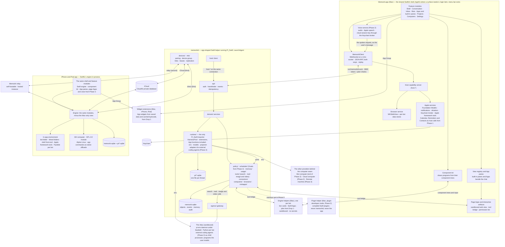
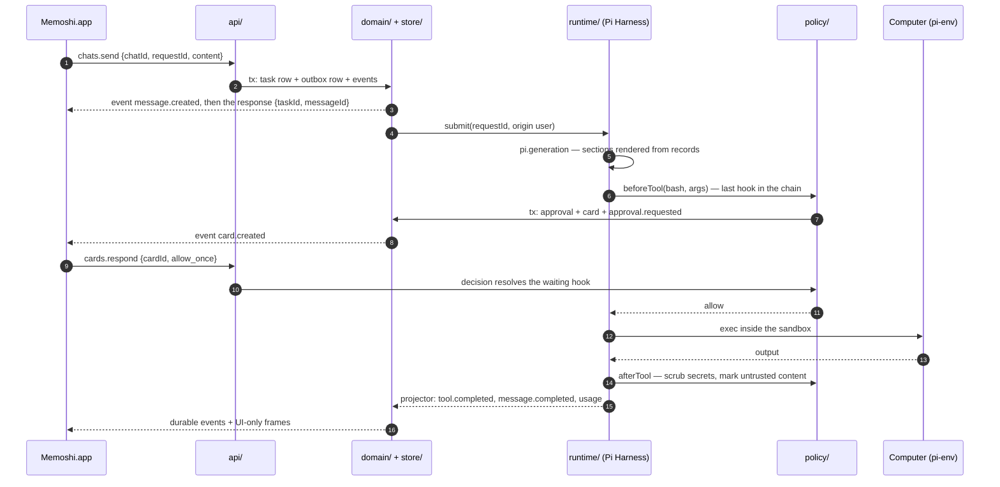
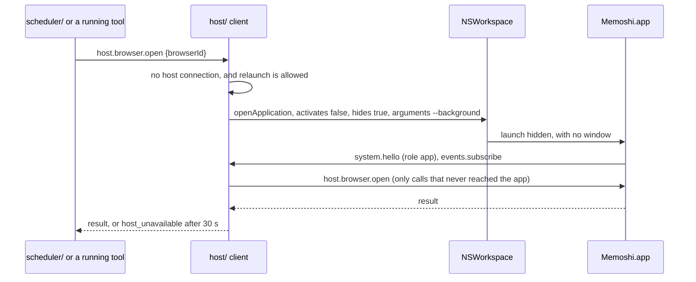
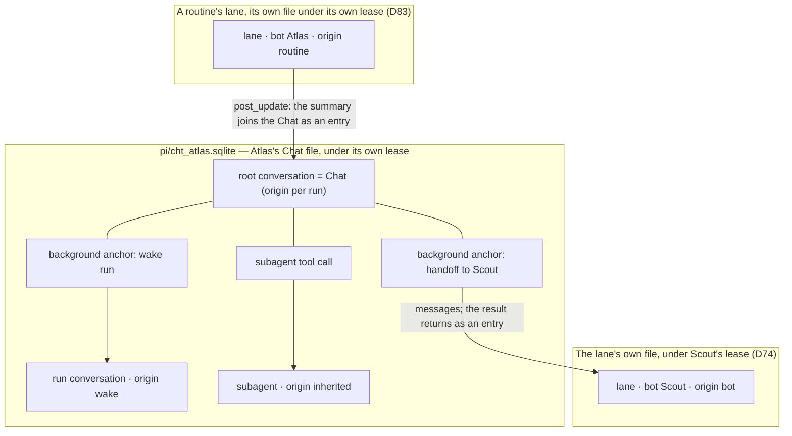
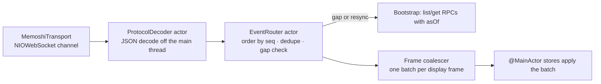

# Architecture

**Status:** Draft 4 · updated through D100 on 2026-11-06; bounded Mac and mobile development implementations are distinguished from the full target below · updated on 2026-11-13 for [D106](decisions.md#d106)–[D122](decisions.md#d122): it now states where the shared shell, App panes, functions and page Apps, streamed cards, voice, the search, mail and media tools, the four computer providers, external coding agents, team mode, Goals and plugin developer mode's helper run ([§2.9](#29-where-the-added-parts-run)); Groups, bot-to-bot messages, Bot computers, Cloud computers and Remote machines are restaged into v1.0; week numbers follow [D122](decisions.md#d122)'s estimated calendar · updated on 2026-11-13 for [D126](decisions.md#d126), [D128](decisions.md#d128) and [D130](decisions.md#d130): what the licence scan covers, `beforeCompact`, the socket fallback folder and host-call slots · updated on 2026-11-14 for [D134](decisions.md#d134): Pi_Swift is consumed at the tag `slice-2` ([§4.1](#41-packages))
**Owns:** Processes and lifecycle on Mac, iPhone and iPad, the engine's modules, the Pi_Swift integration and `RuntimeAdapter`, storage, devices (links, leases and replication), the engine side of typed tools, Python and cards, the Swift engine for live cards and Apps (with its engine helper, background jobs, widgets and signed bytecode), where App panes, page Apps, App functions, the voice service, external coding agents, team mode's landing gate and plugin developer mode's helper run, the iSH computer's GPL module, the Swift app structure, host-capability interfaces, the packaging summary, testing, observability, performance budgets and the Draft 3 port plan.
**Depends on:** [MASTER_PLAN.md](MASTER_PLAN.md) · [decisions.md](decisions.md) · [../specs/protocol.md](../specs/protocol.md) · [../specs/object-model.md](../specs/object-model.md) · [../specs/events.md](../specs/events.md) · [../specs/policy.md](../specs/policy.md) · [05-bots-and-assistant.md](05-bots-and-assistant.md) · [06-computers-and-browsers.md](06-computers-and-browsers.md) · [07-coding.md](07-coding.md) · [08-security-and-privacy.md](08-security-and-privacy.md) · [09-platform-macos.md](09-platform-macos.md) · [phase-0.md](phase-0.md) · [AMENDMENT_2026-11-13.md](AMENDMENT_2026-11-13.md)

"Verified" in this document means checked on 2026-10-20 against upstream's pi-durable 1.3.0 package (README, `dist/**/*.d.ts`, `dist/**/*.js`), the upstream spec [`packages/durable/docs/spec.md`](https://github.com/earendil-works/pi/blob/main/packages/durable/docs/spec.md), and the upstream pi-env, pi-mcp, pi-codemode and pi-ai sources. Memoshi's engine is now Pi_Swift, which ports upstream's latest `main` ([D44](decisions.md#d44)). A verified fact is therefore upstream behavior: on Pi_Swift it holds only once the contract tests ([§5](#5-runtimeadapter)) and the gate of spike S1 ([D46](decisions.md#d46)) pass. Swift names in the sketches come from Pi_Swift's sources as read on 2026-10-22 (Observed), when PiDurable did not compile yet. Anything else about third-party behavior is marked `[INFERENCE]` or "unknown".

**Implementation boundary, 2026-11-06.** Current packages provide `MemoshiStore` at schema 13 (since 2026-11-13; 13 adds the event log's identity, [D131](decisions.md#d131)), authenticated `MemoshiTransport`, `MemoshiDaemon`/`memoshid`, Mac `MemoshiClient`, `MemoshiRuntime` and `MemoshiEgress`. The shared runtime serves real bots, Chats, Sessions, Tasks, recovery holds and review methods. The Mac uses a separate development root and app-owned helper. The mobile `InProcessEngine` owns persistent private stores and serves the same typed API without a socket. The provider catalog supports local OpenAI-compatible endpoints, OpenAI, Anthropic and OpenRouter. OpenAI also accepts Sign in with ChatGPT. The Mac releases model credentials through the app-owned Keychain broker.

Durable policy/approvals, committed tool outcomes, folder authority/native management and `RuntimeWorkingCopy` have bounded development proof. [The local copy journal](../HANDOFF.md#working-copy-ownership-development-proof) records ownership and content-free intents/receipts without automatic re-export. Conversation-wide recovery holds are a separate runtime contract. General metadata-preserving workflows, hard duration/global/live-writer quotas, supported SDK daemon guard/external conformance and full S4/replication/release gates remain open. Normal app/helper tools, MCP, Code Mode, environments and subagents remain disabled. Sample resources remain previews. The complete modules below are the accepted target, not implemented services or Phase 0/release acceptance.

---

## 0. What this document adds to the contract

The binding choices are [D6](decisions.md#d6) as amended by [D44](decisions.md#d44), [D7](decisions.md#d7), [D9](decisions.md#d9), [D12](decisions.md#d12)–[D14](decisions.md#d14) as amended by [D46](decisions.md#d46) and [D49](decisions.md#d49), [D16](decisions.md#d16), [D18](decisions.md#d18), [D42](decisions.md#d42), [D48](decisions.md#d48), [D50](decisions.md#d50)–[D53](decisions.md#d53), [D57](decisions.md#d57), [D58](decisions.md#d58), [D60](decisions.md#d60), [D67](decisions.md#d67)–[D69](decisions.md#d69), [D71](decisions.md#d71)–[D83](decisions.md#d83), [D87](decisions.md#d87)–[D90](decisions.md#d90) and [D95](decisions.md#d95). [D47](decisions.md#d47) sets the v1 scope: Mac, iPhone and iPad; [D109](decisions.md#d109) and [D113](decisions.md#d113) bring what it left for v1.1 into v1.0: Groups in Phase 2, Bot computers at the end of Phase 2 and Remote machines in Phase 3. [D68](decisions.md#d68) puts one Swift engine for live cards and Apps in v1, superseding [D61](decisions.md#d61)'s compile-to-JSON rule and [D62](decisions.md#d62); [D71](decisions.md#d71) adds background jobs, widgets, permission lists and signed bytecode to it, and [D72](decisions.md#d72) widens its language to nearly all of Swift, with exposure tracked value by value. [D73](decisions.md#d73) and [D74](decisions.md#d74) give each conversation its own store, lease and stable runner, merge bot-wide records across devices and make failover safe. [D75](decisions.md#d75) encrypts everything that crosses devices to one MLS group of the user's devices, syncs keys and browser sessions, and asks for biometrics on T4 and T5 approvals; [D76](decisions.md#d76) splits each bot's budget into slices that runners reserve, isolates bots on iPhone and iPad, and gives each bot its own Pyodide. [D77](decisions.md#d77) keeps bot work on the Mac in the sandboxed pi-env daemon, with a fixed fallback order, and adds checkpoints; [D78](decisions.md#d78) runs every program on the Mac in a sandboxed engine helper per bot, and makes Swift types the protocol's source of truth. [D79](decisions.md#d79) makes Apple-data cards live views, adds four recovery rules, keeps bot stores out of device backups with a recovery key for the device group, and settles the widget data, the Code Mode and Pyodide fallbacks and the model catalog. [D80](decisions.md#d80) names the reference devices, puts a small open model on the phone, gives forks their own store and lease, and keeps an only device's stores in its backups. [D81](decisions.md#d81) settles the review's table 1: the engine's watchdog, failure flow, previews and adaptive kit, the bot's digest of App actions, the in-app gateway's WebKit proxy, iSH's default adapter, network fallback and sign-only SSH agent, writes through a temporary file and a rename, and audit chains copied between devices. [D82](decisions.md#d82) settles the review's table 2: pairing through a Noise handshake keyed by the QR code, raced links, live frames only to devices that show a conversation, commits stranded on a lost runner, side threads, signed audit chain heads, wake pushes at fire times, notebook folders synced to the device that runs them, the local transport (amended by [D95](decisions.md#d95) to exact-pinned SwiftNIO), and crash recovery from Pi_Swift's change feed. [D83](decisions.md#d83) settles the review's table 3: lanes of their own for routines and watches, a home Mac for each bot, a hold on the whole store while a step is recovered, steer origins in the outbox, model calls in Code Mode scripts under a spend cap, up to 8 subagents at once, event-driven CloudKit fetches, faster performance targets, and a Swift-native schema validator with deterministic simulation in CI. [D69](decisions.md#d69) adds the iSH computer on iPhone and iPad in v1, superseding [D63](decisions.md#d63), and [D67](decisions.md#d67) makes v1 an app for the user's own devices, with no App Store. [D87](decisions.md#d87) stages delivery: v1.0 ships first, and what this document marks Drop 1 or Drop 2 follows in the two gated drops before v1.1; [D117](decisions.md#d117) and [D122](decisions.md#d122) replace its calendar and its single v1.0 gate with the milestones M1 (the end of Phase 1), M2 (the end of Phase 2) and M3 (the end of Phase 4, which is v1.0). Within these decisions, this document fixes the following:

[D85](decisions.md#d85) sets an App's default presentation on the Mac to a sheet over its conversation; [D114](decisions.md#d114) adds a pane beside the chat to the sheet, window and full-screen forms. [D88](decisions.md#d88) requires a persistent device-local unsent queue when neither the runner nor an allowed model is reachable; only a real model-backed side thread can later join as completed work. [D89](decisions.md#d89) supersedes the earlier Code Mode fallback order. wasm2c ships, WasmKit is the reference and compatibility fallback, and JavaScriptCore is not a backend. [D100](decisions.md#d100) selects the sealed native bridge for Python networking in development, while D81's browser proxy route and physical S6 qualification remain separate.

**D106–D122 (2026-11-13).** [D106](decisions.md#d106) makes the interface one SwiftUI codebase shared by the Mac, iPad and iPhone, written new in this repository. [D108](decisions.md#d108) lets Claude Code, a program the user installs, serve as a bot's model on the Mac. [D109](decisions.md#d109) moves bot-to-bot messages to Phase 1 and Groups to Phase 2, and adds Goals. [D110](decisions.md#d110) adds external coding agents and team mode on the Mac in Phase 2. [D111](decisions.md#d111) adds voice. [D112](decisions.md#d112) and [D116](decisions.md#d116) add the search, mail, image and video tools, and move the Calendar, Reminders and Contacts tools to Phase 1. [D113](decisions.md#d113) puts four computer providers behind one seam. [D114](decisions.md#d114) and [D115](decisions.md#d115) give Apps panes, exported functions, a page form and a Mac-only plugin developer mode, and stream catalog cards. [D119](decisions.md#d119) fixes the word App and keeps every identifier (`mini_app`, `miniApps.*`, `MiniAppsFeature`, `miniapps/`). [§2.9](#29-where-the-added-parts-run) states where each of these runs, following [the amendment's §6](AMENDMENT_2026-11-13.md#6-where-the-new-parts-run), and rows A11–A14 below fix the choices that follow from it.

| # | Choice | Reason |
|---|---|---|
| A1 | **One Pi storage file and one lease per conversation** (Chat, Session, lane; Group from Phase 2, [D109](decisions.md#d109)). A handoff, a routine or a watch runs in a lane of its own ([D74](decisions.md#d74), [D83](decisions.md#d83)); a conversation's subagents and wake runs live in its file. Each file is written only by the runner that holds that conversation's epoch-fenced lease, so one bot may run conversations on two devices at once ([D74](decisions.md#d74), [§2.8](#28-devices-links-runners-and-replicas)). | Pi has no API to delete or purge a conversation (checked in 1.3.0's types and spec, and in Pi_Swift's sources on 2026-10-22). Per-conversation files are the only way to honor "delete this session or bot" and per-bot export. They also limit the blast radius, because a storage error closes its whole Harness. [D74](decisions.md#d74) puts the lease on the same unit, as upstream Pi keeps one file per session; Pi_Swift's requirements E16 and E17 become a store, lease, snapshot and change feed per conversation. |
| A2 | **A run's origin** is the least-trusted origin among the submissions it is answering (`pi.live.run.inputs`), joined to the engine's submission outbox, which also records every steer's origin ([D83](decisions.md#d83)). | Pi hooks see a conversation, not a trigger. The origin rules ([D23](decisions.md#d23), [D27](decisions.md#d27)) need the real origin of each run. |
| A3 | **Approvals wait inside `beforeTool`**, keyed by a durable task memo. | Verified: hooks can rerun after a crash until intent is committed, memos are durable and first-writer-wins, and recovery never reruns `beforeTool` once intent is recorded. |
| A4 | **The policy extension is always last** in every conversation's extension order. | `beforeTool` is an argument-replacement chain and `afterTool` a result-replacement chain. The last hook sees the final arguments and has the last word on results. |
| A5 | **Budgets are enforced by a gating decorator around PiAI's `Models`**, plus abort at 100%. | Verified: a throwing `beforeRequest` is reported and skipped, so it cannot stop a request. |
| A6 | **This Mac = Pi_Swift's `pi-env` daemon inside a Seatbelt sandbox**, driven through `RemoteExecutionEnv`, operating on validated private working copies rather than live granted folders ([D96](decisions.md#d96)). Trusted host admission imports independent file data; model edits stay private; a separate host export requires an immutable proposal, policy/approval, current source authority and conflict checks. Production still requires the S4-qualified kernel boundary and an in-daemon descriptor guard ([D77](decisions.md#d77)); neither the new workflow nor an export approval waives those gates. | Pi's file tools and commands must share the confined env; a host-process `LocalExecutionEnv` is not that boundary. Import/export handles file data, never repository-controlled programs, and staging beneath bot home does not lower the original source path's policy class. App commands use the daemon's existing channel without a new sandbox opening. Agreed with [06](06-computers-and-browsers.md). |
| A7 | **Identity is never stored in `pi.agent.instructions` or in `root()` options.** | Stored agent fields freeze record state, which is the Draft 3 defect. Prompt sections render from the records on every request ([D7](decisions.md#d7)). |
| A8 | **Each store has one writer, and memoshid has a safe mode.** memoshid holds an exclusive lock, Pi_Swift locks each store (requirements E4), and the lease of [D49](decisions.md#d49) extends that lock across devices. | Upstream Pi has no cross-process locking, and two harnesses on one store ran tasks twice (PiDurableKit issue #5, cited in [D49](decisions.md#d49)). A crash loop must stop auto-resume; this follows Aiden's explicit Resume. |
| A9 | **Compile source on each device in v1.0; add the signed cache in Drop 1. Programs never run in memoshid or the Mac app.** The runner of the program's conversation validates each live card and App version, compiling it and listing every tool and web host it can call. Before Drop 1, each device compiles the source locally. From Drop 1 the runner also signs its bytecode, which syncs with the source as a cache: a device runs it only if one of the user's paired devices signed it, its engine version matches and its own verifier accepts it; otherwise it compiles the source itself. On the Mac every live card and App, on screen or, from Drop 1, in a background job, runs in a sandboxed engine helper, one per bot, with no secrets, no files and no network; the app draws the component tree the helper sends and returns the user's input. On iPhone and iPad programs run in the app, each in its own interpreter instance. App widgets arrive in Drop 1 and run in the widget extensions ([D87](decisions.md#d87), [§4.17](#417-the-swift-engine-live-cards-and-mini-apps)). This row covers the Swift engine's programs, live cards and Swift Apps; page Apps, App functions and the compiled plugins of plugin developer mode are A11. | [D71](decisions.md#d71), [D78](decisions.md#d78). Widgets use the cache, so they need no compiler. The signature, the engine version and the verifier bound the trust path that synced bytecode opens between devices, and the runner still refuses any call outside the approved list ([08 TM-35](08-security-and-privacy.md#3-threat-model)). Under D72's near-complete Swift the interpreter is large enough that a bug in it could crash the app, and on the Mac the app holds Keychain access, so a helper with nothing to steal is the safer home ([D78](decisions.md#d78)). Keeping programs out of memoshid keeps bot-written code away from the process that holds policy, the store and the gateway [INFERENCE]. |
| A10 | **The GPL-3.0 module is a leaf.** iSH, any code taken from Open Minis and our provider for them form one module that only the iPhone and iPad app target links. No Apache-2.0 module imports it, and the app registers its provider at launch ([§9](#9-packaging)). | [D69](decisions.md#d69) keeps the rest of the repository Apache-2.0 and the Mac app free of GPL code. A leaf module turns that into a build rule that fails to compile when broken [INFERENCE]. |
| A11 | **On the Mac, bot-written code runs outside memoshid and outside the app's own process, whatever its form** ([D114](decisions.md#d114)). A Swift App runs as A9 says. A page App runs in a sandboxed web view, in WebKit's web content process, and reaches data only through the same tool bridge and approved permission list. An App's exported functions are installed in the runtime as an extension that is replaced in place, and the bot sees them as a Code Mode namespace; the function's code runs inside the App's sandbox, not in the runtime. A plugin written under plugin developer mode, compiled Swift, runs in a separate helper process, on the Mac only ([§2.9](#29-where-the-added-parts-run)). | [D114](decisions.md#d114) keeps [D72](decisions.md#d72)'s rules for bot-written code: sandboxed, a permission list per version, policy on every call, exposure labels, and approval for a version written after untrusted content. Pi_Swift already has runtime install and Code Mode tool registration ([§4.5](#45-registry-and-extension-order), [§4.7](#47-code-mode)). The signed core is never changed at run time. |
| A12 | **A voice session is a client of the conversation's queue, not a second agent loop** ([D111](decisions.md#d111)). The app captures and plays audio and runs Apple's speech recognition and voices. The session hands the user's request to the bot's normal queue as the user's message and speaks the result. | Policy, Cards, budgets and the conversation's lease apply unchanged, so the engine gains no voice-specific run path. |
| A13 | **Claude Code, Codex app-server and ACP agents are separate programs that the user installs and signs in to. Memoshi ships none of them and no runtime for them** ([D108](decisions.md#d108), [D110](decisions.md#d110)). [D46](decisions.md#d46)'s rule stands: no Node ships, outside D46's own fallback for a missed gate on the Mac ([§2.1](#21-processes)). On the Mac the runtime starts an external coding agent as a child process inside the bot's sandbox, and every tool call it makes returns to Memoshi policy through the agent's own permission protocol ([D11](decisions.md#d11)). | [D11](decisions.md#d11)'s route is the one the vendors allow. Memoshi never reads, stores or forwards their credentials and starts no Anthropic sign-in. An agent whose kit needs a JavaScript runtime that Memoshi would have to ship, Cursor's today, stays out ([D110](decisions.md#d110)). |
| A14 | **One computer seam, four providers** ([D113](decisions.md#d113)): This Mac (sandboxed) from Phase 1, Bot computer at the end of Phase 2, Cloud computer in Phase 2 after the local one, and Remote machine in Phase 3. The runtime only ever sees an `ExecutionEnv` ([§4.9](#49-the-env-hook-one-computer-per-conversation)). The in-app environment and the iSH computer on iPhone and iPad are unchanged. | The user chooses per bot, a bot keeps its home and browser profile when it moves, and isolation stays per bot ([D16](decisions.md#d16)). One seam keeps provider cost and lock-in out of the runtime ([06](06-computers-and-browsers.md)). |

## 1. Overview



Bot computers (Linux VMs with Chromium) join at the end of Phase 2, and Cloud computers in Phase 2 after them; Remote machines and the always-on Mac host join in Phase 3 ([D113](decisions.md#d113)). Groups join in Phase 2 ([D109](decisions.md#d109)). [D47](decisions.md#d47) had left these for v1.1, and Cloud computers were v2. Their design stays in this document, marked with its phase, and in [06](06-computers-and-browsers.md). On the Mac, the shared shell, App panes, page Apps, streamed catalog cards, the search and `mail.*` tools, the Calendar, Reminders and Contacts tools, bot-to-bot messages and Claude Code as a model are Phase 1; voice, external coding agents, team mode, Goals, Swift Apps and plugin developer mode are Phase 2; iPhone and iPad follow in Phase 3 ([§2.9](#29-where-the-added-parts-run)). The Swift engine for live cards and Apps ([D68](decisions.md#d68), [§4.17](#417-the-swift-engine-live-cards-and-mini-apps)) and the iSH computer on iPhone and iPad ([D69](decisions.md#d69), [§4.9](#49-the-env-hook-one-computer-per-conversation)) are in v1.0. Two gated drops follow before v1.1 ([D87](decisions.md#d87)): Drop 1 adds the engine's background jobs and widgets ([D71](decisions.md#d71)), its signed bytecode cache, the rest of Swift, rich styling and the adaptive kit; Drop 2 adds the open model on the phone, browser sign-ins on every device, live Apple-data cards and notebook extras. Their design stays in this document, marked Drop 1 or Drop 2. Two rows left the drops: the bot's digest of App actions (CH-31) is Phase 2 ([D114](decisions.md#d114)), and watching and taking over a bot's browser or computer from iPhone and iPad (BRW-15) is Phase 3 ([D113](decisions.md#d113)).

One interactive turn with an approval:



On iPhone and iPad the same steps run inside the app process ([§2.7](#27-iphone-and-ipad)). A voice session enters at the first step like any other client: it sends the spoken request as the user's message and speaks the answer (A12, [D111](decisions.md#d111)). A message sent from a device that is not the conversation's runner is forwarded to the runner, which streams the answer back. Switching UI devices does not move the lease; unreachable-runner failover and idle rebalancing follow [D73](decisions.md#d73) and [D74](decisions.md#d74). When neither the runner nor an available allowed model is reachable, the message instead stays in the device-local unsent queue as **Waiting for connection**, before the transaction and submission shown above ([D88](decisions.md#d88), [§2.8](#28-devices-links-runners-and-replicas)).

### 1.1 Protocol summary

The full specification is [protocol.md](../specs/protocol.md) ([D13](decisions.md#d13)).

- **Transport.** On the Mac, JSON-RPC 2.0 in both directions over one WebSocket per client process, on `run/memoshid.sock` (0600, in a 0700 directory). Both ends use NIOPosix/NIOWebSocket from SwiftNIO **exactly 2.104.0**, through `Packages/MemoshiIPC`'s `MemoshiTransport` ([D95](decisions.md#d95)). The iPhone/iPad `InProcessEngine` serves the implemented development methods through the same typed API, without JSON or a socket ([§2.7](#27-iphone-and-ipad)). Swift types remain the protocol's source of truth, with generated JSON Schema ([D78](decisions.md#d78), [§7.3](#73-generated-protocol-types)).
- **Authentication.** On the **same connected descriptor**, before HTTP handlers or any protocol read/write, both sides require same-user `getpeereid`, `LOCAL_PEERTOKEN` and audit-selected dynamic Security validation. The checks require an Apple anchor, Team ID, sealed expected identifier and hardened runtime. `autoRead` starts disabled. No ad-hoc/debug-relaxation bypass exists. The client validates the daemon before token read, on every connect. The per-daemon-start token then travels in `system.hello` with roles/version/capabilities. A readable token and uid alone are not authority. The implemented get-only Keychain broker revalidates that same carrier before the OS read and before sending the secret ([D13](decisions.md#d13), [D46](decisions.md#d46), [D95](decisions.md#d95); [protocol §3.2](../specs/protocol.md#32-peer-authentication)).
- **Methods.** Namespaced `noun.verb` methods (`chats.send`, `cards.respond`, `browsers.takeOver` …). Every mutating call carries a `requestId` and is answered from the idempotency cache on retry. `cards.respond` is the only user-decision method.
- **Events.** One multiplexed stream of `event` notifications.
  - Durable events carry a global `seq` and a per-conversation `cseq`, are written in the change's transaction, and are sent before the response to the request that wrote them.
  - UI-only frames (deltas, output) go only to focused conversations and use the `offsetUtf16` rule.
  - Replay starts from the last **consumer-applied, explicitly acknowledged** cursor, not the last received event. A cursor outside retention gets `resync`: list-then-watch bootstrap over `asOf`-stamped snapshots; the client acknowledges the barrier only after applying those snapshots ([§7.4](#74-event-pipeline)).
- **Host capabilities.** `host.browser.*`, `host.fm.*`, `host.notify.*` and `host.keychain.*` are daemon-to-app requests on the same connection, served only by the app's host connection. `host.computer.*` comes with Bot computers at the end of Phase 2 ([D113](decisions.md#d113)).
- **Device layer.** Paired devices exchange pairing, lease, replication and remote-environment messages over the direct, relay and iCloud links, encrypted to the user's device group ([D48](decisions.md#d48), [D49](decisions.md#d49), [D75](decisions.md#d75); [protocol.md §12](../specs/protocol.md#12-device-layer); [§2.8](#28-devices-links-runners-and-replicas)). It replaces the relay-only `remote` client role.
- **Added by D106–D122.** The `miniApps.*` methods, the `mini_app.*` events and the `mini_app` tool keep their names ([D119](decisions.md#d119)). The methods and events for views and App panes, App functions, mail accounts, Goals, voice calls, plugin developer mode, the new computer kinds, external coding agents and team mode are in [protocol.md §5.12–§5.18](../specs/protocol.md#512-views-app-panes-and-app-functions) and [events.md §5.20–§5.26](../specs/events.md#520-views-app-functions-scope-and-plugin-developer-mode), and the added host methods in [protocol.md §6](../specs/protocol.md#6-host-capability-methods-daemon-to-app); this summary does not repeat them.
- **Outside the protocol.** The loopback webhook receiver (`ingress/`, Mac only) accepts triggers only and has no control methods.

## 2. Process model

### 2.1 Processes

| Process | What runs there | Started by | Lifetime |
|---|---|---|---|
| **Memoshi.app** | UI: the shared SwiftUI shell ([D106](decisions.md#d106)) with the view registry and the App panes beside the chat ([D114](decisions.md#d114)), plus the host capabilities: the Browser service (WebKit), the Apple services (Foundation Models, notifications, dictation, Keychain broker) and the Apple framework tools of [D50](decisions.md#d50) that need the app's permissions, Calendar, Reminders and Contacts among them from Phase 1 ([D116](decisions.md#d116); [09](09-platform-macos.md)). From Phase 2 it also holds the voice service: audio capture and playback, and Apple's speech recognition and voices ([D111](decisions.md#d111)). It draws the live cards and Swift Apps on screen from the component trees that each bot's engine helper sends, and returns the user's input; no Swift program, page script or plugin runs in its own process ([D78](decisions.md#d78), A11, [§4.17](#417-the-swift-engine-live-cards-and-mini-apps)) | The user; the login item (`SMAppService.mainApp`); memoshid relaunching it hidden ([§2.4](#24-relaunch-hidden)) | Until Quit. Closing the windows keeps it in the menu bar ([D12](decisions.md#d12)) |
| **memoshid** | An app-shaped Swift helper with its own provisioning profile, running Pi_Swift ([D46](decisions.md#d46), [D58](decisions.md#d58)): API server, scheduler, policy, memory, connectors, device layer/CloudKit/push, egress gateway and store; D96's trusted descriptor admission, source/copy binding and policy-bound file-data export, never repository-controlled host programs. From Phase 1 its runtime also holds the typed search and `mail.*` tools, whose traffic passes the egress gateway, and the extensions that carry Apps' exported functions; from Phase 2 the image and video tools, Goals in the scheduler, the adapters that speak to external coding agents, and team mode's landing gate ([D109](decisions.md#d109), [D110](decisions.md#d110), [D112](decisions.md#d112), [D114](decisions.md#d114), [D116](decisions.md#d116); [§2.9](#29-where-the-added-parts-run)) | launchd, as a LaunchAgent registered with `SMAppService.agent(plistName:)` | Always on while registered (`KeepAlive`). Survives app quit, crash and update |
| `pi-env` daemon (This Mac) | File operations, exec and PTYs for one bot computer, confined to private bot home and admitted independent working data, not live source folders (A6, [D96](decisions.md#d96)); full S4 and its daemon guard remain prerequisites | memoshid, through a PiEnv process transport | From the first tool call until 10 min idle ([06](06-computers-and-browsers.md)) |
| Python (This Mac) | The `python` tool's scripts and notebook kernels, run inside the bot's sandbox with its own environment ([D60](decisions.md#d60), [§4.16](#416-python-and-notebooks)) | The bot's `pi-env` daemon, as exec children | Per run; a notebook kernel while its notebook is open, then until 10 min idle ([D83](decisions.md#d83)) |
| Engine helper (This Mac) | One per bot: every live card and App of that bot, on screen or, from Drop 1, in a background job, run by the Swift engine's interpreter with no secrets, no network and no files, in its own sandbox. Its only way out is the tool bridge; it sends component trees to the app and receives the user's input ([D71](decisions.md#d71), [D78](decisions.md#d78), [§4.17](#417-the-swift-engine-live-cards-and-mini-apps), [09 §9.7](09-platform-macos.md#97-the-engine-helpers-sandbox-d71)) | memoshid, when one of the bot's programs opens or a job is due [INFERENCE: or the app for programs on screen; Phase 2 decides] | While the bot has a program open or a job running [INFERENCE]. A crash stops only that bot's programs, and the helper starts again on next use |
| Page App web view (CH-37; Mac from Phase 1, iPhone and iPad from Phase 3) | One page App or interactive artifact: a sandboxed web page in WebKit's web content process. Its only way out is the same tool bridge and approved permission list as a Swift App's ([D114](decisions.md#d114), [D115](decisions.md#d115); TP-07) | WebKit, for a web view the app creates when the App's pane or the artifact opens | While the pane or the artifact is open [INFERENCE: whether a call to an exported function keeps or reopens a closed page App's web view is set in Phase 1] |
| Claude Code as a model (This Mac, Phase 1; MOD-11) | The unmodified `claude` program that the user installed and signed in to, relaying a bot's model requests ([D108](decisions.md#d108)). Memoshi reads none of its credentials and ships no part of it (A13) | memoshid's `runtime/` [INFERENCE: its launch path, its sandbox and how the program's own tools are switched off are set in Phase 1] | [INFERENCE: per request or per conversation; set in Phase 1] |
| External coding agent (This Mac, Phase 2; R11-08, R11-09, R11-10) | Codex app-server, Claude Code or an ACP agent working as a coding worker in a Session: a program the user installs, never one Memoshi ships (A13; [D110](decisions.md#d110), [07](07-coding.md)) | memoshid's `runtime/`, as a child process inside the bot's sandbox [INFERENCE: as an exec child of the bot's `pi-env` daemon, like Python; set in Phase 2] | With its Session's work [INFERENCE: per turn or while the Session is open; set in Phase 2]; killed with its process group at shutdown |
| Plugin helper (This Mac, plugin developer mode, Phase 2; CH-44) | Compiled Swift plugins that a bot wrote, only while the user has plugin developer mode on. A separate process: never memoshid and never the app ([D114](decisions.md#d114)) | [INFERENCE: its launcher, its sandbox and the plugin interface are set in Phase 2; [AMENDMENT §8](AMENDMENT_2026-11-13.md#8-open-items), item 10] | [INFERENCE: set in Phase 2] |
| Bot computer guest (end of Phase 2, [D113](decisions.md#d113)) | Linux VM with a desktop: sshd on vsock, pi-env daemon, Chromium, toolchains | The Computer service in the app | Alternates between `awake` and `sleeping` (saved state) |
| Cloud computer (Phase 2, after Bot computers; V2-02) | A provider's sandbox outside the user's devices, behind the same computer seam: E2B by default, with Orgo and Daytona selectable ([D113](decisions.md#d113), [D120](decisions.md#d120); [06](06-computers-and-browsers.md)) | memoshid's `computers/`, through a provider adapter, after the cost estimate is shown | [INFERENCE: pause and billing follow the provider; set in Phase 2] |
| `ssh` (with Bot computers at the end of Phase 2, and Remote machines in Phase 3; [D113](decisions.md#d113)) | PiEnv's transport to a VM (through the app's vsock bridge) or to a Remote machine | PiEnv, with `BatchMode`, strict host keys and an app-owned known-hosts file (verified in upstream pi-env `src/ssh.ts`) | Per connection |
| MCP stdio servers (Mac only) | Connector tools inside the same qualified private-data boundary; no live source allowance or host-direct model env | memoshid through PiMCP's `StdioTransport`, inside the This Mac sandbox ([CON-07](feature-catalog.md), [D96](decisions.md#d96)) | Per connector; stopped after 10 min idle, like `pi-env`, and started again on the next call ([D83](decisions.md#d83)) |
| `memoshi` CLI | A signed local client with role `cli`, for local triggers and diagnostics ([05](05-bots-and-assistant.md)) | The user or Shortcuts | One invocation |
| **iPhone and iPad app** | UI plus the engine in-process: the engine modules of [§3](#3-memoshid-module-map) except the Mac-only ones, the in-app environment, the Apple framework tools and the Swift engine's interpreter, one instance per program ([D78](decisions.md#d78)), which from Drop 1 also runs App background jobs while the app is the runner of the App's conversation ([D46](decisions.md#d46), [D50](decisions.md#d50), [D68](decisions.md#d68), [D71](decisions.md#d71), [D87](decisions.md#d87)). The shell is the same SwiftUI codebase as the Mac's ([D106](decisions.md#d106)); from Phase 3 it also shows App panes and page Apps and holds the voice service ([D111](decisions.md#d111), [D114](decisions.md#d114)). It has no plugin developer mode, no plugin helper and no external coding agents ([D110](decisions.md#d110), [D114](decisions.md#d114)) | The user; iOS, for background tasks and pushes | iOS suspends and ends it at will; a running turn continues in a `BGContinuedProcessingTask`, and App jobs run in the background time iOS grants ([§2.7](#27-iphone-and-ipad)) |
| WebKit web content process for Pyodide (iPhone and iPad) | One bot's Pyodide for the `python` tool and notebook cells, in a hidden web view the app owns; each bot has its own ([D60](decisions.md#d60), [D76](decisions.md#d76), [§4.16](#416-python-and-notebooks)) | WebKit, when the app creates the bot's web view on first use | Until the app closes it when idle or under memory pressure; an open notebook counts as active and keeps it warm ([D83](decisions.md#d83)). Suspended with the app, and jetsam may end it |
| iSH guest (iPhone and iPad, Phase 3) | The Linux programs of a bot's iSH computer, run by iSH's interpreter on threads inside the app's own process, not as OS processes ([D69](decisions.md#d69), [06 §2.9](06-computers-and-browsers.md#29-iphone-and-ipad-the-emulated-linux-computer-ish)) | The app, when the bot's iSH computer wakes | While the app runs; stopped when idle or under memory pressure |
| Widget extension (Mac, iPhone and iPad) | Memoshi's widgets, and from Drop 1 App widgets drawn by the interpreter and the kit from saved data and cached bytecode, with no compiler and no tool calls ([D71](decisions.md#d71), [D87](decisions.md#d87), [§7.7](#77-platform-surfaces)) | WidgetKit | Per timeline reload, within WidgetKit's budget ([09 §5.4](09-platform-macos.md#54-widgets)) |

Supervision is strictly top-down:

- launchd supervises memoshid (the app does while background running is off, [§2.3](#23-lifecycle)).
- memoshid supervises the `pi-env` daemons, the engine helpers, MCP servers and `git` children, Claude Code when it serves as a model (Phase 1) and external coding agents (Phase 2), and `ssh` once Bot computers ship at the end of Phase 2. It kills their process groups at shutdown. Who supervises the plugin helper is set in Phase 2 [INFERENCE].
- The app supervises WebKit, page Apps' web views included, and VMs once Bot computers ship.
- Only the user, and memoshid's relaunch path, bring the app back.
- On iPhone and iPad, iOS starts and ends the app. The app starts no other process, because iOS apps cannot ([D50](decisions.md#d50)); WebKit's content processes, Pyodide's included, are started by the system for the app's web views, and an iSH guest's Linux programs are threads inside the app ([D69](decisions.md#d69)).
- WidgetKit starts and ends the widget extensions, on every device.

**Fallbacks** ([D46](decisions.md#d46)). The Pi_Swift gate is measured at the Phase 0 review, on macOS and on iOS ([§10](#10-testing-strategy)). If the Mac misses it, memoshid goes back to upstream Pi in bundled Node, as [D6](decisions.md#d6), [D12](decisions.md#d12), [D13](decisions.md#d13) and [D15](decisions.md#d15) read before D46, and Pi_Swift stays on iPhone and iPad. That fallback is the only case in which Node would ship; while the gate holds, D46's rule is that no Node ships. [D108](decisions.md#d108) and [D110](decisions.md#d110) add no such case: the external programs stay the user's own installs either way (A13). If iOS misses it, the v1 iPhone and iPad app is a remote screen for bots that run on the Mac, over the links of [D48](decisions.md#d48), and running bots there moves to v1.1. D44's last resort, the agent loop (PiAgent) plus our own durability layer, stays sized but not built.

### 2.2 Registration

- **Registering.** The app calls `SMAppService.mainApp.register()` for the login item and `SMAppService.agent(plistName:).register()` for memoshid, whose plist lives in `Contents/Library/LaunchAgents/` ([Apple: SMAppService](https://developer.apple.com/documentation/servicemanagement/smappservice)).
- **Status handling.**
  - `.enabled`: nothing to do.
  - `.requiresApproval`: onboarding explains "run in the background" and opens `SMAppService.openSystemSettingsLoginItems()`. Meanwhile the app runs memoshid as its child, so routines run only while the app is open ([09 §8.3](09-platform-macos.md#83-approval-states-and-the-quit-prompt)).
  - `.notFound`: the bundle is damaged, so the app shows a repair screen.
- **Plist** (exact keys and constraints in [09](09-platform-macos.md)):
  - `BundleProgram` points at memoshid's executable inside its app-shaped helper, `Contents/Helpers/memoshid.app/Contents/MacOS/memoshid` ([D58](decisions.md#d58)) [INFERENCE: S5 checks that `SMAppService` accepts a path into a nested bundle]. There is no launcher, interpreter or native addon ([D46](decisions.md#d46)), so the peer checks of [protocol.md §3.2](../specs/protocol.md#32-peer-authentication) bind directly to launchd's job.
  - `RunAtLoad` and `KeepAlive` are true.
  - `LimitLoadToSessionType` is `Aqua`.
  - Launch and spawn constraints are set per 09.
- **No secrets from the environment.** PiAI, like upstream pi-ai, falls back to environment variables when no credential is stored (Observed in Pi_Swift's `PiAI/Auth/AuthRuntime.swift`; upstream README, "Credential Store"). memoshid therefore never inherits the user's shell environment.

### 2.3 Lifecycle

| Event | Memoshi.app | memoshid | Computers | What the user sees |
|---|---|---|---|---|
| Login | The login item starts the app without a window, unless the user asked for one | launchd starts it. It catches up its replicas, renews any lease it still holds ([§2.8](#28-devices-links-runners-and-replicas)), resumes threads with live work and starts the scheduler | Nothing starts until a tool call needs it | Menu bar extra only |
| App launch | Connects, sends `system.hello`, then `events.subscribe` from its in-memory cursor, or from scratch on a cold launch | Keeps serving; nothing restarts | — | Window in < 2 s ([§12](#12-performance-budgets)) |
| Last window closed | Stays in the menu bar; the connection stays open | Unchanged | Unchanged | Menu bar extra |
| App quit (⌘Q) | Closes browser views and disconnects (once Bot computers ship, it first saves every awake VM) | Marks the host unavailable and defers work that needs it. Relaunches the app hidden when that work comes due, unless the user turned this off ([SH-15](feature-catalog.md)) | This Mac keeps working | — (with Bot computers: VMs are saved silently, and a confirmation appears only while a run is active, [D83](decisions.md#d83)) |
| App crash | — | Pending host calls fail with `host_unavailable`, and runs get tool errors. Relaunches the app hidden after 5 s, at most 3 times in 10 min | This Mac keeps working. Once Bot computers ship, VMs die with the app because they run in its process, and the next start is a cold boot | An Inbox item if work failed |
| memoshid crash | Shows `reconnecting`, then replays from its cursor | launchd restarts it. Boot reconciles state and resumes work ([§4.11](#411-replay-and-idempotency)). A lease that expired meanwhile stays with the device that took over, and memoshid catches up as a replica ([§2.8](#28-devices-links-runners-and-replicas)) | pi-env daemons and MCP servers die with their parent's process group and restart lazily | Replay-safe work continues on its own. An interrupted step with side effects runs its outcome check, and waits for a Resume card if the check cannot settle it ([D42](decisions.md#d42), [D51](decisions.md#d51)) |
| memoshid crash loop (≥ 3 in 5 min) | Shows a banner with **Resume** | Boots in safe mode: no scheduler and no `resume()`, but reads still work. `system.exitSafeMode` leaves it | Nothing starts | "Bots paused after repeated crashes" ([Aiden pattern](../research/agentic-workspace-landscape/projects/aiden-agent.md)) |
| Sleep | Sends `system.power {state: "will_sleep"}` | Pauses the scheduler; calls already running continue. Its leases expire after the timeout, so another device can continue its bots ([D49](decisions.md#d49), [O10](decisions.md#open-decisions)) | — | — |
| Wake | Sends `did_wake` | Applies each routine's missed-run policy and reconnects pi-env lazily on the next operation. Without the app, it learns of sleep and wake from IOKit's power notifications (`IORegisterForSystemPower`), with a jump between wall-clock and monotonic time as the backstop ([D83](decisions.md#d83)). It catches up from the log for bots another device ran meanwhile, and skips firings already run elsewhere | — (with Bot computers: VMs resume; the guest agent resyncs its clock) | At most one catch-up run per routine |
| Sparkle update | See [§2.5](#25-updates) | Quiesces, then restarts from the new bundle | — (with Bot computers: VMs are saved before the install) | "Restarting to update" |
| "Run bots in the background" turned off | Calls `SMAppService.agent(…).unregister()` | Leaves launchd. While the app is open, the app runs memoshid as its child ([09 §8.3](09-platform-macos.md#83-approval-states-and-the-quit-prompt)), so routines run only while the app is open | — | Settings explains the trade-off |
| Stop all bots | Calls `bots.stopAll` ([SEC-22](feature-catalog.md)) | Cancels runs and pending approvals, pauses routines, wakes, watches, App jobs and, from Phase 2, Goals, closes egress. Pressed on any device, it stops every bot on every device, and it wins over concurrent offline edits ([D75](decisions.md#d75), [§2.8](#28-devices-links-runners-and-replicas)) | — (with Bot computers: they are saved) | Kill-switch confirmation |

Bot computers ship at the end of Phase 2 ([D113](decisions.md#d113)); the cells above that name VMs apply from then.

### 2.4 Relaunch hidden



- **Launch call.** memoshid calls `NSWorkspace.openApplication(at:configuration:)` with `activates = false` and `hides = true`, a typed AppKit API, instead of relying on the flags of `open(1)` ([D83](decisions.md#d83)).
- **No retry of delivered calls.** A call the app received before it died is never replayed automatically. Its tool gets an error, and its effect is reconciled by the effects ledger ([§4.11](#411-replay-and-idempotency)).

### 2.5 Updates

1. Sparkle has an update ready. The app postpones relaunch with the updater delegate's postpone hook (`updater(_:shouldPostponeRelaunchForUpdate:untilInvokingBlock:)` in `SPUUpdaterDelegate`).
2. The app calls `system.prepareForUpdate`. memoshid holds the scheduler, stops admitting runs, and waits up to 60 s for running tool calls (Pi recovers whatever is still in flight). It then checkpoints the WAL, closes every Harness and answers `ready`. Quiescing also protects Code Mode: a script rerun after an upgrade fails if the sandbox fingerprint or Code Mode version changed (verified, README "Code Mode").
3. The app closes its browser views (once Bot computers ship, it first saves every awake VM), then lets Sparkle install.
4. The new app connects. The daemon is older, so the app re-registers the agent if its plist changed and calls `system.shutdown {reason: "update"}`. launchd restarts memoshid from the new bundle.
5. The new memoshid backs up every store that a migration will touch, `memoshi.sqlite` and Pi files alike, then migrates ([§6.6](#66-migrations)) and resumes ([D44](decisions.md#d44)).
6. If it fails its health check three times, the app offers a restore: the pre-migration backup plus a re-download of the last good build, because Sparkle has no rollback ([DIST-05](feature-catalog.md)).

On iPhone and iPad a new TestFlight or Xcode build ([D67](decisions.md#d67)) replaces the app while it is not running. At the next launch the app backs up any store a migration will touch, migrates and resumes committed turns ([D44](decisions.md#d44), [§2.7](#27-iphone-and-ipad)). Migrations expand, then contract, so the previous app version can still read and run every store; a device on anything older is a read-only replica with an **Update Memoshi** prompt and never takes a lease ([D74](decisions.md#d74), [§2.8](#28-devices-links-runners-and-replicas)).

### 2.6 Single instance and failure isolation

- **One daemon.** memoshid takes an exclusive `flock` on `run/memoshid.lock` before it opens any storage, and a second instance exits with `already_running`. Upstream Pi says "One process owns a storage at a time; there is no cross-process locking" (verified, README "Storage"). Pi_Swift adds an exclusive lock per store (requirements E4), and the lease extends it across devices ([§2.8](#28-devices-links-runners-and-replicas)).
- **One app.** The app is single-instance (`LSMultipleInstancesProhibited`), and memoshid accepts one `host` registration at a time.
- **App crashes take VMs down (from the end of Phase 2, [D113](decisions.md#d113)).** Hosting VMs in the app is D12's accepted trade. [O3](decisions.md#open-decisions) revisits a helper process at the VM spike, at the start of the Bot computer work in Phase 2.

### 2.7 iPhone and iPad

The iPhone and iPad app is one universal app, and the engine runs inside it ([D46](decisions.md#d46), [D47](decisions.md#d47)). There is no daemon.

The current `MobileEngineHost` composes `InProcessEngine`, the Store and Pi stores in its private backup-excluded container. `InProcessChatModel` applies conversation/provider/task/review snapshots and events through `MemoshiAPI`. This is a live development integration, not the separate Design Preview. The remaining lifecycle, tool, device and physical-background requirements below are not implied by that implementation.

- **One process.** The UI, the engine modules of [§3](#3-memoshid-module-map) except the Mac-only ones, and the host services run in the app. Host capabilities are in-process calls, not `host.*` requests. The UI calls the engine through a typed Swift API, with no JSON inside the process, the same API the Mac app uses over its socket ([D78](decisions.md#d78), [§7.3](#73-generated-protocol-types)).
- **Turns in the background.** When the user leaves the app, a running turn continues inside a `BGContinuedProcessingTask` that shows its progress. A host adapter maps the engine's wake signal (`HarnessOptions.onWake`) to the next background opportunity (Pi_Swift requirements E1–E3).
- **Resume at launch.** iOS can end the app at any time. Closing it from the app switcher cancels a continued-processing task, and "the app doesn't receive an indication" (requirements E2). At the next launch the engine resumes committed turns, and interrupted steps follow [D42](decisions.md#d42) and [D51](decisions.md#d51) ([§4.11](#411-replay-and-idempotency)). Upstream's crash-loop guard, which parks a task cut off 5 times in a row (`settings.restartLimit`), is ported in Pi_Swift but unverified.
- **Private stores** ([D79](decisions.md#d79)). Bot stores stay private in the app's container, with one writer per store (requirements E4, extended by the lease of [D49](decisions.md#d49)); a second open of the same store is refused. Memoshi's widgets read a small exported snapshot, and App widgets, from Drop 1, a copy of their saved data and signed bytecode, which the app writes to its App Group container, and Shortcuts actions run in the app's own process, so no extension opens a store. This answers Pi_Swift's E4 question ([§7.7](#77-platform-surfaces)).
- **The in-app environment** ([D50](decisions.md#d50)). iOS apps cannot start processes, so bots get no real shell. They work in their folder in the app's container and in folders the user links (security-scoped bookmarks), through the typed tools and the shell front end ([§4.14](#414-typed-tools-and-the-shell-front-end)). Each bot holds handles to its own folder and its linked folders, and every file operation resolves relative to those handles without following symlinks, so no path check can be raced ([D76](decisions.md#d76); [09 §12.4](09-platform-macos.md#124-files-and-the-shell-front-end)). Writes go through a temporary file that is renamed into place inside the verified folder ([D81](decisions.md#d81)). Code Mode runs in PiCodeMode, and MCP connects over HTTP only ([§4.7](#47-code-mode), [§4.8](#48-mcp-through-pimcp)).
- **Python** ([D60](decisions.md#d60), [D76](decisions.md#d76)). Pyodide, bundled with NumPy, pandas, SciPy and Matplotlib, runs in a hidden web view the app owns, one per bot, started on first use and closed when idle or under memory pressure, as the in-app environment's `python` tool; an open notebook keeps it warm ([D83](decisions.md#d83)). Its network goes through the in-app gateway. Long runs go to the Mac's Python over cross-device calls ([§4.16](#416-python-and-notebooks)).
- **The in-app gateway** ([D76](decisions.md#d76), [D81](decisions.md#d81), [D100](decisions.md#d100)). The app hosts the egress gateway itself. App tools call it in-process. Python reaches it through the sealed native bridge, with a gateway decision for each hop and no direct worker HTTP(S) access. D81's bot-browser route remains a loopback proxy, bound only while needed with a random credential per launch. The iSH guest uses that proxy only if it needs one. The browser proxy and content-rule fallback still need S3 confinement qualification ([06 §2.7](06-computers-and-browsers.md#27-iphone-and-ipad-the-in-app-environment)).
- **The iSH computer** ([D69](decisions.md#d69); IOS-06, Phase 3). An optional computer next to the in-app environment: ARM64 Alpine Linux emulated by iSH inside the app's process. It lives in the GPL-3.0 module ([§9](#9-packaging)). PiEnv reaches it through a host-side adapter by default; the iSH probe confirms it, and a pi-env daemon in the guest is used only if the conformance suite needs it ([§4.9](#49-the-env-hook-one-computer-per-conversation), [D81](decisions.md#d81)). Its network goes through the in-app gateway, or is off if the probe cannot route it there, and its `ssh` and `git` sign through an agent socket backed by the broker, which never hands out a key ([D81](decisions.md#d81)).
- **Memory and the reference devices** ([D80](decisions.md#d80)). The reference devices are an iPhone 14 Pro (A16, 6 GB [Claim]) and an iPad Pro 12.9-inch (5th generation, M1) ([09 §12](09-platform-macos.md#12-iphone-and-ipad-d56)). The app requests the increased-memory-limit entitlement [INFERENCE: its effect on a 6 GB device is measured], and on the iPhone the heavy runtimes (Pyodide, the iSH guest and the on-device model) take turns instead of loading together [INFERENCE].
- **Secrets** stay in Keychain ([D14](decisions.md#d14)), synced through iCloud Keychain unless the user marks one "this device only" ([D75](decisions.md#d75)). The engine shares the app's process, but secret reads still go through an in-process broker that applies the same purpose checks and logs every release, as on the Mac ([D76](decisions.md#d76)).
- **Platform rules** ([D56](decisions.md#d56), [D67](decisions.md#d67)): iOS 27+ and iPadOS 27+. v1 installs only on the user's own devices, through TestFlight internal testing or from Xcode, so App Review does not shape it. iOS's own limits hold: no JIT, no child processes, and limits on background time and memory ([09 §12](09-platform-macos.md#12-iphone-and-ipad-d56)). Every feature, the shell commands, Code Mode, Python, the Swift engine and the iSH computer included, is documented in the app; the App Review notes for a later public release (O13) are in [09 §12.6](09-platform-macos.md#126-app-review).
- **Background work** is limited on iOS. When a Mac runs a conversation, the iPhone or iPad forwards messages to it, so suspending the app stalls no run ([D73](decisions.md#d73)), and an idle conversation's lease returns to the bot's home Mac when it is awake and reachable, so routines run there ([D74](decisions.md#d74), [D83](decisions.md#d83), [§2.8](#28-devices-links-runners-and-replicas)). From Drop 1, App jobs run in the app only while it is the runner of the App's conversation and iOS grants it time: in the foreground, or in a `BGAppRefreshTask` or `BGProcessingTask` [INFERENCE: Drop 1 picks which job uses which], so they may run late ([D71](decisions.md#d71), [D87](decisions.md#d87), [09 §12.10](09-platform-macos.md#1210-mini-app-jobs-and-widgets-d71)).
- **Apps, panes and voice** ([D111](decisions.md#d111), [D114](decisions.md#d114), [D116](decisions.md#d116); CH-23, AP-21, CON-20, VO-05, VO-06; Phase 3). An App's pane opens full screen on iPhone and as a side-panel tab on iPad. A page App runs in a sandboxed web view that the app owns, and a Swift App in the app's interpreter as above. The six built-in panes and the `mail.*` tools reach iPhone and iPad in this phase. The voice service runs in the app; the Action Button and the Start Voice Chat App Intent start a call, and a Live Activity shows it ([§7.7](#77-platform-surfaces)).
- **What stays on the Mac** ([D108](decisions.md#d108), [D110](decisions.md#d110), [D114](decisions.md#d114)). Plugin developer mode, the plugin helper and "Full access on this Mac" do not exist on iPhone or iPad, and external coding agents run only on the Mac. A bot whose model is Claude Code has the Mac as its runner: from iPhone and iPad its messages forward to the Mac ([D73](decisions.md#d73)) and wait while the Mac is unreachable ([D88](decisions.md#d88)) [INFERENCE: how the lease authority keeps such a conversation's lease on a Mac is set in Phase 3].

### 2.8 Devices: links, runners and replicas

Every bot, the Assistant included, runs on every paired device with the same identity, settings, memory and one continuous history ([D49](decisions.md#d49)). The device layer ([protocol.md §12](../specs/protocol.md#12-device-layer)) carries pairing, leases, forwarding, replication, merging and cross-device tool calls, all encrypted to the user's device group ([D75](decisions.md#d75)); the `devices/` and `mls/` modules implement it ([§3](#3-memoshid-module-map)). Spike S2 sets the lease timeout, the hand-over time and the replica lag ([O10](decisions.md#open-decisions)).

- **Pairing** ([D48](decisions.md#d48), [D75](decisions.md#d75), [D82](decisions.md#d82)): a Noise handshake (IKpsk2) whose pre-shared key is the one-time key in a QR code, with no PAKE. A pairing message that does not fit one encrypted message is sent in several, at most 256 KiB in total, and a device group holds at most 64 devices ([D132](decisions.md#d132)). It is mutually authenticated and never reusable; the code expires after 5 minutes, or as soon as its screen closes; and the handshake also authenticates the new device as it joins the device group (below). Every device has its own keys, kept in Keychain on that device only ([D14](decisions.md#d14)), and any paired device can revoke a lost one. Revoking a device moves the group to a new epoch and withdraws the device's data keys, which erases its replicas ([D75](decisions.md#d75)) [INFERENCE: how a revoked device that stays offline loses them].
- **Links,** raced in this order, Happy Eyeballs-style: each link starts a moment after the one above it, the first to connect carries the traffic, and traffic moves up to the direct link as soon as it appears ([D82](decisions.md#d82)). Everything they carry is encrypted to the device group ([D48](decisions.md#d48), [D75](decisions.md#d75)):
  1. **Direct:** the same network, found through Bonjour, or any address the user already reaches, such as a tailnet or VPN name. Live streaming.
  2. **Relay:** Memoshi's relay, self-hostable, with a hosted instance that we run. Live streaming, plus store-and-forward away from home. Pushes go through our own APNs sender with content-free payloads.
  3. **iCloud:** the user's CloudKit private database, as a mailbox and sync log. Fields are end-to-end encrypted (`encryptedValues`) and hold only ciphertext encrypted to the device group, and CloudKit subscriptions wake devices with content-free alerts. No Memoshi server is involved.

  The relay and iCloud each carry everything a device needs to catch up, so either one alone is enough. The user can turn either off; with both off, devices sync only while directly connected. Neither service can read content, but both see timing, sizes and device identifiers.
- **The device group** ([D75](decisions.md#d75)). The user's devices form one MLS group (RFC 9420). Everything that crosses devices, the iCloud sync log and the relay's store-and-forward messages included, is encrypted to the group, with forward secrecy and a new epoch whenever a device joins or is revoked. Pairing adds the new device, authenticated by the handshake that the QR code keys ([D82](decisions.md#d82)). The lease authority's compare-and-swap orders the group's commits, so two devices never commit to the same epoch [INFERENCE]. `mls/` wraps `awslabs/mls-rs` (Apache-2.0 or MIT) through its UniFFI Swift bindings with its CryptoKit provider [INFERENCE: the library D75 names]. mls-rs states full RFC 9420 conformance, but "has not yet received a full security audit by a 3rd party" (Claim, its README; [08 TM-40](08-security-and-privacy.md#3-threat-model)). A recovery key, kept in iCloud Keychain, lets a new device join the group and read the iCloud sync log when no old device is left ([D79](decisions.md#d79)) [INFERENCE: how the key admits the device is set in Phase 3].
- **One runner per conversation** ([D74](decisions.md#d74)). Each conversation (a Chat, a Session, the lane of a handoff, a routine or a watch, [D83](decisions.md#d83), and from Phase 2 a Group, [D109](decisions.md#d109)) has its own durable store and its own lease with a fencing epoch, so one bot may run conversations on two devices at once. The conversation's runner is the only device that writes its store; every write carries the epoch, and a write with an older epoch is rejected. This extends Pi_Swift's store lock (requirements E4), and E16 and E17 become a store, lease, snapshot and change feed per conversation. The lease is granted by a compare-and-swap on one authority ([protocol.md §12.6](../specs/protocol.md#126-leases-and-hand-over)):
  1. the user's CloudKit record, when iCloud is on;
  2. otherwise the relay;
  3. when neither is reachable, the lease moves only between devices that are directly connected, and the new runner is provisional (below).
- **A stable runner and forwarding** ([D73](decisions.md#d73)). An awake, reachable runner keeps its conversation. When the user writes from another device, that device forwards the message to the runner and streams the answer back, so switching devices forces no hand-over, and suspending the iPhone app stalls no run that the Mac is running.
- **Hand-over and rebalancing.** If the runner cannot be reached (a sleeping Mac, a phone app that iOS suspended or that was killed), its lease expires after a short timeout, and another device continues from its replica, brought up to the last commit through the change feed (requirements E17). UI device switching alone never transfers the lease. A free lease goes to an awake Mac first ([D73](decisions.md#d73)). Each bot has one home device, `Bot.homeDeviceId`: the device the user pins for the bot's work, which for Mac work is its home Mac; from Phase 3 an always-on Mac host (R11-07, [D113](decisions.md#d113)) becomes every bot's home by default ([D82](decisions.md#d82), [D83](decisions.md#d83)). When the home device is awake and reachable and a conversation is idle, its lease returns there, so routines and Mac tools run there again ([D74](decisions.md#d74), [D83](decisions.md#d83)). When several awake devices qualify, the one that holds the conversation's data and the needed grants takes the lease; among those, the home device comes first, then one on mains power ([D82](decisions.md#d82)). A pending approval moves with the store: the new runner reruns `beforeTool`, which finds the same Approval through its memo, as after a kill (A3). Anything in flight follows [D42](decisions.md#d42) and [D51](decisions.md#d51) ([§4.11](#411-replay-and-idempotency)).
- **Safe failover** ([D73](decisions.md#d73)). A runner whose lease the authority has not confirmed, after a direct hand-over while iCloud and the relay are unreachable, is provisional: it may read, think and draft, but makes no external effect until the authority confirms. Before any external effect runs, its intent is copied to another device or the relay, so a runner that takes over after a failure runs the step's outcome check instead of repeating the effect ([§4.11](#411-replay-and-idempotency)). The host does both in `beforeTool`, so Pi_Swift needs no new engine feature for them (requirements E6, E20) [INFERENCE]. Steps that a runner committed but could not replicate before its lease lapsed are not lost: when that device is back, they rejoin the conversation like a side thread, as one entry that the new runner writes ([D82](decisions.md#d82)).
- **Live replicas.** Every other device keeps a read-only replica of each conversation's history, cards and status. Durable changes stream in real time over the links, and a device that was offline catches up from the log. UI-only frames, such as deltas and tool output, stream only to the devices that are showing the conversation, coalesced to about 10 a second ([D82](decisions.md#d82)). A transcript lives once, in its runner's store ([D7](decisions.md#d7) as amended by D49), and transcripts are never merged. Each device's audit chain travels the same way, as a read-only copy on the other devices, and `audit.export` merges the chains ([D81](decisions.md#d81)). Each device signs its chain head with its device signing key, the other devices keep the signed heads as anchors, and verification checks every chain, the copies included ([D82](decisions.md#d82)).
- **Answers from any device.** A card appears on every device ([D51](decisions.md#d51)), and the answer goes to the runner, where policy decides ([§4.10](#410-policy-hooks)). An answer made while the runner is unreachable waits only until its card expires: it applies if the card is still pending when the runner is reached, and otherwise it is dropped and the user is told ([D73](decisions.md#d73)).
- **Tools run where they live** ([D49](decisions.md#d49), [D50](decisions.md#d50)). Every typed tool declares where it can run ([§4.14](#414-typed-tools-and-the-shell-front-end)): the Mac only (the shell, Mac files, Mac-only command-line tools, local models, Claude Code as a model, and from Phase 2 external coding agents and the compiled plugins of plugin developer mode; [D108](decisions.md#d108), [D110](decisions.md#d110), [D114](decisions.md#d114)), iPhone and iPad only (frameworks that exist only there), or any device (data that iCloud already syncs, such as Reminders, Calendar and Contacts; Weather, Maps and the web). A runner calls another device's tools through Pi's remote environment over the links (requirements E18). The bot's home Mac, its home device for Mac work (above), serves its Mac-only tools for runners on other devices ([D83](decisions.md#d83)). When several devices could run a call, the awake one that holds the data and the grant runs it; among those, the bot's home device comes first, then one on mains power ([D82](decisions.md#d82)). Policy decides on the runner, and the executing device re-checks its own grants before the call runs. If that device is unreachable, the step waits ("Waiting for your Mac") under the normal approval expiry. If the wait expires, the call returns `device_unreachable`: it never ran, so it is not a denial ([D82](decisions.md#d82)).
- **Background work.** Routines and watches run in their own lanes, each under its own lease; a firing is claimed in that lane's store by its runner, not in the bot's Chat. The Chat's runner writes only the idempotent report. Wakes run in the conversation that set them ([D83](decisions.md#d83)). Rebalancing returns an idle conversation's lease to the bot's home Mac, so they run there whenever it is awake and reachable ([D74](decisions.md#d74), [D83](decisions.md#d83)). A routine that needs Mac tools waits for the home Mac. iOS gives apps only limited background time, so when a phone or tablet runs a routine, the relay wakes it with a content-free push at each fire time, and a fire that still starts past its grace window follows the routine's missed-run policy ([D49](decisions.md#d49), [D82](decisions.md#d82)). From Drop 1, App jobs run on the runner of the App's conversation ([D71](decisions.md#d71), [D87](decisions.md#d87), [§4.17](#417-the-swift-engine-live-cards-and-mini-apps)).
- **No runner and no model: queue** ([D88](decisions.md#d88)). When neither the conversation's runner nor an available allowed model is reachable, the client keeps the user's messages in its persistent device-local unsent queue and shows **Waiting for connection**. It preserves each existing client `requestId` across restart and reconnect; cancellation before delivery leaves nothing to send. Queuing does not write the authoritative conversation store, acquire or steal a lease, start a model turn, call a tool or cause an external effect. It creates no assistant answer or model-written summary. On reconnect, uncanceled messages use the existing forwarding and idempotent submission path to the current confirmed runner with their original `requestId`; current grants, budgets and recovery holds still apply. This extends the existing unsent/outbox path ([§4.11](#411-replay-and-idempotency), [§6.1](#61-stores)), not Pi_Swift or a second scheduler.
- **Runner unreachable, model available: side threads.** Runner reachability and model reachability are separate: internet access alone does not reach a runner, and a wholly disconnected device can answer only with an available on-device model. If a device can neither reach the conversation's runner nor take its lease but can use an allowed model, it may run a real side thread under the existing policy and budget rules: a child conversation in its own store (requirements E19). Each Chat or Session has at most one open side thread on that device ([D82](decisions.md#d82)). On reconnect an available allowed model writes its summary, followed by the exact effect list from its records; the confirmed runner appends that summary and results as one entry, and memory written there syncs. Once joined, the side thread replicates read-only to the other devices. An unsent message is delivered normally, never joined as a completed side thread. No store gets a second writer ([D88](decisions.md#d88)).
- **Bot-wide records merge** ([D74](decisions.md#d74)): memory entry by entry ([D22](decisions.md#d22)), merging validity windows, statuses and deletions so that a whole scope is never overwritten, and configuration records field by field (below).
- **Configuration records** ([D73](decisions.md#d73); [object-model.md §3.4](../specs/object-model.md#34-runner-replicas-and-record-ownership)). Bot settings, grants, routines, skills and other configuration records can be edited on any device, offline included, and merge field by field under hybrid logical clocks, with add-wins sets for lists. Restrictive changes win: a revoked grant, a lowered permission mode, a paused routine or a stop beats a concurrent loosening, until the user loosens again on a device that has seen the restriction. Decisions (card answers, approvals and drafts) still go to the runner, and histories stay single-writer.
- **App saved data** is a CRDT: edits apply at once on any device, offline included, and merge per item and per field when devices meet ([D73](decisions.md#d73)).
- **Bot-wide limits.** Each active runner reserves a slice of the bot's remaining budget through the lease authority, spends locally within it, renews it as needed, and returns the unspent part when its conversation goes idle or its lease ends; a provisional runner spends only the slice it holds. A bot never overruns its cap by more than one in-flight model call per runner ([D76](decisions.md#d76), [§4.13](#413-models-usage-and-budgets)). Other bot-wide limits, such as run caps, use merged counters that can briefly overshoot ([D74](decisions.md#d74)) [INFERENCE: how the counters merge].
- **Older app versions** ([D74](decisions.md#d74)). Store migrations expand, then contract, so the previous app version can still read and run every store. Anything older is a read-only replica with an **Update Memoshi** prompt and never takes a lease.
- **Settled by [D58](decisions.md#d58):** memoshid ships as an app-shaped helper with its own provisioning profile, so on the Mac it uses CloudKit and push itself, and the iCloud link and the lease keep working while the app is quit or has crashed. If S5 finds that the windowless helper cannot register for push, the app receives the pushes and forwards them to memoshid over the socket, and an awake Mac keeps its live relay connection; CloudKit stays in memoshid either way ([09](09-platform-macos.md#7-memoshid-a-swift-executable-d46)).
- **CloudKit mechanics** (S2 and S5 test them):
  - The iCloud link's mailbox and sync log use `CKSyncEngine`, Apple's sync engine for CloudKit (macOS 14 and iOS 17 onward). It handles change tokens, batching, retries and account changes, and relies on pushes to learn about remote changes ([WWDC23](https://developer.apple.com/videos/play/wwdc2023/10188/)).
  - The lease is a direct `CKModifyRecordsOperation` save with `savePolicy = .ifServerRecordUnchanged`, which fails if the record changed since it was read. A lease needs an immediate yes or no, and `CKSyncEngine` schedules and batches its sends.
  - Without pushes, memoshid fetches explicitly at launch, on wake and when the relay nudges it, with a slow timer as the backstop ([D83](decisions.md#d83)). CloudKit on macOS otherwise syncs when an app comes to the foreground ([DTS](https://developer.apple.com/forums/thread/756315)), which memoshid never does. One open-source report says `CKSyncEngine` skips such fetches when no push marked anything changed [Claim: CodexBar issue #4132], so S2 checks which explicit fetch works.

<a id="29-where-the-added-parts-run"></a>
### 2.9 Where the parts added by D106–D122 run

This table follows [the amendment's §6](AMENDMENT_2026-11-13.md#6-where-the-new-parts-run) and adds each part's phase. "The runner" is the conversation's runner ([§2.8](#28-devices-links-runners-and-replicas)). Phase 1 and Phase 2 are Mac work; "3" means iPhone and iPad. Internal design that the decisions do not settle is marked `[INFERENCE: set in Phase N]`.

| Part | Runs in | Phase | Notes |
|---|---|---|---|
| Shell ([D106](decisions.md#d106)) | The app: one SwiftUI codebase for the Mac, iPad and iPhone, with AppKit or UIKit only where a surface needs it | 1; 3 | Written new in this repository. No Kuvo- or Cognitio-derived source file, asset or string enters it ([§7.1](#71-packages), [§9](#9-packaging)) |
| View registry and App panes ([D114](decisions.md#d114); CH-33, CH-35, CH-36) | The app. The registry holds what can open beside the chat, the built-in panes and each App's pane, and keeps the layout per device | 1; 3 | The bot's `view.open`, `view.close`, `view.arrange` and `view.list` are typed tools in the runner's runtime that change only what is shown [INFERENCE: how a call reaches the registry on each device that shows the conversation is set in Phase 1, with [protocol.md](../specs/protocol.md)] |
| Built-in panes ([D116](decisions.md#d116); AP-15 to AP-20, AP-21 on iPhone and iPad) | The app, written against the same App contract: Mail, Calendar, Reminders merged with Tasks, Contacts, Notes (Markdown files), and Files with the Library | 1; 3 | What the user does in a pane is the user's action, not a bot's |
| App code ([D114](decisions.md#d114); CH-37, CH-22, CH-23) | A Swift App: the bot's engine helper on the Mac, and the app on iPhone and iPad (A9). A page App: a sandboxed web view, on every device | Page Apps 1; 3. Swift Apps 2; 3 | Tool calls go to the runner, where `miniapps/` checks the approved permission list and policy decides, as for every App ([§4.17](#417-the-swift-engine-live-cards-and-mini-apps)) |
| App functions ([D114](decisions.md#d114); CH-34) | The runner's runtime installs the function namespace: an extension that is installed and replaced in place, exposed to the bot as a Code Mode namespace. The function's code runs inside the App's sandbox | 1 | Pi_Swift already has runtime install and Code Mode tool registration ([§4.5](#45-registry-and-extension-order), [§4.7](#47-code-mode)). A call is class `app.call`; each tool call the function makes is classified on its own, inside the App's approved permission list ([policy.md](../specs/policy.md)) |
| Streamed catalog cards ([D115](decisions.md#d115); CH-19, CH-25) | The runner's runtime emits partial card data as the model writes it; the app validates the data against the block catalog as it arrives and draws it | 1; 3 | The finished card is still validated on the runner before it is stored ([§4.15](#415-cards)) |
| Voice ([D111](decisions.md#d111); V2-09, VO-01 to VO-06) | The app: audio capture and playback, and Apple's speech recognition and voices. The key for a cloud session comes through the Keychain broker | 2; 3 | The voice session is a client of the conversation's queue (A12) |
| Search, mail, image and video tools ([D112](decisions.md#d112), [D116](decisions.md#d116); CON-15, CON-16, CON-08, CON-20, CON-17, CON-18) | Typed tools in the runner's runtime; their traffic passes the egress gateway | Search and mail 1, mail on iPhone and iPad 3; image and video 2 | Tokens and provider keys stay in Keychain, by reference ([§4.14](#414-typed-tools-and-the-shell-front-end)) |
| Calendar, Reminders and Contacts tools ([D116](decisions.md#d116); AP-14) | Host calls in the app on the Mac, like the plan's other Apple framework tools; in-process on iPhone and iPad | 1; 3 | [§4.14](#414-typed-tools-and-the-shell-front-end), [§8](#8-host-capability-interfaces) |
| Computers ([D113](decisions.md#d113); CMP-06, V2-02, CMP-13, R11-12) | One seam, four providers: This Mac (sandboxed), Bot computer, Cloud computer, Remote machine (A14) | This Mac 1; Bot computer at the end of 2; Cloud computer in 2, after the local one; Remote machine 3 | [§4.9](#49-the-env-hook-one-computer-per-conversation), [06](06-computers-and-browsers.md) |
| Claude Code as a model ([D108](decisions.md#d108); MOD-11) | The program the user installed, as a child process on the Mac; the runtime relays the bot's model requests through it | 1 | The Mac is the runner of every conversation of such a bot ([§4.13](#413-models-usage-and-budgets)) |
| External coding agents ([D110](decisions.md#d110); R11-08, R11-09, R11-10) | Child processes that the runtime starts inside the bot's sandbox, on the Mac only: Codex app-server, Claude Code and ACP agents | 2 | Policy through each agent's own permission protocol ([D11](decisions.md#d11); [07](07-coding.md)). Programs the user installs (A13) |
| Team mode ([D110](decisions.md#d110); CODE-18, CODE-19, CODE-20) | The lead: a Session per piece of work, in its own worktree. Helpers and reviewers: tasks started from the lead's Session. The landing gate: code in memoshid, not a model | 2 | Optional per project, beside direct Sessions |
| Goals ([D109](decisions.md#d109); GR-13) | `scheduler/`, on the runner of the Goal's conversation | 2 | Unattended regime, inside the bot's budgets ([D121](decisions.md#d121)) |
| Bot-to-bot messages ([D109](decisions.md#d109); GR-06) | The handoff service and its lanes ([§4.6](#46-tasks-subagents-handoffs-and-runs)) | 1 | No longer v1.1. Needs the `bot_messaging` grant; at most 8 bot-to-bot hops per thread |
| Groups ([D109](decisions.md#d109); GR-01 to GR-03, GR-05, GR-07, GR-09 to GR-11) | A conversation with its own store and lease (A1, [§4.3](#43-mapping-memoshi-objects-to-pi)) | 2 | No longer v1.1. 2–6 bots with one lead; at most 4 rounds per user message. Shared rooms with other people (GR-12) stay in v1.1 |
| Compiled plugins of plugin developer mode ([D114](decisions.md#d114); CH-44) | A separate helper process on the Mac | 2 | Never memoshid, never the app. Mac only, off by default |

- **Apps and their functions.** Installing an App version's functions reuses the reload rule of [§4.5](#45-registry-and-extension-order): the runtime reinstalls the App's extension under the same name, and a call that is running finishes under the old version. The runtime installs only the function namespace: the functions' names, descriptions and parameter schemas. The function's code runs inside the App's sandbox, with no screen ([cards.md §12.9](../specs/cards.md#129-the-app-contract-panes-places-functions-and-selection)) [INFERENCE: where it executes, the bot's engine helper for a Swift App or the page's web view, and what happens while the pane is closed, are set in Phase 1]. An App that the user granted to all their bots is selected for each of them, as a connector's extension is (CH-39); a project-scoped App (CH-43, Phase 2) lives in the project folder behind a trust prompt ([D114](decisions.md#d114)).
- **Self-checks** ([D110](decisions.md#d110); CH-38). Before it reports done, a bot looks at a rendered snapshot of the App or card it made, a screenshot of a web preview, or the diff; from Phase 1 for Apps and previews. The snapshot is drawn where the thing is drawn and returns to the bot as a tool result [INFERENCE: the rendering call and its tool are set in Phase 1].
- **Voice.** There are two engines, chosen per bot or per call: a cloud realtime engine (xAI by default, OpenAI selectable; [D120](decisions.md#d120)), where audio leaves the device, and an on-device engine (Apple's speech recognition and system voices, with an optional downloadable open voice). Starting a cloud session is a `voice.cloud` decision that policy takes on the runner ([policy.md](../specs/policy.md)). The Keychain broker releases the key for a stated purpose and logs the release, as for model keys ([D14](decisions.md#d14), [D76](decisions.md#d76)) [INFERENCE: which process holds the realtime connection, whether its traffic passes the egress gateway, and whether the voice service receives the provider key or a short-lived session credential are set in Phase 2]. There is one call at a time, and a finished call leaves a Card with its length and transcript. Reading a reply aloud, voice memos and the optional narrator use the same service; a voice bot opens views through the `view.*` tools.
- **Search, mail and media.** `web_search` and `x_search` use the providers of [D120](decisions.md#d120) on the user's key. The `mail.*` tools speak the providers' own interfaces (Gmail, Microsoft 365 and IMAP, several accounts at once) and keep a local cache [INFERENCE: where the cache is stored, and what of it crosses devices, are set in Phase 1]. All message content carries the untrusted label ([policy.md §6](../specs/policy.md#6-exposure-rule)). Image and video generation are budgeted like a model call, so they pass the budget gate ([§4.13](#413-models-usage-and-budgets)) [INFERENCE: whether they go through PiAI or a client of their own is set in Phase 2].
- **External coding agents and Claude Code.** Memoshi bundles, installs and updates none of these programs, reads none of their credential files, and ships no JavaScript runtime for them ([D46](decisions.md#d46), A13). memoshid's adapter turns each agent's permission request into an ordinary policy decision ([§4.10](#410-policy-hooks); [07](07-coding.md)), and their calls map to the existing operation classes ([D121](decisions.md#d121)). Because the agent runs inside the bot's sandbox behind the egress gateway, a gap in an agent's protocol cannot reach the host.
- **Team mode.** A lead's Session has its own store and lease like any Session ([§4.3](#43-mapping-memoshi-objects-to-pi)). Several reviewers, each with a different lens, are merged into one verdict [INFERENCE: whether a helper is a subagent of the lead ([§4.6](#46-tasks-subagents-handoffs-and-runs)) or another bot through a Handoff is set in Phase 2, [07 §9.5](07-coding.md#95-team-mode-phase-2-optional-per-project)]. The landing gate makes no model call: it merges, runs the project's checks, reruns a failing check once, and only then fast-forwards. Its merge and fast-forward are made by memoshid's hardened host git, which runs no repository hook, filter or helper host-side ([07 §9.5](07-coding.md#95-team-mode-phase-2-optional-per-project), [§13.6](07-coding.md#136-hardened-host-side-git)); the project's checks run as commands inside the Session's computer, never as host programs in memoshid ([D96](decisions.md#d96)). The gate is code in memoshid, and 07 owns its steps.
- **Goals.** `scheduler/` admits a Goal's runs as it admits a routine's, under the kill switch and the bot's budgets, and the engine keeps the Goal's log of each decision the bot took [INFERENCE: whether a Goal runs in a lane of its own, as a routine does ([D83](decisions.md#d83)), is set in Phase 2].
- **Plugin developer mode.** Building or loading a plugin is a `plugin.install` operation: attended only, with a typed confirmation ([policy.md](../specs/policy.md)). "Full access on this Mac" is a setting for one App or one plugin that only the user can change; no tool, bot, App or plugin can turn it on ([D121](decisions.md#d121)). Pi_Swift's loader compiles and loads Swift in-process, so the helper needs an interface of its own ([AMENDMENT §8](AMENDMENT_2026-11-13.md#8-open-items), item 10) [INFERENCE: where a plugin is compiled, what the helper's sandbox allows, and what "Full access on this Mac" lifts are set in Phase 2].
- **When the Mac app is not running.** The parts that live in the app (panes, page Apps' web views, voice, and the Calendar, Reminders and Contacts host calls) need it. A bot's call that needs one of them follows the host rules of [§2.3](#23-lifecycle) and [§2.4](#24-relaunch-hidden): memoshid defers it and relaunches the app hidden. The parts that live in memoshid's runtime (search, mail, image and video tools, external coding agents, Goals and the landing gate) keep running while the app is quit.

## 3. memoshid module map

The executable at `memoshid/main.swift` composes the `MemoshiDaemon` library. Shared storage is `MemoshiCore`'s `MemoshiStore` product and local transport is `MemoshiIPC`'s `MemoshiTransport`. The table below is the **target domain-module map**, not a claim that each listed target/service exists. Current implementations and supported RPCs are recorded in [HANDOFF](../HANDOFF.md#foundation-implementation-proof) and the [development protocol](../specs/protocol.md#current-implementation-scope). The iPhone/iPad `InProcessEngine` already reuses the Store and runtime for that implemented subset ([D46](decisions.md#d46)). No app imports the daemon executable.

| Module | Responsibility | Spec |
|---|---|---|
| `main` | Boot order, lock, safe mode, shutdown order. On iPhone and iPad the app's launch path runs the same boot steps | — |
| `api/` | The Unix-socket WebSocket server (*Mac only*): SwiftNIO exactly 2.104.0, NIOPosix/NIOWebSocket shared with the client through `MemoshiTransport` ([D95](decisions.md#d95)); same-connected-FD uid/audit-selected code checks before HTTP; JSON-RPC auth/hello, subscriptions, replay and bounded backpressure. Domain mutation/idempotency routing grows with the runtime tickets | [protocol.md](../specs/protocol.md) |
| `domain/` | Services for the Assistant and bots (with revisions), chats, sessions, groups (Phase 2, [D109](decisions.md#d109)), goals (Phase 2, [D109](decisions.md#d109)), projects, tasks (a projection), handoffs, cards, approval state, drafts, artifacts, inbox (a projection over cards), skills, settings, and Trash (30 days on every device, restorable from any, with Empty Trash; [D74](decisions.md#d74)) | [object-model.md](../specs/object-model.md) |
| `runtime/` | **The only Pi_Swift importer.** `HarnessPool`, extensions (from Phase 1 the ones that carry Apps' exported functions, [D114](decisions.md#d114)), env factory, the remote-environment endpoint for this device's tools, models (from Phase 1 the relay through Claude Code on the Mac, [D108](decisions.md#d108)), MCP clients, projector, Pi contract tests. From Phase 2, on the Mac, it starts external coding agents as child processes inside the bot's sandbox and holds the adapters that speak each agent's protocol ([D110](decisions.md#d110)) [INFERENCE: whether the adapters are a module of their own is set in Phase 2] | [§4](#4-pi-integration-in-depth), [§5](#5-runtimeadapter) |
| `policy/` | Tier classification, permission modes (Ask first, Auto, Bypass; [D52](decisions.md#d52)), grants (including standing `tool_rule` grants), origin rules, approval lifecycle, T4 staging, redaction, audit chain, the check of typed calls parsed from command lines ([D50](decisions.md#d50)), `policy.evaluate` | [policy.md](../specs/policy.md) |
| `scheduler/` | Routines, intervals, one-time runs, wakes, watches (model-free checks), local triggers, missed-run and concurrency policies, auto-pause, which device runs a due item ([§2.8](#28-devices-links-runners-and-replicas)), and App jobs, on a schedule or when data they use changes ([D71](decisions.md#d71)). From Phase 2: Goals ([D109](decisions.md#d109)) and, on the Mac, connector event triggers (RT-14, [D112](decisions.md#d112)) | [05](05-bots-and-assistant.md), [cards.md](../specs/cards.md) |
| `ingress/` (*Mac only*) | The webhook receiver: a separate loopback-only HTTP listener (`127.0.0.1`) for webhook triggers only. Each routine gets its own path and signing secret; it accepts POST only and exposes no control method. Bound only while a webhook routine is enabled. The control protocol stays on the Unix socket; public webhooks arrive through the relay in v1.1 ([D13](decisions.md#d13), [D23](decisions.md#d23), [D48](decisions.md#d48)) | [05](05-bots-and-assistant.md), [08](08-security-and-privacy.md) |
| `memory/` | Scopes, entries, FTS5 search, write budgets, proposals, secret and injection scanning, nightly consolidation with boop's proposer, adversary and judge stages ([D22](decisions.md#d22)), prompt rendering, entry-by-entry sync between devices ([D49](decisions.md#d49)) | [05](05-bots-and-assistant.md) |
| `connectors/` | Connector and account records, OAuth state, per-bot connector grants, the verb-classification input, and the built-in connector catalog behind the connect cards (Phase 1, [D112](decisions.md#d112)); Composio as an optional route, off by default (Phase 2). Mail accounts for the `mail.*` tools ([D116](decisions.md#d116)) [INFERENCE: whether mail gets a module of its own is set in Phase 1]. The PiMCP clients live in `runtime/mcp/` | [08](08-security-and-privacy.md) |
| `tools/` | The typed tool catalog ([D50](decisions.md#d50)): each tool's parameters, effects, tier, location, replay-safety and outcome check; the Apple framework tools; the shell front end and its app commands; from Phase 1 `web_search`, `x_search`, the `mail.*` tools and the `view.*` tools, and from Phase 2 image and video generation ([D112](decisions.md#d112), [D114](decisions.md#d114), [D116](decisions.md#d116); [§4.14](#414-typed-tools-and-the-shell-front-end)) | [policy.md](../specs/policy.md) |
| `cards/` | The card tool's validate and store steps ([D53](decisions.md#d53), [D68](decisions.md#d68)): JSON cards are validated against the block catalog, and live Swift cards are checked by `swiftengine/` on the runner, before the Card is stored through `domain/`. Errors go back to the bot as the tool's result. From Phase 1 the runtime also emits a card's partial data while the model writes it, for the app to validate and draw as it arrives ([D115](decisions.md#d115); [§4.15](#415-cards)) | [cards.md](../specs/cards.md) |
| `swiftengine/` | The Swift engine's compiler ([D68](decisions.md#d68), [D71](decisions.md#d71), [D87](decisions.md#d87)): SwiftSyntax parsing of a program's files, the check against the language subset and the component kit, bytecode with its source map, the list of every tool and web host a version can call, and, from Drop 1, the signature over the bytecode. Shared by memoshid and both apps: the runner validates publication, and every device compiles source locally before Drop 1; from Drop 1 a device may use the runner's signed cache if its checks pass, otherwise it compiles the source itself ([§4.17](#417-the-swift-engine-live-cards-and-mini-apps)) | [cards.md](../specs/cards.md) |
| `miniapps/` | App records and versions, each App's saved data, the "Ask the bot to change it" path, approved permission lists, the signed bytecode cache and background jobs (both from Drop 1, [D87](decisions.md#d87)), and the endpoint where a running card's or App's tool calls are checked against its approved list and enter policy ([D68](decisions.md#d68), [D71](decisions.md#d71), [§4.17](#417-the-swift-engine-live-cards-and-mini-apps)). Since [D114](decisions.md#d114) it serves page Apps (Phase 1) and Swift Apps alike through the same tool bridge, records each App's kind, scope and grants, and hands the runtime the current version's exported functions to install ([§2.9](#29-where-the-added-parts-run)). The module keeps its name ([D119](decisions.md#d119)) | [cards.md](../specs/cards.md), [object-model.md](../specs/object-model.md) |
| `computers/` | Computer records, This Mac sandbox profiles, and the in-app environment's folders on iPhone and iPad ([D50](decisions.md#d50)). From Phase 3, the iSH computer's records on iPhone and iPad; its provider lives in the GPL-3.0 module and registers at launch ([D69](decisions.md#d69), A10). One seam with four providers (A14, [D113](decisions.md#d113)): from the end of Phase 2, VM lifecycle through `host.computer.*`, the awake cap and keep-awake leases; in Phase 2 after that, the Cloud computer providers (E2B by default, Orgo and Daytona selectable; [D120](decisions.md#d120)) with their cost estimate; in Phase 3, Remote machines and host-key trust | [06](06-computers-and-browsers.md) |
| `python/` | Python ([D60](decisions.md#d60)): per-bot environment records and package lists on This Mac, the kernel registry for notebooks (which device and kernel, idle close), `.ipynb` reading and writing, output parsing (text, tables, images), and the route to the Mac for long or Mac-only runs. Runs execute through the call's environment: in the sandbox on the Mac, and through the app's Pyodide host on iPhone and iPad ([§4.16](#416-python-and-notebooks)) | [06](06-computers-and-browsers.md) |
| `browsers/` | One browser tool API: a WebKit engine through `host.browser.*`, in-process on iPhone and iPad. From Drop 2, each bot's cookies sync between the user's devices, encrypted to the device group, so a bot signed in on one device is signed in on all ([D75](decisions.md#d75), [D87](decisions.md#d87); [09 §12.5](09-platform-macos.md#125-browser-on-device-model-and-apple-tools)). From the end of Phase 2, a Chromium engine over CDP through the VM's bridged socket ([D18](decisions.md#d18), [D113](decisions.md#d113)) | [06](06-computers-and-browsers.md) |
| `egress/` (*Mac only*) | The egress gateway: a listener per computer, allowlists, secret placeholders. The search, mail, image and video tools' traffic passes it too ([D112](decisions.md#d112), [D116](decisions.md#d116)). From the end of Phase 2, a userspace network stack for VM frames ([D113](decisions.md#d113)) | [06](06-computers-and-browsers.md), [08](08-security-and-privacy.md) |
| `usage/` | Usage ledger, prices, budgets (warning at 80%, stop at 100%), the budget gate, cost preview, budget slices reserved through the lease authority ([D76](decisions.md#d76)), and run-cap counters merged across devices ([D74](decisions.md#d74)). Subscription usage, Claude Code's included, is recorded as price unknown, never as free, and subscription plan meters show a plan's allowance (BU-08; [D108](decisions.md#d108)) | [05](05-bots-and-assistant.md) |
| `devices/` | Pairing (a Noise IKpsk2 handshake keyed by the QR code, [D82](decisions.md#d82)), the direct, relay and iCloud links, raced in order, a lease with its fencing epoch per conversation, forwarding to the runner (including delivery from the client's persistent unsent queue, [D88](decisions.md#d88)), hand-over and rebalancing, provisional runners and copied effect intents, stranded commits that rejoin like a side thread, replication and catch-up, field-by-field merging of configuration records and App saved data, model-backed side-thread joins, and the transport for cross-device tool calls ([D48](decisions.md#d48), [D49](decisions.md#d49), [D73](decisions.md#d73), [D74](decisions.md#d74), [D82](decisions.md#d82)) | [§2.8](#28-devices-links-runners-and-replicas), [protocol.md §12](../specs/protocol.md#12-device-layer) |
| `mls/` | The device group ([D75](decisions.md#d75)): MLS (RFC 9420) group state, adding a device at pairing and removing one at revocation, commits ordered through the lease authority, the recovery key that lets a new device join when no old one is left ([D79](decisions.md#d79)), and encryption of everything `devices/` sends. It wraps `awslabs/mls-rs` through UniFFI, and its group state is stored encrypted under a key kept in Keychain on this device only [INFERENCE] | [§2.8](#28-devices-links-runners-and-replicas), [§9](#9-packaging) |
| `host/` (*Mac only*) | Typed client for `host.*` calls: availability, relaunch hidden, timeouts | [§8](#8-host-capability-interfaces) |
| `store/` | SQLite connections, migrations, the transaction helper with event append, bus, outbox, pruning, backups, integrity checks | [§6](#6-storage) |
| `telemetry/` | Local spans, metrics and logs; diagnostics export; opt-in anonymous telemetry (off by default) | [§11](#11-observability) |
| `util/` | ids, schedule, log and bus, ported to Swift from Draft 3's TypeScript ([§13](#13-port-plan-from-the-draft-3-build)) | — |

Layering rules, enforced by SwiftPM target dependencies (one target per module), so a forbidden import fails to compile:

1. `api/` calls only `domain/` and service facades. It contains no SQL and no Pi_Swift.
2. Services depend on `store/` and on each other's facades, never on `runtime/`. They reach the engine through `domain/` commands (`submit`, `abort`, `reset`).
3. `runtime/` depends on ports that the services implement (prompt, policy, computers, usage, tools). It is the only module that imports Pi_Swift modules: PiDurable, PiCodeMode, PiMCP, PiEnv and PiAI ([D6](decisions.md#d6), [D44](decisions.md#d44)).
4. Every write goes through `store.tx()`, and every state change writes its event in the same transaction ([MASTER_PLAN §5, rule 6](MASTER_PLAN.md#rules)).

**Concurrency.** The engine uses Swift concurrency.

- Each SQLite database has one writer connection, which keeps its transactions short.
- Backups, integrity checks and exports read on their own read connections, which WAL allows. An FTS rebuild writes, so it runs on the writer in small batches that keep each transaction short ([D83](decisions.md#d83)).
- Code Mode scripts run in PiCodeMode's pinned QuickJS-WASI guest, translated to C with `wasm2c` for shipping, with WasmKit as the reference and compatibility fallback, one sandbox per execution ([D89](decisions.md#d89), [§4.7](#47-code-mode)). Image decoding uses Apple's ImageIO in place of Pi's Photon worker (Observed, Pi_Swift `PiDurable/Images/AppleImages.swift`).
- Python never runs on an engine thread: on the Mac it is a process in the bot's sandbox, and on iPhone and iPad Pyodide runs in WebKit's process, reached asynchronously ([§4.16](#416-python-and-notebooks)).
- Swift engine programs never run in memoshid or on an engine thread: on the Mac they run in each bot's engine helper, on iPhone and iPad in the app, each program in its own interpreter instance, and widgets in the widget extensions; each event handler runs under its instruction budget ([D78](decisions.md#d78), [§4.17](#417-the-swift-engine-live-cards-and-mini-apps)). A program's own tasks, task groups and actors share one cooperative scheduler inside its interpreter and start no threads ([D72](decisions.md#d72)) [INFERENCE]. An iSH guest runs on its own threads in the app ([D69](decisions.md#d69)).
- Nothing added by D106–D122 runs on an engine thread either: a page App's script runs in WebKit's web content process, a compiled plugin in the plugin helper, and Claude Code and the external coding agents in processes of their own (A11, A13; [§2.9](#29-where-the-added-parts-run)).

## 4. Pi integration in depth

### 4.1 Packages

Pi_Swift's modules ([D44](decisions.md#d44)) are consumed at the tag `slice-2` ([D134](decisions.md#d134)), by path from `../Pi_Swift-slice-2`: a clean clone of the sibling `../Pi_Swift` Git clone at exactly that commit, which `scripts/check-prerequisites.sh` creates and verifies. The sibling's working tree is never built:

| Module | License | Used for |
|---|---|---|
| `PiDurable` | MIT | Harness, conversations, tasks, hooks, coding tools, the Code Mode tool, tool search, SQLite storage, the conformance suites (`PiDurable/Testing`) |
| `Chord` | MIT | Contexts and SQLite access (a dependency of PiDurable) |
| `PiAI` | MIT | Models, providers, credential store, usage and cost; Sign in with ChatGPT in open-source builds ([D54](decisions.md#d54)) |
| `PiCodeMode` | MIT | The pinned QuickJS-WASI sandbox (`CodemodeSandbox`): wasm2c for shipping, WasmKit as reference and compatibility fallback ([D89](decisions.md#d89)) |
| `PiMCP` | MIT | MCP client: Streamable HTTP on every device, stdio on the Mac only, OAuth |
| `PiEnv` | MIT | `RemoteExecutionEnv`, env connections over a process or TLS-PSK transport, SSH helpers, `openTerminal`, and the `pi-env` daemon |
| `PiTelemetry` | MIT | Optional span and metric contracts for a local adapter ([§11](#11-observability)) |
| `PiCore` | MIT | JSON values, errors and abort signals that the other modules share |

- **Versions.** D44's update policy follows Pi_Swift's upstream-sync runbook, `Pi_Swift/docs/UPSTREAM-SYNC.md`. Since [D134](decisions.md#d134) (2026-11-14) the dependency is Pi_Swift's tag `slice-2`, commit `ce1728ef8236d95a8b94b50a856670c48ad85365` (tagged 2026-11-12), named once in [`scripts/lib/pi-swift-pin.sh`](../../scripts/lib/pi-swift-pin.sh); later commits on Pi_Swift's `main` are not taken. SwiftPM refuses a revision pin on that commit, because its manifest depends on a local package (`Vendor/SwiftBashParser`), so `Packages/MemoshiCore/Package.swift` uses the clean clone by path and the pin is not in `Package.resolved`; the prerequisite check refuses a clone that is not exactly that commit, with a clean tree and the tag on it. A later Pi_Swift tag that folds that package into its root package would allow a revision pin again. Results recorded on the earlier development candidate `892585fc` stay development evidence ([D90](decisions.md#d90)). Pi_Swift records its upstream revision in `UPSTREAM.lock.json`. Pi_Swift is built in its own repository ([D45](decisions.md#d45)). Memoshi integrates and measures it under S1 and D90's readiness gate ([D46](decisions.md#d46), [D90](decisions.md#d90)).
- **Not used:** `PiCodingAgent`, `PiTUI`, `PiEvals` and the `pi` command-line tool (Pi_Swift requirements §3); `PiAgent`, except as D44's fallback.
- **Instability.** Upstream changes without notice. Its 1.2.0 release was breaking: it introduced tagged-union tool tasks, renamed `content` to `output`, changed how bash reports exit codes, made a storage error fail the Session, and settled display-only writes at once (verified, CHANGELOG). Pi_Swift is also early: on 2026-10-21 only PiCore, PiTelemetry and PiCodeMode type-checked ([D46](decisions.md#d46)). This is why [§5](#5-runtimeadapter) and the gate exist.

### 4.2 Harness pool and storage backend

```swift
// runtime/HarnessPool.swift — illustrative. Pi_Swift names from its sources (2026-10-22); names without a Pi import are ours.
import PiDurable

func openThread(_ store: ThreadId, context: Chord.Context) async throws -> Harness {
  let storage = try await openSqliteStorage(paths.piStore(store))  // WAL, synchronous = NORMAL; the lease's epoch fences commits once E16 lands
  var options = HarnessOptions(
    models: gatedModels,                                  // PiAI Models behind the budget gate (§4.13)
    registry: registry,                                   // one process-wide registry (§4.5)
    env: { target, c in try await envFactory.forConversation(store, target, c) },           // §4.9
    conversationCreated: { tx, record in try await bindings.ensure(tx, store, record) },  // §4.3
    onWake: { wake in background.schedule(store, wake) }, // iPhone and iPad: the next background opportunity (§2.7)
    onReport: { error, _ in telemetry.report("pi", store, error) })
  options.settings = { liveSettings.current() }          // read at every use and never stored
  let harness = try await Harness.open(storage: storage, options: options, context: context)
  Task { if case .failed(let error) = await harness.closed { pool.reopenLater(store, error) } }
  return harness
}
```

| Backend (verified upstream) | Verdict |
|---|---|
| `openSqliteStorage(path)` (upstream's `openNodeSqliteStorage`) | **Chosen.** One file. Commits survive process crashes; the newest commit may be lost on power or host failure |
| JSONL | No. It "keeps the whole history in memory too", so memory grows with every transcript |
| Memory | Tests only |
| Cloudflare Durable Object | Not applicable |

Pool rules:

- **Opening.** A thread's Harness opens on first use and closes after 10 min with no live work and no watchers. The pool keeps at most 64 open on the Mac and starts lower on iPhone and iPad, at 16, closing the least recently used first; S1's measurements tune both caps ([D83](decisions.md#d83)).
- **Boot.** The engine opens the threads that `memoshi.sqlite` marks as having live work, for the bots whose lease it holds, then calls `harness.resume()` on each, except a store held for a Resume card ([§4.11](#411-replay-and-idempotency)). `resume()` is idempotent, and submitting or waiting also starts scheduling (verified).
- **Failure.** A storage error fails that Harness only (README "Errors", rule 1). The pool reopens it with backoff, and a resubmission with the same `requestId` finds the work that was already admitted.
- **Separate files.** Pi storage is never shared with `memoshi.sqlite`. Pi's `prefix` option (`SqliteStorageOptions.prefix` in Pi_Swift) exists for sharing one database, but Pi commits and host writes could still not share a transaction.

### 4.3 Mapping Memoshi objects to Pi

| Memoshi | Pi construct | Storage file |
|---|---|---|
| **Chat** | The reserved root conversation (upstream's `harness.root(ctx, {agent, init})`, created in one commit) | `pi/cht_<id>.sqlite` |
| **Session** | The root conversation of its own file. A forked Session is a new conversation with its own store and lease, starting from its parent's history at the fork point ([D80](decisions.md#d80), [§6.8](#68-pi-storage-placement)) | `pi/ses_<id>.sqlite` |
| Checkpoint ([D77](decisions.md#d77)) | The last entry of a coding turn, paired with a snapshot of the Session's files [INFERENCE: a git commit on a hidden ref in the worktree]. The user can restore its files, its conversation or both, or fork a new Session from it. Restoring the conversation uses Pi_Swift's `Conversation.fork(at:)` inside the Session's file (Observed, `PiDurable/Harness/Harness.swift`); a forked Session gets its own store ([D80](decisions.md#d80)) | The Session's file, plus the worktree's repository |
| **Group** (Phase 2, [D109](decisions.md#d109)) | The root conversation; the lead speaks in it | `pi/grp_<id>.sqlite` |
| Team mode's lead (Phase 2, [D110](decisions.md#d110)) | A Session in its own worktree; helper and reviewer tasks start from it [INFERENCE: a helper as a subagent of the lead or as another bot through a Handoff; set in Phase 2] | `pi/ses_<id>.sqlite` |
| Goal run (Phase 2, [D109](decisions.md#d109)) | [INFERENCE: the root conversation of a lane of its own, like a routine's; set in Phase 2] | [INFERENCE: `pi/lan_<id>.sqlite`] |
| Voice session ([D111](decisions.md#d111)) | None. It submits to the bot's conversation like any client (A12) | — |
| Side thread ([D49](decisions.md#d49), [D88](decisions.md#d88)) | A child conversation on a device that can neither reach the conversation's runner nor take its lease, but has an available allowed model (Pi_Swift requirements E19); one open per parent conversation ([D82](decisions.md#d82)). No-model messages stay in the client queue instead | Its own file on that device, `pi/sth_<id>.sqlite`, replicated read-only to the other devices once it has joined ([D82](decisions.md#d82)) |
| Subagent | A conversation owned by the calling tool's task (example 22) | The thread's file |
| Handoff lane | A conversation bound to the target bot, tracked by a background anchor task in the issuing thread (example 23); it runs under that lane's own lease, with the receiving bot's memory, tools and grants ([D74](decisions.md#d74)) | Its own file, `pi/lan_<id>.sqlite`, after the specs' Lane kind (`lan_`); the Handoff record and its `requestId`s keep `hnd_` |
| Routine or watch run | The root conversation of the routine's or watch's own lane, under that lane's own lease, like a handoff lane ([D83](decisions.md#d83)); project work opens a Session instead | Its own file, `pi/lan_<id>.sqlite`, or a new Session file |
| Wake run | A conversation owned by a background anchor task in the conversation that set the wake ([05](05-bots-and-assistant.md), [D83](decisions.md#d83)) | That conversation's file |
| **Task** | One run: the inputs a run answers, from `run_start` to `run_end` | — (a projection in `memoshi.sqlite`) |
| Message | Entries: `pi.user`, `pi.assistant` and `pi.tool-result`, plus our own `memoshi.*` kinds | The thread's file |
| **Computer** | The `ExecutionEnv` that `HarnessOptions.env` returns ([§4.9](#49-the-env-hook-one-computer-per-conversation)) | — |

Every conversation carries one Memoshi document, written in its creating commit. `conversationCreated` guarantees one even for a tool's raw `tx.createConversation()` (verified).

```swift
// Shape from Pi_Swift's defineDoc (2026-10-22); upstream example 29 uses the same fields.
let bindingDoc = try! defineDoc(
  kind: "memoshi.binding", version: 1, scope: .latestConversation(fork: .initial),
  initial: { Binding() }, checkpointWhen: { _, _, _ in false })

struct Binding: Codable, Sendable {
  var v = 1
  var thread = ""                 // cht_/ses_/lan_/sth_ id (grp_ from Phase 2): the file that owns this conversation
  var kind = "chat"               // chat, session, subagent, handoff_lane, routine_lane, watch_lane, run, side_thread; group from Phase 2
  var botId = ""                  // whose identity, memory, grants and computer apply
  var taskId: String?, handoffId: String?, routineId: String?, watchId: String?
  var origin: Origin?             // fixed for subagents, lanes and runs; absent on roots (§4.10)
}
```

The binding carries **identity only**. Everything mutable is read from `memoshi.sqlite` on each use: persona, job, memory, grants, permission mode, computer and working directory. This is how D7 is met.

### 4.4 Prompt: identity and memory rendered per request

- **Sections.** Pi builds the system prompt "from the selected extensions' sections, rendered in order before each request". Sections are stored as positional system entries, and "only what changed is sent again" (verified, README "System Prompt").
- **The `memoshi.identity` extension** supplies the sections listed below, rendered from the records, with field ownership in [05](05-bots-and-assistant.md):
  - preamble;
  - persona and job, stamped with the bot revision;
  - grants summary;
  - skills index;
  - roster (for the Assistant; for Groups from Phase 2);
  - standing memory (bounded at 64 entries or 8 KB, [D22](decisions.md#d22));
  - the active Handoff contract, and from Phase 2 the Group plan, re-injected on every turn ([D24](decisions.md#d24), [D109](decisions.md#d109)).
- **Deterministic rendering.** Unchanged records must render byte-identical text: sorted keys, no timestamps. Otherwise every request resends the prompt and the provider cache goes cold.
- **Volatile context goes through `beforeRequest`.** The current time, budget state, computer and browser state and the per-turn memory recall change on every request. A `beforeRequest` hook on the generation task (`generationTask` in Pi_Swift) appends them at the tail of that request's messages. The hook result "is used for that request only", recovery included, and is never stored (verified, `GenerationHooks`). Placement per provider (mid-conversation system message versus trailing user message) is checked in Phase 0.
- **Never in stored fields.** Memoshi never sets `instructions` or identity through `root()` or `configure()`. Both are stored in `pi.agent`, and `root()` applies its options only when it creates the conversation (verified, `Harness.root`).
- **Model and effort** live in `pi.agent`, because "the model, prompt, and offered tools of a request are fixed when it is prepared". They are synced before each submission ([§4.13](#413-models-usage-and-budgets)).

```swift
let identity = defineExtension(Extension(
  name: "memoshi.identity",
  sections: [
    section("memoshi_preamble", tag: false) { input, c in try await prompt.preamble(input, c) },
    section("persona") { input, c in try await prompt.persona(input, c) },        // reads bindingDoc through input.read
    section("standing_memory") { input, c in try await prompt.memory(input, c) },
    section("handoff") { input, c in try await prompt.handoff(input, c) },        // nil omits the section
  ],
  hooks: [hook(generationTask, handlers: HookHandlers(
    beforeRequest: { messages, api, c in messages + [try await prompt.volatile(api, c)] }))]))
```

### 4.5 Registry and extension order

There is one process-wide registry. Each conversation selects an exact ordered list (`AgentChange.extensions` as an array "selects exactly these, in order", verified). `syncAgent` reconciles that list with the records ([§4.13](#413-models-usage-and-budgets)).

| Order | Extension | Contents | Selected for |
|---|---|---|---|
| 1 | `memoshi.identity` | Sections and `beforeRequest` | Every conversation |
| 2 | `coding` | `codingTools`: read, write, edit, bash (verified upstream, `pi-durable/tools`). On iPhone and iPad the shell is the generated front end of [D50](decisions.md#d50) ([§4.14](#414-typed-tools-and-the-shell-front-end)) | Bots with a computer (all of them by default) |
| 3 | `memoshi.tools` | Memory, cards (native and generated, [D53](decisions.md#d53)), `post_update` / `no_update` ([D8](decisions.md#d8)), handoff, wake, watch and routine proposals, artifacts, run reading (names in 05), and the typed Apple framework tools ([D50](decisions.md#d50)). Since D106–D122 also `web_search` and `x_search`, the `mail.*` tools, the `view.*` tools and the `mini_app` tool (Phase 1), and image and video generation (Phase 2) ([§4.14](#414-typed-tools-and-the-shell-front-end)) | Every conversation; the set depends on its kind and on the bot's grants |
| 4 | `memoshi.browser` | The browser tool API: one API for WebKit, and for Chromium from the end of Phase 2 ([BRW-03](feature-catalog.md), [D113](decisions.md#d113)) | Bots with a Browser grant |
| 5 | `memoshi.delegation` | The `subagent` tool plus the anchor and reporter task definitions (`tasks:`) | Chats and Sessions (Groups from Phase 2); never subagents |
| 6 | `mcp.<connectorId>` | One extension per connector, with deferred tools ([§4.8](#48-mcp-through-pimcp)) | Bots granted that connector ([CON-04](feature-catalog.md)) |
| 6a | One extension per App that exports functions ([D114](decisions.md#d114), Phase 1) [INFERENCE: its name, for example `app.<appId>`, and its place in the order are set in Phase 1] | The App's exported functions as tools, reached from scripts as a Code Mode namespace ([§4.7](#47-code-mode)) | The bot that made the App, or every bot the user granted it to |
| 7 | `tool_search` | `createToolSearchExtension()` | Whenever a deferred tool is enabled |
| 8 | `codemode` | `createCodemodeExtension(_:)` ([§4.7](#47-code-mode)) | Bots whose tool set crosses the Code Mode threshold ([D8](decisions.md#d8)) |
| **last** | `memoshi.policy` | `beforeTool` / `afterTool` on the tool task (`toolTask` in Pi_Swift) ([§4.10](#410-policy-hooks)) | **Every conversation, always last** |

- **Default selection.** `settings.extensions` gives the same order as the default. A subagent "starts as a copy of its owner's conversation's agent" (verified), so it inherits policy as well.
- **Reload.** When an MCP server's tool list changes, the runtime reinstalls `mcp.<id>` under the same name, which "replaces it in place". An App's extension is replaced the same way when a new version is published (A11). "A running tool call finishes under its old implementation" (verified, README "Reload").

### 4.6 Tasks, subagents, Handoffs and runs

Task status ([object-model.md](../specs/object-model.md)) follows Pi signals:

| Task status | Pi signal |
|---|---|
| `queued` | The outbox row is written and the submission admitted (queued in `pi.inbox` while the conversation is busy), or held in the outbox while its file holds for a Resume card ([§4.11](#411-replay-and-idempotency)) |
| `running` | A `run_start` whose `inputs` contain the submission (verified agent event) |
| `waiting` | A `beforeTool` approval wait, an awaited Handoff, a waiting child task, or a Resume hold after a restart ([§4.11](#411-replay-and-idempotency)); `waitingOn` names it |
| `done` | The submission settles `done` |
| `failed` | The submission settles `unanswered`, with a reason, or the task faults |
| `canceled` | Abort or withdrawal |

Outcomes:

| Outcome | Meaning |
|---|---|
| `answered` | The run produced a reply |
| `updated` | `post_update` was called |
| `no_update` | `no_update` was called |
| `failed` | The run failed |
| `canceled` | The run was aborted |
| `budget_stopped` | The budget gate tripped ([§4.13](#413-models-usage-and-budgets)) |

- **Subagents** follow [example 22](https://github.com/earendil-works/pi/blob/main/packages/durable/test/examples/22-subagent-foreground.ts).
  - The tool is `replay: "safe"`. It finds or creates its child inside `api.commit()`, owned by the calling tool's task, and submits with `requestId: "subagent:<taskId>"`.
  - Aborting the call aborts the child, and the parent is idle only once the child is (verified).
  - Children get no `memoshi.delegation`, so the depth is 1. A run may have up to 8 children running at once; further calls queue until one finishes, and every child spends within the bot's budgets ([D83](decisions.md#d83)).
- **Handoffs** follow [example 23](https://github.com/earendil-works/pi/blob/main/packages/durable/test/examples/23-subagent-background.ts).
  - The handoff service writes the Handoff record (`hnd_`).
  - In the issuing thread, it commits a background anchor task (owned by the conversation, `background: true`). The work runs in a lane: a conversation with its own store, under the receiving bot's own lease, with its own memory, tools and grants ([D74](decisions.md#d74)). The lane's binding names the target bot and the origin, whose kind is the issuer's: `user`, `assistant` or, for a bot-to-bot message, `bot` ([object-model.md §3.3](../specs/object-model.md#33-origin-and-regime)). Its result joins the sender's conversation as an entry.
  - A background reporter task delivers each message with `requestId: "hnd_<id>:msg:<n>"` and posts the answer back with `"hnd_<id>:report"`. A restart therefore never sends twice (verified pattern).
  - Background tasks do not keep the parent busy and survive its plain abort. `abort(background: true)` reaches them.
  - From Phase 1 the user and the Assistant hand off, each time to one bot ([D24](decisions.md#d24)), and a bot that holds the `bot_messaging` grant may message another bot (GR-06, [D109](decisions.md#d109)). The receiving run's origin kind is `bot`, and it has the strictest regime in its chain and only its own grants (GR-06; [object-model.md §3.3](../specs/object-model.md#33-origin-and-regime)). Before it creates a lane for such a message, the service enforces the cap of 8 bot-to-bot hops per thread, the loop guard and the budgets. From Phase 2, with Groups, it also enforces the Group cap of 4 rounds per user message ([D109](decisions.md#d109)).
  - The target bot's Chat gets a `handoff_note` entry linking to the work.
- **Runs.** A routine's or a watch's runs go to its own lane, under that lane's own lease; a wake uses the same anchor pattern in the conversation that set it ([D83](decisions.md#d83)).
  - `post_update` writes the summary line into the Chat as an entry with `model` content, so the bot can answer follow-ups; from a lane, the Chat's runner writes it, as it writes a handoff's result. Such a write waits for the next boundary, like a steer. The entry carries its run's exposure flags, as a handoff result and a side-thread summary carry theirs, so a later turn that reads it inherits them ([D82](decisions.md#d82)).
  - `no_update` writes nothing to the Chat and sends no notification. The run appears only in the routine's run history ([D23](decisions.md#d23)).
  - A write of only `kind` and `data` would be appended at once but never seen by the model (verified, README "Busy Conversations").
- **Where spawned work runs.** Subagents and wake runs live in the spawning conversation's file, so they run on the device that holds that conversation's lease. A lane, a handoff's, a routine's or a watch's, runs wherever its own lease is ([D74](decisions.md#d74), [D83](decisions.md#d83), [§2.8](#28-devices-links-runners-and-replicas)).



### 4.7 Code Mode

The sketch below shows the extension wiring from the observed API, not shipping backend selection. Pi_Swift owns the sandbox's backend configuration under D89's policy and gates below.

```swift
import PiCodeMode
import PiDurable

let sandbox = try CodemodeSandbox(options: CodemodeSandboxOptions(
  memoryLimitBytes: 256 * 1024 * 1024,
  wasmLoader: loadQuickJSWasm,                     // the quickjs.wasm that PiCodeMode ships, the same bytes as upstream's
  acquireWorker: { try scriptSlots.acquire() }))   // throws to refuse; returns a release callback
try registry.install(createCodemodeExtension(CodemodeToolOptions(
  sandbox: sandbox,
  namespaces: connectors.namespaces(),             // [{ name, description, prefix: "mcp__github__" }]; Apps' exported functions add namespaces of their own (D114)
  inlineBudget: 3000,                              // Pi's default token budget for declarations
  models: true)))                                  // models.* inside scripts, within the runner's budget slice and a per-script spend cap (D83)
```

- **Engine** ([D89](decisions.md#d89); Pi_Swift requirements E7). Both backends use the same pinned upstream `quickjs.wasm`: quickjs-wasi 3.6.2 / QuickJS-NG 0.17.0. Shipping builds translate it to C with WABT 1.0.42's `wasm2c`; WasmKit interprets it as the reference and compatibility fallback. Neither needs JIT, and JavaScriptCore is not a WebAssembly or JavaScript backend. Pi_Swift owns the implementation and backend configuration; the C backend retains explicit bounds checks, malloc-backed linear memory, no signal handler and call-depth protection, with generated-source provenance and compiler settings recorded.
- **Parity and safety before default.** Pi_Swift's differential check against the upstream Node oracle gates making wasm2c the default. The same guest identity alone does not establish replay equivalence: journals, host calls, clocks, rounding and failures must agree. Memory limits, interruption, trap handling and the Swift/C boundary remain gates; Code Mode replays journals, not VM snapshots.
- **Device and integration gates.** Measure both backends in Release on the reference iPhone 14 Pro on Thu 2026-11-12, cold and warm, against the [workload, p95 limits and memory ceiling](../research/spikes/2026-11-02-code-mode-workload.md) accepted by [D98](decisions.md#d98). This supplies D90's input due Mon 2026-11-09 ([D80](decisions.md#d80), [D89](decisions.md#d89), [D90](decisions.md#d90), [phase-0.md](phase-0.md)). S1.18 still proves integrated policy coverage, recovery and the iOS scenarios. S1.19's JavaScriptCore experiment is retired. Missing device evidence is not a pass, and WasmKit is not presumed to be a faster escape if wasm2c misses its limit.
- **What scripts can do.** Each `tools.<name>()` call inside a script is a nested tool task. It runs the tool task's hooks with `call.parent`, so policy covers scripts ([D9](decisions.md#d9)). Scripts may also call models through `models.*`: every such call passes the budget gate, within the runner's slice of the bot's budget ([D76](decisions.md#d76)) and a spend cap per script, and the gate fails the call once either is spent ([D83](decisions.md#d83), [§4.13](#413-models-usage-and-budgets)). Only the script's output reaches the model. The tool is `replay: "safe"` and resumes from its journal after a restart (verified).
- **Reinstalls.** The extension's options are fixed when it is created. When the connector set changes, or an App's exported functions change, the runtime reinstalls `codemode` under the same name with new `namespaces`.
- **App functions** ([D114](decisions.md#d114); CH-34, Phase 1). An App's exported functions appear to scripts as one more namespace. A call is a nested tool task like any other, so policy sees it with `call.parent`: the call itself is class `app.call`, and each tool call the function makes is classified on its own, inside the App's approved permission list ([policy.md](../specs/policy.md)) [INFERENCE: the namespace's name and prefix are set in Phase 1].
- **Display.** Scripts appear as Code Mode cards through `codemode.*` events ([events.md](../specs/events.md)).

<a id="48-mcp-through-pi-mcp"></a>

### 4.8 MCP through PiMCP

PiMCP, like upstream's pi-mcp, is a standalone client that depends on no other Pi module except PiCore. Turning its tools into Durable tools is our job (verified, pi-mcp README).

```swift
let wrapped = defineTool(ToolRegistration(
  name: mcpToolName(connector, tool.name),     // mcp__<server>__<tool>, at most 64 chars of [A-Za-z0-9_-]
  description: tool.description ?? tool.name,
  parameters: objectSchema(tool.inputSchema),  // type "object", with properties defaulted to {}
  deferred: true                               // loaded through tool_search (D8); scripts may call it any time
) { args, api, c in
  let result = try await mcp.client(connector).callTool(tool.name, arguments: args.objectValue,
                                                        options: McpRequestOptions(signal: abortSignal(c)))
  return toolResult(try toLlmContent(result), isError: result.isError)
})
```

- **Transports.**
  - Stdio, on the Mac only: `StdioTransport` with a command and arguments. The command runs inside the This Mac sandbox and gets its secrets at exec time through the opt-in environment injection ([CON-07](feature-catalog.md)). iOS apps cannot start processes, so iPhone and iPad have no stdio servers ([D50](decisions.md#d50); Pi_Swift requirements E8).
  - Streamable HTTP, on every device: `StreamableHttpTransport` with a URL, headers and a `fetch` function. PiMCP lets a host inject `fetch`, so on the Mac HTTP connectors go through the egress gateway (verified upstream). On iPhone and iPad the injected `fetch` applies the same allowlist in-process.
- **OAuth.** PiMCP provides `McpOAuthProvider` and `authorizeMcp`, with two redirect receivers: `OAuthCallbackServer`, a loopback listener on the Mac, and `OAuthCallbackReceiver`, which takes the redirect URL from an iOS authentication session (Observed, Pi_Swift `PiMCP/OAuthCallback.swift`). The engine injects a `McpOAuthStateStore` backed by Keychain, through `host.keychain.*` on the Mac. The sign-in card opens the authorization URL ([CON-02](feature-catalog.md)). The MCP client document and the universal-link file (`apple-app-site-association`) for sign-in redirects are served from the public-files domain ([D80](decisions.md#d80), [§9](#9-packaging)).
- **Classification.** Each tool's tier is fixed when it is wrapped, by verb. Unknown tools ask in every mode, Bypass included, until a standing rule ("Always allow") quiets that tool ([D52](decisions.md#d52), [D57](decisions.md#d57)). They are denied in untrusted runs and under a Session's `/plan` option, which runs nothing above T0 ([D27](decisions.md#d27), [D52](decisions.md#d52)). A changed tool definition holds the tool until the user re-reviews it ([CON-13](feature-catalog.md)).
- **Catalog and connect cards** ([D112](decisions.md#d112); CON-14, CON-19). From Phase 1 a built-in catalog over MCP offers one-tap connect cards; tokens stay in Keychain by reference. From Phase 2 Composio is an optional route for the long tail, off by default, with a notice that it holds the user's tokens on its servers. The catalog adds no transport: a catalog connector is an MCP connector wrapped as above [INFERENCE: where the catalog's entries are kept and updated is set in Phase 1].
- **Screens from connectors** ([D115](decisions.md#d115); CH-45, Phase 2). A screen that a connector provides (MCP Apps) is drawn as a sandboxed web page, the same layer as page Apps ([§4.15](#415-cards)).
- **Disconnects.** Disconnecting or removing a connector first cancels the runs and approvals that depend on it, then closes the transport (a measured Grok behavior, [http.md](../research/prior/grok-bot-measured/http.md)).
- **Version gap.** PiMCP, like upstream, speaks MCP `2025-11-25` and accepts older servers, while the current spec is `2026-07-28` (Pi_Swift requirements E8; [harnesses](../research/agentic-workspace-landscape/landscape/agent-harnesses.md#pi)).

### 4.9 The env hook: one computer per conversation

```swift
env: { target, c in
  guard let binding = try await target.read.snapshot(bindingDoc, conversationId: target.conversationId, context: c)
  else { return nil }                                               // no env: tools fail cleanly
  let computer = try await ports.computers.targetFor(binding, c)    // plain data, no Pi types
  return envCache.lazy(computer)                                    // never starts or wakes anything by itself
}
```

| Computer level | Pi env | Connection | env `id` |
|---|---|---|---|
| **This Mac (sandboxed)** | `RemoteExecutionEnv` | PiEnv process transport starts the daemon inside the qualified per-bot Seatbelt boundary with private home and independently admitted working data, never live source roots ([D96](decisions.md#d96)). Trusted host admission/export keeps original source identity, `Grant.access`, path classes, immutable proposal, policy/approval and conflict checks outside model control. Network remains gateway-only. The in-daemon no-follow descriptor guard, safe per-file writes and full external-daemon conformance are still required; the pinned SDK seam is not yet available ([D77](decisions.md#d77), [D81](decisions.md#d81), [06](06-computers-and-browsers.md)) | `cmp_<id>` |
| **In-app environment** (iPhone and iPad) | Pi_Swift's in-app iOS environment (requirements E9c) | None; it runs in the app. The bot's folder in the app's container plus linked folders (security-scoped bookmarks); commands go through the shell front end ([D50](decisions.md#d50), [§4.14](#414-typed-tools-and-the-shell-front-end)) | `cmp_<id>` |
| **Bot computer** (end of Phase 2, [D113](decisions.md#d113)) | `RemoteExecutionEnv` | `sshConnection(target)`. Its `configFile` gives ssh a `ProxyCommand` to the per-VM socket returned by `host.computer.connect`, which the app bridges to guest vsock port 22 (the VM spike tests it) | `cmp_<id>` |
| **Remote machine** (Phase 3, [D113](decisions.md#d113)) | `RemoteExecutionEnv` | `connectSsh`. A first connection runs `scanHostKey`, shows a card, then calls `acceptHostKey` (verified API); a changed key blocks ([CMP-13](feature-catalog.md)). Any paired device that reaches the host connects to it, with the SSH key that syncs through iCloud Keychain ([D75](decisions.md#d75), [D82](decisions.md#d82)). pi-env stops its jobs 30 s after the link drops unless they are detached, so full always-on comes with the always-on Mac host (R11-07), also in Phase 3 ([D16](decisions.md#d16), [D113](decisions.md#d113)). The bot browses with WebKit on the Mac ([D18](decisions.md#d18)) | `cmp_<id>` |
| **iSH computer** (iPhone and iPad, Phase 3, [D69](decisions.md#d69)) | A host-side PiEnv adapter in the app by default, which the iSH probe confirms; `RemoteExecutionEnv` only if the conformance suite needs it ([D81](decisions.md#d81)) | The adapter runs commands through iSH's in-process shell (`ISHShellExecutor`) and does file work through guest commands. `RemoteExecutionEnv` would use a pipe to a pi-env daemon built for Linux ARM64 with Swift's static musl SDK, inside the guest; under emulation it may be slow to start. Optional; the in-app environment stays the default ([06 §2.9](06-computers-and-browsers.md#29-iphone-and-ipad-the-emulated-linux-computer-ish)) | `cmp_<id>` |
| **Cloud computer** (Phase 2, after Bot computers; [D113](decisions.md#d113)) | The same seam [INFERENCE: `RemoteExecutionEnv` to a pi-env daemon in the provider's sandbox; set in Phase 2] | A provider adapter: E2B by default, Orgo and Daytona selectable ([D120](decisions.md#d120)). It is treated like a Bot computer only for a provider whose egress control Memoshi has verified; otherwise the Remote machine rules apply ([policy.md §3.7](../specs/policy.md#37-network)). The cost estimate is always shown before it starts, and its charges count against the bot's budget ([D121](decisions.md#d121)) | `cmp_<id>` |

- **One seam, four providers** (A14, [D113](decisions.md#d113)). The user picks per bot: This Mac (sandboxed), a Bot computer or a Cloud computer, and from Phase 3 a Remote machine. A bot keeps its home and browser profile when it moves, and a shared computer is only ever the user's explicit choice ([D16](decisions.md#d16)). A Cloud computer is treated like a Bot computer only for a provider whose egress control Memoshi has verified; otherwise the Remote machine rules apply ([policy.md §3.7](../specs/policy.md#37-network)). The cost estimate is always shown before a Cloud computer starts: on the approval card where the mode asks, otherwise as a non-blocking notice; the budget gate applies in every mode. GUI computer use (R11-12) inside a Bot or Cloud computer arrives with them, as `computer.input` calls under policy ([policy.md](../specs/policy.md)). O2, O3 and O4 are decided at the VM spike, at the start of the Bot computer work in Phase 2 ([06](06-computers-and-browsers.md)).
- **Tools on another device** ([D49](decisions.md#d49)). A tool that lives on another device runs through a `RemoteExecutionEnv` whose transport is the device link (Pi_Swift requirements E18). That device's `runtime/` serves the call after its own grant check ([§2.8](#28-devices-links-runners-and-replicas)).
- **Why `RemoteExecutionEnv` on the Mac.** Upstream's "Every local Node environment shares one id" (verified, `FileSystem.id`), and `edit`/`write` serialize writes by env `id` and path, so each computer needs its own id; the in-app environment needs one per computer as well. The one env type on the Mac also gives every level `listFiles` and `openTerminal` (verified) for the inspector's Files and Terminal tabs.
- **Lazy and pinned.** The env factory is called for sections too. The returned object stays lazy: the first file or exec operation calls `computers.ensureAwake(computerId)`, which starts the This Mac daemon, or the iSH guest on iPhone and iPad. From the end of Phase 2 it also wakes a sleeping VM, and from Phase 3 reconnects a Remote machine, and holds a keep-awake lease for the duration of the call (agreed with Computers). A Cloud computer starts only after its cost estimate is shown [INFERENCE: whether resuming a paused Cloud computer counts as a start is set in Phase 2]. Sections never touch the env, so prompt rendering never starts or wakes anything.
- **Working directory.** The env's `cwd` comes from the Session's project or worktree path as seen inside that computer. Pi's agent `cwd` stays unset.
- **Computer changes.** A Session's computer override takes effect at the next run boundary, never in the middle of a call.
- **A lost link** ([D79](decisions.md#d79)). Nothing retries on its own after the link to a bot's computer was lost: the step ends interrupted and follows the Resume rules of [§4.11](#411-replay-and-idempotency).
- **Fallback** ([D77](decisions.md#d77)). If S4's first design fails, the order is fixed. First S4's other design, chosen by a fixed scorecard: any escape blocks, then fidelity to `srt`, overhead and maintenance, and a tie goes to the `srt` port. Then a separate unprivileged macOS user account for bots, plus Seatbelt, which keeps Xcode and macOS tools ([09 §9.5](09-platform-macos.md#95-the-app-sandbox-decision)). A Linux VM only for work that runs on Linux. Draft 3's realpath plus `O_NOFOLLOW` guard lives in the daemon in every case, as defence in depth ([06 §3.5](06-computers-and-browsers.md#35-execution-path), [SEC-12](feature-catalog.md)).

### 4.10 Policy hooks

```swift
let policy = defineExtension(Extension(
  name: "memoshi.policy",
  hooks: [hook(toolTask, handlers: HookHandlers(
    beforeTool: { call, api, c in
      let facts = try await toolFacts(call, api, c)      // binding, run origin, call.parent, permission mode, grants, tool metadata
      switch try await ports.policy.decide(facts, c) {   // deterministic rules first; a reviewer may only add friction
      case .allow(let arguments): return arguments.map { BeforeToolResult(arguments: $0) }
      case .deny(let message): return BeforeToolResult(block: message)
      case .stage:                                       // T4 → Draft card
        let draftId = try await api.memo("memoshi.draft", value: ids.new("drf"), context: c)     // a restart never stages twice
        return BeforeToolResult(block: try await ports.drafts.stage(draftId, facts, c))
      case .ask:
        let approvalId = try await api.memo("memoshi.approval", value: ids.new("apr"), context: c) // first writer wins, survives restarts
        let d = try await ports.approvals.await(approvalId, facts, c)                               // one card; expires to denied
        return d.allowed ? nil : BeforeToolResult(block: d.message)
      }
    },
    afterTool: { call, result, api, c in try await ports.policy.scrub(call, result, api, c) }))]))  // never throws
```

Verified hook semantics ([`ToolHooks`](https://github.com/earendil-works/pi/blob/main/packages/durable/docs/spec.md), spec §7):

- `beforeTool` runs "before intent". In the chain, the first `block` wins, later hooks may replace arguments, and a throw blocks the call. Arguments are validated before and after the hook.
- "A crash before the consuming commit may rerun" hooks. Once intent is recorded, "recovery does not rerun `beforeTool`". This is why the memo keys the Approval.
- `afterTool` "replaces the result", and a throw there is "report, continue". The scrubber therefore catches its own failures: a redactor that fails returns safe output, a generic error, never the raw text ([D79](decisions.md#d79)). A redaction must cover `structuredOutput` as well as `output` (README "Tools").
- Nested calls carry `call.parent = {taskId, callId}`. Policy decides them exactly like model calls. Audit links the parent, and the card says "from a Code Mode script" ([SEC-01](feature-catalog.md)).

Run origin (A2):

- Subagents, lanes and runs take the fixed origin in their binding.
- For a root conversation, the hook reads `pi.live` (`run: {taskId, inputs}` is "present exactly while busy", verified `LiveState`) through `api.snapshot`. It joins `inputs` to the `pi_submissions` outbox and takes the least-trusted origin.
- A missing row counts as a trigger origin, so the hook fails closed.
- Every steer is recorded in the outbox with its origin too, so the hook counts the steers a run received, whatever Phase 0 finds about steers in `inputs` ([D83](decisions.md#d83)).

Permission modes ([D52](decisions.md#d52)):

- `facts` carries the bot's permission mode: Ask first (the default for new bots), Auto or Bypass, the same on every device. The mode changes which verdict `decide` returns, never where it is enforced.
- Every mode keeps the sandbox and grants, every denial (the untrusted regime's included), budgets, the audit log, Resume cards, the origin rule, approval expiry and standing rules.
- In Bypass there are no approval cards, except for spending money, for using, revealing or granting a credential (sign-in cards), for unknown tools, and for `host_exec` patches: files that make the Mac run code outside the sandbox, such as git hooks and git config, `.husky`, `.envrc`, VS Code tasks, launch and settings files, and `.devcontainer` ([D57](decisions.md#d57)). Changes to the bot's own permissions, grants, instructions or persona stay proposals.
- Runs nobody is watching (routines, wakes and watches, and from Phase 2 Goals, [D121](decisions.md#d121)) use [D27](decisions.md#d27)'s unattended column in Ask first and Auto alike, so a routine has no mode of its own. In Bypass that column's asks become allows and its drafts are sent at once, and every denial stays ([D57](decisions.md#d57)).
- Plan is not a mode: it is a Session option (`/plan`) that runs nothing above T0. Read-only is a property of a grant. The full matrix is in [policy.md](../specs/policy.md).

Where policy runs:

- Policy decides on the conversation's runner. A call that executes on another device is checked again there, against that device's grants ([§2.8](#28-devices-links-runners-and-replicas)).
- Grants are re-checked when a call is dispatched, not only when it was approved, so a grant revoked or a mode lowered while the call waited applies to it ([D79](decisions.md#d79)).
- A command line from the shell front end reaches policy as the typed calls it was parsed into, never as text ([D50](decisions.md#d50), [§4.14](#414-typed-tools-and-the-shell-front-end)).

T4 staging:

- `beforeTool` memoizes the Draft id (`api.memo("memoshi.draft", …)`), writes the Draft and its card once, then returns a block whose text says the call was staged, with diagnostic code `memoshi_staged_draft`.
- The external effect runs once, keyed by `drf_<id>`: from `cards.respond(send)`, or at once by memoshid in the two cardless cases below ([§4.11](#411-replay-and-idempotency)). As defense in depth, connector adapters refuse a mutating call that lacks the Draft's single-use send token ([policy.md](../specs/policy.md)).
- In Bypass, a T4 call runs without a draft card, and so does the built-in `mail.send` of a bot whose **Send mail by itself** the user turned on, in Ask first and Auto ([D116](decisions.md#d116); [policy.md §11.3](../specs/policy.md#113-mail-drafts-and-send-mail-by-itself)); in both cases the draft is still recorded and audited and memoshid sends it at once ([D52](decisions.md#d52)). Runs started by outside content (webhooks, connector events, arriving mail, App Intents and Shortcuts) are the exception: they keep the draft card in every mode ([D57](decisions.md#d57), [D116](decisions.md#d116)).
- Draft-aware Memoshi tools (op class `self.state`, T0) create their own Draft and return it as a normal result ([SEC-06](feature-catalog.md)).

Work outside Pi goes through `policy.evaluate` directly: watch checks, Draft execution and user-started processes. From Phase 2 the same path serves an external coding agent's permission requests, which memoshid's adapter maps to the existing operation classes ([D11](decisions.md#d11), [D110](decisions.md#d110), [D121](decisions.md#d121)), the start of a cloud voice session (`voice.cloud`) and the start of a Cloud computer (`computer.cloud_start`). The landing gate's checks enter policy like any project command, and its own merge is memoshid's hardened host git ([07 §9.5](07-coding.md#95-team-mode-phase-2-optional-per-project)). Semantics, classes and tiers live in [policy.md](../specs/policy.md); [D118](decisions.md#d118) and [D121](decisions.md#d121) fix the classes of the tools that D109–D116 add.

### 4.11 Replay and idempotency

| Layer | Mechanism | Source |
|---|---|---|
| Client unsent queue | Before runner admission, persist the message and its existing client `requestId` locally. Restart and reconnect preserve it; cancellation before delivery removes the pending send. Once connected, forward to the current confirmed runner through the normal RPC and submission outbox below; queuing itself creates no model turn, authoritative store write, lease or effect | [D88](decisions.md#d88), [§2.8](#28-devices-links-runners-and-replicas) |
| RPC | A `requestId` on every mutating method, stored with the result in the same transaction | [protocol.md §9](../specs/protocol.md#9-idempotency) |
| Pi submissions | An outbox row comes first, then `submit({requestId})`. Pi returns the existing submission for a repeated `requestId` | Verified, README "Persist and Resume" |
| Tool calls | Intent is committed before `execute()`. `replay: "safe"` tools rerun; others give the model an `interrupted` result | Verified |
| Built-in tools | read, write, edit and bash declare no replay policy, so they default to `unsafe`. `codemode` is replay-safe | Verified in `dist/` |
| Nested calls | Keyed by position or explicit `key`. A rerun of a replay-safe caller gets its nested calls back; an interrupted nested call follows its own policy | Verified |
| Memoshi tools with external effects | `replay: "safe"` plus an **effects ledger** keyed `<thread>:<piTaskId>`. Where an API supports it, an external idempotency key is sent. Before dispatch, the `intent` row is copied to another device or the relay ([D73](decisions.md#d73)). An unknown outcome is never retried blindly: the tool's outcome check runs first, and if it cannot settle the outcome the task waits for a Resume card ([D42](decisions.md#d42), [D51](decisions.md#d51)) | Verified rule "a replay-safe tool with external effects still needs its own idempotency"; Apollo's "intent before dispatch, unknown never retried" ([in-house](../research/agentic-workspace-landscape/landscape/in-house-assets.md#apollo)) |
| Typed tools | Each tool declares whether it is replay-safe and how to check its outcome, and the engine reads both (Pi_Swift requirements E20) | [D50](decisions.md#d50), [§4.14](#414-typed-tools-and-the-shell-front-end) |
| Drafts (T4) | Executed from `cards.respond`, or at once by memoshid in a `send` cell (Bypass; Send mail by itself), keyed by `drf_<id>` either way | [§4.10](#410-policy-hooks) |
| Handoff messages and reports | `requestId` values `hnd_<id>:msg:<n>` and `hnd_<id>:report` | Example 23 |
| Projection | Unique keys on (thread, Pi entry id) for messages and usage | [§6.4](#64-event-append-and-projection) |

The effects ledger moves through `intent → dispatched → done | unknown`. On a rerun:

- `done` returns the stored result;
- `intent` dispatches;
- `dispatched` without a result becomes `unknown`, unless the API took an idempotency key, in which case the call is retried with the same key.

**Across devices** ([D73](decisions.md#d73)). A provisional runner dispatches nothing. A runner that takes over a conversation after a failure finds the copied `intent` and runs the step's outcome check, then continues or asks with a Resume card, instead of repeating the effect.

**Recovery rules** ([D79](decisions.md#d79)). While a step is recovered, its whole thread holds. Grants are re-checked when a call is dispatched ([§4.10](#410-policy-hooks)). A redactor that fails returns safe output, never the raw text. Nothing retries on its own after the link to a bot's computer was lost ([§4.9](#49-the-env-hook-one-computer-per-conversation)).

**Resume after a crash** ([D42](decisions.md#d42), [D51](decisions.md#d51)). Pi never reruns unsafe calls, and every new call passes policy again. Pi_Swift's recovery reports interrupted steps to the engine (requirements E20). Each task carries a `resumeMode` ([object-model.md §4.7](../specs/object-model.md#47-task-tsk_)):

- `auto`: the next step is replay-safe (idempotent or keyed), so the task resumes on its own (principle 6).
- `explicit`: the task could repeat a side effect, because a T4/T5 step was pending, a non-replay-safe tool or a nested call was interrupted before its result was committed, or an effect is `unknown`. The step shows in place as "Interrupted: may have happened". Then:
  1. If its tool declares an outcome check, that read-only check runs automatically. A definite answer is recorded: if the step happened, the task continues; if not, the step runs again under normal policy.
  2. Otherwise the task waits with `waitingOn = resume` behind a Resume card that shows what may have happened and what will run next, with **Run again**, **Skip** and **Mark as done**. The card appears in the bot's Chat, in the Inbox and as a notification, on every device, and Bypass never skips it ([D52](decisions.md#d52)).

While an `explicit` task waits, its whole thread file holds, as [D79](decisions.md#d79) requires: the engine skips that file's `resume()` and keeps new messages for it in the outbox, unsubmitted, because a submission would start scheduling, until the outcome check or the Resume card settles the step ([D83](decisions.md#d83)). The safe mode of [§2.3](#23-lifecycle) adds a daemon-wide Resume for crash loops.

**What the model sees** ([D82](decisions.md#d82)). However an interrupted step settles, its tool result tells the model that the step was interrupted, when, and how it settled: rerun, checked, run again, skipped or marked done.

### 4.12 Compaction and `reset(handoff)`

- **Compaction.** Pi compacts automatically, with the verified upstream defaults of `DEFAULT_COMPACTION_POLICY` (`defaultCompactionPolicy` in Pi_Swift):

  | Setting | Default |
  |---|---|
  | `enabled` | true |
  | `reserveTokens` | 16384 |
  | `keepRecentTokens` | 20000 |
  | `backgroundTokens` | 32768 |

  When a provider rejects an oversized context, Pi compacts once and retries. Summaries are stored as `pi.compaction` entries, and older entries stay in storage. Summarization spend counts in `pi.usage`.
- **Reset** ([D78](decisions.md#d78)). Compaction and memory keep a bot's Chat going, and Memoshi never resets a Chat by itself. After a long idle, at least 6 hours, a **Start fresh?** chip offers a reset, and only the user resets (`chats.reset`; [05 §4.1](05-bots-and-assistant.md#41-chat-context-compaction-and-resethandoff)). `reset(note)` starts a new context headed by the handoff note, and runs only while the Chat is idle, because a reset placed during a tool round ends the current run (verified).
- **The handoff note** holds the last summary, open Tasks, open Handoffs and pinned facts, within 1,500 tokens ([05 §4.1](05-bots-and-assistant.md#41-chat-context-compaction-and-resethandoff)). The UI shows a divider; the transcript stays.
- **Memory and `beforeCompact`** ([D128](decisions.md#d128)). Memoshi uses the engine's `beforeCompact` hook for two things, as [05 §4.1](05-bots-and-assistant.md#41-chat-context-compaction-and-resethandoff) describes: a silent memory flush, one short turn in which the bot may only save memories, at most once per compaction and with a 2-minute limit; and summary instructions that keep open commitments with dates, pending cards, active Handoffs, decisions and the user's corrections. What the flush saves follows the normal memory rules: it is evidence, never a standing instruction (the Aiden rule), and it shows in the memory log. Its cost counts against the bot's budget, through the gate of [§4.13](#413-models-usage-and-budgets). The tree-shaped summary of [NEXT_VERSION.md](NEXT_VERSION.md) §5 stays an experiment, not the baseline.

### 4.13 Models, usage and budgets

- **Models.** PiAI's `createModels(_:)` with factories for API-key providers, plus Sign in with ChatGPT in open-source builds. `createProvider(_:)` adds the local OpenAI-compatible endpoints (Ollama, LM Studio, MLX) with keyless auth (verified, pi-ai README "Custom Providers"; [MOD-03](feature-catalog.md)). Local models live on the Mac ([D49](decisions.md#d49)). From Drop 2, a bot set to a local model chooses what happens while the Mac is unreachable: a small open model on the phone or tablet (the default), Apple's on-device model where the device has one, a cloud model the user picks, or waiting for the Mac ([D74](decisions.md#d74), [D80](decisions.md#d80), [D87](decisions.md#d87)). Each provider's own model list says which models are available, and a catalog that CI builds daily from upstream Pi, and signs, supplies prices and limits (Pi_Swift requirements E31; [D79](decisions.md#d79)). The app checks the signature before it uses a new catalog and keeps the one it ships as the fallback [INFERENCE].
- **The on-device model** ([D80](decisions.md#d80); MOD-09, Drop 2, [D87](decisions.md#d87)). On iPhone and iPad a small open model runs on MLX, downloaded on first use and sized per device [INFERENCE]: about 1.7B parameters on the iPhone 14 Pro and about 4B on the iPad, for example Qwen3 (Apache-2.0). The app registers it as one more local provider [INFERENCE: through `createProvider(_:)`], and on the iPhone it takes turns with Pyodide and the iSH guest ([§2.7](#27-iphone-and-ipad)). Apple's on-device model stays an option where it exists; the iPhone 14 Pro has none, because Apple Intelligence needs an iPhone 15 Pro or later [Claim: MacRumors].
- **Availability before a turn** ([D88](decisions.md#d88)). Runner reachability is not model reachability. Forward to a reachable runner; if it is unreachable, a side thread requires an available model the user has allowed. With neither, retain the message as **Waiting for connection** in the client queue, without execution or an unapproved fallback. Before MOD-09 ships in Drop 2, the reference iPhone's wholly disconnected no-model path queues; Drop 2 adds actual offline answers with the downloaded model and keeps the same queue fallback when it is unavailable.
- **Sign in with ChatGPT** ([D54](decisions.md#d54)). Open-source, locally hosted builds may use Pi's `openai-chatgpt` flow in PiAI, with one `ext_agent_host_id` per device. Plan usage needs `store: false` and `stream: true`, and covers neither image generation nor audio input, so API keys stay for images, voice and other providers. Before any paid or hosted build, OpenAI's interest form comes first.
- **No other subscription sign-in.** Builds leave out the Anthropic, Google and Meta subscription flows and the Codex CLI client-ID flow, through Pi_Swift's build switch (requirements E11; [D10](decisions.md#d10), [D54](decisions.md#d54)). CI fails if one is compiled in ([DIST-03](feature-catalog.md)). [D108](decisions.md#d108) narrows DIST-03's Anthropic rule to "no Anthropic sign-in flow inside the app": nothing changes for flows compiled into the build, and Claude Code, a separate program, is not one of them. OpenRouter's and Radius's sign-ins stay in product builds, outside that switch: they create usage-billed keys and reuse no subscription ([D79](decisions.md#d79)).
- **Claude through Claude Code** ([D108](decisions.md#d108); MOD-11, Phase 1, Mac only). The unmodified program that the user installed and signed in to with its own `claude auth login` may be the model of any bot on the Mac: the runtime relays that bot's model requests through it. Memoshi starts no Anthropic sign-in, never reads, stores or forwards Claude credentials, and ships no Anthropic client ID and no part of the program (A13). Such a bot has the Mac as its runner ([§2.7](#27-iphone-and-ipad)). Its usage shows as price unknown, never as free. [INFERENCE: how the relay is registered with PiAI, how the program's own tools are kept off, and how the budget gate counts usage whose price is unknown are set in Phase 1.] The provider's terms are re-checked before any public release (O13); a terms change can remove this route, and API keys and the other providers stay.
- **Credentials.** PiAI's `CredentialStore` contract is `read`, `list`, `modify` and `delete` (verified upstream). Ours resolves a `secretRef` from Keychain with purpose `model:<provider>`, through `host.keychain.get` on the Mac, and caches values in memory with a TTL. It never writes API keys; sign-in tokens refreshed by D54's flow are written back to Keychain.
- **Model and effort sync.** Before each submission, `syncAgent` compares the bot's or routine's model and effort (mapped to `thinkingLevel`) with `pi.agent`. If they differ, it calls `configure()`. The change applies from the next request (verified; [MOD-04](feature-catalog.md)).
- **Utility jobs.** Titles, summaries, memory drafts, risk explanations and commit messages bypass conversations. They use Foundation Models when available (`host.fm.generate` on the Mac, in-process on iPhone and iPad), otherwise the user's cheapest configured model, otherwise a deterministic fallback ([D41](decisions.md#d41)).
- **Budget gate.** Enforcement wraps PiAI's model calls ([D25](decisions.md#d25)): `gatedModels` is a PiAI `Models` that wraps `stream` and `complete`.
  - It maps each request to its conversation by the `sessionId` that Pi forwards to PiAI (the conversation's `pi.provider` UUIDv7, verified).
  - It fails the request before any provider call when the budget is exhausted, or when the runner's slice of it is spent and the lease authority grants no renewal ([D76](decisions.md#d76)).
  - At 100%, the budget service also aborts the affected runs whose regime is not attended; an attended task waits for the `budget_stop` card instead ([policy.md §12](../specs/policy.md#12-budgets)). The tolerance is one in-flight call per runner ([D76](decisions.md#d76), [MASTER_PLAN §14](MASTER_PLAN.md#14-success-metrics)).
  - Pi may retry the gate's error under `DEFAULT_RETRY_POLICY` (3 retries, 2 s base). Those retries cost nothing, but Phase 0 confirms how they are classified.
  - **Phase 1 floor** ([D25](decisions.md#d25)): the same gate enforces a per-run cap for unattended runs (default $1) and a monthly stop per bot. Full budgets and cost preview arrive later in v1, as [10-roadmap](10-roadmap.md) schedules them; group budgets come with Groups, in Phase 2 ([D109](decisions.md#d109)).
  - **Handoff caps** ([D25](decisions.md#d25)): a Handoff may carry its own cap, set by whoever delegates. It is one more budget (`ownerKind: handoff`) in the task's `budgetIds`, enforced by the same gate and clamped to the receiving bot's remaining budget. Handoff caps ship with full budgets (BU-03); until then, a Handoff's work counts against the receiving bot's Phase 1 floor.
  - **Code Mode scripts** ([D83](decisions.md#d83)): a script's model calls (`models.*`) pass the same gate, which also holds each script to its own spend cap ([§4.7](#47-code-mode)).
  - **Media and Cloud computers** ([D121](decisions.md#d121); CON-17, CON-18, V2-02; Phase 2): image and video generation are budgeted like a model call, and a Cloud computer's charges count against the bot's budget, with the budget gate applying in every mode [INFERENCE: how a provider's charges reach the usage ledger is set in Phase 2].
  - **Rate limits and roles** ([D117](decisions.md#d117); [AMENDMENT §5](AMENDMENT_2026-11-13.md#5-smaller-items-adopted-with-d117)): from Phase 1, a rate limit reported by a provider pauses every bot until the user presses Play (BU-09); from Phase 2, model roles carry ordered fallback lists (MOD-12), and prompt-cache warming after a break is available, off by default (MOD-14) [INFERENCE: their design is set in the phase that ships each].
  - **Across devices** ([D76](decisions.md#d76)). A bot's budgets count its usage on every device: usage rows replicate with the bot. Each active runner reserves a slice of the bot's remaining budget through the lease authority, spends within it, renews it as needed, and returns the unspent part when its conversation goes idle or its lease ends. A provisional runner, and a device running a side thread, spend only the slice they hold [INFERENCE: side threads]. So a bot never overruns its cap by more than one in-flight model call per runner. Run caps that cover a whole bot use merged counters, which can briefly overshoot ([D74](decisions.md#d74)); a per-run cap holds on the run's own runner [INFERENCE].
- **Usage capture.**
  - The projector reads `message_end` entries (an `AssistantMessage` with `Usage`: input, output, cacheRead, cacheWrite, reasoning, cost) and the tool buckets of `pi.usage`. Utility jobs add their own rows.
  - It writes ledger rows (`usg_`), unique per source, and updates budget counters. It emits `usage.recorded`, `budget.warned` and `budget.exhausted` in the same transaction.
  - Cost comes from the signed model catalog, with PiAI's bundled `PiAI/Resources/model-catalog.json` as the fallback ([D79](decisions.md#d79)) [INFERENCE: the fallback]. Local models cost 0, and the user may price custom endpoints. Subscription usage, Claude Code's included, is recorded as price unknown, never as 0 ([D108](decisions.md#d108)).

### 4.14 Typed tools and the shell front end

Typed tools are the source of truth ([D50](decisions.md#d50)). The `tools/` module holds one catalog, written once, and each device registers the tools whose framework its OS has.

- **The schema.** Every tool declares:
  - its parameters (JSON Schema);
  - its effects;
  - its risk tier ([D27](decisions.md#d27));
  - where it can run: the Mac, iPhone and iPad, or any device ([D49](decisions.md#d49));
  - whether it is replay-safe, that is, idempotent or keyed;
  - how to check its outcome after an interruption, as a read-only call such as "does the reminder exist?" ([D51](decisions.md#d51)).

  Pi_Swift makes the location, replay-safety and outcome check readable by the host (requirements E20).
- **The Apple tools:** Reminders, Calendar, Contacts, Music, Weather, Maps, Photos, Alarms, Health (read), Home, Shortcuts, Notifications and Files. One definition serves every device whose OS has the framework. On the Mac, tools that need the app's permissions run in the app as host calls ([§2.1](#21-processes), [§8](#8-host-capability-interfaces)). [D116](decisions.md#d116) moves the Calendar, Reminders and Contacts tools to Phase 1 on the Mac (AP-14, split from AP-10), with their panes; Music, Weather, Maps, Photos, Shortcuts and Notifications stay in Phase 2, and Alarms, Health (read) and Home in Phase 3, when iPhone and iPad get them all.
- **Search** ([D112](decisions.md#d112); CON-15, CON-16, Phase 1). `web_search`, on the provider and key the user picks, and `x_search`, on an xAI key ([D120](decisions.md#d120) names the defaults). Results carry their source links, which the app shows as chips, and are untrusted content.
- **Mail** ([D116](decisions.md#d116), [D118](decisions.md#d118); CON-08 in Phase 1 on the Mac, CON-20 in Phase 3 on iPhone and iPad). `mail.list`, `mail.thread`, `mail.search`, `mail.draft`, `mail.send`, `mail.archive` and `mail.label`, over Gmail's, Microsoft 365's and IMAP's own interfaces, for several accounts at once. Tokens stay in Keychain by reference. `mail.send` is T4 and a Draft, except where the user let that bot send mail by itself ([D116](decisions.md#d116)); that permission never applies to a run started by incoming mail or other outside content ([D57](decisions.md#d57)). The classes and tiers are [policy.md](../specs/policy.md)'s. MCP mail connectors stay possible and keep [§4.8](#48-mcp-through-pimcp)'s verb classification.
- **Image and video generation** ([D112](decisions.md#d112); CON-17, CON-18, Phase 2). Typed tools on the user's provider key: xAI by default, OpenAI and Google selectable ([D120](decisions.md#d120)).
- **View tools** ([D114](decisions.md#d114); CH-35, Phase 1). `view.open`, `view.close`, `view.arrange` and `view.list` change only what is shown: they act on the app's view registry, and the layout is kept per device ([§2.9](#29-where-the-added-parts-run)).
- **Where these run.** Search, mail and media tools run in the runner's runtime, and their traffic passes a gateway under the bot's allowlists: memoshid's egress gateway on the Mac, and the in-app gateway on iPhone and iPad ([§2.7](#27-iphone-and-ipad)).
- **The shell front end** is generated from the same catalog ([D50](decisions.md#d50)):
  - On iPhone and iPad, where apps cannot start processes, the bot gets an emulated shell over its folder: app commands such as `reminders add …` and `calendar list …`, file commands (`ls`, `cat`, `grep`, `find`, `head`, `wc`) and pipes.
  - Each command line is parsed into typed tool calls before anything runs, so policy judges the typed calls, never the text. An unknown command fails.
  - On the Mac the bot keeps its real sandboxed shell ([D16](decisions.md#d16)), with the same app commands installed as a command-line tool, so skills work on every device. Each app command reaches memoshid over the bot's pi-env daemon's existing channel, as typed calls that pass policy, so the sandbox needs no extra opening ([D77](decisions.md#d77)) [INFERENCE: how the tool hands its call to the daemon].
  - In the iSH computer on iPhone and iPad (Phase 3), the same app commands are real programs: native offloads whose command lines the app parses into typed calls before policy ([D69](decisions.md#d69), [06 §2.9](06-computers-and-browsers.md#29-iphone-and-ipad-the-emulated-linux-computer-ish)) [INFERENCE].
- **Files** ([D50](decisions.md#d50)): on iPhone and iPad, the bot's folder in the app's container plus folders the user links (security-scoped bookmarks); on the Mac, the bot's home and granted folders ([D16](decisions.md#d16)).
- **Code Mode** composes these tools in one step on every device ([§4.7](#47-code-mode)).
- **Live cards and Apps** call these tools through the Swift engine's `tools` namespace, generated from this catalog, under policy ([§4.17](#417-the-swift-engine-live-cards-and-mini-apps)). A page App reaches the same tools through the same tool bridge and its own approved permission list ([D114](decisions.md#d114)).
- **Python** ([D60](decisions.md#d60)): the `python` tool and the notebook tools are typed tools in this catalog. Every run is a T2 command under policy, on every device ([§4.16](#416-python-and-notebooks)).
- **Documentation.** Every command is a documented app feature, with nothing hidden or dormant. App Review's 2.5.19 asks the same, which matters only for a later public release ([D67](decisions.md#d67), O13).

### 4.15 Cards

Cards are native, JSON or live Swift ([D53](decisions.md#d53), [D68](decisions.md#d68)). [D115](decisions.md#d115) orders generated interface in three layers: catalog cards streamed as the model writes them (Phase 1), bot-written Swift (Phase 2 on the Mac, Phase 3 on iPhone and iPad), and sandboxed web pages.

- **Native cards** are hand-built SwiftUI cards for Apple data (Reminders, Calendar, Music, Weather, Maps, Contacts and Photos) and for decisions (approvals, drafts, sign-in, purchases and Resume). They are never generated. From Drop 2, Apple-data cards are live views of the item ([D79](decisions.md#d79); AP-12, [D87](decisions.md#d87)): they show its current state, re-read it before any write, show a conflict when it changed elsewhere, and mark a write that timed out as "outcome unknown".
- **JSON cards** (CH-19, Phase 1 since [D115](decisions.md#d115)) cover quick, static cards such as flights, comparisons, plans and dashboards. The bot calls the card tool with JSON in an A2UI-style schema, built from the block catalog: 26 SwiftUI building blocks such as text, list, table, chart, map, image, form fields, buttons and progress, the `tabs` block among them ([03](03-design-system.md), [cards.md](../specs/cards.md)). A JSON card holds no code, HTML or scripts. The schema is aligned with the open A2UI standard; whether D53's schema is kept and mapped to A2UI or A2UI's schema is adopted is decided by the survey's experiment A-E4 ([AMENDMENT §8](AMENDMENT_2026-11-13.md#8-open-items), item 4).
- **Validation and drawing.** The card tool validates the JSON against the block catalog on the runner before the engine stores it as card data, and returns any errors to the bot ([cards.md](../specs/cards.md)). The app draws it natively on Mac, iPhone and iPad. The catalog is versioned, and an unknown block renders as a plain fallback.
- **Updating a card.** A bot changes a JSON card where it stands with the card tool's in-place `update` ([cards.md §2.2](../specs/cards.md#22-updating-a-card-in-place)): the runner applies it to the stored card, validates the whole result and stores it only if it passes. `replaces` stays beside it, for a new card that should appear as the newest entry.
- **Streaming** ([D115](decisions.md#d115); CH-19, Phase 1). While the model writes a card, the runner's runtime emits the card's partial data, and the app validates it against the block catalog as it arrives and draws what is valid so far. The finished card still passes the runner's validation above before it is stored, so a stored Card never depends on what a device drew [INFERENCE: partial data travels as UI-only frames, like text deltas ([§1.1](#11-protocol-summary)); set in Phase 1].
- **Native diagrams, charts and math** ([D115](decisions.md#d115); CH-41, Phase 1). The app draws them natively: Mermaid diagrams with Pele_Swift and charts with Swift Charts. In cards a chart is the existing `chart` block, and diagrams and math are the proposed `diagram` and `math` blocks of [cards.md §3.1](../specs/cards.md#31-diagrams-charts-and-math), a minor catalog version beside version 1's 26 blocks [INFERENCE: the blocks' names and fields, and the math renderer, are set in Phase 1]. Generated motion and shader effects, and native 3D and Gaussian-splat views, wait for later design passes.
- **Live Swift cards** ([D68](decisions.md#d68); CH-21, Phase 2). The bot may instead write a card in SwiftUI-style Swift. It runs in the Swift engine inline in the conversation, with state, logic and tool calls under policy ([§4.17](#417-the-swift-engine-live-cards-and-mini-apps)). This replaces [D61](decisions.md#d61)'s Swift files that compiled to JSON and never ran.
- **Apps** ([D68](decisions.md#d68), [D114](decisions.md#d114)). An App is a page App or a Swift App. A page App (CH-37) is a sandboxed web page with the same tool bridge and permission list: Phase 1 on the Mac, Phase 3 on iPhone and iPad with CH-23. A Swift App runs in the Swift engine: CH-22 on the Mac in Phase 2, CH-23 on iPhone and iPad in Phase 3; it can replace a page App and keep its data. Both keep versions and an "Ask the bot to change it" box, may export functions to the bot, and may open as a pane beside the chat ([§4.17](#417-the-swift-engine-live-cards-and-mini-apps), [§2.9](#29-where-the-added-parts-run)). On the Mac an App opens as a side-panel tab, inline, or as a sheet over its conversation, with **Open in Window**, **Full Screen** and a per-App presentation preference ([D85](decisions.md#d85), [D114](decisions.md#d114)); on iPad it may open as a side-panel tab, and on iPhone it opens full screen. [D62](decisions.md#d62)'s JavaScript Apps stay superseded ([D115](decisions.md#d115)). From Drop 1, a Swift App may also declare background jobs (CH-26) and offer home-screen widgets (CH-27) ([D71](decisions.md#d71), [D87](decisions.md#d87)). The built-in panes (Mail, Calendar, Reminders merged with Tasks, Contacts, Notes, and Files with the Library) are written against the same contract ([D116](decisions.md#d116)).
- **Tabs** (CH-25, Phase 1 with the catalog cards; [D115](decisions.md#d115)). A `tabs` block switches between its children locally and sends nothing to the bot ([§4.17](#417-the-swift-engine-live-cards-and-mini-apps)).
- **Actions.** A button names an action, a tool call or a message, which passes policy like any other call ([§4.10](#410-policy-hooks)). A purchase or sign-in button opens a native card drawn by the app, never a generated one.
- **No fetching by itself.** A JSON card shows data from the bot's run and cannot fetch anything. Live cards and Apps fetch only through tools on their approved permission list, under policy ([§4.17](#417-the-swift-engine-live-cards-and-mini-apps)).
- **Web content** keeps its D29 roles: previews, artifacts, MCP Apps and page Apps. [D115](decisions.md#d115) makes the sandboxed web page the third layer: page Apps and interactive artifacts (TP-07) in Phase 1, and screens that connectors provide (MCP Apps) in Phase 2. Each runs in a sandboxed web view, in WebKit's web content process, never in the app's own process or in memoshid (A11). Charts and tables become native blocks. App Review does not apply in v1 ([D67](decisions.md#d67)); the notes for a later public release are in [09 §12.6](09-platform-macos.md#126-app-review).

### 4.16 Python and notebooks

Python runs on the Mac from Phase 2 and on iPhone and iPad from Phase 3 ([D60](decisions.md#d60); PY-01 to PY-04). Design details that cite no other decision are settled by [D83](decisions.md#d83).

- **The `python` tool** runs a script or a snippet in the bot's Python and returns text, tables and images; files it writes stay in the bot's home or folder. Every run is a T2 command under policy, and unattended runs follow [D57](decisions.md#d57). It declares no outcome check, so a run cut off by a crash or a hand-over ends `interrupted` with a Resume card instead of rerunning ([D51](decisions.md#d51)).
- **On the Mac** ([06 §3.8](06-computers-and-browsers.md#38-python)): Python 3 runs in the bot's This Mac sandbox through the call's environment, like any command. memoshid installs one pinned, hash-checked CPython once, which every bot shares read-only, and each bot keeps its own package environment in its home ([D83](decisions.md#d83)). Packages come from PyPI through the package-registries egress preset, and an install or upgrade is T2 with a DependencyBadge ([07 §13.5](07-coding.md#135-dependency-install-policy)). Heavy research and backtests run here, as do packages that generate machine code at run time, such as numba and vectorbt.
- **On iPhone and iPad.** The target `PythonHost` package gives each bot its own hidden `WKWebView`, started on first use and closed when idle or under memory pressure ([D76](decisions.md#d76)). The current development product is `MemoshiApp`'s `PyodideSpike`. It loads the pinned Pyodide and scientific stack from the sealed app bundle. The native bridge sends code/files to its worker and receives text, tables, PNG images and files. Under [D100](decisions.md#d100), the sealed CSP denies direct worker HTTP(S) connections. Python's `fetch`/`pyfetch` go through native code, which checks the main frame, realm and live cell. Each hop needs a gateway decision under the bot's allowlists. The bounded fetch subset excludes WebSocket, `same-origin`, `no-cors` and integrity requests. D100 requires registry installs to download natively through the same gateway, not a general in-page package installer. [S6's development-Mac evidence](../research/spikes/2026-11-04-s6-pyodide-draft.md#2c-sealed-native-http-route-2026-11-06-development-control) is not physical-device qualification. The native review host remains offline by default.
- **Limits on iPhone and iPad.** Web content is memory-limited and suspended in the background ([D60](decisions.md#d60)). Every open bot's web view counts against the device's memory, so the app closes idle ones first under pressure ([D76](decisions.md#d76)). An open notebook counts as active, so its bot's web view stays warm while the notebook is open; memory pressure and the iPhone's turn-taking ([D80](decisions.md#d80)) still apply ([D83](decisions.md#d83)). A run continues only in the foreground or inside a continued-processing task; a web content process killed by jetsam (`webViewWebContentProcessDidTerminate(_:)`) becomes a tool error; long runs go to the Mac. Spike S6 measures cold start, memory, background behaviour and size. If Pyodide fails it, the order is fixed: first a trimmed, lazily loaded Pyodide; then phones use the Mac's Python; native CPython for iOS, in the style of Carnets, only if both fail ([D79](decisions.md#d79), [phase-0 S6](phase-0.md#s6)).
- **Runs on the Mac from a phone.** A call can ask for the Mac, and a run that outgrows the phone's limits is offered to it. Either runs in the bot's This Mac sandbox through cross-device calls ([D49](decisions.md#d49), [§2.8](#28-devices-links-runners-and-replicas)) and shows "Waiting for your Mac" while the Mac is unreachable.
- **Results.** Text goes back to the model, a table travels as JSON (pandas' Table Schema, `to_json(orient="table")`), and a figure as a PNG attachment. The bot shows them in a JSON card or a live Swift card ([§4.15](#415-cards)), or keeps them as files and artifacts. Python never draws UI itself.
- **Notebooks** (PY-02, PY-04). A notebook is an `.ipynb` file in the bot's home or folder, or in a project. `NotebookFeature` opens it in a native SwiftUI view on every device, and outputs (text, tables, images) render natively; from Drop 2, HTML outputs render in the artifacts' sandboxed web view, and Plotly figures with a bundled plotly.js (PY-05, [D85](decisions.md#d85), [D87](decisions.md#d87)). Each device has its own kernel: on the Mac, a Python process in the bot's sandbox that exchanges JSON with memoshid over its pipes through pi-env, not a Jupyter kernel over ZeroMQ, so the sandbox needs no local sockets; on iPhone and iPad, the bot's own Pyodide in `PythonHost`. A kernel on the Mac lives while its notebook is open, then until 10 idle minutes pass ([D83](decisions.md#d83)). A notebook runs on the device that holds it by default, and on a reachable Mac when its imports need Mac-only packages; a notebook on the phone can also pick the Mac's kernel, and its cells then run over the links ([D48](decisions.md#d48), [D82](decisions.md#d82)). From Drop 2, when the kernel is on another device, the notebook's folder syncs there, content-addressed, and its outputs sync back ([D82](decisions.md#d82), [D87](decisions.md#d87)). Kernel state is not durable: after a crash, a hand-over or the closing of the bot's web view, the kernel restarts empty, and the notebook marks its outputs stale and offers a one-tap **Run all above** ([D82](decisions.md#d82)). Bots read, write and run notebooks through typed tools (names set in Phase 2), and edits follow the usual file-write rules.
- **Data and secrets.** Market data and other inputs arrive through the bot's tools and connectors, with keys in Keychain, and reach Python as files. A script that calls an API directly goes through a gateway under the bot's allowlists: on the Mac the egress gateway, with secret placeholders ([06 §3.6](06-computers-and-browsers.md#36-secrets-on-this-mac)), and on iPhone and iPad the in-app gateway ([D76](decisions.md#d76)).
- **Standing rules.** An "Always allow" for Python covers one script or notebook, identified by its content, so changed code asks again ([D76](decisions.md#d76)).

<a id="417-the-swift-engine-live-cards-and-mini-apps"></a>
### 4.17 The Swift engine: live cards and Apps

[D68](decisions.md#d68) replaces D61's compile-to-JSON rule and D62's JavaScript Apps with one engine, [D71](decisions.md#d71) adds background jobs, widgets, permission lists, open sizes and signed bytecode, [D72](decisions.md#d72) widens the language to nearly all of Swift and adds rich styling for Apps, saved-data migrations at publish and exposure tracked value by value, and [D78](decisions.md#d78) moves every program on the Mac into a sandboxed engine helper per bot. Bots write SwiftUI-style Swift; SwiftSyntax parses it; Memoshi's compiler checks it and turns it into bytecode; Memoshi's interpreter runs it with no JIT; and native SwiftUI components draw it. It follows Ronith's approach ([research §3](../research/2026-10-22-python-and-native-generative-ui.md#3-roniths-swift-interpreter)), built as our own code. Phase 2 builds it on the Mac (CH-21, CH-22, CH-24), and Phase 3 brings it to iPhone and iPad (CH-23). [D87](decisions.md#d87) puts the rest in Drop 1: background jobs (CH-26) and widgets (CH-27) on Mac, iPhone and iPad, the signed bytecode cache (CH-28), the rest of Swift (CH-29), rich styling (CH-30) and the adaptive kit (CH-32); the bullets below mark them. [D114](decisions.md#d114) moves the bot's digest of program actions (CH-31) from Drop 1 to Phase 2, adds the pane, exported functions, view tools and selection carry to every App, and adds page Apps beside this engine; [D115](decisions.md#d115) keeps the engine as the second of three layers. The language and the kit are specified in [cards.md §11](../specs/cards.md#11-the-swift-engine) and [§12](../specs/cards.md#12-swift-mini-apps), permission lists in [§11.11](../specs/cards.md#1111-permission-lists), the signed bytecode cache in [§11.12](../specs/cards.md#1112-signed-bytecode-cache), jobs in [§12.4](../specs/cards.md#124-background-jobs) and widgets in [§12.5](../specs/cards.md#125-widgets), and its policy in [policy.md §10.7](../specs/policy.md#107-live-cards-and-mini-apps). Module names here are [INFERENCE]. The timer and in-flight call caps below stand as written ([D83](decisions.md#d83)), and the Swift engine probe below sets the other limits.

- **Two forms, one engine.** A **live card** sits inline in a conversation. A **Swift App** opens on the Mac as a pane beside the chat or as a sheet over its conversation, with **Open in Window**, **Full Screen** and a per-App preference ([D85](decisions.md#d85), [D114](decisions.md#d114)); on iPad it may open as a side-panel tab, and on iPhone it opens full screen ([D68](decisions.md#d68)). It keeps its versions and has an "Ask the bot to change it" box that sends the request to its bot, like Viticci's task garden. Both share the parser, the compiler, the interpreter and the kit. JSON cards ([§4.15](#415-cards)) stay for quick, static cards. Page Apps keep their [D29](decisions.md#d29) form, a sandboxed web page that does not use this engine, and since [D114](decisions.md#d114) they share the App contract: the same tool bridge, permission list, versions, saved data, pane and exported functions. A Swift App can replace a page App and keep its data.
- **What every App adds since [D114](decisions.md#d114).** A pane beside the chat; functions it exports to its bot, whose namespace the runner's runtime installs as an extension and the bot sees as a Code Mode namespace, while their code runs inside the App's sandbox (A11, [§4.7](#47-code-mode), [cards.md §12.9](../specs/cards.md#129-the-app-contract-panes-places-functions-and-selection)); the bot's `view.*` tools; and the user's selection in a pane, which travels with the next message once, behind a removable chip (CH-33 to CH-36). An App may add to a fixed set of places: a side-panel tab, a row under Apps, a ⌘K command, the look of its own function calls in the transcript (CH-40), a widget and an App Intent. It never adds to approval, draft, sign-in or purchase cards, permission sheets, the composer or the title bar. Scope is the bot that made it, or all the user's bots by grant; project-scoped Apps follow in Phase 2 ([§2.9](#29-where-the-added-parts-run)) [INFERENCE: how a selection and its exposure labels reach the runner with the next message is set in Phase 1].
- **The language** is nearly all of Swift ([D72](decisions.md#d72)): besides D68's value types, closures and control flow, programs may use classes (`@Observable` and `ObservableObject` included), protocols with extensions, their own generics, `async let`, task groups and actors. v1.0 ships the core, D68's subset plus classes and protocols with extensions; the program's own generics, `async let`, task groups and actors follow in Drop 1 (CH-29, [D87](decisions.md#d87)). Still excluded: unsafe pointers, `@_silgen_name`, dynamic loading, Objective-C interop, `#if`, and macros other than `#Preview` and `@Observable`. [D114](decisions.md#d114)'s plugin developer mode is the one exception to the exclusion of dynamic loading, and it is outside this engine: compiled Swift plugins run in the plugin helper on the Mac ([§2.9](#29-where-the-added-parts-run)). The language widens, not the reach: data still comes only through tools, with no Apple or system API beyond the kit. Programs may read the environment's `locale`, `timeZone`, `calendar`, `scenePhase` and accessibility settings, read-only ([D81](decisions.md#d81)). An App may span several files, and a bot edits one file at a time ([D71](decisions.md#d71)).
- **Reference types and concurrency** [INFERENCE: the runtime design is set in Phase 2]. The interpreter keeps class instances on a heap with identity, so shared and captured references behave as in Swift, and a change to an `@Observable` or `ObservableObject` property redraws the views that read it, as a `@State` change does. Protocol requirements and the program's own generics are dispatched at run time where the compiler leaves them open. `async let`, task groups and actors run on one cooperative scheduler inside the program's interpreter: its tasks take turns at `await` points, an actor runs one call at a time, and no task gets a thread of its own. The work and memory limits cover every task a program starts, and a reference cycle stays inside the program's memory limit until the program stops.
- **Checked before and during a run** ([D72](decisions.md#d72); [cards.md §11.4](../specs/cards.md#114-the-language)). Full static checking of generics and protocols is hard, so the compiler checks names and shapes before a program runs, and the interpreter checks the rest while it runs. Every error, at compile time or at run time, carries a line and a fix. The permission list does not depend on this split: the source names every tool and web host a version calls, so the compiler lists them all ([cards.md §11.11](../specs/cards.md#1111-permission-lists)).
- **Exposure, value by value** ([D72](decisions.md#d72); [cards.md §11.6](../specs/cards.md#116-the-tool-bridge)). In the style of CaMeL ([Debenedetti et al.](https://arxiv.org/abs/2503.18813)), every interpreter value carries labels for where it came from: the user (`user`), private data (`privateData`) or untrusted content (`untrusted`). A value computed from others, or inside a branch that depends on them, carries their labels, and an App's saved data stores each value's labels with it, per `@Saved` key and per item in a collection, so a value read back carries its own labels ([cards.md §12.3](../specs/cards.md#123-saved-data)) [INFERENCE: the details are set in Phase 2]. A tool call sends the labels of the values in its arguments to the runner, where policy's exposure effects apply to that call ([policy.md §6](../specs/policy.md#6-exposure-rule)). This replaces per-program flags. Labels cost interpreter speed and memory, which the probe measures.
- **Saved-data migrations** ([D72](decisions.md#d72); [cards.md §12.3](../specs/cards.md#123-saved-data)). Publishing compares the version's saved types with the stored data on the runner of the App's conversation. New fields get their defaults; a renamed or removed field needs a migration the bot writes, or the publish fails with a fix (`swift.migration_needed`). A migration is program code, so it runs where programs run, never in memoshid: on the Mac in the bot's engine helper. Snapshots of the saved data stay as a safety net, and the runner also takes one before each write the bot makes to the data ([D81](decisions.md#d81)). Every version's source is kept; snapshots are kept for 30 days, and always the last 3, within a size budget ([D82](decisions.md#d82)).
- **Rich styling** ([D72](decisions.md#d72); CH-30, Drop 1, [D87](decisions.md#d87); [cards.md §11.5](../specs/cards.md#115-the-component-kit)). Besides padding, frames, colors, fonts, shapes, gradients and animations, Apps may use shadows, materials, overlays, offsets, SF Symbol rendering modes, Canvas drawing and images from the bot's files. The compiler checks text contrast, and the kit honours Dynamic Type and Reduce Motion by itself. Live cards stay semantic-only.

| Part | Kind | Where | What it does |
|---|---|---|---|
| `swiftengine/` | Engine module | memoshid and both apps | Parses a program's files with SwiftSyntax, checks names and shapes against the language, the kit's manifest and the bridge, checks contrast and changes to saved types, compiles the files to bytecode with a source map, lists every tool and web host the version can call, and, on the runner, signs the bytecode (from Drop 1) |
| `miniapps/` | Engine module | Every engine; publication and policy on the conversation's runner, saved data merged across devices | App records and versions, each App's saved data, the "Ask the bot to change it" path, approved permission lists, the signed bytecode cache and background jobs (from Drop 1), and the endpoint where a running program's tool calls are checked against its approved list and enter policy |
| `SwiftEngineVM` | App package | Each bot's engine helper on the Mac, the iPhone and iPad app, and, from Drop 1, the widget extensions | The bytecode interpreter and its verifier: the object heap, the cooperative scheduler, value labels, the run-time checks, state and timers, and the limits below. It produces each program's view as a component tree, as data ([D78](decisions.md#d78)) |
| `ComponentKit` | App package | Memoshi.app, the iPhone and iPad app, and, from Drop 1, the widget extensions | The native SwiftUI components a program's component tree maps onto: D53's blocks plus lists, forms, navigation, charts, maps, media, tabs and the built-in Apple-data cards, with rich styling for Apps from Drop 1 ([D72](decisions.md#d72)). From Drop 1 it adapts by device (CH-32): richer on the Mac and lighter on iPhone, where a part a program marks Mac-only draws a lighter fallback. Charts take about 100,000 points, drawn as vectorized plots and downsampled (LTTB) beyond that; PDF and CSV artifacts get QuickLook previews beside the media players; `ViewThatFits` is in the kit, and inline live cards get no vertical `ScrollView` ([D81](decisions.md#d81)). On the Mac it draws the trees that the helpers send |
| Engine helper | Mac helper executable, one per bot | Started when one of the bot's programs opens or, from Drop 1, a job is due | Runs every live card and Swift App of one bot, on screen or, from Drop 1, in a job: `SwiftEngineVM` and the bridge client, with no compiler, no `ComponentKit` views and no secrets. It sends component trees to the app and receives the user's input ([D78](decisions.md#d78)) [INFERENCE: its contents] |

- **Source first; signed cache from Drop 1** ([D71](decisions.md#d71); CH-28, [D87](decisions.md#d87); [cards.md §11.12](../specs/cards.md#1112-signed-bytecode-cache)). The stored form is the Swift source: a live card's file, and the files of each App version ([object-model.md §4.32](../specs/object-model.md#432-mini-app-app_)). In v1.0, the runner compiles at publication, returns any errors and lists every tool and web host the version can call; each device compiles the source locally before running it. From Drop 1, the runner also signs the bytecode with its device signing key, and the bytecode syncs with the source as a cache. A device runs synced bytecode only if one of the user's paired devices signed it, its engine version matches and its own bytecode verifier accepts it; a revoked device is no longer paired, so its signatures stop counting. Otherwise the device compiles the source itself (A9). Signed bytecode is not a v1.0 prerequisite.
- **Where programs run** ([D78](decisions.md#d78)). Never in memoshid. On the Mac every live card and App runs in a sandboxed engine helper, one per bot, with no secrets, no files and no network: its only way out is the tool bridge. The app draws the component tree the helper sends and returns the user's input, so a helper crash stops only that bot's programs. On iPhone and iPad, where iOS allows apps no such helpers, programs run in the app, each in its own interpreter instance. Every paired device runs every App, with one language and kit everywhere, and from Drop 1 the kit adapts to each device ([D81](decisions.md#d81), [D87](decisions.md#d87)). From Drop 1, widgets run in the widget extensions, and background jobs on the runner of the App's conversation, without a screen. A page App's script runs in its sandboxed web view on every device, and a compiled plugin, under plugin developer mode, in the plugin helper on the Mac (A11, [§2.9](#29-where-the-added-parts-run)).
- **Background jobs** ([D71](decisions.md#d71); CH-26, Drop 1, [D87](decisions.md#d87); [cards.md §12.4](../specs/cards.md#124-background-jobs)). An App may declare refresh jobs, on a schedule or when data it uses changes. On the runner of the App's conversation, `scheduler/` admits a due job like a routine, under the kill switch and the bot's budgets, and `miniapps/` hands it to an interpreter with no screen:
  - **on the Mac,** to the bot's engine helper, the same sandboxed process that runs its programs on screen, with no secrets, no network and no files, together with the signed bytecode, the saved data and the job to run. Its only way out is the tool bridge. A job never runs in memoshid ([09 §9.7](09-platform-macos.md#97-the-engine-helpers-sandbox-d71));
  - **on iPhone and iPad,** to the app's own interpreter, only while the app is the runner and iOS grants it time ([§2.7](#27-iphone-and-ipad), [09 §12.10](09-platform-macos.md#1210-mini-app-jobs-and-widgets-d71)).

  A job's calls carry trigger `job` and origin `app`, so they follow the unattended rules and budgets in every mode ([D57](decisions.md#d57)). A job saves data and sends notifications only through tools.
- **Widgets** ([D71](decisions.md#d71); CH-27, Drop 1, [D87](decisions.md#d87); [cards.md §12.5](../specs/cards.md#125-widgets)). An App may offer home-screen widgets on Mac, iPhone and iPad (WidgetKit), drawn from its saved data. Each app copies the App's saved data, and the bytecode the device checked or compiled, into its App Group container, and the widget extension draws the widget from that copy with `SwiftEngineVM` and `ComponentKit`, so widgets use the cache. A widget compiles nothing and makes no tool calls [INFERENCE]. Tapping it opens the App ([§7.7](#77-platform-surfaces), [09 §5.4](09-platform-macos.md#54-widgets)).
- **Tools and the permission list** ([D71](decisions.md#d71); [cards.md §11.11](../specs/cards.md#1111-permission-lists)). A program reaches data only through Memoshi's tools, as a `tools` namespace generated from the typed tool catalog ([§4.14](#414-typed-tools-and-the-shell-front-end)). Within its approved permission list it may call every tool its bot can call; no fixed list of tools is closed to programs. The compiler lists every tool and web host a version can call, and the user approves that list in a native sheet when a live card or App first appears, and again when a new version adds to it; risky abilities, such as shell commands or changing its own code, are named plainly. Each call travels over the protocol to the runner of the program's conversation. There `miniapps/` refuses any call outside the approved list (`bridge.not_approved`), and policy decides the rest by the bot's mode, grants and rules, like any bot call ([§4.10](#410-policy-hooks)). A tap or an edit counts as the user, origin `user` and attended, but it is never an approval; timers, on-open and change handlers and background jobs are the program's own, origin `app` and unattended. A program cannot call Apple APIs directly, load native code, or reach files or the network except through tools, and money and credentials still open native cards ([D53](decisions.md#d53)). A secret reaches a program only from a tap with typed confirmation, never from timers, on-open calls or jobs, and its `secret` label lets the program show it but never pass it to a tool or save it ([D71](decisions.md#d71) as corrected). A refused or failed call throws a `ToolError` with a stable code and a plain reason. `bot.ask` puts text to the bot only after the user confirms it in an inline sheet that shows the exact text, with the exposure note when untrusted values are in it. The bot does not see each call: from Phase 2, its next turn gets a short digest of what the user did in its Apps, and calls from timers and jobs stay in the activity log unless they fail ([D81](decisions.md#d81); CH-31, moved from Drop 1 by [D114](decisions.md#d114)).
- **Versions written after untrusted content** ([D72](decisions.md#d72)). A version written by a task exposed to untrusted content runs only after the user approves it in the same sheet, which also shows what changed; until then the runner refuses its calls (`bridge.version_not_approved`). Its T4 calls keep draft cards in every mode, Bypass included, as [D57](decisions.md#d57) does for runs started by outside content.
- **Saved data** is a merge-friendly type, a CRDT ([D73](decisions.md#d73)): edits apply at once on any device, offline included, and merge per item and per field when devices meet. There is no fixed size limit ([D71](decisions.md#d71)). The bot's own writes to it stay T1, and the values it reads carry the labels they were stored with ([D81](decisions.md#d81)).
- **Limits.** An instruction budget per event handler, with a wall-clock watchdog behind it (fuel plus epoch interruption, as in Wasmtime) ([D81](decisions.md#d81)); a memory cap per program; a call-depth limit; a cap on views per update; at most 4 timers, none firing more than once a second; at most 4 tool calls in flight and 60 a minute. There is no fixed limit on source or saved data; only the interpreter's work and memory limits apply ([D71](decisions.md#d71)). A handler that fails or crosses a limit is switched off, says why in place and offers "Ask the bot to fix it", and the rest of the program keeps running. The bot gets one automatic fix attempt per version, within its budget; three failures in a minute stop the program, and later fixes are the user's to ask for ([D81](decisions.md#d81)). On the Mac a helper crash stops only that bot's programs ([D78](decisions.md#d78)); the app never crashes.
- **Errors.** Unsupported code fails at compile time with a line, a column and a suggested fix, all returned to the bot as the tool's result so it can fix the file in one pass: at most 20 errors per result, with cascade errors suppressed, fix-its where possible and the count of errors left out ([D81](decisions.md#d81)). A live card whose source holds a secret fails to publish the same way, with a compile error at the secret's line ([D82](decisions.md#d82)). Publishing also draws a program's `#Preview` blocks headlessly as a smoke test, and their errors go to the bot the same way ([D81](decisions.md#d81)). A run-time fault, such as a spent budget, a bad index, a failed tool call or a type check left to run time, stops only the handler that hit it and names its source position and a fix from the source map. `print` output, run-time errors and job outcomes go to the program's log, which its bot reads, for live cards as for Apps; the user sees it only at the Developer interface level (SH-12, [D81](decisions.md#d81)), which is not plugin developer mode.
- **Tabs** (CH-25). The block catalog gains a `tabs` block for JSON cards and the kit: a row of tab buttons, each tab with its own child blocks. Switching tabs is local to the app and sends nothing to the bot, and each device remembers a card's last tab without syncing it ([D81](decisions.md#d81)).
- **Size and licences.** SwiftSyntax (Apache-2.0 with the Swift runtime library exception, listed in `NOTICE`) is linked into memoshid and both apps, and the probe measures what it and the interpreter add to the iPhone app. The engine helper and the widget extensions link no compiler [INFERENCE]. The interpreter and the kit are our own code; Interswift (MIT) is a reference only ([research §4](../research/2026-10-22-python-and-native-generative-ui.md#4-interswift-in-detail-observed-commit-03486798-archived-in-evidence)). The front end ships its core in v1.0 and expands to nearly all of Swift in Drop 1 ([D72](decisions.md#d72), [D87](decisions.md#d87); [R51](risks.md#r51)).

<a id="swift-engine-probe"></a>
**The Swift engine probe** (Phase 2, week W52; it was W25 before [D122](decisions.md#d122)). **Lanes:** RT, with APP for the kit. **Timebox:** 3 days [INFERENCE]. **Decides:** the order in which the language is built, the split between checks before and during a run, and the limits above. Its thresholds are settled by [D83](decisions.md#d83). The Phase 2 acceptance covers the v1.0 core, permissions, per-value tracking and migrations; program-defined generics, actors, `async let`, task groups and the signed cache remain Drop 1 gates ([D87](decisions.md#d87)). The future-feature cases below do not make them v1.0 prerequisites.

| # | Question | Method | Pass | If it fails |
|---|---|---|---|---|
| 1 | Compile speed and size | Parse, check and compile a 200-line card and a 2,000-line App on the reference iPhone 14 Pro ([D80](decisions.md#d80)); measure what SwiftSyntax adds to the app | < 100 ms p95 for the card and < 1 s for the App; < 15 MB added | A smaller hand-written parser for the language; each device still compiles source locally before Drop 1, when a checked signed cache may avoid that work (A9) |
| 2 | Interpreter speed | A list of 1,000 rows with `@State` filters, an `@Observable` model and a timer, with value labels on, on the reference iPhone and iPad, and on the Mac through the engine helper ([D78](decisions.md#d78)) | Scrolling at 120 fps on the ProMotion reference devices ([D80](decisions.md#d80)), and never below 60 fps on any device; a state change redrawn within one frame, everywhere ([D83](decisions.md#d83)) | Move heavy work into kit components; build the slowest constructs later |
| 3 | Limits | An endless loop, deep recursion, a 100 MB allocation, a growing reference cycle, a timer storm and tool calls in a loop; in Drop 1, a task-group storm and two actors waiting on each other | Each stops only its program, within 100 ms of crossing its limit; the app stays responsive | Core cases fixed before Phase 2 builds on it; concurrency cases before Drop 1 ships |
| 4 | Tool bridge | A tap, a timer and an appear handler each call a T0 read and a T3 write, and one tool that is not on the approved list, with the program on an iPhone and its conversation's runner on the Mac | Every listed call gets a policy decision on the runner, timer and appear calls are decided as unattended, and the unlisted call is refused before policy | Fixed before CH-22 |
| 5 | Models | Two frontier models each write 20 cards and 10 Apps using the v1.0 core, including classes and protocols; repeat with program-defined generics and concurrency for Drop 1 | ≥ 90% compile, and run without a run-time type error, within one round of fixes ([D83](decisions.md#d83)) | Better error messages, and more checks before a run |

If the probe fails, JSON cards ([D53](decisions.md#d53)) keep working, and any scope cut follows the roadmap's [cut order](10-roadmap.md#cut-order).

## 5. RuntimeAdapter

The following protocol is the **full target seam sketch**, not the currently compiled Swift API. The [`RuntimeAdapter` actor](../../Packages/MemoshiCore/Sources/Runtime/RuntimeAdapter.swift) implements the bounded [development profile](../specs/protocol.md#current-text-chat-profile), with no Pi types escaping `MemoshiRuntime`. It opens real per-conversation PiDurable stores, renders current bot identity, projects content-free message/task indexes and exposes text/history, provider selection, targeted Stop and conversation recovery. Mandatory policy hooks and durable approvals govern tools supplied by trusted development/qualification composition. That composition also owns the optional Code Mode, MCP, subagent and environment integrations. Normal app/helper composition supplies none. Full budgets, forks, distributed runner integration and the other unimplemented ports below remain target contracts.

```swift
// runtime/RuntimeAdapter.swift — everything outside runtime/ sees only these types.
public protocol RuntimeAdapter: Sendable {
  func start(resumeLiveWork: Bool) async throws -> BootReport             // open live threads, reconcile outbox
  func quiesce(_ reason: QuiesceReason, deadline: Duration) async throws    // .update or .shutdown
  func close() async throws

  func ensureThread(_ thread: ThreadRef, _ initial: ThreadInit) async throws  // creates the root on first use
  func fork(_ from: ConversationRef, at: MessageId, to: ThreadRef) async throws -> ConversationRef  // into a new store and lease (D80)
  func deleteStore(_ store: ThreadId) async throws                         // close, then delete; no file is shared (D80)

  func takeStore(_ thread: ThreadId, lease: Lease) async throws             // becoming its runner: open at the lease's epoch (§2.8)
  func releaseStore(_ thread: ThreadId) async throws                         // hand-over: finish the step, close, release

  func submit(_ input: SubmitInput) async throws -> SubmitReceipt          // idempotent by requestId; records origin
  func write(_ entry: WriteInput) async throws                             // summary lines, handoff notes, side-thread joins
  func abort(_ target: AbortTarget, background: Bool) async throws         // a conversation or a task
  func compact(_ conv: ConversationRef, instructions: String?) async throws
  func reset(_ conv: ConversationRef, note: String?) async throws
  func syncAgent(_ conv: ConversationRef, _ desired: AgentSpec) async throws  // model, effort, extension list

  func history(_ conv: ConversationRef, before: HistoryCursor?, limit: Int) async throws -> HistoryPage
  func live(_ conv: ConversationRef) async throws -> LiveSnapshot          // in-flight message, tools, queue
  func taskGraph(_ thread: ThreadId) async throws -> [TaskNode]
  func inspect() async throws -> LiveWorkReport

  func events() -> AsyncStream<RuntimeEvent>
}

public struct RuntimePorts: Sendable {          // implemented by services
  var prompt: any PromptPort                    // sections(binding, key) -> String?; volatile(binding) -> String
  var policy: any PolicyPort                    // decide(facts) -> Verdict; scrub(facts, result) -> ToolResultFacts
  var approvals: any ApprovalPort               // await(approvalId, facts) -> Decision
  var drafts: any DraftPort                     // stage(facts) -> String
  var computers: any ComputerPort               // targetFor(binding) -> ComputerTarget; ensureAwake(computerId)
  var usage: any UsagePort                      // gate(conv) -> GateResult; record(usage)
  var tools: any MemoshiToolHost                // the typed tool catalog (§4.14): memory, cards, handoffs, browser...
}

public enum RuntimeEvent: Sendable {
  case runStarted(ConversationRef, inputs: [String])
  case runEnded(ConversationRef, inputs: [String], outcome: RunOutcome)
  case messageStarted(ConversationRef, messageKey: String)
  case messageDelta(ConversationRef, messageKey: String, channel: Channel, offsetUtf16: Int, text: String)  // .text or .thinking
  case messageCompleted(ConversationRef, messageKey: String, entry: EntryRef, usage: UsageFacts?)
  case toolStarted(ConversationRef, callId: String, parentCallId: String?, tool: String)
  case toolOutput(ConversationRef, callId: String, offsetUtf16: Int, text: String, trimStart: Int?)
  case toolCompleted(ConversationRef, callId: String, isError: Bool, durationMs: Int?)
  case toolInterrupted(ConversationRef, callId: String, tool: String)     // reported by recovery (E20): check, then ask (D51)
  case compactionStarted(ConversationRef, reason: String)
  case compactionFinished(ConversationRef, reason: String, error: String?)
  case taskFailed(ConversationRef, message: String)
}
```

`RuntimeEvent` is produced from Pi's experimental agent events (`watchEvents`: `run_start`, `message_update`, `tool_execution_*`, `compaction_*` and the others, verified upstream in `harness/events.d.ts`; `Harness.watchEvents` in Pi_Swift). Durable facts are re-derived from committed entries at boot, so a lost UI-only frame never loses data.

**Contract tests** live in memoshid's runtime contract test target. They run on every change to `runtime/` and on every Pi_Swift update ([D44](decisions.md#d44)), on macOS and on iOS, using PiAI's faux provider, plus a nightly recorded run against a real provider.

| ID | Asserts | Pi behavior relied on |
|---|---|---|
| C1 | Kill -9 mid-run, reopen, `resume()`: a replay-safe run finishes, a run stopped at a step that could repeat a side effect runs its outcome check and otherwise waits for its Resume card ([D42](decisions.md#d42), [D51](decisions.md#d51)), while its whole file holds and new messages stay in the outbox ([D83](decisions.md#d83)), and no submission is duplicated | Durable tasks; `requestId` dedupe |
| C2 | An edit to the persona, a memory entry or a grant shows in the next request's prompt with no reconfiguration | Sections render per request |
| C3 | An unchanged record renders identical sections, and no new `pi.system` entry appears | "Only what changed is sent again" |
| C4 | `beforeTool` sees nested Code Mode and MCP-bridge calls with `call.parent`, and blocking one fails only that call. From Phase 1 the same holds for a call to an App's exported function and for each tool call that function makes ([D114](decisions.md#d114)) | Nested hooks |
| C5 | A throw in `beforeTool` blocks the call; a throw in `afterTool` is reported and its result kept, so our wrapper must catch | Hook throw table |
| C6 | An approval wait survives kill -9: the rerun hook gets the same memo and the same Approval | Hook rerun before intent; durable memos |
| C7 | After intent, an interrupted bash returns `interrupted` and never reruns | Default `unsafe` |
| C8 | A replay-safe effect tool rerun with the ledger produces one external effect | Replay-safe reruns |
| C9 | The env function gets the right binding per conversation, and two bots never share an env `id` | `HarnessOptions.env`; `FileSystem.id` |
| C10 | Subagent and lane ownership: foreground abort cascades, background survives a plain abort, and reporters never double-post | Ownership; background tasks |
| C11 | A Code Mode script resumes after kill -9 without rerunning finished calls, and fails cleanly on a fingerprint change | The Code Mode journal |
| C12 | Deferred MCP tools are offered only after `tool_search`, and loaded tools survive compaction. Reinstalling an extension under the same name, an MCP connector's or from Phase 1 an App's, replaces it in place while a running call finishes under its old implementation | `deferred`; `control.addTools`; reload |
| C13 | Compaction, overflow retry, and `reset(note)` while idle versus busy | Compaction and reset semantics |
| C14 | Usage per model and per tool matches the provider fixture, and the gate stops a request before the provider is called | `pi.usage`; Models decorator |
| C15 | The agent-event mapping is golden-tested against upstream example `19-json` | `watchEvents` |
| C16 | A storage error closes only its Harness; the pool reopens it and the outbox reconciles | Errors rule 1 |
| C17 | `registerStorageConformance` passes on Pi_Swift's SQLite storage, and the environment conformance suite on our This Mac env and the in-app environment | `PiDurable/Testing` (upstream `pi-durable/testing`) |
| C18 | `syncAgent` model changes apply from the next request, and a running request keeps its model | "fixed when it is prepared" |
| C19 | The `post_update` write with `model` content is seen in the next turn, and a `kind`/`data`-only write is not | Write semantics (1.2.0) |
| C20 | The build contains no forbidden subscription sign-in flow (Sign in with ChatGPT only in open-source builds), no Anthropic sign-in flow or client ID ([D108](decisions.md#d108)), and nothing outside `runtime/` imports a Pi_Swift module (PiDurable, PiCodeMode, PiMCP, PiEnv, PiAI) | [D10](decisions.md#d10), [D44](decisions.md#d44), [D54](decisions.md#d54), [D108](decisions.md#d108) |
| C21 | A write that carries an older fencing epoch is rejected; a hand-over between committed steps continues on the new runner with no duplicated submission or effect; a provisional runner makes no external effect, and a runner taking over after a copied intent runs the outcome check ([D49](decisions.md#d49), [D73](decisions.md#d73), [D74](decisions.md#d74)) | Store lock, lease, snapshot and change feed per conversation (Pi_Swift requirements E4, E16, E17) |
| C22 | A real model-backed side thread joins its conversation's history as one entry with its exact recorded effect list, and no store ever gets a second writer. No-model unsent messages are app-owned delivery, not side threads ([D49](decisions.md#d49), [D88](decisions.md#d88)) | Side threads (E19); client queuing adds no Pi_Swift engine capability |
| C23 | A tool on another device runs through the remote environment; the runner's policy decides and the executing device re-checks its grants ([D49](decisions.md#d49)) | Remote environment (E18) |
| C24 | Recovery reports an interrupted step; a definite outcome check settles it, and otherwise a Resume card appears ([D51](decisions.md#d51)) | Tool metadata and interrupted steps (E20) |

**Updating Pi_Swift** ([D44](decisions.md#d44)).

1. Pi_Swift's agent ports upstream's latest `main` with its runbook, `UPSTREAM-SYNC.md`: a worklist from `Scripts/upstream-delta.swift`, porting, upstream's tests and the Swift tests, then the pin in `UPSTREAM.lock.json`.
2. Memoshi moves to the new Pi_Swift revision on a branch and reads upstream's CHANGELOG.
3. Run C1–C24, the chaos suite and the performance suite, on macOS and on iOS.
4. If the update migrates stored data, the engine backs up every store it touches first. Migrations only go forward, and they expand before they contract, so the previous app version can still read and run the store ([D74](decisions.md#d74)); going back further means restoring the backup.
5. Run a 3-day dogfood canary, then merge.

An update that fails the contract does not merge, and Memoshi stays on the last Pi_Swift revision that passed. If Pi_Swift cannot go on, the adapter is reimplemented over the agent loop (PiAgent) plus our own durability layer, D44's sized fallback.

## 6. Storage

### 6.1 Stores

Every device keeps its own stores ([D14](decisions.md#d14) as amended by [D49](decisions.md#d49)): its own `memoshi.sqlite` and event log, the Pi files of the conversations it runs, and replicas of the rest ([D74](decisions.md#d74)).

**Current subset.** `MemoshiStore` at schema 13 implements bot/conversation/task/card/approval records, numbered events/audit rows, backups/migrations, local ownership/fencing, source/copy authority, recovery queues, child bindings, Session lifecycle and gateway audit summaries. The Store reserves Pi paths. `MemoshiRuntime` opens the actual Pi databases and projects committed changes. The complete target schema, distributed Pi-store replication, HMAC audit chain and production lease-authority integration below are not supplied by a local fence ([development protocol](../specs/protocol.md#current-implementation-scope)).

| Store | Owner | Holds | Never holds |
|---|---|---|---|
| `memoshi.sqlite` | The engine's `store/` (memoshid on the Mac, the app on iPhone and iPad) | App objects, projections, the event log, memory with FTS5, approvals, audit, usage, the outbox, the idempotency cache, devices and leases | Transcript text, secrets |
| `pi/<thread>.sqlite` | `runtime/` through Pi, written only by its conversation's runner under that conversation's lease ([§2.8](#28-devices-links-runners-and-replicas)) | Transcripts, Pi task state, Pi documents (bindings, Code Mode store) | App objects |
| Replicas | `devices/` | Read-only copies of the conversation files that other devices run, kept live from their change feeds (Pi_Swift requirements E17) | Writes of their own. Transcripts are never merged |
| Side-thread files | `runtime/` on the device that ran them | `pi/sth_<id>.sqlite`: a model-backed child conversation run while the runner was out of reach; its summary and exact recorded effects join the conversation's history ([D88](decisions.md#d88)) | Writes from any other device; no-model unsent messages |
| Files | Several modules | Bot homes and folders, worktrees, artifacts, attachments, skills, Notes as Markdown files ([D116](decisions.md#d116)); VM bundles from the end of Phase 2; project-scoped Apps in their project's folder from Phase 2 ([D114](decisions.md#d114)) | Secrets |
| Keychain | The app's broker on the Mac; an in-process broker in the app on iPhone and iPad; both log every release ([D76](decisions.md#d76)) | API keys, OAuth and sign-in tokens, synced through iCloud Keychain unless marked "this device only" ([D75](decisions.md#d75)); device keys, on their own device only; from Phase 1, mail accounts' tokens and the provider keys for search, and from Phase 2 those for voice, image and video and Cloud computers, all by reference ([D112](decisions.md#d112), [D116](decisions.md#d116), [D120](decisions.md#d120)); VM credentials from the end of Phase 2 and SSH identities with them | — |
| App UI state | The app | Window layout, the per-device layout of views and App panes ([D114](decisions.md#d114)), unsent composer text and the persistent device-local unsent message queue, including each message's existing client `requestId` ([D88](decisions.md#d88)) | Authoritative conversation state; model turns or tool effects |

`memoshi.sqlite` settings:

- `journal_mode=WAL` and `synchronous=NORMAL`, the same durability as Pi's storage;
- `foreign_keys=ON`, `busy_timeout=5000`, `journal_size_limit` at 64 MiB;
- one writer connection plus reader connections.

### 6.2 Schema outline

Field-level definitions belong to [object-model.md](../specs/object-model.md). Tables are plural snake_case, IDs are `prefix_ULID`, timestamps are Unix milliseconds, and money is integer micro-dollars.

| Group | Tables |
|---|---|
| Identity and team | `users`, `bots`, `bot_revisions`, `grants`, `skills`, `budgets` |
| Conversations | `chats`, `sessions`, `groups` and `group_members` (Phase 2), `projects`, `project_bots`, `messages` (an index only) |
| Work | `tasks`, `handoffs`, `routines`, `watches`, `wakes`, `artifacts` |
| Decisions | `cards`, `approvals`, `drafts` (the Inbox is a projection over `cards`) |
| Computers | `computers`, `browsers`; `computer_snapshots` from the end of Phase 2 |
| Devices | `devices`, `leases` (one per conversation, [D74](decisions.md#d74)), `replica_states`, `side_threads` ([D48](decisions.md#d48), [D49](decisions.md#d49)) |
| Memory and connectors | `memories` + `memories_fts` (FTS5), `connectors`, `connector_accounts` |
| Infrastructure | `events`, `conversation_cursors`, `requests`, `pi_submissions`, `effects`, `usage_records`, `audit_log`, `settings`, `meta` |

D106–D122 add records that this outline does not name yet: Goals ([D109](decisions.md#d109)), Apps' views, kinds, scopes and exported functions ([D114](decisions.md#d114)), mail accounts ([D116](decisions.md#d116)) and the new computer kinds ([D113](decisions.md#d113)). Their tables are named in [object-model.md §8](../specs/object-model.md#8-storage-summary): `views` and `view_layouts`, `goals` and `goal_decisions`, `voice_calls`, `plugins` and `full_access`, and `connector_accounts` for mail accounts. Mail message content is private, untrusted data: like transcript text, it stays out of `events`, `audit_log` and `usage_records` [INFERENCE: where the `mail.*` tools' local cache is stored is set in Phase 1].

```sql
CREATE TABLE events (                         -- the change feed; envelope in events.md
  seq INTEGER PRIMARY KEY AUTOINCREMENT,      -- global; never reused
  cseq INTEGER,                               -- per conversation (cht_/ses_/lan_/sth_, grp_ from Phase 2), else NULL
  ts INTEGER NOT NULL, type TEXT NOT NULL, type_version INTEGER NOT NULL,
  actor_kind TEXT NOT NULL, actor_id TEXT,
  subject_kind TEXT NOT NULL, subject_id TEXT NOT NULL,
  bot_id TEXT, conversation_id TEXT, project_id TEXT, task_id TEXT,
  origin_kind TEXT, origin_id TEXT,
  payload TEXT NOT NULL                       -- JSON; never transcript text, never secrets
);
CREATE UNIQUE INDEX events_cseq ON events(conversation_id, cseq) WHERE conversation_id IS NOT NULL;
CREATE INDEX events_subject ON events(subject_kind, subject_id, seq);

CREATE TABLE requests (request_id TEXT PRIMARY KEY, method TEXT NOT NULL, params_hash TEXT NOT NULL,
  result TEXT NOT NULL, written_seq INTEGER, created_at INTEGER NOT NULL);

CREATE TABLE pi_submissions (                 -- outbox to Pi; the source of run origins
  request_id TEXT PRIMARY KEY, pi_store TEXT NOT NULL, pi_conversation_id INTEGER NOT NULL,
  pi_submission_id INTEGER, task_id TEXT NOT NULL, origin_kind TEXT NOT NULL, origin_id TEXT,
  state TEXT NOT NULL,                        -- pending | admitted | settled
  created_at INTEGER NOT NULL, settled_at INTEGER);

CREATE TABLE effects (effect_key TEXT PRIMARY KEY, tool TEXT NOT NULL, args_hash TEXT NOT NULL,
  state TEXT NOT NULL,                        -- intent | dispatched | done | unknown
  external_key TEXT, result TEXT, updated_at INTEGER NOT NULL);

CREATE TABLE messages (                       -- msg_ index; content stays in Pi (D7)
  id TEXT PRIMARY KEY, conversation_id TEXT NOT NULL, pi_store TEXT NOT NULL,
  pi_conversation_id INTEGER NOT NULL, pi_entry_id INTEGER NOT NULL,
  role TEXT NOT NULL, author_kind TEXT NOT NULL, author_id TEXT, task_id TEXT, ts INTEGER NOT NULL,
  UNIQUE (pi_store, pi_entry_id));
```

Pi's conversation, entry, task and submission ids are branded numbers (verified, `Id<Kind>`), so the `pi_*` columns are integers. They never leave the engine.

The client unsent queue precedes these engine tables. It persists pending messages and their original `requestId` in the existing device-local unsent state, without a Task, Message or Pi submission in the authoritative conversation store. Delivery to the current confirmed runner enters the existing `requests` / `pi_submissions` path; restart and reconnect preserve the idempotency key, and the recovery hold can still keep an admitted message unsubmitted ([D88](decisions.md#d88), [§4.11](#411-replay-and-idempotency)). Cancellation before delivery removes the pending send; it does not become a side-thread join.

### 6.3 Where state lives and what stays out

- **Single source.** Every object row is the current state, so the app never reconstructs objects from events. The event log is a change feed for replay, the Inbox and audit, not an event-sourcing store.
- **Snapshots.** A [D14](decisions.md#d14) snapshot is a consistent list or get response stamped with `asOf` (seq and cseq) ([protocol.md §8](../specs/protocol.md#8-replay-and-snapshots)). Nothing extra is stored for them.
- **No transcript text.** Transcript text never enters `memoshi.sqlite`: not in events, messages, audit or usage. `message.completed` is metadata only, and focused clients get the content attached to the live frame ([events.md](../specs/events.md)).

### 6.4 Event append and projection

```swift
try store.tx { w in                                    // BEGIN IMMEDIATE
  let approval = try w.approvals.insert(fields)
  let card = try w.cards.insert(kind: .approval, subjectId: approval.id /* … */)
  try w.emit("approval.requested", subject: .approval(approval.id), scope: scope, actor: actor, origin: origin, payload: payload)
  try w.emit("card.created", subject: .card(card.id), scope: scope, actor: actor, payload: payload)
}                                                      // COMMIT, then bus.publish(appended)
```

- **Sequence numbers.** `seq` comes from `AUTOINCREMENT`, which is gapless while every append commits. `cseq` comes from `conversation_cursors` in the same transaction.
- **Publishing.** Events are published only after commit. On a subscribed connection, a request's events are sent before its response ([protocol.md §7](../specs/protocol.md#7-events)).
- **Projection from Pi.**
  - Per open Harness, `subscribeCommits` reports which conversations changed (on the Harness's `session` in Pi_Swift; upstream, a `Harness` is a `Session`, verified).
  - `watchEvents()` runs for conversations with live work or focused clients.
  - Durable projections happen at boundaries: `message_end` (a `msg_` row and `message.completed`), `tool_execution_end`, `run_start`/`run_end` (task status) and usage. Unique keys make every projection idempotent.
- **Replication.** On the runner, the same commit feed drives replication: `devices/` streams each bot's changes to its replicas, and a replica projects what it receives as if it were local, read-only (Pi_Swift requirements E17) [INFERENCE].
- **Crash recovery** ([D82](decisions.md#d82)). The projector reads each store's change feed (Pi_Swift requirements E17) from a cursor that it saves in `memoshi.sqlite` in the same transaction as the records it projects, so after a crash it resumes from that cursor with nothing missed or applied twice. Upstream Pi has no API to read commits after a `Seq`, and `watchEvents` replays nothing, so the fallback is a scan: at boot the engine reconciles the conversations that the outbox marks as active, plus those with live tasks in `harness.inspect()`, by reading entries after the last projected `msg_` row.

### 6.5 Retention and pruning

| Data | Retention |
|---|---|
| `events` | 30 days by default (Developer setting: 7–365) and at least the latest 200,000 rows, whichever keeps more. Pruned in 5,000-row batches while idle, and `meta.min_retained_seq` is updated. A client whose cursor is older gets `resync` |
| UI-only frames | Never stored |
| `requests` | 7 days |
| `pi_submissions`, settled | 30 days |
| `effects` | 90 days |
| `audit_log` | Payloads 1 year by default, then purged; headers and hashes stay, so the chain still verifies ([policy.md §14.4](../specs/policy.md#144-retention-purge-and-export)) |
| Pi files | No pruning ([D7](decisions.md#d7)). Storage settings show the size per bot and thread; deleting threads frees space |
| App versions | Every version's source, for the App's life; saved-data snapshots for 30 days, and always the last 3, within a size budget ([D82](decisions.md#d82)) |
| Spilled tool output | 7 days, inside each computer's temp area |

### 6.6 Migrations

- **`memoshi.sqlite`.** Numbered, forward-only SQL files in `store/migrations/`, applied inside one transaction at boot, after a `VACUUM INTO backups/pre-<version>.sqlite`. `PRAGMA foreign_key_check` runs after each one ([DIST-04](feature-catalog.md)).
- **Our Pi documents and tasks** (`memoshi.binding`, anchor and reporter definitions) carry `version` and a `migrate` step. Pi migrates its own built-ins, for example "`pi.tool` is version 2 and migrates live version 1 tasks" (verified, 1.2.0).
- **Pi files.** An engine update that migrates stored data backs up each Pi file it touches first. Migrations only go forward: returning to an older engine means restoring the backup ([D44](decisions.md#d44)).
- **Compatibility.** The protocol version is negotiated in `system.hello`, so the app and daemon never need a matching storage schema. The engine refuses to open a schema newer than itself and offers the restore path from [§2.5](#25-updates). The same refusal applies to a store that a newer engine on another device migrated (the open point in [§2.5](#25-updates)).

### 6.7 Backups and integrity

- **Out of device backups** ([D79](decisions.md#d79)). Bot stores, and our own backup copies of them, are excluded from device backups (iCloud Backup and Finder backups on iPhone and iPad, Time Machine on the Mac) with `isExcludedFromBackup`, set on their folders and set again at each launch, because Apple notes that "some operations commonly made to user documents will cause this property to be reset" [INFERENCE: folder-level exclusion, and that Time Machine honours it]. A restored device therefore never brings back stale leases; it re-syncs from the user's other devices or from iCloud. The one exception ([D80](decisions.md#d80)): when a device is the user's only device and both iCloud and the relay are off, its stores are included in device backups, because there is no other copy and no lease that could go stale. The app re-checks the condition at each launch and when a device is paired or a link is turned on or off [INFERENCE].
- **Daily, when idle on AC power.** On iPhone and iPad the daily backup runs in a background processing task while the device charges.
  - `VACUUM INTO backups/<date>/memoshi.sqlite`.
  - An APFS clone of every **closed** Pi file of the bots this device runs (`clonefile(2)`).
  - Keep 7 days, plus 3 pre-migration copies ([EXP-04](feature-catalog.md)).
- **Checks.**
  - `PRAGMA quick_check` at boot for `memoshi.sqlite`, and for a Pi file before its first open of the day.
  - A full `integrity_check` weekly, while idle.
- **Corruption.**
  - A corrupt file is moved to `quarantine/` (the Aiden pattern) and the latest backup is restored.
  - `system.storage_recovered` and an Inbox card tell the user.
  - A thread whose history cannot be restored stays visible as "history unavailable", with its records intact.

### 6.8 Pi storage placement

| Rule | Detail |
|---|---|
| One file per conversation | `pi/cht_<id>.sqlite`, `pi/ses_<id>.sqlite` (a forked Session's too, [D80](decisions.md#d80)), `pi/lan_<id>.sqlite` for a lane, whether a handoff's, a routine's or a watch's ([D83](decisions.md#d83)), and `pi/grp_<id>.sqlite` from Phase 2 ([D109](decisions.md#d109)). The conversation is the file's reserved root ([D74](decisions.md#d74)) |
| One writer per conversation | Each file is written only by its conversation's runner, under that conversation's lease with a fencing epoch. Every other device holds read-only replicas of it ([D49](decisions.md#d49), [D74](decisions.md#d74), [§2.8](#28-devices-links-runners-and-replicas)) |
| Spawned work stays in the spawning conversation's file | Subagents and wake runs. A lane has its own file, `pi/lan_<id>.sqlite`, under its own lease: a handoff's lane runs as the receiving bot ([D74](decisions.md#d74)), and each routine and watch has a lane of its own ([D83](decisions.md#d83)) |
| Side threads keep their own file | `pi/sth_<id>.sqlite` on the device that ran it. Its summary and results join the conversation's history as one entry; the file is never merged into another store ([D49](decisions.md#d49)) |
| Forks get their own file ([D80](decisions.md#d80)) | A forked Session is a new conversation with its own file, `pi/ses_<id>.sqlite`, and its own lease, starting from its parent's history at the fork point, so a lease per conversation has no exception [INFERENCE: how the history is copied, for example by cloning the parent's file and forking inside the clone]. `fork()` keeps the verbatim context with a fresh provider identity (verified) |
| Deletion | A file is deleted when its conversation leaves Trash for good; no file is shared, since forks got their own ([D80](decisions.md#d80)). The Harness is closed first, and the replicas on other devices are deleted too [INFERENCE] |
| Trash | A deleted conversation or bot stays in Trash for 30 days on every device and can be restored from any of them. **Empty Trash**, or the end of the 30 days, purges it everywhere: a bot's Chat file, its Sessions' and lanes' files ([D74](decisions.md#d74), [object-model.md §4.3](../specs/object-model.md#43-bot-bot_)). A handoff's result entry stays in the sender's conversation |

### 6.9 On-disk layout

```
~/Library/Application Support/Memoshi/        0700
├── memoshi.sqlite (+ -wal, -shm)             app state, events, memory, audit, devices and leases
├── pi/                                        Pi_Swift's durable stores, one file per conversation
│   ├── cht_<ULID>.sqlite                      written while this Mac holds that conversation's lease; a read-only replica otherwise
│   ├── ses_<ULID>.sqlite   lan_<ULID>.sqlite  Sessions, forked ones included, and lanes
│   └── sth_<ULID>.sqlite                      side threads run on this Mac (grp_ files from Phase 2)
├── run/                                       0700, recreated at each start
│   ├── memoshid.sock   memoshid.token         0600 (protocol.md §2, §3.2)
│   └── memoshid.lock
├── bots/<bot_id>/home/                        This Mac computer root for the bot
├── worktrees/<prj_id>/<ses_id>/               managed worktrees (07)
├── artifacts/<art_id>/   attachments/<id>/
├── skills/                                    global skills
├── backups/<date>/   quarantine/
└── ui/                                        app-local UI state (composer text and persistent unsent queue)
~/Library/Logs/Memoshi/                        memoshid.jsonl and app logs, rotated
~/Library/Caches/Memoshi/                      re-creatable data: previews
```

- **From the end of Phase 2** ([D113](decisions.md#d113)), Bot computers add `computers/<cmp_id>/` (VM bundle, disk, saved state, snapshots), the per-VM bridge sockets in `run/` (`v<8hex>-ssh.sock`, `-cdp.sock`, `-net.sock`), `ssh/` (pi-env's trust store and `ProxyCommand` config) and VM base images in the caches ([06](06-computers-and-browsers.md)). Remote machines use the same `ssh/` trust store from Phase 3. A Cloud computer's disk lives at its provider, not here.
- **Project-scoped Apps** (Phase 2, [D114](decisions.md#d114)) live in their project's folder, behind a trust prompt, not under this directory.
- **iPhone and iPad.** The same layout, without `run/`, lives in the app's container, and each bot's folder replaces `bots/<bot_id>/home/` ([D50](decisions.md#d50)). The stores stay private there; only the widgets' data goes to the App Group ([D79](decisions.md#d79)).
- **App Group container.** `~/Library/Group Containers/<TeamID>.<prefix>.shared/` on the Mac, and the app group on iPhone and iPad, hold what the widgets read, all written by the app: a small exported snapshot, and, from Drop 1, for each App widget a copy of its saved data and signed bytecode. No store lives there ([§7.7](#77-platform-surfaces), [D71](decisions.md#d71), [D79](decisions.md#d79)). The signed bytecode cache arrives in Drop 1, stays with the source in the engine's records and syncs with it; before then each device compiles the source locally ([D87](decisions.md#d87), [§4.17](#417-the-swift-engine-live-cards-and-mini-apps)).
- **Socket paths.** macOS `sun_path` is limited to 104 bytes ([Apple forums 756756](https://developer.apple.com/forums/thread/756756)); changing the transport to NIO does not change that kernel limit. If any socket path would exceed 100 bytes, both sides use the user's private temporary folder instead, not `/tmp/memoshi-<uid>/`, so another account on the Mac cannot block start-up ([D130](decisions.md#d130); [protocol.md](../specs/protocol.md) names the path). memoshid's fallback socket is named `memoshid-<first 16 hex digits of the SHA-256 of the canonical data root>.sock`, so two data roots never share one.
- **No secrets on disk.** Device keys live in Keychain on their own device only ([D14](decisions.md#d14)), and the device group's state is stored encrypted under a key kept there ([D75](decisions.md#d75)) [INFERENCE]. With Bot computers and Remote machines, SSH identities are kept off the disk too: a private `ssh-agent` that memoshid owns is fed from Keychain ([06](06-computers-and-browsers.md)).

## 7. Swift app structure

### 7.1 Packages

Local SwiftPM packages live under **`Packages/`**, not `apps/`. XcodeGen composes the app/helper targets. Current packages are `MemoshiProtocol`, `MemoshiCore`, `MemoshiIPC`, `MemoshiMLS`, `MemoshiDaemon`, the Mac-only `MemoshiClient` and `MemoshiApp`. The rows for those packages describe implemented development code. The other rows describe the accepted target organization, not installed services. The universal iPhone/iPad app already composes the in-process engine ([D47](decisions.md#d47), [§2.7](#27-iphone-and-ipad)). Sample resources remain separate previews.

[D106](decisions.md#d106) makes the interface one SwiftUI codebase shared by the Mac, iPad and iPhone, with AppKit or UIKit only where a surface needs it. Cognitio's design leads the shell and is rebuilt here in Memoshi's own code: no Kuvo- or Cognitio-derived source file, asset or string enters any package, and Cognitio's running app and source are read only as a behaviour reference ([D107](decisions.md#d107)). The earlier Viticci-style preview is frozen at git tag `design-preview-2026-11-13`. The feature packages below are therefore shared by both app targets unless a row says otherwise.

| Package | Contents |
|---|---|
| `MemoshiProtocol` | The protocol's Swift types and method descriptors, the source of truth, shared by the apps and memoshid; the JSON Schema is generated from them ([D78](decisions.md#d78), [§7.3](#73-generated-protocol-types)) |
| `MemoshiIPC` | `MemoshiTransport` provides the Mac Unix-socket WebSocket carrier, SwiftNIO exactly 2.104.0 and same-FD authentication before HTTP ([D95](decisions.md#d95)). `MemoshiDevice` and `MemoshiDeviceApple` provide the separate S2 qualification prototype, not product Pi-store replication or physical-device acceptance |
| `MemoshiCore` | `MemoshiStore` owns schema-12 SQLite records/events, backups/migrations and local ownership. `MemoshiRuntime` is the Pi importer and shared development adapter. `MemoshiEgress` provides the attributed gateway. Normal app/helper composition installs no tools, extensions or environments |
| `MemoshiDaemon` | Authenticated infrastructure and opt-in bot/Session/chat/provider/task/review methods, get-only Keychain reverse calls and local folder management, composed by `memoshid/main.swift`. No production paired-device domain |
| `MemoshiClient` | Mac typed client with authenticated connect, bounded RPCs, replay/dedupe/gaps, applied receipts/bootstrap and `host.keychain.get` dispatch. Other accepted host services remain unimplemented |
| `MemoshiApp` / `AppCore` | Shared typed conversation/provider/task/review projections, original-request intents, local drafts and app-owned model Keychain. The package also builds `DesignSystem`, `ConversationFeature`, `ShellFeature`, `DevicePairingFeature` and the `PyodideSpike` development host. App targets compose the live Mac and mobile integrations alongside separate previews |
| `DesignSystem` | Tokens generated from [design-tokens.json](../specs/design-tokens.json), components, motion primitives, and the block catalog that draws generated cards ([03](03-design-system.md), [D53](decisions.md#d53)) |
| Feature packages | `ShellFeature` (the card window with sidebar, conversation and side panel, tabs and split view, the view registry, ⌘K, menu bar extra; [D106](decisions.md#d106), [D114](decisions.md#d114)) · `ConversationFeature` (transcript, composer, native, JSON and live Swift cards, tool and Code Mode cards) · `MiniAppsFeature` (App panes in the side panel, Mac sheets with window/full-screen choices and a per-App preference, full screen on iPhone, the sandboxed web view that hosts page Apps, versions and the "Ask the bot to change it" box; [D85](decisions.md#d85), [D114](decisions.md#d114), [§4.17](#417-the-swift-engine-live-cards-and-mini-apps); the package keeps its name, [D119](decisions.md#d119)) · the built-in panes, written against the App contract: Mail, Calendar, Reminders merged with Tasks, Contacts, Notes, and Files with the Library ([D116](decisions.md#d116)) [INFERENCE: their package split is set in Phase 1] · `InboxFeature` · `BotsFeature` (roster, profile, memory, routines, watches) · `ProjectsFeature` (sessions, Changes, Files, Terminal, Preview; [07](07-coding.md)) · `NotebookFeature` (the native `.ipynb` view and its kernel picker; [§4.16](#416-python-and-notebooks)) · `ComputersFeature` and `BrowsersFeature` (live views, takeover) · `SettingsFeature` (including pairing and devices) · `OnboardingFeature` · `GroupsFeature` from Phase 2 ([D109](decisions.md#d109)) · the voice call surfaces from Phase 2 (V2-09; [D111](decisions.md#d111)) [INFERENCE: package name] |
| Engine packages | memoshid's modules ([§3](#3-memoshid-module-map)), linked into the iPhone and iPad app ([D46](decisions.md#d46)) |
| Host packages | `BrowserService` (WebKit, with each bot's cookie export and import for sync from Drop 2; [D75](decisions.md#d75), [D87](decisions.md#d87)), `AppleServices` (Foundation Models, UserNotifications, SpeechAnalyzer dictation, Keychain broker, the LocalAuthentication check for T4 and T5 approvals ([D75](decisions.md#d75)), App Intents bridge, the Apple framework tools of [D50](decisions.md#d50), and on iPhone and iPad the `BGContinuedProcessingTask` host adapter of Pi_Swift requirements E3); `PythonHost` on iPhone and iPad (one hidden web view per bot that runs the bundled Pyodide, and its bridge; [D60](decisions.md#d60), [D76](decisions.md#d76)); `ComputerService` (Virtualization.framework) from the end of Phase 2 ([D113](decisions.md#d113)); and from Phase 2 the voice service: audio capture and playback, Apple's speech recognition and voices, and the optional downloadable open voice ([D111](decisions.md#d111), [D120](decisions.md#d120)) [INFERENCE: its package name and split are set in Phase 2] |
| `SwiftEngineVM` and `ComponentKit` | The Swift engine's interpreter, with its bytecode verifier, and its native components. `SwiftEngineVM` runs in each bot's engine helper on the Mac, in the iPhone and iPad app and, from Drop 1, in the widget extensions; `ComponentKit` draws in both apps and, from Drop 1, the widget extensions, and the Mac's engine helper links only `SwiftEngineVM` ([§4.17](#417-the-swift-engine-live-cards-and-mini-apps), [D71](decisions.md#d71), [D78](decisions.md#d78), [D87](decisions.md#d87)) |
| `MemoshiWidgets` | Each app's widget extension: Memoshi's widgets and, from Drop 1, the App widget ([§7.7](#77-platform-surfaces)) |
| Engine helper (Mac only) | The executable that runs every live card and Swift App on the Mac, one process per bot, built from `SwiftEngineVM` and the bridge client ([§4.17](#417-the-swift-engine-live-cards-and-mini-apps), [D78](decisions.md#d78)) [INFERENCE: name] |
| Plugin helper (Mac only, Phase 2) | The executable that hosts the compiled plugins of plugin developer mode, apart from memoshid and the app ([D114](decisions.md#d114), [§2.9](#29-where-the-added-parts-run)) [INFERENCE: name and contents are set in Phase 2] |
| `MemoshiMLS` | Current Rust-built native MLS, UniFFI Swift bindings and CryptoKit provider, used by the S2 device prototype. The pinned payload has no crypto fallback. This is not production pairing or physical-device qualification ([D75](decisions.md#d75), [§9](#9-packaging)) |
| `MemoshiLinux` (iPhone and iPad only) | The GPL-3.0 module: iSH (`OpenMinis/ish-arm64`), its Alpine root file system and our `LinuxEmulatedProvider`. Only the iPhone and iPad app target links it, and no other package imports it (A10, [§9](#9-packaging)) [INFERENCE: name] |
| `Diagnostics` | Log viewer, diagnostics export UI |

Dependency rules:

- Features never import each other; they navigate through `AppCore` routes.
- Host packages register handlers on `MemoshiClient` and import no feature.
- The app target is only the composition root.
- Only the iPhone and iPad app target links `MemoshiLinux`, and no other package imports it (A10).
- Third-party UI dependencies come from their original upstreams, never from Cognitio's forks: SwiftTerm, Textual, WhisperKit and the usage-meter library that UsageKit forks ([D106](decisions.md#d106), [§9](#9-packaging)).

### 7.2 State with Observation

There is no global `AppModel`; Draft 3's 1,716-line model is the anti-pattern.

- Each feature owns `@Observable @MainActor` stores for its slice: `ChatStore`, `InboxStore`, `RosterStore` and so on.
- A store applies events for its types and refetches its slice on resync.
- Views read stores. User actions call `MemoshiClient` methods, never a store's internals.

### 7.3 Generated protocol types

- **The pipeline** ([D78](decisions.md#d78)). The protocol's Swift types in `MemoshiProtocol` are the source of truth, shared by the apps and memoshid. The in-repo generator emits the committed Draft 2020-12 schema at `protocol/protocol.schema.json` for tests and documentation ([protocol.md §14](../specs/protocol.md#14-schema-codegen-and-fixtures)). The repository needs no pnpm or Zod.
- **In-process on iPhone and iPad.** The app calls its engine through the same typed Swift API, with no JSON inside the process; the Mac uses the same API over its socket ([D13](decisions.md#d13), [D78](decisions.md#d78)).
- **What the types include.**
  - `Codable`, `Sendable`, `Hashable` structs.
  - String enums with an `unknown(String)` case.
  - Discriminated unions as enums with associated values plus `unknown(type:raw:)`.
  - Method descriptors such as `Method<ChatsSendParams, ChatsSendResult>("chats.send")`.
  - Handler protocols for `host.*`.
- **Unknown data.** An event the app cannot decode becomes `.unknown`. It is counted and surfaced as a diagnostics badge, never dropped silently ([SH-03](feature-catalog.md)).
- **Drift.** CI runs `scripts/protocol-schema.sh --check`, which regenerates the schema from the types and fails on any diff ([SH-02](feature-catalog.md)). `SchemaTests` checks generation and schema structure, not equality with the committed file.

### 7.4 Event pipeline

The diagram is the target store-application pipeline. The live Mac consumer bootstraps real snapshots before `completeResync` and acknowledges only applied durable receipts. The mobile consumer applies typed snapshots and events in-process. Design Preview examples are separate from these consumers.



- **Ordering and receipts.** Durable events apply in `seq` order. A jump triggers replay from the last **applied** cursor; `resync` triggers real list/get/history snapshots. Stores keep their own `asOf` filters. `MemoshiClient.acknowledgeApplied` accepts only the outstanding receipt after its application; `completeResync` accepts the exact barrier only after snapshots cover it. Merely receiving a frame, hello or status does not advance the cursor or complete bootstrap.
- **UI-only frames** apply only to in-memory live state, using the `offsetUtf16` rule ([protocol.md §7.4](../specs/protocol.md#74-ui-only-frames)).
- **Coalescing.** The coalescer batches per display refresh (a display link: the `NSView` one on the Mac, `CADisplayLink` on iPhone and iPad), and stores apply each batch without animation. SwiftUI therefore diffs once per frame.
- **In-process events.** The planned iPhone/iPad path takes events from its in-process engine rather than the Mac local WebSocket; ordering and coalescing stay the same [INFERENCE]. This integration is not implemented yet.
- **Optimistic sends.** The composer inserts a pending row keyed by `requestId`. Whichever of `message.queued` (a send to a busy conversation, waiting in `pi.inbox`) or `message.created` arrives first with that `requestId` confirms it ([events.md](../specs/events.md)). A failure keeps the text and offers Retry with the same `requestId`.

### 7.5 Transcript

- **First surface.** [D106](decisions.md#d106) rebuilds Cognitio's transcript in new code, and it is the first surface built and measured in Phase 1, because matching its custom text layout is the hardest single surface [INFERENCE] ([AMENDMENT §9](AMENDMENT_2026-11-13.md#9-risks-added-or-raised)). It gains tool calls that fold open, one steps line, a live caption, find and selection across messages ([02](02-experience.md)).
- **Virtualized list.** The transcript is an AppKit-backed list on the Mac: `NSTableView` with `NSHostingView` cells, reused and keyed by `msg_` id. A Phase 1 spike checks whether SwiftUI `List` can meet the budgets of [§12](#12-performance-budgets) on the Mac, and which list view does on iPhone and iPad.
- **Streaming.** The streaming row updates in place. Row heights are cached per (id, content hash, width class).
- **Off-main work.** Markdown parsing and attributed-string building run off the main thread, with a cache.
- **History.** The transcript pages back with `*.history {before}` as the user scrolls up.

### 7.6 Host capability server

- **Routing.** On the Mac, a `HostRouter` actor routes `host.*` requests to the `BrowserService` and `AppleServices` actors, and to `ComputerService` from the end of Phase 2. On iPhone and iPad the engine calls these services in-process.
- **Timeouts and cancellation.** Each method has a default timeout ([protocol.md §11](../specs/protocol.md#11-backpressure-and-limits)). `system.cancel` cancels the underlying Swift task. When a cancelled handler ends, the app answers `canceled`, and the daemon keeps that call's slot until then, so a ninth request can no longer end the connection ([D130](decisions.md#d130)). The app's own deadline follows the same rule: it answers `timeout` only once the handler has ended ([D131](decisions.md#d131)).
- **Threading.** WebKit lives on the main actor. From the end of Phase 2, Virtualization.framework objects live on their own dispatch queue.

### 7.7 Platform surfaces

| Surface | How it reaches the engine |
|---|---|
| Menu bar extra (Mac) | The same process and connection as the app |
| Actionable notifications | `host.notify.post` from the daemon on the Mac, in-process on iPhone and iPad; the user's action calls `cards.respond` ([AP-02](feature-catalog.md)) |
| Pushes | Content-free wake-ups from our APNs sender (through the relay) or from CloudKit subscriptions; the woken device then syncs over the links ([D48](decisions.md#d48), [§2.8](#28-devices-links-runners-and-replicas)). On the Mac, memoshid receives them itself; if the windowless helper cannot register for push, the app receives them and forwards them over the socket ([D58](decisions.md#d58)) |
| Voice (Mac from Phase 2; iPhone and iPad from Phase 3) | The voice service runs in the app and sends the spoken request with the same method as a typed message (A12). On iPhone the Action Button and the Start Voice Chat App Intent start a call in the app process, and a Live Activity shows it (VO-06; [D111](decisions.md#d111)) [INFERENCE: which target draws the Live Activity is set in Phase 3, with [09](09-platform-macos.md)] |
| App Intents | Run in the app process, on iPhone and iPad too, and call the engine with origin `intent`, so no extension opens a store ([AP-05](feature-catalog.md), [D79](decisions.md#d79)) |
| Widgets | Memoshi's widgets read a small exported snapshot (counts) that the app writes to its app group; they open the app and never decide ([AP-07](feature-catalog.md)). From Drop 1, App widgets read the App's saved data and signed bytecode, which the app copies there, draw them with the interpreter and the kit, and open the App when tapped ([CH-27](feature-catalog.md), [D71](decisions.md#d71), [D87](decisions.md#d87)). No widget opens a store ([D79](decisions.md#d79)). On the Mac, a copy that changes while the app is quit waits until the app runs again [INFERENCE] |

## 8. Host-capability interfaces

Only interfaces are defined here. Behavior belongs to [06](06-computers-and-browsers.md) (computers, browsers) and [09](09-platform-macos.md) (Apple services, Keychain). On the Mac these are daemon-to-app requests on the same connection, accepted only from the connection that registered with role `app` ([protocol.md §6](../specs/protocol.md#6-host-capability-methods-daemon-to-app)). On iPhone and iPad the engine calls the same handler protocols in-process.

| Service | Methods | Data plane outside JSON-RPC |
|---|---|---|
| Computer (end of Phase 2, [D113](decisions.md#d113)) | `host.computer.create · start · save · restore · stop · status · connect · cdpConnect · snapshot · revert · setShares · delete · stream · input (Phase 3, BRW-15)` | Per-VM Unix sockets: ssh, CDP, network frames |
| Browser | `host.browser.open · navigate · snapshot · read · act · wait · tabs · downloads · screenshot · fillCredential · configure · clearData · close · stream · input (Phase 3)` | None |
| Foundation Models | `host.fm.availability · generate` | None |
| Notifications | `host.notify.post · withdraw · authorization` | None |
| Keychain broker | `host.keychain.get · put · delete · list` | None |
| Apple framework tools ([D50](decisions.md#d50)) | The typed tools of [§4.14](#414-typed-tools-and-the-shell-front-end) that need the app's permissions on the Mac; names are set in [protocol.md §6](../specs/protocol.md#6-host-capability-methods-daemon-to-app). The Calendar, Reminders and Contacts calls are Phase 1 ([D116](decisions.md#d116)) | None |

memoshid uses CloudKit and APNs itself ([D58](decisions.md#d58)), so neither joins this table. The push fallback of [§2.8](#28-devices-links-runners-and-replicas) runs the other way: the app forwards each push to memoshid as a client call, not a `host.*` request; spike S5 names its method.

D106–D122 put more services in the app: the view registry and App panes, page Apps' web views, snapshot rendering for self-checks, and voice ([§2.9](#29-where-the-added-parts-run)). The voice service needs no daemon-to-app call to submit a request, because it is a client like the composer (A12). Only two of them need a daemon-to-app call: a page App's exported function (`host.page.call`) and snapshot rendering (`host.program.snapshot`), both in [protocol.md §6](../specs/protocol.md#6-host-capability-methods-daemon-to-app) with `host.apple.call` for the Apple framework tools [INFERENCE there: names set in Phase 1]. View changes reach the app as events and frames, and voice calls, read-aloud and voice memos add no `host.*` method (protocol.md §6 rule 8, §5.15).

```swift
// Generated handler protocols (shape only). AppleServices and BrowserService implement them, and ComputerService from the end of Phase 2.
protocol HostComputerHandling: Sendable {                                    // end of Phase 2, with Bot computers
  func start(_ p: HostComputerRef) async throws -> HostComputerStatus
  func connect(_ p: HostComputerRef) async throws -> HostComputerSockets   // ssh / cdp / net socket paths
  // create, save, restore, stop, status, cdpConnect, snapshot, revert, setShares, delete
}
protocol HostBrowserHandling: Sendable {
  func act(_ p: HostBrowserActParams) async throws -> HostBrowserActResult // click, type, fill, select, press, ...
  func fillCredential(_ p: HostBrowserFillParams) async throws -> HostBrowserFillResult // value never leaves the app
}
protocol HostFoundationModelsHandling: Sendable {
  func availability() async -> HostFMAvailability
  func generate(_ p: HostFMGenerateParams) async throws -> HostFMGenerateResult
}
protocol HostNotifyHandling: Sendable { func post(_ p: HostNotifyPostParams) async throws; func withdraw(_ p: HostNotifyIds) async }
protocol KeychainBroker: Sendable {
  func get(_ p: HostKeychainGetParams) async throws -> HostKeychainSecret  // only for a verified daemon peer
  func put(_ p: HostKeychainPutParams) async throws -> HostKeychainRef
  func delete(_ p: HostKeychainRef) async throws
  func list(_ p: HostKeychainListParams) async throws -> [HostKeychainItemInfo] // metadata only
}
```

Rules:

1. **The engine is the trust boundary.** The app's UI enforces no policy. The one exception on the Mac: the Keychain broker releases a value only to a verified daemon peer and logs every release. The engine checks the account grant first, and emits `secret.used` ([08](08-security-and-privacy.md)). On iPhone and iPad the UI and the engine share a process, policy still runs only in `policy/` [INFERENCE], and secret reads go through an in-process broker that logs every release ([D76](decisions.md#d76)). The app asks for Face ID, Touch ID or the device passcode before it sends the answer to a T4 or T5 approval ([D75](decisions.md#d75)); policy still decides in the engine. The key for a cloud voice session reaches the voice service only through the broker, after the engine's `voice.cloud` decision ([D111](decisions.md#d111), [§2.9](#29-where-the-added-parts-run)).
2. **Credentials for browser sign-in** are filled inside the app's browser service, for WebKit and, from the end of Phase 2, for Chromium (over the app's own CDP link). The value never reaches the model or memoshid.
3. **Takeover and live view** on the device that hosts the browser or computer are app UI, outside `host.*`. From Phase 3, the user can watch and take over a bot's browser or computer from iPhone and iPad: memoshid asks the hosting app for frames with `host.browser.stream` or `host.computer.stream` and hands it the forwarded input with `host.browser.input` or `host.computer.input` ([protocol.md §6](../specs/protocol.md#6-host-capability-methods-daemon-to-app), rules 5 and 9) [INFERENCE there: names in Phase 3] ([D83](decisions.md#d83); BRW-15, moved from Drop 2 by [D113](decisions.md#d113)). The app reports `browsers.takeOver` (and from the end of Phase 2 `computers.takeOver`) to the engine so that policy pauses the bot ([D19](decisions.md#d19)).

## 9. Packaging

[D46](decisions.md#d46), [D56](decisions.md#d56), [D58](decisions.md#d58), [D67](decisions.md#d67)–[D69](decisions.md#d69) and [D71](decisions.md#d71). No Node, native addon or JIT entitlement ships, and Memoshi never requests Full Disk Access. The only case in which Node would return is D46's own fallback for a missed Pi_Swift gate on the Mac ([§2.1](#21-processes)). The rule is unchanged by [D108](decisions.md#d108) and [D110](decisions.md#d110): Claude Code, Codex app-server and ACP agents are separate programs that the user installs and signs in to, not runtimes that Memoshi ships. The bundle contains none of them, no installer or updater for them, and no JavaScript runtime to host one; an agent whose kit would need one, Cursor's today, stays out (A13). The exact layout, signing and entitlements are in [09](09-platform-macos.md#7-memoshid-a-swift-executable-d46).

| Path in `Memoshi.app` | What |
|---|---|
| `Contents/MacOS/Memoshi` | The app |
| `Contents/Helpers/memoshid.app` | memoshid's app-shaped helper, with no window or Dock icon ([D58](decisions.md#d58)): the signed Swift executable that links Pi_Swift (`Contents/MacOS/memoshid`, the `BundleProgram`), its Info.plist with its own bundle ID, and its own embedded provisioning profile with iCloud (CloudKit) and push |
| `Contents/Helpers/pi-env` | Pi_Swift's `pi-env` daemon for This Mac. It is Mach-O and signed, so it does not go in Resources |
| `Contents/Helpers/` app commands | The app commands of [D50](decisions.md#d50) as a command-line tool for the bot's sandboxed shell [INFERENCE: name and path set in spike S4] |
| `Contents/Helpers/` engine helper | The engine helper ([D71](decisions.md#d71), [D78](decisions.md#d78)): the signed executable that runs every live card and App of one bot, one process per bot, in its own sandbox with no secrets ([09 §9.7](09-platform-macos.md#97-the-engine-helpers-sandbox-d71)) [INFERENCE: name and path set in Phase 2] |
| `Contents/Helpers/` plugin helper (Phase 2) | The helper that hosts the compiled plugins of plugin developer mode on the Mac, a process apart from memoshid and the app ([D114](decisions.md#d114), [§2.9](#29-where-the-added-parts-run)) [INFERENCE: name, path, signing and sandbox are set in Phase 2, with [09](09-platform-macos.md)] |
| `Contents/Resources/` | SwiftPM resource bundles: the pinned `quickjs.wasm` for PiCodeMode's WasmKit reference/compatibility backend and PiAI's model catalog, the fallback for the signed daily catalog ([D79](decisions.md#d79)). Shipping Code Mode also compiles the same guest's wasm2c-generated C into the binaries ([D89](decisions.md#d89)) |
| `Contents/Library/LaunchAgents/<label>.plist` | The memoshid agent |
| `Contents/Frameworks/` | Sparkle |
| `Contents/PlugIns/` | Widget extension: Memoshi's widgets and, from Drop 1, the App widget, which links the interpreter and the kit |
| `Contents/embedded.provisionprofile` | The app's Developer ID provisioning profile: Keychain access groups, app groups, iCloud (CloudKit) and push ([D56](decisions.md#d56)) |

- **SQLite and FTS5.** Pi_Swift links the system SQLite through its `CSQLite` module (Observed, `Package.swift`). Boot probes for FTS5 by creating a table, relying on Apple's SQLite including it on macOS and iOS.
- **Daemon path.** PiEnv starts a daemon from an explicit command line (Observed, `ProcessEnvTransport.launch(argv:)`), so memoshid passes the bundle path of `pi-env`, wrapped by the This Mac sandbox.
- **Pipeline.**
  1. A release `swift build` of the app, memoshid and `pi-env`, with Pi_Swift's build switch leaving out the forbidden sign-in flows ([DIST-02](feature-catalog.md); Pi_Swift requirements E11).
  2. The license and sign-in-flow scan ([DIST-03](feature-catalog.md)). [D126](decisions.md#d126) fixes what its licence half covers: Swift packages against the accepted list (MIT, Apache-2.0, BSD, ISC); the Rust crates of the MLS library against the same list, with two named exceptions, MPL-2.0 for the `uniffi` crates and Unicode-3.0 for the crate that needs it; and the Python packages shipped with Pyodide against a reviewed table, one row per package, built from each package's own licence files. An unknown or unlisted licence, or a Python package without an accepting row, fails the scan. Since [D108](decisions.md#d108) its Anthropic check is "no Anthropic sign-in flow inside the app", and [D106](decisions.md#d106) leaves DIST-03's Kuvo exception unused for interface code.
  3. Code signing from the inside out, with Developer ID certificates from Apple's G2 Sub-CA, because certificates from the original Sub-CA stop working on 2027-02-01 ([D56](decisions.md#d56)): `pi-env`, the app-commands tool, the engine helper, the memoshid helper bundle, frameworks, the widget, the app. Renewal is a yearly release-calendar item, and both provisioning profiles are regenerated with it ([D58](decisions.md#d58)).
  4. Notarize and staple.
  5. Sign Sparkle and update the appcast on the public-files domain ([D80](decisions.md#d80)).
  6. A smoke test on a clean macOS 27 VM ([DIST-01](feature-catalog.md)).
- **iPhone and iPad** ([D67](decisions.md#d67)). The app is archived from the same tag and uploaded to App Store Connect for TestFlight internal testing only, with no App Review; CI also uploads a fresh build before each one's 90 days run out ([09 §10.1](09-platform-macos.md#101-release-pipeline)). It carries the pinned Pyodide bundle with NumPy, pandas, SciPy and Matplotlib (spike S6 measures its size), and links SwiftSyntax, `SwiftEngineVM` and `ComponentKit` for the Swift engine ([§4.16](#416-python-and-notebooks), [§4.17](#417-the-swift-engine-live-cards-and-mini-apps)). From Drop 1, its widget extension links `SwiftEngineVM` and `ComponentKit` for App widgets, and its Info.plist declares the background modes that App jobs use ([D71](decisions.md#d71), [D87](decisions.md#d87); [09 §12.7](09-platform-macos.md#127-entitlements-and-infoplist-keys)). From Phase 3 it also links the GPL-3.0 module `MemoshiLinux`: iSH (`OpenMinis/ish-arm64`), our provider for it, and the Alpine root file system, bundled or downloaded on first use as the iSH probe decides ([D69](decisions.md#d69)).
- **Dependencies.** `Package.resolved` pins every Swift dependency except Pi_Swift, which [`scripts/lib/pi-swift-pin.sh`](../../scripts/lib/pi-swift-pin.sh) pins and the prerequisite check verifies ([§4.1](#41-packages), [D134](decisions.md#d134)); an SBOM per release; nothing PolyForm anywhere, and nothing GPL in the Mac app or in any Apache-2.0 module. [D106](decisions.md#d106) keeps the interface free of Kuvo- and Cognitio-derived code, so [D91](decisions.md#d91)'s permitted reuse goes unused there. The permissive libraries it names stay usable from their original upstreams, not from Cognitio's forks: SwiftTerm, Textual, WhisperKit and the usage-meter library that UsageKit forks. Pele_Swift draws Mermaid diagrams ([D115](decisions.md#d115)) [INFERENCE: each one's licence and pin are checked by the licence scan when it is first added]. The one GPL-3.0 exception is `MemoshiLinux`, linked only into the iPhone and iPad app (A10), which makes that app a GPL-3.0 combined work: if it is ever distributed, its source is offered with it ([D69](decisions.md#d69); [09 §12.9](09-platform-macos.md#129-emulated-linux-through-ish-d69)). The license scan enforces both rules ([DIST-03](feature-catalog.md)). Pyodide is MPL-2.0, a per-file copyleft (Observed, its README): it ships unmodified, with its source location in `NOTICE`, and every Python package shipped with it is checked by the licence scan against the reviewed table ([D126](decisions.md#d126)). [D60](decisions.md#d60) records why that fits [D33](decisions.md#d33): unmodified MPL-2.0 components are not code copied into ours.
- **Rust for the device group** ([D75](decisions.md#d75)). `MemoshiMLS` adds the build's only Rust step: CI builds `mls-rs` with Cargo for macOS and iOS, generates its Swift bindings with UniFFI, and packs both into an XCFramework; `Cargo.lock` pins every crate [INFERENCE: the build layout]. mls-rs is Apache-2.0 or MIT (Observed, its README). UniFFI's runtime is MPL-2.0 (Observed, its LICENSE) and ships unmodified, like Pyodide. The licence scan holds every crate in `Cargo.lock` to the Swift packages' accepted list, with MPL-2.0 for the `uniffi` crates and Unicode-3.0 for the crate that needs it as the only exceptions ([D126](decisions.md#d126)).
- **Public files** ([D80](decisions.md#d80)). A domain the user owns, served by GitHub Pages or Cloudflare Pages, hosts the website, the Sparkle feed, the signed model catalog ([D79](decisions.md#d79)), the MCP client document and the universal-link file (`apple-app-site-association`) for sign-in redirects. The user picks it before Pi_Swift needs it for E29 (Fri 2026-11-13).

## 10. Testing strategy

Tests follow [D87](decisions.md#d87)'s release boundaries as restaged by [D117](decisions.md#d117) and [D122](decisions.md#d122), with the gates M1 (end of Phase 1), M2 (end of Phase 2) and M3 (end of Phase 4, v1.0). The core Swift language, permission lists, per-value tracking, migrations and, since [D114](decisions.md#d114), action digests gate v1.0, as do the parts of [§2.9](#29-where-the-added-parts-run) at the gate of the phase that ships each; jobs, App widgets, signed bytecode, the remaining Swift constructs, rich styling and the adaptive kit gate Drop 1; the phone model, cookie sync, phone coding, notebook extras, live Apple-data cards, visual views, live QuickAsk and the Apple tools proposal gate Drop 2. Side-thread cases below require an available allowed model and are separate from the no-model delivery gate ([D88](decisions.md#d88)).

| Layer | What | Tooling | Gate |
|---|---|---|---|
| Unit (engine) | Policy resolution, command-line parsing for the shell front end, schedule parsing, memory budgets and entry-by-entry sync, effects ledger, pruning, the Swift engine's compiler and interpreter (every supported construct, classes, generics and concurrency on the scheduler included, every error and every limit), value labels through every construct, saved-data migrations, permission lists, bytecode signatures and verifier | Swift Testing | Every PR |
| Unit (apps) | Stores, event router, decoders, diff parser, the JSON-card renderer and `ComponentKit` | Swift Testing | Every PR |
| Protocol contract | Every fixture validates against the JSON Schema generated from the Swift types, decodes in Swift and round-trips; card fixtures validate against the block catalog. Schema drift fails CI ([D78](decisions.md#d78)) | A Swift-native JSON Schema validator, so the repository needs no Node ([D46](decisions.md#d46), [D83](decisions.md#d83)); Swift Testing | Every PR |
| Pi contract | C1–C24 ([§5](#5-runtimeadapter)), plus Pi's storage and environment conformance suites, on macOS and iOS | Swift Testing | PRs that touch `runtime/`; every Pi_Swift update |
| Integration | The engine with the faux provider, real git repositories, a real sandbox, MCP reference servers, Python in the This Mac sandbox and Pyodide in the iPhone app (scripts, package installs, notebook runs on each device's kernel and on the Mac's from a phone, two bots' Python kept apart, an idle bot's web view closed and reopened, a web view kept warm while its notebook is open ([D83](decisions.md#d83)), and fetches through the in-app gateway), the Swift engine's tool bridge from a device that is not the runner, programs and jobs in each bot's engine helper on the Mac (a helper crash stopping only its bot's programs) and in the app on iPhone, a page App's tool bridge and permission list, an App's exported functions installed, replaced in place and called from a script, a card streamed in parts and stored only after the runner validates it, the `mail.*` tools for Gmail, Microsoft 365 and IMAP and the search tools, all through the egress gateway (Phase 1), external coding agents whose every permission request reaches policy, the landing gate rerunning a failing check once before it refuses to fast-forward, and a voice request handed to the bot's queue (Phase 2) ([§2.9](#29-where-the-added-parts-run)), widgets drawn from the cache, checkpoints restored as files, conversation or both, and from Phase 3 commands and package installs in the iSH computer; recorded real-model runs nightly | Swift Testing + temporary state directories | Every PR / nightly |
| Devices | A paired Mac, iPhone and iPad: lease hand-over, lease expiry when a runner sleeps or is killed, fencing of stale writes, replica catch-up over each link with the others off, offline side threads, per-entry memory merges ([D48](decisions.md#d48), [D49](decisions.md#d49)); one bot's conversations running on two devices, forwarding to a Mac runner from a suspended iPhone, rebalancing to the Mac, provisional runners, failover after a copied intent, concurrent restrict and loosen edits, offline answers that lapse, and a device two versions behind ([D73](decisions.md#d73), [D74](decisions.md#d74)); a device joining the group at pairing, a new epoch on revocation, two commits racing for one epoch, a revoked device unable to read new data, a key and a sign-in made on one device used on another, and a stop pressed offline winning ([D75](decisions.md#d75)); two runners spending one bot's budget, over by at most one call each ([D76](decisions.md#d76)); a device restored from a backup re-syncing with no stale lease, and a new device joining with the recovery key when no old device is left ([D79](decisions.md#d79)); bytecode signed on one device and run on another, and refused once its signer is revoked ([D71](decisions.md#d71)); a QR code refused after 5 minutes or once its screen closed, links raced with traffic moving up to the direct link when it appears, live frames sent only to devices that show the conversation, a commit stranded on a lost runner rejoining like a side thread, a call whose device stays out of reach ending `device_unreachable`, one open side thread per conversation, replicated read-only once it joins, a rewritten audit chain caught by the head its peers anchored, and a phone's notebook run on the Mac's kernel with its folder synced there ([D82](decisions.md#d82)); a routine's and a watch's lanes leased apart from the Chat, and, with two Macs paired, idle leases returning to the bot's home Mac and its Mac-only tools served there ([D83](decisions.md#d83)) | Spike S2's device harness, promoted to the test suite, plus deterministic simulation of clocks and networks in CI ([D83](decisions.md#d83)) | Nightly; phase gates, against the targets of [O10](decisions.md#open-decisions) |
| No-model client delivery (DEV-09) | On the reference iPhone in airplane mode with no model: **Waiting for connection**, persistent queue retention across restart, cancellation before delivery, no model turn, authoritative write, lease acquisition, tool call or effect while queued, and one idempotent delivery of each uncanceled message after reconnect to the current confirmed runner, with current grants, budgets and recovery holds preserved. Separately test real side-thread reconciliation with an available allowed model. Drop 2 adds actual offline answers with the downloaded model and repeats the queue fallback without it ([D88](decisions.md#d88)) | App/device harness; no new Pi_Swift engine feature | Phase 3 P0 / v1.0; MOD-09 additions in Drop 2 |
| Chaos | Kill -9 memoshid mid-stream, mid-approval, mid-script and mid-effect; swipe the iPhone app away mid-turn; kill a runner during a hand-over; 1,000 forced disconnects; disk full; a corrupt database ([SH-03](feature-catalog.md)); from the end of Phase 2, kill the app with VMs awake, and kill memoshid while an external coding agent runs | The chaos and kill-resume harnesses, ported to Swift from Draft 3's `chaos.mjs` and `kill-resume.sh` | Nightly; phase gates (≥ 99% resume, 0 duplicated effects) |
| UI snapshot | The headless `--snapshot` walk of the main flows on Mac, iPhone and iPad, JSON cards, live cards and Apps included, in light, dark, Increase Contrast and Reduce Motion | Ported `SnapshotSupport` | Every PR touching UI |
| Performance | The budgets of [§12](#12-performance-budgets) on reference hardware | XCTest metrics, signposts, engine benchmarks | Nightly; [SH-19](feature-catalog.md) at Phase 4 |
| Security | Injection red-team suite, policy-bypass fixtures (shell command lines included), sandbox escapes, Swift engine escapes through the tool bridge (calls outside the approved permission list included), untrusted values that reach a risky call without their labels, versions written after untrusted content, faults in reference types, actors and the scheduler, runaway programs and jobs, tampered and foreign-signed bytecode against the verifier, escapes from the engine helper's sandbox, a page App's web view reaching the network or a tool outside its approved list, an injected email steering a bot into changing an App or sending mail ([D116](decisions.md#d116)), an App function whose inner calls skip policy, a compiled plugin reaching memoshid or the app, a tool or App trying to turn on "Full access on this Mac", an external coding agent's call that bypasses its permission protocol, iSH guest traffic that bypasses the gateway, symlink swaps and `..` paths against the iPhone app's folder handles, Pyodide fetches that bypass the in-app gateway, T4 and T5 answers sent without the biometric check, MLS messages from a revoked device or a stale epoch, a call dispatched after its grant was revoked, a redactor that fails, a tampered or unsigned model catalog ([D79](decisions.md#d79)), secret canaries in logs, events and diagnostics ([SEC-15](feature-catalog.md)) | Custom suite | Every build |
| Accessibility | VoiceOver, keyboard, contrast | Accessibility Inspector + manual | Phase gates |

**The Pi_Swift gate** ([D46](decisions.md#d46)) is measured at the Phase 0 review, on macOS and on iOS. Its fallbacks are in [§2.1](#21-processes).

- Upstream's storage and environment conformance suites pass.
- 50 random kills give 50 correct resumes and 0 duplicated effects.
- Every tool call, nested ones included, gets a policy decision.
- 10 of 10 pending approvals survive a kill.
- On iOS also: swiping the app away during a continued-processing task and relaunching resumes correctly; a second open of the same store is refused; Code Mode meets the recorded workload, cold/warm p95 limits and memory ceiling on the reference iPhone 14 Pro ([D90](decisions.md#d90)). Measure both wasm2c and WasmKit in Release on Thu 2026-11-12, with Memoshi's workload and limits recorded by Mon 2026-11-09. Differential replay against the upstream Node oracle, memory/interrupt/trap and Swift/C safety, and S1.18's integrated policy and recovery coverage remain required; missing evidence is not a pass ([D80](decisions.md#d80), [D89](decisions.md#d89), [§4.7](#47-code-mode)).

Golden rule, carried over from Draft 3: every event and method has a fixture, and every fixture renders or decodes without a crash.

## 11. Observability

- **Spans.** Local only. Recorded spans: RPC request, run, model request, tool call, approval wait, host call, lease hand-over, replication, compaction, backup; VM wake from the end of Phase 2. PiTelemetry, like upstream's pi-telemetry (MIT), defines vendor-neutral `TelemetryContext`/`TelemetrySpan` contracts and ships no exporter (verified upstream README). The engine passes an adapter through `HarnessOptions.telemetry` that writes spans to a bounded on-disk ring. Whether PiDurable passes spans to PiAI is unknown.
- **Metrics.** Counters and histograms for the budgets in [§12](#12-performance-budgets): queue depths, commit latency, open Harnesses, lease hand-overs, replica lag, egress denials, decode failures; awake VMs from the end of Phase 2.
- **Logs.** memoshid writes JSON lines to `~/Library/Logs/Memoshi/memoshid.jsonl`, rotated at 10 MB with 5 files kept. The apps log through `os.Logger` plus a file mirror. A redactor runs before every write and removes tokens, keys, Keychain values and environment values ([SEC-23](feature-catalog.md)).
- **Diagnostics export.** User-initiated ([D28](decisions.md#d28)). A zip of logs, schema and protocol versions, an event metadata tail (types and timings, no payload text), performance metrics and the system profile. It contains no transcript, file content or secret, and a canary test enforces that ([SEC-17](feature-catalog.md)).
- **Telemetry.** Off by default. When opted in, it sends IDs, durations and error kinds through a payload viewer ([SEC-16](feature-catalog.md)).

## 12. Performance budgets

Adapted from Draft 3 `docs/02-architecture.md` §14. The new process split adds daemon, event and device budgets; VM budgets apply from the end of Phase 2. Rows are Mac budgets unless they name iPhone; iPhone and iPad budgets are measured on the reference devices, an iPhone 14 Pro and an iPad Pro 12.9-inch (5th generation, M1) ([D80](decisions.md#d80)).

| Metric | Budget | Change from Draft 3 |
|---|---|---|
| Cold launch to usable (daemon running) | < 2.0 s | Same |
| Cold launch including daemon start | < 2.0 s p95, the same as with the daemon running ([D83](decisions.md#d83)) | New |
| Daemon start to ready (no live work) | < 500 ms ([D83](decisions.md#d83)) | New |
| Relaunch reconnect | < 1 s ([SH-01](feature-catalog.md)) | New |
| Conversation switch | < 150 ms | Same |
| History page (50 messages) | < 50 ms p95 ([D83](decisions.md#d83)) | New |
| First token after send | < 1.5 s p50, < 3 s p95 (provider permitting) | Same |
| Event latency, commit to UI applied | < 20 ms p95 locally | New (S5) |
| Delta render | < 16 ms per frame (8 ms at 120 Hz) | Same |
| SQLite event append | < 5 ms p95 | Same |
| Pi Harness open plus resume | < 50 ms p95 | New (S1) |
| Approval card visible after `beforeTool` | < 100 ms p95 on the runner; spike S2 sets the budget across devices ([D83](decisions.md#d83)) | New |
| Replay of 10,000 events | < 1.5 s end to end | New |
| Lease hand-over, replica lag, and lease expiry after a lost runner | Set by spike S2 ([O10](decisions.md#open-decisions)) | New ([D49](decisions.md#d49)) |
| Code Mode script on iPhone | Within its time limit on the reference iPhone | New (the S1 gate, [D46](decisions.md#d46)) |
| Pyodide cold start on iPhone: core, then NumPy, pandas, SciPy and Matplotlib imported | p95 < 5 s, then < 15 s (spike S6's pass bounds) | New ([D60](decisions.md#d60)) |
| Swift engine: compile on the reference iPhone; state change to redraw; list scrolling | < 100 ms p95 for a 200-line card; within one frame; 120 fps on the ProMotion reference devices, never below 60 fps (the Swift engine probe's bounds, [D83](decisions.md#d83)) | New ([D68](decisions.md#d68)) |
| iSH computer: guest cold start; per-command overhead | p50 < 2 s; < 100 ms p50 (the iSH probe's bounds) | New ([D69](decisions.md#d69)) |
| Idle memory, app plus daemon | < 500 MB | Now includes the daemon |
| Idle CPU with no runs | < 1% averaged over 10 min | Was < 5%; an always-on daemon must be near zero |
| Diff render (1,000 lines) | < 100 ms | Same |
| 10,000-message transcript | 60 fps, no hitch over 50 ms | Same |
| Wake a sleeping Bot computer (end of Phase 2) | < 5 s p50 | [MASTER_PLAN §14](MASTER_PLAN.md#14-success-metrics) |
| Voice turn gap, cloud engine (V2-09, Phase 2) | < 500 ms p50, < 1 s p95 (V2-09's target); the on-device engine's target is set by measurement | New ([D111](decisions.md#d111)) |
| Kill and resume | ≥ 99%, 0 duplicated external effects | [MASTER_PLAN §14](MASTER_PLAN.md#14-success-metrics) |

Techniques:

- a virtualized transcript;
- decoding off the main thread and one coalesced apply per frame;
- deltas only for focused conversations, and across devices only to the devices showing the conversation, coalesced to about 10 a second ([D82](decisions.md#d82));
- lazy Harness opening with idle close;
- lazy env objects that never start or wake anything for prompt rendering;
- short write transactions, with heavy reads on their own connections and FTS rebuilds batched on the writer;
- tool output spilled to files;
- a scheduler that sleeps until the next due time instead of polling (Draft 3 ticked every 30 s).

## 13. Port plan from the Draft 3 build

Paths are relative to `~/Documents/Memoshi-Plan`. The verdicts come from the [Draft 3 build audit](../research/agentic-workspace-landscape/landscape/in-house-assets.md#draft-3-build) ([D36](decisions.md#d36)). Port by the verdict, not by copying directories.

| Component | Verdict | Lands in | Required change |
|---|---|---|---|
| Protocol package (`packages/protocol/src/index.ts`, 683 lines of Zod) | Port with changes | `MemoshiProtocol` and the generated JSON Schema ([protocol.md §14](../specs/protocol.md#14-schema-codegen-and-fixtures)) | Rewritten as Swift types with plural namespaces, from which the JSON Schema is generated ([D78](decisions.md#d78)); Zod and the hand-copied `ProtocolModels.swift` are dropped ([D46](decisions.md#d46)) |
| Transport: replay, heartbeat, auth (`sidecar/src/server.ts`) | Port with changes | memoshid `api/` | Rewritten in Swift: WebSocket on a Unix socket instead of HTTP + SSE; one stream for every conversation instead of a 12 s poll; peer checks |
| Store and event pattern (`store/db.ts`, `migrations.ts`, `events/types.ts`) | Port with changes | memoshid `store/` | Rewritten in Swift: a global `seq` plus `cseq`, pruning, `requests`/`pi_submissions`/`effects`; no transcript tables (D7) |
| Policy and approvals (`policy/engine.ts`, `approvals/service.ts`) | Port with changes | memoshid `policy/` | Rewritten in Swift: tiers T0–T5 instead of regex risk levels; Ask first, Auto and Bypass ([D52](decisions.md#d52)); standing rules as Grants; nested, browser and shell command-line coverage through `beforeTool` (VM coverage from the end of Phase 2); memo-keyed waits; origin rules |
| Workbench realpath guard and git helpers (`workbench/service.ts:96-108`) | Port with changes | `computers/` fallback guard, [07](07-coding.md) git | Rewritten in Swift; a real PTY through PiEnv's `openTerminal` |
| Supervisor, RPC and event-stream clients (`SidecarSupervisor.swift`, `RPCClient.swift`, `EventStream.swift`) | Port with changes | `MemoshiClient` and Mac composition | Explicit LaunchAgent registration; app-owned foreground child only when unavailable/background-off ([§2.3](#23-lifecycle)); shared NIO 2.104.0 WebSocket ([D95](decisions.md#d95)); never drop undecodable events or acknowledge before application |
| Artifact preview (`ArtifactPreviewView.swift`) | Port with changes | `ConversationFeature` | Keep JavaScript off and the CSP; add a navigation delegate |
| Smoke, chaos and snapshot harnesses | Port with changes | `scripts/`, `apps/` | Rewrite the JavaScript harnesses in Swift; retarget them to the new protocol, a real model and paired devices |
| Schedule, log, ids and bus utilities | Port to Swift | memoshid `util/` | Same behavior, rewritten in Swift ([D46](decisions.md#d46)) |
| `runtime/pi-durable.ts` event mapping, server orchestration, `AppModel`, views, theme | Reference only | — | Rewritten ([§5](#5-runtimeadapter), [§7](#7-swift-app-structure)) |
| Host-direct agent tools, fake runtime, demo seed | Drop | — | — |

How each audited defect is fixed:

| Defect (audit) | Fix in this architecture |
|---|---|
| The seeded agent can overwrite `src/greet.js` | No seed and no fake runtime; every write passes T1 policy inside the bot's sandbox |
| `read_file` bypasses policy | Built-in tools only, and every call goes through `beforeTool`, including nested ones (C4) |
| The path guard misses symlink escapes | The kernel sandbox (A6) plus the realpath guard in the fallback ([SEC-12](feature-catalog.md)) |
| Permission, instruction and memory edits never apply | Sections and policy read the records on every request (A7; C2) |
| Restarts reorder entries; events never pruned; misleading context meter | Transcripts come only from Pi entries; a global `seq`; pruning ([§6.5](#65-retention-and-pruning)); the context meter reads Pi's usage for the active context |
| Pi packages external, system Node | No Node: memoshid is an app-shaped Swift helper that links Pi_Swift ([§9](#9-packaging), [D46](decisions.md#d46), [D58](decisions.md#d58)) |
| Routines only while the app is open | The scheduler lives in the LaunchAgent ([D12](decisions.md#d12)) |
| Hand-copied Swift models drifted | Generated types and a CI drift check ([§7.3](#73-generated-protocol-types)) |

## Open questions

1. **Approval waits.** Does a `beforeTool` approval wait of 30 minutes or more hit any watchdog in Pi_Swift? Does `api.memo` survive kill -9 inside a hook, as the upstream spec says, and a lease hand-over? (S1, S2, C6.)
2. **Steers and origin.** Settled by [D83](decisions.md#d83): every steer's origin is recorded in the outbox too, so a run's origin no longer depends on whether steers appear in `pi.live.run.inputs` ([§4.10](#410-policy-hooks)).
3. **Gate retries.** How does Pi's retry policy classify the budget gate's error? (S1, C14.)
4. **Harness cost.** What is the open plus resume cost and the memory per open Harness, with 8 concurrently streaming threads, on a Mac and on the reference iPhone? This tunes the pool limits. (S1.)
5. **This Mac sandbox.** Is sandbox-runtime ported to Swift, or replaced by our own Seatbelt profile and egress proxy? Can the result confine a long-lived `pi-env` daemon with per-bot settings and chain to the egress gateway? S4 picks by [D77](decisions.md#d77)'s fixed scorecard, and D77 also fixes the fallback order ([§4.9](#49-the-env-hook-one-computer-per-conversation)). (S4, [D46](decisions.md#d46); owned by [06](06-computers-and-browsers.md).)
6. **Transcript list.** `NSTableView` or SwiftUI `List` for the transcript on the Mac, at 10,000 messages, and which list view on iPhone and iPad? (Phase 1 spike.)
7. **Idle sleep.** Settled by [D77](decisions.md#d77): while runs are active on mains power, memoshid keeps the Mac from idle sleep, the display may still sleep, and on battery it does not; one setting changes both ([09 §8.6](09-platform-macos.md#86-mac-sleep-d77)).
8. **Volatile block placement.** Where does the `beforeRequest` block go for Anthropic, OpenAI and local models without breaking caches? (S1.)
9. **Backups.** What do daily APFS clones of large Pi files cost, and does the daily backup fit in an iPhone's background processing time? Since [D79](decisions.md#d79) the stores and their copies stay out of device backups, except on a user's only device with both iCloud and the relay off ([D80](decisions.md#d80), [§6.7](#67-backups-and-integrity)). ([EXP-04](feature-catalog.md).)
10. **Explicit Resume hold.** Settled by [D83](decisions.md#d83): while a task whose `resumeMode` is `explicit` waits ([D42](decisions.md#d42), [D51](decisions.md#d51)), its whole thread file holds, as [D79](decisions.md#d79) requires; the engine skips that file's `resume()` and keeps new messages in the outbox until the step is settled ([§4.11](#411-replay-and-idempotency)).
11. **Lease timeout, hand-over time and replica lag** ([O10](decisions.md#open-decisions)). How long before a silent runner's lease expires, how fast an idle conversation's lease returns to the bot's home Mac, and how far may a replica lag on each link? [S2.12](phase-0.md#s2-12) measures claim/renew volume, latency and throttling at representative active and idle conversation counts on real CloudKit and the relay, and informs the renewal and idle policy; no rate is assumed. (S2, [D49](decisions.md#d49).)
12. **One file per bot.** Settled by [D74](decisions.md#d74): a store, lease, snapshot and change feed per conversation (Pi_Swift requirements E16, E17; A1).
13. **App records across devices.** Settled by [D73](decisions.md#d73): configuration records merge field by field, restrictive changes win, decisions go to the runner, and App saved data is a CRDT ([§2.8](#28-devices-links-runners-and-replicas)).
14. **Engine versions across devices.** Settled by [D74](decisions.md#d74): migrations expand, then contract, and a device older than the previous app version is a read-only replica that never takes a lease ([§2.8](#28-devices-links-runners-and-replicas)).
15. **CloudKit and push on the Mac.** Settled by [D58](decisions.md#d58): memoshid is an app-shaped helper with its own provisioning profile and uses CloudKit and push itself ([§2.8](#28-devices-links-runners-and-replicas), [09](09-platform-macos.md#7-memoshid-a-swift-executable-d46)). S5 still checks push registration from the windowless helper; the fallback is the app forwarding pushes.
16. **Local models from a phone runner.** Settled by [D74](decisions.md#d74) and [D80](decisions.md#d80): while the Mac is unreachable, a bot on a local model uses a small open model on the device by default (on MLX, downloaded on first use), or Apple's on-device model where one exists, a cloud model the user picks, or waits ([§4.13](#413-models-usage-and-budgets)).
17. **App commands in the Mac sandbox.** Settled by [D77](decisions.md#d77): they reach memoshid over the pi-env daemon's existing channel, so the sandbox needs no extra opening ([§4.14](#414-typed-tools-and-the-shell-front-end)).
18. **The in-process API.** Settled by [D78](decisions.md#d78): a typed Swift API with no JSON inside the process, the same API the Mac uses over its socket ([§7.3](#73-generated-protocol-types)).
19. **Python install path.** Settled by [D83](decisions.md#d83): memoshid installs one pinned, hash-checked CPython once, which every bot shares read-only, and each bot keeps its own packages ([§4.16](#416-python-and-notebooks), [06 §3.8](06-computers-and-browsers.md#38-python)).
20. **Pyodide sessions.** Each bot has its own Pyodide since [D76](decisions.md#d76). How many bots' web views can the reference iPhone keep open before memory pressure closes them, while the heavy runtimes take turns ([D80](decisions.md#d80)), and how long does a reopened one take ([§4.16](#416-python-and-notebooks))? (S6, then Phase 3.)
21. **SwiftSyntax and the interpreter on iOS.** How much do SwiftSyntax and an interpreter for nearly all of Swift add to the iPhone and iPad app ([§4.17](#417-the-swift-engine-live-cards-and-mini-apps))? (The Swift engine probe, W52.)
22. **Programs away from the runner.** A program runs where it is drawn, but its tool calls go to the runner of its conversation ([§4.17](#417-the-swift-engine-live-cards-and-mini-apps)). When the runner is unreachable, does an App wait, show its last data, or both? (Phase 3, with the device layer.) [INFERENCE]
23. **Old engines and new programs.** Settled by [D81](decisions.md#d81) and [D83](decisions.md#d83): a bot targets the newest engine, kit and catalog its conversation's runner knows. A device too old for an App's newest version runs the last version it can, read-only, with an **Update Memoshi** banner ([D83](decisions.md#d83)); where no version fits, as with a live card, it shows a fallback with **Update Memoshi** in its place ([D81](decisions.md#d81)) ([§4.17](#417-the-swift-engine-live-cards-and-mini-apps)).
24. **The iSH connection.** Settled by [D81](decisions.md#d81): a host-side adapter by default, which the iSH probe confirms in W135, and a pi-env daemon in the guest only if the conformance suite needs it ([§4.9](#49-the-env-hook-one-computer-per-conversation)).
25. **Jobs and the lease.** Settled by [D73](decisions.md#d73), [D74](decisions.md#d74) and [D83](decisions.md#d83): UI device switching does not move a reachable runner's conversation; unreachable-runner failover and idle rebalancing are separate paths. An idle conversation's lease returns to the bot's home Mac when it is awake and reachable, so from Drop 1 a phone-run App's jobs move there once its conversation is idle ([D87](decisions.md#d87), [§2.8](#28-devices-links-runners-and-replicas)).
26. **The engine helper.** Settled by [D78](decisions.md#d78): programs on the Mac run in a sandboxed engine helper per bot. Its launcher (memoshid alone, or the app for programs on screen) and its sandbox (a Seatbelt profile or the App Sandbox) are Phase 2 details ([§4.17](#417-the-swift-engine-live-cards-and-mini-apps), [09 §9.7](09-platform-macos.md#97-the-engine-helpers-sandbox-d71)).
27. **Labels and control flow.** How far do value labels follow branches and loops, and what do they cost on the reference iPhone ([§4.17](#417-the-swift-engine-live-cards-and-mini-apps))? (Phase 2.) [INFERENCE]
28. **The device group's commits.** How does the lease authority order MLS commits when iCloud and the relay are both unreachable, and how does a device that missed several epochs catch up ([§2.8](#28-devices-links-runners-and-replicas))? (Phase 3, with the device layer.) [INFERENCE]
29. **Checkpoint files.** How does a coding turn's checkpoint keep its files, as a git commit on a hidden ref or an APFS clone, and for how long ([§4.3](#43-mapping-memoshi-objects-to-pi), [07](07-coding.md))? (Phase 2.) [INFERENCE]
30. **The recovery key.** Where does the user find the recovery key, and how does a new device prove it holds the key before the group admits it ([§2.8](#28-devices-links-runners-and-replicas))? (Phase 3.) [INFERENCE]
31. **App functions away from their code.** The runtime installs the function namespace, and the function's code runs inside the App's sandbox, with no screen ([cards.md §12.9](../specs/cards.md#129-the-app-contract-panes-places-functions-and-selection), [§2.9](#29-where-the-added-parts-run)). Where does it execute, the bot's engine helper for a Swift App or the page's web view, and what happens while the pane is closed or the Mac app is quit? (Phase 1.) [INFERENCE]
32. **View tools across devices.** How does a `view.*` call reach the view registry on each device that shows the conversation, when layout is kept per device? (Phase 1, with [protocol.md](../specs/protocol.md).) [INFERENCE]
33. **The mail cache.** Where is the `mail.*` tools' local cache stored, is it kept out of device backups like the bot stores ([§6.7](#67-backups-and-integrity)), and does any of it cross devices? (Phase 1.) [INFERENCE]
34. **Claude Code as a model.** Its launch path and sandbox, how the program's own tools are kept off, how the lease authority keeps such a bot's conversations on a Mac, and how the budget gate treats usage whose price is unknown ([§4.13](#413-models-usage-and-budgets)). (Phase 1; the provider's terms before O13.)
35. **The card schema.** Keep D53's schema and map it to A2UI, or adopt A2UI's ([§4.15](#415-cards))? (The survey's experiment A-E4, Phase 1.)
36. **The cloud voice connection.** Which process holds the realtime connection, whether its traffic passes the egress gateway, and what credential the voice service receives ([§2.9](#29-where-the-added-parts-run)). On iPhone, does the on-device voice join the heavy runtimes that take turns ([§2.7](#27-iphone-and-ipad))? (Phase 2; Phase 3 for iPhone.) [INFERENCE]
37. **The plugin helper.** Its plugin interface, given that Pi_Swift's loader compiles and loads Swift in-process; its launcher and sandbox; where plugins are compiled; and what "Full access on this Mac" lifts ([AMENDMENT §8](AMENDMENT_2026-11-13.md#8-open-items), item 10). (Phase 2.)
38. **Team mode in Pi.** Is a helper a subagent of the lead or another bot through a Handoff, and may a reviewers' verdict start the landing gate without the user ([§2.9](#29-where-the-added-parts-run), [07 §9.5](07-coding.md#95-team-mode-phase-2-optional-per-project))? (Phase 2; owned by [07](07-coding.md).) [INFERENCE]
39. **External coding agents in the sandbox.** Do the agents' own sandboxes nest under ours, and can each agent reach its own credentials there without Memoshi reading them? (Phase 2; owned by [07](07-coding.md).)
40. **The Cloud computer connection.** How does PiEnv reach a provider's sandbox, how is a provider's egress control verified so that its computers count as Bot computers ([policy.md §3.7](../specs/policy.md#37-network)), and how do the provider's charges reach the usage ledger ([§4.9](#49-the-env-hook-one-computer-per-conversation))? (Phase 2, after the provider comparison of [D120](decisions.md#d120).) [INFERENCE]
41. **`beforeCompact`.** Settled by [D128](decisions.md#d128): the hook carries a silent memory flush and summary instructions, as [05 §4.1](05-bots-and-assistant.md#41-chat-context-compaction-and-resethandoff) describes ([§4.12](#412-compaction-and-resethandoff)).

## Sources

- D106–D122 (2026-11-13): [`AMENDMENT_2026-11-13.md`](AMENDMENT_2026-11-13.md), §6 "Where the new parts run" and §8; the [merge assessment](../research/2026-11-12-memoshi-cognitio-bot-hq-merge.md); the [generative-UI survey](../research/2026-11-11-generative-ui-sota.md); the estimated calendar in [`10-roadmap.md`](10-roadmap.md) ([D122](decisions.md#d122)).
- Pi_Swift (`~/Documents/memoshi/Pi_Swift`, read 2026-10-22): `Package.swift`, `UPSTREAM.lock.json`, `docs/UPSTREAM-SYNC.md`; `Sources/PiDurable` (`Harness`, `Settings`, `Types`, `Documents`, `Codemode`, `Testing`, `Images`), `Sources/PiCodeMode`, `Sources/PiMCP`, `Sources/PiEnv`, `Sources/PiAI`, `Sources/pi-env`; requirements E1–E20 in `docs/research/apple-bots-engine-requirements.md`.
- Upstream pi-durable 1.3.0: local package `~/Documents/Memoshi-Plan/.spike/pi-durable/package/` (README, CHANGELOG, `dist/harness/types.d.ts`, `dist/harness/events.d.ts`, `dist/harness/live.d.ts`, `dist/harness/agent.js`, `dist/env/index.d.ts`, `dist/codemode/codemode.d.ts`, `dist/tools/bash.d.ts`); upstream [README](https://github.com/earendil-works/pi/blob/main/packages/durable/README.md), [spec](https://github.com/earendil-works/pi/blob/main/packages/durable/docs/spec.md), [examples 22, 23, 29](https://github.com/earendil-works/pi/tree/main/packages/durable/test/examples).
- Upstream pi-ai 1.3.0: local README and `dist/types.d.ts` (`Usage`); [upstream](https://github.com/earendil-works/pi/tree/main/packages/ai).
- Upstream [pi-env README](https://github.com/earendil-works/pi/blob/main/packages/env/README.md) and sources `src/connection.ts` and `src/ssh.ts`; [pi-mcp README](https://github.com/earendil-works/pi/blob/main/packages/mcp/README.md); [pi-codemode README](https://github.com/earendil-works/pi/blob/main/packages/codemode/README.md); [pi-telemetry README](https://github.com/earendil-works/pi/tree/main/packages/telemetry).
- [Anthropic sandbox-runtime](https://github.com/anthropics/sandbox-runtime) (Apache-2.0), README.
- Apple: [SMAppService](https://developer.apple.com/documentation/servicemanagement/smappservice); [Unix-socket WebSocket with Network.framework and the path limit](https://developer.apple.com/forums/thread/756756); [Developer ID](https://developer.apple.com/developer-id/) (CloudKit and push for Developer ID apps, as cited in [D48](decisions.md#d48)); [signing a daemon with a restricted entitlement](https://developer.apple.com/documentation/xcode/signing-a-daemon-with-a-restricted-entitlement) (the app-shaped helper of [D58](decisions.md#d58)). Read 2026-10-23 for [D83](decisions.md#d83): [`NSWorkspace.OpenConfiguration`](https://developer.apple.com/documentation/appkit/nsworkspace/openconfiguration) (`activates`, and `hides`, "whether you want the app to hide itself after it launches", macOS 10.15 onward) and [`IORegisterForSystemPower`](https://developer.apple.com/documentation/iokit/1557114-ioregisterforsystempower) (sleep and wake notifications for the system). `LOCAL_PEERTOKEN` and `SecCodeCopyGuestWithAttributes` are covered in [09](09-platform-macos.md).
- Draft 3 (superseded, adapted where noted): `~/Documents/Memoshi-Plan/docs/02-architecture.md` (§3 supervision, §5 storage, §13 packaging, §14 budgets, §15 testing, §16 observability), `specs/events.md`, `BUILD.md`; [Draft 3 build audit](../research/agentic-workspace-landscape/landscape/in-house-assets.md#draft-3-build); [Apollo audit](../research/agentic-workspace-landscape/landscape/in-house-assets.md#apollo).
- Research: [agent harnesses, Pi](../research/agentic-workspace-landscape/landscape/agent-harnesses.md#pi); [execution environments](../research/agentic-workspace-landscape/landscape/execution-environments.md); [Aiden Agent profile](../research/agentic-workspace-landscape/projects/aiden-agent.md); [Grok Bot measured HTTP rules](../research/prior/grok-bot-measured/http.md); [Viticci follow-ups](../research/2026-10-22-viticci-followups.md) (§4 Open Minis and iSH, §6 Code Mode engines, §7 following upstream Pi); [Python and native generative UI](../research/2026-10-22-python-and-native-generative-ui.md) (§3 Ronith's Swift interpreter, §4 Interswift, §6 Python and notebooks).
- Python, the Swift engine and iSH (read 2026-10-22): [Pyodide](https://github.com/pyodide/pyodide) (MPL-2.0, per its README); `uv`'s [environment variables](https://docs.astral.sh/uv/reference/environment/) and [settings](https://docs.astral.sh/uv/reference/settings/) (managed CPython builds come from `github.com/astral-sh/python-build-standalone` releases unless `UV_PYTHON_INSTALL_MIRROR` points elsewhere, a `file://` directory included); the [Swift.org license](https://www.swift.org/legal/license.html), which swift-syntax uses; [OpenMinis/ish-arm64](https://github.com/OpenMinis/ish-arm64) (README and `README_arm64.md`: `ISHShellExecutor`, native offload, bind mounts) and [ish-app/ish](https://github.com/ish-app/ish) (GPL-3.0); CaMeL, "Defeating Prompt Injections by Design" ([arXiv 2503.18813](https://arxiv.org/abs/2503.18813)), whose custom interpreter "tracks data provenance and enforces security policies before each tool call" (as summarized in a 2025 survey, [arXiv 2505.02077](https://arxiv.org/abs/2505.02077)).
- Device security (read 2026-10-22): [awslabs/mls-rs](https://github.com/awslabs/mls-rs) (README: "100% RFC 9420 conformance", a CryptoKit provider for cipher suites 1, 2, 3, 5 and 7, "has not yet received a full security audit by a 3rd party", Apache-2.0 or MIT; the repository holds `mls-rs-uniffi` and `mls-rs-crypto-cryptokit`); [mozilla/uniffi-rs](https://github.com/mozilla/uniffi-rs) (MPL-2.0, its LICENSE); [RFC 9420](https://www.rfc-editor.org/rfc/rfc9420.html).
