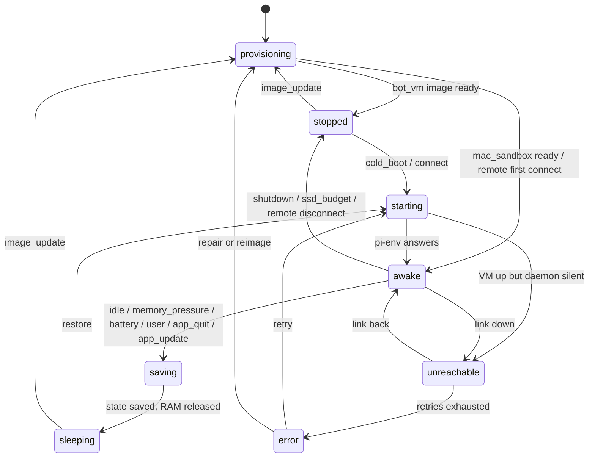
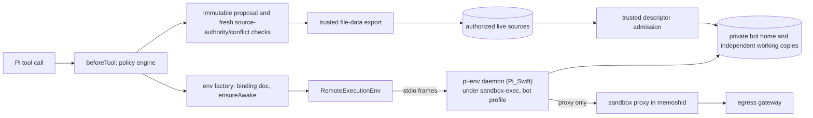
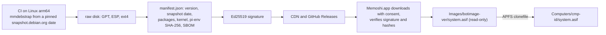
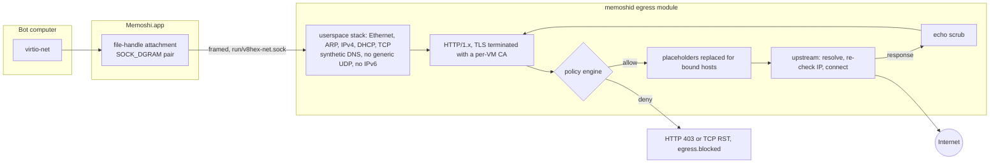
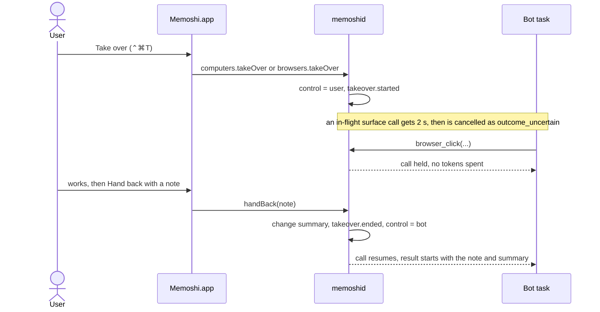

# Computers and Browsers

**Status:** Draft 4 · 2026-10-20 · updated through [D101](decisions.md#d101), 2026-11-07 · updated 2026-11-13 for [D106](decisions.md#d106)–[D122](decisions.md#d122) (next paragraph)
**Owns:** Computer levels and selection, the This Mac sandbox, the in-app environment on iPhone and iPad, Python on both ([D60](decisions.md#d60)), tools that run on another device, the iSH computer on iPhone and iPad ([D69](decisions.md#d69)), Bot computer VMs, GUI computer use inside them and Cloud computers (Phase 2), Remote machines and the always-on Mac host (Phase 3) ([D113](decisions.md#d113)), per-bot browsers and their tool API, live view and takeover, computer resources, the computer and browser Phase 0 spikes, the iSH probe and the VM spike.
**Depends on:** [MASTER_PLAN](MASTER_PLAN.md) · [decisions](decisions.md) · [04-architecture](04-architecture.md) · [08-security-and-privacy](08-security-and-privacy.md) · [09-platform-macos](09-platform-macos.md) · [07-coding](07-coding.md) · [05-bots-and-assistant](05-bots-and-assistant.md) · [02-experience](02-experience.md) · [object-model](../specs/object-model.md) · [events](../specs/events.md) · [protocol](../specs/protocol.md) · [policy](../specs/policy.md)

**Updated 2026-11-13 for [D106](decisions.md#d106)–[D122](decisions.md#d122).** Bot computers, GUI computer use inside them and Cloud computers move into v1.0 at Phase 2, with the VM spike and O2, O3 and O4 at the start of the Bot computer work; Remote machines, the always-on Mac host and watching and taking over a bot's browser or computer from iPhone and iPad move to Phase 3; the user chooses per bot among This Mac (sandboxed), a Bot computer and a Cloud computer, and a bot keeps its home and browser profile when it moves ([D113](decisions.md#d113), [D120](decisions.md#d120), [D121](decisions.md#d121)); stage labels and weeks follow [D122](decisions.md#d122)'s estimated calendar.

This doc turns [D16](decisions.md#d16)–[D19](decisions.md#d19), as amended by [D46](decisions.md#d46)–[D50](decisions.md#d50), [D60](decisions.md#d60), [D67](decisions.md#d67), [D69](decisions.md#d69), [D73](decisions.md#d73)–[D77](decisions.md#d77), [D79](decisions.md#d79)–[D81](decisions.md#d81), [D83](decisions.md#d83), [D88](decisions.md#d88), [D89](decisions.md#d89), [D113](decisions.md#d113), [D120](decisions.md#d120) and [D121](decisions.md#d121), into a buildable design. [D87](decisions.md#d87) stages it, as changed by [D113](decisions.md#d113) and [D117](decisions.md#d117) and dated by [D122](decisions.md#d122)'s estimates: what this doc marks Drop 2 ships in the second of the two gated drops between v1.0 and v1.1. No-model messages queue before then and remain safe when the Drop 2 model is unavailable. Other docs own the neighboring pieces:
- **Policy** (tiers, grants, the exposure rule, secret handling): [`../specs/policy.md`](../specs/policy.md). This doc only describes the mechanisms that enforce it.
- **Fields and event payloads:** [`../specs/object-model.md`](../specs/object-model.md) and [`../specs/events.md`](../specs/events.md).
- **RPC names:** [`../specs/protocol.md`](../specs/protocol.md).

`CMP-`, `BRW-`, `DEV-`, `IOS-`, `SEC-`, `R11-` and `V2-` IDs refer to [`feature-catalog.md`](feature-catalog.md).

## 1. Summary

**v1.0 ([D47](decisions.md#d47), [D113](decisions.md#d113)).** A bot has a computer and a browser on every device it runs on ([D49](decisions.md#d49)): This Mac (sandboxed) on the Mac (§3), the in-app environment on iPhone and iPad (§2.7), and a WebKit profile per bot on each device (§8). A device creates a bot's Computer and Browser records when the bot first reaches it, and the bot's folder and WebKit data store on their first use ([D82](decisions.md#d82)). At the end of Phase 2 a bot on the Mac can have a Bot computer, a Linux VM of its own with a desktop and Chromium (§4, §5), and after that, still in Phase 2, a Cloud computer behind the same seam (§7). The user chooses per bot among This Mac (sandboxed), a Bot computer and a Cloud computer; a bot keeps its home and browser profile when it moves (§2.2), and GUI computer use works inside a Bot computer or a Cloud computer (§8.4) ([D113](decisions.md#d113)). From Phase 3 a bot on an iPhone or iPad can also use the iSH computer, an emulated Linux ([D69](decisions.md#d69), §2.9); Remote machines over SSH and the always-on Mac host arrive (§6); and the user can watch and take over a bot's browser or computer from an iPhone or iPad (§9.1) ([D113](decisions.md#d113)). Browser sign-ins synced between devices, notebook folders synced to the kernel's device and the open model on the phone come in Drop 2 ([D87](decisions.md#d87)). Isolation stays per bot at every level: bots share a computer only when the user explicitly chooses it ([D16](decisions.md#d16)).

| Topic | Choice | Phase |
|---|---|---|
| Mac computer | **This Mac (sandboxed):** a per-bot pi-env daemon under an S4-qualified Seatbelt profile, with an in-daemon no-follow descriptor guard ([D77](decisions.md#d77)). The next qualification route uses private bot home and independently admitted working copies, never direct live-folder access; trusted host export separately checks the original source authority, immutable proposal and policy ([D96](decisions.md#d96)). Network remains gateway-only. No Node; no production enablement before the complete S4 scorecard passes | 1 |
| iPhone and iPad computer | **The in-app environment** ([D50](decisions.md#d50)): the bot's folder in the app container, folders the user links through security-scoped bookmarks, and a shell front end that turns each command line into typed tool calls. No processes (§2.7; IOS-03, IOS-04) | 3 |
| iSH computer (iPhone and iPad) | **Emulated Linux through iSH** ([D69](decisions.md#d69)): Open Minis's ARM64 iSH with an Alpine user space, an optional computer next to the in-app environment. The app commands ([D50](decisions.md#d50)) are real programs inside it, and its code lives in a GPL-3.0 module that only the iPhone and iPad app links (§2.9; IOS-06) | 3 |
| Tools on another device | Every tool declares where it runs. A runner calls another device's tools through Pi's remote environment over [D48](decisions.md#d48)'s links, so a conversation whose runner is a phone uses the computer on the bot's home Mac ([D83](decisions.md#d83)), and an admitted step shows "Waiting for your Mac" while that tool's Mac is unreachable. This differs from a message with neither a reachable runner nor an available allowed model: it stays in the persistent client unsent queue as **Waiting for connection**, with no execution ([D88](decisions.md#d88)). From Drop 2, the local-model fallback can use the downloaded phone model, Apple's model where available, or a user-selected cloud model; none bypasses the tool's device or grants (§2.8; DEV-08, DEV-09, MOD-09) | 3 / Drop 2 |
| Python | **This Mac:** Python 3 in each bot's sandbox: one pinned, hash-checked CPython that every bot shares read-only ([D83](decisions.md#d83)), each bot's own package environment in its home, packages from PyPI through the package-registries preset, and every run a T2 command (§3.8; PY-01, PY-02). **iPhone and iPad:** Pyodide, one per bot, bundled with NumPy, pandas, SciPy and Matplotlib, with other packages installable at run time ([D67](decisions.md#d67)), as a tool in the in-app environment, its network through the in-app gateway, with long runs sent to the Mac (§2.7; PY-03, PY-04) ([D60](decisions.md#d60), [D76](decisions.md#d76)) | 2 / 3 |
| Execution path | Pi tool → policy hooks → `RemoteExecutionEnv` → confined pi-env daemon. For This Mac, trusted host admission supplies independent private file data, and a separate policy-bound host export applies reviewed changes to authorized sources ([D96](decisions.md#d96)); source folders are not daemon roots. Bot computers (end of Phase 2) and Remote machines (Phase 3) keep the protocol over SSH ([D83](decisions.md#d83), §4.2, §6) | 1 / 2 / 3 |
| Bot computer | One Debian 13 arm64 VM per bot on Virtualization.framework, hosted by Memoshi.app: Xfce, Chromium, toolchains, sshd on vsock, the pi-env daemon. No NAT: the VM's only network is a file-handle NIC wired to the gateway. One VM per bot; shared only by the user's explicit choice ([D16](decisions.md#d16)) | 2, at the end ([D113](decisions.md#d113)) |
| Sleep | Idle VMs pause, then save their state and release RAM. The number of awake VMs is capped by installed RAM ([O4](decisions.md#open-decisions)) | 2, at the end |
| Egress | One gateway module, ported to Swift from Gondolin's userspace network stack and secret placeholders. From Phase 1 it runs in memoshid for This Mac and the Mac's WebKit browsers, and from Phase 3 in the app on iPhone and iPad: web and fetch tools call it in-process, Python goes through it ([D76](decisions.md#d76)), WebKit reaches it through a loopback proxy with a random credential per launch, and the iSH computer's guest goes through it or has no network ([D81](decisions.md#d81); §2.7, §2.9); from the end of Phase 2 it also serves Bot computers. Remote machines have no gateway (§6), and a Cloud computer is held to the bot's allowlist only for a provider whose egress control Memoshi has verified (§7). In Bypass, attended runs may reach public hosts beyond the allowlist, each logged (§4.8) | 1 / 2 / 3 |
| O2 engine | Direct Virtualization.framework, unless the VM spike fails the must-haves in §5. O2, O3 and O4 are decided at the start of the Bot computer work in Phase 2, with the VM spike ([D113](decisions.md#d113)) | 2 |
| Remote machine | pi-env over SSH, with pinned host keys and digest-verified daemon deploys. It has no sandbox and no egress control, so it is gated hard. The always-on Mac host arrives with it ([D113](decisions.md#d113)) | 3 |
| Cloud computer | Behind the same seam, built after Bot computers: E2B by default, with Orgo and Daytona selectable ([D120](decisions.md#d120)). The cost is shown before a Cloud computer starts, and its charges count against the bot's budget ([D113](decisions.md#d113), [D121](decisions.md#d121); §7) | 2, after Bot computers |
| Browsers | One tool API, two engines: **WebKit** (`WKWebView` with a per-bot `WKWebsiteDataStore(forIdentifier:)`) in the app on Mac, iPhone and iPad, with each bot's cookies synced end to end encrypted between the user's devices from Drop 2 ([D75](decisions.md#d75), [D87](decisions.md#d87)), and, from the end of Phase 2, **Chromium** over CDP inside a Bot computer or a Cloud computer ([D113](decisions.md#d113)) | 1 / 2 / 3 / Drop 2 |
| Takeover | The user watches by default. **Take over** makes the bot's next step on that surface wait; **Hand back** resumes it with a note and a summary of what changed. A Bot computer's desktop can be watched and taken over the same way from the end of Phase 2. From Phase 3, a bot's browser or computer can be watched and taken over from any of the user's devices, an iPhone or iPad included: the device that hosts it streams its screen and receives the user's input ([D83](decisions.md#d83), [D113](decisions.md#d113), §9.1). Views can be detached on the Mac. Takeovers are audited, never recorded | 1 / 2 / 3 |

## 2. Computer levels

### 2.1 Levels and defaults

| Level (UI) | `kind` | Boundary | Network | Browser | Default for | Cost | Phase |
|---|---|---|---|---|---|---|---|
| **This Mac (sandboxed)** | `mac_sandbox` | Per-bot Seatbelt profile on the shared kernel | Proxy only, through the egress gateway | WebKit in the app | Every bot on the Mac, the Assistant included, until the user picks another level for it ([D20](decisions.md#d20), [D47](decisions.md#d47), [D113](decisions.md#d113)) | None | 1 |
| **In-app environment** (iPhone and iPad) | `in_app` | The app's own iOS sandbox: the bot's folder and linked folders; no processes | Web and fetch tools call the gateway in the app's own process ([D81](decisions.md#d81), §2.7) | WebKit in the app | Every bot on iPhone and iPad ([D47](decisions.md#d47), [D50](decisions.md#d50)) | None | 3 |
| **iSH computer** (iPhone and iPad) | `linux_emulated` | ARM64 Alpine Linux emulated by iSH inside the app's process and iOS sandbox; not a VM boundary | Through the gateway hosted in the app, or none if the iSH probe cannot route the guest's traffic there ([D81](decisions.md#d81), §2.9) | WebKit in the app | Bots that need Linux packages, Git, SSH, ffmpeg or a real shell on the phone, by the user's choice; never a default ([D69](decisions.md#d69)) | Slow, and heavy on memory and battery: its README puts compute at 3–30× native (vendor claim); a root file system in the bot's folder | 3 |
| **Bot computer** | `bot_vm` | Linux VM with its own kernel | File-handle NIC → gateway; HTTP(S) only | Chromium in the VM | Background browsing, untrusted code, Linux or desktop needs | ~4 GB RAM while awake; 3–10 GB disk per bot | 2, at the end |
| **Remote machine** | `remote_ssh` | The remote account; no sandbox | Not mediated | WebKit in the app | Builds and long jobs on a Mac mini or server | User's hardware | 3 |
| **Cloud computer** | `cloud` | Provider microVM | Provider network plus tool-level policy | Chromium in the sandbox | Opt-in, always-on bots | Shown before it starts; charged against the bot's budget (§7) | 2, after Bot computers |

Rules:
1. **One computer per bot on each device.** Each device keeps its own Computer record per bot ([`../specs/object-model.md`](../specs/object-model.md)). By default that is This Mac (sandboxed) on the Mac and the in-app environment on iPhone and iPad ([D47](decisions.md#d47)). From the end of Phase 2 the user chooses per bot on the Mac among This Mac (sandboxed), a Bot computer and, once it follows in the same phase, a Cloud computer ([D113](decisions.md#d113)). From Phase 3 the user can switch a bot on an iPhone or iPad to its iSH computer, which then serves the bot's shell and files on that device, while its typed tools and the `python` tool stay in the app (§2.9). Once Bot computers exist a template can set another Mac-side level, and a Session override (§2.3) can pick either computer on a phone or tablet from Phase 3. [`05-bots-and-assistant.md`](05-bots-and-assistant.md) owns the template defaults; Operator uses a Bot computer once Phase 2 adds them.
2. **No "Full access" level.** Isolation stays per bot: bots share a computer only when the user explicitly chooses it ([D16](decisions.md#d16), [D113](decisions.md#d113)); sharing arrives with Bot computers at the end of Phase 2 (CMP-17). [D114](decisions.md#d114)'s **Full access on this Mac** is a different thing: a setting inside plugin developer mode (CH-44) that only the user can turn on for one App or plugin on the Mac, never a computer level ([`../specs/policy.md`](../specs/policy.md)).
3. **Remote-machine bots browse with WebKit on the Mac** (Phase 3). The browser is a separate object from the computer, as [D18](decisions.md#d18) states for this case.
4. **Bot computers on 8 GB Macs** require an explicit opt-in (§4.4).
5. **GUI computer use** exists only inside a Bot computer or a Cloud computer (`computer.input`, T2; §8.4), never on This Mac (§3.7) ([D113](decisions.md#d113), [D121](decisions.md#d121)).

### 2.2 Selection UX

Until Bot computers arrive, the Mac offers one level, This Mac (sandboxed) ([D47](decisions.md#d47)). From the end of Phase 2 the user chooses per bot among This Mac (sandboxed), a Bot computer and, once Cloud computers follow in the same phase, a Cloud computer ([D113](decisions.md#d113)); a Remote machine joins the list in Phase 3 (§6). From Phase 3, iPhone and iPad offer two: the in-app environment, which stays the default, and the iSH computer (§2.9; [D69](decisions.md#d69)). The Mac-side choices below arrive with those levels.

- **Where the level is chosen:**
  - at bot creation, from the template;
  - in the inspector's **Computer** tab, via "Change computer…" (CMP-05);
  - in Settings › Computers, which lists every VM, cloud computer and remote machine, the image, the cloud provider and the resource policy;
  - from ⌘K.
- **The change sheet** lists each level with its consequence and resource cost. Unavailable levels say why ("Needs 16 GB of memory", "Coming later"). The first Bot computer asks before downloading its image and shows the size. A Cloud computer always shows its cost estimate before it starts (§7): starting one is its own policy class, `computer.cloud_start` (T3), and its charges count against the bot's budget ([D113](decisions.md#d113), [D121](decisions.md#d121); [`../specs/policy.md` §3.1](../specs/policy.md#31-operation-classes)). The iSH computer downloads nothing to start: Alpine's minirootfs ships in the app ([D83](decisions.md#d83), §2.9).
- **Sharing** (CMP-17) is a separate, explicit choice ("Use Ada's computer"), with the warning: "Bots that share a computer are not isolated from each other: they can read and change each other's files and see each other's processes." On a shared Bot computer, each bot runs as its own Linux user, with its own home and browser profile ([D83](decisions.md#d83)).
- **A bot keeps its home and browser profile when it moves** among This Mac (sandboxed), a Bot computer and a Cloud computer ([D113](decisions.md#d113)). This replaces the earlier rule that a switch moved nothing.
  - **Home.** The bot's home files go to the new computer, copied host-side, as the sheet's earlier "Copy home files" offer did [INFERENCE: whether the home is moved or copied, and what happens when it does not fit the new computer's disk, is set in Phase 2].
  - **Browser profile.** A Bot computer and a Cloud computer both run Chromium, whose profile lives in the bot's home (§8.3), so it travels with the home (CMP-12, V2-02). Between This Mac's WebKit profile and Chromium the engine switches with the level; how the profile's sign-ins cross the two engines is open (§13, question 19) [INFERENCE: set in Phase 2].
  - The old computer is kept until the user deletes it.
  - **Remote machines** (Phase 3) keep the earlier rule [INFERENCE: [D113](decisions.md#d113) names the three computers above]: the remote home starts empty, the sheet offers "Copy home files", and the browser stays the app's WebKit profile, so nothing about it changes (§2.1, rule 3).
- **Only the user changes a level.** Bots and the Assistant can propose a change with a proposal card. A level change is a grant change, so it is T5 ([MASTER_PLAN §10](MASTER_PLAN.md#10-safety-at-a-glance)).

### 2.3 Per-session overrides and sharing

- **Session override** (with Bot computers, at the end of Phase 2; PR-05, [D113](decisions.md#d113)). A Session may use a different computer than its bot ([MASTER_PLAN §5 rules](MASTER_PLAN.md#rules)); for example, a VM bot can work on a project folder on This Mac.
  - `Session.computerId` is null when the session uses the bot's default.
  - The composer's computer chip only offers computers the bot holds a `computer_level` grant for.
- **Resolved on every tool call.** Pi's `HarnessOptions.env` "Builds a conversation's environment at each use" (upstream pi-durable 1.3.0 `dist/harness/types.d.ts`; Pi_Swift keeps it in `PiDurable/Harness/Settings.swift`). Memoshi's env factory on the Mac:
  1. reads the conversation's binding document (`computerId`, `cwd`), as in Pi example 29 "sandbox-per-conversation";
  2. calls `ensureAwake`;
  3. returns a `RemoteExecutionEnv`.

  On iPhone and iPad the factory returns the in-app environment (§2.7); tools that live on the Mac reach it through the remote environment (§2.8).

  A binding change takes effect at the next turn, never mid-call ([`04-architecture.md`](04-architecture.md)).
- **Unattended runs** use the routine's computer. A run started by a trigger can never change its binding ([D23](decisions.md#d23)).
- **Groups** (Phase 2, [D109](decisions.md#d109)): each member works on its own computer. Membership grants no authority over another member's computer, the same rule Grok Bot follows ([measured](../research/prior/grok-bot-measured/http.md)). Results move through the project or Artifacts.
- **One computer at a time:** a session uses one computer at a time (adapted from Draft 3 `specs/object-model.md`).

### 2.4 The computer seam

memoshid's `computers/` module puts one interface in front of every level. Its split (lifecycle, exec, files, desktop) follows Rakazo's `SandboxProvider` (Apache-2.0, [computer-runtime.md](https://github.com/elie222/rakazo/blob/main/docs/computer-runtime.md)).

```swift
protocol ComputerProvider {                  // memoshid/computers: ours, not a Pi type
  var kind: ComputerKind { get }             // .macSandbox from Phase 1; .botVM, then .cloud, in Phase 2; .remoteSSH, and .linuxEmulated on iPhone and iPad, in Phase 3
  func provision(_ spec: ComputerSpec) async throws          // image, home, keys, profile
  func wake(_ id: ComputerID, reason: String) async throws   // idempotent
  func sleep(_ id: ComputerID, reason: String) async throws  // save (VM) or disconnect (remote)
  func stop(_ id: ComputerID) async throws
  func destroy(_ id: ComputerID) async throws
  func status(_ id: ComputerID) -> ComputerStatus            // never wakes it
  func connection(_ id: ComputerID) -> ConnectionSpec        // how PiEnv starts or reaches the daemon
  // Optional capabilities; the default implementations throw `.unsupported`.
  func snapshot(_ id: ComputerID, label: String) async throws -> SnapshotID
  func revert(_ id: ComputerID, to snapshot: SnapshotID) async throws
  func setShares(_ id: ComputerID, _ shares: [Share]) async throws
  func forwardPort(_ id: ComputerID, port: Int) async throws -> Int
  func desktop(_ id: ComputerID) throws -> DesktopHandle     // live view, screenshot
  func cdpSocket(_ id: ComputerID) throws -> String          // Chromium engine
  func meter(_ id: ComputerID) throws -> CostMeter           // cloud only
}
```

Implementations:
- `MacSandboxProvider`: the sandbox chosen in S4, plus a local pi-env daemon (§3.5).
- `BotVmProvider` (end of Phase 2): the app's Computer service, through `host.computer.*`.
- `RemoteSshProvider` (Phase 3): pi-env over SSH.
- `LinuxEmulatedProvider` (Phase 3, iPhone and iPad): iSH, hosted in the app's GPL-3.0 module. PiEnv reaches the guest through a host-side adapter by default; the iSH probe confirms it, and a pi-env daemon inside the guest is used only if the conformance suite needs it (§2.9, [D81](decisions.md#d81)).
- `CloudProvider` (Phase 2, after `BotVmProvider`): E2B by default, with Orgo and Daytona selectable (§7; [D113](decisions.md#d113), [D120](decisions.md#d120)).

On iPhone and iPad there is no memoshid: the app provides the in-app environment (`in_app`) itself (§2.7), and from Phase 3 the iSH computer (§2.9). The runtime adapter only ever sees `ExecutionEnv` ([D6](decisions.md#d6), kept by [D44](decisions.md#d44)).

### 2.5 States and events

The states are defined in [`../specs/object-model.md` §5.6](../specs/object-model.md#56-computer):
- `Computer.state`: `provisioning | stopped | starting | awake | saving | sleeping | unreachable | error`, plus a `stateReason`;
- a separate `control: bot | user` field, which is `user` while a takeover is active.



| UI label | `state` (`stateReason`) | UI label | `state` (`stateReason`) |
|---|---|---|---|
| Setting up / Updating | `provisioning` (`image_update`) | Going to sleep | `saving` |
| Off | `stopped` | Asleep | `sleeping` |
| Starting / Waking | `starting` (`cold_boot`, `restore`, `connect`) | Unreachable (retrying) | `unreachable` |
| Awake ("Working" while a tool runs) | `awake` | Needs attention | `error` |
| You're in control | `control = user` | | |

- **This Mac** is `awake` once provisioned, or `error` if the sandbox cannot start.
- **The in-app environment** is `awake` once the bot's folder exists. It runs only while the app does (§2.7).
- **The iSH computer** is `provisioning` while its root file system is set up, `starting` while the guest boots, and `awake` while it runs. It runs only while the app does, and the app stops an idle guest (`stopped`, reason `idle`) or any guest under memory pressure (reason `memory_pressure`) (§2.9).
- **Waking.** Status, transcript and usage reads never wake a computer. Only a tool call, an open live view, a takeover or a keep-awake lease does. This copies Grok Bot's measured behavior ([profile](../research/agentic-workspace-landscape/projects/grok-bot.md)).
- **A lost link** ([D79](decisions.md#d79)). `unreachable` retries the link, never the work: a call that was running when the link dropped does not rerun on its own, even a replay-safe one. It ends **Interrupted: may have happened** and follows its outcome check, then the Resume card, while its whole conversation holds ([D51](decisions.md#d51), [D83](decisions.md#d83); [05 §4.5](05-bots-and-assistant.md#45-interrupted-steps)).
- **Events** (payloads in [`../specs/events.md`](../specs/events.md)):
  - `computer.created`, `.updated`, `.state_changed`, `.removed`, `.resource_pressure`, `.snapshot_created`, `.snapshot_restored`, `.image_updated`;
  - `browser.created`, `.state_changed`, `.navigated` (UI only), `.download_completed`, `.signin_completed`, `.data_cleared`;
  - `takeover.requested`, `.started`, `.ended`;
  - from the gateway: `egress.blocked` (coalesced per host per task), `egress.allowed` (the first per host per task) and `secret.used`.

### 2.6 Protocol surface

Names are owned by [`../specs/protocol.md`](../specs/protocol.md).

| Direction | Methods |
|---|---|
| App → daemon | `computers.list/get/create/update/delete/start/stop/sleep/wake/takeOver/handBack/snapshot/revert/listSnapshots/setShares/forwardPort`, `computers.costPreview` for a Cloud computer (Phase 2), and `computers.watch/unwatch/input` for a computer this app does not host (a Cloud computer in Phase 2; a Bot computer on another device from Phase 3); `browsers.list/get/clearData/takeOver/handBack/watch/unwatch/input` (the last three for a browser on another device, from Phase 3; [D83](decisions.md#d83), [D113](decisions.md#d113)) |
| Daemon → app (host capabilities) | `host.browser.open/navigate/snapshot/act/screenshot/read/wait/tabs/downloads/configure/clearData/fillCredential/stream/input/close`; from the end of Phase 2, `host.computer.create/start/save/restore/stop/status/connect/cdpConnect/snapshot/revert/setShares/delete`, and from Phase 3 `host.computer.stream/input` |
| Per-VM sockets in `run/` (end of Phase 2) | `v<8 hex>-ssh.sock`, `-cdp.sock` and `-net.sock`. The names are short because of the 104-byte `sun_path` limit; any path over 100 bytes falls back to the user's private temporary folder (owned by the user, mode 0700, verified), as the daemon's own socket does ([D130](decisions.md#d130)) |
| Between devices | The device layer (pairing, links, a lease per conversation, forwarding and replication), the remote environment for tools on another device, and, from Phase 3, live view and takeover of a bot's browser or computer from another device ([D48](decisions.md#d48), [D49](decisions.md#d49), [D73](decisions.md#d73), [D74](decisions.md#d74), [D83](decisions.md#d83), [D113](decisions.md#d113); §2.8, §9.1; [protocol §12.13](../specs/protocol.md#1213-browser-live-view-across-devices), [§12.14](../specs/protocol.md#1214-computer-live-view-across-devices)) |

### 2.7 iPhone and iPad: the in-app environment

Every bot on iPhone and iPad uses the in-app environment ([D47](decisions.md#d47), [D50](decisions.md#d50)). Pi_Swift runs inside the app, with no daemon ([D46](decisions.md#d46)), and iOS apps cannot start processes. So there is no real shell, PTY, dev server or `process_*` tool here.

- **Files** (IOS-03).
  - The bot's folder in the app's container, the counterpart of the Mac's bot home (§3.2).
  - Folders the user links through the system document picker, kept as security-scoped bookmarks. Bots can only propose a folder, through a card, as on the Mac (§3.3). A linked folder is a folder grant, read-only or read-write ([D52](decisions.md#d52)).
  - **Isolation** ([D76](decisions.md#d76)). Each bot gets handles to its own folder and its linked folders, and every file operation resolves relative to those handles without following symlinks, so no path check can be raced [INFERENCE: `openat`-style calls with `O_NOFOLLOW` on each path component]. A write goes through a temporary file that is renamed into place inside the verified folder ([D81](decisions.md#d81)). Secret reads go through an in-process broker that logs every release, as on the Mac.
- **Shell front end** ([D50](decisions.md#d50), IOS-04). The bot gets an emulated shell, generated from the typed tools:
  - app commands such as `reminders add …` and `calendar list …`;
  - file commands (`ls`, `cat`, `grep`, `find`, `head`, `wc`) and pipes, over the bot's folder and linked folders;
  - every command line is parsed into typed tool calls before anything runs, so policy judges the typed calls, never the text. An unknown command fails.

  On the Mac the bot keeps its real sandboxed shell, with the same app commands installed as a command-line tool in its sandbox, so skills work on every device (CMP-21). They reach memoshid over the pi-env daemon's existing channel, so the sandbox needs no extra opening for them ([D77](decisions.md#d77), §3.5).
- **Where tools run.** Every tool declares its location: `mac`, `iphone_ipad` or `any` ([D49](decisions.md#d49)). Tools that live on the Mac, such as the shell, Mac files and Mac-hosted local models, run there (§2.8).
- **Code Mode** composes tools in one step using PiCodeMode's pinned upstream `quickjs.wasm` (quickjs-wasi 3.6.2 / QuickJS-NG 0.17.0): WABT 1.0.42's `wasm2c` translates it to C for shipping, and WasmKit is the reference and compatibility fallback. JavaScriptCore is neither a WebAssembly nor a JavaScript backend ([D89](decisions.md#d89)). Pi_Swift owns implementation; explicit bounds checks, malloc-backed memory, no signal handler and retained call-depth protection remain required. Differential replay against the upstream Node oracle gates making wasm2c default, alongside memory, interrupt, trap and Swift/C safety. Both backends are measured in Release on the iPhone 14 Pro on Thu 2026-11-12 against Memoshi's workload, cold/warm p95 limits and memory ceiling recorded by Mon 2026-11-09 ([D90](decisions.md#d90)); S1.18 retains integrated policy and recovery coverage, and S1.19's JSC experiment is retired. Missing evidence is not a pass, and WasmKit is not presumed faster ([04 §4.7](04-architecture.md#47-code-mode), [phase-0 S1](phase-0.md#s1)).
- **Boundary.** The app's iOS sandbox, plus policy, grants and budgets as on the Mac. Pi_Swift's local environment states: "iOS inherits the app's OS sandbox; local process execution is explicitly unavailable there" (Observed, Pi_Swift `PiEnv/LocalExecutionEnv.swift`, 2026-10-22).
- **Running time.** A turn keeps running in the background inside a `BGContinuedProcessingTask` that shows its progress, and committed turns resume at launch ([D46](decisions.md#d46)).
- **Reference devices and memory** ([D80](decisions.md#d80)). The reference devices are the user's iPhone 14 Pro (A16, 6 GB of RAM [Claim]) and iPad Pro 12.9-inch (5th generation, M1; 8 GB [Claim]), on iOS and iPadOS 27. The app requests the increased-memory-limit entitlement [INFERENCE: its effect on a 6 GB device is checked in Phase 3]. It raises the app's own limit, under which the iSH guest (§2.9) and the on-device model (§2.8) run; Pyodide runs in WebKit's web content process, which it does not cover [INFERENCE]. On the iPhone the heavy runtimes, Pyodide, the iSH guest and the on-device model, take turns instead of loading together [INFERENCE: Phase 3 measures how many the iPad holds at once].
- **No App Review in v1** ([D67](decisions.md#d67)). The app is for the user's own devices, so App Review does not shape this environment. Every shell command, Code Mode and Python are still documented in the app; the App Review notes for a later public release are in [09 §12.6](09-platform-macos.md#126-app-review).
- **Python** ([D60](decisions.md#d60), [D76](decisions.md#d76); PY-03, PY-04, Phase 3). Pyodide (CPython compiled to WebAssembly), pinned and bundled with NumPy, pandas, SciPy and Matplotlib, runs in a hidden web view that the app owns, as this environment's `python` tool ([04 §4.16](04-architecture.md#416-python-and-notebooks)). Each bot gets its own Pyodide, started on first use and closed when idle or under memory pressure, so bots' Python state never mixes. An open notebook counts as active, so its Pyodide stays warm while the notebook is open; memory pressure and the iPhone's turn-taking still apply ([D83](decisions.md#d83)).
  - **Files and data.** The tool copies files from the bot's folder and linked folders into Pyodide's in-memory file system and copies results back.
  - **Network** ([D76](decisions.md#d76), [D100](decisions.md#d100)). Python's network goes through the in-app gateway under the bot's allowlists, the same as Python on the Mac (§3.8), by way of a sealed native bridge: the page's CSP refuses direct connections, and native code answers Python's `fetch` with one gateway decision per hop. WebKit's loopback proxy ([D81](decisions.md#d81)) is not Python's route; S6.5 checks that no request goes around the gateway.
  - **Packages.** The four packages are pinned per app version and ship in the app. In v1 Pyodide may also install other packages at run time ([D67](decisions.md#d67)): the app downloads them through the gateway from the package-registries preset, which is on by default for every bot on iPhone and iPad ([D81](decisions.md#d81)), and installs them from Pyodide's in-memory file system. Policy classifies each install like a registry install on the Mac. Packages that generate machine code at run time, such as numba and vectorbt, are Mac only.
  - **Memory.** Web content is memory-limited, with no published limit, and jetsam can end its process. A killed process becomes a tool error, and the run can go to the Mac (§2.8). On the iPhone 14 Pro's 6 GB, one bot's Pyodide runs at a time, taking turns with the iSH guest and the on-device model (above) [INFERENCE].
  - **Background.** The web content process is suspended with the app, so a run continues only in the foreground or inside a continued-processing task [INFERENCE: S6 measures]. Long runs go to the Mac.
  - **Spike.** Phase 0's S6 measures cold start, memory, background behaviour and bundle size on the user's iPhone 14 Pro ([phase-0 S6](phase-0.md#s6), [D80](decisions.md#d80)). If Pyodide fails it, the order is fixed ([D79](decisions.md#d79)): first a trimmed, lazily loaded Pyodide; then phones use the Mac's Python (§2.8, §3.8); native CPython for iOS, in the style of Carnets [INFERENCE], only if both fail.
- **The gate.** Pi_Swift's in-app environment (requirements E9c) is not written yet. If iOS misses the Pi_Swift gate at the Phase 0 review, bots do not run on iPhone and iPad in v1: the app is a remote screen for bots that run on the Mac, and this section moves to v1.1 ([D46](decisions.md#d46)).
- **Egress.** There is no memoshid on the device, so the app hosts the gateway module itself. Web and fetch tools call it in-process, with no network hop, and Python ([D76](decisions.md#d76)) goes through it too. WebKit reaches it through a loopback proxy that the app binds only while a web view needs it, guarded by a random credential per launch; the iSH guest uses that proxy only if it needs one ([D81](decisions.md#d81)). Its rules match the Mac's (§4.8). S3 row 13 checks that every WebKit request reaches the proxy; if one does not, per-bot content rules block disallowed hosts in WebKit itself, besides the site checks in the navigation delegate ([D81](decisions.md#d81)).

### 2.8 Tools on another device

Each conversation of a bot runs on one device at a time, its **runner**, under its own epoch-fenced lease, so one bot may run conversations on two devices at once ([D49](decisions.md#d49), [D74](decisions.md#d74)). An awake, reachable runner keeps its conversation, and the user's other devices forward to it; the lease moves when the runner cannot be reached, and an idle conversation's lease returns to the bot's **home Mac** when it is awake and reachable ([D73](decisions.md#d73), [D74](decisions.md#d74), [D83](decisions.md#d83); [05 §4.4](05-bots-and-assistant.md#44-bots-on-every-device)). That decides only where a conversation runs; tools still run where they live:
- **Mac only:** the shell, Mac files, Mac-only command-line tools, Mac-hosted local models and the bot's Mac Python, including packages that need the Mac (numba, vectorbt), all in This Mac (sandboxed);
- **iPhone and iPad only:** frameworks that exist only there;
- **any device:** data that iCloud already syncs (Reminders, Calendar, Contacts), Weather, Maps and the web.

A runner calls another device's tools through Pi's remote environment over [D48](decisions.md#d48)'s direct, relay and iCloud links (DEV-08). Pi_Swift's `RemoteExecutionEnv` already runs on macOS and iOS over any transport; carrying it over the relay and iCloud is new work (Pi_Swift requirements E18).

- **A phone runner uses the home Mac's computer.** When the runner is an iPhone or iPad, a Mac-only call runs on the bot's home Mac, in This Mac (sandboxed), inside the bot's sandbox. Serving the tool does not transfer the conversation's lease or make the Mac its writer; the phone runner still records the result under its own lease.
- **The iSH computer** (Phase 3, §2.9). When a bot on an iPhone or iPad uses its iSH computer, its shell and file calls run there, on that device. Calls that need the Mac (its files, Mac-only programs, local models, the Mac's Python) still go to the Mac [INFERENCE].
- **Python on the Mac from a phone** ([D60](decisions.md#d60), [D82](decisions.md#d82)). A `python` call or a notebook cell can ask for the Mac, and long runs go there. They run in the bot's This Mac sandbox (§3.8), and a notebook open on the phone can use the Mac's kernel (PY-04). A notebook's cells run on the device that holds it by default, and on a reachable Mac, the bot's home Mac first, when its imports need packages that only the Mac has. From Drop 2, its folder syncs, content-addressed, to the device that runs the kernel, and the outputs sync back (PY-05, [D87](decisions.md#d87)).
- **Two checks** (SEC-27). Policy decides on the runner. The device that executes re-checks its own grants, and on the Mac the call still runs inside the sandbox, so a phone cannot widen what the Mac allows. Both checks use the grants current when the call is dispatched, not only those it was approved under ([D79](decisions.md#d79)).
- **"Waiting for your Mac."** If an admitted call needs an unreachable Mac (asleep, off or offline), the step shows "Waiting for your Mac" and waits under the normal approval expiry ([D27](decisions.md#d27), [D49](decisions.md#d49)). When that expires, the call returns `device_unreachable`: it was never dispatched and is not a denial, so the bot can retry, reschedule or ask ([D82](decisions.md#d82)). A tool on any other unreachable device waits the same way. This is not the no-model unsent-message state below: an unsent message has not admitted a tool call.
- **Background work** ([D83](decisions.md#d83)). Routines and watches run in their own lanes, each under its own lease; their runner claims a firing in the lane's store, not the bot's Chat, whose runner writes only the idempotent report. Wakes run in the conversation that set them. An idle lease returns to the bot's home Mac, so they run there whenever it is awake and reachable, and a routine that needs Mac tools waits for that Mac ([D49](decisions.md#d49), [D74](decisions.md#d74); [05 §6.5](05-bots-and-assistant.md#65-missed-runs-concurrency-and-idempotency)). When an iPhone or iPad holds a routine's lease, the relay wakes it with a content-free push at each fire time, and a fire that starts later than a grace window counts as missed and follows the routine's missed-run policy ([D82](decisions.md#d82)).
- **Local models while the Mac is unreachable** ([D74](decisions.md#d74), [D80](decisions.md#d80); MOD-09, Drop 2, [D87](decisions.md#d87)). A bot set to a Mac-hosted local model picks what its conversations use while that Mac cannot be reached: from Drop 2, by default a small open model on the device, run with MLX in the app and downloaded on first use, sized per device [INFERENCE]: about 1.7B parameters on the iPhone 14 Pro and about 4B on the iPad, for example Qwen3 (Apache-2.0); Apple's on-device model where the device has one, which the iPhone 14 Pro does not (Claim: MacRumors, as D80 cites); a cloud model the user picks; or waiting for the Mac. No unavailable or unapproved model is silently substituted. On the iPhone the open model takes turns with Pyodide and the iSH guest (§2.7). If neither the runner nor an allowed model is reachable, waiting uses the unsent queue below ([D88](decisions.md#d88)).
- **No runner and no model: queue** ([D88](decisions.md#d88)). Keep the user's messages in the persistent device-local unsent queue as **Waiting for connection**, retaining their existing client `requestId` across restart and reconnect. Cancellation before delivery leaves nothing to send. Queuing takes no lease, writes no authoritative conversation store, starts no model turn and runs no tool or external effect; it fabricates no answer or summary. On reconnect, uncanceled messages go through existing forwarding and idempotent submission to the current confirmed runner with the same `requestId`, current grants and budgets, and any recovery hold. This is the existing unsent/outbox design, not a separate scheduler ([04 §2.8](04-architecture.md#28-devices-links-runners-and-replicas)).
- **Runner unreachable, model available: side threads.** A device that can neither reach a conversation's runner nor take its lease may answer in a real side thread only with an available allowed model, using only reachable tools under the existing grants and budget rules ([D49](decisions.md#d49), [D88](decisions.md#d88)). Runner and model reachability are distinct; a wholly disconnected device needs an on-device model to answer. On reconnect an available allowed model summarizes the real side thread and appends its exact recorded effect list. An unsent message is instead delivered normally and is never joined as answered work. Before MOD-09 in Drop 2, the reference iPhone's fully disconnected no-model path queues.
- **Interrupted calls.** A remote call cut off before its outcome was recorded follows [D51](decisions.md#d51): an outcome check if the tool declares one, otherwise a Resume card on every device. A lost link never reruns it on its own ([D79](decisions.md#d79), §2.5).
- **Which device serves** ([D82](decisions.md#d82), [D83](decisions.md#d83)). When several devices could run a call, the awake, reachable one that holds the data and the grant runs it; among those, the bot's home device comes first, which the user sets per bot, then a device on mains power. For Mac work the home device is the bot's **home Mac**: it serves the bot's Mac-only tools for runners on other devices, and an idle conversation's lease returns to it. From Phase 3 an always-on Mac host becomes every bot's home Mac by default (§6, [D113](decisions.md#d113)).

### 2.9 iPhone and iPad: the emulated Linux computer (iSH)

**v1, Phase 3 ([D69](decisions.md#d69); IOS-06).** An optional computer next to the in-app environment on iPhone and iPad: emulated Linux through iSH, using Open Minis's ARM64 version (`OpenMinis/ish-arm64`) with an Alpine Linux user space. The in-app environment and its shell front end (§2.7) stay every bot's default, and the Mac keeps its real sandboxed shell (§3). The [iSH probe](#ish-probe) at the start of Phase 3 (week W135) tests this design ([D81](decisions.md#d81), [D83](decisions.md#d83)).

- **The emulator** (Observed, its README, read 2026-10-22). The fork adds an AArch64 guest to iSH's threaded-code interpreter, which runs Linux programs inside the app's own process by chaining precompiled gadget functions. "No machine code is generated at runtime", so it needs no JIT and no child process ([09 §12.9](09-platform-macos.md#129-emulated-linux-through-ish-d69)). It ships Alpine 3.21 with `apk`, and its README lists Python 3, Node.js, Go, Git, SSH and ffmpeg as working. For agents it adds an in-process shell API (`ISHShellExecutor`), native offload (a guest `execve` handled by host code), bind mounts of host folders and a JSON-RPC debug server. Its README puts compute at 3–30× slower than native (vendor claim).
- **What the bot gets:** a Linux user space with a package manager, a real shell, Python, Git, SSH and ffmpeg. Its root file system lives in the bot's folder, copied from Alpine's minirootfs, which ships in the app; each bot's copy updates with `apk upgrade` under policy ([D83](decisions.md#d83)). The bot's folder and linked folders are bind-mounted into the guest with their grants' read-only or read-write modes. Packages download through the gateway, which [D67](decisions.md#d67) allows in v1, and policy classifies each install ([policy.md §3.9](../specs/policy.md#39-the-emulated-linux-computer-ish)).
- **The app commands are real programs** ([D69](decisions.md#d69)). D50's app commands, such as `reminders add …` and `calendar list …`, run inside the guest as native offloads: the guest's `execve` reaches the app, which parses the command line into typed tool calls before policy sees it, as the shell front end does (§2.7) [INFERENCE]. So a bot's scripts work the same in the Mac shell, the in-app shell and iPhone Linux.
- **Connection** ([D81](decisions.md#d81)). PiEnv reaches the guest through a host-side adapter by default. The iSH probe confirms it, and the in-guest daemon is used only if the conformance suite needs it:
  - **(a) A host-side PiEnv adapter** in the app, the default. It runs commands through the emulator's in-process shell (`ISHShellExecutor`) and does file work through guest commands.
  - **(b) A pi-env daemon built for Linux ARM64** with Swift's static musl SDK, inside the guest, reached by `RemoteExecutionEnv` over a pipe to the emulator, as a Bot computer is reached over SSH (§4.6), only if (a) fails conformance. Under emulation it may be slow to start.
- **Boundary.** Everything stays inside the app's process and iOS sandbox. The emulator is not a VM boundary, so policy groups it with This Mac for T2 ([policy.md §3.9](../specs/policy.md#39-the-emulated-linux-computer-ish)), and policy decides every call: each command line, each app command as its typed calls, and each package install. The fork's debug server is left out of the build ([09 §12.9](09-platform-macos.md#129-emulated-linux-through-ish-d69)).
- **Network.** The guest's sockets are the app's own sockets, so the emulator's socket layer admits only the gateway hosted in the app (§2.7), directly or through the loopback proxy that WebKit uses, with its allowlists and secret placeholders; the iSH probe checks how (row 8). Raw TCP, such as SSH and git over SSH, reaches only the hosts and ports a `network_domain` grant names. If the probe cannot route the guest's traffic through the gateway, iSH ships with guest networking off ([D81](decisions.md#d81)).
- **SSH keys** ([D81](decisions.md#d81)). Keys stay in the Keychain. The guest gets a sign-only SSH agent socket backed by the broker: the guest's `ssh` and `git` ask it to sign, and it never hands out a key.
- **Limits.** Emulation is slow and uses memory and battery ([D69](decisions.md#d69)). A guest runs only while the app does, in the foreground or inside a continued-processing task. Per-call CPU, memory and wall-time caps apply as on the Mac (§3.7), and idle guests stop first (§10). The guest lives in the app's own memory, so on the iPhone 14 Pro's 6 GB it runs under the increased memory limit and takes turns with Pyodide and the on-device model (§2.7, [D80](decisions.md#d80)). Numeric Python stays on Pyodide (§2.7) or the Mac (§2.8).
- **Licence** ([D33](decisions.md#d33) as amended by [D69](decisions.md#d69)). iSH and any code taken from Open Minis are GPL-3.0, so they live in their own GPL-3.0 module that only the iPhone and iPad app links. The rest of the repository stays Apache-2.0, and the Mac app links no GPL code ([04 §9](04-architecture.md#9-packaging), [09 §12.9](09-platform-macos.md#129-emulated-linux-through-ish-d69)).
- **Fallbacks** ([D83](decisions.md#d83)). If the probe fails, the order is fixed: first the Mac's real shell, which a phone runner reaches as a Mac tool (§2.8), as [D79](decisions.md#d79) orders for Python; then Blink (ISC); then v86 (BSD-2), [D63](decisions.md#d63)'s candidates ([iSH probe](#ish-probe)).
- **Risks:** [R53](risks.md#r53) (speed, memory and battery) and [R54](risks.md#r54) (the GPL module boundary).

## 3. This Mac (sandboxed)

This Mac (sandboxed) is every bot's computer on the Mac from Phase 1 ([D47](decisions.md#d47)), and stays the default once the user can choose a Bot computer or a Cloud computer per bot ([D113](decisions.md#d113)). memoshid is a Swift LaunchAgent with no Node ([D46](decisions.md#d46)). After both preliminary live-folder profile designs and the separate-user read gate failed, [D96](decisions.md#d96) selects **private native Mac working copies for qualification**, not for production acceptance:
- trusted host admission walks the authorized source by descriptors, rejects symlinks, multiply-linked regular files and special entries, and imports independent file data;
- the confined pi-env daemon receives private working-copy roots and bot home, never the live source folder;
- model edits remain private until a separately approved immutable proposal passes current source authority, original-path policy classes and conflict checks at trusted host export.

The original candidates—a Swift port of srt's generator/proxy/monitor or our own Seatbelt profile plus proxy—remain the reference designs for the unchanged full S4 scorecard. The measured filesystem subsets were not complete manager/proxy implementations. Private copies do not waive the gateway, credential masks, in-daemon descriptor guard, conformance, toolchains, TCC, attribution or performance gates (§12, [D77](decisions.md#d77)).

### 3.1 What sandbox-runtime provides (verified)

Facts below come from `anthropics/sandbox-runtime` v0.0.81 (2026-10-20; npm `@anthropic-ai/sandbox-runtime`; Apache-2.0; labeled "Beta Research Preview"). The 2026-10-26 source recheck distinguishes the [actual tag `c40cf14…`](https://github.com/anthropics/sandbox-runtime/tree/c40cf14a65d025e3cd27f071f13a73c12b3b1f92) from [inspected HEAD `98a4016…`](https://github.com/anthropics/sandbox-runtime/tree/98a4016d27609ed34dd1fb43d23ed6efb6eeeb77), whose package version is still 0.0.81. Sources: `macos-sandbox-utils.ts`, `sandbox-config.ts`, `sandbox-manager.ts` and `sandbox-utils.ts`; source inspection is not runtime qualification.

| Area | Fact | Consequence for Memoshi |
|---|---|---|
| Mechanism | `/usr/bin/sandbox-exec -p <generated SBPL>`; the profile starts with `(deny default)` | Kernel-enforced and inherited by child processes |
| Reads | Default readable; broad `denyRead`, then `allowRead` carve-outs, then late re-denial of nested literal/glob denies, with explicit-file/library exceptions. [The tagged source already contains this composition](https://github.com/anthropics/sandbox-runtime/blob/c40cf14a65d025e3cd27f071f13a73c12b3b1f92/src/sandbox/macos-sandbox-utils.ts#L432-L493) | Explicitly configure secret denies. Denying `~` alone leaves other host paths readable; the S4 prototype denies `/` before approved read roots. Configured `.env` inside a grant stayed denied in the kernel probes; hard links did not |
| Writes | Only `allowWrite`, and `denyWrite` wins. Mandatory denies are anchored at the cwd: `.gitconfig`, `.bashrc`, `.zshrc`, `.mcp.json`, `.vscode`, `.idea`, `.git/hooks`, and `.git/config` unless `allowGitConfig` | Explicit denies for repo metadata outside the cwd ([`07-coding.md`](07-coding.md)) |
| Default writable paths | Includes `/tmp/claude` and `/private/tmp/claude`; `~/.npm/_logs` and `~/.claude/debug` are added only when applicable read-deny rules do not exclude them ([source](https://github.com/anthropics/sandbox-runtime/blob/98a4016d27609ed34dd1fb43d23ed6efb6eeeb77/src/sandbox/sandbox-utils.ts#L581-L697)) | No shared writable temp in Memoshi; each bot gets its own `TMPDIR`. The home convenience paths are not unconditionally writable |
| Processes | Exec and fork are allowed; signals and `process-info` only within the same sandbox | A bot cannot signal memoshid or other bots |
| Mach services | A fixed list that includes `coreservices.launchservicesd`, `com.apple.SecurityServer` and `securityd.xpc`. No pasteboard. Apple Events and `lsopen` only with `allowAppleEvents` | Bots cannot launch or script apps. The Keychain lookup is an S4 item |
| Network | With an allowlist, only `localhost:<proxy ports>`. An in-process HTTP + SOCKS5 proxy with a per-session token; an ask callback; `deniedResolvedAddresses`; external `httpProxyPort`/`socksProxyPort`; `mitmProxy`; `parentProxy` | The proxy lives in memoshid and chains to the gateway |
| Unix sockets, ports | Blocked by default; `allowLocalBinding` is opt-in | Dev servers run only in coding sessions. `docker.sock` and memoshid's socket stay unreachable |
| API | `SandboxManager.initialize`, `wrapWithSandbox`, `wrapWithSandboxArgv` (per-call `customConfig`), `updateConfig`, `registerCommandNetworkLists`, `reset`; CLI `srt --settings --control-fd` | Either S4 candidate keeps this shape: one manager in memoshid, with a per-bot profile for each daemon |
| Violations | Opt-in `log stream` monitor (`enableLogMonitor`); an in-memory store of 100 | Feeds the bot's activity log ("Blocked: read ~/.ssh/id_ed25519") |

### 3.2 Per-bot home layout

Paths use the bot's ID, so renaming a bot moves nothing (CMP-04).

```text
~/Library/Application Support/Memoshi/Bots/<botId>/
  home/              HOME for the sandboxed daemon (read-write)
    Workspace/       default cwd for sessions without a project; scratch work
    Documents/       files the bot keeps (inspector › Files)
    Downloads/       browser downloads, quarantined (§8.7)
    .config/ .cache/ per-bot tool configs and caches
    .venv/           the bot's Python environment (Phase 2; §3.8)
    .gitconfig       generated bot identity (07-coding.md)
    tmp/             TMPDIR
  runtime/           generated profile, daemon logs (not readable by the bot)
```

- **On other computers:**
  - **In-app environment:** the bot's folder in the app's container on iPhone and iPad (§2.7).
  - **Bot computer** (end of Phase 2): the home is `/home/bot` on the VM's home disk, or the bot's own user's home on a shared VM (§2.2), and projects live at `/workspace/<project-slug>` (§4.7).
  - **Remote machine** (Phase 3): the home is `~/.memoshi/bots/<botId>/home`.
- **Deleting a bot** moves `home/` to the Trash. From the end of Phase 2, VM disks stay in "Recently deleted" for 30 days ([`05-bots-and-assistant.md`](05-bots-and-assistant.md)).

### 3.3 Granted folders

- **Granting.** The user picks a folder in an `NSOpenPanel`; bots can only propose paths through cards. A `folder` grant stores original source identity/bookmark and `Grant.access: read` or `write` ([object-model §4.24](../specs/object-model.md#424-grant-grt_)); read-only is not a permission mode ([D52](decisions.md#d52)). The Mac bookmark is regular, not security-scoped, because the app is not sandboxed ([09 §9.6](09-platform-macos.md#96-granted-folders-and-bookmarks)). D96 makes this source admission/export authority, never a direct live-folder Seatbelt allowance. Export needs active write authority and the applicable policy/immutable reviewed proposal; read-only cannot export. iPhone/iPad retain security-scoped bookmarks (§2.7).
- **Never grantable:** `/`, `~`, `~/Library`, `~/.ssh`, Memoshi's Application Support (except the bot's own home), and other bots' homes.
- **Admission and links.** Trusted host admission opens each component relative to verified directory descriptors without following links, refuses symlinks, multiply-linked regular files and special files, and copies independent file data into a fresh private root ([D96](decisions.md#d96)). Staged unsafe entries are refused again before export. Kernel confinement and the required in-daemon descriptor guard still protect model file tools and commands ([D77](decisions.md#d77)); display canonicalization is never the boundary.
- **Changes apply now.** Dispatch and host export re-check current source authority ([D79](decisions.md#d79)); revocation invalidates the source/copy binding and cannot be overridden by an earlier approval. The profile/copy capability changes at the next tool boundary. This prevents future access/export, not recovery of data already read into a model's context.
- **macOS privacy prompts** for Desktop, Documents, Downloads, iCloud Drive and removable volumes should be attributed to Memoshi [INFERENCE: S4 check 11 and S5 test this]. Their wording is in [`09-platform-macos.md`](09-platform-macos.md).

### 3.4 Sandbox profiles

| Profile | Reads | Writes | Network | Used by |
|---|---|---|---|---|
| `standard` | Approved read-only system/toolchain paths, private bot home and validated independent source copies; no live user-folder roots | Private bot home and authorized working copies only; original files change solely through trusted policy-bound export | Proxy → gateway; private ranges denied; no Unix sockets or local binding | Default, after full S4 acceptance |
| `coding` | `standard` plus an independent private project/worktree and its coding metadata | Private coding copy and metadata, never the live main repository or shared `.git` objects; protected source classes remain protected ([`07-coding.md`](07-coding.md)) | Loopback-only dev-server binding, subject to the S4 network gate | Project sessions (Phase 2 qualification) |
| `readonly` | As `standard` | Per-run private scratch only; source grants cannot export | Bot allowlist; unknown hosts denied without asking | Watches: 60 s timeout, 4 KB output cap, no secrets ([`05-bots-and-assistant.md`](05-bots-and-assistant.md)) |

All profiles set `inheritEnv=false`, put `HOME` and `TMPDIR` inside the bot home, use a clean `PATH` and deny Apple Events (srt's `allowAppleEvents=false`). The `security` binary is always denied ([`../specs/policy.md`](../specs/policy.md)).

### 3.5 Execution path

Wrapping only `exec` is not enough. Pi's `read`, `write` and `edit` tools call the env's file-system methods, which for Pi's local environment run inside memoshid's own process: upstream's `NodeExecutionEnv` (pi-durable 1.3.0 `dist/env/node.js`), and Pi_Swift's `LocalExecutionEnv`, whose `cwd` "is a working directory, NOT an OS sandbox or filesystem jail" (`PiEnv/LocalExecutionEnv.swift`).

So the This Mac computer is **a pi-env daemon started inside the sandbox**, and it stays there ([D77](decisions.md#d77)). It is reached through Pi_Swift's `RemoteExecutionEnv` over a local connection. Pi_Swift ships the daemon as a Swift executable: `pi-env serve --token <hex>` speaks pi-env's protocol over stdin and stdout (Observed, Pi_Swift `Sources/pi-env/Main.swift`, 2026-10-22). Files, exec and the PTY all run in the confined process. Bot computers (end of Phase 2) and Remote machines (Phase 3) use the same protocol over SSH.



- **Lifetime.** One daemon per computer, started at the first tool call. The connection pings every 5 s and Memoshi closes it after 10 minutes idle. The daemon "kills every process group it started and exits after 30 seconds without receiving any bytes, or when stdin ends" (upstream pi-env `docs/protocol.md`, which Pi_Swift's daemon ports; S4 row 1 re-checks it).
- **Wrapping.** One sandbox manager in memoshid starts each daemon under its bot's profile, with per-bot network lists, so one proxy serves every bot and the policy engine sees each request. With a Swift port of srt this is `wrapWithSandboxArgv(…, customConfig)`; with our own profile, memoshid generates the SBPL and runs `sandbox-exec` itself.
- **Guard and channel** ([D77](decisions.md#d77)). The required daemon guard resolves every path through no-follow descriptors, as defence in depth behind Seatbelt. The pinned SDK has no supported injection seam yet, so host admission/export is not claimed to implement that guard. Guard writes and trusted export use verified same-directory temporary files and atomic per-file replacement ([D81](decisions.md#d81)); no external-writer inode/content CAS or multi-file transaction is claimed. The app commands retain the existing stdio channel, without a new sandbox opening.
- **Qualification after the failures** ([D96](decisions.md#d96)). The measured same-UID and separate-user live-folder gates remain failed. Private working copies must pass the complete unchanged S4 suite before This Mac is enabled. If this native route fails, D77's remaining Linux VM fallback is still unqualified and only serves work that runs on Linux; a classifier-only or host-only guard is never the boundary.
- **The daemon** is Pi_Swift's `pi-env` executable. It ships inside the app, signed with our Developer ID and pinned by digest.

### 3.6 Secrets on This Mac

The mechanism is fixed by [`../specs/policy.md`](../specs/policy.md):
- **Placeholders by default.**
  - The sandbox proxy routes the hosts a secret is bound to through the gateway's TLS-terminating listener (srt's `mitmProxy`, or the same in our own proxy), which substitutes the real value.
  - The child process gets the CA variables: `NODE_EXTRA_CA_CERTS`, `SSL_CERT_FILE`, `REQUESTS_CA_BUNDLE`, `CURL_CA_BUNDLE`, `GIT_SSL_CAINFO`.
- **Environment injection** is an opt-in on an account grant ("commands can read this value"). It applies to one process only, never a PTY or a shell, and is scrubbed afterward.
- **Scrubbing** removes exact, base64, URL-encoded and hex forms from tool output, memory writes, artifacts, logs and events. A scrubber that fails returns safe output, a generic error, never the raw text ([D79](decisions.md#d79)).

### 3.7 Limits

| Limit | Detail | Mitigation |
|---|---|---|
| Same kernel | A kernel or privilege-escalation bug escapes every profile. CPU, memory and disk are shared | Per-call resource caps; from the end of Phase 2, a Bot computer for untrusted code |
| `sandbox-exec` is deprecated | The man page says "The `sandbox-exec` command is **DEPRECATED**" ([mirror](https://manp.gs/mac/1/sandbox-exec)); Codex and Claude Code still ship on it ([landscape](../research/agentic-workspace-landscape/landscape/execution-environments.md#24-local-isolation)) | Pin the srt version we follow; test each macOS beta in CI; [D77](decisions.md#d77)'s fallback order (§3.5) |
| GUI apps not covered | Apple Events and `lsopen` are denied, so bots cannot launch or script apps. Mac apps the user opens run unsandboxed | No computer use and no desktop view on This Mac: GUI computer use works only inside a Bot computer or a Cloud computer ([D113](decisions.md#d113), §8.4), and computer use on the user's own Mac stays an exploration item (EXPL-02, [D41](decisions.md#d41)) |
| Proxy-only network | Tools that ignore proxy variables fail closed | Proxy-aware presets; from the end of Phase 2, a Bot computer |
| `localhost` matching | A Noodle profile comment says "Seatbelt's 'localhost' token also matches this machine's LAN addresses" (`Sources/NoodleCore/RestrictedAgentSandbox.swift`) | `allowLocalBinding` only in coding sessions; S4 tests LAN reach |
| Following srt | A Swift port, or our own profile, must track srt's fixes; srt's APIs and config "may evolve" | Pin the srt version we follow; run the S4 escape suite in CI |
| Chromium-family tools | `mach-register` is unsupported, so Chromium and Electron crash inside srt (issue #210) | Not needed: browsers run in the app (or, from the end of Phase 2, a VM) |

### 3.8 Python

Python 3 runs in each bot's This Mac sandbox, as Phase 2 work ([D60](decisions.md#d60); PY-01, PY-02). A conversation whose runner is an iPhone or iPad reaches it through cross-device calls (§2.8).

- **One interpreter, one environment per bot** ([D83](decisions.md#d83)). memoshid installs one pinned, hash-checked CPython once, and every bot uses it read-only. Each bot keeps its own packages in an environment in its home (`home/.venv/`), created on first use. No bot downloads an interpreter, so `uv`'s default source for one, GitHub releases (`github.com/astral-sh/python-build-standalone`), which the package-registries preset does not cover, never needs a grant ([uv docs](https://docs.astral.sh/uv/reference/environment/)).
- **Packages** come from PyPI through the Python entry of the package-registries egress preset (`pypi.org`, `files.pythonhosted.org`; [07 §13.4](07-coding.md#134-network-presets-for-package-registries)), granted to the bot rather than to a project. Adding or upgrading a package is T2 with a DependencyBadge (name, version, registry), and a lockfile-pinned sync is plain T2 ([07 §13.5](07-coding.md#135-dependency-install-policy)). numba, vectorbt and other packages that generate machine code at run time work here, and only here.
- **Runs.** The `python` tool runs a script or a snippet through the bot's pi-env daemon, with the same sandbox, grants and egress as any command, and every run is a T2 command under policy ([D60](decisions.md#d60)). Unattended runs follow [D57](decisions.md#d57): they ask on This Mac unless a standing rule covers them. An **Always allow** rule for Python covers one script or notebook, identified by its content, so changed code asks again, on the Mac and on iPhone and iPad alike ([D76](decisions.md#d76)). Results come back as text, tables and PNG figures, and files stay in the home; the bot shows them in cards ([D53](decisions.md#d53), [D61](decisions.md#d61)) or saves artifacts ([04 §4.16](04-architecture.md#416-python-and-notebooks)).
- **Notebook kernels** (PY-02). A notebook's kernel is a Python process in the bot's sandbox that talks to memoshid over its pipes, not over local sockets, which the `standard` profile blocks (§3.4). It lives while its notebook is open, then closes after 10 idle minutes, like the daemon ([D83](decisions.md#d83)).
- **Heavy work.** Backtests and parameter sweeps run here, within the per-call CPU, memory and wall-time caps of §3.7; a research bot may need higher caps, set per bot.
- **Data and secrets.** Market data comes through the bot's tools and connectors and reaches Python as files. A script that calls an API directly gets its key as an egress placeholder (§3.6).

## 4. Bot computer

**End of Phase 2, on the Mac ([D113](decisions.md#d113)).** Bot computers are part of v1.0: a Linux VM per bot with a desktop and Chromium, live view, takeover and sleep when idle (CMP-06 to CMP-12, CMP-15 to CMP-20, BRW-11, BRW-12). [D47](decisions.md#d47) had moved them to v1.1; [D113](decisions.md#d113) brings them back, built at the end of Phase 2. The VM spike (§12) opens that work, and O2, O3 and O4 are decided at its start ([open decisions](decisions.md#open-decisions)). Isolation stays per bot ([D16](decisions.md#d16)): each bot has its own VM, and two bots share one only by the user's explicit choice (§2.2). GUI computer use inside the VM arrives with it (§8.4). The design below is unchanged.

### 4.1 Virtual machine specification

These are Virtualization.framework APIs, with the minimum macOS version in parentheses ([docs](https://developer.apple.com/documentation/virtualization)). Memoshi requires macOS 27.

| Area | Choice | API | Notes |
|---|---|---|---|
| Platform | Generic platform with a persisted machine identifier | `VZGenericPlatformConfiguration` (12), `VZGenericMachineIdentifier` (13) | A Linux restore needs the same identifier (third-party report, [Tart PR #1297](https://github.com/openai/tart/pull/1297)) |
| Boot | UEFI with a per-VM variable store; Debian GRUB | `VZEFIBootLoader`, `VZEFIVariableStore` (13) | Kernels update through apt. macOS 27 adds EFI Secure Boot (evaluated in Phase 2, with Bot computers) |
| CPU and memory | 2 vCPU / 4 GB | | See §4.4 |
| Disks | `system` (a clone of the signed base) and `home` (ext4 at `/home/bot`), both virtio-blk | `VZDiskImageStorageDeviceAttachment`, RAW or ASIF (ASIF since 26) | Image updates swap only `system`. The home disk is the portable workspace (CMP-12) |
| Network | One virtio-net on a file-handle attachment wired to the gateway. No NAT, no bridge | `VZFileHandleNetworkDeviceAttachment` (11) | `SOCK_DGRAM`; `SO_RCVBUF` ≥ 2× `SO_SNDBUF` |
| Control | vsock port 22 (sshd) and 9222 (CDP) | `VZVirtioSocketDeviceConfiguration` (11) | The VM has no host-side IP, so there is no Local Network prompt |
| Shares | virtiofs `memoshi-projects` at `/workspace`; `memoshi-seed` for first boot | `VZVirtioFileSystemDeviceConfiguration`, `VZMultipleDirectoryShare` (12) | Shares can be swapped while running (§4.7) |
| Display | One 2D virtio-gpu scanout, 1440 × 900 by default, in `VZVirtualMachineView` with `automaticallyReconfiguresDisplay` | `VZVirtioGraphicsDeviceConfiguration` (13); view property (14) | No Apple 3D for Linux guests (§5.1) |
| Input | USB keyboard and USB screen-coordinate pointer | `VZUSBKeyboardConfiguration`, `VZUSBScreenCoordinatePointingDeviceConfiguration` | The pointer reportedly breaks restore (Tart #1297); VM-spike gate with a fallback |
| Clipboard | SPICE agent port, sharing off by default | `VZSpiceAgentPortAttachment.sharesClipboard` (13) | Turned on during takeover only, if toggling at runtime works (VM spike) |
| Intel binaries | Rosetta share, if it passes save/restore validation | `VZLinuxRosettaDirectoryShare` (13) | Built into macOS 27; unknown after macOS 28 |
| Memory | Traditional balloon | `targetVirtualMachineMemorySize` (11) | Shrinks the guest before saving |
| Other | Entropy device; virtio console written to a host log | | Boot diagnostics |
| Not attached | Audio, USB passthrough, bridging | | Smaller attack surface; bridging needs a restricted entitlement |
| Threading | One serial queue per VM | `init(configuration:queue:)` (11) | Keeps the main thread free for views |

Only `com.apple.security.virtualization` is needed ([`09-platform-macos.md`](09-platform-macos.md)). VMs run inside Memoshi.app's Computer service ([D12](decisions.md#d12)). Apollo's `NativeEnergyVM` module (custom queue, `VZLinuxBootLoader`, pause and resume) is the in-house starting point ([audit](../research/agentic-workspace-landscape/landscape/in-house-assets.md#apollo)).

### 4.2 Guest image

| Option | For | Against | Verdict |
|---|---|---|---|
| **Debian 13 "trixie"** (2025-08-09; 5-year support; Linux 6.12 LTS, systemd 257, Xfce 4.20, OpenSSH 10.0; [release](https://www.debian.org/News/2025/20250809)) | Native arm64 `chromium` through `trixie-security` ([tracker](https://tracker.debian.org/pkg/chromium)); systemd ≥ 256 gives sshd on vsock; no snaps | Chromium arrives through security updates, not Google's channel | **Chosen** |
| Ubuntu 24.04 / 26.04 | Familiar; Noodle uses 24.04 | `chromium-browser` is a transitional package that installs a snap ([Ubuntu](https://discourse.ubuntu.com/t/call-for-testing-chromium-browser-deb-to-snap-transition/11179/64)) | No |
| Alpine (Gondolin's only image) | Tiny | musl breaks Chromium and many prebuilt toolchains; Kuvo's remote engine says "not Alpine" | No |
| Fedora | Current | 13-month lifecycle | No |

**`botimage` contents** (signed, versioned `botimage-YYYY.MM.N`):
- **System:** Debian, `linux-image-arm64`, systemd, and `openssh-server` on vsock only.
- **Desktop:** Xorg, Xfce 4.20 and LightDM auto-login as `bot`. X11 rather than Wayland keeps XTest and screen capture simple for GUI computer use (§8.4).
- **Chromium (Debian)** with managed policies: no password manager, no sign-in or sync, no extension installs, no QUIC, no DNS-over-HTTPS.
- **Toolchains:** git, curl, build-essential, python3 with pip and venv, Node.js and npm, ripgrep, jq, unzip; Noto fonts including CJK and emoji.
- **Helpers:**
  - `spice-vdagent`;
  - the pi-env daemon: upstream's Linux build (`pi-env-linux-arm64`, pinned by SHA-256). Pi_Swift's `pi-env` runs only on macOS today, and since the iSH computer uses the host-side adapter ([D81](decisions.md#d81)), nothing needs a Linux build of the port ([D83](decisions.md#d83));
  - `memoshi-guest`, which handles host time sync, display hints and, if the VM spike needs it, input injection.
- **User `bot`** (uid 1000) has passwordless sudo; on a shared Bot computer, each bot has a Linux user of its own (§2.2). The VM is the boundary, and the host never trusts the guest. Gondolin's threat model says "malicious guest code can still send any data it can read to that host", which is why every control sits on the host.

Size targets, checked by the VM spike (§12): ≤ 3 GB compressed download, ≤ 8 GB allocated.

### 4.3 Lifecycle, sleep and wake

**Verified constraints:**
- `saveMachineStateTo(url:)` (macOS 14) "fails if the VM isn't in a paused state".
- `restoreMachineStateFrom(url:)` needs a stopped VM and leaves it paused.
- `validateSaveRestoreSupport()` warns: "Not all configuration options can be safely saved and restored".
- The saved file is "hardware encrypted… No other Mac or user account can read another's save file, or restore the virtual machine", and disk images "should be copied separately" ([WWDC23 10007](https://developer.apple.com/videos/play/wwdc2023/10007/)).
- Devices are fixed at creation. Only folder shares, the balloon target and console attachments can change while the VM runs.

| Idle tier | Trigger | Mechanism | RAM | Resume |
|---|---|---|---|---|
| Dozing | 2 min idle | `pause()`; state stays `awake` with `stateReason: paused_idle` | Held | Instant |
| Asleep | 15 min idle on power, 5 min on battery, or at once under memory pressure | Shrink the balloon and drop caches → pause → `saveMachineStateTo` → stop → `sleeping` | Released | Restore |

- **Idle** means none of the following:
  - a tool call targeting the computer;
  - an open live view;
  - a takeover;
  - a keep-awake lease;
  - a registered background job.
- **Look-ahead.** A VM is not saved if a routine, wake or watch for its bot is due within 20 minutes. (OpenMausBot keeps a machine up when a routine runs within 30 minutes, [docs](https://github.com/milind-soni/OpenMausBot/blob/main/apps/docs/content/docs/computers/cloud-and-vps.mdx).)
- **Keep-awake lease.** `computer_keep_awake(minutes ≤ 120, reason)`, visible in the Computer tab and revocable there. Unattended runs may hold a lease only within their budget.
- **Wake** (CMP-08):
  1. Restore the saved state, then resume.
  2. Resync the clock. It is stale after a restore; `memoshi-guest` sets it through pi-env.
  3. Connect SSH over vsock and wait for the pi-env sync line.
  4. Mark the computer `awake`.
- **Quit, update, crash and Mac sleep:**
  - On quit, and before a Sparkle relaunch, the app saves every awake VM (`app_quit` / `app_update`; [`09-platform-macos.md`](09-platform-macos.md)).
  - An app crash ends its VMs. They cold-boot later, and in-flight calls follow the replay rules in §8.4.
  - When the Mac sleeps, VMs pause with it, and the clock is resynced on wake.
- **Migrating to another Mac,** or restoring from a backup, always cold-boots: the saved state belongs to this Mac and this user.

**Wake-latency budget.** Target: p50 < 5 s and p95 < 10 s, from the wake request to the first pi-env round trip ([MASTER_PLAN §14](MASTER_PLAN.md#14-success-metrics)).

| Step | p50 budget |
|---|---|
| Policy decision and bookkeeping | 0.1 s |
| `restoreMachineStateFrom` (≤ 1.5 GB of state after the balloon) | 1.5 s |
| Resume and guest settle | 0.4 s |
| SSH over vsock; pi-env start and sync | 0.6 s |
| Clock resync and display refresh | 0.2 s |
| Margin | 2.2 s |
| **Total** | **≤ 5.0 s** |

A cold boot to SSH-ready should take < 30 s p50. Chromium's state survives sleep because it lives in the saved RAM.

### 4.4 Sizing and the awake cap

| Size | vCPU / RAM | Disks (virtual, sparse) | Availability |
|---|---|---|---|
| Compact | 2 / 2 GB | system 16 GB, home 32 GB | 8 GB Macs, opt-in only |
| **Standard** | **2 / 4 GB** | system 16 GB, home 32 GB | Default ([O4](decisions.md#open-decisions)) |
| Large | 4 / 8 GB | system 16 GB, home 64 GB | Developer mode |

**Awake cap.** The recommended default for O4, validated in the VM spike:

`cap = clamp(floor((RAM − max(12 GB, 0.6 × RAM)) / VM RAM), 0, 6)`

| Installed RAM | 8 GB | 16 GB | 24 GB | 32–36 GB | 48 GB | 64 GB+ |
|---|---|---|---|---|---|---|
| Awake standard VMs | 0 (1 compact by opt-in) | 1 | 2 | 3 | 4 | 6 |

- **Over the cap,** wakes queue and the least recently used idle VM sleeps first. Priority: takeover or live view, then interactive turns, then routine runs, then watches.
- **Memory pressure** (`DispatchSource` memory-pressure events): a warning sleeps idle VMs, least recently used first. A critical event sleeps all idle VMs and defers routine wakes.
- **Balloon.** It is applied before every save and during long idle periods. Linux does not hand freed guest memory back to the host on its own (stated for this framework in Apple's `container` [technical overview](https://github.com/apple/container/blob/main/docs/technical-overview.md)).

### 4.5 Image pipeline and updates



- **Signing.** The manifest is signed with a dedicated Ed25519 image key, separate from Sparkle's EdDSA key but held under the same custody; both public keys are pinned in the app, so a compromised update feed cannot sign images ([`09-platform-macos.md`](09-platform-macos.md)). An image that fails verification is refused (CMP-07).
- **Per-VM files** live in `~/Library/Application Support/Memoshi/Computers/<cmp_id>/`: `config.json`, `nvram.bin`, `system.asif`, `home.asif`, `state.vzvmsave` (while asleep), `snapshots/` and `console.log`. The folder can be relocated to another APFS volume (adapted from Draft 3 `docs/07-macos-27-platform.md` §9).
- **Security updates in the guest.** `unattended-upgrades` runs through the gateway, with Debian mirrors on a maintenance rule (GET only, fixed hosts). This keeps Chromium patched between image releases.
- **Image releases** (monthly, plus urgent ones) apply at the VM's next cold boot, with the user's consent:
  1. take a `pre_update` snapshot;
  2. swap `system` for a clone of the new base, keeping `home`;
  3. replay the bot's installed packages from `/home/bot/.memoshi/apt-manifest`;
  4. discard the saved state (`stateReason: image_update`).

  Old bases are kept until no VM uses them.
- **DiskImageKit** (macOS 27) stacks copy-on-write overlays on shared read-only bases. The VM spike compares it with APFS clones.
- **Licensing** ([D83](decisions.md#d83)). The image redistributes GPL software, so each release publishes the full source packages beside the image, with its Debian source manifest. No GPL code ships inside Memoshi.app: QEMU is avoided ([D17](decisions.md#d17)).

### 4.6 In-guest access: pi-env over SSH on vsock

- **sshd.** systemd ≥ 256's `systemd-ssh-generator`: "If invoked in a VM with AF_VSOCK support, a socket-activated SSH per-connection service is bound to AF_VSOCK port 22". The host waits for `ssh-access.target` instead of polling ([man page](https://www.freedesktop.org/software/systemd/man/256/systemd-ssh-generator.html)). This default drew [oss-security](https://www.openwall.com/lists/oss-security/2025/12/29/19) criticism because the host can reach the guest's sshd; that is intended here, since the host is the trusted side. There is no TCP listener; logins are key-only, and `AllowUsers` names only the bots' users.
- **Keys.** Each VM has its own ed25519 client key, stored in Keychain and loaded into a memoshid-owned `ssh-agent`, so it never touches disk; VM spike row 10 checks `ssh-add -` from stdin. The guest's host key is generated on the Mac at provisioning, injected through the seed share and pinned with pi-env's `acceptHostKey`. Nothing is trusted on first use.
- **Path.**
  1. memoshid runs `ssh -F <config>`, whose `ProxyCommand` points at `run/v<8 hex>-ssh.sock`.
  2. The app bridges each connection to `VZVirtioSocketDevice.connect(toPort: 22)`.
- **pi-env behavior** (upstream `src/ssh.ts`; Pi_Swift `PiEnv/SSH.swift`):
  - It runs the system `ssh` with `BatchMode=yes`, `StrictHostKeyChecking=yes`, a fixed `HostKeyAlias`, no agent forwarding and `ClearAllForwardings=yes`.
  - A changed host key raises `HostKeyChangedError` and is "never accepted automatically".
  - The daemon is preinstalled, so nothing is uploaded.
- **Background jobs.** The daemon kills its process groups 30 s after its link drops, so long-running work must be detached on purpose (`systemd-run --user`) and is registered in `computer_jobs`. A registered job blocks sleep.
- **Ports.**
  - **Preview** (CMP-18): a separate `ssh -N -L 127.0.0.1:<ephemeral>:127.0.0.1:<port>`, because pi-env clears forwardings.
  - **CDP:** a guest socket unit on `vsock::9222` proxies to Chromium's loopback port. On the Mac it appears as `run/v<8 hex>-cdp.sock`.

### 4.7 Projects in the VM

- **One share.** A single virtiofs device, `memoshi-projects` (a `VZMultipleDirectoryShare`), is mounted at `/workspace`. Each granted project appears at `/workspace/<project-slug>`, read-only or read-write per its grant (CMP-10).
- **Live grants.** Grant changes apply without a reboot. Apple: "To limit or expose new directories to the guest while the VM is running, you can update the directory share" ([shared directories](https://developer.apple.com/documentation/virtualization/shared-directories)). Containerization uses one multiple-directory share that "supports runtime updates".
- **Ownership.** Files are accessed as the Mac user. The framework "ignores requests from guest operating systems to change the UID or group ID".
- **Worktrees.** Git worktrees record absolute host paths, so the share also carries the Memoshi worktrees root. Each entry is bind-mounted in the guest at its identical host path; `/workspace/<slug>` stays as the friendly path ([`07-coding.md`](07-coding.md)). VM spike row 9 checks the bind mounts.
- **No filtering.** virtiofs cannot hide files: a `.env` in a shared folder is visible to the VM. The grant sheet warns about this and offers a clean worktree instead. Symlinks resolve inside the guest's namespace, so they cannot reach host paths outside the share.
- **Large repos.** If `git status` over virtiofs takes more than 3× as long as on the host, the project uses an in-VM clone at `/home/bot/src/<slug>`, synced through git.
- **Compared with Kuvo Box.** Kuvo Box shares all of `/Users` ([Kuvo docs](https://www.kuvo.run/llms-full.txt)); Memoshi shares only granted projects.

### 4.8 Egress gateway and secret placeholders

This is Gondolin's design, as required by [D17](decisions.md#d17), ported to Swift in memoshid's `egress/` module from Gondolin v0.13.0 (Apache-2.0; [network](https://earendil-works.github.io/gondolin/network/), [secrets](https://github.com/earendil-works/gondolin/blob/main/docs/secrets.md)). What is allowed is decided by [`../specs/policy.md`](../specs/policy.md) (CMP-11). The gateway ships in Phase 1 for This Mac and the Mac's WebKit browsers; its VM front end arrives with Bot computers at the end of Phase 2 ([D113](decisions.md#d113)).



| Property | Gondolin (verified) | Memoshi addition |
|---|---|---|
| Mediation | The host "terminates and mediates traffic in a userspace network stack"; no generic NAT | Frames come from the app's file-handle attachment instead of QEMU |
| Protocols | HTTP/1.x and TLS carrying HTTP. "HTTP `CONNECT` is explicitly denied"; no HTTP/2 or HTTP/3; "No generic UDP (DNS-only)"; WebSockets become opaque after `101` | No SSH or raw TCP from VMs; git uses HTTPS |
| TLS | Reads SNI; certificates are "signed by a local CA" injected into the guest | One CA per VM, also in Chromium's NSS database |
| Allowlists | `allowedHosts`; internal ranges blocked by default; hooks `isRequestAllowed`, `isIpAllowed`, `onRequest`, `onResponse`; redirects re-checked | Hooks call the policy engine. A DNS-rebinding guard re-checks the resolved IP at connect time. IP literals are denied unless granted |
| Secrets | Placeholders are replaced in headers and Basic auth; in queries only by opt-in. "Not substituted: Request body, URL path, Response content". A placeholder sent to a host it is not bound to is blocked | `secret.used`. The real value is fetched from the app's Keychain broker at use |
| Echo | None: "Servers that can echo headers back (eg: httpbin) can be used to exfiltrate secrets" | Responses are scrubbed of every live secret and its encodings |
| Blocks | HTTP 403 "blocked by policy"; TCP RST | `egress.blocked`, coalesced per host per task |

The same gateway has three front ends, and what it can see differs by front end ([`../specs/policy.md` §3.7](../specs/policy.md#37-network), "Method visibility"):

| Front end | How traffic arrives | What the gateway sees | Network-layer method rules |
|---|---|---|---|
| Bot computer (end of Phase 2) | Ethernet frames from the file-handle NIC | Full HTTP: every TLS flow is terminated with the per-VM CA | Enforced |
| This Mac | The sandbox proxy, chained to the gateway | Host and port. TLS is terminated only for secret-bound hosts (`mitmProxy`), never wholesale, because blanket interception breaks Go and Rust tools on system trust and tools that pin certificates | Only for secret-bound hosts. Elsewhere, method rules hold at the tool layer, and the grant UI says "Commands on This Mac can send data to allowed sites" |
| WebKit on the Mac | Authenticated HTTP CONNECT listener | Host and port only | None; browser actions follow §8.6 |

Bots that need method-level egress control use a Bot computer (from the end of Phase 2). A Cloud computer is not one of these front ends: it is treated like a Bot computer only for a provider whose egress control Memoshi has verified (§7; [`../specs/policy.md` §3.7](../specs/policy.md#37-network)).

**Bypass** ([D52](decisions.md#d52)). For attended runs of a bot in Bypass, the gateway admits public hosts beyond the allowlist and logs each new host (`egress.allowed`). Unattended and untrusted runs keep their rules, and Bypass never opens private ranges or IP literals ([`../specs/policy.md`](../specs/policy.md) §3.7, §4.7).

**On iPhone and iPad** the app hosts the same module for web and fetch tools (§2.7).

### 4.9 Snapshots

- **What a snapshot is:** pause → optionally save the state → `clonefile` of `system` and `home` → resume.
  - APFS clones are copy-on-write, so a snapshot is near-instant and initially free; VM spike row 16 measures it.
  - Each is a `ComputerSnapshot` (`snp_`) with reason `manual`, `before_risky` or `pre_update`.
- **Triggers:**
  - image updates;
  - destructive commands that the policy engine flags in the VM;
  - a `computer_snapshot` call;
  - the user.
- **Retention:** the last 3 automatic snapshots for 7 days; manual ones until deleted.
- **Revert:** stop the VM and swap in the cloned disks. Then restore the saved state if one was captured; otherwise cold-boot.
- **Not covered:** project files on virtiofs, which git and worktrees protect ([`07-coding.md`](07-coding.md)). "Snapshots before risky work; discard after" is adapted from Draft 3 `docs/07-macos-27-platform.md` §9.

### 4.10 Monitoring and recovery

| Signal | Source | Action |
|---|---|---|
| VM stopped or errored | `VZVirtualMachineDelegate` (`guestDidStop`, `didStopWithError`) | `stopped` or `error`, with the console log attached |
| Daemon heartbeat | pi-env ping every 5 s | Silent 30 s → `unreachable`. After 2 min (never during a takeover): stop and cold-boot. Two failed boots → `error` |
| Guest health | `/proc/meminfo`, load and `df` through pi-env every 60 s while awake | `computer.resource_pressure` when the home disk is full |
| Host cost | RSS and CPU of each VM's host process (one XPC service per VM); gateway byte counters | Computer tab and menu bar (CMP-15) |
| Restore failure | Error from `restoreMachineStateFrom` | Discard the state and cold-boot (`restore_failed`); notify the user |

Computer tab actions:
- **Restart.**
- **Revert to snapshot.**
- **Reset system:** a new `system` disk; `home` is kept.
- **Erase computer:** both disks; requires typed confirmation.

The state file is written to a temporary path and renamed into place, so a crash during a save never leaves a partial file.

## 5. Bot computer engine comparison (O2)

**Phase 2 ([D113](decisions.md#d113)).** The VM spike (§12) applies this rule at the start of the Bot computer work in Phase 2.

| Criterion | Direct Virtualization.framework | Apple Containerization | Gondolin |
|---|---|---|---|
| Desktop and takeover | Yes: 2D virtio-gpu and `VZVirtualMachineView`; the docs imply several views can share one display | None. A maintainer has "no plans to build a GUI into the actual service using a remote display protocol" ([container #1069](https://github.com/apple/container/issues/1069)) | None. QEMU runs `-nographic`; Chromium only headless behind CDP |
| Memory save/restore | Yes (macOS 14), tied to this Mac and user | Not exposed (pause only) | No: "No Full VM Save/Restore"; disk checkpoints only |
| Start time | Restore takes seconds; desktop cold boot ~10–30 s | "sub-second start times" for minimal images (vendor claim) | "boot in under a second" (vendor claim) |
| Egress and secrets | File-handle NIC into our gateway | None built in; Apple's `sandboxy` example relies on `HTTP_PROXY` | Native: the model we adopt |
| License to ship | Apple system framework; no GPL | Apache-2.0 | Apache-2.0, but the default QEMU backend is GPL-2.0; krun is "experimental" |
| Maturity | Stable since macOS 11; used by Tart, Lume, Kuvo Box, Noodle and Claude Cowork's local mode | Pre-1.0 (tag 0.52.1); "source stability is only guaranteed within minor versions" | v0.13.0; "this is an early project"; Alpine only |
| macOS 27 | First-class: DiskImageKit, custom Virtio devices, Secure Boot | Needs macOS 26 vmnet | Not stated; Hypervisor.framework, one VM per process |
| Effort for us | Medium to high: lifecycle, image, guest wiring | Low for headless exec (`LinuxContainer`, vminitd gRPC on vsock 1024); high for a desktop | Lowest for headless exec plus egress; a desktop would mean rebuilding it |

**Decision rule for [O2](decisions.md#open-decisions).**

Must-haves:
- (a) a Linux desktop with live view and takeover;
- (b) idle VMs release RAM, and either wake < 5 s p50 or cold boot < 30 s p50;
- (c) no GPL component inside Memoshi.app;
- (d) all egress goes through the gateway, with no bypass;
- (e) runs on macOS 27 with only the standard virtualization entitlement.

Rules:
1. **Direct VZ passes every VM-spike row:** O2 closes as direct VZ. This is the expected outcome.
2. **Only save/restore fails** (validation, or fewer than 99% of 200 cycles): keep direct VZ, since neither alternative has memory save/restore.
   - Sleep becomes "stop", with the dozing tier kept.
   - The [MASTER_PLAN §14](MASTER_PLAN.md#14-success-metrics) wake metric becomes cold boot < 30 s p50, recorded in [`10-roadmap.md`](10-roadmap.md).
3. **The display or input path fails:** first, a VNC server in the guest, reached over vsock, carries the desktop's live view and takeover ([D83](decisions.md#d83)). If that fails too, ship Bot computers headless on direct VZ at the end of Phase 2.
   - Browser-only live view and takeover through CDP screencast and CDP input.
   - The desktop follows in a later release, with a Noodle-style custom virtio-gpu. GUI computer use in a Bot computer needs the desktop, so it would follow with it, recorded at the gate review [INFERENCE].
4. **Containerization** replaces our lifecycle code only if the VM-spike prototype saves at least two weeks of work and still accepts our file-handle NIC, display devices and save/restore.
5. **Gondolin** is not the engine: it fails (a) and (b), and (c) with QEMU. Its network and secret code is ported either way. Revisit it if it gains a Virtualization.framework backend with a display.

### 5.1 Native references

**Noodle Computer** (Apache-2.0, [repo](https://github.com/pdparchitect/noodle)):
- **Hypervisor.** Every VM runs on Virtualization.framework:
  - Linux computers are Apple Containerization `LinuxPod`s, pinned at 0.43.0 (`Computer/Sources/NoodleComputer/ContainerComputer.swift`).
  - Windows uses `VZVirtualMachine` directly (`VirtualComputer.swift`, `WindowsComputer.swift`).
  - There is no QEMU or libkrun.
- **Display path.**
  - The bundled libvirglrenderer and libepoxy (both MIT) back an app-implemented virtio-gpu built on `VZCustomVirtioDeviceConfiguration` (macOS 27). It runs guest OpenGL on Apple's OpenGL 4.1 core contexts (`VirglGPU.swift`) and shows frames in an IOSurface-backed `CALayer` view.
  - Input reaches that view through private VZ SPI.
  - The fallback is a 2D `VZVirtioGraphicsDeviceConfiguration` in a `VZVirtualMachineView` subclass.
- **Agents and remote viewers** use an X11 capture program inside the guest, on vsock port 5100, "because neither view can be captured" (`ComputerDesktop.swift`). This is why `computer_screenshot` captures inside the guest.
- **Other choices:** NAT networking with no egress filter; no shared folders; no snapshots; a `WKWebView` browser with `WKWebsiteDataStore(forIdentifier:)`, an isolated content world and synthesized `NSEvent` input.
- **What we take:** the browser approach and the Seatbelt profile patterns (`RestrictedAgentSandbox.swift`). We do not take its networking.

**Kuvo Box** (ideas only, [docs](https://www.kuvo.run/llms-full.txt)):
- Virtualization.framework with "no QEMU", and Alpine running `dockerd`.
- The Docker socket is relayed over vsock, and ports are published on `127.0.0.1` only.
- Sizing: half the cores, and half the RAM up to 8 GB; a sparse 64 GB disk; a forced stop after 15 s.
- Its own docs call it "not a security sandbox for hostile code".
- **What we take:** the vsock relay and loopback-only ports. We do not take its `/Users` share or its NAT.

## 6. Remote machine

**Phase 3 ([D113](decisions.md#d113)),** next to the always-on Mac host (R11-07), which moves with it. [D47](decisions.md#d47) had put both in v1.1; the design is unchanged.

Adapted from Draft 3 `docs/03-feature-catalog.md` L2–L8 (CMP-13, CMP-14).

- **Adding a machine** is a `computer_level` grant. It needs typed confirmation and shows "No sandbox and no egress control on this machine" ([`../specs/policy.md`](../specs/policy.md)).
- **Requirements.** The user enters host, user and port, or imports them from `~/.ssh/config`. The remote must run Linux or macOS on x64 or arm64, with `sh`, `uname` and a SHA-256 tool. Node is not needed (pi-env `src/ssh.ts`).
- **Authentication.** By default, a generated ed25519 key per machine, kept in Keychain and served on the Mac by memoshid's `ssh-agent`; the sheet shows the public key and a one-line install command. Developer mode can use the user's own agent instead. The key syncs through iCloud Keychain ([D75](decisions.md#d75)), so any paired device that reaches the host connects to it with the same key ([D82](decisions.md#d82)).
- **Host keys:**
  - `scanHostKey` shows the fingerprints with pi-env's caution: "Showing a fingerprint is not authentication: compare it with one obtained out of band".
  - The user confirms, optionally checking `~/.ssh/known_hosts`, and `acceptHostKey` pins the key in Memoshi's own file.
  - A mismatch blocks the connection: `HostKeyChangedError` sets `error` and posts a card.
- **Daemon deploy.**
  - pi-env uploads the binary over ssh stdin, checks its SHA-256 on the remote, and installs it as `~/.pi/mobile/tools/pi-env-<sha256[:32]>`.
  - Memoshi first checks its bundled binaries against the signed release manifest and pins the expected digest for each platform.
- **What runs there:** the daemon, as the SSH user, in `~/.memoshi/bots/<botId>/home`, plus a remote PTY and remote files. The connection opens on demand and closes after 10 minutes idle. Jobs stop 30 s after the link drops unless they were detached on purpose (§4.6); full always-on needs the always-on Mac host below, which [D16](decisions.md#d16) called the runner.
- **Restrictions** ([`../specs/policy.md`](../specs/policy.md)):
  - **Secrets:** no placeholders, because there is no gateway; secrets use the `exec_env` opt-in only.
  - **T2 commands:**
    - unattended runs ask unless a rule allows them;
    - a task with untrusted and private-data exposure asks even in Auto;
    - runs from untrusted triggers never run T2 here.
  - **Accounts:** the UI recommends a dedicated account per bot.
- **Local Network prompt.** LAN hosts trigger it once, attributed to Memoshi [INFERENCE] ([`09-platform-macos.md`](09-platform-macos.md)).

**The Mac mini case.**
- **As a Remote machine** (Phase 3): a bot uses the mini for builds, tests and long jobs. When the laptop sleeps, memoshid sleeps too, so no new routine runs start there, unless another device has taken the routine's lease (§2.8). Explicitly detached jobs (§4.6) keep running, and their results are collected at the next wake.
- **Always-on Mac host** (Phase 3, R11-07, [D113](decisions.md#d113)): memoshid and Memoshi.app run on a Mac mini in a windowless mode and host the whole team, including Bot computers and WebKit browsers. It becomes every bot's home device by default ([D82](decisions.md#d82), [D83](decisions.md#d83), §2.8), so it serves their Mac-only tools, and idle conversations return to it even while the laptop is awake. A reachable runner keeps its conversation ([D73](decisions.md#d73), [D74](decisions.md#d74)), so the host holds most leases.
- **Kuvo's remote engine** similarly survives the Mac sleeping and stops after a day without the app ([docs](https://www.kuvo.run/llms-full.txt)).

<a id="7-cloud-computer-v2"></a>
## 7. Cloud computer

**Phase 2, after Bot computers ([D113](decisions.md#d113), [D120](decisions.md#d120)).** Cloud computers (V2-02) move from v2 into v1.0. They are built in Phase 2 once Bot computers work locally, behind the same seam, and are one of the three computers the user chooses among per bot (§2.2). Isolation stays per bot here too: a bot's Cloud computer is its own, and bots share one only by the user's explicit choice ([D16](decisions.md#d16)).

- **Seam.** `CloudProvider` implements `ComputerProvider` (§2.4):
  - Lifecycle (create, pause, resume, kill) goes through the provider API.
  - Exec and files go through the same pi-env daemon, reached by a `Connection` running the provider's exec stream.
  - The desktop is the provider's stream (E2B Desktop: Ubuntu with VNC).
  - The browser is Chromium over CDP.
- **Providers** ([D120](decisions.md#d120); V2-02). The provider is a setting, on the user's own key: E2B by default, with Orgo and Daytona selectable. E2B's runtime is Apache-2.0, and its pause preserves memory, with paused sandboxes "kept indefinitely and not billed" ([landscape](../research/agentic-workspace-landscape/landscape/execution-environments.md#21-cloud-sandboxes-and-vms)). The default gets a short measured comparison before the work starts and may change by a note in the gate review; provider prices and terms are re-read then. The seam bullets above describe E2B; what Orgo and Daytona offer for pause, the desktop stream and CDP is recorded by that comparison [INFERENCE: set in Phase 2] (§13, question 20).
- **Starting** ([D121](decisions.md#d121)). Starting a Cloud computer is the policy class `computer.cloud_start`, T3 ([`../specs/policy.md` §3.1](../specs/policy.md#31-operation-classes)). The cost estimate below is always shown before a Cloud computer starts: on the approval card where the mode asks, otherwise as a non-blocking notice. The provider's charges count against the bot's budget, and the budget gate applies in every mode. Choosing the level stays the user's alone (§2.2).
- **Moving** ([D113](decisions.md#d113)). A bot keeps its home and browser profile when it moves between This Mac (sandboxed), a Bot computer and a Cloud computer (§2.2).
- **GUI computer use** works inside a Cloud computer as inside a Bot computer: `computer.input`, T2 (§8.4; [D113](decisions.md#d113), [D121](decisions.md#d121)).
- **Policy.** [`../specs/policy.md` §3.7](../specs/policy.md#37-network) owns the rule: a Cloud computer is treated like a Bot computer only for a provider whose egress control Memoshi has verified; for any other provider the Remote machine rules apply (§6). Which providers pass is open (§13, question 9).

**Cost display**, always shown before a Cloud computer starts and live afterward ([D113](decisions.md#d113)):

| Shown | Example (E2B list prices, 2 vCPU / 4 GiB) |
|---|---|
| Awake rate | ≈ $0.17 per hour |
| Estimate from this bot's last 30 days of awake hours | 60 h → ≈ $10 per month |
| Worst case, never paused | ≈ $120–175 per bot-month ([cost model](../research/agentic-workspace-landscape/landscape/execution-environments.md#3-cost-model-for-n-always-on-bots)) |
| Guards | Idle pause after 10 min; at most 2 h awake per wake (as Rakazo does); charges count against the bot's budget ([D121](decisions.md#d121)), and the money budget pauses the sandbox at 100% ([D25](decisions.md#d25)) |

## 8. Browsers

### 8.1 One browser per bot, two engines

Every bot has one Browser on each device it runs on: a persistent profile behind one tool API ([D18](decisions.md#d18), [D47](decisions.md#d47)). Each device keeps its own Browser record per bot ([`../specs/object-model.md`](../specs/object-model.md)).
- **Engines:**
  - `webkit` ("WebKit · in Memoshi") on Mac, iPhone and iPad: every bot by default, and from Phase 3 also bots on a Remote machine;
  - `chromium` ("Chromium · in Bot computer"), from the end of Phase 2, for bots with a Bot computer; a bot with a Cloud computer also browses with Chromium over CDP, in the provider's sandbox (§7) ([D113](decisions.md#d113)).
- **Sign-ins follow the bot** ([D75](decisions.md#d75); BRW-14, Drop 2, [D87](decisions.md#d87)). Each bot's browser cookies sync end to end encrypted between the user's devices, under the devices' MLS group, so a bot signed in on one device is signed in on all (§8.9). Saved logins sync as Keychain items (§8.5).
- **State:** `Browser.state` is `closed | starting | ready | error` ([§5.7](../specs/object-model.md#57-browser)), with `control: bot | user`.

### 8.2 WebKit engine

| Concern | Design | Verified API (macOS) |
|---|---|---|
| Profile | `WKWebsiteDataStore(forIdentifier: dataStoreId)`, created if missing; removed with `remove(forIdentifier:)` after its views are released (BRW-02) | 14.0 |
| Egress | `proxyConfigurations = [ProxyConfiguration(httpCONNECTProxy:)]` pointing at the gateway with a per-launch credential (`applyCredential`), set before any page loads, plus a fixed deny-local `WKContentRuleList`, the per-bot allowlist list and Lockdown (`securityRestrictionMode = .lockdown`); loads fail closed until all are installed | 14.0 (Lockdown mode setting 26.4). "These HTTP CONNECT proxies only handle TCP connections"; on macOS 27 the proxy also skips loopback, IP-literal and `localhost` URLs and WebRTC, which the rule list and Lockdown cover (owned-loopback control, 2026-11-07). S3 checks for QUIC and DNS leaks |
| Windows closed | Views live in an off-screen host window owned by the menu bar app. `inactiveSchedulingPolicy` is `.none` while automating and `.throttle` when idle. An App Nap activity is held during runs | 14.0. The default `.suspend` "will pause JavaScript execution and page layout" |
| Automation code | An isolated world, `WKContentWorld.world(name: "memoshi.automation")`, injected into all frames. Frames register through a script message handler. Calls use `callAsyncJavaScript(_:arguments:in:in:)` with arguments, never string building | 11.0. macOS 27 adds `WKJSHandle` frame lookup and `WKContentWorld.Configuration` |
| Input | Synthesized `NSEvent`s sent straight to the `WKWebView`, as Noodle does ("No event is posted to the window server", `BrowserPointer.swift`). The fallback is DOM events, where `isTrusted == false` | No documented trusted-input API; tested in S3 |
| Screenshots, PDF | `takeSnapshot(with:)`, `createPDF` | 10.13 / 11.0 |
| Forms | `webView(_:willSubmitForm:submissionHandler:)` enforces §8.6 | 27.0 |
| Navigation | `decidePolicyFor` checks site grants for the top level and frames. Only `http`/`https`; no hand-off to other apps | — |
| Permissions | Camera, microphone, location, notifications and clipboard prompts are denied; only the user can allow one, during a takeover | — |
| Passkeys | Unavailable: "Your app can't use passkeys to authenticate for services that you haven't configured as the app's associated domains"; the browser entitlement requires acting as the user's web browser | Documented limit |
| Debugging | `isInspectable` in Developer mode only | 13.3 |

**Limits compared with CDP:**
- no request-level interception (only the gateway and content rules);
- input is trusted only if S3 confirms it;
- no full frame list before macOS 27's `WKJSHandle`;
- no device emulation beyond the viewport and user agent;
- no passkeys;
- a separate rendering process for each tab (§10).

SwiftUI's `WebPage` (macOS 26) can run JavaScript "by itself when you don't need to display the content". It has no scheduling policy, though, so it is only a fallback for headless reads.

**On iPhone and iPad** ([D47](decisions.md#d47), BRW-13) the same engine, profile and tool API apply. `WKWebsiteDataStore(forIdentifier:)` and `proxyConfigurations` exist on iOS 17 and later (Claim, [WebKit commit](https://www.mail-archive.com/webkit-changes@lists.webkit.org/msg220138.html)). S3 measures what differs:
- **Input:** iOS has no `NSEvent`, and no documented way to send trusted touches to a web view, so input may be DOM events only (`isTrusted == false`).
- **Background:** there is no menu bar app or off-screen window. Browsing runs while the app is in the foreground, or inside the turn's `BGContinuedProcessingTask` ([D46](decisions.md#d46)).
- **Egress:** `proxyConfigurations` point at a loopback proxy in front of the gateway hosted in the app (§2.7), bound only while a web view needs it and guarded by a random credential per launch ([D81](decisions.md#d81)). The proxy alone does not carry every request, so each bot web view also installs the fixed deny-local list and its block-all allowlist list before any load and runs in Lockdown, which removes WebRTC and WebTransport. Content rules cannot see WebRTC or the `target=_blank` preconnect; S3 row 13 checks the rest on device.

### 8.3 Chromium-in-VM engine

**End of Phase 2 ([D113](decisions.md#d113)),** with Bot computers (BRW-11).

- **Where it runs.** Chromium (Debian) runs headed on the guest desktop as a user service, with its profile at `/home/bot/.config/chromium` on the home disk. It survives sleep (in saved RAM), reboots and image updates (on the home disk), and keeps running with every window closed (BRW-11).
- **The CDP driver.** memoshid connects through `run/v<8 hex>-cdp.sock` and implements the same tool API:
  - snapshots inject the same `snapshot.js` into an isolated world (`Page.createIsolatedWorld`), so refs mean the same on both engines;
  - input is trusted, through `Input.dispatchMouseEvent` and `Input.insertText`;
  - downloads use `Browser.setDownloadBehavior`;
  - uploads use `DOM.setFileInputFiles`;
  - screenshots use `Page.captureScreenshot`.
- **Egress** follows the VM's gateway path.
- **Live view.** The Browser tab shows `Page.startScreencast`; the full desktop is in the Computer tab.
- **Credential fill** happens in the app, over its own short-lived CDP connection, so secrets never pass through memoshid.

### 8.4 Common tool API

These are Memoshi tools ([D8](decisions.md#d8)). Element refs belong to the latest `snapshotId`, and stale refs are rejected (as in Rakazo). The policy engine applies tiers and site levels ([`../specs/policy.md`](../specs/policy.md)). One fixture suite must pass on WebKit on Mac, iPhone and iPad, and on Chromium from the end of Phase 2 (BRW-03).

| Tool | Parameters | Returns | Gate |
|---|---|---|---|
| `browser_tabs` | `action: list \| new \| select \| close`, `tabId?`, `url?` | Tabs (id, URL, title, active) and engine capabilities | T0; `new` with a URL counts as a navigation |
| `browser_navigate` | `url`, `tabId?`, `waitUntil?: load \| domcontentloaded \| networkidle`, `timeoutMs?` (30000) | URL, title, status | T0 on a site with a `browser_site` grant, otherwise T3 |
| `browser_history` | `action: back \| forward \| reload`, `tabId?` | URL, title | As navigation |
| `browser_snapshot` | `tabId?`, `mode?: interactive \| full`, `maxElements?` (150), `frame?` | `snapshotId`, URL, title, numbered elements (role, name, state, value); password and filled values masked | T0 |
| `browser_read` | `tabId?`, `format?: markdown \| text`, `maxChars?` (20000), `ref?` | Readable content, marked untrusted | T0 |
| `browser_screenshot` | `tabId?`, `ref?`, `fullPage?` | Image artifact | T0 |
| `browser_click` | `ref` or `{x, y}`, `snapshotId`, `button?`, `clickCount?`, `modifiers?` | `navigated?`, URL | Link: as navigation. Button: T1 with `interact`; a POST submit without `interact` is T4. Consequential T4, money T5 (§8.6) |
| `browser_hover`, `browser_scroll` | `ref?`, `direction?`, `amount?` | ok | T0 |
| `browser_type` | `ref`, `text`, `snapshotId`, `submit?`, `clear?` | ok | T1 (non-credential fields); a submit follows §8.6 |
| `browser_fill` | `fields: [{ref, value}]`, `snapshotId` | ok | T1; never secrets |
| `browser_select` | `ref`, `values[]`, `snapshotId` | ok | T1 |
| `browser_press` | `keys` (for example `Enter`, `Meta+A`), `ref?` | ok | T1; Enter in a form counts as a submit |
| `browser_wait_for` | `text?`, `ref?`, `urlPattern?` or `gone?`; `timeoutMs` (≤ 60000) | `matched` | T0 |
| `browser_dialog` | `action: accept \| dismiss`, `promptText?` | ok | T1 |
| `browser_upload` | `ref`, `paths[]` (from the bot home or granted folders) | ok | T3 |
| `browser_downloads` | `action: list \| wait`, `timeoutMs?` | Files (path, name, size, type, source URL) | T1 |
| `browser_sign_in` | `site`, `account?` | `filled`, `card_posted` or `declined`; never a secret | `secret.use`, T3: needs an `account` grant and a `sign_in` site grant; otherwise a card |
| `browser_request_takeover` | `reason`, `kind: captcha \| two_factor \| payment \| other` | `handed_back` (with the user's note) or `expired` | Posts a `takeover_request` card |
| `browser_pdf` | `tabId?` | Artifact | T0 |
| `browser_eval` | `script`, `tabId?` | JSON, marked untrusted | Developer mode only; T2; refused for 60 s after a fill |

Computer tools run alongside Pi's `read`, `write`, `edit` and `bash`, which execute in the computer's env (on iPhone and iPad, the shell front end replaces `bash`, §2.7):

| Tool | Parameters | Returns | Gate |
|---|---|---|---|
| `computer_status` | — | Level, state, resources, jobs and ports; never wakes the computer | T0 |
| `computer_keep_awake` | `minutes` (≤ 120), `reason` | Lease | T1 |
| `computer_snapshot` | `label` | `snp_` ID (VMs only) | T1 |
| `computer_jobs` | `action: list \| stop`, `jobId?` | Detached jobs | T0 / T2 |
| `computer_forward_port` | `port` | A loopback port on the Mac | T1 |
| `computer_screenshot` | — | Desktop image (VMs only; captured inside the guest, §5.1) | T0 |
| `computer_request_takeover` | `reason`, `kind` | As `browser_request_takeover` | Card |

GUI actions (`computer_click`, `computer_type`, `computer_key`, `computer_scroll`) arrive with Bot computers at the end of Phase 2 and work the same way inside a Cloud computer (R11-12, [D113](decisions.md#d113)). They are the policy class `computer.input`, T2 ([D121](decisions.md#d121); [`../specs/policy.md` §3.1](../specs/policy.md#31-operation-classes)), and exist only inside a Bot computer or a Cloud computer: never on This Mac (§3.7), and needing no Screen Recording or Accessibility permission on the host ([D41](decisions.md#d41)).

**Replay after a crash:**
- **Reads** are replay-safe: snapshot, read, screenshot, the tabs list, `wait_for` and status.
- **Every action** is `replay: "unsafe"` and is never re-run automatically. It follows [D51](decisions.md#d51): an outcome check if the tool declares one, otherwise a **Resume** card with Run again, Skip and Mark as done. A call resumed this way returns with a fresh snapshot, so the bot sees the page as it is now.

This follows Rakazo ("never replay completed or uncertain actions automatically") and Pi's rule that external effects need their own idempotency.

### 8.5 Sign-in cards and credential fill

Sign-in works the same way on every engine and device (BRW-04):
1. **The card.** The bot calls `browser_sign_in`, or the page shows a login form. A `sign_in` card ("Mira wants to sign in to github.com") offers *Use saved login ▾*, *New login*, *Take over* and *Decline*.
2. **Storage and matching.** Credentials are stored in Keychain as synchronizable items, which iCloud Keychain syncs end to end encrypted between the user's devices; the user can mark any of them **This device only** ([D75](decisions.md#d75)). Each is bound to one `https` origin. The app fills only if the page's origin matches and the form still shows the fields the card showed. Otherwise the app fills nothing.
3. **The fill.**
   - **WebKit:** the app fills from its isolated world.
   - **Chromium** (from the end of Phase 2): the app fills over its own CDP connection.

   Neither the model, memoshid nor the event log sees the value. `browser.signin_completed` and `secret.used` record the use.
4. **After a fill,** snapshots and reads mask the filled values. `browser_eval` is refused for 60 s and until the next navigation (adapted from OpenMausBot's `fill_login`).
5. **Signing in alone.** "Let Mira sign in here on her own" grants `sign_in` for that site (as in Kuvo) and skips the card. Unattended runs fill only if the `account` grant's attendance is `any`; otherwise the card waits.
6. **One-time codes** are typed by the user, in the card or during a takeover.
7. **Passkey-only sites** cannot be used by bots in v1 (§8.2).

### 8.6 Per-site permissions

Site permissions are Grants of kind `browser_site {sitePattern, level}` (BRW-08). The full rules are in [`../specs/policy.md`](../specs/policy.md).

| Level | Allows | Notes |
|---|---|---|
| `read` | Navigate (T0), read, screenshot, scroll, follow links | `*` (any public site) is allowed only at this level. The Researcher template asks for it at creation: "Can read any public website" |
| `interact` | POST submits and non-consequential buttons as T1 | Without `interact`, a POST submit is T4. Typing and selecting are T1 on any site |
| `sign_in` | Credential fill (`secret.use`, T3) with an `account` grant; no card if the grant allows auto-fill | Exact `https` origin only |

- **At every level** ([`../specs/policy.md` §3.6](../specs/policy.md#36-browser-actions)):
  - money actions (pay, buy, order, checkout, transfer, subscribe, book, donate, bid, or a form with card-number fields) are T5 `purchase` cards, confirmed by typing the amount;
  - consequential clicks or submits (send, post, publish, reply, comment, share, invite, delete, confirm, apply, sign up) are T4 `draft` cards with `draftKind: browser_action`. The held tool call runs only on Send, after the page and element are re-checked; Discard returns a denial;
  - uploads are T3;
  - downloads are T1.

  Label matching only adds friction, because pages control their own labels.
- **Exposure rule** ([`../specs/policy.md` §6](../specs/policy.md#6-exposure-rule)). Once the context holds private data (signed-in pages count), navigating to a host this bot has never visited, or submitting any form, asks when attended and is denied otherwise (E1). With untrusted content as well, standing rules for navigation and uploads are suspended (E2).
- **Where rules are enforced:**
  - the policy engine;
  - WebKit's navigation and form delegates;
  - the gateway (hosts, private ranges, DNS rebinding). For Chromium in a Bot computer (from the end of Phase 2), the gateway also sees HTTP methods.

### 8.7 Downloads and uploads

- **Downloads** (BRW-09) go to the bot's `Downloads/` folder: in the bot home on the Mac, and in the bot's folder on iPhone and iPad (§2.7).
  - Each file gets a unique name, the `com.apple.quarantine` attribute on the Mac, and a 1 GB default cap.
  - Downloads are never auto-opened ("no surprise writes", adapted from Draft 3 N9), and running one is T2.
  - From the end of Phase 2, VM downloads stay in the VM until the user chooses **Save to Mac**, as Kuvo does for remote downloads.
- **Uploads.** WebKit disables file uploads unless the app implements `runOpenPanelWith`. Memoshi returns only the files staged by an approved `browser_upload` call and cancels every other file picker. S3 checks the same control on iPhone and iPad.

### 8.8 Page content is untrusted

- **Wrapping.** Every string that comes from a page (names, text, titles, URLs, dialog text) reaches the model wrapped as untrusted content, with its provenance (site, URL, tab, `snapshotId`). It never enters instructions, and it sets the task's `untrustedContent` exposure flag.
- **Visible content only.** Snapshots drop elements hidden by `display:none`, `aria-hidden`, zero opacity, off-screen placement or tiny fonts. They also strip zero-width and bidirectional control characters. This reduces hidden-text injection but does not prevent it.
- **Memory.** Memory writes derived from pages are scanned and keep their `web` provenance ([D22](decisions.md#d22)).
- **Enforcement** lives in tools and policy, never in the prompt. A page that asks the bot to install, run, download or send something is just text.

### 8.9 Profile persistence and cleanup

| | WebKit | Chromium (end of Phase 2) |
|---|---|---|
| Stored in | The identified data store; WebKit manages the location (unknown on disk) | `/home/bot/.config/chromium` on the home disk |
| Survives | App restarts and updates | VM sleep, reboot and image updates |
| Clearing | Per site (`removeData`) or all (`browsers.clearData`, BRW-10) | Per site via CDP, or all |
| Sync | From Drop 2 (BRW-14, [D87](decisions.md#d87)), each bot's cookies sync end to end encrypted between its stores on the user's devices, under the devices' MLS group, so a bot signed in on one device is signed in on all ([D75](decisions.md#d75)) [INFERENCE: read and written through `fetchData(of:)` and `restoreData(_:)`, which exist from macOS 26, or the data store's cookie store]. Nothing leaves the user's devices | Not synced: a Bot computer runs only on its Mac |
| Isolation | One store per bot on each device; two bots never share a login (adapted from Draft 3 N4) | One profile per bot |

Each bot can keep at most 6 tabs open, and at most 2 on the iPhone (§10.1, [D83](decisions.md#d83)). A tab idle for 30 minutes is closed, and its back-forward state is kept through `interactionState` (macOS 12).

## 9. Live view and takeover

### 9.1 Surfaces

| Surface | This Mac bot | iPhone and iPad bot | Bot computer bot (end of Phase 2) | Remote bot (Phase 3) |
|---|---|---|---|---|
| Inspector › Browser (BRW-05) | The live `WKWebView` itself, moved into the inspector | The live `WKWebView` on that device | CDP screencast of the active tab | The live `WKWebView` |
| Inspector › Computer (CMP-09) | Sandbox summary, processes and command log; no desktop | The bot's folder, linked folders and command log; no desktop. With the iSH computer, its terminal too | `VZVirtualMachineView` desktop | Connection, jobs, terminal |
| Detached window | Either view | — | Either view | Browser |

- **One instance per target.** Each target has one live instance; while it is detached, the inspector shows "Showing in window".
- **Live views and sleep.** Opening a live view wakes the computer; closing it lets the idle timer run.
- **A Cloud computer bot** (Phase 2) is shown like a Bot computer bot: its Chromium over CDP in the Browser tab, and the provider's desktop stream in the Computer tab (§7) [INFERENCE: set in Phase 2].
- **Across devices** ([D83](decisions.md#d83), [D113](decisions.md#d113); BRW-15, Phase 3). The user can watch and take over a bot's browser or computer from any of their devices, an iPhone or iPad included, not only the one that hosts it. The host streams the browser's screen to the other device over the device links ([D48](decisions.md#d48)), and during a takeover it applies the user's input forwarded from there. A Bot computer's desktop is watched and taken over the same way, from the Mac that hosts it [INFERENCE: [D83](decisions.md#d83) specified the browser; [protocol §12.14](../specs/protocol.md#1214-computer-live-view-across-devices) names the messages for a computer, and how the desktop's stream, and a Cloud computer's, is produced and carried is set in Phase 3 (§13, question 21)]. This matters since [D73](decisions.md#d73): the user may write from a phone while the conversation, and the browser it uses, run on the Mac. From Drop 2, synced cookies ([D75](decisions.md#d75), BRW-14) carry a sign-in made on any device to the others, so a takeover from another device is then mostly for CAPTCHAs, two-factor prompts and other steps that need the user's hand. [D87](decisions.md#d87) had put takeover from another device in Drop 2; [D113](decisions.md#d113) moves it to Phase 3.

### 9.2 Input ownership

- **Watching** (`control = bot`).
  - A transparent input shield covers the view; its only control is **Take over**.
  - The bot's own input bypasses the shield: on the Mac, `NSEvent`s go straight to the web view (iPhone and iPad: §8.2), CDP input goes through the protocol, and the VM receives its own events.
- **You're in control** (`control = user`).
  - The shield is removed, and a persistent badge and border show who is in control.
  - In a detached window, the VM view can capture system keys (`capturesSystemKeys`, off by default).
  - In a VM, clipboard sharing turns on only if the VM spike's runtime toggle works.
- **Keys.** ⌃⌘T toggles between Take over and Hand back ([`02-experience.md`](02-experience.md)); ⌘. stops the bot.

### 9.3 Take over and hand back

Pi has no pause API, upstream or in Pi_Swift. `Conversation.abort` and `Harness.abortTask` exist, but `Harness.resume` only re-enables scheduling (Observed, Pi_Swift `PiDurable/Harness/Harness.swift`, 2026-10-22). So "pauses the bot" ([D19](decisions.md#d19)) is implemented as a wait scoped to the surface, the same semantics as Kuvo's "the agent's next browser step waits until you click Hand Back" (BRW-06, BRW-12).



- **Wait limit.** A held call waits up to 30 minutes, then returns `user_in_control` so the model can end its turn. If no call is waiting at hand-back, the note reaches the task as a follow-up input.
- **Change summary** (nothing is recorded):
  - **browser:** URL and title before and after, tabs opened or closed, downloads, completed sign-ins;
  - **VM:** the duration, the front window title (read in the guest) and Chromium's tab URLs.
- **Scope.** A computer takeover includes the VM's browser. A browser takeover does not hold the bot's other tools.

### 9.4 Bot-requested takeover

`browser_request_takeover` or `computer_request_takeover` posts a `takeover_request` card (BRW-07) with an Inbox item and a notification. It covers the cases where Grok Bot asks for help: a password, 2FA, a CAPTCHA or a payment. As in Grok Bot, the user should "complete only the blocked step" ([profile](../research/agentic-workspace-landscape/projects/grok-bot.md)).

The card opens the live view in Watching mode with **Take over** focused. An unanswered card expires like an Approval (after 30 minutes when attended, 10 minutes otherwise), and the tool returns `expired`.

### 9.5 Detached window

**Pop out** (Mac) opens an `NSWindow` that holds the same view instance. Its toolbar shows:
- the bot's avatar, name and state;
- Take over / Hand back, with a note field;
- Stop bot;
- Close.

Closing the window returns the view to the inspector. In Watching mode, the window can stay on top.

### 9.6 Audit

- **Logged:** `takeover.requested`, `takeover.started` and `takeover.ended` go to the event log. The hand-back note and the change summary reach the task as input.
- **Never recorded:** no video, no screenshots of the user's session, no keystroke log. As in Draft 3, "every screen action is recorded as a structured event, not a video" (adapted from Draft 3 `docs/07-macos-27-platform.md` §10).

## 10. Resources: RAM, battery and storage

### 10.1 RAM

- **VMs** (from the end of Phase 2): the awake cap and the memory-pressure response are described in §4.4.
- **WebKit tabs:** each tab is its own web content process, about 100–300 MB each. Memoshi keeps at most 6 tabs per bot and 12 in total, closing the least recently used idle tab first. On the iPhone it keeps at most 2 per bot and 4 in total, and closes tabs under memory pressure too ([D83](decisions.md#d83)).
- **Sandbox daemons** are Pi_Swift's `pi-env` executable, one per awake computer, and exit when idle.
- **Python** ([D60](decisions.md#d60)): on the Mac, one process per run or open notebook inside the bot's sandbox (§3.8); on iPhone and iPad, Pyodide's web content process, memory-limited by iOS, and at most one at a time [INFERENCE: S6 measures its footprint on the iPhone 14 Pro] (§2.7). On the iPhone it takes turns with the iSH guest and the on-device model ([D80](decisions.md#d80)).
- **The iSH computer** (Phase 3, §2.9): each awake guest lives in the app's own memory, which iOS limits, and idle guests stop first. On the iPhone at most one guest is awake at a time, taking turns with Pyodide and the on-device model ([D80](decisions.md#d80)); the iSH probe sets the iPad's cap.
- **The on-device model** (Drop 2, §2.8; [D80](decisions.md#d80), [D87](decisions.md#d87)): the small open model loads into the app's memory while a bot uses it and unloads when idle [INFERENCE]; on the iPhone it takes turns with Pyodide and the iSH guest (§2.7).
- **Menu bar** (from the end of Phase 2): shows the total memory used by VMs.

### 10.2 Battery and thermal

The VM rules apply from the end of Phase 2 ([D113](decisions.md#d113)).

| Condition | Policy |
|---|---|
| On battery | Sleep timer drops to 5 min; awake cap drops by 1 (minimum 1) |
| Low Power Mode or battery < 20% | Idle VMs sleep at once; routine wakes of Bot computers wait for power unless the routine is marked urgent; idle WebKit tabs use `.suspend` |
| Serious or critical thermal state | No new VM wakes for unattended runs; interactive use continues |
| Mac idle sleep (from Phase 1) | While runs are active on mains power, Memoshi prevents idle sleep by default; the display may still sleep. On battery it does not. One setting changes both ([D77](decisions.md#d77)) [INFERENCE: an IOKit power assertion against idle system sleep, held only while a run is active]. Kuvo similarly "keeps your Mac from going to sleep on its own while agents work" |

On iPhone and iPad an idle iSH guest stops after a few idle minutes, and at once in Low Power Mode (§2.9).

### 10.3 Storage and SSD writes

Every row except browser data, Python environments and iSH root file systems is about VMs and applies from the end of Phase 2.

| Item | Typical size | Policy |
|---|---|---|
| Base image | ~6–8 GB allocated per version | Keep the current and previous versions |
| Per-VM disks | Shared blocks plus 1–10 GB per bot | Shown per bot; `fstrim` weekly (the VM spike checks discard, which is undocumented) |
| Saved state | ≤ 1.5 GB per sleeping VM after the balloon | A VM asleep for more than 24 h is cold-stopped and its state deleted |
| Snapshots | Clones that grow with changes | Retention as in §4.9 |
| Browser data | Up to hundreds of MB per bot | Clear-data buttons; weekly cache trim |
| Python environments (Mac) | A few hundred MB per bot with NumPy, pandas, SciPy and Matplotlib, plus one shared interpreter per Mac ([D83](decisions.md#d83)) | Shown per bot; the per-bot `uv` cache is trimmed with the other caches (§10.4) |
| iSH root file systems (iPhone and iPad) | A copy of the Alpine minirootfs that ships in the app ([D83](decisions.md#d83)), plus the bot's packages: tens to hundreds of MB per bot, which the iSH probe measures | Shown per bot; deleted with the bot, or when the user removes its iSH computer |

- **Device backups** ([D79](decisions.md#d79), [D80](decisions.md#d80)). Bot stores, the durable store of each conversation, are excluded from device backups, so a restored device never brings back stale leases; it re-syncs from the user's other devices or from iCloud. The exception: on the user's only device, with both iCloud and the relay off, the stores stay in device backups, because there is no other copy and no lease that could go stale ([04 §6.7](04-architecture.md#67-backups-and-integrity)). D79 and D80 name only the stores, so the items in this table keep each platform's backup behaviour [INFERENCE]. Open: whether items that can be rebuilt, such as Python environments, iSH root file systems and caches, should leave device backups too [INFERENCE].
- **SSD write budget.**
  - The risk: each save writes up to ~1.5 GB, so a VM woken every hour writes ~36 GB a day.
  - The default budget is 20 GB of state writes per Mac per day.
  - Above it, idle VMs shut down instead of saving (`stateReason: ssd_budget`) and wake with a cold boot. The Computers settings say so.
- **Free-space guards:**
  - warn below 20 GB free;
  - below 15 GB, no new VMs or image downloads;
  - below 10 GB, all idle VMs are cold-stopped.

### 10.4 Cleanup

A weekly maintenance task:
- deletes expired snapshots and orphaned saved states;
- removes unused base images;
- clears per-bot caches over their quota;
- reports the space freed in Settings.

Deleting a bot moves it to Trash on every device; after 30 days, or at **Empty Trash**, its VM files, browser stores and Keychain items are purged on every device ([D74](decisions.md#d74), [D75](decisions.md#d75), [`05-bots-and-assistant.md`](05-bots-and-assistant.md)). Archiving a bot shuts its VM down cleanly, discarding the saved state but keeping the disks.

## 11. Phase map

| Capability | Features | Phase | Exit evidence |
|---|---|---|---|
| Spikes S3 and S4 (S2, the devices spike, and S6, Pyodide on iPhone, are in [`phase-0.md`](phase-0.md)) | CMP-02, BRW-01 | 0 | §12 tables filled in |
| This Mac sandbox: qualified private-data daemon/guard, source admission/export, homes, grants, `standard`/`readonly` profiles and gateway with placeholders ([D96](decisions.md#d96)) | CMP-03 to CMP-05 | 1 | Full red-team suite: no direct live/outside-private-root access, no unauthorized original-file effect, no unsafe-link/path-class escape and no direct network |
| WebKit engine on the Mac, tool API, sign-in cards, site grants, downloads and uploads, profile management | BRW-02 to BRW-04, BRW-08 to BRW-10 | 1 | S3 suite ≥ 90%; no secret exposure |
| WebKit live view, takeover, detached window, `takeover_request` on the Mac | BRW-05 to BRW-07 | 1 | Takeover suite (CAPTCHA, 2FA) passes |
| `coding` profile, PTY terminal, preview ports on This Mac | [`07-coding.md`](07-coding.md) | 2 | — |
| Python on This Mac: the shared interpreter, per-bot environments, the `python` tool, package installs as T2 with a DependencyBadge, notebook kernels (§3.8) | PY-01, PY-02 | 2 | A bot installs NumPy, pandas, SciPy and Matplotlib through the registries preset and runs a backtest script and a notebook in its sandbox; with Python in it, the S4 escape suite still passes, and so do Python's own escapes: `ctypes`, `subprocess`, raw sockets and proxy bypass ([D83](decisions.md#d83)) |
| VM spike; O2, O3 and O4 decided at the start of the Bot computer work ([D113](decisions.md#d113)) | CMP-01 | 2, at the end | VM-spike table filled in |
| Bot computer: image pipeline, lifecycle, sleep and wake, snapshots, monitoring, awake cap | CMP-06 to CMP-08, CMP-12, CMP-15, CMP-16, CMP-19 | 2, at the end | Wake < 5 s p50 on the 16 GB reference Mac; week-long soak with no lost VM |
| Projects in the VM (virtiofs shares); VM egress through the gateway; per-VM CA; echo scrubbing | CMP-10, CMP-11 | 2, at the end | No-bypass suite (raw TCP, UDP, DNS, IPv6, metadata IPs) |
| Chromium over CDP; VM live view and takeover | BRW-11, BRW-12, CMP-09 | 2, at the end | Same tool suite as WebKit ≥ 90%; a bot finishes a web chore in its own computer while watched (M2 exit, [amendment §3](AMENDMENT_2026-11-13.md#3-milestones)) |
| Battery, storage and SSD policy; shared computers; port forwarding | CMP-17, CMP-18, CMP-20 | 2, at the end | Policy tests |
| Image signing and source-package publishing in release CI ([D83](decisions.md#d83)), Secure Boot evaluation | — | 2, at the end | Review sign-off |
| GUI computer use inside a Bot computer or a Cloud computer: `computer.input`, T2 (§8.4; [D113](decisions.md#d113), [D121](decisions.md#d121)) | R11-12 | 2, with Bot computers | A fixture desktop task completes, and every action is a tiered tool call |
| Cloud computers behind the same seam: E2B by default, Orgo and Daytona selectable; the cost shown before start and charged against the bot's budget; the per-bot choice among This Mac (sandboxed), Bot computer and Cloud computer (CMP-05; §2.2, §7; [D113](decisions.md#d113), [D120](decisions.md#d120), [D121](decisions.md#d121)) | V2-02 | 2, after Bot computers | A bot moves between a Bot computer and a Cloud computer keeping its home and browser profile; the cost preview appears before a Cloud computer starts, and its charges show against the bot's budget |
| In-app environment on iPhone and iPad: bot folder, linked folders, shell front end; the WebKit browser, sign-in and takeover there; tools on another device; the app commands on the Mac | IOS-03, IOS-04, BRW-13, DEV-08, CMP-21 | 3 | S3 iOS rows pass; a phone runner completes a task that needs Mac tools, and with the Mac asleep the step shows "Waiting for your Mac" (DEV-08) |
| No-model delivery while the runner is unreachable (§2.8) | DEV-09 | 3 P0 | On the reference iPhone in airplane mode without a model, queue retention across restart, cancellation, no model/tool/effect execution or authoritative write while queued, and one delivery of each uncanceled message after reconnect through the existing requestId path; model-backed side-thread reconciliation is a separate case ([D88](decisions.md#d88)) |
| Pyodide in the in-app environment; notebooks on iPhone and iPad with the device's kernel or the Mac's (§2.7, §2.8) | PY-03, PY-04 | 3 | S6's thresholds hold in the shipping app; a phone notebook runs a cell on the Mac's kernel, and a long run goes to the Mac |
| The iSH computer on iPhone and iPad: the GPL-3.0 module, the Alpine root file system that ships in the app, app commands as real programs, the host-side PiEnv adapter the iSH probe confirmed (or the in-guest daemon), the sign-only SSH agent, and gateway-only network or none (§2.9, [D81](decisions.md#d81), [D83](decisions.md#d83)) | IOS-06 | 3 | The iSH probe report, then in the shipping app: a bot runs a script and, with guest networking on, installs a package with `apk` and clones a repository with Git, each command decided by policy; no guest traffic bypasses the gateway, and with guest networking off none leaves the guest; the probe's memory and battery soak (rows 5 and 6) and a swipe-away test (row 7) pass again ([D83](decisions.md#d83)); the Mac build holds no GPL code |
| Remote machines: host keys, daemon deploy, jobs, restrictions ([D113](decisions.md#d113)) | CMP-13, CMP-14 | 3 | A host-key mismatch blocks; a digest mismatch refuses |
| The always-on Mac host (§6; [D113](decisions.md#d113)) | R11-07 | 3 | A bot runs on a Mac mini while the laptop sleeps ([amendment §3](AMENDMENT_2026-11-13.md#3-milestones)) |
| Watching and taking over a bot's browser or computer from iPhone and iPad, and a browser that another device hosts from any device (§9.1; [D113](decisions.md#d113)) | BRW-15 | 3 | From the iPhone the user takes over a browser hosted on the Mac and hands it back ([D83](decisions.md#d83)); from the iPhone the user watches a Bot computer hosted on the Mac, takes it over and hands it back (M3 exit, [amendment §3](AMENDMENT_2026-11-13.md#3-milestones)) |
| Security review, gateway fuzzing | — | 4 | Review sign-off |
| Across devices: each bot's browser sign-ins synced between devices (§8.1, §8.9); a notebook's folder synced to the device that runs its kernel (§2.8); the open model on the phone or tablet while the Mac is away (§2.8, §10.1) | BRW-14, PY-05, MOD-09 | Drop 2 | A bot signed in to a fixture site on the Mac is signed in there on the iPhone, and revoking the iPhone erases its cookies; a phone notebook that imports a Mac-only package runs on the Mac with its folder synced there; with the Mac asleep, a bot on a local model answers on the iPhone 14 Pro with the downloaded open model, including fully offline answers, and uses the persistent queue fallback when no allowed model is available ([D87](decisions.md#d87), [D88](decisions.md#d88)) |
| Teach-by-demonstration | R11-11 | v1.1 | — |

## 12. Phase 0 spike plan

The reference machine is a base 16 GB M1 on macOS 27; the iOS rows use the user's iPhone 14 Pro on iOS 27, the phone [D46](decisions.md#d46)'s gate uses, and the iPad Pro 12.9-inch (M1) where an iPad is measured ([D80](decisions.md#d80)). [`phase-0.md`](phase-0.md) owns timeboxes. Every result goes into the gate review with its raw numbers. Each measurement is pass, marginal or fail; a marginal result lies between the two bounds, and its consequences are in [phase-0 §5](phase-0.md#spikes). S2 is now the devices spike, in [`phase-0.md`](phase-0.md), and so is S6, Pyodide in the in-app environment ([phase-0 S6](phase-0.md#s6)). Two later spikes close this section: the VM spike at the start of the Bot computer work in Phase 2 ([D113](decisions.md#d113)) and the iSH probe at the start of Phase 3 (week W135, [D69](decisions.md#d69)).

<a id="s3-webkit-browser"></a>
### S3. WebKit browser on Mac and iOS

Rows 1–9 run on the Mac and rows 10–14 on iPhone and iPad. The iOS thresholds mirror the Mac rows.

| # | Question | Method | Pass | If it fails |
|---|---|---|---|---|
| 1 | Task success | 20 scripted tasks on 5 sites (search, form, test-account login, pagination, download) | ≥ 90% | Fix snapshot heuristics |
| 2 | Trusted input | `NSEvent` clicks and keys checked against `event.isTrusted` on 3 pages, on- and off-screen | `isTrusted` is true in both | DOM events, plus a takeover prompt where sites reject them |
| 3 | Closed windows | Timer page and automation loop for 10 min with all windows closed | Timers ≥ 1 Hz; `takeSnapshot` works off-screen | 1-pixel visible host window |
| 4 | Snapshot speed | p50 over 30 real pages | < 300 ms | Fewer default elements |
| 5 | Profile isolation | Cookie set in bot A; check bot B and Safari | Invisible to both | Blocker |
| 6 | Proxy coverage | Packet capture while browsing 20 sites, plus the owned-loopback independent-sink control (`spikes/S3-webkit-browser/no-bypass/`) on every run | 100% through the gateway; no direct QUIC or DNS; zero sink events | Deny-local and allowlist content rules plus Lockdown (adopted 2026-11-07); the `target=_blank` preconnect is a known residual that still fails; study a Network Extension filter |
| 7 | Secret safety | Fill a sign-in, then search transcripts, event log, unified logs and crash reports | Zero hits | Blocker |
| 8 | Frames | Cross-origin iframe snapshot and click (frame registration; `WKJSHandle` on 27) | Works | Main frame only, with a takeover hint |
| 9 | Form gate | `willSubmitForm` blocks a POST on a site without `interact` | Blocks | Navigation-delegate POST check |
| 10 | iOS: tasks and isolation | Rows 1, 5 and 7 on iPhone and iPad | As on the Mac | As on the Mac |
| 11 | iOS: input | Look for a trusted input path; otherwise DOM events, checked against `event.isTrusted` on 3 pages | The 20 tasks of row 1 reach ≥ 90% with the path found | A takeover prompt where sites reject untrusted input |
| 12 | iOS: background | Timer page and automation loop for 10 min with the app in the background, inside a `BGContinuedProcessingTask` | Timers ≥ 1 Hz; snapshots work | Browse only while the app is in the foreground |
| 13 | iOS: proxy | `proxyConfigurations` pointing at the app's loopback proxy, with its per-launch credential; packet capture while browsing 20 sites | Every request reaches the proxy | The same deny-local list, block-all allowlist list (`WKContentRuleList`) and Lockdown as the Mac, besides the site checks in the navigation delegate ([D81](decisions.md#d81)); these cannot see WebRTC (Lockdown removes it) or the `target=_blank` preconnect |
| 14 | iOS: uploads | A page's file input with and without a staged `browser_upload` | Only staged files reach the page | No uploads on iPhone and iPad |

<a id="s4-this-mac-sandbox"></a>
### S4. This Mac sandbox without Node

S4 retains the fixed scorecard from [D77](decisions.md#d77): any escape blocks a candidate; then fidelity to `srt`, overhead and maintenance decide; a tie goes to the `srt` port. [D96](decisions.md#d96) changes the next native qualification workflow to private working copies after the measured live-folder failures; it does not lower any full-S4 acceptance threshold.

**2026-10-26 early kernel gate: failed.** [Both filesystem-profile prototypes and actual pinned-SDK daemon runs](../HANDOFF.md#s4-confinement-kernel-gate) permitted preexisting hard-link access outside grants. This rejects those preliminary kernels, not records a full proxy/manager implementation or complete S4 run. Neither can be promoted; D77's separate-user fallback needs human provisioning and the full qualification suite. The daemon's required descriptor guard also lacks a supported injection seam in the current SDK.

**2026-10-27 separate-user early gate: failed.** [The actual non-admin UID-502 run](../HANDOFF.md#s4-separate-user-setup) blocked host-owned `0600` data but still read a host-owned `0644` inode through its granted alias, including real PiEnv file and exec paths. The direct outside pathname was denied and legitimate-access controls worked. This is a failed read gate, not a full S4 run or an outside-write claim for UID 502. D77's remaining Linux VM is still unqualified and Linux-only; a different native-Mac/live-folder workflow needs an explicit decision rather than a weaker scorecard.

**2026-10-27 D96 development proof: filesystem/policy slice passed, full S4 open.** [The private-copy run](../HANDOFF.md#s4-private-working-copies) passed 4 admission cases and 23 actual raw/PiEnv checks under UID 501; independent copy edits left originals unchanged, direct live/outside reads and writes were denied, and unsafe inputs/late links were refused. Eight real RuntimeAdapter/durable-approval scenarios against an owned scripted loopback provider exported only reviewed ordinary-note changes, or denied them on rejection, changed authority, source/stage conflict or altered proposal arguments. Audit/replay survived normal close/reopen. Directory/mode changes are explicitly refused by this content-only qualification actor; no production grant UI, sensitive-path export, crash recovery, daemon guard or complete S4 result is claimed.

**2026-11-02 runtime-library follow-through:** [`RuntimeWorkingCopy`](../../Packages/MemoshiCore/Sources/Runtime/RuntimeWorkingCopy.swift) owns content-only descriptor admission/proposal/export behind current grants and mandatory runtime policy. [Its renewed native proof](../HANDOFF.md#working-copy-limits-development-proof) passed 50 checks: 20 export scenarios, 20 exact/over resource and cleanup cases, nine metadata refusals and cross-Chat isolation. Exact BOM/binary data, a 24 KiB approved binary, source/stage/authority/metadata/resource conflicts, bounded export history and honest partial/unknown effects were exercised. The [metadata/resource profiles](../specs/policy.md) reject unsupported/oversized work rather than stripping data; 15 consumer test functions and full canonical CI passed. This is library integration, not a product file tool or SDK daemon bridge. General metadata preservation, restart/outcome recovery, hard duration/global/live-writer quotas, full race/performance/TCC and supported SDK guard/external conformance remain open. Earlier dated proofs and failed live-folder results remain historical; full S4 stays open.


| # | Question | Method | Pass | If it fails |
|---|---|---|---|---|
| 1 | Daemon under the sandbox | PiEnv daemon under the per-bot profile using only private roots; the complete environment conformance suite through that external daemon, plus independent-copy admission/export fixtures | Passes; cold start < 300 ms; no live source capability reaches the daemon | Native route remains blocked; D96's remaining fallback must itself qualify |
| 2 | Per-bot network | One sandbox manager with per-bot network lists, chained to the gateway | No list leaks between bots; every request reaches the policy engine | One proxy per bot |
| 3 | Reads | Approved private read roots; deny live sources/outside data; configured nested/glob secret denies retain original-source classes inside copies | `~/.ssh`, `~/Library/Keychains`, other homes, live source paths and configured copied `.env` all denied | Fix the generated profile; do not rely on the shell classifier as a kernel boundary |
| 4 | Writes and links | Raw/SDK writes outside private roots; unsafe-source admission; staged symlink/hard-link/special entries; immutable export with current `Grant.access`, original path class, authority and conflict checks | No unauthorized original/outside effect; unsafe input/output refused; originals change only after authorized export; full case/normalization/race suite passes | Blocker |
| 5 | Shared paths | `/tmp/claude`; per-bot `TMPDIR` | No path writable by two bots | Drop the path from the profile |
| 6 | Mach services | Pasteboard, `osascript`, `open -a`, `security find-generic-password` with SecurityServer removed; then git, npm, pip, cargo and swift | All blocked; toolchains work | Keep the lookup, hard-deny `security`, and record the risk |
| 7 | Local network | LAN service bound to the Mac's own IP, with and without `allowLocalBinding`; `docker.sock`; memoshid's socket | All blocked by default | `allowLocalBinding` only for loopback dev servers |
| 8 | Fail closed | A tool that ignores proxy variables | It fails | — |
| 9 | Overhead | Exec latency inside the sandboxed daemon vs unsandboxed | < 50 ms p95 | Simplify the profile |
| 10 | Violations | The sandbox's violation log (srt's `enableLogMonitor`, or our own `log stream` reader) mapped to bot and task | Shown in the activity log | Stderr annotations only |
| 11 | Privacy prompts | Trusted admission from a granted `~/Documents/x`, then daemon tools reading its private copy; observe the actual responsible process | One source-access prompt attributed to Memoshi; no invented daemon/TCC attribution | [`09-platform-macos.md`](09-platform-macos.md) guidance |

<a id="ish-probe"></a>
### iSH probe (Phase 3)

**Phase 3, week W135 ([D69](decisions.md#d69)).** **Lanes:** NAT, with RT for the PiEnv connection. **Timebox:** 3 days [INFERENCE]. **Decides:** whether the host-side adapter, the default, is enough for PiEnv to reach the guest or the in-guest daemon is needed, and whether the guest's traffic can be routed through the gateway or iSH ships with guest networking off (§2.9, [D81](decisions.md#d81)); the memory and speed bounds IOS-06 is built to, the iPad's cap on awake guests included; and whether the fallbacks are needed. It runs on the user's iPhone 14 Pro, with a check on the iPad Pro 12.9-inch (M1) ([D80](decisions.md#d80)).

| # | Question | Method | Pass | If it fails |
|---|---|---|---|---|
| 1 | Does the GPL module build and stay out of the Mac app? | Build `OpenMinis/ish-arm64` as a library in its own module, linked only by the iPhone and iPad target; run the license scan on both apps | Builds for iOS 27 devices; the Mac bundle and link map hold no GPL code | Fix the module split before anything else |
| 2 | Cold start | App launch → guest shell → `echo ok` round trip, 20 runs | p50 < 2 s, p95 < 5 s | Keep a warm guest only while its bot is active |
| 3 | Connection | PiEnv's environment conformance suite through (a) the host-side adapter, the default; only if (a) fails, (b) a pi-env daemon built for Linux ARM64 in the guest, with its start time ([D81](decisions.md#d81)) | (a) passes, with overhead < 100 ms p50 | (b), if it passes and starts in < 3 s; if neither passes, the fallbacks below |
| 4 | Workloads | `apk add python3 git`; a Git clone through the gateway; a Python sort of 100k items; an ffmpeg transcode through native offload | All complete; the sort within 3× the README's macOS time (1.57 s) | Heavy work goes to the Mac (§2.8) |
| 5 | Memory | App footprint with the engine, one idle guest and one guest running a Git clone, over 30 minutes of mixed use, on the 6 GB iPhone 14 Pro with the increased-memory-limit entitlement ([D80](decisions.md#d80)) | No jetsam kill; a guest adds < 300 MB | One guest at a time, taking turns with Pyodide and the on-device model (§2.7); idle guests stop sooner ([09 §12.2](09-platform-macos.md#122-the-engine-inside-the-app)) |
| 6 | Battery and heat | 30 minutes of a build-like workload | < 10% battery; thermal state never `serious` | Heavy work goes to the Mac |
| 7 | Background | A command inside a `BGContinuedProcessingTask`; a swipe-away mid-command | The command continues in the task; after a swipe-away the root file system is intact | Guest commands run in the foreground only |
| 8 | Network | Guest `curl` to an allowed and a blocked host; raw sockets; DNS; `git` over SSH to a granted host through the sign-only agent | Only gateway traffic leaves; no bypass; the agent signs and never hands out a key | iSH ships with guest networking off ([D81](decisions.md#d81)) |
| 9 | App commands and policy | `reminders list` and a file write in the guest, against the shell front end's fixtures (IOS-04) | The same typed calls and policy decisions; no debug server in the build | Fixed before IOS-06 ships |

**Fallbacks** ([D83](decisions.md#d83)). If iSH fails rows 2, 4 or 5 beyond tuning, the order is fixed: first the Mac's real shell, which a phone runner reaches as a Mac tool (§2.8), as [D79](decisions.md#d79) orders for Python; then [D63](decisions.md#d63)'s candidates, [Blink](https://github.com/jart/blink) (ISC), which runs x86-64 Linux programs and would run in the app's process without its JIT, and then [v86](https://github.com/copy/v86) (BSD-2), which boots Linux in a web view. A change of scope goes through the roadmap's [cut order](10-roadmap.md#cut-order).

<a id="vm-spike"></a>
<a id="vm-spike-v11"></a>
### VM spike (Phase 2)

**Phase 2 ([D113](decisions.md#d113)).** It runs at the start of the Bot computer work in Phase 2 and decides O2 (§5) and O4 (§4.4); O3, whether native capabilities are split into a helper process, is decided with it ([open decisions](decisions.md#open-decisions)). Until 2026-10-22 it was Phase 0's S2, and from then until 2026-11-13 it was planned for the start of v1.1 ([D47](decisions.md#d47)).

| # | Question | Method | Pass | If it fails |
|---|---|---|---|---|
| 1 | Does save/restore work with our devices? | `validateSaveRestoreSupport()` with graphics, USB keyboard and pointer, vsock, virtiofs, balloon, SPICE, file-handle NIC and Rosetta; 200 sleep/wake cycles | Validates; ≥ 99% of cycles restore | Drop the USB pointer and inject input via `memoshi-guest` (uinput over vsock); then drop Rosetta; then §5 rule 2 |
| 2 | Wake latency | Wake request → pi-env round trip, 50 runs | p50 < 5 s, p95 < 10 s | Tune the balloon or RAM; §5 rule 2 |
| 3 | Cold boot | Power on → `ssh-access.target` → pi-env | < 30 s p50 | Direct kernel boot (`VZLinuxBootLoader`) |
| 4 | Save time and state size | With and without balloon plus dropped caches | Save < 5 s p50; state ≤ 1.5 GB | Raise the SSD guard; prefer dozing |
| 5 | Idle cost | Host CPU of an awake idle VM (Xfce + Chromium) | < 2% | Pause sooner |
| 6 | Memory | Host RSS with 1, 2 and 3 awake standard VMs | ≤ 4 GB per VM; the §4.4 formula holds | Adjust the O4 formula |
| 7 | Display | 2D virtio-gpu with Xfce; `automaticallyReconfiguresDisplay`; two views on one VM | Usable desktop; resize works, or a fixed size is acceptable | §5 rule 3 |
| 8 | Input and clipboard | Takeover keyboard and pointer; does toggling `sharesClipboard` at runtime take effect? | Works | Paste by typing |
| 9 | Projects | virtiofs `git status` on a 50k-file repo vs host; runtime share swap; host-path bind mounts | < 3× host (3–5× only with the in-VM clone fallback; > 5× fails) | In-VM clone by default |
| 10 | Access | SSH over vsock via `systemd-ssh-generator`; pi-env conformance suite; `ssh-add -` from stdin | All pass | Static socket units; key file in a 0700 run directory |
| 11 | Egress | Gondolin stack in memoshid behind the frame relay; 50 sleep/wake cycles with traffic running | No bypass (raw TCP, UDP, DNS, IPv6, ICMP, metadata IPs); ≥ 200 Mbit/s; Chromium works with the per-VM CA; the gateway link survives every restore (same MAC, no guest reconfiguration) | `HTTP_PROXY`-only VM that fails closed |
| 12 | CDP | Snapshot and click through `run/…-cdp.sock`; screencast frame rate | Tool suite ≥ 90%; ≥ 10 fps | Playwright over CDP |
| 13 | Image | Build from a pinned snapshot; size; signature check | ≤ 3 GB compressed, ≤ 8 GB allocated | Make toolchains on-demand |
| 14 | Lifecycle edges | App quit, app crash, host sleep and wake, clock resync, disk discard | No corruption; clock within 1 s | Fix before Bot computers ship |
| 15 | O2 comparison | Containerization: `LinuxContainer` boot time; custom NIC and display possible? Gondolin krun: boot time; effort to extract egress | Recorded in §5 | — |
| 16 | Disk layers | DiskImageKit stacks vs APFS clones: snapshot time, space | Recorded | APFS clones (default) |

## 13. Open questions

1. (Phase 2) Does the macOS 27 fix for saving VMs with USB devices also cover the USB screen-coordinate pointer that Tart reported (VM spike #1)?
2. (Phase 2) Can a saved-state file be made smaller than the memory the guest has touched? The format is undocumented (VM spike #4).
3. (Phase 2) Does Apple's Intel translation for Linux VMs outlive macOS 27? Apple keeps Rosetta "through macOS 27", except for games, and does not mention Linux VMs.
4. (Phase 3) Should Remote machines that are Macs run the daemon under a remote Seatbelt profile? Neither S4 candidate needs Node there.
5. The `WKWebsiteDataStore` CONNECT proxy does not cover every WebKit connection: loopback, IP-literal and `localhost` URLs and WebRTC skip it, and WebTransport (QUIC) cannot use it (it failed with the proxy set) (owned-loopback control, 2026-11-07), so the deny-local list and Lockdown cover them. Does anything still escape on real sites, including QUIC and DNS prefetch (S3 #6), and is a Network Extension filter worth its permission cost for the `target=_blank` preconnect residual?
6. Which user-agent should WebKit bots send? The default lacks Safari's version tokens; claiming to be Safari, as Noodle does, is less honest.
7. (Phase 2) Should guest Secure Boot (macOS 27) use Apple's default platform key or our own signing keys?
8. (Phase 2) Does the 20 GB/day SSD write budget fit real usage? It needs measuring locally, without telemetry, during dogfooding.
9. (Phase 2) Does E2B, Orgo, Daytona or another provider offer an egress control that Memoshi can verify, so the provider is treated like a Bot computer ([`../specs/policy.md` §3.7](../specs/policy.md#37-network)) and the gateway's placeholder model can work in the cloud? Until one is verified, the Remote machine rules apply (§7).
10. (Phase 2) Should the dozing tier (`paused_idle`) be visible in the UI, or show as "Awake"?
11. Settled by [D81](decisions.md#d81): web and fetch tools call the in-app gateway in-process, and WebKit reaches it through a loopback proxy with a random credential per launch, bound only while needed; S3 row 13 checks that every request reaches it, and if one does not, per-bot content rules block disallowed hosts (§2.7).
12. Settled by [D82](decisions.md#d82) and [D83](decisions.md#d83): when several devices could serve a call, the awake one with the data and the grant runs it, the bot's home device first, then a device on mains power; each bot's home Mac, set per bot, serves a phone runner's Mac tools and receives the bot's idle leases (§2.8).
13. (Phase 3) Settled by [D83](decisions.md#d83): a bot's browser can be watched and taken over from any of the user's devices; the host streams its screen and applies the user's forwarded input (§9.1). [D87](decisions.md#d87) put it in Drop 2; [D113](decisions.md#d113) moves it to Phase 3 and extends it to a bot's computer.
14. Settled by [D77](decisions.md#d77): S4's fixed scorecard weighs the two candidates (any escape blocks; then fidelity to `srt`, overhead and maintenance; a tie goes to the `srt` port) (§12).
15. (Phase 3) Settled by [D83](decisions.md#d83): the always-on Mac host is every bot's home Mac by default, so idle leases return to it even while a laptop is awake (§6), and a Linux guest runs upstream's Linux pi-env daemon (§4.2).
16. (Phase 2) Settled by [D83](decisions.md#d83): memoshid installs one pinned, hash-checked CPython once, and bots share it read-only while keeping their own packages (§3.8).
17. (Phase 3) Each bot has its own Pyodide ([D76](decisions.md#d76)), and on the iPhone the heavy runtimes take turns ([D80](decisions.md#d80)): what does each Pyodide cost in memory on the iPhone 14 Pro, and how many fit at once on the iPad (§2.7, S6)? [INFERENCE]
18. (Phase 3) Settled by [D81](decisions.md#d81) and [D83](decisions.md#d83): PiEnv reaches the guest through the host-side adapter unless the probe's conformance run needs the in-guest daemon; the guest's network goes through the gateway, directly or through WebKit's loopback proxy, or stays off, and the iSH probe checks how the socket layer holds to it; Alpine's minirootfs ships in the app, and each bot's copy updates with `apk upgrade` under policy (§2.9).
19. (Phase 2) [D113](decisions.md#d113): a bot keeps its home and browser profile when it moves among This Mac (sandboxed), a Bot computer and a Cloud computer (§2.2). Is the home moved or copied, and what happens when it does not fit the new computer's disk? How do the sign-ins in This Mac's WebKit profile reach Chromium, and back, when the two engines store them differently [INFERENCE]?
20. (Phase 2) What do Orgo and Daytona provide for pause with memory, a desktop stream, CDP and price, against §7's E2B design? [D120](decisions.md#d120)'s comparison before the work starts records it.
21. (Phase 3) How does a Bot computer's desktop, or a Cloud computer's provider stream, reach an iPhone or iPad for watching and takeover ([D113](decisions.md#d113))? [D83](decisions.md#d83) and [protocol §12.13](../specs/protocol.md#1213-browser-live-view-across-devices) cover the browser. [protocol §12.14](../specs/protocol.md#1214-computer-live-view-across-devices) names the messages [INFERENCE there]; still open is how a Bot computer's desktop stream and a Cloud computer's provider stream are produced and carried.

## 14. Sources

**Research in this repo:**
- [Execution environments](../research/agentic-workspace-landscape/landscape/execution-environments.md): table rows 23, 31 and 33 (Gondolin); §2.4; §3 cost model.
- Profiles:
  - [Noodle](../research/agentic-workspace-landscape/projects/noodle.md): its versions are stale, and per the repo its Linux computers are Containerization pods.
  - [Rakazo](../research/agentic-workspace-landscape/projects/rakazo.md), [OpenMausBot](../research/agentic-workspace-landscape/projects/openmausbot.md), [Grok Bot](../research/agentic-workspace-landscape/projects/grok-bot.md), [Kuvo Code](../research/agentic-workspace-landscape/projects/kuvo-code.md).
- In-house: [Apollo](../research/agentic-workspace-landscape/landscape/in-house-assets.md#apollo), [Draft 3 build](../research/agentic-workspace-landscape/landscape/in-house-assets.md#draft-3-build), and [Grok Bot measured: http.md](../research/prior/grok-bot-measured/http.md).
- Draft 3 (superseded), in `~/Documents/Memoshi-Plan`: `docs/03-feature-catalog.md` (L, N), `docs/07-macos-27-platform.md` §9–10, `docs/02-architecture.md` (Browser), `specs/object-model.md`.
- [Python and native generative UI §6](../research/2026-10-22-python-and-native-generative-ui.md#6-python-in-our-apps-quant-research-and-notebooks): Pyodide 314 and its packages, cold-start figures, web content memory limits, Carnets, and what belongs on the Mac.

**Primary sources:**
1. Apple Virtualization: https://developer.apple.com/documentation/virtualization. Pages: `VZVirtualMachine` save/restore and state, `VZEFIBootLoader`, `VZVirtioGraphicsDeviceConfiguration`, `VZVirtualMachineView`, `VZVirtioFileSystemDevice`, `VZFileHandleNetworkDeviceAttachment`, `VZVirtioSocketDevice`, `VZDiskImageStorageDeviceAttachment`, `VZLinuxRosettaDirectoryShare`, `VZSpiceAgentPortAttachment`.
2. Shared directories: https://developer.apple.com/documentation/virtualization/shared-directories. GUI Linux sample: https://developer.apple.com/documentation/virtualization/running-gui-linux-in-a-virtual-machine-on-a-mac
3. WWDC23 session 10007: https://developer.apple.com/videos/play/wwdc2023/10007/. WWDC26 session 224: https://developer.apple.com/videos/play/wwdc2026/224/
4. macOS release notes (26, 27): https://developer.apple.com/documentation/macos-release-notes. Rosetta: https://developer.apple.com/documentation/apple-silicon/about-the-rosetta-translation-environment
5. Tart PR #1297 (third-party save/restore report): https://github.com/openai/tart/pull/1297
6. WebKit: https://developer.apple.com/documentation/webkit. Pages: `WKWebsiteDataStore`, `WKPreferences.inactiveSchedulingPolicy`, `WKContentWorld`, `callAsyncJavaScript`, `WKDownload`, `WKUIDelegate`, `WKContentRuleListStore`, `WebPage`.
7. Network `ProxyConfiguration`: https://developer.apple.com/documentation/network/proxyconfiguration. Passkeys in a WKWebView: https://developer.apple.com/documentation/authenticationservices/supporting-passkeys
8. Safari 27 WebKit features: https://webkit.org/blog/18325/webkit-features-for-safari-27-0/
9. sandbox-runtime v0.0.81: https://github.com/anthropics/sandbox-runtime. `sandbox-exec` man page: https://manp.gs/mac/1/sandbox-exec
10. Gondolin: https://github.com/earendil-works/gondolin and https://earendil-works.github.io/gondolin/ (network, secrets, backends, limitations, security)
11. Pi 1.3.0: https://github.com/earendil-works/pi/tree/v1.3.0/packages/env (`src/ssh.ts`, `src/connection.ts`, `docs/protocol.md`); pi-durable examples 29 and 23.
12. Apple Containerization: https://github.com/apple/containerization. Apple container: https://github.com/apple/container (technical overview, issue #1069)
13. Noodle: https://github.com/pdparchitect/noodle (`VirtualComputer.swift`, `ContainerComputer.swift`, `VirglGPU.swift`, `ComputerDesktop.swift`, `BrowserPointer.swift`, `RestrictedAgentSandbox.swift`)
14. Rakazo: https://github.com/elie222/rakazo/blob/main/docs/computer-runtime.md
15. OpenMausBot: https://github.com/milind-soni/OpenMausBot/blob/main/apps/docs/content/docs/computers/cloud-and-vps.mdx and https://github.com/milind-soni/OpenMausBot/blob/main/docs/browser-packaging.md
16. Kuvo docs (Browsing and Remote machines: source inspection/personal-use code adaptation permitted by [D91](decisions.md#d91); Kuvo Box remains ideas only): https://www.kuvo.run/llms-full.txt
17. Grok Bot: https://docs.x.ai/grok-bot/computer-and-apps and https://docs.x.ai/grok-bot/security
18. systemd-ssh-generator: https://www.freedesktop.org/software/systemd/man/256/systemd-ssh-generator.html. oss-security thread: https://www.openwall.com/lists/oss-security/2025/12/29/19
19. Debian 13: https://www.debian.org/News/2025/20250809. Chromium package: https://tracker.debian.org/pkg/chromium. Ubuntu's Chromium snap transition: https://discourse.ubuntu.com/t/call-for-testing-chromium-browser-deb-to-snap-transition/11179/64
20. E2B pricing: https://e2b.dev/pricing
21. Pi_Swift (`~/Documents/memoshi/Pi_Swift`, MIT, read 2026-10-22): `Sources/pi-env/Main.swift`; `Sources/PiEnv/LocalExecutionEnv.swift`, `RemoteExecutionEnv.swift` and `SSH.swift`; `Sources/PiDurable/Harness/Harness.swift` and `Settings.swift`; requirements E9 and E18 in `docs/research/apple-bots-engine-requirements.md`.
22. WebKit's proxy and data-store APIs on iOS 17 and macOS 14 (WebKit commit): https://www.mail-archive.com/webkit-changes@lists.webkit.org/msg220138.html
23. Python ([D60](decisions.md#d60)): Pyodide https://github.com/pyodide/pyodide; `uv`'s managed Python downloads and `UV_PYTHON_INSTALL_MIRROR`: https://docs.astral.sh/uv/reference/environment/ and https://docs.astral.sh/uv/reference/settings/ (read 2026-10-22).
24. Emulated Linux ([D69](decisions.md#d69)), read 2026-10-22: Open Minis's ARM64 iSH https://github.com/OpenMinis/ish-arm64 (README and `README_arm64.md`; licence "Same as upstream iSH"); iSH https://github.com/ish-app/ish (GPL-3.0, with `LICENSE.IOS`); Open Minis's shell as reviewed by MacStories, via [Viticci follow-ups §4.2](../research/2026-10-22-viticci-followups.md#42-the-ios-constraint). Fallbacks: Blink https://github.com/jart/blink (ISC) and v86 https://github.com/copy/v86 (BSD-2-Clause), as recorded in [D63](decisions.md#d63).
