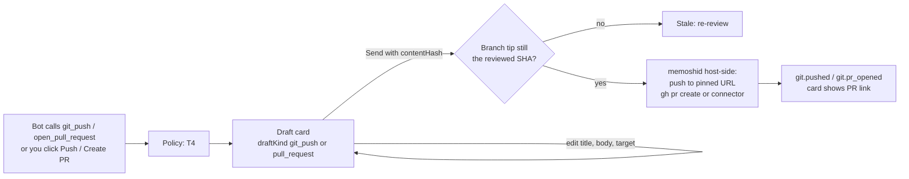
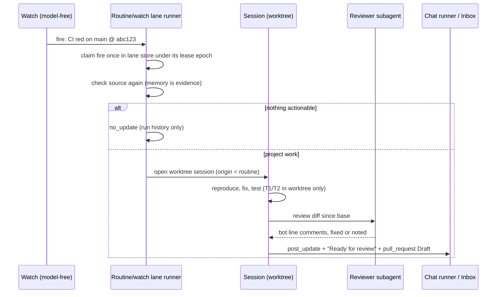
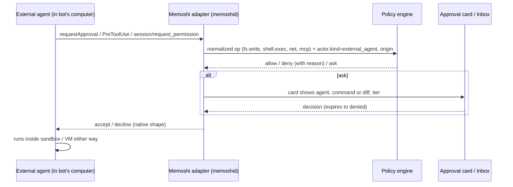

# Coding in projects

**Status:** Draft 4 · 2026-10-20 · updated 2026-10-23 for [D44](decisions.md#d44)–[D70](decisions.md#d70), [D77](decisions.md#d77), [D79](decisions.md#d79), [D80](decisions.md#d80), [D82](decisions.md#d82)–[D85](decisions.md#d85) and [D87](decisions.md#d87)–[D91](decisions.md#d91) · updated 2026-11-13 for [D106](decisions.md#d106)–[D122](decisions.md#d122): external coding agents, team mode and Attempts move into Phase 2 on the Mac ([D110](decisions.md#d110), [D117](decisions.md#d117)); Claude Code may also be a bot's model on the Mac ([D108](decisions.md#d108)); bots check their own work before reporting done ([D110](decisions.md#d110)); Apps gain page Apps in Phase 1 and project-scoped Apps in Phase 2 ([D114](decisions.md#d114), [D119](decisions.md#d119)); coding on Bot computers, Cloud computers and Remote machines is restaged ([D113](decisions.md#d113)); Cognitio's workbench is the behaviour reference, with no Kuvo- or Cognitio-derived code ([D106](decisions.md#d106)); stages follow Phases 1–4 and the gates M1–M3 ([D122](decisions.md#d122))
**Owns:** How bots code in projects: projects and trust, sessions, Pi coding tools in the bot's computer, Python environments and notebooks in projects, coding reached from iPhone and iPad, the review loop, worktrees, preview and run, bots on projects, coding subagents, self-checks, team mode and its landing gate, Attempts, external coding agents (Phase 2, on the Mac), git hosting and coding safety.
**Depends on:** [MASTER_PLAN.md](MASTER_PLAN.md) · [decisions.md](decisions.md) · [AMENDMENT_2026-11-13.md](AMENDMENT_2026-11-13.md) · [02-experience.md](02-experience.md) · [03-design-system.md](03-design-system.md) · [04-architecture.md](04-architecture.md) · [05-bots-and-assistant.md](05-bots-and-assistant.md) · [06-computers-and-browsers.md](06-computers-and-browsers.md) · [08-security-and-privacy.md](08-security-and-privacy.md) · [10-roadmap.md](10-roadmap.md) · [../specs/policy.md](../specs/policy.md) · [../specs/object-model.md](../specs/object-model.md) · [../specs/events.md](../specs/events.md) · [../specs/protocol.md](../specs/protocol.md)

---

## 1. Summary

Coding is the sixth white-space promise in [MASTER_PLAN §1](MASTER_PLAN.md#1-the-product), "a real workbench": a bot works in a project inside its own computer, and the user reviews the result like a pull request. This doc turns MASTER_PLAN §11 "Coding" and the coding part of Phase 2 (Mac: workbench, teams, voice, bot computers) into a design. Phase 2 ends at the gate M2, whose exit includes a first accepted diff within 10 minutes for a new project and a team-mode change that lands only after its checks pass ([D117](decisions.md#d117), [AMENDMENT_2026-11-13.md §3](AMENDMENT_2026-11-13.md#3-milestones)). Coding can be driven two ways, both first-class: through the Assistant, which hands the work to a coding bot, or directly in a session ([D109](decisions.md#d109)).

**Where coding runs.** When the workbench arrives in Phase 2, coding runs on the Mac, in This Mac (sandboxed) ([D47](decisions.md#d47)). Reaching a coding Session from iPhone or iPad does not move its lease: an awake, reachable runner keeps the conversation and the phone forwards messages ([D73](decisions.md#d73), [D74](decisions.md#d74)). If the Session's runner is on the phone or tablet after a valid hand-over, it calls the Mac's tools through Pi's remote environment, and a step shows "Waiting for your Mac" while the Mac is unreachable ([D49](decisions.md#d49), [06 §2.8](06-computers-and-browsers.md#28-tools-on-another-device)). Coding in a Bot computer arrives at the end of Phase 2, in a Cloud computer in Phase 2 after the local ones, and on a Remote machine in Phase 3 ([D113](decisions.md#d113), which supersedes [D47](decisions.md#d47)'s move of them to v1.1). From Phase 3 a bot can also do small coding jobs on iPhone or iPad in the optional emulated Linux computer (iSH), with Git, SSH and a real shell (§4.4, [D69](decisions.md#d69)). From Drop 2 the iPhone and iPad app also shows a session's Changes and Files, with Accept, comments and Commit run on the Mac, and its Terminal mirrored read-only (§5.2, [D85](decisions.md#d85), [D87](decisions.md#d87)).

**Phase 2 delivers, on the Mac:**
- projects with trust levels, project memory (`AGENTS.md`) and project skills;
- sessions with a lead bot, a model, an optional worktree and an optional `/plan`; a session uses its lead bot's permission mode ([D52](decisions.md#d52));
- Pi coding tools from Pi_Swift ([D44](decisions.md#d44)), running in the bot's computer on the Mac;
- the Changes tab, with hunk accept and reject and line comments queued into the next message;
- commit, with push and PR as T4 Draft cards;
- a real PTY terminal, long-running processes and dev-server preview;
- worktree lifecycle;
- bots attached to projects through watches and routines;
- coding subagents and Code Mode;
- Python in projects, with the bot's own environment or the project's pinned one, and notebooks in the native notebook view ([D60](decisions.md#d60)).

Phase 2 also delivers, on the Mac, what earlier drafts held for v1.1 ([D110](decisions.md#d110), [D117](decisions.md#d117)):
- external coding agents as workers behind policy: Codex app-server, Claude Code and ACP agents (§11; [D11](decisions.md#d11));
- team mode, optional per project: a lead bot per piece of work in its own worktree, helper tasks, several reviewers merged into one verdict, and a landing gate that is a program (§9.5);
- Attempts: the same task in two to four worktrees, compared (§4.6; [AMENDMENT_2026-11-13.md §5](AMENDMENT_2026-11-13.md#5-smaller-items-adopted-with-d117)).

Two things arrive earlier, in Phase 1. A bot looks at what it made before it reports done, starting with Apps and previews (§10.5, [D110](decisions.md#d110)). Claude Code, the program the user installed and signed in to, can be the model of any bot on the Mac; that role is separate from the Phase 2 worker role (§11.6, [D108](decisions.md#d108)).

**Choices this doc makes beyond the contract:**
1. **Accept means stage.** The git index is the review ledger: Staged means accepted, Unstaged means still to review. Commit takes only the index. This replaces Draft 3's `git add -A` commit.
2. **Every model tool runs inside the bot's computer, file tools included.** For This Mac, `RemoteExecutionEnv` reaches the pi-env daemon inside the S4-qualified Seatbelt boundary. [D96](decisions.md#d96) supplies independent private coding data rather than a live project/root allowance; applying reviewed changes to the authorized source is a separate trusted host file-data export, not a host-direct model tool (agreed with [06](06-computers-and-browsers.md#3-this-mac-sandboxed) and [04](04-architecture.md)).
3. **Git is the ledger, hidden refs are the memory.** A start snapshot and per-turn checkpoints under `refs/memoshi/`, with their SHAs held in SQLite, give the "This session" scope, attribution and checkpoints you can restore or fork from, without touching the user's branch ([D77](decisions.md#d77)). This follows T3 Code's hidden-ref checkpoints.
4. **Repo hooks never run host-side.** Hooks run inside the session's sandbox through `git hook run`, then memoshid commits host-side with `--no-verify` so signing still works. This is a hard rule in [policy.md](../specs/policy.md), and [D77](decisions.md#d77) keeps it.
5. **Unattended work happens only in session-owned worktrees.** A routine never edits the user's checkout.
6. **memoshid's host-side git is hardened** and remains the only host-side coding program. D96's descriptor-safe import/export is a separate trusted file-data operation; it never executes repository-controlled programs, hooks, filters or helpers, and does not grant models a host-direct env.
7. **External agents always ask.** From Phase 2 they run with their most-asking approval setting, and Memoshi's single policy engine answers every request.

### Scope by release

Feature IDs refer to [feature-catalog.md](feature-catalog.md).

| Capability | Release | Catalog | Notes |
|---|---|---|---|
| Grant folders, trust levels, `AGENTS.md`, project skills, project settings | v1 · Phase 2 | PR-01, PR-02, PR-08 | §3 |
| Sessions: lead bot, model, `/plan`, Local or Worktree | v1 · Phase 2 | PR-03, PR-05 | §4 |
| Pi_Swift's coding tools in the This Mac sandbox; hardened host git and sandboxed hooks | v1 · Phase 2 | CODE-01, CODE-16 | §5, §6.5, §13.6 |
| Coding reached from iPhone or iPad: tools run on the Mac through cross-device calls | v1 · Phase 3 | — | §5.2, [D49](decisions.md#d49) |
| Coding on iPhone and iPad: a session's Changes and Files, with Accept, review comments and Commit run on the Mac through typed calls, and its Terminal mirrored read-only | Drop 2 | CODE-17 | §5.2, §5.5, [D85](decisions.md#d85), [D87](decisions.md#d87) |
| The same tools on a Bot computer (virtiofs) | v1.0 · end of Phase 2 | CMP-10, CMP-18 | [D113](decisions.md#d113) moves Bot computers from v1.1 to the end of Phase 2 |
| The same tools on a Cloud computer | v1.0 · Phase 2, after Bot computers | V2-02 | Behind the same computer seam ([D113](decisions.md#d113)); policy as in §4.4; how a project reaches one is open (Open question 15) |
| The same tools on a Remote machine | v1.0 · Phase 3 | CMP-13 | [D113](decisions.md#d113) moves Remote machines from v1.1 to Phase 3 |
| Changes tab, hunk accept/reject, line comments, checkpoints, commit | v1 · Phase 2 | CODE-02 to CODE-05, CODE-07 | §6 |
| Push and PR as Draft cards; conflict help | v1 · Phase 2 | CODE-08, CODE-09 | §6.6, §6.7 |
| Terminal (SwiftTerm PTY), bot command view, processes, run and test commands, preview | v1 · Phase 2 | TP-01 to TP-04, CODE-10 | §5.4, §5.5, §8 |
| Worktrees: create, set up, clean up, merge back | v1 · Phase 2 | CODE-06 | §7 |
| Bots on projects: CI watcher, issue triager, dependency updater | v1 · Phase 2 | PR-04, CODE-11 | Watches and routines arrive in Phase 1 (§9) |
| Coding subagents (scout, planner, reviewer, implementer); Code Mode | v1 · Phase 2 | CODE-15 | The Code Mode engine arrives in Phase 1 (§10). Cross-bot review through a Handoff is CODE-12 (Phase 2, [AMENDMENT_2026-11-13.md §4.7](AMENDMENT_2026-11-13.md#47-engineering-workbench-d110)) |
| Python in projects: the bot's environment or the project's pinned one, the `python` tool, notebooks | v1 · Phase 2 | PY-01, PY-02 | §5.6, §5.7 |
| Python and notebooks reached from iPhone or iPad: Pyodide on the device, or the Mac's Python | v1 · Phase 3 | PY-03, PY-04 | §5.6, [D49](decisions.md#d49) |
| Notebook extras: HTML and Plotly outputs, co-editing with the bot, and a notebook's folder synced to the device that runs its kernel | Drop 2 | PY-05 | §5.6, [D85](decisions.md#d85), [D87](decisions.md#d87) |
| Bots that build page Apps: the `mini_app` tool, a sandboxed web view with the tool bridge and a permission list, a pane beside the chat, exported functions, versions and change requests | v1.0 · Phase 1 (Mac), Phase 3 (iPhone and iPad) | CH-33 to CH-37, CH-39 | §10.4, [D114](decisions.md#d114), [D115](decisions.md#d115); iPhone and iPad follow with CH-23 |
| Bots that build Swift Apps and live cards: the `mini_app` tool, core Swift, compile errors as tool results, permission lists, per-value tracking, publish-time migrations, versions and change requests | v1.0 · Phase 2 (Mac), Phase 3 (iPhone and iPad) | CH-21 to CH-24 | §10.4, [D68](decisions.md#d68), [D87](decisions.md#d87), [D114](decisions.md#d114); source compiles locally on each device; a Swift App can replace a page App and keep its data |
| The digest of what the user did in an App, sent to its bot | v1.0 · Phase 2 | CH-31 | §10.4; moved from Drop 1 by [D114](decisions.md#d114) |
| Project-scoped Apps: an App that lives in the project folder, behind a trust prompt | v1.0 · Phase 2 | CH-43 | §10.4, [D114](decisions.md#d114) |
| Self-checks: a bot looks at what it made before it reports done | v1.0 · Phase 1 for Apps, cards, page Apps and interactive artifacts; Phase 2 for the dev-server Preview and a session's diff | CH-38 | §10.5, [D110](decisions.md#d110) |
| App power: background jobs, widgets, signed bytecode cache, remaining Swift language, rich styling and adaptive kit | Drop 1 | CH-26–CH-30, CH-32 | §10.4, [D87](decisions.md#d87); not prerequisites for v1.0. The action digest (CH-31) left this row for Phase 2 ([D114](decisions.md#d114)) |
| Small coding jobs on iPhone and iPad in the optional emulated Linux computer (iSH): Git, SSH, a real shell | v1 · Phase 3 | IOS-06 | §4.4, [D69](decisions.md#d69) |
| Attempts: 2–4 parallel worktree sessions from one prompt, compared | v1.0 · Phase 2 (Mac) | R11-15 | §4.6; moved from v1.1 with the workbench ([D117](decisions.md#d117), [AMENDMENT_2026-11-13.md §5](AMENDMENT_2026-11-13.md#5-smaller-items-adopted-with-d117)) |
| External coding agents as workers: Codex app-server, Claude Code, ACP agents | v1.0 · Phase 2 (Mac only) | R11-08, R11-09, R11-10 | §11, [D11](decisions.md#d11), [D110](decisions.md#d110); Cursor stays out while its kit needs a JavaScript runtime ([D46](decisions.md#d46)) |
| Team mode, optional per project: a lead bot per worktree, helper tasks, parallel reviewers, a code-only landing gate | v1.0 · Phase 2 (Mac); shown and followed on iPhone and iPad in Phase 3 | CODE-18, CODE-19, CODE-20; IOS-07 | §9.5, [D110](decisions.md#d110) |
| Claude Code as a bot's model on the Mac | v1.0 · Phase 1 | MOD-11 | §11.6, [D108](decisions.md#d108); the model route belongs to [04 §4.13](04-architecture.md#413-models-usage-and-budgets) |
| History and blame (read-only) | v1 · Phase 2 (P2) | CODE-14 | Served by host-side hardened git (§13.6) |
| Syncing PR review comments (P2); stacked PRs | v1 · Phase 2; stacked PRs later, no catalog row | CODE-13 | Draft 3 catalog E11, E12 |

## 2. Principles for coding

1. **Review like a pull request.** In Ask first and Auto, a bot never lands code you have not seen: accepting stages a hunk, and landing (commit, merge, push) is your act or a Draft you approve. In team mode the landing gate adds a condition to that and removes none (§9.5). In Bypass, a bot's push and PR go out without a card, recorded and audited, and the Changes tab still shows every change ([D52](decisions.md#d52)).
2. **The bot's computer is the boundary.** Tools run in the bot's sandbox on the Mac (from the end of Phase 2 also in a Bot computer or a Cloud computer, and from Phase 3 on a Remote machine; [D113](decisions.md#d113)). The only coding code that runs host-side is memoshid's hardened git, and it runs no repository-controlled programs.
3. **Diffs come from git, not from tool claims.** Tool results add attribution; git decides what changed.
4. **Nothing leaves the Mac without a Draft.** Push, PR, comment, label and merge-on-remote are all T4 ([MASTER_PLAN §10](MASTER_PLAN.md#10-safety-at-a-glance)). In Ask first and Auto you approve each Draft; in Bypass it is sent without a card but still recorded and audited ([D52](decisions.md#d52)).
5. **One policy engine for every author.** Pi tools, Code Mode scripts, subagents and, from Phase 2, external agents all pass through the same `beforeTool`/`afterTool` decisions ([D9](decisions.md#d9)).
6. **Unattended runs are boxed in.** They work in worktrees, never escalate, and end in "Ready for review" ([D23](decisions.md#d23), [D27](decisions.md#d27)).
7. **A bot looks before it reports done.** It checks what it made: the rendered App or card, a screenshot of a web preview, the diff ([D110](decisions.md#d110), §10.5). Its check never replaces your review.

## 3. Projects

A **Project** is a folder or repo the user grants: files, git, project memory (`AGENTS.md`), skills and a trust level ([MASTER_PLAN §5](MASTER_PLAN.md#5-vocabulary-and-object-model)).

### 3.1 Granting a folder

1. The user picks a folder (Open panel, drag and drop, ⌘O, or onboarding's "grant a first folder"). The Assistant or a bot can only *propose* a grant, through a card ([D20](decisions.md#d20), [D21](decisions.md#d21)).
2. memoshid canonicalizes the path (`realpath`) and refuses paths that can never be granted (below).
3. It detects git: repository root, current branch, default branch, and remotes. The remote URL the user confirms is **pinned in the Project record**. Host-side fetch and push only ever use that pinned URL, never a URL re-read from `.git/config` (agreed with Security).
4. The grant sheet asks the trust question (§3.2) and which bots may work in the project. Each chosen bot receives a folder Grant.
5. v1 projects have one root folder. Kuvo supports multi-folder projects ([Kuvo docs](https://www.kuvo.run/llms-full.txt), "Projects and sessions"); multi-root is an open question.
6. Remote machine projects (Phase 3, [D113](decisions.md#d113)) are a path on that machine. Their files never sync to the Mac.

**Never grantable: the `system` class.** The full list is in [policy.md](../specs/policy.md), agreed with Security; it started from Forma's `protectedPaths.ts` (MIT; [in-house assets](../research/agentic-workspace-landscape/landscape/in-house-assets.md)). memoshid refuses these paths as a project root, and every sandbox profile denies them even when a parent folder is granted. They include:
- `/` and `~` as whole folders, and OS paths such as `/.Spotlight-V100`, `/.fseventsd`, `/.Trashes` and `/.DocumentRevisions-V100`;
- `~/Library/**`, which covers Messages, Mail, Safari, Cookies, Calendars, AddressBook, the TCC stores and Keychains. The one carve-out is Memoshi's own bot homes and worktrees under `~/Library/Application Support/Memoshi/`: each sandbox may use only its own bot's home and its own session's worktree;
- `~/.ssh`, `~/.gnupg`, `~/.aws`, `~/.config/gcloud`, `~/.config/gh`, `~/.kube`, `~/.docker`, shell rc files and `~/.gitconfig`.

Forma also blocks `~/Documents`, `~/Desktop` and `~/Downloads` outright, which would block this very repo. Memoshi instead requires typed confirmation to grant one of these personal folders as a whole (policy.md §3.5.2) and treats projects beneath them normally.

### 3.2 Trust levels

Agreed with Security. The policy mechanics live in [policy.md](../specs/policy.md).

| Level | What bots can do | Instruction files and skills from the repo | Default for |
|---|---|---|---|
| **Restricted** | T0 only. In an attended run, the first T1+ call shows a "Trust this project?" card (`grant_request`, variant `project_trust`: Trust, Trust for unattended work, or Keep restricted); unattended runs are denied. Content read from a Restricted project marks the run as exposed to untrusted content. | Found and listed, **not loaded** | A clone a bot made, or any folder where the user picks "Open restricted" |
| **Trusted** | The normal tier matrix for the lead bot's permission mode | Loaded | Folders the user trusts on the grant sheet; projects Memoshi creates |
| **Trusted for unattended work** | Trusted, plus a project-scoped standing rule: unattended runs may do T1 and T2 **in session-owned worktrees only** | Loaded | Off; the user turns it on in project settings. Revocable. The rule has the standard standing-rule expiry (1–90 days, default 90), and a renewal card is offered when it was recently used ([policy.md](../specs/policy.md) §8). Plain **Trusted** is a project setting and does not expire |

The grant sheet asks "Trust this folder's code?" with two equal buttons, **Trust** and **Open restricted**, and no preselected answer. Project settings (§3.5) live in Memoshi's database rather than in the repo, so a cloned repo cannot preconfigure commands that Memoshi then runs.

### 3.3 Project memory: `AGENTS.md`

Project memory has two layers (aligned with [05-bots-and-assistant.md](05-bots-and-assistant.md)).

**1. `AGENTS.md` files in the repo.** These are checked-in instructions, usually written by humans.
- **Discovery.** We adopt pi-coding-agent's convention so repos that already work with Pi, Codex or Claude Code behave the same in Memoshi. In each directory from the project root down to the session's working directory, Memoshi takes the first of `AGENTS.override.md`, `AGENTS.md`, `AGENTS.MD`, `CLAUDE.md` or `CLAUDE.MD`. Deeper `AGENTS.md` files are listed by path, and each one joins the loaded files the first time the bot reads or edits a file in its subtree ([D85](decisions.md#d85)).
  - Pi Durable has no context-file loader; this convention comes from pi-coding-agent's `resource-loader`. Memoshi implements its own loader in the runtime adapter.
- **Rendering.** The files are rendered into **every request** from disk, using an mtime cache, and are never frozen at session creation ([D7](decisions.md#d7)).
  - Caps: 16 KB per file (Aiden's cap) and 32 KB in total. Anything over the cap is truncated with a diagnostic and a card suggesting consolidation.
  - The prompt labels these files as project instructions. They rank below Memoshi policy and the bot's persona, and they never grant permissions. Memory is evidence, not authority ([D22](decisions.md#d22)).
- **Edits.** These files are in the `instruction` protected class (§13.2). A bot's `write` or `edit` becomes a `memory_proposal` card (variant `project_file`, carrying the path, the unified diff and its `contentHash`) that needs typed confirmation, because policy.md rates an instruction change T5. Unattended runs can never make or propose such edits.
- **Bootstrapping.** "Set up AGENTS.md" asks the lead bot to draft one, which arrives as the same proposal. Kuvo's `/init` command plays this role.

**2. Project-scope Memory entries.** These are rows in the memory service (SQLite, with provenance). They stay on the user's devices, which sync them entry by entry ([D49](decisions.md#d49)).
- Bots working in the project write them freely within the [D22](decisions.md#d22) load budget, and every bot in the project can see them.
- The nightly consolidation pass may propose promoting a stable entry, such as "integration tests need `DATABASE_URL`", into `AGENTS.md`. That promotion is an instruction proposal like any other.

### 3.4 Project skills

- **Discovery.** Memoshi reads `.agents/skills/**/SKILL.md`, the cross-tool path that pi-coding-agent and Kuvo both read. It also reads `.claude/skills` and `.pi/skills` for compatibility, without writing to them. Skills Memoshi creates for a project go to `.agents/skills/`.
- **Trust.** Project skills load only in Trusted projects. pi-coding-agent likewise loads `.pi/skills` only for trusted projects.
- **Progressive disclosure.** Only a skill's name, description and path go into the prompt; the bot reads the body on demand. Names are limited to 64 characters and descriptions to 1,024, following pi-coding-agent's `docs/skills.md`.
- **Precedence.** When names collide, a bot skill beats a global skill, which beats a project skill, so a repository's files cannot shadow a skill the user installed with typed confirmation; the skill list warns about the shadowed skill ([D84](decisions.md#d84)). The general skill model is in [05](05-bots-and-assistant.md).
- **Scripts.** A skill's scripts run through the normal tools (T2).
- **Edits.** Changing a `SKILL.md` becomes a `bot_proposal` card with `op: skill_change` (typed confirmation, attended runs only).

### 3.5 Project settings

These are stored in SQLite and exportable. They are never read from the repo.

| Setting | Purpose | Default |
|---|---|---|
| Commands: `setup`, `run`, `test`, `lint`, `build` | Named commands for buttons (⌘R, ⌘U) and for the `project_command` tool | Suggested by detection (§8.2), confirmed by the user |
| Preview | A URL or port that overrides detection | Empty |
| Default workspace | Local or Worktree for new interactive sessions | Local |
| Base branch | Base for worktrees and the "Since base" scope | The repo's default branch |
| Branch prefix | Prefix for worktree branches | `memoshi/` |
| Commit and PR instructions | Style guidance for suggested messages; Kuvo has the same setting | Empty: suggested messages match the style of the repo's recent history, whatever it is ([D85](decisions.md#d85)) |
| Network presets | "Package registries" and "Git hosting (read)" egress presets (§13.4) | Registries on for Trusted projects |
| Environment references | `NAME` → Keychain item, used by reference: a placeholder by default, the real value at exec time only by opt-in (§13.3) | None |
| Worktree copy list | Untracked, non-secret files copied into new worktrees, like Orca's `.worktreeinclude` | None; the `secret` class is never copied |
| Extra protected paths | Additions to the protected classes (§13.2) | None |
| Bots | Attached bots and their project routines and watches (§9) | The bots chosen at grant time |
| Trusted for unattended work | §3.2 | Off |
| Team mode | Whether work in this project runs in team mode, and which of the project's commands are its checks (§9.5) | Off [INFERENCE: the default; [D110](decisions.md#d110) says only that team mode is optional per project] |

## 4. Sessions

A **Session** is a working thread led by one bot or the Assistant. Coding happens in sessions ([MASTER_PLAN §5](MASTER_PLAN.md#5-vocabulary-and-object-model)). Field names are agreed with DomainSpecs ([object-model.md](../specs/object-model.md)).

### 4.1 Anatomy

| Field | Meaning |
|---|---|
| `projectId` | The project; null for a session without a project, listed in the **Sessions** sidebar section |
| `leadBotId` | Exactly one lead: a bot or the Assistant. Other bots contribute only through Handoffs ([D24](decisions.md#d24)). In team mode each piece of work still has exactly one lead (§9.5) |
| `model`, effort | Default from the lead bot; overridable per session and for the next turn from the composer |
| `plan` | `/plan` on or off (default off). While it is on, the session runs nothing above T0 (§4.3). The permission mode is the lead bot's `permissionMode`; a session has none of its own ([D52](decisions.md#d52)) |
| `computerId` | The lead bot's This Mac computer, whichever device runs the bot (§5.2). Once the user can pick a Bot computer or a Cloud computer for a bot (end of Phase 2, [D113](decisions.md#d113)), it is the computer chosen for the lead bot, and a session may override it ([MASTER_PLAN §5 rule 1](MASTER_PLAN.md#rules)) |
| `workspaceKind` | `local` (the project folder) or `worktree` (§7) |
| `worktreePath`, `branch` | For worktree sessions |
| `baseRef`, `baseSha` | Base branch name and the commit at session start; the UI labels the scope "Since `<baseRef>`" |
| Start snapshot | A Checkpoint (`ckp_`) of the working tree at start, including untracked files (§6.2) |
| `attemptGroupId` | Attempts (§4.6), Phase 2 |

Interactive turns are Tasks of kind `turn` (`tsk_`). Checkpoints, comments and write records point at the `taskId`.

### 4.2 Creating a session

- **From a project:** "+" or ⌘N. The New Session sheet asks for the bot, **Local | Worktree**, the base (worktree only), the model and whether to start in `/plan`. It shows the bot's permission mode.
- **From the Assistant:** "Build X in project Y" becomes a Handoff to a coding bot, which opens the session ([MASTER_PLAN §5 rule 4](MASTER_PLAN.md#rules)).
- **From a routine run:** always a worktree session with origin `routine` (§9).
- **From ⌘K:** "New session in…".
- **Collision guard:** if another session is already working Local in the same project, the sheet recommends Worktree. Two Local sessions writing the same tree are allowed but flagged.

### 4.3 Model, permission mode and `/plan`

- **Model.** The composer can switch the model for the next turn; identity, instructions, memory and grants are re-rendered on every request ([D7](decisions.md#d7)). Effort works the same way.
- **Permission modes in coding.** A session uses its lead bot's mode, the same on every device. New bots start in Ask first, in Guided and Developer mode alike ([D52](decisions.md#d52), [policy.md](../specs/policy.md) §4.6; that is the interface level, not [D114](decisions.md#d114)'s plugin developer mode, §10.4):
  - **Ask first:** reads (T0) run; T1 writes, T2 commands and T3 ask; T4 makes Drafts; T5 needs typed confirmation.
  - **Auto:** T1 and T2 run inside the sandbox and granted folders; T3 asks; T4 makes Drafts; T5 needs typed confirmation; `ci_config` writes still ask.
  - **Bypass:** no approval cards, except for money, credentials (sign-in, raw `secret` reads and writes, and commands that reveal or create credentials, such as `gh auth token` or `npm token create`) and changes to the bot's own permissions, grants or instructions, which stay proposals (`instruction`-class writes included). Pushes, PRs and other T4 actions are sent without a card, except in runs started by outside content, such as a webhook; their Drafts are still recorded and audited. Attended runs may reach public hosts beyond the allowlist, each logged ([06 §4.8](06-computers-and-browsers.md#48-egress-gateway-and-secret-placeholders)). A `host_exec` patch and unknown tools keep their cards ([policy.md](../specs/policy.md) §4.7, [D57](decisions.md#d57)). Bypass is off by default and is turned on per bot after a confirmation that names the risks ([D52](decisions.md#d52)); §14 maps each coding action.
- **`/plan`** is a per-session option, not a mode ([D52](decisions.md#d52)). While it is on, the session proposes and runs nothing above T0: a planner subagent (§10) produces a plan Artifact, and **Build it** turns `/plan` off and starts under the bot's mode ([02](02-experience.md)). Kuvo's Plan mode similarly "explores and plans without changing files" ([Kuvo docs](https://www.kuvo.run/llms-full.txt)).
- **Read-only** is no longer a mode. A read-only folder grant gives the same limit for one project ([D52](decisions.md#d52)).
- **Changes** to the mode or to `/plan` apply to the next tool call, because the policy reads them when it decides.

### 4.4 The session's computer

| Computer | Where the project appears to tools | Notes |
|---|---|---|
| **This Mac (sandboxed)** | An independent private project/worktree mapped to its authorized original source; neither the live checkout nor main `.git` is a daemon root ([D96](decisions.md#d96), §5.2) | Native Mac toolchains remain the goal, subject to complete S4 and Phase 2 qualification; the same computer serves iPhone/iPad calls ([D47](decisions.md#d47), [D49](decisions.md#d49)) |
| **Emulated Linux** (iSH; iPhone and iPad, Phase 3) | A path inside the guest, where the bot clones the repo with `git clone`; the Mac's project folder is not shared there | Optional and slow: for small repos, quick fixes, and `git` and `ssh` away from the Mac. Policy groups it with This Mac ([policy.md](../specs/policy.md) §3.9); heavy builds and tests stay on the Mac |
| **Bot computer** (end of Phase 2) | `/workspace/<project-slug>` via the `memoshi-projects` virtiofs share ([06 §4.7](06-computers-and-browsers.md#47-projects-in-the-vm)) | Recommended for untrusted code and unattended work. For very large repos, an in-VM clone at `/home/bot/src/<slug>`, synced through git |
| **Cloud computer** (Phase 2, after Bot computers) | Not settled [INFERENCE: set in Phase 2; a provider's machine cannot mount the Mac's folder, so a clone synced through git, as for an in-VM clone, is the likely shape] (Open question 15) | Behind the same computer seam as a Bot computer, and picked per bot ([D113](decisions.md#d113); V2-02). Policy treats it like a Bot computer only for a provider whose egress control Memoshi has verified; otherwise the Remote machine rules apply ([policy.md](../specs/policy.md) §3.7). The cost estimate is always shown before it starts: on the approval card where the mode asks, otherwise as a non-blocking notice; the budget gate applies in every mode ([policy.md](../specs/policy.md) §3.1, §12) |
| **Remote machine** (Phase 3) | A path on the remote host | The remote user account is the only boundary ([06](06-computers-and-browsers.md)) |

### 4.5 Lifecycle

Sessions move through active, idle, ready for review (unattended runs) and archived; the exact state names are in [object-model.md](../specs/object-model.md).
- **After a crash,** an interrupted step follows [D51](decisions.md#d51): it shows "Interrupted: may have happened", runs its outcome check if its tool declares one, and otherwise waits for a **Resume** card with Run again, Skip and Mark as done. Replay-safe work resumes on its own ([D42](decisions.md#d42)).
  - Pi's built-in tools are replay-unsafe. An interrupted call returns "Tool X was interrupted and may have partially run" to the model (pi-durable `harness/tool.js`; Pi_Swift `PiDurable/Harness/ToolTask.swift`).
  - The checkpoint diff (§6.2) shows exactly what landed.
- **After the link to the bot's computer is lost** (the pi-env daemon stops answering, or, once they arrive, a Bot computer, Cloud computer or Remote machine drops), nothing retries on its own: an interrupted call follows the steps above, and while a step is recovered, the session's whole thread holds ([D79](decisions.md#d79)).
- **Before delivery, without a model** ([D88](decisions.md#d88)). When neither the Session's runner nor an available allowed model is reachable, a sent message stays in the device-local unsent queue as **Waiting for connection**, with its original `requestId`, surviving restart and supporting cancellation. It starts no coding turn, tool or effect, takes no lease and writes no authoritative conversation history. Reconnect delivers each uncanceled message once through the normal idempotent forwarding path to the current confirmed runner, under current grants, budgets and recovery holds. A real side thread may still execute under its existing rules when an allowed model is available; waiting messages are not side-thread results and generate no summary ([05 §4.4](05-bots-and-assistant.md#44-bots-on-every-device)).
- **Archiving** runs the worktree cleanup policy (§7.4) and stops the session's processes (§5.4).

<a id="46-attempts-v11-proposed"></a>
### 4.6 Attempts (Phase 2)

Attempts arrive in Phase 2 on the Mac, with the workbench. They were a v1.1 proposal until [D117](decisions.md#d117) adopted them ([AMENDMENT_2026-11-13.md §5](AMENDMENT_2026-11-13.md#5-smaller-items-adopted-with-d117)).

- **What it is.** Two to four sessions start from one prompt, each in its own worktree, with the same or different bots and models. Kuvo offers 2–4 and rolls all of them back if one fails to start ([Kuvo docs](https://www.kuvo.run/llms-full.txt) and [changelog](https://raw.githubusercontent.com/serhatandic/kuvo-code/main/CHANGELOG.md)). Orca documents a "race" recipe ([profile](../research/agentic-workspace-landscape/projects/orca.md)).
- **Cost.** A cost preview appears before start ([D25](decisions.md#d25)). Full budgets and the cost preview arrive in Phase 3, after Attempts; until then each attempt counts against its bot's monthly stop, and what the start sheet shows in Phase 2 is open (Open question 7).
- **Compare.** One view shows files changed, test results, cost and time for each attempt.
- **Pick.** **Keep this one** marks the winner; the others are archived, and their branches are kept for 7 days.
- **Review and landing.** Each attempt is an ordinary worktree session: its Changes, checkpoints and merge work as in §6 and §7. In a project with team mode on, the kept attempt lands through the landing gate like any other change (§9.5).

## 5. Pi coding tools in the bot's computer

### 5.1 What Pi 1.3.0 provides (verified)

Memoshi takes these tools from Pi_Swift, the Swift port of upstream Pi, with no Node ([D44](decisions.md#d44), [D46](decisions.md#d46)). The facts below were verified on upstream 1.3.0, which Pi_Swift ports; those marked Pi_Swift were also checked in its source on 2026-10-22. Phase 2 re-checks the rest on Pi_Swift.

| Tool | Package | Parameters | Result notes |
|---|---|---|---|
| `read` | PiDurable `createCodingTools` (upstream pi-durable) | `{path, offset?, limit?}` | Keeps the head; adds a continuation hint ("Use offset=N") |
| `write` | PiDurable | `{path, content}` | Full overwrite, creates parent directories; **returns no diff** |
| `edit` | PiDurable | `{path, edits:[{oldText,newText}]}` | Each `oldText` must be unique and non-overlapping; falls back to fuzzy matching for whitespace and quotes; returns `details: {diff, patch, firstChangedLine}` |
| `bash` | PiDurable | `{command, timeout?}` (seconds; **no default**) | Pipes, not a PTY; keeps the tail; spills the full output to a temp file (Pi_Swift: `pi-output-<uuid>.log`) |
| `grep`, `find`, `ls` | **PiCodingAgent only** (upstream pi-coding-agent) | `grep {pattern, path?, glob?, ignoreCase?, literal?, context?, limit?=100}`, `find {pattern, path?, limit?=1000}`, `ls {path?, limit?=500}` | Agent tools, not Durable tools. Upstream's `grep` runs ripgrep and `find` runs fd, downloading each binary from GitHub if it is missing. Pi_Swift searches through the env's file system instead: "neither grep nor find launches or downloads a binary" (`PiCodingAgent/Tools/NativeFileSearch.swift`) |

Sources: pi-durable 1.3.0 `dist/tools/index.js`, `read.js`, `write.js`, `edit.js`, `bash.js` (local copy in `~/Documents/Memoshi-Plan/.spike/pi-durable/package/`); pi-coding-agent [`src/core/tools`](https://github.com/earendil-works/pi/tree/v1.3.0/packages/coding-agent) and `docs/settings.md`; Pi_Swift `Sources/PiDurable/Tools` and `Sources/PiCodingAgent/Tools`. Other facts that shape this design:

- **Installation.** Nothing installs the coding tools automatically: the app calls `registry.install(CodingTools)` and narrows per conversation with `configure({tools, extensions})`. "Without an environment, the built-in tools fail with an error result" (pi-durable README).
- **No confinement.** Pi's local environment (upstream `NodeExecutionEnv`, Pi_Swift `LocalExecutionEnv`) passes absolute paths straight through and sandboxes nothing. The coding-agent's own sandbox example wraps only `bash` with sandbox-runtime, not read, write or edit.
- **Environment leak.** `bash` defaults to `inheritEnv: true` (Pi_Swift too, `PiDurable/Tools/Bash.swift`) and merges the daemon's environment. Memoshi forces `inheritEnv: false` and builds the exec environment from an allowlist (agreed with Security and Computers).
- **Write locking.** Pi serializes writes and edits per `env.id` and path, but this is "Not a lock against `bash` or other processes".
- **Hooks.** `beforeTool` can block (the first block wins; a throw blocks) or rewrite arguments, and rewritten arguments are validated again. `afterTool` replaces the result before Pi bounds it, and does **not** run for blocked, invalid or aborted calls. Nested Code Mode and MCP-bridge calls carry `call.parent {taskId, callId}`.

**Memoshi's coding tool set:**
- Pi_Swift's `read`, `write`, `edit` and `bash`.
- `grep`, `find` and `ls`, adapted from Pi_Swift's PiCodingAgent (MIT, with attribution) as Durable tools. Every file access goes through the env, so the sandboxed daemon performs it. On the Mac, `grep` and `find` run the signed `rg` and `fd` that the app bundles (ripgrep: Unlicense/MIT; fd: Apache-2.0/MIT), inside the sandbox; on iPhone and iPad they stay native, and nothing is ever downloaded ([D85](decisions.md#d85)).
- `process_start`, `process_status`, `process_logs`, `process_stop`, `process_list` (§5.4).
- `project_command {name}` for configured commands.
- `git_fetch` (host-side, pinned remote; T0).
- `git_push` and `open_pull_request`, which create T4 Drafts (§6.6).
- `review_comment`, for the reviewer subagent only (§10).
- `subagent` (§10).
- Memoshi's memory, card, handoff, browser and computer tools ([D8](decisions.md#d8)).
- Code Mode is on for coding bots ([D8](decisions.md#d8)).

### 5.2 How tools reach the bot's computer

The harness `env({conversationId, cwd})` callback runs for every tool call and returns the session's `ExecutionEnv`. The env is rebuilt per call, so a rerun after recovery gets the conversation's environment at that time. This is the pattern of Pi's example 29, "sandbox-per-conversation", which stores the sandbox in a per-conversation document.

- **This Mac.** PiEnv file tools, exec and PTY must share the S4-qualified Seatbelt daemon, reached through `RemoteExecutionEnv`. [D96](decisions.md#d96) selects independent private working copies for the next qualification, not production acceptance. Original source identity/mode and source-relative policy classes remain bound to each copy; staging beneath bot home never changes a source path into a lower-tier bot-home path. App commands retain the existing stdio channel ([D77](decisions.md#d77)).
  - `allowWrite` includes only private bot home and session-owned private coding data/metadata. Do not add the live project, live worktree, main repository's `.git`, shared objects/refs/logs, hooks or configuration. Private Git metadata and accepted-diff/host-commit integration still need the Phase 2 proof; copied pointers to a live main `.git` are not usable authority.
  - Preserve srt's mandatory write denies for `.git/config`, `.git/hooks/`, `.gitmodules`, `.vscode/`, `.idea/`, `.mcp.json` and shell rc files, plus policy on the mapped original source classes. Trusted host export is data-only and still follows the hardened host-git/no-host-hooks rules.
  - `denyRead` covers the `system` and `secret` classes in private data as well as outside roots. The tagged srt generator already emits configured nested/glob read denies after allows ([06 §3.1](06-computers-and-browsers.md#31-what-sandbox-runtime-provides-verified)); the former blanket precedence concern was inaccurate. The measured hard-link failures were a different inode-alias problem. No tool-enabled release may rely on classifier-only secret protection while S4 is open.
  - Dev-server binding is loopback-only and requires the full S4 local-network gate; `allowLocalBinding` is not permission to reach LAN/private services.
  - Network remains sandbox proxy → memoshid's **egress gateway**; neither the private-copy development profile nor its scripted loopback policy provider qualifies that production path.
  - Clean `inheritEnv=false`; `HOME` and `TMPDIR` stay in private bot home outside the source copy. Trusted host export requires the immutable proposal, fresh applicable approval and original read-write source authority; read-only sources cannot export.
- **Fallback.** Both preliminary same-UID profile kernels and the actual separate-user live-folder read gate failed. D96's private native working copies are the next qualification route, with the full D77 guard/conformance/gateway/toolchain/TCC/performance scorecard unchanged. If it fails, the remaining Linux VM is unqualified and Linux-only. A policy path guard or trusted importer alone does not replace the daemon's kernel boundary and descriptor guard.
- **From iPhone or iPad.** When the coding bot's runner is a phone or tablet, its Mac tools reach This Mac through Pi's remote environment over [D48](decisions.md#d48)'s links. The Mac re-checks its own grants and runs each call in the same sandbox. While the Mac is unreachable, the step shows "Waiting for your Mac" and waits under the normal approval expiry ([D49](decisions.md#d49), [06 §2.8](06-computers-and-browsers.md#28-tools-on-another-device)). From Drop 2, the iPhone and iPad app shows a session's Changes and Files, with Accept, review comments and Commit, and mirrors its Terminal read-only; its git actions reach memoshid on the Mac as typed calls over the same links and take the Mac's own commit path (§6.5) ([D85](decisions.md#d85); CODE-17, [D87](decisions.md#d87)).
- **Bot computer** (end of Phase 2, [D113](decisions.md#d113)). The pi-env daemon runs in the VM over SSH. Projects appear at `/workspace/<project-slug>` ([06 §4](06-computers-and-browsers.md#4-bot-computer)). Worktree sessions need git's absolute paths to resolve in the guest (§7.2).
- **Cloud computer** (Phase 2, after Bot computers). The same daemon behind the same computer seam ([D113](decisions.md#d113), [06](06-computers-and-browsers.md)); where the project lives there is open (§4.4).
- **Remote machine** (Phase 3). The same client over SSH, with the project at its remote path.
- **Defense in depth.** A guard in the pi-env daemon resolves paths without following symlinks ([D77](decisions.md#d77)), and the policy engine keeps the Draft 3 workbench guard: resolve the real path of the nearest existing ancestor and reject anything outside the root. Ported with one fix: it also refuses a final component that is a dangling symlink, a write that Draft 3's guard let escape the root [INFERENCE from reading `workbench/service.ts:92-127`].

```mermaid
sequenceDiagram
  participant M as Model (Pi Durable turn)
  participant P as Policy (beforeTool)
  participant E as RemoteExecutionEnv
  participant S as pi-env daemon (sandboxed on the Mac; later a VM, cloud or remote computer)
  participant A as Policy (afterTool)
  participant G as Git ledger + SQLite
  M->>P: edit {path, edits}
  P->>P: tier, mode, origin, protected class
  P-->>M: block (with reason) / Approval card / allow
  P->>E: allowed (args possibly rewritten)
  E->>S: readTextFile / writeFile / exec
  S-->>E: result
  E->>A: result + details.patch
  A->>A: redact secrets in output and structuredOutput
  A->>G: write record (taskId, callId, path, before/after blob)
  G-->>M: bounded result
  G->>G: session.changes_updated (UI only)
```

### 5.3 Output limits

| Item | Pi default (verified) | Memoshi setting |
|---|---|---|
| Any tool | 2,000 lines or 50 KB, whichever comes first; never a partial line (`truncate.js`) | Kept |
| `read` | Keeps the head; offset hint; a single line over 50 KB shows its first 50 KB | Kept |
| `bash` | Keeps the **tail**; the full output spills to `pi-output-<uuid>.log` in the env's temp folder; Pi's `cleanup()` does not delete spill files | Spill files land in the bot home's `TMPDIR`; memoshid sweeps them when the session is archived or after 24 h. The tool chip offers **Open full output** |
| `bash` timeout | None | `beforeTool` fills in 600 s for interactive runs and 1,800 s for unattended runs; hard cap 3,600 s. Longer work uses `process_start` |
| Code Mode | `max_output_tokens` 10,000; Harness limit raised to 4 MiB; full text in a `pi-codemode-` temp folder | Kept |
| Redaction | `afterTool` must redact both `output` and `structuredOutput` (pi-durable README) | Secret values and placeholders are scrubbed in both ([MASTER_PLAN §8](MASTER_PLAN.md#8-computers-and-browsers-at-a-glance)) |

### 5.4 Long-running processes

Pi's `exec` waits for the process to exit, and neither package has a background or job API (upstream pi-durable `env/node.js`). `nohup … &` may survive but can die of SIGPIPE. Memoshi therefore adds the `process_*` tools.

- **Mechanism.** `process_start {command | commandName, name?, cwd?, ready?: {url | port | logRegex}}` opens a PTY in the session's computer through pi-env `openTerminal` (Unix-only, today not wired to `bash`), which the Phase 2 spike verifies over the sandboxed local daemon.
  - A process that receives injected secrets runs without a shell and over pipes instead, because policy.md §13 never injects secrets into a PTY or shell session (§13.3).
  - memoshid keeps a ring buffer of 5,000 lines or 8 MiB per process (T3 Code's terminal budget) and spills older output to a log file.
- **Tiers.** `process_start` is T2. Status, logs and list are T0. Stopping a process the session started is T1.
- **Lifecycle.**
  - Processes belong to the session, at most 4 at once.
  - They stop when the session is archived, the computer sleeps, or a budget hard stop hits.
  - An idle dev server is stopped after 30 minutes with no preview open.
  - `beforeTool` blocks `bash` commands that background themselves (trailing `&`, `nohup`, `setsid`, `disown`), with the reason "use process_start". This is friction, not a security control.
- **UI.** A **ProcessStrip** above the composer shows the name, port link, elapsed time, Output and Stop ([03](03-design-system.md)). Kuvo shows a similar bar for commands an agent leaves running.
- **Events:** `process.started`, `process.exited` and `process.preview_detected` ([events.md](../specs/events.md)).

### 5.5 Terminal

This replaces Draft 3's one-shot runner, which ran `/bin/zsh -lc` with no sandbox, clamped to 120 s and capped at 2 MB ([audit](../research/agentic-workspace-landscape/landscape/in-house-assets.md#draft-3-build)). Terminals are Mac-only: iOS apps cannot start processes ([06 §2.7](06-computers-and-browsers.md#27-iphone-and-ipad-the-in-app-environment)). From Drop 2, a session's terminals are mirrored read-only on iPhone and iPad ([D85](decisions.md#d85); CODE-17, [D87](decisions.md#d87)).

| Terminal (`terminals.open {sessionId, kind}` → `{terminalId, host}`) | This Mac | Bot computer and Cloud computer (Phase 2) / Remote machine (Phase 3) |
|---|---|---|
| `kind: user`, "Your terminal" | `host: app`. Your login shell, unsandboxed, hosted by the app in SwiftTerm `LocalProcessTerminalView` (MIT): a real PTY, like Terminal.app or Kuvo's terminal. Its output never passes through memoshid | `host: computer`. A shell on that computer through pi-env `openTerminal` |
| `kind: bot`, "Bot shell" | `host: computer`. A shell inside the bot's sandbox through pi-env `openTerminal` | Same |
| Bot commands (TP-02) | Each `bash` call streams live and read-only, with its exit code. Pi commits progress every 100 ms | Same |
| Bot processes | Read-only tabs that mirror `process_*` PTYs. **Take over** lets you type; **Hand back** returns control with a note, the [D19](decisions.md#d19) pattern | Same |

- **Approvals.** User-typed commands are not tool calls: no approval. Opening and closing a terminal are audited with `actor=user`; keystrokes are not recorded.
- **Sharing output with the bot.**
  - **Add to message** shares selected output.
  - `!cmd` in the composer runs in the session's computer and attaches the output to the next message, as Kuvo and Pi do.
- **Rendering.** Shell integration via OSC 7 (working directory) and OSC 133 (prompt marks); 10,000 lines of scrollback; tabs survive inspector switches (Draft 3 docs/02 §9).
- **Transport.** For `host: computer`, PTY bytes travel as the UI-only `terminal.output` event, only while the session is in focus, and input goes back through `terminals.write`. For `host: app`, the app runs the PTY itself and memoshid records only the open and close audit rows ([protocol.md](../specs/protocol.md)).

### 5.6 Python environments

Python runs on the Mac in v1, Phase 2 ([D60](decisions.md#d60); PY-01; [06 §3.8](06-computers-and-browsers.md#38-python), [04 §4.16](04-architecture.md#416-python-and-notebooks)). A coding bot reached from iPhone or iPad runs it on the Mac through cross-device calls (§1).

- **Two environments, never mixed.**
  - **The bot's own environment:** Python 3 with its own packages in the bot's home (`home/.venv/` [INFERENCE: the path]), created on first use, for the bot's work outside projects.
  - **A project's environment:** a project may pin its own Python version and packages in its own files: `.python-version`, and `pyproject.toml` with `uv.lock`, a `pylock.toml` (PEP 751, which uv installs as a preview feature) or a pinned `requirements.txt` ([D85](decisions.md#d85)). In a session in that project, the `python` tool, notebook cells and `python` in the terminal use the project's `.venv` in the session's folder or worktree, built by a lockfile-pinned install (`uv sync --locked`, §13.5). A project that pins nothing gets its own `.venv` too: uv creates it on the first install, and the `.venv` ignores itself in git ([D85](decisions.md#d85)).
  - Packages installed for the bot never land in a project, and a project's environment never changes the bot's.
- **Interpreters.** A project's `.python-version` picks its interpreter, and the bot's environment uses the version Memoshi installs. Both come from the install path the Phase 2 spike picks, not from a download inside the sandbox ([06 §3.8](06-computers-and-browsers.md#38-python)).
- **Installs** follow §13.5 as in any ecosystem: a lockfile-pinned install is T2; adding or upgrading a package (`uv add`, `uv pip install`) is T2, and in a project it edits `pyproject.toml` and `uv.lock`, which show in Changes with a DependencyBadge; URL and git sources are T3. PyPI is in the package-registries preset (§13.4): a project's preset covers its environment, and the bot's own environment gets the preset as a bot grant ([06 §3.8](06-computers-and-browsers.md#38-python)).
- **The `python` tool** runs a script or code in the session's environment, inside the session's computer, as T2 ([policy.md](../specs/policy.md) §3.8), and returns text, tables and PNG figures. `python` typed in the terminal or sent through `bash` is classified like any command (`python -c` is opaque).
- **Mac-only packages.** Packages that generate machine code at run time, such as numba and vectorbt, which builds on it, run only on the Mac; iPhone and iPad cannot run them ([D60](decisions.md#d60)). A notebook whose imports need them runs on a reachable Mac wherever it is held; from Drop 2 its folder syncs there and its outputs sync back ([D82](decisions.md#d82), [D87](decisions.md#d87)). Whether numba's JIT works inside the S4 sandbox is checked in spike C7 (§17).
- **iPhone and iPad.** Pyodide's bundled packages, plus pure-Python packages the bot installs at run time as T2 calls ([D67](decisions.md#d67); [policy.md](../specs/policy.md) §3.8), and no project environments. Projects are not held on iPhone or iPad in v1.0, and a notebook runs on the device that holds it, so a project notebook opened on a phone runs on the Mac's Python ([D82](decisions.md#d82)). The emulated Linux computer has its own Python for small scripts (§4.4).

### 5.7 Notebooks in projects

`.ipynb` files in a project open in the native notebook view from Session › Files and the Project home ([02 §10.10](02-experience.md#1010-python-and-notebooks); PY-02).

- **Running.** Cells run in the session's computer, in the project's environment (§5.6). The bot's cell runs are T2 tool calls; yours are your own actions, like ⌘R (§14).
- **Review.** A bot's notebook edits are file writes and show in Changes. Changes shows a notebook by cell: each cell's changed source, with output and execution-count changes folded (Open question 11). Outputs are saved in the file, as Jupyter does, so the secret scan (§13.3) reads added outputs too.
- **Trust.** A notebook in a Restricted project opens and reads (T0), but nothing in it runs until the project is trusted (§3.2). Its markdown and saved outputs are content, never instructions ([08](08-security-and-privacy.md)).
- **Unattended.** A routine may rerun a notebook in its session worktree, such as a nightly backtest. On This Mac that is T2, so it asks unless the project is Trusted for unattended work or a standing rule covers it (§14).

## 6. The review loop

This loop is Kuvo-inspired, and Cognitio's workbench is its behaviour reference ([D106](decisions.md#d106), [D107](decisions.md#d107)). The interface is written new in Memoshi's own code: no Kuvo- or Cognitio-derived source file, asset or string enters this repository, so the code reuse [D91](decisions.md#d91) permits is not taken for the interface ([D106](decisions.md#d106)). Surfaces and labels are aligned with [02-experience.md](02-experience.md); visuals with [03-design-system.md](03-design-system.md) (DiffView, HunkHeader, AcceptBar, LineCommentComposer, LineCommentThread, ProtectedBadge, SecretWarning, DependencyBadge, AttributionChip, IgnoredFilesRow, ConflictView).

### 6.1 The Changes tab

| Scope | Git source (host-side, hardened §13.6) | Default when |
|---|---|---|
| **Uncommitted** | `diff HEAD` plus untracked files | Local sessions |
| **Staged** (accepted) | `diff --cached` | — |
| **Unstaged** (to review) | `diff` plus untracked files | — |
| **Since `<baseRef>`** | `diff <merge-base(baseSha, HEAD)>` against the working tree | Worktree sessions |
| **This session** | Changes since the start snapshot that this session's bot made, directly, through its commands or through an external agent, each with an AttributionChip (§6.2). Hunks only you changed stay hidden unless you turn on **Show my edits**, as Kuvo's This Session scope does ([Kuvo docs](https://www.kuvo.run/llms-full.txt), "Changes") | Local sessions that began with existing uncommitted work |

- **Header:** branch, base, ahead/behind, worktree badge, checks (the last test or run in this session, plus CI for a pushed branch), the unreviewed hunk count and the queued comment count.
- **File rows:** status (A, M, D, R, untracked), +/− counts, an AttributionChip in This session, and badges:
  - ProtectedBadge, with the class (§13.2);
  - DependencyBadge, on manifest and lockfile hunks;
  - SecretWarning, on added lines.

  Untracked files are listed separately. Writes to ignored paths collapse into "Ignored files changed (N)". Binary files, generated files, and files over 5,000 lines or 2 MB stay collapsed behind **Load anyway**.
- **Review button.** The checkmark runs the reviewer subagent on the current scope. Its findings arrive as bot line comments, each with **Add to queue**. Kuvo's checkmark runs `/review`.
- **Folders outside git.** memoshid keeps a host-side shadow repository with `GIT_DIR` in its own state folder and `--work-tree` set to the project, so non-git folders get the same scopes without a `.git` folder appearing in them.
- **Where git runs.** For This Mac sessions, and from the end of Phase 2 virtiofs-backed Bot computer sessions, the files are host files and memoshid runs git on the host. For in-VM clones (end of Phase 2) and Remote machines (Phase 3), the same hardened invocation runs through the env's `exec`.

### 6.2 Diff pipeline

This is adapted from Draft 3 `docs/02-architecture.md` §8, "Diff pipeline". Draft 3 captured a base commit, diffed after each write, parsed in Swift, stored comments with a `contextHash`, applied hunks with `git apply`, and never committed rejected hunks. Changes from Draft 3 are marked **new**.

1. **Base capture.** At session start, record `baseRef` and `baseSha`. **New:** also take a *start snapshot* of the working tree, including untracked and excluding ignored files. Build it with a temporary index (`GIT_INDEX_FILE`), `add -A`, `write-tree` and `commit-tree`, and store it at `refs/memoshi/sessions/<sessionId>/start`. The user's index, branch and stash are untouched.
2. **New: per-turn checkpoints.** Before a turn's first mutation, snapshot the same way to `refs/memoshi/checkpoints/<sessionId>/<taskId>` (event `git.checkpoint_created`). T3 Code uses hidden refs "without adding commits to the user's branch" ([profile](../research/agentic-workspace-landscape/projects/t3code.md)).
   - SQLite stores each checkpoint SHA as the source of truth; the refs only keep the objects alive.
   - A ref that disagrees with SQLite (the sandbox can write `.git/refs`) is flagged in the Changes header.
3. **Per-write records.** `afterTool` records each mutation:
   - `edit`: from Pi's `details.patch`.
   - `write`: from a pre-image captured in `beforeTool`, because Pi's `write` returns no diff.
   - `bash`: from the status delta against the last snapshot.

   Each record holds taskId, callId, path, before and after blob IDs, and author: bot, command or external agent.
4. **Scopes** are computed on demand (§6.1). This session diffs the start snapshot against the working tree and labels hunks from the write records: bot, command, external agent, you (changed while no bot call was running) or mixed. Hunks labeled only "you" are hidden by default.
5. **Parse** into files, hunks and lines in Swift (GitKit), off the main thread. A hunk ID is a hash of the path and the old and new hunk text, so IDs stay stable across refreshes.
6. **Render** unified or split, keeping line numbers and hunk headers (DiffView).
7. **Accept and reject** apply single-hunk patches (§6.3).
8. **Comments** are stored with `{path, side, line, contextHash}` (§6.4).
9. **Commit** takes only the index (§6.5). Rejected hunks are never committed.
10. **New: refresh.** Mutating tool calls and file watchers (FSEvents on This Mac, pi-env `watch` elsewhere) trigger a refresh, debounced at 150 ms. memoshid emits the UI-only `session.changes_updated`, and the client refetches with `changes.list` and `changes.diff` ([protocol.md](../specs/protocol.md)).

**Checkpoints** ([D77](decisions.md#d77)). Each coding turn is a checkpoint. On a turn in the transcript ([02 §5.8](02-experience.md#58-message-actions)) you can:

- **Restore files** (`sessions.restoreCheckpoint` with scope `files`; CODE-05). The whole workspace returns to the turn's checkpoint byte for byte. The restore first snapshots the current state as a new checkpoint, so it can itself be undone. T3 Code behaves the same way: a turn's diff shows only that turn's work, but "Restore still returns the complete saved workspace" ([T3 source-control docs](https://github.com/pingdotgg/t3code/blob/main/docs/user/source-control.md)).
- **Restore conversation** (scope `conversation`). The session's conversation returns to just before that turn, so the bot carries on from there and no longer sees the later messages; the files stay as they are [INFERENCE: Pi has no in-place rewind, so the session continues from a copy of its history up to that turn, in the same store; the later messages stay readable in the session's history].
- **Restore both** (scope `both`).
- **Fork from here** (`sessions.fork`). A new session starts from that turn, with its conversation and its checkpoint's files, and this session stays as it is. The fork is a new conversation with its own store and lease ([D80](decisions.md#d80)) [INFERENCE: it also gets its own worktree (§7), so two sessions never share a working tree].

### 6.3 Accept and reject

| Action | Effect | Undo |
|---|---|---|
| Accept hunk (A) | `git apply --cached` of that hunk: stage it. For a new file, `git add` it | Unstage |
| Accept file (⇧A) | Stage all of the file's hunks except protected or secret-flagged ones | Unstage |
| Accept all | Stage everything in scope except protected and secret-flagged hunks, which need their own Accept ("N protected" in the AcceptBar) | Unstage |
| Reject hunk (R) | Check that the hunk still applies, then `git apply -R` to the working tree; the reverse patch is kept for the session | Undo reject |
| Reject file / all | The same per hunk. Files the session created go to the Trash, as in Kuvo; files it deleted are restored | Undo reject; the Trash |
| Reject a hunk not authored in this session | Confirm first; the reverse patch is kept in "Recently discarded" for 7 days | Restore |

- **Reject all** restores the **start snapshot**, not `HEAD`, so a Local session never wipes your earlier uncommitted work.
- **Rejections as feedback.** A rejection is queued as review feedback for the bot's next turn, like a comment, unless you clear "Tell `<bot>`".
- **Later edits.** If the bot edits a file after you accepted part of it, the new edits appear as new unstaged hunks.
- **Events.** Accept and reject write `review.hunk_accepted` and `review.hunk_rejected`. Both are user actions, audited and not policy-gated (`changes.accept` and `changes.reject {sessionId, target}`).
- **Kuvo comparison.** Kuvo stages, unstages and discards only whole files ([Kuvo docs](https://www.kuvo.run/llms-full.txt), "Changes"). Hunk-level review is our addition.

### 6.4 Line comments

- **Adding.** Hover a line number, click "+", write the comment, as in Kuvo ([02](02-experience.md)). A comment is anchored to `{path, side, line, contextHash}`, where the hash covers the 3 surrounding lines (Draft 3).
  - When the bot edits the file, the comment re-anchors by hash.
  - If the anchor is lost, the comment shows as "outdated" and is not deleted.
- **Queueing.** Comments queue in the composer ("3 comments") and go out with your next message as one structured block of our own design:

  ```
  <line-comments session="ses_…">
  [src/cart.ts:42] `const total = items.reduce(sum, 0)`
  Use the tax-inclusive total here.
  [src/cart.ts:57 (removed)] `return cached`
  Why did the cache go?
  </line-comments>
  ```

- **States:** queued → sent (with `sentInTaskId`) → resolved. The bot can mark a comment addressed; you confirm. Events: `review.comment_added` and `review.comments_sent`.
- **Bot comments** from the reviewer subagent have `author: bot` and **Add to queue**.
- **Privacy.** Comments stay on the user's devices unless you paste them into a PR body.

### 6.5 Commit

1. **Open.** The Commit sheet (⌘↩) commits the **index only**. **Accept all & commit** is an explicit shortcut, and it skips protected and secret-flagged hunks.
2. **Suggest.** `git.suggestMessage` runs Foundation Models on-device by default; [D10](decisions.md#d10) and [D41](decisions.md#d41) name commit messages as an on-device job.
   - It reads a bounded summary of the staged diff and the repo's recent commit messages, and matches their style, whatever it is, unless the project's commit instructions say otherwise ([D85](decisions.md#d85)).
   - It falls back to the session model when the summary does not fit the on-device context, and to a deterministic file-list summary when neither is available.
3. **Gates.**
   - Staged secret warnings block the commit; overriding needs a typed confirmation.
   - Staged conflict markers block it.
   - Protected hunks are committed only if they were explicitly accepted.
4. **Hooks, sandboxed** (this design stands under [D77](decisions.md#d77)).
   - memoshid runs `git hook run pre-commit`, `prepare-commit-msg` and `commit-msg` inside the session's computer, with the same profile as the bot. Tools like lint-staged can still rewrite and re-stage files, because the index is writable in the sandbox.
   - memoshid then runs the commit host-side: `git commit --no-verify -F <msgfile>`, so commit signing works with your global git config. `post-commit` runs afterwards in the sandbox.

   The reason: a hook manager executes working-tree files (`.husky/*`, `.pre-commit-config.yaml`) that a bot can edit. A host-side hook run would execute bot-written code outside every sandbox [INFERENCE]. Committing in your own shell would keep hooks and signing working, but it would run those hooks unsandboxed. We keep signing and sandbox the hooks.
5. **Hook failure.** **Ask `<bot>` to fix** sends the hook output as a repair prompt only; it never asks the bot to bypass hooks. Orca's "Fix with AI" works the same way ([profile](../research/agentic-workspace-landscape/projects/orca.md)).
6. **Authorship.** Commits use your git identity. A `Co-authored-by:` trailer naming the bot is a project setting, off by default.
7. **Bot commits.** A bot's own `git commit` (T1) runs inside the sandbox, so hooks run there and the commit is unsigned. Bots are told not to commit in Local sessions unless asked. The scopes still expose their work.
8. **Record.** A commit emits `git.committed {sha, branch}` and is audited with `actor=user` or the bot.

### 6.6 Push and pull requests (T4 Drafts)



- **Drafts.** Draft kinds follow DomainSpecs: `git_push`, and `pull_request`, which includes the push step so one approval covers both ([object-model.md](../specs/object-model.md)).
  - The card shows: the remote (the pinned URL), branch, commit list, diffstat, secret-scan result and check status. For a PR it adds title, body, base, head, the draft flag and reviewers.
  - The title and body are written by the bot or the session model, "for you to check before you create it", as Kuvo puts it.
- **Same card for buttons.** The Push and Create PR buttons produce the same Draft, so text and target are always reviewed.
- **Bypass.** For a bot in Bypass, its `git_push` and `pull_request` Drafts are sent without a card: the same host-side Send runs, and the Draft is recorded and audited ([D52](decisions.md#d52)). Your own Push and Create PR buttons still show the card.
- **Send.** memoshid verifies that the branch tip is still the SHA you reviewed; Aiden refuses with "The branch moved after this push was reviewed" (`git.ts` in [sambitcreate/aiden-agent](https://github.com/sambitcreate/aiden-agent), MIT). It then pushes `<sha>:refs/heads/<branch>` to the pinned URL with your credentials.
  - For the PR it runs `gh pr create` or the GitHub connector (§12).
  - Idempotency: the Draft ID is the key, and memoshid first checks for an open PR on the head branch (`gh pr list --head`).
- **Raw commands.** policy.md stages every T4 shell command as a Draft (§3.4.2 "External action"). A bot that types `git push` or `gh pr create` into `bash` therefore gets the same `git_push` or `pull_request` Draft as the tools produce. Send runs it host-side in memoshid with your credentials (purpose `git:<host>`), against the pinned URL and after the reviewed-SHA check. Other command Drafts run in the bot's computer with placeholders (policy.md §11.2). No git credential exists inside a computer, so the push can only happen through the Draft.
- **Link back.** The PR URL is stored on the session and shown in its header and in the Changes tab (CODE-08). PR bodies never contain local paths or session links.
- **Force pushes** (agreed with Security):
  - `--force-with-lease` to a session-owned branch is a T4 Draft.
  - Any other force push, or deleting a remote branch, is T5: typed confirmation in Ask first and Auto, no card in Bypass ([D52](decisions.md#d52)), and denied unattended.
- **Default branch.** Unattended runs can never push to the default branch. An interactive push there shows a warning on the Draft.

### 6.7 Conflicts

- **Predict before merging.** `git merge-tree --write-tree <base> <branch>` reports conflicts without touching the worktree or index ([git docs](https://git-scm.com/docs/git-merge-tree)). If it finds conflicts, **Merge into `<base>`** changes nothing and offers **Ask `<bot>` to resolve**, as Kuvo does:
  1. The bot merges the base into its own session branch inside its worktree (T1/T2).
  2. You review the resolution under Since `<base>`.
  3. Then you merge.
- **A merge or rebase already in progress** in a Local session opens the **Conflicts** section: ConflictView with ours, theirs and result, a manual pick per hunk, and **Ask `<bot>` to resolve**.
- **Remote conflicts.** A PR that conflicts on the remote wakes the CI or PR watcher bot (§9); it updates the branch in its worktree, and the push is a Draft.
- **No silent resolution.** Nothing auto-resolves silently (Draft 3).

## 7. Worktrees

### 7.1 When

- **Interactive sessions** default to the project setting, which is Local unless changed. Local is the fastest path to the first accepted diff.
- **Worktree is forced** for unattended runs, Attempts and each piece of work in team mode (§9.5).
- **Worktree is recommended** when another session is active in the same project.

### 7.2 Naming and location

- **Path:** `~/Library/Application Support/Memoshi/worktrees/<prj_id>/<ses_id>/`. This follows Draft 3's convention, agreed with Architecture ([04](04-architecture.md)). From Phase 3, Remote machines use `~/.memoshi/worktrees/<prj_id>/<ses_id>/` on the remote.
- **Branch:** `memoshi/<bot-slug>/<session-slug>`. Draft 3 used `agent/…`, Kuvo uses `kuvo/` and T3 Code uses `t3/`. The prefix is a project setting; a collision adds `-2`.
- **Base:** the base branch tip by default, or any branch, SHA or remote branch fetched host-side. Orca offers the same choices.
- **Creation:** `git worktree add -b <branch> <path> <baseSha>`, run host-side by memoshid, followed by `git.worktree_created`.
- **Bot computers** (end of Phase 2). A worktree's `.git` file and the repo's `.git/worktrees/<name>/gitdir` hold **absolute host paths**, so git inside a VM that sees the repo only at `/workspace/<slug>` would break. The proposal sent to Computers: in the guest, also bind-mount each shared project and the worktrees root at their identical host absolute paths, keeping `/workspace/<slug>` as the friendly path; the VM spike of [06](06-computers-and-browsers.md#vm-spike) verifies it. The fallback is the in-VM clone.

### 7.3 Setup

- **Setup command.** The project's `setup` command runs in the new worktree inside the session's computer (T2), with `MEMOSHI_PROJECT_ROOT` set. Kuvo sets `$OPENCODE_WORKTREE_BASE` for the same purpose.
- **Copy list.** Files on the copy list are cloned with APFS `cp -c` on This Mac. Secret-class files are never copied: worktrees get environment variables by reference instead (§13.3).
- **Dependencies** install fresh from the lockfile (T2, registries preset). A Python project gets its own `.venv` in the worktree the same way (§5.6).

### 7.4 Cleanup

- **When a worktree is never removed:**
  - while a bot, subagent or process works in it;
  - while it holds uncommitted changes;
  - while it holds commits that are neither merged nor pushed.

  These are Kuvo's and T3's guards.
- **Triggers:**
  - archiving offers removal;
  - a merged session is removed automatically after a 24-hour grace period;
  - a worktree with no changes and no activity for 14 days is removed.

  The branch is kept unless it is merged. `worktrees.remove {sessionId, keepBranch}`, then `git.worktree_removed`.
- **Reconciliation.** At startup, memoshid compares `git worktree list --porcelain` against SQLite, prunes stale entries, and finishes interrupted deletions from a journal (Aiden finishes leftover deletion journals at startup).
- **Visibility.** Settings › Worktrees lists sizes and offers removal, as in Kuvo.
- **Targets.** No leaked worktree older than 30 days (Draft 3 catalog E13). Uninstall offers an export first.

### 7.5 Merging back

- **Merge into `<base>` locally** is a user action, audited and not gated.
  - Strategies: merge (`--no-ff`, the default), squash, or rebase (`git.merge {sessionId, strategy}`).
  - Only committed work moves, as in Kuvo.
  - The merge runs in the project folder only if that folder has the base checked out and is clean; otherwise Memoshi explains what to commit or stash first.
- **PR** is a T4 Draft (§6.6) and the default for repos with a remote.
- **Afterwards,** the session is marked merged and worktree cleanup is scheduled.
- **Team mode.** In a project with team mode on, the same Merge runs through the landing gate: the base moves only by fast-forward to a commit whose checks passed (§9.5). Everything else in this section is unchanged.

## 8. Preview and run

### 8.1 Commands

- **Buttons.** ⌘R runs the `run` command and ⌘U runs `test`. They are user actions: no approval, executed in the session's computer so you and the bot see the same environment, each output in a process tab.
- **Bots** use `project_command` or `bash` (T2).
- **Tests.**
  - Exit codes are always read. An optional JUnit XML path gives per-test results.
  - Results feed the Changes header's checks and the tool chip.
  - A failing test offers **Ask `<bot>` to fix**.

### 8.2 Dev-server detection

1. **Explicit settings win:** the preview URL or port.
2. **Manifests** (adapted from Draft 3 docs/02 §9): `package.json` scripts (`dev`, `start`, `serve`, `preview`), `Procfile` `web:`, framework config files, `manage.py runserver`, `rails server`, and `docker-compose.yml` ports. Each match produces a suggested `run` command.
3. **At runtime:**
   - parse process output for `http(s)://localhost|127.0.0.1:<port>` URLs;
   - check listening sockets **owned by the session's own processes**: `lsof -a -p <pids> -iTCP -sTCP:LISTEN` on This Mac, `ss -ltnp` in a Bot computer (end of Phase 2).

   We drop Draft 3's 3000–9999 port scan. T3 Code learned that probing an unknown listener "can crash it before classification", and it probes only listeners its own terminals own ([`PortScanner.ts`](https://github.com/pingdotgg/t3code/blob/main/apps/server/src/preview/PortScanner.ts)).
4. **Output:** `process.preview_detected {sessionId, url, port}`. The Preview tab offers **Open**.
5. **Bot computers** (end of Phase 2): `computers.forwardPort {computerId, port}` maps the guest port to `127.0.0.1:<ephemeral>` on the Mac, bound to loopback and closed with the session ([06](06-computers-and-browsers.md)).

### 8.3 Preview policy

Web views are for content only ([D29](decisions.md#d29)).

| | Dev-server preview (PreviewView) | Artifact preview (static HTML a bot wrote) |
|---|---|---|
| JavaScript | On (apps need it) | Off (`allowsContentJavaScript = false`); a **Run scripts** toggle turns it on with `connect-src 'none'` |
| Origin and navigation | Pinned to the preview origin by a navigation delegate. Other links open in the bot's Browser, or in your browser after a click | All navigation blocked (Draft 3 had no navigation delegate) |
| Network | A `WKContentRuleList` blocks non-loopback subresources by default; an **Allow external resources** toggle lifts it | None. CSP `default-src 'none'; style-src 'unsafe-inline'; img-src data:; font-src data:; media-src data:` (Draft 3 `ArtifactPreviewView.swift`) |
| Storage | A non-persistent `WKWebsiteDataStore` per session | Per artifact, cleared on delete |
| Bridges | No script message handlers; no `file://` access; downloads blocked | Same; served from a custom `memoshi-artifact://<id>/` scheme |
| Who drives it | Only you. Bots that must check a page use **their own Browser** on the dev-server URL ([06](06-computers-and-browsers.md)) and can attach a screenshot | Only you |

The dev-server preview arrives with the workbench in Phase 2. The **Run scripts** toggle is the interactive artifact of TP-07, which [D115](decisions.md#d115) moves to Phase 1 beside page Apps (CH-37); what it shares with a page App's tool bridge and permission list is specified in [cards.md §12.7](../specs/cards.md#127-web-mini-apps), not here. A bot's screenshot of its own preview is one of the self-checks of §10.5.

## 9. Bots on projects

### 9.1 Attaching a bot

Project settings › Bots attaches a bot with:
- a folder Grant;
- its job in this project;
- a computer: This Mac (sandboxed); from the end of Phase 2 the user may pick a Bot computer or a Cloud computer for the bot instead ([D113](decisions.md#d113)), and a Bot computer is recommended for unattended work;
- routines and watches from the templates below.

Unattended T1/T2 work also needs **Trusted for unattended work** (§3.2). Without it, an unattended run stops at the first project write and asks through the Inbox ([MASTER_PLAN §10](MASTER_PLAN.md#10-safety-at-a-glance)).

### 9.2 Templates

| Template | Trigger (model-free first) | What runs unattended | What waits for you |
|---|---|---|---|
| **CI watcher** | An HTTP watch on the default branch's latest check-run conclusion, using the GitHub connector credentials by reference; it fires only on a change that persists ([D23](decisions.md#d23)) | Open a worktree session "Fix CI on `<branch>` @ `<sha7>`", reproduce, fix, run tests, then reviewer subagent | `pull_request` Draft; Inbox "Ready for review" |
| **Issue triager** | An HTTP watch for issues created since the last check. GitHub's webhooks need a public endpoint, and public webhooks through the relay stay in v1.1 ([D48](decisions.md#d48)); v1's loopback webhook receiver serves only local senders ([D13](decisions.md#d13), [D23](decisions.md#d23)). From Phase 2 on the Mac a connector event trigger (RT-14) can start the run instead, where the connector offers one ([D112](decisions.md#d112)); such a run is in the untrusted regime (§14) | Read the issue (marks the run as exposed to untrusted content); search code; optionally reproduce in a worktree, from the end of Phase 2 preferably on a Bot computer | `issue` Drafts: `op: update` for labels and assignee, `op: comment` |
| **Dependency updater** | A weekly schedule, under the per-run cap for unattended runs (default $1) and the bot's monthly stop ([D25](decisions.md#d25)); the cost preview arrives in Phase 3 | Worktree session: outdated check, update, install through the registries preset, tests; new and major-bumped dependencies flagged | `pull_request` Draft with a changelog summary |
| **PR watcher** (optional) | An HTTP watch on the session's open PR: checks, reviews, mergeability. T3 polls every 2 minutes and wakes on a failed check, review or conflict | Update the branch in the same worktree | `git_push` Draft |

None of these templates may push to the default branch or merge on its own. Policy enforces that rule (§9.4); it is never left to a prompt.

### 9.3 How unattended runs open sessions



A routine or watch claims its fire in its own lane's store under that lane's runner and lease, not in the bot's Chat ([D83](decisions.md#d83), [05 §6.5](05-bots-and-assistant.md#65-missed-runs-concurrency-and-idempotency)). A run with news sends one report to the Chat runner to write idempotently and opens a Session only for project work; opening that Session does not transfer the firing claim. A quiet run (`no_update`) leaves no line in the Chat, sends no notification, and shows only in the routine's run history ([MASTER_PLAN §5 rule 2](MASTER_PLAN.md#rules), [D23](decisions.md#d23)).

### 9.4 Review gating

- **Never unattended:** merging; touching the default branch; writing `instruction`, `ci_config` or `host_exec` files. External writes (push, PR, comment, label) happen only as Drafts, in every run.
- **Escalation.** Runs started by a trigger or another bot never escalate their grants or mode ([D27](decisions.md#d27)).
- **Concurrency.** One open unattended session per routine at a time ([D23](decisions.md#d23)). A failing session counts toward auto-pause.
- **Cost.** Every unattended run stops at its per-run cap (default $1) and at the bot's monthly stop. Both ship with routines in Phase 1 ([D25](decisions.md#d25)). A capped run ends `budget_stopped` and shows an `error` card with variant `limit_reached`.
- **"Ready for review" sessions** appear under the project with the bot's avatar and an unattended badge. Opening one lands on Changes, scoped to Since `<baseRef>`.

### 9.5 Team mode (Phase 2, optional per project)

Team mode is a second way to run coding work in a project, beside direct sessions ([D110](decisions.md#d110); CODE-18, with the landing gate as CODE-19 and the parallel reviewers as CODE-20). It is a project setting (§3.5), on the Mac, in Phase 2. Direct sessions keep working in the same project, and both ways are first-class ([D109](decisions.md#d109)). Team mode adds no new kind of author and no new git mechanism: it arranges the sessions, subagents, reviews and merges this doc already describes, and it leaves §6, §7 and §13 as they are.

| Part | What [D110](decisions.md#d110) decides | How it sits in this doc |
|---|---|---|
| **Lead** | A lead bot per piece of work, in its own worktree | A worktree session (§4, §7) whose `leadBotId` is that bot. Several pieces of work can be open at once, each with its own lead, branch and worktree |
| **Helpers** | Helper tasks that build | Tasks the lead delegates, working in the lead's worktree. Each takes the strictest regime and mode in its chain ([policy.md](../specs/policy.md) §5.1) [INFERENCE: whether a helper is a subagent of the lead in the implementer role (§10.2) or another bot through a Handoff is set in Phase 2] |
| **Reviewers** | Several reviewers, each with a different lens, merged into one verdict | Runs of the reviewer role (§10.2), one lens each, in parallel. Their findings arrive as bot line comments (§6.4), and the verdict is one result for the whole change [INFERENCE: the lenses, their number, the verdict's wording, and whether a reviewer may be another bot (CODE-12) are set in Phase 2] |
| **Landing gate** | A program, not a model. It merges, runs the project's checks, reruns a failing check once, and only then fast-forwards | Code in memoshid. No model call decides whether a change lands |

**The landing gate, step by step.**

1. **Merge.** The gate merges the work's branch with the current tip of the base branch, using memoshid's hardened git (§13.6). Neither the base branch nor your checkout moves yet [INFERENCE: the trial merge is made in a gate-owned worktree; set in Phase 2]. A conflict stops the gate and takes the path of §6.7.
2. **Check.** The gate runs the project's checks on the merged tree. The checks are commands from project settings (§3.5), never commands read from the repo, and they run inside the bot's computer like any `project_command`, never host-side [INFERENCE: which of `test`, `lint` and `build` count as checks is a project setting; set in Phase 2].
3. **Rerun once.** A check that fails is run once more. If it fails again, the gate stops and nothing lands [INFERENCE: its output then goes to the lead bot as a repair prompt, as a hook failure does in §6.5].
4. **Fast-forward.** Only when every check has passed does the gate fast-forward the base branch to the commit it checked, so what lands is exactly what was checked [INFERENCE: if the base moved meanwhile, the fast-forward cannot apply and the gate starts again from step 1].

**What team mode leaves unchanged.**

- **Your review.** Principle 1 stands. In Ask first and Auto the gate starts from your **Merge into `<base>`** (§7.5), on work you have seen. The reviewers' verdict informs you; it is not an approval and decides nothing in policy ([policy.md](../specs/policy.md) §5.1). Whether a verdict may start the gate without you, for a Bypass bot or under a standing rule, is not decided: §9.4 forbids unattended merging, and no decision changed that (Open question 13).
- **Leaving the Mac.** The gate lands locally. Push and PR remain T4 Drafts (§6.6), and unattended runs still never push to the default branch.
- **Hooks and host git.** A lead's commits follow §6.5. The gate's own merge is made by memoshid's hardened git, which runs no repository hook host-side (§13.6).
- **Policy.** Leads, helpers and reviewers pass the one policy engine like every other author (principle 5). A reviewer stays at T0 plus `review_comment` (§10.2).
- **External agents.** An external coding agent in a team-mode session is a worker inside that session, as in any other (§11).
- **Self-checks.** A lead looks at its diff before it asks for review (§10.5).

**Devices.** Team mode runs on the Mac. From Phase 3 it is shown and followed on iPhone and iPad (IOS-07); the coding work stays on the Mac, and Changes, Accept and Commit on iPhone and iPad stay Drop 2 (CODE-17).

## 10. Code Mode and subagents for coding

### 10.1 Code Mode

Code Mode (`createCodemodeExtension`) gives the model one `codemode` tool that runs a QuickJS script with "no Node APIs, filesystem, network or timers". The script reaches the world only through nested `await tools.x()` calls (pi-durable 1.3.0 README and `dist/codemode`).
- **Backends** ([D89](decisions.md#d89)). Pi_Swift owns the implementation: the same pinned upstream `quickjs.wasm` ships translated to C with wasm2c, while WasmKit remains the reference and compatibility fallback. There is no JavaScriptCore backend, for JavaScript or WebAssembly. Adopted pins are quickjs-wasi 3.6.2 / QuickJS-NG 0.17.0 and WABT 1.0.42.
- **Host safety.** The C backend keeps explicit bounds checks, malloc-backed linear memory, no signal handler and call-depth protection. Memory limits, interruption, traps and the Swift/C boundary remain required gates, together with policy coverage and recovery.
- **Uses in coding:** batch searches and reads, such as "find all callers of `x`, read each, summarize", and multi-file analysis without filling the context.
- **Policy.** Each nested call is classified on its own, carries `call.parent`, and shows its parent script on any Approval card. The outer script is T0 (agreed with Security).
- **Durability and parity.** Code Mode replays journals, not VM snapshots. A diverging script ends with an error rather than re-running effects. The shared guest identity does not prove replay equivalence: Pi_Swift's differential check against the upstream Node oracle gates making wasm2c the default, covering journals, host calls, clocks, rounding and failure behavior. WasmKit is not assumed to be a faster escape if wasm2c misses a device performance limit ([D89](decisions.md#d89)).
- **Device gate.** Both backends must be measured in Release on the iPhone 14 Pro on Thu 2026-11-12, cold and warm, against the workload, p95 limits and memory ceiling Memoshi records by Mon 2026-11-09. S1.18 also retains the integrated policy, recovery and iOS scenarios; S1.19's JavaScriptCore experiment is retired. An unset workload or missing device evidence is not a pass ([D89](decisions.md#d89), [D90](decisions.md#d90), [phase-0.md](phase-0.md)).

### 10.2 Roles

These are adapted from Aiden Agent's role catalog (MIT, `main/services/subagents/role-catalog.ts` at v0.58.0; [profile](../research/agentic-workspace-landscape/projects/aiden-agent.md)).

| Role | Aiden's brief (quoted) | Memoshi tool ceiling | Default model | Used by |
|---|---|---|---|---|
| **scout** | "Investigate the assigned question efficiently … distinguish facts from inference" | T0: read, grep, find, ls, read-only git, Code Mode | A fast, cheap model | Big-repo questions; the triager |
| **planner** | "…ordered, testable recommendations without making changes" | T0; writes the plan Artifact | The session model | `/plan` (§4.3) |
| **reviewer** | "Review the assigned concern adversarially … report only evidence-backed issues" | T0 plus `review_comment` (bot line comments, never on the remote PR) | The session model or a stronger one | The Review button; every unattended run before "Ready for review"; team mode's reviewers, one lens each (§9.5) |
| **implementer** | "Make the needed edits and run relevant checks … keep diffs scoped and never revert unrelated work … You cannot delegate" | T1/T2 within the parent's ceiling; no web, MCP or nesting | The session model | Parallel subtasks in one session; team mode's helper tasks, where a helper is a subagent (§9.5) |

### 10.3 Mechanics on Pi Durable

- **Spawning.** A `subagent` tool with actions spawn, send, stop and status, plus a `role`, following Pi example 23 ("persistent subagents"). Each child is a child conversation owned by a background task, and children are configured without the subagent tool, so they cannot spawn.
  - Example 23 still returns `content`, but results have been `output` since 1.2.0. Our port fixes this.
- **Inheritance.** Children inherit the session's computer, env and policy context. They run under the lead bot's identity and budget: they are helpers, not other bots, so no Handoff is involved (delegating to another bot stays a Handoff, [D24](decisions.md#d24)).
  - Approval cards read "via `<role>` of `<bot>`".
- **Limits,** adapted from Aiden: up to 4 children per call; concurrency 2 for hosted models and 1 for local; each child gets 10 minutes, 24 turns and 64 tool calls.
- **Isolation.** Implementers share the session workspace in v1. One child worktree per implementer stays a v1.1 candidate; Attempts moved to Phase 2 without it (§4.6).

<a id="104-bots-that-build-mini-apps"></a>
### 10.4 Bots that build Apps

An App is what earlier drafts called a mini app ([D119](decisions.md#d119)); the `mini_app` tool and the other identifiers keep their names. A bot builds one in a short coding loop. There are two kinds ([D114](decisions.md#d114), [D115](decisions.md#d115)):

| Kind | What the bot writes | Stage |
|---|---|---|
| **Page App** (CH-37) | A web page shown in a sandboxed web view, with the same tool bridge and permission list as a Swift App ([cards.md §12.7](../specs/cards.md#127-web-mini-apps)) | Phase 1 on the Mac; Phase 3 on iPhone and iPad |
| **Swift App**, and live cards | SwiftUI-style Swift, with Memoshi's Swift engine as the compiler ([D68](decisions.md#d68); [cards.md §11](../specs/cards.md#11-the-swift-engine) and [§12](../specs/cards.md#12-swift-mini-apps)) | Phase 2 on the Mac; Phase 3 on iPhone and iPad |

A Swift App can replace a page App and keep its data. For Swift Apps, v1.0 includes core Swift, permission lists, per-value tracking and publish-time saved-data migrations; each device compiles source locally. The digest of what the user did in an App (CH-31) arrives in Phase 2 ([D114](decisions.md#d114)). Background jobs, widgets, signed bytecode caching, the rest of Swift, rich styling and the adaptive kit wait for Drop 1 ([D87](decisions.md#d87)).

1. **Write.** The bot writes the page or the Swift file and publishes it with the `mini_app` tool, or posts a live card with the card tool. Publishing is T0 self-state, and nothing runs on the runner ([policy.md](../specs/policy.md) §10.7).
2. **Fix compile errors** (Swift Apps and live cards). Errors come back as the tool's result, all at once, each with a line, a column, a code and a suggested fix, so the bot fixes the file in one pass. Nothing is published until it compiles.
3. **Look at it.** Before it reports done, the bot looks at a rendered snapshot of what it built (§10.5; from Phase 1).
4. **Try it.** The user opens the new version after its required permission-list and untrusted-version approvals. An App opens in a pane beside the chat: a side-panel tab on Mac and iPad, full screen on iPhone, or inline. On the Mac it can also open as a sheet, in its own window or full screen, with a per-App preference ([D85](decisions.md#d85), [D114](decisions.md#d114)). A run-time error shows in the App with its line, and **Ask the bot to fix it** sends it back to the bot.
5. **Iterate.** Each "Ask the bot to change it" request arrives with the App and its version; the bot reads the source with the `mini_app` tool, edits it and publishes the next version. Every version is kept, and the user can restore any of them.
6. **Data and logs.** The bot reads the App's saved data and its log through the same tool, to answer questions or to move data to a new shape.

**What an App gives its bot** ([D114](decisions.md#d114); the contract is in [cards.md §12](../specs/cards.md#12-swift-mini-apps), the tiers in [policy.md](../specs/policy.md) §10.7 and [D121](decisions.md#d121)):

- **Functions** (CH-34). An App exports functions to the bot as a Code Mode namespace (§10.1). A bot's call to one is `app.call`, T0 like the Code Mode outer script: every tool call the function makes is classified on its own, inside the App's approved permission list.
- **View tools** (CH-35). `view.open`, `view.close`, `view.arrange` and `view.list` let the bot show and arrange panes. They are T0 self-state and change only what is shown.
- **Selection** (CH-36). What the user selects in a pane travels with the next message, once, behind a removable chip.
- **Places** (CH-33). An App may add a side-panel tab, a row under Apps, a ⌘K command, the look of its own function calls in the transcript, a widget and an App Intent. It may never add to approval, draft, sign-in or purchase cards, permission sheets, the composer or the title bar.
- **The rules for bot-written code stay:** sandboxed; a permission list per version that the user approves; policy on every call; exposure labels per value; and a version written after untrusted content needs approval before it first runs.

**Scope** ([D114](decisions.md#d114)).

- **A bot's App** (CH-39). An App belongs to the bot that made it, or to all the user's bots by grant (v1.0).
- **Project-scoped Apps (Phase 2; CH-43).** An App can instead live in the project folder, behind a trust prompt. For coding this means:
  - **Its source is project files.** A bot's edits to it show in Changes, live in the session's worktree and are committed like any other file (§6, §7). This is the one case where an App has a Changes tab.
  - **A repo can bring an App.** Nothing from the folder runs before the trust prompt is answered. After it, the rules for bot-written code above still apply to every version: the user approves its permission list, it runs sandboxed, and policy decides every call. In a Restricted project it is found and listed, not loaded [INFERENCE: modelled on project skills, §3.4; set in Phase 2].
  - **Not settled:** where in the folder it lives, which protected class its files get, and whether the trust prompt is the project's trust question (§3.2) or one per App (Open question 14).
- **Built-in Apps** (Mail, Calendar, Tasks, Notes, Contacts, Files with the Library) are written against the same contract, so bots can drive and extend them.

**Plugin developer mode** (Mac only, off by default; Phase 2; CH-44, [D114](decisions.md#d114)). In plugin developer mode a bot may write compiled Swift plugins, which run in a separate helper process, never in memoshid or the app. Building or loading one is `plugin.install`: T5, attended only, with typed confirmation ([D121](decisions.md#d121)). Inside plugin developer mode the user, and only the user, may switch a single App or plugin to **Full access on this Mac** after a typed confirmation; it carries a badge wherever it appears, and no tool, bot, App or plugin can turn it on. Neither exists on iPhone or iPad. The plugin interface is a Phase 2 design item ([AMENDMENT_2026-11-13.md §8](AMENDMENT_2026-11-13.md#8-open-items), item 10).

**Not offered:** changing the signed core at run time. Changing Memoshi itself is coding work on its repository: a project with sessions, review and commits like any other ([D114](decisions.md#d114)).

A bot's own Apps have no Changes tab, worktree or commit: their versions are their history. A bot that also wants such an App's source in a project writes it there as a file. Phase 2 measures compile errors and turns per working version (§16).

### 10.5 Self-checks before reporting done

Before a bot reports that work is done, it looks at what it made ([D110](decisions.md#d110); CH-38).

| What it made | What it looks at | From |
|---|---|---|
| An App or a card | A rendered snapshot of it | Phase 1 |
| A web preview | A screenshot of it. For a project's dev server the bot opens the URL in its own Browser, never in your Preview tab (§8.3) | Phase 1 for page Apps and interactive artifacts; the dev-server Preview (TP-04) joins in Phase 2 |
| A code change | The session's diff, read through read-only git (T0, §14) | Phase 2, with the workbench (CH-38) |

- **It is the bot's own step, not a gate.** A self-check adds no approval and removes none. It does not replace your review (§6), the reviewer subagent (§10.2) or the landing gate (§9.5).
- **What the bot sees is content.** A snapshot or screenshot is evidence about the work, never an instruction, like any page a bot reads ([06 §8.8](06-computers-and-browsers.md#88-page-content-is-untrusted)).
- **Tools.** The checks use tools the bot already has: the `mini_app` and card tools, its Browser and read-only git [INFERENCE: how a rendered snapshot reaches the bot is specified in cards.md].
- **Unattended runs** check their work the same way before "Ready for review" (§9.3).

<a id="11-external-coding-agents-v11"></a>
## 11. External coding agents (Phase 2, on the Mac)

External coding agents arrive in Phase 2, on the Mac only; [D110](decisions.md#d110) moved them from v1.1. The runtime starts each agent as a child process inside the bot's sandbox ([AMENDMENT_2026-11-13.md §6](AMENDMENT_2026-11-13.md#6-where-the-new-parts-run)). A session that uses one keeps its runner on the Mac, and reaching it from iPhone or iPad forwards messages as for any coding session (§1). Claude Code has a second, separate role from Phase 1, as a bot's model (§11.6, [D108](decisions.md#d108)).

### 11.1 Rules

Per [D11](decisions.md#d11), staged by [D110](decisions.md#d110): Codex (app-server), Claude Code (the unmodified binary) and ACP agents work as delegated coding workers inside a Memoshi session. Every tool call they make is routed back through Memoshi policy, using each agent's native permission protocol. Users sign in to each vendor's CLI themselves; Memoshi never collects, stores or forwards vendor credentials and never resells usage.

The subscription-login rules are quoted from [agent-harnesses §4](../research/agentic-workspace-landscape/landscape/agent-harnesses.md#4-subscription-auth-policy-verbatim-dated), retrieved 2026-10-20:
- **Anthropic:**
  - "Anthropic does not permit third-party developers to offer Claude.ai login into their own applications, or to route requests through Free, Pro, or Max plan credentials on behalf of their users. Moreover, developers may not collect, store, or intermediate Claude.ai credentials or session tokens — sign-in to a Claude account must complete through Anthropic's own flow."
  - It does not "prevent an end user from signing in to the unmodified Claude Code binary with their own Claude subscription, including where a platform hosts Claude Code."
  - "The Claude Code binary must not be modified ... customers may not remove, disable, or restrict any authentication method built into it", and "Customers may not pay for, resell, or intermediate Claude usage on their end users' behalf."
- **OpenAI:** "If you have a Go, Plus, or Pro plan, you can also choose to use your ChatGPT plan for AI requests in participating commercial apps and sites that support this feature." Codex app-server accepts Sign in with ChatGPT tokens.
- **Google:** "Directly accessing the services powering Gemini CLI … using third-party software, tools, or services … is a violation of applicable terms and policies." Antigravity's terms forbid using the service "in connection with products not provided by us."
- **Meta:** "This credential is for use with Muse Code only."

**Consequences:**
- Memoshi offers Claude Code, Codex and Copilot CLI, and other ACP agents whose terms permit it.
- Gemini CLI and Antigravity are not offered by default; a user who adds them sees a terms warning.
- Memoshi never reads `~/.claude`, `~/.codex/auth.json` or similar files.
- An agent whose kit needs a JavaScript runtime stays out, because Memoshi ships no Node ([D46](decisions.md#d46), [D110](decisions.md#d110)). Cursor's kit needs one today, so Cursor is not offered; that is revisited if Cursor speaks ACP ([AMENDMENT_2026-11-13.md §8](AMENDMENT_2026-11-13.md#8-open-items), item 12).
- Claude Code's terms are re-checked before any public release (O13). A terms change can remove the route; API keys and the other providers stay ([D108](decisions.md#d108)).

### 11.2 Adapters

| | Codex | Claude Code | ACP agents |
|---|---|---|---|
| **Transport** | `codex app-server`: JSON-RPC 2.0 over stdio JSONL; WebSocket and Unix socket are "experimental and unsupported" | The user's `claude` binary: `-p --input-format stream-json --output-format stream-json --verbose` | JSON-RPC over stdio (v1 stable; v2 still a draft) |
| **Settings we pass** | `approvalPolicy: "unlessTrusted"`; `sandboxPolicy: {type: "externalSandbox"}`, because the process already runs in the bot's computer | `--permission-mode default`; a `--settings` file adding a PreToolUse hook that calls memoshid; `--permission-prompt-tool mcp__memoshi__approve` with `--mcp-config`/`--strict-mcp-config` | A client that advertises `fs` and `terminal` capabilities, so file I/O and commands go through Memoshi's env |
| **Permission hook → Memoshi policy** | `item/commandExecution/requestApproval`, `item/fileChange/requestApproval`, `item/permissions/requestApproval` → answered `accept` or `decline` | PreToolUse returns `permissionDecision` (`allow`, `deny`, `ask`, `defer`) plus `updatedInput`; residual prompts go to the permission-prompt tool | `session/request_permission` → answered with an `allow_once` or `reject_once` option; never the `*_always` kinds, because standing rules live only in Memoshi |
| **Diff source for attribution** | `fileChange` items `{path, kind, diff}`; `turn/diff/updated` | Edit/Write inputs seen in PreToolUse; tool results | `diff` content `{path, oldText, newText}`; `fs/write_text_file` |
| **Mode mapping** | Every Memoshi mode keeps Codex asking; Memoshi's engine answers per mode (Auto and Bypass answer T1/T2 instantly) | Same: the hook decides; `/plan` maps to `--permission-mode plan` | Same |

Sources: [Codex app-server docs](https://learn.chatgpt.com/docs/app-server.md), [Claude Code CLI reference](https://code.claude.com/docs/en/cli-reference) and [hooks](https://code.claude.com/docs/en/hooks), and ACP [tool calls](https://agentclientprotocol.com/protocol/tool-calls), [file system](https://agentclientprotocol.com/protocol/file-system) and [terminals](https://agentclientprotocol.com/protocol/terminals), all fetched 2026-10-20.

- **T3 Code comparison.** T3 Code maps its Supervised mode to Codex `untrusted` + `readOnly` and answers the same three Codex approval methods. It derives diffs from its own checkpoints rather than `turn/diff/updated` ([providers.md](https://github.com/pingdotgg/t3code/blob/main/docs/internals/providers.md); [profile](../research/agentic-workspace-landscape/projects/t3code.md)). We do the same: git is the ledger.
- **Claude Code integration choice.** The TypeScript Agent SDK has no open-source license file, while the Python wrapper is MIT ([harnesses](../research/agentic-workspace-landscape/landscape/agent-harnesses.md)). Memoshi therefore speaks stream-JSON to the binary the user installed instead of bundling the TS SDK. The SDK's `canUseTool` callback would be the alternative if legal review cleared it (Open questions), but the TS SDK also needs a JavaScript runtime, which [D46](decisions.md#d46) excludes.

### 11.3 Policy integration



- **Same rules.** The engine applies the same tiers, protected classes, modes and origin rules as for Pi tools. Its audit rows carry `actor.kind = external_agent`; the origin remains the root cause (user, routine and so on), as agreed with Security.
- **Defense in depth.** The agent process itself runs in the bot's computer with the egress gateway: the This Mac sandbox in Phase 2, and a Bot computer only if Phase 2 settles that (Open question 6), so a protocol gap cannot reach the host. The gateway must allow the vendor's own API and sign-in hosts, so that no built-in authentication method is "restricted", which a legal check confirms.

### 11.4 Diffs flow into the same review loop

External agents work in a Memoshi session, usually a worktree. The diff pipeline (§6.2) is agent-agnostic: start snapshot, per-turn checkpoints and git scopes. Agent events only add attribution chips. Line comments go to the agent as the same `<line-comments>` block in its next prompt. Push and PR remain Memoshi Drafts, and agents get no git credentials. Checkpoints work the same way (§6.2); restoring the conversation also asks an agent that can rewind its own thread (Codex `thread/revert`) to revert. Team mode changes none of this: an agent in a team-mode session is a worker in that session, and what it wrote lands through the same landing gate (§9.5).

### 11.5 Install, versions, quota

- **Detection.** Memoshi detects installed CLIs and shows their versions against a tested-compatibility table, updated with every Memoshi release. Codex alphas ship daily and Claude Code ships about daily ([harnesses](../research/agentic-workspace-landscape/landscape/agent-harnesses.md)).
- **No installs.** Memoshi never installs or updates vendor binaries.
- **Usage.** Shown as "billed by `<vendor>`" when the CLI reports it (Claude Code's JSON reports `total_cost_usd`). Budgets count only what Memoshi can see. On a subscription the price shows as unknown, never as free ([D108](decisions.md#d108); BU-08).

### 11.6 Claude Code as a bot's model (Phase 1)

[D108](decisions.md#d108) gives Claude Code a second role (MOD-11). Besides working as a coding worker (§11.1–§11.5, Phase 2), the same unmodified program may be the model of any bot on the Mac, from Phase 1. The model route belongs to [04 §4.13](04-architecture.md#413-models-usage-and-budgets); this section states only how the two roles differ.

| | Worker (§11.1–§11.5) | Model |
|---|---|---|
| Stage | Phase 2, Mac | Phase 1, Mac |
| Who uses it | A coding session, as a delegated worker | Any bot, coding or not, as its model |
| Whose loop and tools | Claude Code's own agent loop and tools, inside the bot's computer | The bot's own: Memoshi's runtime, tools, memory and Cards. Claude Code relays the model requests [INFERENCE: the relay's design, and how Claude Code's own tools are kept out of it, are set in Phase 1] |
| How policy applies | Each tool call the agent makes is routed back to Memoshi policy through Claude Code's permission protocol (§11.3) | As for any bot: the bot's tool calls pass `beforeTool` and `afterTool` directly |
| Audit actor | `external_agent` | The bot |
| Changes | Attributed to the external agent (§6.2) | Attributed to the bot |
| Devices | The session runs on the Mac | The bot's runner is the Mac. From iPhone and iPad its messages forward to the Mac ([D73](decisions.md#d73)) and wait while the Mac is unreachable ([D88](decisions.md#d88)) |

Both roles share these rules ([D108](decisions.md#d108)):
- The user installs Claude Code and signs in with its own `claude auth login`. Memoshi starts no Anthropic sign-in, never reads, stores or forwards Claude credentials, and ships no Anthropic client ID.
- Subscription usage shows as price unknown, never as free.
- The provider's terms are re-checked before any public release (O13).

A bot whose model is Claude Code can lead a coding session like any other bot. That does not make it an external agent: its edits and commands are the bot's own tool calls.

## 12. Git hosting

| Path | Who holds credentials | Used for | Where it runs | Tier |
|---|---|---|---|---|
| **The user's `gh` CLI** | `gh`'s own store, untouched by Memoshi | Push (via `gh`'s credential helper), `gh pr create`, PR lookup | memoshid, host-side, only after a Draft is approved | T4 per action |
| **GitHub connector** (MCP through Pi_Swift's PiMCP, e.g. GitHub's official MCP server, MIT; or an OAuth app) | Keychain, by reference ([D14](decisions.md#d14)) | Reading issues, PRs and checks for bots and watches; creating PRs, comments and labels after a Draft | Connector calls pass the policy engine; watches use the token as a placeholder via the egress gateway | Reading private data is T3 unless the bot holds a Grant; writes are T4 |
| **Plain git remote** (SSH agent or credential helper) | The user's agent or helper | Push for any host (GitLab, Bitbucket, self-hosted) | memoshid, host-side, after the Draft; then "Open PR page" in the browser, as Kuvo does | T4 |

- **No credentials in computers.** No git credential ever enters a computer. Bot computers (end of Phase 2) have no SSH egress ([06](06-computers-and-browsers.md)).
- **Pinned URLs.** Host-side fetch and push use the pinned URL with an explicit refspec, never a remote name resolved from `.git/config`.
- **First run** prefers `gh` if `gh auth status` succeeds, and otherwise offers the connector.

## 13. Coding safety

### 13.1 Coding threats

| Threat | Vector | Mitigation |
|---|---|---|
| Malicious repo instructions | `AGENTS.md`, README, code comments, issue text | Restricted trust by default for unknown clones; instruction files are evidence, not authority; untrusted-content exposure blocks escalation |
| Host code execution | Bot-written `.git/config` (`core.fsmonitor`, `core.sshCommand`, aliases), `.git/hooks`, `.husky/*`, `.envrc`, `.vscode/tasks.json` | srt mandatory denies plus the `host_exec` class; hooks run only in the sandbox (§6.5); hardened host git (§13.6) |
| Secret leakage | `.env`, tokens in output, commits | The `secret` class and redacted reads; values scrubbed in `afterTool`; commit and push scans; secrets injected by reference |
| Supply chain | `postinstall` scripts, typosquats on npm or PyPI, `npx` | Installs run in the sandbox with no secrets; registry-only egress; DependencyBadge (`new_dependency` flag); unpinned `npx`, `bunx`, `pnpm dlx`, `uvx` are `remote_code`, hard-denied on This Mac and Remote machines and asked about on Bot computers outside Bypass (policy.md §3.4.5); lockfile-pinned installs for unattended runs |
| Exfiltration over allowed hosts | Gists, issues, package publish | Egress allowlist; every external write is T4; `publish` commands are T4 command Drafts (policy.md §3.4.2) |
| CI secret abuse | Edits to workflow files reach CI on push | The `ci_config` class always asks; push is a Draft |
| Destructive git | `reset --hard`, `clean -fdx`, force push | Local discards are T1 with the `destructive_local` flag: in Auto they ask unless memoshid snapshots first. Force-with-lease to a session branch is a T4 Draft; any other force push is T5 |
| An App shipped in a repo | A project-scoped App in a cloned project folder (Phase 2) | Nothing runs before the trust prompt; a permission list per version that the user approves; sandboxed; policy on every call (§10.4, [D114](decisions.md#d114)) |
| Untrusted notebooks | A cloned or downloaded `.ipynb` whose markdown or saved outputs carry instructions, or whose cells exfiltrate when run | Content, never instructions; nothing runs on open; Restricted projects run nothing above T0; cell runs are T2 in the sandbox with registry-only egress (§5.7) |

### 13.2 Protected path classes

Class names are from [policy.md](../specs/policy.md), agreed with Security.

| Class | Examples | Bot behavior |
|---|---|---|
| `secret` | `.env*` except `.env.example`, `.env.sample`, `.env.template`; `*.pem`, `id_*`, `.npmrc` and `.pypirc` with tokens, `credentials.json` | Reads return a **redacted view** (names kept, values replaced by placeholders; T0). A raw read is T5 and a write is T5; both are denied unattended |
| `host_exec` | `.git/config`, `.git/hooks/**`, `.gitmodules`, `core.hooksPath` targets, `.husky/**`, `.envrc`, `.vscode/tasks.json`, `.vscode/settings.json`, `.vscode/launch.json`, `.devcontainer/**` | Writes are hard-denied by Seatbelt and policy. The bot may attach the patch to an `approval` card (variant `patch`: unified diff and `contentHash`, typed confirmation, allow once only). memoshid applies it host-side after you confirm |
| `instruction` | `AGENTS.md`, `CLAUDE.md`, `GEMINI.md`, `.cursorrules`, `.cursor/rules/**`, `.windsurfrules`, `.clinerules`, `.github/copilot-instructions.md`, `**/SKILL.md`, `.memoshi/**`, `bot.md` | T5 ("instruction change"): a write becomes a project-memory or skill proposal with a diff (typed confirmation); denied unattended |
| `ci_config` | `.github/workflows/**`, `.gitlab-ci.yml`, `.circleci/**`, `Jenkinsfile`, `.buildkite/**` | Asks in Ask first and Auto; allowed in Bypass when attended ([policy.md](../specs/policy.md) §4.7); denied unattended |
| `system` | OS paths, `~/Library/**` (except the carve-out in §3.1), `~/.ssh`, `~/.gnupg`, `~/.aws`, `~/.config/gcloud`, `~/.kube`, `~/.docker`, shell rc files, `~/.gitconfig` | Never grantable; always hard-denied |
| `memoshi_state` | Memoshi's own database and state; other bots' homes | Always hard-denied |
| `outside_grant` | Any other path outside the project and bot home | Attended: a grant-request card. Unattended or untrusted: denied, with a blocked item in the Inbox |

In the Changes tab, protected hunks carry a ProtectedBadge and need their own Accept (§6.3).

### 13.3 Secrets in repos and `.env`

- **Import.** "Import `.env` into Memoshi" moves each value into Keychain and keeps only `NAME` → item references in project settings ([D14](decisions.md#d14)).
- **Injection.** Values are used by reference: by default as egress-gateway placeholders, and **at exec time** only by opt-in; every output is scrubbed of them ([MASTER_PLAN §8](MASTER_PLAN.md#8-computers-and-browsers-at-a-glance)). In policy terms this is `secret.use`, pre-approved by the account grant that the import creates. Following policy.md §13, exec-time injection is opt-in per grant and applies to one approved process at a time, such as the project's `run` command started by `process_start`. It never applies to a shell or interactive PTY session: `process_start` runs such a process directly, without a shell, over pipes.
  - For HTTP APIs, srt's `credentials` `mode: "mask"` puts a sentinel in the environment. The proxy substitutes the real value only toward allowed hosts, over terminated TLS ([srt README](https://github.com/anthropics/sandbox-runtime)). Gondolin uses the same model: substitution in request headers (and optionally the query string), never in bodies, URL paths or responses ([Gondolin docs](https://earendil-works.github.io/gondolin/)).
  - Non-HTTP secrets, such as a database URL password, need real injection plus scrubbing.
- **Compatibility.** Secret files are invisible inside the sandbox, not just unreadable: `stat` fails on them as well as reads, so a dotenv loader finds no `.env` and keeps the variables that are already set, and a dev server keeps working. Spike C6 verifies this on the fixture corpus ([D85](decisions.md#d85)).
- **Scanning.** Added lines are scanned when Changes refreshes, and again at the commit and push gates. The rules are a vetted MIT rule set (gitleaks is MIT, and AGPL scanners are excluded), plus exact matches against known secret values, compared by hash. Draft 3's `SENSITIVE_PATH` pattern seeds the `secret` class.

### 13.4 Network presets for package registries

These are egress-gateway presets, toggled per project. The hostnames are an initial list to verify per ecosystem in Phase 2.

| Preset | Hosts |
|---|---|
| npm, pnpm, Yarn, Bun | `registry.npmjs.org`, `registry.yarnpkg.com` |
| Python (pip, uv, Poetry) | `pypi.org`, `files.pythonhosted.org` |
| Rust (Cargo) | `crates.io`, `index.crates.io`, `static.crates.io` |
| Go modules | `proxy.golang.org`, `sum.golang.org` |
| Ruby | `rubygems.org`, `index.rubygems.org` |
| Java (Maven Central) | `repo.maven.apache.org`, `repo1.maven.org` |
| Git hosting (read), off by default | `github.com`, `codeload.github.com`, `objects.githubusercontent.com` (SwiftPM, Go direct). Shown with srt's warning that broad domains like `github.com` allow exfiltration |
| Private registries | User-added hosts; tokens injected as placeholders |

### 13.5 Dependency install policy

| Kind | Examples | Tier and rule |
|---|---|---|
| Lockfile-pinned install | `npm ci`, `pnpm install --frozen-lockfile`, `yarn install --immutable`, `uv sync --locked`, `cargo build --locked`, `go mod download`, `swift package resolve` | T2; the only kind allowed unattended (outside the dependency updater) |
| Add or upgrade | `npm install <pkg>`, `pnpm add`, `uv add`, `uv pip install <pkg>`, `cargo add`, `go get` | T2 plus a DependencyBadge with name, version and registry in Changes (agreed with Security) |
| Git, tarball or URL source | `npm i github:x/y`, `pip install https://…` | T3; the egress gateway blocks it unless the host is added |
| Global or system install | `npm i -g`, `brew install` (`pip install --user` lands in the bot home and is plain T2) | On This Mac, `brew` and `port` installs are hard-denied (policy.md §3.4.4); `npm i -g` writes outside the grant (`outside_grant`), so an attended run gets a grant-request card, and from the end of Phase 2 the better answer is a Bot computer; unattended runs are denied. Inside a Bot computer, which is the bot's own machine, both are T2 |
| Run a package without installing it | `npx <pkg>`, `bunx`, `pnpm dlx`, `uvx` with an unpinned package | `remote_code`: hard-denied on This Mac, in the emulated Linux computer and on Remote machines; on a Bot computer it asks in Ask first and Auto and is allowed in Bypass (policy.md §3.4.5, §4.7) |
| Publish | `npm publish`, `cargo publish`, `gh release create` | T4: staged as a command Draft, and your Send runs it (policy.md §3.4.2) |

Lifecycle scripts (`postinstall`) run inside the sandbox, which is what it is for.

### 13.6 Hardened host-side git

memoshid's git calls (diff, status, merge-tree, merge and fast-forward, worktree add and remove, commit, fetch, push) treat repository configuration as untrusted. We own this list; [policy.md](../specs/policy.md) links to it.

- **Overrides on every call:**
  - `-c core.hooksPath=/dev/null -c core.pager=cat -c diff.external= -c protocol.ext.allow=never`
  - `core.fsmonitor` forced to `false`, or to Git's built-in daemon (`true`) when your global config already uses it; never a program path
  - `--no-ext-diff --no-textconv` for diffs
  - `--no-verify` for commits; hooks run sandboxed (§6.5)
- **Environment:**
  - `GIT_CONFIG_NOSYSTEM=1`, `GIT_TERMINAL_PROMPT=0`, `GIT_OPTIONAL_LOCKS=0` for read calls;
  - `GIT_ASKPASS`, `SSH_ASKPASS` and `GIT_EXEC_PATH` are dropped from the inherited environment;
  - the global config, meaning your identity and signing setup, is kept.
- **Pre-flight.** memoshid reads `git config --local --list --includes --show-origin` before its first call in a session.
  - **Keys it checks:** program paths in `core.fsmonitor`, `core.sshCommand`, `credential.*`, `filter.*`, `diff.*.textconv`, `diff.*.command`, `merge.*.driver`, `gpg.program`, `gpg.ssh.program`, `remote.*.uploadpack`, `remote.*.receivepack`, and anything pulled in through `include.path` or `includeIf.*`.
  - **Known drivers** pass, such as Git LFS (`git-lfs filter-process`).
  - **Unknown values** raise a one-time card that lists them. Until you approve those exact values (typed confirmation, recorded with a hash of the config), memoshid overrides them to empty with `-c`, or refuses the operation that needs them.
  - **Who can set them:** the bot's sandbox cannot write `.git/config`, so these keys can only come from you or a tool you ran on the host.
  - **Ignored keys:** `alias.*`, `core.editor` and `core.pager` are never invoked by memoshid (the pager is forced to `cat`; messages go through `-F`).
  - **Push target:** pushes use the pinned URL, so a repo-level `remote.*.url` is ignored.
- **Version floor:** git ≥ 2.38, because `merge-tree --write-tree` needs 2.38 and `git hook run` needs 2.36. Apple Git on the build Mac reports 2.54.0 (`git --version`, 2026-10-20).

### 13.7 Fixes over Draft 3

| Draft 3 defect ([audit](../research/agentic-workspace-landscape/landscape/in-house-assets.md#draft-3-build)) | Draft 4 answer |
|---|---|
| The seeded agent could overwrite `src/greet.js` in auto mode | No seed; every write passes policy in a sandbox ([D36](decisions.md#d36)) |
| `read_file` bypassed policy and the secret check | All tools, nested ones included, pass `beforeTool`/`afterTool` ([D9](decisions.md#d9)) |
| The tool path guard compared strings, so symlinks escaped | A kernel sandbox for every tool (§5.2), plus a realpath guard that refuses dangling symlinks |
| `commitWorkspace` ran `git add -A` | Commit takes the index only (§6.5) |
| `run()` passed the full `process.env` to git; repo config ran on the host | Hardened git with an allowlisted environment (§13.6) |
| A one-shot `zsh -lc` runner | A SwiftTerm PTY plus `process_*` (§5.4, §5.5) |
| Artifact preview had no navigation delegate | Navigation blocked; CSP kept (§8.3) |

## 14. Policy map for coding actions

Agreed with Security. "Unattended" means a chain started by a routine, watch or wake, or from Phase 2 by a Goal ([D121](decisions.md#d121)). Delegated work takes the strictest regime in its chain, and untrusted chains (webhook, connector event, App Intent) are stricter still, for example no T2 on This Mac ([MASTER_PLAN §10](MASTER_PLAN.md#10-safety-at-a-glance), [policy.md](../specs/policy.md) §4.3–§4.4). The policy engine classifies these actions through the op classes in policy.md §3.1: `fs.read`, `fs.write`, `git.read`, `git.local`, `git.fetch`, `shell.exec` (refined per command), `python.run`, `net.fetch`, `connector.*`, `secret.use`, `secret.reveal` and `code.run`.

| Action | Tier | Ask first | Auto | Bypass | Unattended |
|---|---|---|---|---|---|
| read, grep, find, ls; read-only git; `process_status`, `process_logs`, `process_list`; redacted `secret` read | T0 | Allow | Allow | Allow | Allow |
| `git_fetch` from the pinned URL (host-side) | T0 | Allow | Allow | Allow | Allow |
| Code Mode outer script | T0 | Allow | Allow | Allow | Allow (nested calls classified on their own) |
| write or edit in the project or worktree; bot stage or unstage; bot local commit; stop own process | T1 | Ask | Allow | Allow | Ask, unless Trusted for unattended work (worktree only) |
| Create or remove a session worktree; check out the session branch | T1 | Ask | Allow | Allow | Allowed for its own worktree |
| Destructive local git (`reset --hard`, `clean -f*`, `checkout -- .`, `stash drop`) | T1 + `destructive_local` | Ask | Allow once memoshid has snapshotted; otherwise ask | Allow | Per policy.md §4.3; never outside the session's worktree |
| bash, tests, builds, `process_start`, Bot shell; lockfile-pinned install | T2 | Ask | Allow | Allow | On This Mac, ask unless Trusted for unattended work; in a Bot computer (end of Phase 2), allow |
| The `python` tool and notebook cell runs (`python.run`) | T2 | Ask | Allow | Allow | On This Mac, ask unless Trusted for unattended work or a standing rule covers it |
| Add or upgrade a dependency | T2 + badge | Ask | Allow | Allow (badge shown) | Dependency updater only |
| Egress beyond the allowlist; git, tarball or URL sources; private connector reads without a Grant | T3 | Ask | Ask | Allow, logged | Deny unless granted |
| `ci_config` write | Class rule | Ask | Ask | Allow | Deny |
| `instruction` write | Class rule | Proposal (typed) | Proposal (typed) | Proposal (typed) | Deny |
| `host_exec` write | Class rule | Denied; the patch may go to an `approval` card (variant `patch`, typed) | Same | Same [INFERENCE] | Deny |
| Path outside the project and bot home (`outside_grant`) | Class rule | Grant-request card | Grant-request card | Grant-request card | Deny, with a blocked item |
| `system` or `memoshi_state` path | Class rule | Denied | Denied | Denied | Deny |
| Push; force-with-lease to a session branch | T4 | Draft | Draft | Sent without a card; the Draft is recorded and audited | Draft; never to the default branch |
| Open or update a PR; PR or issue comment; labels, assignee, close | T4 | Draft | Draft | Sent without a card | Draft |
| Merge a PR on the remote; request reviewers; auto-merge | T4 (`connector_action`) | Draft | Draft | Sent without a card | Deny |
| Publish packages or releases (`npm publish`, `cargo publish`, `gh release create`) | T4 (command Draft) | Draft | Draft | Sent without a card | Draft |
| Run an unpinned package (`npx`, `bunx`, `pnpm dlx`, `uvx`): `remote_code` | T2 + flag | Hard deny on This Mac (and on Remote machines from Phase 3); ask on a Bot computer (end of Phase 2) | Same | Hard deny on This Mac (and on Remote machines from Phase 3); allow on a Bot computer (end of Phase 2) | Same as Ask first |
| Other force push; remote branch delete | T5 | Typed | Typed | Allow, no card | Deny |
| Raw `secret` read or write | T5 | Typed | Typed | Typed (a credential) | Deny |
| Your own UI actions: accept, reject, commit, merge, discard, run, test, terminal, notebook cell runs, Push button | Not a tool call | Audited (`actor=user`); Push and PR still render a Draft | Same | Same | — |

The Bypass column follows [D52](decisions.md#d52) and [policy.md](../specs/policy.md) §4.7: asks become allows, Drafts are sent but still recorded and audited, and denials stay. The Unattended column is for bots in Ask first and Auto. An unattended run of a Bypass bot turns T1 and T2 asks into allows and sends T4 Drafts; T3 rules and T5 denials stay.

The decisions of 2026-11-13 add no row here. A Cloud computer takes the Bot computer cells only for a provider whose egress control Memoshi has verified; otherwise it takes the Remote machine cells ([policy.md](../specs/policy.md) §3.7). An external coding agent's calls map to the rows above ([D11](decisions.md#d11), [D121](decisions.md#d121)). Team mode's helpers and reviewers are delegated work under the same rows, and the landing gate is memoshid code, not a tool call (§9.5). For Apps, publishing stays T0 self-state, a bot's call to an App's function is `app.call` (T0, with each inner call classified on its own), and building or loading a plugin in plugin developer mode is `plugin.install` (T5, attended only, Mac only); [policy.md](../specs/policy.md) is their home (§10.4).

## 15. Data, events and RPC touchpoints

Detail lives in the specs; names were agreed with DomainSpecs and Architecture.

- **Objects** ([object-model.md](../specs/object-model.md)): Project (pinned remote; `trust`: `restricted` or `trusted`, plus a derived `trustedForUnattended`; settings); Session fields (§4.1); ReviewComment (`rvc_`); Checkpoint (`ckp_`); Notebook (`nbk_`, §5.7); Draft kinds `git_push`, `pull_request`, `issue` (ops create, comment, update) and `connector_action`; Card variants `memory_proposal`/`project_file`, `approval`/`patch` and `grant_request`/`project_trust`; Artifact kinds `diff_bundle` (a session's change set as a patch series) and `document` (plans).
- **Events** ([events.md](../specs/events.md)): `session.changes_updated` (UI only); `review.hunk_accepted`, `review.hunk_rejected`, `review.comment_added`, `review.comments_sent`; `git.committed`, `git.pushed`, `git.pr_opened`, `git.worktree_created`, `git.worktree_removed`, `git.checkpoint_created`; `process.started`, `process.exited`, `process.preview_detected`; `terminal.output` (UI only) and `terminal.exited`; team mode and the landing gate (Phase 2; [events.md §5.24](../specs/events.md#524-team-mode-and-external-coding-agents)): `team.task_assigned`, `team.verdict_recorded`, `landing.started`, `landing.step_completed`, `landing.finished`.
- **RPC** ([protocol.md](../specs/protocol.md)):
  - changes: `changes.list`, `changes.diff`, `changes.accept`, `changes.reject`, `changes.comments.add|update|delete`;
  - git: `git.suggestMessage`, `git.commit`, `git.merge`, `git.discard`;
  - sessions and worktrees: `sessions.create` (with `worktree`), `sessions.restoreCheckpoint {sessionId, taskId, scope}` with scope `files`, `conversation` or `both`, `sessions.fork`, `worktrees.list`, `worktrees.remove` [INFERENCE: `restoreCheckpoint` replaces `sessions.undoTurn` in protocol.md];
  - processes and terminals: `processes.start|stop|list|logs`, `terminals.open|write|resize|close`;
  - files: `files.list|read|write` (your edits in the Files tab, realpath-guarded and audited);
  - team mode, Attempts and external agents (Phase 2; [protocol.md §5.18](../specs/protocol.md#518-external-coding-agents-and-team-mode)): `agents.list`, `projects.update {teamMode}`, `git.merge` (starts the landing gate and returns `landingId`), `sessions.createAttempts`, `sessions.keepAttempt`.

## 16. Metrics

All metrics are computed locally. Opt-in telemetry carries only counts and durations, never content ([D28](decisions.md#d28)).

| Metric | Definition | Target |
|---|---|---|
| First accepted diff | From opening a project for the first time to the first Accept (hunk, file or all) or commit that contains bot-authored lines | ≥ 50% within 10 minutes ([MASTER_PLAN §14](MASTER_PLAN.md#14-success-metrics)) |
| Accepted without edit | Share of bot-authored hunks accepted with no later change by you in the same session | ≥ 60% (Draft 3 target) |
| Comment round-trip | Median bot turns until a sent comment is resolved | ≤ 1.5 |
| Changes freshness | Bot write to an updated Changes list, for 200 or fewer changed files | p95 < 300 ms |
| Diff render | A 1,000-line diff | < 100 ms (Draft 3 budget) |
| Terminal latency | Local keystroke echo | < 16 ms |
| Preview detection | Corpus projects whose dev server is detected without settings | ≥ 80% |
| Worktree hygiene | Leaked worktrees older than 30 days | 0 |
| Unattended usefulness | CI-watcher wakes that end in "Ready for review" or a true `no_update` | ≥ 90% (mirrors MASTER_PLAN's ≤ 10% noisy runs) |
| Safety | T4 git actions without a Draft; host-side hook runs; commits with an unacknowledged secret warning | 0 |
| Durability | Kill memoshid mid-edit, then resume: no duplicated write, and the checkpoint diff matches the transcript | ≥ 99% |
| External agents (Phase 2) | Agent tool calls that reached Memoshi policy (contract test) | 100% |
| Team-mode landing (Phase 2) | Team-mode changes that reached the base branch without every project check passing in the landing gate | 0 |
| App loop | Bot turns from a user's change request to a version that compiles and opens | Median ≤ 2 |

## 17. Dependencies, spikes and tests

- **Code Mode prerequisite:** [D89](decisions.md#d89)'s Pi_Swift differential-oracle, host-safety and reference-iPhone Release evidence (§10.1); neither the same guest bytes nor desktop timings alone pass the shipping gate.
- **Needs from Phase 1:** the policy engine with protected classes; This Mac sandbox and egress gateway; Cards, Drafts and the Inbox; watches and routines; Code Mode; the memory service; the App contract, page Apps and the snapshot self-check ([D110](decisions.md#d110), [D114](decisions.md#d114)) ([10-roadmap.md](10-roadmap.md)).
- **Needs from Phase 3:** cross-device tool calls (DEV-08), so a bot reached from iPhone or iPad codes on the Mac.
- **Drop boundaries:** App power features are Drop 1, not requirements for the Phase 2/3 core; phone/tablet Changes, Files, Commit and mirrored Terminal (CODE-17) and notebook HTML/Plotly outputs, co-editing and folder sync (PY-05) are Drop 2. Their fixtures belong to their drop's gate, including MOD-09's real offline-answer and no-model queue-fallback cases ([D87](decisions.md#d87), [D88](decisions.md#d88)).
- **Later in v1.0** ([D113](decisions.md#d113)): Bot computer coding paths (virtiofs, port forwards) at the end of Phase 2, Cloud computers after them, and Remote machines in Phase 3. Team mode, Attempts and external agents do not wait for them; they start in This Mac (sandboxed) [INFERENCE: from Bot computers arriving at the end of Phase 2].
- **Coding spikes,** feeding [phase-0.md](phase-0.md) and Phase 2 week 1:
  - **C1:** Pi_Swift's `pi-env` daemon inside the S4 sandbox, with fs and exec under Seatbelt.
  - **C2:** `openTerminal` over the local daemon for `process_*` and the Bot shell.
  - **C3:** hooks in the sandbox plus a host commit with signing, tested on husky, lint-staged and the pre-commit framework.
  - **C4** (with the VM spike, at the start of the Bot computer work in Phase 2; [D113](decisions.md#d113), [D122](decisions.md#d122)): worktrees in the VM with mirrored absolute paths.
  - **C5:** diff pipeline and Changes refresh on a 100k-file monorepo.
  - **C6:** S4 secret-file hiding: on the fixture corpus, secret files fail `stat`, not just reads ([D85](decisions.md#d85)).
  - **C7:** Python on This Mac: the interpreter's install path, a per-bot environment and a project `.venv`, NumPy, pandas, SciPy and Matplotlib from PyPI through the registries preset, numba's JIT under the S4 sandbox, and a notebook kernel over pipes ([06 §3.8](06-computers-and-browsers.md#38-python)).
- **Tests:**
  - a fixture corpus: Vite, Next, Django, FastAPI, Rust, Go, a Swift package, a pnpm monorepo, LFS, submodules, a husky repo, a repo with a malicious `AGENTS.md` and symlink traps, a repo with `.env`, a Python project with `uv.lock` and a notebook, and a notebook whose markdown carries injected instructions;
  - diff-parser fuzzing against `git apply --check`;
  - an accept/reject property test (accepted plus rejected hunks partition the change);
  - worktree chaos (kill during add or remove);
  - red-team injection through issue text, CI logs, README and `postinstall`;
  - external-agent contract tests in Phase 2;
  - landing-gate tests in Phase 2: a failing check blocks the fast-forward; a check that fails once and passes on its rerun lands; a check that fails twice lands nothing.

## Open questions

1. **Secret reads in bash.** Until spike S4 passes, `bash cat .env` inside a granted folder is not kernel-blocked. Should Phase 2 ship with a fix in the S4 profile (deny after allow), or the redacted-view rule enforced only on file tools?
2. **Worktrees in Bot computers** (end of Phase 2). Mirrored absolute paths, or always an in-VM clone (the VM spike)?
3. **Git version.** Bundle a pinned git, or require the Xcode Command Line Tools (git ≥ 2.38)? Owned by [09-platform-macos.md](09-platform-macos.md).
4. **Search tools.** Settled for the Mac by [D85](decisions.md#d85): `grep` and `find` run the signed `rg` and `fd` the app bundles, inside the sandbox, and their licenses (Unlicense/MIT, Apache-2.0/MIT) get a notice review; on iPhone and iPad they stay native (§5.1). Still open: keep adapting Pi_Swift's tools as Durable tools, or ask upstream to ship Durable versions?
5. **Claude Code integration.** Can Memoshi depend on the TS Agent SDK, which has no OSS license file, or must it speak stream-JSON? A legal review is needed. The TS SDK also needs a JavaScript runtime, which [D46](decisions.md#d46) excludes, so stream-JSON to the user's binary is the working assumption (§11.2).
6. **External agents in the sandbox.** Codex and Claude Code under our Seatbelt: do their own sandboxes nest? Can they reach their Keychain or file credentials? Does an egress allowlist "restrict" an authentication method under Anthropic's terms? May an agent run inside a Bot computer or a Cloud computer, or only in This Mac (sandboxed)? Cursor is revisited if it speaks ACP (§11.1).
7. **Attempts.** The stage is settled by [D117](decisions.md#d117): Phase 2, with the workbench (§4.6). Still open: what the start sheet shows in Phase 2, before the cost preview arrives in Phase 3.
8. **Multi-root projects.** Kuvo has them. Do builders need them in v1?
9. **Default trust answer.** Should Developer mode (the interface level, [policy.md](../specs/policy.md) §4.6) preselect **Trust** on the grant sheet to protect the 10-minute first-diff metric?
10. **Co-authored-by.** Should the trailer default on for transparency, or stay off for clean history?
11. **Notebook diffs.** Settled for Changes by [D85](decisions.md#d85): it folds output and execution-count changes (§5.7). Still open: should commits strip outputs by default (a project setting), as tools like `nbstripout` do?
12. **Projects without pins.** Settled by [D85](decisions.md#d85): a Python project that pins nothing gets its own `.venv`, which uv creates on the first install (§5.6).
13. **Team mode** (§9.5). (a) May a reviewers' verdict start the landing gate without you, for a Bypass bot or under a standing rule, or does landing always start from your Merge? §9.4 forbids unattended merging today. (b) Which project commands count as the project's checks? (c) The reviewers' lenses and the verdict's form; and whether a helper or a reviewer may be another bot through a Handoff (CODE-12) rather than a subagent. (d) Where the gate makes its trial merge and runs the checks. (e) What "shown and followed" covers on iPhone and iPad in Phase 3 (IOS-07).
14. **Project-scoped Apps** (§10.4). Where in the project folder does one live, and which protected class do its files get (`.memoshi/**` is `instruction` today, §13.2)? Is the trust prompt the project's trust question or one per App?
15. **Projects on a Cloud computer** (§4.4). A clone synced through git, or another way?
16. **Self-check of a diff** (§10.5). Settled by the catalog: CH-38 puts the diff check with the workbench in Phase 2; [D110](decisions.md#d110) dates only Apps and previews.

## Sources

- **Contract:** [MASTER_PLAN.md](MASTER_PLAN.md), [decisions.md](decisions.md) (D3, D5, D7–D11, D14, D16–D19, D22–D25, D27–D29, D33, D36, D41, D44, D46, D47, D49–D52, D60, D67–D69, D77, D79, D80, D82, D85, D87, D106–D110, D112–D115, D117, D119, D121, D122), [AMENDMENT_2026-11-13.md](AMENDMENT_2026-11-13.md).
- **Research in this repo:**
  - [agent-harnesses.md](../research/agentic-workspace-landscape/landscape/agent-harnesses.md): Pi, Codex app-server, Claude Code, ACP, and §4 subscription-auth quotes;
  - [execution-environments.md](../research/agentic-workspace-landscape/landscape/execution-environments.md);
  - [in-house-assets.md](../research/agentic-workspace-landscape/landscape/in-house-assets.md): Forma protected paths, [Draft 3 build audit](../research/agentic-workspace-landscape/landscape/in-house-assets.md#draft-3-build), [Apollo](../research/agentic-workspace-landscape/landscape/in-house-assets.md#apollo);
  - profiles: [kuvo-code.md](../research/agentic-workspace-landscape/projects/kuvo-code.md), [t3code.md](../research/agentic-workspace-landscape/projects/t3code.md), [orca.md](../research/agentic-workspace-landscape/projects/orca.md), [aiden-agent.md](../research/agentic-workspace-landscape/projects/aiden-agent.md);
  - [merge assessment](../research/2026-11-12-memoshi-cognitio-bot-hq-merge.md): [§6.4](../research/2026-11-12-memoshi-cognitio-bot-hq-merge.md#64-external-coding-agents-without-node), external coding agents without Node; [§12.5](../research/2026-11-12-memoshi-cognitio-bot-hq-merge.md#125-other-ideas-worth-taking), the landing gate and parallel reviewers;
  - [Python and native generative UI research](../research/2026-10-22-python-and-native-generative-ui.md) §6: Python on the Mac and iPhone, quant notes and notebooks.
- **Draft 3** (superseded; adapted where noted): `~/Documents/Memoshi-Plan/docs/02-architecture.md` §7–§10 and §14, `docs/03-feature-catalog.md` sections B, D and E, `sidecar/src/workbench/service.ts`, `sidecar/src/policy/engine.ts`, `apps/mac/Memoshi/Views/ArtifactPreviewView.swift`.
- **Pi 1.3.0** (MIT):
  - local pi-durable package `~/Documents/Memoshi-Plan/.spike/pi-durable/package/` (README, `dist/tools`, `dist/env`, `dist/truncate.js`, `dist/harness/tool.js`, `dist/codemode`, CHANGELOG);
  - upstream [packages/durable](https://github.com/earendil-works/pi/tree/v1.3.0/packages/durable) (examples 23 and 29), [packages/coding-agent](https://github.com/earendil-works/pi/tree/v1.3.0/packages/coding-agent) (`docs/skills.md`, `docs/settings.md`, `src/core/tools`, `resource-loader`), [packages/env](https://github.com/earendil-works/pi/tree/v1.3.0/packages/env).
- **Pi_Swift** (MIT, `~/Documents/memoshi/Pi_Swift`, read 2026-10-22): `Sources/PiDurable/Tools`, `Sources/PiDurable/Harness/ToolTask.swift`, `Sources/PiCodingAgent/Tools/NativeFileSearch.swift`, `Sources/PiEnv/LocalExecutionEnv.swift`.
- **Sandbox and VM:**
  - [anthropics/sandbox-runtime](https://github.com/anthropics/sandbox-runtime) README at v0.0.81 (Apache-2.0): read and write precedence, mandatory deny paths, `allowLocalBinding`, credentials masking, ask callback;
  - [Gondolin](https://github.com/earendil-works/gondolin) and its [docs](https://earendil-works.github.io/gondolin/) (Apache-2.0): host allowlists, secret substitution in request headers, FUSE VFS mounts, Pi extension.
- **External agents** (fetched 2026-10-20): [Codex app-server](https://learn.chatgpt.com/docs/app-server.md); [Claude Code CLI reference](https://code.claude.com/docs/en/cli-reference); [Claude Code hooks](https://code.claude.com/docs/en/hooks); ACP [tool calls](https://agentclientprotocol.com/protocol/tool-calls), [file system](https://agentclientprotocol.com/protocol/file-system), [terminals](https://agentclientprotocol.com/protocol/terminals).
- **Git:** [git-hook](https://git-scm.com/docs/git-hook), [git-merge-tree](https://git-scm.com/docs/git-merge-tree), [git-config](https://git-scm.com/docs/git-config).
- **Other products:**
  - Kuvo docs [llms-full.txt](https://www.kuvo.run/llms-full.txt) and GitHub source (PolyForm Noncommercial; read as a reference only: no Kuvo- or Cognitio-derived code enters this repository, [D106](decisions.md#d106));
  - Cognitio (`~/Projects/Cognitio`), the behaviour reference for the workbench; read, never copied ([D106](decisions.md#d106), [D107](decisions.md#d107));
  - T3 Code docs ([pingdotgg/t3code](https://github.com/pingdotgg/t3code), MIT);
  - Orca docs ([stablyai/orca](https://github.com/stablyai/orca), MIT);
  - Aiden Agent `role-catalog.ts` at v0.58.0 ([sambitcreate/aiden-agent](https://github.com/sambitcreate/aiden-agent), MIT).
- **Components:** [SwiftTerm](https://github.com/migueldeicaza/SwiftTerm) (MIT), [github/github-mcp-server](https://github.com/github/github-mcp-server) (MIT), [gitleaks](https://github.com/gitleaks/gitleaks) (MIT), [ripgrep](https://github.com/BurntSushi/ripgrep), [fd](https://github.com/sharkdp/fd) (licenses via `gh api`, 2026-10-20).
