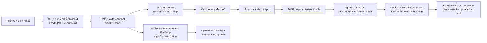

# 09 — Platform: macOS, iPhone and iPad

**Status:** Draft 4 · 2026-10-20 · updated 2026-10-23 for [D44](decisions.md#d44)–[D90](decisions.md#d90) · updated 2026-11-13 for [D106](decisions.md#d106)–[D122](decisions.md#d122), and for [D125](decisions.md#d125) and [D129](decisions.md#d129)
**Owns:** The OS floors (macOS, iOS and iPadOS), Apple framework use, memoshid as a Swift app-shaped helper, the engine helper's sandbox, signing and entitlements, privacy permissions, distribution and updates, widgets on every device, the platform side of voice, of Bot computers and Cloud computers, of external programs (Claude Code and outside coding agents) and of the plugin helper for plugin developer mode, the iPhone and iPad platform rules (TestFlight and Xcode installs, no JIT, memory, background time for App jobs, the iSH GPL module, and App Review notes for a later public release), and the platform test matrix.
**Depends on:** [MASTER_PLAN.md](MASTER_PLAN.md) · [decisions.md](decisions.md) · [04-architecture.md](04-architecture.md) · [../specs/protocol.md](../specs/protocol.md) · [06-computers-and-browsers.md](06-computers-and-browsers.md) · [08-security-and-privacy.md](08-security-and-privacy.md) · [../specs/policy.md](../specs/policy.md) · [02-experience.md](02-experience.md) · [03-design-system.md](03-design-system.md) · [feature-catalog.md](feature-catalog.md) · [10-roadmap.md](10-roadmap.md) · [phase-0.md](phase-0.md) · [risks.md](risks.md)

This doc elaborates [D31](decisions.md#d31) (platform), [D32](decisions.md#d32) (distribution), [D41](decisions.md#d41) (Apple platform leverage), [D46](decisions.md#d46) (memoshid as a Swift executable, which supersedes [D15](decisions.md#d15)'s bundled Node), [D56](decisions.md#d56) (Apple platform rules for Mac, iPhone and iPad), [D58](decisions.md#d58) (memoshid as an app-shaped helper with its own provisioning profile), [D67](decisions.md#d67) (v1 for the user's own devices: TestFlight internal testing or Xcode, no App Store), [D68](decisions.md#d68) (the Swift engine, an interpreter), [D69](decisions.md#d69) (iSH in its own GPL-3.0 module), [D71](decisions.md#d71) (App background jobs, widgets and signed bytecode), [D72](decisions.md#d72) (the engine's wider language), [D73](decisions.md#d73) (forwarding to a stable runner), [D74](decisions.md#d74) (leases per conversation, older app versions and the local-model fallback), [D75](decisions.md#d75) (synced keys, biometric approvals and synced browser sessions), [D76](decisions.md#d76) (folder handles, the in-process broker and Pyodide per bot), [D77](decisions.md#d77) (the Mac sandbox's fallback order and Mac sleep), [D78](decisions.md#d78) (programs in an engine helper per bot), [D79](decisions.md#d79) (widget data in the App Group, Shortcuts in the app, stores kept out of device backups, and the Code Mode and Pyodide fallbacks), [D80](decisions.md#d80) (the reference devices, a small open model on the phone, a domain for public files and the only-device backup), [D83](decisions.md#d83) (the hidden relaunch through `NSWorkspace`, sleep and wake notices, one shared CPython on the Mac and a home Mac per bot), [D84](decisions.md#d84) (the review of this doc's inferred choices: the macOS floor policy, Enhanced Security from Phase 1, the iPhone and iPad memory entitlements, a maintenance hold on leases during updates, uninstall leaving the device group, and Python sent to the Mac under Lockdown Mode), [D86](decisions.md#d86) (the Apple tools proposal, with S5's WeatherKit check) and [D87](decisions.md#d87) (the staged calendar: App jobs, widgets and signed bytecode in Drop 1; cookie sync, the open model on the phone and the Apple tools proposal in Drop 2), whose calendar [D117](decisions.md#d117) and [D122](decisions.md#d122) replace with the milestones M1–M3 and estimated dates. It also states the platform consequences of [D106](decisions.md#d106) (one SwiftUI codebase for the Mac, iPad and iPhone), [D108](decisions.md#d108) and [D110](decisions.md#d110) (Claude Code and outside coding agents as separately installed programs), [D111](decisions.md#d111) (voice), [D113](decisions.md#d113) (Bot computers at the end of Phase 2, Cloud computers after them, Remote machines in Phase 3), [D114](decisions.md#d114) (Apps as panes, page Apps and the plugin helper for plugin developer mode) and [D116](decisions.md#d116) (Calendar, Reminders and Contacts in Phase 1 on the Mac; mail through the providers' own interfaces). It is adapted from Draft 3 `docs/07-macos-27-platform.md` and `docs/02-architecture.md` §13 and §13.5. Every Draft 3 API claim was re-checked ([§3.1](#31-draft-3-claims-re-checked)).

[D85](decisions.md#d85) sets an App's presentation on the Mac to a sheet over its conversation, with window/full-screen choices and a per-App preference; iPhone and iPad keep D68's full-screen presentation. [D114](decisions.md#d114) adds a pane beside the chat: a side-panel tab on Mac and iPad, full screen on iPhone, or inline. [D88](decisions.md#d88) requires persistent client queuing without execution when neither the runner nor an allowed model is reachable. [D89](decisions.md#d89) supersedes the earlier Code Mode fallback order with wasm2c for shipping, WasmKit as reference/compatibility fallback, and no JavaScriptCore backend.

**Updated 2026-11-13 for [D106](decisions.md#d106)–[D122](decisions.md#d122).** This revision moves the Calendar, Reminders and Contacts tools, with their panes, purpose strings and entitlements, to Phase 1 on the Mac and Phase 3 on iPhone and iPad (§5.9, §9.2–§9.4, §12.5, §12.7); states that mail needs no Apple framework, entitlement or prompt (§5.9); adds voice (§5.10, §12.11), Claude Code and outside coding agents as separately installed programs (§7.11) and the plugin helper for plugin developer mode with its open signing questions (§7.12); restages Bot computers to the end of Phase 2, with Cloud computers after them and Remote machines in Phase 3 (§5.7); narrows DIST-03 (§7.9); records the one SwiftUI codebase (§3); and relabels stages to the phases and the gates M1–M3 of [D122](decisions.md#d122)'s estimated calendar (§13).

**How claims were verified.** On 2026-10-20, Apple API availability was read from the macOS 27.0 SDK in Xcode 27.1 (Swift 6.4): its `.swiftinterface` files and Objective-C headers. Each API was then matched to its Apple documentation page, linked inline. "(27)" after an API means the SDK marks it available from macOS 27.0, and likewise for other version numbers. Unverified reasoning is marked `[INFERENCE]`, and vendor statements are marked "(vendor claim)". IDs such as AP-02 refer to [feature-catalog.md](feature-catalog.md). The passages added on 2026-11-13 were written from the decisions and the [scope amendment](AMENDMENT_2026-11-13.md), with no new SDK or documentation reading; an Apple fact in them that the earlier reading does not cover is marked `[INFERENCE]` with the phase that checks it.

---

## 1. Decisions in this doc

| # | Choice | Basis |
|---|---|---|
| P1 | macOS 27.0+, arm64 only, no Rosetta dependency | [D31](decisions.md#d31); [§2](#2-the-os-floor-d31) |
| P2 | No App Sandbox for Memoshi.app or memoshid on the Mac. The widget extension is sandboxed, the engine helper that runs live cards, Swift Apps and, from Drop 1, their jobs has a sandbox of its own, and bot work is confined by Seatbelt (and, from the end of Phase 2, by a VM per Bot computer, [D113](decisions.md#d113)) | [D16](decisions.md#d16), [D32](decisions.md#d32), [D71](decisions.md#d71), [D87](decisions.md#d87), [D113](decisions.md#d113); [§9.5](#95-the-app-sandbox-decision), [§9.7](#97-the-engine-helpers-sandbox-d71) |
| P3 | memoshid is a signed Swift executable that runs Pi_Swift ([D44](decisions.md#d44)), inside an app-shaped helper bundle with its own provisioning profile ([D58](decisions.md#d58)), registered as a LaunchAgent with `SMAppService`. No Node, native addon or JIT entitlement ships. If the Mac misses the Pi_Swift gate at the Phase 0 review, the bundled-Node design returns | [D46](decisions.md#d46), [D58](decisions.md#d58); [§7](#7-memoshid-a-swift-executable-d46), [§7.10](#710-the-node-fallback-d46) |
| P4 | memoshid uses hardened runtime, launch constraints and, from Phase 1, Enhanced Security. The app and memoshid check each other's code signature and Team ID through the connection's audit token, and the app checks memoshid before it releases a secret | [D13](decisions.md#d13), [D46](decisions.md#d46), [D84](decisions.md#d84); [§6](#6-keychain-and-the-secrets-broker), [§7.5](#75-hardening-memoshid) |
| P5 | Secrets live in the data protection keychain, readable only by Memoshi.app, as synchronizable items that iCloud Keychain syncs end to end encrypted between the user's devices, unless the user marks one "this device only"; every secret uses one accessibility class, readable after first unlock. memoshid receives them per use through `host.keychain.*`, after the app verifies its peer | [D14](decisions.md#d14), [D75](decisions.md#d75); [§6](#6-keychain-and-the-secrets-broker) |
| P6 | Developer ID signing with certificates from Apple's G2 Sub-CA, renewed yearly; two Developer ID provisioning profiles with iCloud (CloudKit) and push, one for the app and one for memoshid; a notarized, stapled DMG; Sparkle 2.10 with EdDSA and a signed feed; stable and beta channels; a Homebrew cask later | [D32](decisions.md#d32), [D48](decisions.md#d48), [D56](decisions.md#d56), [D58](decisions.md#d58); [§10](#10-distribution-and-updates-d32) |
| P7 | XcodeGen plus local SwiftPM packages | [§10.8](#108-build-tooling) |
| P8 | Foundation Models on-device only, for small jobs, where the device has Apple Intelligence; elsewhere, such as on the reference iPhone 14 Pro, those utility features use their deterministic fallbacks, not fabricated conversation answers. From Drop 2, a bot whose local model is on an unreachable Mac falls back by default to an available downloaded open model on MLX on the phone or tablet, with Apple's model as an option where it exists ([D80](decisions.md#d80), [D87](decisions.md#d87)). When neither the runner nor an allowed model is reachable, messages persist as **Waiting for connection** with no turn or effect ([D88](decisions.md#d88)). Private Cloud Compute is not used in v1 | [D10](decisions.md#d10), [D41](decisions.md#d41), [D74](decisions.md#d74), [D80](decisions.md#d80), [D87](decisions.md#d87), [D88](decisions.md#d88); [§5.1](#51-foundation-models), [§12.5](#125-browser-on-device-model-and-apple-tools) |
| P9 | App Intents run with origin `intent`, in the untrusted regime | [D27](decisions.md#d27); [§5.2](#52-app-intents-shortcuts-and-siri) |
| P10 | Inline Allow and Deny appear in notifications only for attended T1–T2 approvals whose payload fits. T3 and T5 open the app. A Draft offers Review or Discard and is never sent from a notification. Sends (T4) and money and credential approvals (T5) need Face ID, Touch ID or the device passcode through LocalAuthentication, on every device | [D27](decisions.md#d27), [D75](decisions.md#d75); [§5.5](#55-notifications), [§6](#6-keychain-and-the-secrets-broker) |
| P11 | Memoshi never requests Full Disk Access | [D56](decisions.md#d56); [§9.4](#94-privacy-prompts-and-when-each-appears) |
| P12 | iPhone and iPad: iOS and iPadOS 27+, one universal app for the user's own devices, installed through TestFlight internal testing or from Xcode, with no App Store release or App Review in v1. Pi_Swift runs inside the app. No JIT: Code Mode ships its wasm2c backend compiled ahead of time, with WasmKit as reference/compatibility fallback; the Swift engine and iSH interpret. The app links iSH's GPL-3.0 module; the Mac app links no GPL code | [D46](decisions.md#d46), [D47](decisions.md#d47), [D56](decisions.md#d56), [D67](decisions.md#d67)–[D69](decisions.md#d69), [D89](decisions.md#d89); [§12](#12-iphone-and-ipad-d56) |
| P13 | On the Mac, live cards and Swift Apps run in the engine helper, one sandboxed process per bot with no secrets, no files and no network, never in memoshid or the app, and the app draws the component trees it sends; on iPhone and iPad they run in the app, each in its own interpreter instance. On the Mac, Apps open as a sheet over their conversation, with **Open in Window**, **Full Screen** and a per-App preference; iPhone and iPad remain full-screen ([D85](decisions.md#d85)). An App may also open as a pane beside the chat (CH-33): a side-panel tab on Mac and iPad, full screen on iPhone, or inline ([D114](decisions.md#d114)). Page Apps (CH-37), from Phase 1, run in a sandboxed web view and not in the engine helper (§9.7). Devices compile source locally before Drop 1. From Drop 1, App background jobs run on the runner of the App's conversation: on the Mac in that bot's engine helper; on iPhone and iPad inside the app, when it is that runner and iOS grants background time; and App widgets on Mac, iPhone and iPad draw from saved data and checked cached bytecode | [D71](decisions.md#d71), [D78](decisions.md#d78), [D85](decisions.md#d85), [D87](decisions.md#d87), [D114](decisions.md#d114); [§5.4](#54-widgets), [§9.7](#97-the-engine-helpers-sandbox-d71), [§12.10](#1210-mini-app-jobs-and-widgets-d71) |
| P14 | One SwiftUI codebase draws the interface on the Mac, iPad and iPhone, with AppKit or UIKit only where a surface needs it. Cognitio's design leads the shell and is rebuilt in Memoshi's own code: no Kuvo- or Cognitio-derived source file, asset or string enters the repository | [D106](decisions.md#d106); [§3](#3-swiftui-and-appkit-on-macos-27), [§7.9](#79-supply-chain) |
| P15 | Calendar, Reminders and Contacts reach bots and the built-in panes through EventKit and Contacts, in the app: Phase 1 on the Mac, Phase 3 on iPhone and iPad. Mail goes through the providers' own interfaces (Gmail, Microsoft 365, IMAP): Memoshi does not read Apple Mail's store and sends no Apple Events, so mail needs no entitlement, purpose string or privacy prompt | [D41](decisions.md#d41), [D56](decisions.md#d56), [D116](decisions.md#d116); [§5.9](#59-eventkit-and-contacts-the-apple-tool-catalog) |
| P16 | Voice runs in the app: audio capture and playback, and Apple's speech recognition and system voices for the on-device engine; the cloud realtime engine's session key comes through the Keychain broker. Phase 2 on the Mac, which needs no new entitlement; Phase 3 on iPhone and iPad, with a Live Activity for the call, the Start Voice Chat App Intent and the Action Button | [D111](decisions.md#d111), [D120](decisions.md#d120), [D121](decisions.md#d121); [§5.10](#510-voice-d111), [§12.11](#1211-voice-on-iphone-and-ipad-d111) |
| P17 | Claude Code and the outside coding agents (Codex app-server, ACP agents) are programs the user installs and signs in to. On the Mac only, memoshid starts them as child processes inside the bot's sandbox. Memoshi bundles, downloads and signs none of them, ships no Node or other JavaScript runtime, starts no Anthropic sign-in and stores no Claude credential | [D11](decisions.md#d11), [D46](decisions.md#d46), [D108](decisions.md#d108), [D110](decisions.md#d110); [§7.11](#711-external-programs-claude-code-and-outside-coding-agents-d108-d110) |
| P18 | Plugin developer mode exists on the Mac only and is off by default. Inside it, a compiled Swift plugin that a bot wrote runs in a separate helper process, never in memoshid or the app, and only the user can switch one App or plugin to **Full access on this Mac**. That setting is Memoshi's own and is not macOS's Full Disk Access (P11). How the helper is signed, and whether it needs a library-validation exception, is open until Phase 2 | [D72](decisions.md#d72), [D114](decisions.md#d114), [D121](decisions.md#d121); [§7.12](#712-the-developer-mode-plugin-helper-d114) |

## 2. The OS floor (D31)

### 2.1 What we build against

- **Deployment target and toolchain.** The deployment target and `LSMinimumSystemVersion` remain 27.0; iPhone/iPad target iOS/iPadOS 27.0 ([D56](decisions.md#d56), [§12](#12-iphone-and-ipad-d56)). [D97](decisions.md#d97) adopts Xcode 27.2 / Swift 6.4.2 as the current baseline and tracks later stable toolchains through recorded CI/native qualification. Historical SDK observations below keep their original versions.
- **arm64 only.** macOS 27 "Golden Gate" runs only on Apple silicon: M1 and later Macs, plus the MacBook Neo (13-inch, A18 Pro) ([Apple](https://support.apple.com/en-us/127255)). No binary we ship has an x86_64 slice.
- **No Rosetta.** Apple calls macOS 27 the "Final release to support Rosetta" for Intel apps ([Apple developer news](https://developer.apple.com/news/?id=w5ngl9k2)).
  - Every bundled executable is arm64: memoshid, Pi_Swift's `pi-env` daemon, the app-commands tool ([D50](decisions.md#d50)), and rg and fd if Coding ships them.
  - From the end of Phase 2 ([D113](decisions.md#d113)), Bot computer images are arm64 Linux. They do not depend on [`VZLinuxRosettaDirectoryShare`](https://developer.apple.com/documentation/virtualization/vzlinuxrosettadirectoryshare), whose future after macOS 27 is undocumented.

### 2.2 What the floor buys

D31's rationale stands, with one correction. Liquid Glass and most APIs we depend on shipped in macOS 26 or earlier ([§3.3](#33-the-foundation-macos-1326)). The 27-only APIs we adopt ([§3.2](#32-macos-27-apis-we-adopt)) mostly remove custom code. So the floor buys one OS to test and no `#available` branches, plus a few capabilities we could approximate on macOS 26. What supporting 26 would cost no longer decides the floor: the current-and-previous policy does (§2.4, [D84](decisions.md#d84)).

### 2.3 Hardware tiers

| Tier | Example Macs | RAM | What runs |
|---|---|---|---|
| Floor | MacBook Neo (A18 Pro, fanless); base M1/M2 MacBook Air | 8 GB | Everything on This Mac. From the end of Phase 2 ([D113](decisions.md#d113)), Bot computers only by explicit opt-in: one awake, "compact" size (2 vCPU / 2 GB), with a performance warning ([06](06-computers-and-browsers.md)). Parallels says the A18 Pro supports hardware virtualization (vendor claim, [KB 131100](https://kb.parallels.com/en/131100)). A Cloud computer uses none of the Mac's memory, so it is the other choice on this tier [INFERENCE] |
| Reference | 16 GB M1 (the reference box in [risks.md](risks.md)) | 16 GB | Default experience; from the end of Phase 2, 1 awake Bot computer ([O4](decisions.md#open-decisions)) |
| Comfortable | M-series Pro or Max, Mac mini, Mac Studio | 24 GB+ | The best always-on host (Phase 3, [D113](decisions.md#d113)); more awake Bot computers from the end of Phase 2 |

Foundation Models availability is a runtime check, not a hardware tier ([§5.1](#51-foundation-models)).

### 2.4 Revisit triggers

[D84](decisions.md#d84) drops both of [D31](decisions.md#d31)'s triggers: the share of interested beta users still on macOS 26, and the Phase 2 count of call sites that would need `if #available(macOS 27, *)`. One policy sets the floor instead:
- **Current and previous.** After v1, Memoshi supports the current and the previous major macOS, and that policy alone sets the macOS floor. macOS 28 is expected in fall 2027.
- **Before v1.0.** [D122](decisions.md#d122)'s estimated calendar puts the v1.0 gate (M3) on Fri 2030-09-27, so several major macOS, iOS and iPadOS releases ship before it. D84's policy is worded for the time after v1; whether the floors move before v1.0 is open ([question 5](#14-open-questions)).

### 2.5 What we deliberately do not use

Adapted from Draft 3 docs/07 §11.

| Technology | Why not |
|---|---|
| Electron or a web shell | Native is the premise. Web views are for content only ([D29](decisions.md#d29)), page Apps included ([D114](decisions.md#d114)) |
| SwiftData or Core Data as the store | memoshid owns SQLite on the Mac, and the app owns it on iPhone and iPad ([D14](decisions.md#d14), [D49](decisions.md#d49)) |
| CloudKit as the store | Every device keeps its own SQLite ([D49](decisions.md#d49)). The user's CloudKit private database is only one of three links: an end-to-end-encrypted mailbox and sync log that the user can turn off ([D48](decisions.md#d48)) |
| Mac App Store in v1 | Its sandbox conflicts with the daemon and file access, and with Bot computer VMs ([D32](decisions.md#d32), [D113](decisions.md#d113)). The iPhone and iPad app has no App Store release in v1 either: it installs through TestFlight internal testing or Xcode ([D67](decisions.md#d67)) |
| Private APIs; custom window chrome | Fragile, and they fight Liquid Glass |
| Runtime binary downloads | Every helper is bundled, pinned and signed ([§7.9](#79-supply-chain)). Programs the user installs themselves (Claude Code and outside coding agents, §7.11) are not Memoshi's helpers, and Memoshi downloads none of them. Data that downloads on first use (the Bot computer image, an optional on-device voice) is verified and is not an executable of ours |
| Other apps' stores and Apple Events | Reading Apple Mail's store would need Full Disk Access, which Memoshi never requests ([D56](decisions.md#d56)), and Apple Events stay excluded; mail goes through the providers' own interfaces ([D116](decisions.md#d116), §5.9) |

## 3. SwiftUI and AppKit on macOS 27

**One codebase** ([D106](decisions.md#d106)). The interface is written new in Memoshi as one SwiftUI codebase shared by the Mac, iPad and iPhone (SH-06, IOS-01), with AppKit on the Mac or UIKit on iPhone and iPad only where a surface needs it. Cognitio's design leads the shell, and its running app and source are read as a behaviour reference only: no Kuvo- or Cognitio-derived source file, asset or string enters this repository. The permissive dependencies D106 names stay usable from their original upstreams, not from Cognitio's forks, and are pinned like every package (§7.9): SwiftTerm, Textual, WhisperKit and the usage-meter library that UsageKit forks. The tables below were read from the macOS SDK; whether each adopted API also exists on iOS and iPadOS 27 is checked against that SDK as the shared code is built for iPhone and iPad [INFERENCE: §12 notes that its Apple facts were not read from the iOS 27 SDK].

### 3.1 Draft 3 claims re-checked

| Draft 3 claim (docs/07 §3.2) | Verdict | Memoshi use |
|---|---|---|
| `@Animatable` macro | Exists, but it is a compiler macro that back-deploys (documented availability: macOS 10.15). It is not a macOS 27 API ([doc](https://developer.apple.com/documentation/swiftui/animatable())) | Avatar-state and chip shapes |
| `@State` macro | True of the toolchain: "When you build with Xcode 26 or earlier, the system uses the State property wrapper instead." It back-deploys ([doc](https://developer.apple.com/documentation/swiftui/state())) | Feature views |
| `reorderable()` | Correct (27), along with `reorderContainer(for:in:isEnabled:move:)` ([doc](https://developer.apple.com/documentation/swiftui/dynamicviewcontent/reorderable())) | Bot sections, pinned items, routines |
| `swipeActions` outside `List` | Correct in substance: `swipeActionsContainer()` (27) coordinates swipe actions across rows in a `ScrollView` or `LazyVStack` ([doc](https://developer.apple.com/documentation/swiftui/view/swipeactionscontainer())) | Inbox and session rows |
| Toolbar overflow and visibility | Partly. [`visibilityPriority(_:)`](https://developer.apple.com/documentation/swiftui/toolbarcontent/visibilitypriority(_:)) is 26.1; the relative [`ToolbarItemVisibilityPriority(lowerThan:)`](https://developer.apple.com/documentation/swiftui/toolbaritemvisibilitypriority/init(lowerthan:)) is 27 | Narrow-window toolbar |
| `AsyncImage` caching | Not found in the macOS 27 SDK | Dropped. Avatars are local assets, and thumbnails use our own cache |
| Optional-binding `confirmationDialog` and `alert` | Exists, but `confirmationDialog(_:item:…)` is not gated to 27 | Use where it helps |
| `NavigationSplitView` improvements | No 27-specific API found | [`NavigationSplitView`](https://developer.apple.com/documentation/swiftui/navigationsplitview) (13) and [`inspector`](https://developer.apple.com/documentation/swiftui/view/inspector(ispresented:content:)) (14) |

### 3.2 macOS 27 APIs we adopt

| API | Use |
|---|---|
| `reorderable()`, `swipeActionsContainer()` (§3.1) | Reordering and swipe actions in custom lists |
| [`PickerStyle.tabs`](https://developer.apple.com/documentation/swiftui/pickerstyle/tabs) | The side panel's tab bar. On macOS it "distinguishes tab navigation from value selection", and VoiceOver announces the options as tabs |
| `ToolbarItemVisibilityPriority(lowerThan:)` | Toolbar ordering |
| [`fileExporter(…onCancellation:)`](https://developer.apple.com/documentation/swiftui/view/fileexporter(ispresented:document:contenttype:defaultfilename:oncompletion:oncancellation:)) with `WritableDocument` | `bot.md` and data export (EXP-02, EXP-06); whether it fits the new document model is a Phase 1 call |
| [`NSStatusItemExpandedInterfaceDelegate`](https://developer.apple.com/documentation/appkit/nsstatusitemexpandedinterfacedelegate) and `…Session` | Menu bar panel lifecycle, if [`MenuBarExtra`](https://developer.apple.com/documentation/swiftui/menubarextra) with the [`.window`](https://developer.apple.com/documentation/swiftui/menubarextrastyle/window) style falls short. The header targets status items "which do not use an NSMenu but instead position other windows" |
| `NSGlassEffectView.effectIsInteractive`; `NSViewCornerConfiguration` (SDK headers) | AppKit-hosted glass controls; concentric corners |
| `LanguageModelSession.Usage`; [`LanguageModelError`](https://developer.apple.com/documentation/foundationmodels/languagemodelerror) cases (`contextSizeExceeded`, `guardrailViolation`, `refusal`, `rateLimited`, `timeout`, `unsupportedLanguageOrLocale`) | Metering and fallbacks for on-device jobs |
| [`IndexedEntityQuery`](https://developer.apple.com/documentation/appintents/indexedentityquery) | Answers the system's Spotlight reindex requests |
| [`VZVirtualMachineConfiguration.label`](https://developer.apple.com/documentation/virtualization/vzvirtualmachineconfiguration/label) | Names each Bot computer in system services (end of Phase 2, [D113](decisions.md#d113)) |

**Present in 27 but not adopted in v1:**
- [`PrivateCloudComputeLanguageModel`](https://developer.apple.com/documentation/foundationmodels/privatecloudcomputelanguagemodel);
- the pluggable [`LanguageModel`](https://developer.apple.com/documentation/foundationmodels/languagemodel) protocol;
- Core Spotlight's [`SearchableItem`](https://developer.apple.com/documentation/corespotlight/searchableitem);
- the [`systemExtraLargePortrait`](https://developer.apple.com/documentation/widgetkit/widgetfamily/systemextralargeportrait) widget family;
- Virtualization's custom virtio devices, USB passthrough, EFI secure boot and macOS guest provisioning.

### 3.3 The foundation (macOS 13–26)

Most of what Memoshi needs predates 27:

| Since | APIs |
|---|---|
| 13 | `MenuBarExtra`, `SMAppService` |
| 14 | `inspector`, [`WKWebsiteDataStore(forIdentifier:)`](https://developer.apple.com/documentation/webkit/wkwebsitedatastore/init(foridentifier:)), VM save and restore (used from the end of Phase 2) |
| 15 | `IndexedEntity`, `requestConfirmation` |
| 26.0 | Liquid Glass, Foundation Models, SpeechAnalyzer, `supportedModes` |
| 26.1 | `visibilityPriority` |
| 26.4 | `tokenCount(for:)` |

This is the evidence behind §2.2.

## 4. Liquid Glass rules

These rules were agreed with Design. Tokens and visuals live in [03-design-system.md](03-design-system.md); the feature is AP-01. All the glass APIs named here are macOS 26.0 unless marked otherwise. [D106](decisions.md#d106) makes Cognitio's design the lead for the shell, and the design review it triggers (change-control rule 5) re-checks these rules against that design; until it reports, they stand as written: the window keeps system window chrome, and the card look is drawn inside the content area ([question 21](#14-open-questions)). The right-hand tabbed area of the window is the side panel ([D106](decisions.md#d106), [D114](decisions.md#d114)); Inspector names the bot and Session detail tabs inside it.

1. **Glass is the functional layer only.** Apple describes Liquid Glass as "a distinct functional layer for controls and navigation elements" above the content layer ([Adopting Liquid Glass](https://developer.apple.com/documentation/technologyoverviews/adopting-liquid-glass)).
   - **Glass:** toolbar, sidebar (system), the side panel's tab bar, composer shell, dictation pill, toast, command palette, scroll-to-latest pill, menu bar panel (system), popovers and sheets (system).
   - **Opaque:** transcript, every Card, chips, diffs, terminal, files, artifacts, settings content, avatars.
2. **System components first.** Standard bars, split views, popovers and sheets adopt glass automatically. Buttons use the `.glass` and `.glassProminent` styles. Apple advises reducing custom backgrounds on controls and navigation, which "might overlay or interfere with Liquid Glass".
3. **Custom glass is used sparingly.**
   - In SwiftUI: [`glassEffect(_:in:)`](https://developer.apple.com/documentation/swiftui/view/glasseffect(_:in:)) inside one [`GlassEffectContainer`](https://developer.apple.com/documentation/swiftui/glasseffectcontainer) per cluster. Apple says the container improves rendering performance and enables morphing.
   - In AppKit: [`NSGlassEffectView`](https://developer.apple.com/documentation/appkit/nsglasseffectview) and [`NSGlassEffectContainerView`](https://developer.apple.com/documentation/appkit/nsglasseffectcontainerview).
4. **No glass over live surfaces.** Controls for WebKit live views, and for Bot computer and Cloud computer live views from Phase 2 ([D113](decisions.md#d113)), sit in the side panel's header strip. A detached full-window live view puts its controls in the standard window toolbar and lays the live view out below the toolbar, never under it, so no glass sits over live content ([D84](decisions.md#d84)).
5. **Settings change glass.**
   - Reduce Transparency, read from [`accessibilityReduceTransparency`](https://developer.apple.com/documentation/swiftui/environmentvalues/accessibilityreducetransparency): custom glass falls back to the opaque `surface.raised` token.
   - Increase Contrast: custom glass adds the `border.strong` token.
   - Reduce Motion, read from [`accessibilityReduceMotion`](https://developer.apple.com/documentation/swiftui/environmentvalues/accessibilityreducemotion): no `glassEffectID` morphs; transitions crossfade instead.
   - Users can "choose a preferred look for Liquid Glass". Test custom elements against it.
6. **Concentric shapes.** Use `ConcentricRectangle` in SwiftUI and `NSViewCornerConfiguration` (27) in AppKit.
7. **Scroll edges and backgrounds.** Custom floating bars use [`scrollEdgeEffectStyle(_:for:)`](https://developer.apple.com/documentation/swiftui/view/scrolledgeeffectstyle(_:for:)). [`backgroundExtensionEffect()`](https://developer.apple.com/documentation/swiftui/view/backgroundextensioneffect()) is not planned, because there is no hero imagery.
8. **No custom window chrome.** This Draft 3 rule is kept.

## 5. Apple frameworks (D41)

### 5.1 Foundation Models

Foundation Models runs in Memoshi.app ([D12](decisions.md#d12)). On the Mac, memoshid calls it through `host.fm.*` on the [D13](decisions.md#d13) connection; on iPhone and iPad the engine runs inside the app and calls it directly ([D46](decisions.md#d46), [§12](#12-iphone-and-ipad-d56)). Method names are defined in [protocol.md](../specs/protocol.md). Results are data, never instructions. Feature: AP-04. Besides the jobs below, from Drop 2 it is one choice of fallback model, where the device has it, for a bot set to a local model on the Mac while that Mac cannot be reached; the default is a small open model on MLX, and a cloud model or waiting are the other choices ([D74](decisions.md#d74), [D80](decisions.md#d80), [D87](decisions.md#d87), §12.5). On a device without Apple Intelligence, such as the reference iPhone 14 Pro, every job below uses its fallback [Claim: MacRumors].

| Job | Bounded input | Output | Fallback |
|---|---|---|---|
| Chat and session titles | First message and first reply | 3–6 words | Truncated first message |
| Run summaries (Inbox line) | Redacted transcript slice | Up to 3 bullets | The bot's own `post_update` text, or a template |
| Memory proposal drafts | Redacted transcript slice | 0–3 candidates (guided generation) | No proposal |
| Risk explanation on approval Cards | The deterministic policy decision (tier, verb, target) | One sentence rephrasing that decision | Static policy copy |
| Guided-mode tool summaries | Tool name and redacted arguments | One sentence | Tool name and arguments |
| Commit message drafts | Diff stat and hunk headers | Subject and body | The session bot's model if allowed; otherwise "Update <files>" |

The table is adapted from Draft 3 docs/07 §4.1.

**Rules.**
- **It decides and executes nothing.** It never approves, denies, classifies tiers or edits policy. No acting Foundation Models `Tool` is registered, so its output cannot become a tool call ([D9](decisions.md#d9)).
- **Inputs are redacted.** They pass the same redaction as `afterTool` output, so the model never sees secrets.
- **It runs on-device only.** `PrivateCloudComputeLanguageModel` (27) runs on Apple's servers and needs a managed entitlement with eligibility requirements ([doc](https://developer.apple.com/documentation/foundationmodels/privatecloudcomputelanguagemodel)). It is out of scope under [D10](decisions.md#d10) ([open question 2](#14-open-questions)).
- **Availability is checked on every call.**
  - [`availability`](https://developer.apple.com/documentation/foundationmodels/systemlanguagemodel/availability-swift.enum/unavailablereason) returns `.available`, or `.unavailable` with a reason: `deviceNotEligible`, `appleIntelligenceNotEnabled` or `modelNotReady`.
  - [`supportsLocale(_:)`](https://developer.apple.com/documentation/foundationmodels/systemlanguagemodel/supportslocale(_:)) checks the language.
  - Inputs are bounded with [`contextSize`](https://developer.apple.com/documentation/foundationmodels/systemlanguagemodel/contextsize), which covers prompt and response together, and [`tokenCount(for:)`](https://developer.apple.com/documentation/foundationmodels/systemlanguagemodel/tokencount(for:)).
- **We follow Apple's guidance on fit.** The model suits summarizing, extracting, classifying and tagging. Apple lists code generation, math and logical reasoning as "capabilities to avoid" ([doc](https://developer.apple.com/documentation/foundationmodels/generating-content-and-performing-tasks-with-foundation-models)). So commit messages summarize the diff, and risk explanations only rephrase deterministic text.
- **Output is labeled "On-device" where trust matters.**
- **Timeouts are bounded.** 3 s for titles and 10 s for summaries, then the fallback; Phase 1 tunes them.
- **Jobs wait for the app.** When the app is not running, these jobs queue or use their fallback; they never trigger the hidden relaunch (SH-15).
- **Pi_Swift stays the model layer.** The `LanguageModel` protocol (27) would let other models plug into Foundation Models sessions. We don't need it: Pi_Swift's PiAI stays the model layer ([D10](decisions.md#d10), [D44](decisions.md#d44)).

### 5.2 App Intents, Shortcuts and Siri

Intents run in Memoshi.app, which forwards every request to memoshid; an intent never acts directly. The entities are `BotEntity`, `ProjectEntity`, `SessionEntity` (title only), `RoutineEntity` and `MiniAppEntity` (name only; the identifier keeps its name, [D119](decisions.md#d119)), built on [`AppEntity`](https://developer.apple.com/documentation/appintents/appentity). Feature: AP-05, Phase 2; the Start Voice Chat intent (VO-06) arrives with voice on iPhone and iPad in Phase 3 ([D111](decisions.md#d111), §12.11).

| Intent | Parameters | Result | [Mode](https://developer.apple.com/documentation/appintents/appintent/supportedmodes) |
|---|---|---|---|
| `AskAssistantIntent` ("Ask Assistant") | prompt | "Sent", or opens the Assistant's Chat | dynamic |
| `MessageBotIntent` | bot, text | "Sent" | background |
| `RunRoutineIntent` | routine | "Started" or "Needs you" | background |
| `ShowInboxIntent` ("Open Inbox") | — | Opens the Inbox | foreground |
| `GetBotStatusIntent` | bot (optional) | State words and counts, never content | background |
| `OpenBotIntent`, `OpenProjectIntent`, `OpenSessionIntent` | entity | Opens it ([`OpenIntent`](https://developer.apple.com/documentation/appintents/openintent)) | foreground |
| `OpenMiniAppIntent` | App | Opens the App by name ([D81](decisions.md#d81)); opening an App is not a tool call ([policy.md §10.7](../specs/policy.md#107-live-cards-and-mini-apps)) | foreground |
| `NewSessionIntent` | project, bot, prompt | Opens the new session | foreground |
| `PauseBotIntent` | bot | "Paused" | background |
| `GetTodayBriefIntent` | — | The brief text, but only if Settings › Privacy › "Share content with Shortcuts" is on (default off); otherwise it opens the app | either |
| Start Voice Chat ([D111](decisions.md#d111); iPhone and iPad, Phase 3) [INFERENCE: its type name and parameters are set in Phase 3] | — | Opens a voice call (§12.11) | foreground |

**Policy (agreed with Security; [policy.md](../specs/policy.md)).** Messages and runs started by an intent carry origin `intent`, in the untrusted regime, like webhook and connector events. A Shortcuts automation can run an intent unattended, and its parameters can carry content from other actions. We cannot tell a tap from an automation, so:
- no escalation, and no permission or instruction proposals;
- T2 is allowed only on a Bot computer, which arrives at the end of Phase 2 ([D113](decisions.md#d113)), or on a Cloud computer whose provider's egress control Memoshi has verified ([policy.md §4.4](../specs/policy.md#44-untrusted-originrootkind--webhook-connector_event-intent));
- T3 is denied unless a standing rule exists;
- T4 becomes a Draft in every mode, Bypass included ([D57](decisions.md#d57));
- T5 is denied.

Intents never resolve approvals; they may only open the Inbox. There is deliberately no intent to approve, resume a bot, grant access or edit a persona. Start Voice Chat only opens a call and carries no prompt; how what the user then says is classified is [policy.md](../specs/policy.md)'s rule for voice sessions.

**Mechanics.**
- **Confirmation.** [`requestConfirmation(conditions:actionName:dialog:)`](https://developer.apple.com/documentation/appintents/appintent/requestconfirmation(conditions:actionname:dialog:)) asks before a foreground `RunRoutineIntent`. It is UX only; policy still decides.
- **Authentication.** [`authenticationPolicy`](https://developer.apple.com/documentation/appintents/appintent/authenticationpolicy) defaults to `.alwaysAllowed`. Intents that send or start work use `.requiresAuthentication`; Phase 2 verifies how they behave on a locked Mac.
- **Phrases.** [`AppShortcutsProvider`](https://developer.apple.com/documentation/appintents/appshortcutsprovider) phrases use `\(.applicationName)`. Apple "may extract anonymized App Shortcuts data such as localized phrases, display representation values, and the title and description of related intents" for training (vendor statement). So phrases and display representations hold only user-chosen names, never message content.
- **Discovery.** [`isDiscoverable`](https://developer.apple.com/documentation/appintents/appintent/isdiscoverable) exposes intents to Siri, Spotlight and Shortcuts.
- **Apps and intents** ([D114](decisions.md#d114)). An App Intent is one of the fixed places an App may add to (CH-33). App Intents are types compiled into the app, so an App that a bot builds cannot add a new intent type: it is reached through intents Memoshi ships, as `OpenMiniAppIntent` reaches it by name [INFERENCE: how an App's own action appears in Shortcuts is set in Phase 2 with [cards.md](../specs/cards.md)].

### 5.3 Spotlight

Titles only by default ([D41](decisions.md#d41); AP-06, Phase 3).
- **Indexed:** bot names, project names, session titles, routine names, artifact titles and App names ([D81](decisions.md#d81)).
- **Never indexed:** transcripts, memory, file contents, diffs, tool output or connector data, nor anything read through the `mail.*` tools, EventKit or Contacts ([D116](decisions.md#d116)) [INFERENCE: follows from titles only].

**Implementation:**
- Entities adopt [`IndexedEntity`](https://developer.apple.com/documentation/appintents/indexedentity) and are donated to [`CSSearchableIndex`](https://developer.apple.com/documentation/corespotlight/cssearchableindex) with one domain identifier per type.
- Deletions use [`deleteSearchableItems(withDomainIdentifiers:)`](https://developer.apple.com/documentation/corespotlight/cssearchableindex/deletesearchableitems(withdomainidentifiers:completionhandler:)).
- `IndexedEntityQuery` (27) answers the system's reindex requests.

Apple notes that indexing makes entities "discoverable by Apple Intelligence" (IndexedEntity doc), which is one more reason for titles only. Settings › Privacy keeps Draft 3's controls: a Spotlight toggle, per-project exclusion, "Rebuild index", and index removal on data deletion or uninstall.

### 5.4 Widgets

AP-07 for Memoshi's widgets (Phase 3), whose approvals are open-only ([D41](decisions.md#d41)), and CH-27 for App widgets (Drop 1; [D71](decisions.md#d71)). A widget is one of the fixed places an App may add to (CH-33; [D114](decisions.md#d114)); its stage does not change. This extension serves the Mac; the iPhone and iPad app has its own (§12.10).
- **Memoshi's widgets** (sizes agreed with [03](03-design-system.md)): small shows the Inbox count and the top item; medium shows working bots with their state; large shows Today (brief and budgets).
- **Content.** Item titles and the brief follow the user's notification-preview setting. With previews off, widgets show only counts and states.
- **Buttons.** `Button(intent:)` only opens items, pauses a bot or runs a routine, and each carries origin `intent` ([interactivity](https://developer.apple.com/documentation/widgetkit/adding-interactivity-to-widgets-and-live-activities)).
- **Data.**
  - The app writes a redacted snapshot into the App Group container `<TeamID>.<prefix>.shared`. With this Team ID-prefixed form, "macOS checks that the code signature of processes that try to access the app group container contains the same Developer-Team-ID" ([app groups](https://developer.apple.com/documentation/xcode/configuring-app-groups)).
  - The app then calls [`reloadTimelines(ofKind:)`](https://developer.apple.com/documentation/widgetkit/widgetcenter/reloadtimelines(ofkind:)).
  - The widget never talks to memoshid.
- **App widgets** ([D71](decisions.md#d71); CH-27, Drop 1, [D87](decisions.md#d87); [cards.md §12.5](../specs/cards.md#125-widgets)). An App may offer home-screen widgets on Mac, iPhone and iPad, drawn from its saved data:
  - **One configurable kind.** WidgetKit widget kinds are fixed when the extension is built, so the extension ships one App widget built with [`AppIntentConfiguration`](https://developer.apple.com/documentation/widgetkit/appintentconfiguration) (macOS 14, iOS 17), "a widget that uses a custom intent to provide user-configurable options", and the user picks the App, and one of its widgets, when adding it [INFERENCE: the design].
  - **Data.** The app copies the App's saved data, and the bytecode the device checked or compiled, into the same App Group container, then reloads the timelines. The extension draws the widget from that copy with the interpreter and the kit: it uses the cache, compiles nothing and makes no tool calls [INFERENCE]. Without a usable copy it shows a placeholder until the app writes one [INFERENCE].
  - **Tap.** Tapping the widget opens the App.
  - **Refresh.** WidgetKit gives each widget a reload budget. For a widget the user views often, "a daily budget typically includes from 40 to 70 refreshes", and reloads while the app is in the foreground do not count ([keeping a widget up to date](https://developer.apple.com/documentation/widgetkit/keeping-a-widget-up-to-date)). A widget therefore shows the App's data as of its last reload.
  - **On the Mac,** data that changes while the app is quit waits until the app runs again [INFERENCE].
- **Sandbox.** The extension is sandboxed. Apple's extension templates include App Sandbox ([guide](https://developer.apple.com/library/archive/documentation/General/Conceptual/ExtensibilityPG/ExtensionCreation.html)), and PlugInKit refuses unsandboxed widget plug-ins (developer report, [ping-warden #92](https://github.com/oliverames/ping-warden/issues/92)).

### 5.5 Notifications

AP-02. Categories were agreed with [02](02-experience.md) and [08](08-security-and-privacy.md).

| Category | Actions, in order | Notes |
|---|---|---|
| Approval, attended T1–T2, when its full payload fits in the notification | Allow once, Deny | "Allow once" has [`.authenticationRequired`](https://developer.apple.com/documentation/usernotifications/unnotificationactionoptions/authenticationrequired), so it works "only on an unlocked device". A notification never offers "Always allow" ([policy.md](../specs/policy.md) §10) |
| Approval: T3, T5 or unattended | Open | T5 typed confirmation happens in the app (SEC-07), after Face ID, Touch ID or the passcode ([D75](decisions.md#d75), §6) |
| Draft (T4) | Review, Discard | No "Send": the body is not fully visible, and sending is irreversible. Send in the app asks for Face ID, Touch ID or the passcode first ([D75](decisions.md#d75)) |
| Question | Reply, Open | Reply is a [`UNTextInputNotificationAction`](https://developer.apple.com/documentation/usernotifications/untextinputnotificationaction) |
| Run summary or news | Reply, Open | |
| Error | Retry (only if idempotent), Open | |
| Resume (interrupted step) | Open | The notification only opens the card; Run again, Skip and Mark as done happen in the app ([D51](decisions.md#d51), [02](02-experience.md)) |
| Budget stop | Open | Raising a limit is a grant change |

- **Order.** "When displaying banner notifications, the system displays only the first two actions" ([doc](https://developer.apple.com/documentation/usernotifications/unnotificationcategory/actions)). The two key actions come first, and clicking the body opens the item.
- **Handling.**
  - The system launches the app in the background and calls its delegate ([doc](https://developer.apple.com/documentation/usernotifications/declaring-your-actionable-notification-types)).
  - The app forwards the action to memoshid. memoshid re-validates before applying it: the approval is still pending, not expired, has the same arguments hash, is attended, and is T2 or below.
  - The UI is never the trust boundary ([D9](decisions.md#d9)).
- **Permission.** Ask in context during onboarding, not at launch. Quiet [`.provisional`](https://developer.apple.com/documentation/usernotifications/unauthorizationoptions/provisional) delivery is an option before that.
- **Content.** Bot name plus a one-line summary, following the preview setting. Never secrets or T5 arguments. Quiet runs (`no_update`) never notify and leave no line in the bot's Chat; they appear only in the routine's run history ([D23](decisions.md#d23)).
- **Interruption level.**
  - `.active` by default.
  - [`.timeSensitive`](https://developer.apple.com/documentation/usernotifications/unnotificationinterruptionlevel/timesensitive) only for attended approvals that block a task, and for budget hard stops.
  - Time Sensitive needs its capability, which Developer ID supports ([capability table](https://developer.apple.com/help/account/reference/supported-capabilities-macos)).

### 5.6 Dictation

AP-03, Phase 1. Voice calls are separate (§5.10).
- **Engine.** [`SpeechAnalyzer`](https://developer.apple.com/documentation/speech/speechanalyzer) with [`SpeechTranscriber`](https://developer.apple.com/documentation/speech/speechtranscriber). [`DictationTranscriber`](https://developer.apple.com/documentation/speech/dictationtranscriber) is the fallback: it uses the system dictation models and is "compatible with older devices".
- **Models.** [`AssetInventory`](https://developer.apple.com/documentation/speech/assetinventory) installs per-locale models "downloaded from Apple's servers and managed by the system". Onboarding pre-installs the user's locale so that dictation works offline.
- **Permissions.**
  - Microphone: `NSMicrophoneUsageDescription` plus the hardened-runtime [`com.apple.security.device.audio-input`](https://developer.apple.com/documentation/bundleresources/entitlements/com.apple.security.device.audio-input) entitlement.
  - Speech Recognition: Apple's pages are silent on whether SpeechAnalyzer needs it. A developer report says it does not ([dousha #58](https://github.com/giraphant/dousha/pull/58)). We ship without `NSSpeechRecognitionUsageDescription`, test with `tccutil reset` in Phase 1, and add the key only if macOS prompts.
- **Behavior.** Text lands in the composer and is never auto-sent. No audio is stored.

### 5.7 Virtualization

End of Phase 2, on the Mac ([D113](decisions.md#d113), which brings Bot computers back into v1.0 from the v1.1 that [D47](decisions.md#d47) gave them; CMP-06 to CMP-12, CMP-15 to CMP-20, BRW-11, BRW-12). The VM spike (CMP-01) at the start of the Bot computer work decides [O2, O3 and O4](decisions.md#open-decisions). The full design is in [06](06-computers-and-browsers.md).
- **Entitlement.** [`com.apple.security.virtualization`](https://developer.apple.com/documentation/bundleresources/entitlements/com.apple.security.virtualization), on the app only, because the app hosts the VMs ([D12](decisions.md#d12)) [INFERENCE: if O3 moves VM hosting into a helper process, the entitlement moves with it; set at the VM spike in Phase 2].
- **Checks before use.** [`isSupported`](https://developer.apple.com/documentation/virtualization/vzvirtualmachine/issupported), `validate()` and [`validateSaveRestoreSupport()`](https://developer.apple.com/documentation/virtualization/vzvirtualmachineconfiguration/validatesaverestoresupport()).
- **Devices** (agreed with 06):
  - [virtio-fs](https://developer.apple.com/documentation/virtualization/vzvirtiofilesystemdeviceconfiguration) for project shares;
  - [vsock](https://developer.apple.com/documentation/virtualization/vzvirtiosocketdevice) control channels, bridged by the app to per-VM Unix sockets;
  - [`VZFileHandleNetworkDeviceAttachment`](https://developer.apple.com/documentation/virtualization/vzfilehandlenetworkdeviceattachment) frames relayed to memoshid's egress gateway. There is no NAT and no VM address on a host network, so a VM never triggers a Local Network prompt;
  - [`VZVirtualMachineView`](https://developer.apple.com/documentation/virtualization/vzvirtualmachineview) for the live view.
- **Save and restore.** [`saveMachineStateTo`](https://developer.apple.com/documentation/virtualization/vzvirtualmachine/savemachinestateto(url:completionhandler:)) and `restoreMachineStateFrom` handle idle, quit and update ([§10.5](#105-updating-with-a-live-daemon-and-awake-vms)). Per 06, saved state is bound to this Mac and user, so a restore from backup cold-boots.
- **Not used:**
  - Bridged networking ([`com.apple.vm.networking`](https://developer.apple.com/documentation/bundleresources/entitlements/com.apple.vm.networking), "restricted to developers of virtualization software").
  - vmnet topologies (`VZVmnetNetworkDeviceAttachment`, 26). Per its header, vmnet "requires an entitlement".
  - Hypervisor.framework ([`com.apple.security.hypervisor`](https://developer.apple.com/documentation/bundleresources/entitlements/com.apple.security.hypervisor)), unless [O2](decisions.md#open-decisions) switches to Gondolin or QEMU.
- **Cloud computers** (V2-02; Phase 2, after the local ones; [D113](decisions.md#d113), [D120](decisions.md#d120)). A Cloud computer needs nothing from this section: no Virtualization entitlement, no other entitlement, no purpose string and no privacy prompt. It is network calls from memoshid to the provider (E2B by default; Orgo and Daytona selectable) on the user's key, which is a Keychain item like every secret (§6), behind the same computer seam as the other providers ([04 §2.9](04-architecture.md#29-where-the-added-parts-run), [06](06-computers-and-browsers.md)). Its cost estimate is always shown before it starts: on the approval card where the bot's mode asks, otherwise as a non-blocking notice, and the budget gate applies in every mode. It is treated like a Bot computer only for a provider whose egress control Memoshi has verified; otherwise the Remote machine rules apply ([policy.md §3.7](../specs/policy.md#37-network)). [INFERENCE: how its live view and takeover reach the app is set in Phase 2 with 06.]
- **Remote machines** (CMP-13, CMP-14; Phase 3; [D113](decisions.md#d113)) are reached over SSH and need no entitlement; a host on the LAN can raise the Local Network prompt (§9.4).

<a id="58-screencapturekit-and-accessibility-v11"></a>
### 5.8 ScreenCaptureKit and Accessibility

- **v1 and v1.1** link neither framework and never prompt for Screen Recording or Accessibility ([D41](decisions.md#d41)).
- **Phase 2** ([D113](decisions.md#d113)). GUI computer use (R11-12) inside a Bot computer or a Cloud computer captures and drives the guest from inside it, without host permissions (`computer.input`, T2; [D121](decisions.md#d121)). Host APIs matter only for computer use on This Mac, an exploration item (EXPL-02) that needs a new decision.
- **If they are used:**
  - [`SCContentSharingPicker`](https://developer.apple.com/documentation/screencapturekit/sccontentsharingpicker) (14) lets the user choose what is captured.
  - [`CGPreflightScreenCaptureAccess()`](https://developer.apple.com/documentation/coregraphics/cgpreflightscreencaptureaccess()) and [`AXIsProcessTrustedWithOptions`](https://developer.apple.com/documentation/applicationservices/1459186-axisprocesstrustedwithoptions) check access.
  - Access is explicit, revocable and explained. A Stop control is always visible, and every action is audited as a structured event (Draft 3 §10).
- **Watching and taking over from iPhone and iPad** (Phase 3; BRW-15) shows what the runner sends over the device links and uses neither framework (§12.5).

### 5.9 EventKit and Contacts (the Apple tool catalog)

Reminders, Calendar and Contacts are typed tools in the Apple tool catalog ([D50](decisions.md#d50)): AP-14 on the Mac, which [D116](decisions.md#d116) split from AP-10, and AP-11 on iPhone and iPad. They can run on any device, because iCloud already syncs their data ([D49](decisions.md#d49)), and they show native cards ([D53](decisions.md#d53)). [D116](decisions.md#d116) moves these three tools from Phase 2 to **Phase 1 on the Mac**, together with the built-in Calendar (AP-16), Reminders merged with Tasks (AP-17) and Contacts (AP-18) panes on [D114](decisions.md#d114)'s App contract (CH-33); iPhone and iPad get the tools (AP-11) and the panes (AP-21) in **Phase 3**. AP-10 keeps Music, Weather, Maps, Photos, Shortcuts, Notifications and Files in Phase 2.
- **Design.** They are native host capabilities in the app, exposed to bots as typed tools under policy: reads are T3; writes are T4, which go out as a draft card in Ask first and Auto ([D52](decisions.md#d52)). The panes use the same host calls in the app ([AMENDMENT §6](AMENDMENT_2026-11-13.md#6-where-the-new-parts-run)).
- **Why native.** Apollo's Mac worker reads Contacts with `sqlite3` and Reminders through `osascript`, which needs Full Disk Access and Automation. Native calls avoid both ([Apollo audit](../research/agentic-workspace-landscape/landscape/in-house-assets.md#apollo)). Memoshi never requests Full Disk Access ([D56](decisions.md#d56), [§9.4](#94-privacy-prompts-and-when-each-appears)).
- **APIs:** [`requestFullAccessToEvents`](https://developer.apple.com/documentation/eventkit/ekeventstore/requestfullaccesstoevents(completion:)) (14) and [`CNContactStore.requestAccess(for:)`](https://developer.apple.com/documentation/contacts/cncontactstore/requestaccess(for:completionhandler:)).
- **Purpose strings:** [`NSCalendarsFullAccessUsageDescription`](https://developer.apple.com/documentation/bundleresources/information-property-list/nscalendarsfullaccessusagedescription) (or the write-only variant), [`NSRemindersFullAccessUsageDescription`](https://developer.apple.com/documentation/bundleresources/information-property-list/nsremindersfullaccessusagedescription) and [`NSContactsUsageDescription`](https://developer.apple.com/documentation/bundleresources/information-property-list/nscontactsusagedescription). The planned wording is in §9.3 ([D129](decisions.md#d129)), which the Phase 1 design review may polish; the Mac ships it in Phase 1 and the iPhone and iPad app in Phase 3 (§12.7).
- **Entitlements:** [`personal-information.calendars`](https://developer.apple.com/documentation/bundleresources/entitlements/com.apple.security.personal-information.calendars) and [`personal-information.addressbook`](https://developer.apple.com/documentation/bundleresources/entitlements/com.apple.security.personal-information.addressbook), on the app, from Phase 1 (§9.2).
- **Apollo lesson.** The system prompts only once. A capability whose prompt was already shown needs a "Repair in Settings" path (Apollo `CHANGELOG.md`, 1.0.21).
- **Mail is not an Apple-framework tool** ([D116](decisions.md#d116)). The `mail.*` tools (CON-08) reach Gmail, Microsoft 365 and IMAP over the providers' own interfaces, as typed tools in the runtime through the egress gateway, with account tokens in the Keychain by reference (§6). Memoshi does not read Apple Mail's store, which would need Full Disk Access (P11, §9.4), and does not drive Mail with Apple Events, which stay excluded ([D41](decisions.md#d41), §9.2) [INFERENCE: D116 records that Apple offers no interface for reading the Mail store as platform knowledge, not tested]. Mail therefore adds no entitlement, no purpose string and no privacy prompt on any device. The Mail pane (AP-15) is Phase 1 on the Mac; the tools (CON-20) and the pane (AP-21) reach iPhone and iPad in Phase 3.
- **Notes and Files.** The Notes pane (AP-19) shows Markdown files, and the Files pane (AP-20) shows files with the Library ([D116](decisions.md#d116)). They read folders under §9.6's rules and use no Apple data framework; Memoshi does not read the Notes app's store [INFERENCE: which folders the two panes show is set in Phase 1 with [02](02-experience.md)].

### 5.10 Voice ([D111](decisions.md#d111))

Phase 2 on the Mac; Phase 3 on iPhone and iPad (§12.11). [D111](decisions.md#d111) moves voice into v1.0 from v2: V2-09 is now the call on the Mac, with VO-01 to VO-04 beside it, and VO-05 and VO-06 cover iPhone and iPad. Dictation (§5.6, AP-03) is unchanged.

- **Where it runs.** Audio capture and playback, and Apple's speech recognition and voices, run in Memoshi.app; memoshid never opens the microphone ([AMENDMENT §6](AMENDMENT_2026-11-13.md#6-where-the-new-parts-run), [04 §2.9](04-architecture.md#29-where-the-added-parts-run)). A voice session only listens and speaks: what the user asks is handed to the bot's normal queue as the user's message, so policy, Cards and budgets apply unchanged, and the result is spoken back. One call at a time.
- **Two engines,** chosen per bot or per call ([D120](decisions.md#d120)):
  - **On-device.** Apple's speech recognition and system voices; it works offline and is T0 ([D121](decisions.md#d121)). [INFERENCE: whether a call uses `SpeechAnalyzer` as dictation does (§5.6), and which API speaks, is set in Phase 2; AVFoundation's speech synthesizer is the system-voice API from platform knowledge.] An optional open voice of higher quality can be downloaded ([D120](decisions.md#d120)): it is data, not an executable, so §2.5's rule on runtime binary downloads does not cover it, and it is verified before use [INFERENCE: its source, licence, size and runtime are set in Phase 2, after D120's measured comparison].
  - **Cloud realtime.** xAI by default, OpenAI selectable, on the user's key ([D120](decisions.md#d120)). Audio leaves the device, the interface says so, and the session is `voice.cloud`, T3, granted per bot ([D121](decisions.md#d121), [policy.md §3.1](../specs/policy.md)). The session key comes through the Keychain broker (§6) [INFERENCE: which process holds the realtime connection, and how it passes the egress gateway, is set in Phase 2 with [08](08-security-and-privacy.md)].
- **Permissions on the Mac.** No new entitlement: the app already carries `com.apple.security.device.audio-input` for dictation (§9.2). The microphone purpose string changes in Phase 2, because it must now cover calls and say that a cloud voice sends audio to the provider (§9.3). `NSSpeechRecognitionUsageDescription` follows §5.6's rule and is re-tested for calls in Phase 2: it ships only if macOS prompts.
- **Read aloud, voice memos and the narrator** (VO-01, VO-02, VO-04). Reading a reply aloud, voice memos from bots and the optional spoken narrator for background events, which is off until the user turns it on, only play audio. They need no microphone access and no purpose string [INFERENCE: playback needs no entitlement under hardened runtime; Phase 2 verifies].
- **Dictation and calls.** Dictation never shares the microphone with a call ([02](02-experience.md)).
- **Targets.** V2-09's target, turn gaps under 500 ms p50 and under 1 s p95, applies to the cloud engine; the on-device target is set by measurement ([D111](decisions.md#d111)).

## 6. Keychain and the secrets broker

SEC-10 and SEC-23; the threat model is in [08](08-security-and-privacy.md). This section describes the Mac; iPhone and iPad are in [§12](#12-iphone-and-ipad-d56).

**Store.**
- **Which keychain.** SecItem against the data protection keychain, with [`kSecUseDataProtectionKeychain`](https://developer.apple.com/documentation/security/ksecusedataprotectionkeychain). TN3137 recommends it, calls the file-based keychain "on the road to deprecation", and notes that the data protection keychain works only in a user login context ([TN3137](https://developer.apple.com/documentation/technotes/tn3137-on-mac-keychains)). Synced items are data protection items too: Apple says a macOS item with [`kSecAttrSynchronizable`](https://developer.apple.com/documentation/security/ksecattrsynchronizable) "behaves like an iOS keychain item".
- **Access group.** `<TeamID>.<prefix>.secrets`, via [`keychain-access-groups`](https://developer.apple.com/documentation/bundleresources/entitlements/keychain-access-groups).
- **Provisioning profile.** TN3137 says these entitlements "must be authorized by a provisioning profile". The profile is embedded at `Contents/embedded.provisionprofile` ([bundle layout](https://developer.apple.com/documentation/bundleresources/placing-content-in-a-bundle)), and Developer ID supports both Keychain sharing and App groups ([capability table](https://developer.apple.com/help/account/reference/supported-capabilities-macos)). The app's profile also carries iCloud (CloudKit) and push ([D48](decisions.md#d48), [§10.2](#102-identities-and-secrets)). memoshid has its own profile, with iCloud and push but no keychain access group ([D58](decisions.md#d58), [§7.2](#72-bundle-layout)).
- **Who can read.** Only Memoshi.app holds the entitlement. memoshid, the widget and the helpers have none, and neither does an external program or a plugin built in plugin developer mode (§7.11, §7.12).

| Items | Accessibility | Why |
|---|---|---|
| Every secret: model API keys and Sign in with ChatGPT tokens ([D54](decisions.md#d54)); connector and MCP OAuth tokens; mail account tokens and passwords ([D116](decisions.md#d116)); the keys for search, cloud voice, image and video generation and Cloud computer providers ([D120](decisions.md#d120)); egress-placeholder secrets; browser-fill passwords; payment credentials | [`AfterFirstUnlock`](https://developer.apple.com/documentation/security/ksecattraccessibleafterfirstunlock), synchronizable | One class for every secret, so unattended runs can use any key while the Mac is locked; Apple recommends it "for items that need to be accessed by background applications" ([D75](decisions.md#d75)) [INFERENCE: verify the macOS lock semantics in Phase 0] |
| A secret the user marks "this device only"; device keys; the audit HMAC key and chain anchor | [`AfterFirstUnlockThisDeviceOnly`](https://developer.apple.com/documentation/security/ksecattraccessibleafterfirstunlockthisdeviceonly), not synchronizable | The same class in the form that never leaves the device [INFERENCE: device keys and the audit key belong to one device] |

**Never held: Claude credentials** ([D108](decisions.md#d108)). Claude Code keeps its own sign-in. Memoshi never reads, stores or forwards it and ships no Anthropic client ID, so no item above holds it and the broker has nothing of it to release (§7.11).

**Sync** ([D75](decisions.md#d75)). Synchronizable items reach every device through iCloud Keychain, which Apple syncs end to end encrypted, so any runner finds the keys it needs. Apple notes that updating or deleting such an item "affects all copies of the item, not just the one on your local device", so removing a secret on one device removes it everywhere, and uninstall leaves synced items alone (§8.4). With iCloud Keychain off, each device keeps its own items [INFERENCE]. Payment credentials no longer carry `.userPresence` on the item; the biometric check below guards their use [INFERENCE].

**Biometric approvals** ([D75](decisions.md#d75)). Sending a draft (T4) and approving money or a credential (T5) first call LocalAuthentication's `evaluatePolicy` with [`.deviceOwnerAuthentication`](https://developer.apple.com/documentation/localauthentication/lapolicy/deviceownerauthentication), "user authentication with biometry, Apple Watch, or the device passcode": on the Mac Touch ID, Apple Watch or the user's password, and on iPhone and iPad Face ID or Touch ID, or the passcode. On iOS the check fails when no passcode is set, and T4 and T5 answers then wait for another device [INFERENCE]. The app runs the check before it sends the answer, and policy still decides in the engine ([04 §8](04-architecture.md#8-host-capability-interfaces)).

```mermaid
sequenceDiagram
  participant D as memoshid
  participant A as Memoshi.app (broker)
  participant K as Keychain (Team-ID group)
  D->>A: host.keychain.get {secretRef, purpose}
  A->>A: verify peer: code signature and Team ID (audit token)
  A->>A: is this purpose allowed for this secret?
  A->>K: SecItemCopyMatching(secretRef)
  K-->>A: secret
  A-->>D: secret (memory only, with TTL)
  Note over D: model calls, egress substitution, host-side git<br/>and opt-in exec_env only; never disk, logs or Pi storage
  Note over A: browser-fill secrets never leave the app (host.browser.*)
```

**Peer verification** ([D13](decisions.md#d13), [D46](decisions.md#d46)). The checks were agreed with Architecture, and [protocol.md](../specs/protocol.md) §auth cites them. memoshid is a signed Swift executable in its own helper bundle ([D58](decisions.md#d58)), not an interpreter, so its code signature identifies the code that runs. The per-launch token and the peer user-ID check stay. Each side also reads the connection's audit token with `getsockopt(LOCAL_PEERTOKEN)` (SDK `sys/un.h`), passes it to [`SecCodeCopyGuestWithAttributes`](https://developer.apple.com/documentation/security/seccodecopyguestwithattributes(_:_:_:_:)), and checks the result against a code requirement and the hardened-runtime flag:

1. **The app checks memoshid** on every connection, and before it releases any secret: `anchor apple generic and certificate leaf[subject.OU] = "<TeamID>" and identifier "<prefix>.memoshid"`, where `<prefix>.memoshid` is the helper's bundle ID ([D58](decisions.md#d58)). Noodle pins its Agent Host the same way ([AgentHostProtocol.swift](https://github.com/pdparchitect/noodle/blob/main/Sources/NoodleAgentBridge/AgentHostProtocol.swift)).
2. **memoshid checks the app** against the same requirement with the app's identifier.

The audit token, unlike a PID, cannot be reused by another process. Launch constraints ([§7.5](#75-hardening-memoshid)) stop a copy of memoshid from running under another parent. The executable-path, launchd-PID and argument checks and the N-API addon existed only because memoshid ran Node, so they are dropped ([D46](decisions.md#d46)); they return only with the Node fallback ([§7.10](#710-the-node-fallback-d46)). The requirement names no intermediate certificate, so it holds across the move to G2 certificates and their yearly renewal; S5 checks it.

**Rename risk (R22).** The access group, the item service names, the LaunchAgent label and the iCloud container identifier all carry the bundle prefix. `<prefix>` is `com.mehmetcanbudak.memoshi` ([D59](decisions.md#d59)), set once and kept even if the product is renamed, so a rename changes only visible names and needs no migration. That matters because iCloud containers can never be deleted or renamed ([Apple engineer](https://developer.apple.com/forums/thread/818604)).

## 7. memoshid: a Swift executable (D46)

### 7.1 What memoshid is

- **The engine.** memoshid runs Pi_Swift ([D44](decisions.md#d44)), the Swift port of upstream Pi, with the scheduler, policy, memory and connectors ([D12](decisions.md#d12), [D46](decisions.md#d46)). On iPhone and iPad the same engine runs inside the app ([§12](#12-iphone-and-ipad-d56)).
- **A signed Swift executable in an app-shaped helper.** It is built from our local SwiftPM packages plus Pi_Swift's packages, signed with our Team ID and registered as a LaunchAgent with `SMAppService` ([§8.1](#81-two-registrations)). It ships inside `Contents/Helpers/memoshid.app`, a bundle with no window and no Dock icon, its own bundle ID and its own Developer ID provisioning profile ([D58](decisions.md#d58), §7.4). No Node, native addon or JIT entitlement ships ([D46](decisions.md#d46)).
- **Code Mode needs no JIT** ([D89](decisions.md#d89); Pi_Swift requirements E7). Both backends use the same pinned upstream `quickjs.wasm`, quickjs-wasi 3.6.2 / QuickJS-NG 0.17.0. Shipping builds translate it to C with WABT 1.0.42's `wasm2c` and compile it ahead of time; WasmKit interprets the guest as the reference and compatibility fallback. The Mac and iOS follow the same policy. JavaScriptCore is neither a WebAssembly nor a JavaScript backend. Pi_Swift owns implementation; the C backend keeps explicit bounds checks, malloc-backed linear memory, no signal handler and call-depth protection, with generated-source provenance and compiler settings recorded.
- **Code Mode gates.** The same guest identity does not prove replay equivalence. Pi_Swift's differential check against the upstream Node oracle gates making wasm2c default, and memory limits, interruption, trap handling and the Swift/C boundary still need verification. On Thu 2026-11-12, measure both backends in Release on the reference iPhone 14 Pro, cold and warm, against the workload, p95 limits and memory ceiling Memoshi must record by Mon 2026-11-09 ([D90](decisions.md#d90)). S1.18 retains integrated policy, recovery and iOS coverage; S1.19's JSC experiment is retired. Missing workload or device evidence is not a pass, and WasmKit is not presumed to be a faster fallback ([D89](decisions.md#d89), [04 §4.7](04-architecture.md#47-code-mode), [phase-0 S1](phase-0.md#s1)).
- **The gate.** Pi_Swift must pass [D46](decisions.md#d46)'s gate at the Phase 0 review (spike S1). If the Mac misses it, the Node fallback applies ([§7.10](#710-the-node-fallback-d46)).

### 7.2 Bundle layout

The layout was agreed with Architecture ([04](04-architecture.md)). Mach-O never sits in `Resources` ([placing content in a bundle](https://developer.apple.com/documentation/bundleresources/placing-content-in-a-bundle)).

```
Memoshi.app/Contents/
  Info.plist
  embedded.provisionprofile         # the app's Developer ID profile: keychain groups, app groups, iCloud (CloudKit), push
  MacOS/Memoshi                     # the app
  Helpers/memoshid.app/Contents/    # memoshid's app-shaped helper: no window, no Dock icon
    Info.plist                      # its own bundle ID; LSUIElement, so an agent app with no Dock icon
    embedded.provisionprofile       # its own Developer ID profile: iCloud (CloudKit), push
    MacOS/memoshid                  # the daemon: Swift, links Pi_Swift (BundleProgram target)
    Resources/*.bundle              # its SwiftPM resource bundles: PiCodeMode's quickjs.wasm, PiAI's model catalog
  Helpers/pi-env                    # Pi_Swift's environment daemon for This Mac
  Helpers/<app-commands tool>       # D50's app commands for the sandboxed shell
  Helpers/<engine helper>           # the engine helper (D71, D78): one process per bot for its live cards, Swift Apps and, from Drop 1, App jobs; own sandbox, no secrets
  Helpers/rg, Helpers/fd            # only if Coding ships search tools
  Library/LaunchAgents/<prefix>.memoshid.plist
  Frameworks/Sparkle.framework
  PlugIns/MemoshiWidgets.appex      # Memoshi's widgets and the App widget (§5.4)
```

- **No launcher.** memoshid's executable, `Helpers/memoshid.app/Contents/MacOS/memoshid`, is the `BundleProgram` itself; launchd resolves it relative to the app bundle, wherever the app lives ([guide](https://developer.apple.com/documentation/servicemanagement/updating-helper-executables-from-earlier-versions-of-macos)). Apple's own example points launchd's `Program` at the executable inside such a wrapper ([Apple](https://developer.apple.com/documentation/xcode/signing-a-daemon-with-a-restricted-entitlement)). That `SMAppService` accepts a `BundleProgram` path into a nested bundle is checked in S5 [INFERENCE].
- **The app-commands tool** ([D50](decisions.md#d50)) gives the Mac's sandboxed shell the same app commands as the shell front end on iPhone and iPad. It reaches memoshid over the bot's pi-env daemon's existing channel, so the sandbox needs no extra opening ([D77](decisions.md#d77)). Its name and path are open [INFERENCE: S4 settles them].
- **The engine helper** ([D71](decisions.md#d71), [D78](decisions.md#d78)) is a signed command-line executable that runs every live card and Swift App of one bot, on screen or in a job, one process per bot, confined in its own sandbox (§9.7). It links the interpreter and the bridge client only. Its name and path are open [INFERENCE: Phase 2 settles them].
- **Resource bundles** ([D84](decisions.md#d84)). memoshid's SwiftPM resource bundles sit in its own bundle, in `Helpers/memoshid.app/Contents/Resources/`, where Xcode puts them for that target.
- **No runtime downloads.** Upstream Pi's coding-agent package downloads the latest rg and fd from GitHub at runtime ([tools-manager.ts](https://github.com/earendil-works/pi/blob/main/packages/coding-agent/src/utils/tools-manager.ts)). Memoshi does not link Pi_Swift's port of it, PiCodingAgent (Pi_Swift requirements §3). Before it ever does, a build flag compiles that downloader out ([D84](decisions.md#d84)).
- **The Mac's Python** ([D83](decisions.md#d83)). memoshid installs one pinned CPython once, checks it against its pinned hash, and keeps it read-only for every bot: each bot's sandbox may read and run it, and each bot keeps its own packages in its home ([06 §3.8](06-computers-and-browsers.md#38-python)). It ships pinned with the app, like every helper (§2.5, §7.9), and each of its Mach-O files is signed like the other helpers (§7.3) [INFERENCE: the bundled copy and its install path are set in Phase 2].
- **Not in the bundle** ([D108](decisions.md#d108), [D110](decisions.md#d110), [D114](decisions.md#d114)). Claude Code and the outside coding agents are programs the user installs (§7.11). The plugin helper for plugin developer mode has no place in this layout yet: whether it is a bundled, signed helper or each plugin is its own locally built executable is open (§7.12) [INFERENCE: set in Phase 2].

### 7.3 Signing every Mach-O

- **Order.** Sign inside-out and never with `--deep`:
  1. `pi-env`, the app-commands tool, the engine helper, rg and fd;
  2. `memoshid.app`, the helper bundle, with its own entitlements and profile;
  3. Sparkle;
  4. the `.appex`;
  5. the app.
- **Flags.** Every signature uses `codesign --force --options runtime --timestamp`, plus per-target entitlements and a stable `--identifier`.
- **Certificate.** Every signature uses a Developer ID Application certificate from Apple's G2 Sub-CA ([§10.2](#102-identities-and-secrets), [D56](decisions.md#d56)).
- **Release checks.**
  - `codesign --verify --strict --deep`, `spctl -a -vvv` and `stapler validate`.
  - A script asserts that every Mach-O carries our Team ID, the runtime flag and exactly its intended entitlements. Noodle's [`verify-updater.sh`](https://github.com/pdparchitect/noodle/blob/main/scripts/verify-updater.sh) (Apache-2.0) is the model.
- **Not signed by us.** The release checks cover every Mach-O in the bundle. A program the user installed keeps its vendor's signature (§7.11), and code a bot compiles in plugin developer mode is built on the user's Mac, so it cannot carry our Developer ID signature (§7.12).

### 7.4 Entitlements: no JIT

memoshid, `pi-env`, the app-commands tool and the engine helper run with hardened runtime and no exception entitlements ([D46](decisions.md#d46), [D71](decisions.md#d71)):
- no [`cs.allow-jit`](https://developer.apple.com/documentation/bundleresources/entitlements/com.apple.security.cs.allow-jit) and no [`cs.allow-unsigned-executable-memory`](https://developer.apple.com/documentation/bundleresources/entitlements/com.apple.security.cs.allow-unsigned-executable-memory), because nothing in memoshid needs a JIT (§7.1);
- no [`cs.disable-library-validation`](https://developer.apple.com/documentation/bundleresources/entitlements/com.apple.security.cs.disable-library-validation), `cs.allow-dyld-environment-variables` or `cs.disable-executable-page-protection`;
- never `get-task-allow`, which notarization rejects.

**Plugin developer mode** ([D114](decisions.md#d114); Phase 2). No target above gains an exception, and memoshid and the app never will. One question is open. A helper that loads a plugin compiled on the user's Mac as a library could not keep library validation, because the plugin is signed neither by our Team ID nor by Apple, so that helper alone would need `cs.disable-library-validation`; running each plugin as its own executable avoids the entitlement (§7.12) [INFERENCE: platform knowledge, not tested; set in Phase 2].

**S5 acceptance.** The Pi_Swift contract suite plus a Code Mode script pass under the notarized, hardened build.

**Restricted entitlements.** Settled by [D58](decisions.md#d58): memoshid ships in an app-shaped helper with its own provisioning profile. Apple says "a daemon is a standalone executable, so you can't embed a provisioning profile in it", and its fix is to "wrap your daemon in an app-like structure" ([Apple](https://developer.apple.com/documentation/xcode/signing-a-daemon-with-a-restricted-entitlement)).

How it works:
- **Layout.** The wrapper nests in `Contents/Helpers` (or `Contents/MacOS`), and the LaunchAgent plist's `BundleProgram` points into it. Where that target sits is "totally irrelevant to launchd" ([DTS](https://developer.apple.com/forums/thread/759976); nesting: [DTS](https://developer.apple.com/forums/thread/766464)). The helper has its own entitlements file, and the build signs it before the outer app (§7.3).
- **Push.** memoshid runs an AppKit event loop as an agent app (`LSUIElement`, activation policy `.accessory`) and calls `registerForRemoteNotifications()` at launch; APNs sends the token to its app delegate ([Apple](https://developer.apple.com/documentation/appkit/nsapplication/registerforremotenotifications())). It uses silent, content-free pushes only, which need no permission prompt [Claim: developer reports], and leaves every visible notification to Memoshi.app, so notifications stay under Memoshi's name in System Settings. APNs tokens belong to one bundle ID, so pushes to a Mac carry memoshid's bundle ID as their topic.
- **No launch on push.** macOS delivers a push only to a process that is already running [Claim: developer reports]. memoshid runs whenever the user is logged in ([D12](decisions.md#d12)), so this costs nothing.
- **CloudKit and push in memoshid.** The helper's profile authorizes iCloud (CloudKit, the same container as the app) and push. memoshid uses both itself, for [D48](decisions.md#d48)'s iCloud link and [D49](decisions.md#d49)'s lease, so they keep working while the app is quit or has crashed. The profile carries no keychain access group, so secrets stay behind the broker (§6).
- **Push fallback.** If a windowless helper cannot register for push, Memoshi.app receives the pushes and passes them to memoshid over the [D13](decisions.md#d13) connection, and an awake Mac keeps its live relay connection. CloudKit stays in memoshid either way.
- **S5 checks** that the helper's profile validates in the notarized build, that a CloudKit compare-and-swap works from memoshid with the app quit, and that the windowless helper can register for push.

### 7.5 Hardening memoshid

- **Launch constraints** in the code signatures ([applying launch constraints](https://developer.apple.com/documentation/security/applying-launch-environment-and-library-constraints); `codesign --launch-constraint-*`):
  - For `memoshid`, the parent must be launchd (`is-init-proc`) or Memoshi.app. The app runs memoshid as its child when background running is off ([§8.3](#83-approval-states-and-the-quit-prompt)).
  - For the engine helper, the parent must be memoshid, or the app if Phase 2 lets the app start the helpers for programs on screen ([D78](decisions.md#d78), §9.7) [INFERENCE]. For `pi-env`, the parent must be memoshid (§9.2).
  - The LaunchAgent plist adds a `SpawnConstraint` that checks our Team ID and identifier.
  - Library constraints admit only Apple's and our Team ID.
- **No debugger.** Release builds never carry `get-task-allow` (§7.4), so no other process of the user can attach a debugger to memoshid.
- **Seatbelt.** The This Mac profile ([06](06-computers-and-browsers.md)) denies `signal` to processes outside the sandbox's own descendants, and blocks loopback connections to debugger ports. The engine helper has its own profile (§9.7).
- **Enhanced Security** ([doc](https://developer.apple.com/documentation/xcode/enabling-enhanced-security-for-your-app), 26; [D84](decisions.md#d84)). memoshid adopts it from Phase 1, and the engine helper from its first build, in Phase 2. The app and the widget are evaluated in Phase 4.
- **What these do not cover.** Launch and library constraints are properties of our own signatures. A program the user installed carries none of them, so the bot's sandbox is what confines it (§7.11). A plugin helper for plugin developer mode that loads locally built code could not carry a library constraint limited to Apple's and our Team ID, and whether Enhanced Security fits it is open (§7.12) [INFERENCE: set in Phase 2].

### 7.6 Notarizing nested binaries

- **Requirements** ([notarizing](https://developer.apple.com/documentation/security/notarizing-macos-software-before-distribution)): a Developer ID signature, hardened runtime on the app and every command-line target, a secure timestamp, no `get-task-allow`, the 10.9 SDK or later, and well-formed entitlements.
- **Flow.**
  1. Notarize and staple the app.
  2. Wrap it in the DMG, then sign, notarize and staple the DMG.

  `notarytool` authenticates with an App Store Connect API key. The stapled app keeps Sparkle-delivered copies verifiable offline.
- **Linux ELF daemons** (Bot computers at the end of Phase 2, Remote machines in Phase 3; [D113](decisions.md#d113)): `pi-env` builds for Bot computers and Remote machines ship in `Resources` as data, not Mach-O, which the notary service ignores; this is checked when the Bot computer work starts in Phase 2.

### 7.7 Size budget

S5 measures each component ([D84](decisions.md#d84)): memoshid with Pi_Swift linked in, whose PiAI carries several provider clients and a model catalog and whose PiCodeMode carries `quickjs.wasm`; the app, widget, Sparkle and helpers; the installed total; and the DMG. Those sizes become the budgets, and CI fails a build in which any component has grown more than 10% over its budget.

- **The Bot computer image** (end of Phase 2, [D113](decisions.md#d113); about 3 GB compressed, per [risks.md](risks.md)) downloads separately on first use, and is verified ([06](06-computers-and-browsers.md)).
- **The optional on-device voice** ([D120](decisions.md#d120), §5.10) also downloads separately, when the user asks for it [INFERENCE: its size is measured in Phase 2].

### 7.8 Update cadence

- **Pi_Swift** follows [D44](decisions.md#d44): Memoshi tracks the latest Pi_Swift, which follows upstream Pi's latest `main` through its runbook (`Pi_Swift/docs/UPSTREAM-SYNC.md`). Every engine update passes the contract tests, and one that migrates stored data backs up the store first.
- **Security fixes.** A high or critical issue in code we ship goes out within 7 days; anything else rides the next release.
- **Swift dependencies** are pinned in `Package.resolved` and reviewed monthly.

### 7.9 Supply chain

- **Swift packages.**
  - `Package.resolved` pins exact revisions, Pi_Swift included (DIST-02). Pi_Swift records its own pin of upstream Pi in `UPSTREAM.lock.json` ([D44](decisions.md#d44)).
  - A license scan fails on GPL or PolyForm code (DIST-03), and each release ships a CycloneDX SBOM.
  - No Kuvo- or Cognitio-derived source file, asset or string enters the repository, so DIST-03's Kuvo exception ([D91](decisions.md#d91)) goes unused for interface code ([D106](decisions.md#d106)). SwiftTerm, Textual, WhisperKit and the usage-meter library that UsageKit forks come from their original upstreams, not from Cognitio's forks, and are pinned like every package.
- **Helpers.** rg and fd, if shipped, use pinned releases verified by SHA-256 and re-signed. Nothing downloads executables at runtime.
- **Sign-in flows** ([D108](decisions.md#d108)). DIST-03 narrows from "no Anthropic subscription flows" to "no Anthropic sign-in flow inside the app", and its CI check follows: a build fails if it holds an Anthropic sign-in flow or an Anthropic client ID [INFERENCE: how the check detects one is set in Phase 1]. Starting the Claude Code that the user installed and signed in to is not such a flow (§7.11).
- **Releases.** Each release publishes `SHA256SUMS` and a GitHub artifact attestation, as Aiden does ([releasing.md](https://github.com/sambitcreate/aiden-agent/blob/main/docs/releasing.md)).

### 7.10 The Node fallback (D46)

If the Mac misses the Pi_Swift gate at the Phase 0 review, memoshid goes back to upstream Pi in bundled Node, as [D6](decisions.md#d6), [D12](decisions.md#d12), [D13](decisions.md#d13) and [D15](decisions.md#d15) read on 2026-10-20, and iPhone and iPad keep Pi_Swift ([D46](decisions.md#d46)). That returns a pinned Node LTS behind a small signed launcher, re-signed with hardened runtime and only `allow-jit`; the signed N-API addon; the extra executable-path, launchd-PID and argument checks before secrets (§6); and Node's supply-chain checks. S5 no longer proves Node packaging, so a time-boxed Node packaging spike proves the fallback's ship path, and it runs only if the Mac misses the gate ([D84](decisions.md#d84)).

### 7.11 External programs: Claude Code and outside coding agents ([D108](decisions.md#d108), [D110](decisions.md#d110))

Mac only. Claude Code serves as the model of a bot from Phase 1 (MOD-11; [D108](decisions.md#d108)). Codex app-server, Claude Code and ACP agents work as coding workers from Phase 2 (R11-08, R11-09, R11-10; [D110](decisions.md#d110), [D11](decisions.md#d11); [07](07-coding.md)).

- **Separately installed.** Each is a program the user installs and signs in to themselves; for Claude Code, the unmodified program and its own `claude auth login`. Memoshi bundles none of them, downloads none of them (§2.5, §7.9), and neither re-signs nor notarizes them. They are not in the bundle layout (§7.2), the signing order (§7.3) or the size budget (§7.7).
- **No Node.** Memoshi ships no Node and no other JavaScript runtime for them ([D46](decisions.md#d46)). An agent whose kit needs a JavaScript runtime that Memoshi would have to ship, Cursor's today, stays out ([D110](decisions.md#d110)).
- **Child processes inside the sandbox.** memoshid's runtime starts each one as a child process inside the bot's This Mac sandbox ([AMENDMENT §6](AMENDMENT_2026-11-13.md#6-where-the-new-parts-run)), so Seatbelt, the path guard and the egress gateway confine it like any command the bot runs (§9.5). Every tool call it makes still returns to Memoshi policy through the agent's own permission protocol ([D11](decisions.md#d11), [policy.md §3.2](../specs/policy.md)). [INFERENCE: the launch path, whether the bot's `pi-env` daemon is the parent, and the sandbox details for Claude Code as a model are set in Phase 1, and for the workers in Phase 2 ([04 §2.9](04-architecture.md#29-where-the-added-parts-run)).]
- **No Anthropic sign-in, no Claude credential.** Memoshi starts no Anthropic sign-in, ships no Anthropic client ID, and never reads, stores or forwards Claude credentials ([D108](decisions.md#d108)). No Keychain item of Memoshi's holds one (§6), and the secrets broker releases nothing of Memoshi's to an external program.
- **Signatures and constraints.** Memoshi's launch and library constraints (§7.5) belong to its own signatures and do not reach these programs. [INFERENCE: whether memoshid checks a program's vendor signature before it starts it, and how it finds the program, since a LaunchAgent does not inherit the login shell's `PATH`, are set in Phase 1 for Claude Code and in Phase 2 for the others.]
- **Their own sign-in state.** Each program keeps its credentials where its vendor put them, in its own files or its own Keychain item. Whether it can reach them from inside the bot's sandbox, whether its own sandbox nests in ours, and which hosts the bot's egress allowlist must admit for it are open ([question 24](#14-open-questions); [07](07-coding.md) carries the same question for the workers).
- **iPhone and iPad.** An iOS app cannot start processes (§12.1), so none of this exists there. A bot whose model is Claude Code has the Mac as its runner: from iPhone and iPad its messages forward to the Mac ([D73](decisions.md#d73)) and wait while the Mac is unreachable ([D88](decisions.md#d88)) ([D108](decisions.md#d108)).
- **Terms.** The provider's terms are re-checked before any public release ([O13](decisions.md#open-decisions)); a terms change can remove this route, and API keys and the other providers stay ([D108](decisions.md#d108)).

<a id="712-the-developer-mode-plugin-helper-d114"></a>
### 7.12 The plugin helper for plugin developer mode ([D114](decisions.md#d114))

Phase 2, Mac only, off by default (CH-44). Neither plugin developer mode nor Full access on this Mac exists on iPhone or iPad. Plugin developer mode is not the Guided and Developer interface level of SH-12, and Full access on this Mac is not a permission mode ([D52](decisions.md#d52)).

- **What is decided.** Inside plugin developer mode a bot may write compiled Swift plugins. They run in a separate helper process, never in memoshid or the app ([D114](decisions.md#d114); [AMENDMENT §6](AMENDMENT_2026-11-13.md#6-where-the-new-parts-run)). Building or loading one is `plugin.install`, T5: attended only, with typed confirmation ([D121](decisions.md#d121)). [D72](decisions.md#d72)'s exclusion of dynamic loading gains this one exception. It still holds for every program the Swift engine interprets, on every device, and memoshid and the app still load no code that Memoshi did not ship (§7.4).
- **Full access on this Mac.** Inside plugin developer mode the user may switch a single App or plugin to **Full access on this Mac**, after a typed confirmation that names the risks. It carries a badge wherever it appears, and no tool, bot, App or plugin can turn it on ([D114](decisions.md#d114), [D121](decisions.md#d121)). It removes Memoshi's sandbox for that one App or plugin. It is not macOS's Full Disk Access, which Memoshi still never requests (P11), and macOS's own privacy prompts still apply to what that code touches (§9.4) [INFERENCE: which process runs an App with Full access on this Mac, and under whose name macOS shows its prompts, are set in Phase 2].
- **Open: the plugin interface** ([AMENDMENT §8](AMENDMENT_2026-11-13.md#8-open-items), item 10). Pi_Swift's loader compiles and loads Swift in-process, and D114 requires a separate helper. The Phase 2 design chooses the shape, and the signing follows from it:

| Shape | Signing and library validation | Cost |
|---|---|---|
| A bundled, signed plugin host that loads each plugin as a library | The plugin is built on the user's Mac, so neither our Team ID nor Apple signs it, and hardened runtime's library validation refuses it. The host would need [`cs.disable-library-validation`](https://developer.apple.com/documentation/bundleresources/entitlements/com.apple.security.cs.disable-library-validation), the only exception entitlement in the bundle (§7.4), and could not carry a library constraint limited to Apple's and our Team ID (§7.5) | An exception entitlement on a shipped binary; plugins share the host's process unless there is one host per plugin |
| Each plugin built as its own executable and started as a child process | No shipped target changes its entitlements. The plugin carries only the ad hoc signature its build gives it | No launch constraint of ours can name it, so only the sandbox applied at its start confines it |

[INFERENCE: both rows are platform knowledge, not tested. Phase 2 tests the chosen shape under the notarized, hardened build, as S5 does for memoshid.]
- **Also set in Phase 2** [INFERENCE]:
  - which process starts the helper and supervises it, and its launch constraint ([04 §2.9](04-architecture.md#29-where-the-added-parts-run));
  - its sandbox profile while Full access on this Mac is off: the rules for bot-written code stay, so a plugin is sandboxed by default ([D114](decisions.md#d114));
  - whether Enhanced Security (§7.5) fits it;
  - which Swift toolchain compiles a plugin: Memoshi bundles no native Swift compiler (§7.2), so the toolchain the user installed is the candidate;
  - where built plugins are kept, and how one is removed or survives an update.
- **Not offered.** Changing the signed core at run time ([D114](decisions.md#d114)). Nothing a plugin does replaces or patches a Mach-O in the bundle, so the bundle's signature and notarization stay valid. Changing Memoshi itself is coding work on its repository.

## 8. Background lifecycle and diagnostics

### 8.1 Two registrations

- [`SMAppService.mainApp`](https://developer.apple.com/documentation/servicemanagement/smappservice/mainapp) launches the app at login, along with its menu bar extra (SH-10).
- [`SMAppService.agent(plistName:)`](https://developer.apple.com/documentation/servicemanagement/smappservice/agent(plistname:)) registers memoshid.
  - The plist must be in `Contents/Library/LaunchAgents`, with `BundleProgram` relative to the bundle ([guide](https://developer.apple.com/documentation/servicemanagement/updating-helper-executables-from-earlier-versions-of-macos)).
  - [`register()`](https://developer.apple.com/documentation/servicemanagement/smappservice/register()) bootstraps the agent immediately and again at every login, once per user.

### 8.2 The LaunchAgent plist

Keys were checked against `man launchd.plist` on macOS 27.0.1.

| Key | Value | Why |
|---|---|---|
| `Label` | `<prefix>.memoshid` | Names the agent for launchd; carries the bundle prefix ([§6](#6-keychain-and-the-secrets-broker), R22) |
| `BundleProgram` | `Contents/Helpers/memoshid.app/Contents/MacOS/memoshid` | memoshid's executable in its helper bundle ([§7.2](#72-bundle-layout), [D58](decisions.md#d58)) [INFERENCE: S5 checks that `SMAppService` accepts a path into a nested bundle] |
| `RunAtLoad`, `KeepAlive` | `true` | Routines survive app quits and crashes ([D12](decisions.md#d12)) |
| `ProcessType` | `Interactive` | Without it, launchd applies "light resource limits … throttling its CPU usage and I/O bandwidth". `Adaptive` needs XPC, and streaming latency depends on memoshid. Background tool runs lower their own priority; S5 measures energy |
| `ThrottleInterval`, `ExitTimeOut` | 10 s, 30 s | Crash-loop banner; time to checkpoint after `SIGTERM` |
| `SpawnConstraint` | Team ID and identifier | [§7.5](#75-hardening-memoshid) |

### 8.3 Approval, states and the quit prompt

| Status | Meaning | Memoshi's response |
|---|---|---|
| `notRegistered` | First run | Onboarding explains "your bots keep working when the window is closed", then registers |
| [`enabled`](https://developer.apple.com/documentation/servicemanagement/smappservice/status-swift.enum/enabled) | Running | Normal operation |
| [`requiresApproval`](https://developer.apple.com/documentation/servicemanagement/smappservice/status-swift.enum/requiresapproval) | The user switched the agent off; Apple also returns this "if the user revokes consent" | A banner with [`openSystemSettingsLoginItems()`](https://developer.apple.com/documentation/servicemanagement/smappservice/opensystemsettingsloginitems()). Meanwhile memoshid runs as the app's child, so routines run only while the app is open (A8 in risks.md) |
| [`notFound`](https://developer.apple.com/documentation/servicemanagement/smappservice/status-swift.enum/notfound) | The bundle moved or is damaged | Re-register on launch |

- **Quit prompt.** Apple's deployment guide says: "On Mac computers with macOS 26 or later, if background tasks are started by an app and remain active after a user quits the app, the user is prompted to allow or not allow the background tasks to remain active" ([guide](https://support.apple.com/guide/deployment/manage-login-items-background-tasks-mac-depdca572563/web)).
  - The Quit item reads "Quit Memoshi (bots keep working)".
  - Onboarding prepares the user for this prompt.
  - Managed Macs can pre-approve by Team ID.
- **Hidden relaunch** (SH-15). memoshid starts the app with `NSWorkspace.openApplication(at:configuration:)`, setting the configuration's `activates` to `false` and `hides` to `true`, so the app neither activates nor shows ([D83](decisions.md#d83); Observed, the macOS SDK's `NSWorkspace.h`), unless the user has turned this off.

### 8.4 Restarts, versions and uninstall

- **Version handshake.** App and daemon exchange build IDs in `system.hello` (DIST-04). After an update, a mismatch makes memoshid drain and exit, and launchd restarts it from the new bundle.
- **Eager loading.** memoshid reads its resource bundles (PiCodeMode's `quickjs.wasm`, PiAI's model catalog) at boot, so a replaced bundle cannot split its code.
- **Multiple users.** Each macOS user has their own registration, agent and data.
- **Backups** ([D79](decisions.md#d79)). Bot stores, and Memoshi's own copies of them, are excluded from Time Machine with [`isExcludedFromBackup`](https://developer.apple.com/documentation/foundation/urlresourcevalues/isexcludedfrombackup), set on their folders and set again at each launch [INFERENCE: Time Machine honours it, and folder-level exclusion covers new files], so a restored Mac re-syncs from the user's other devices or from iCloud instead of bringing back stale leases. Apple notes that "some operations commonly made to user documents will cause this property to be reset to false". The exception ([D80](decisions.md#d80)): when the Mac is the user's only device and both iCloud and the relay are off, its stores are included in its backups, because there is no other copy and no lease that could go stale.
- **Uninstall** (DIST-07). "Uninstall Memoshi…":
  1. unregisters the agent and the login item;
  2. deletes the VMs (from the end of Phase 2, [D113](decisions.md#d113)); what it does about the user's Cloud computers, which live at the provider, is set in Phase 2 [INFERENCE];
  3. offers a full export (EXP-06);
  4. leaves the device group, and deletes this device's own records in the user's iCloud and no others ([D48](decisions.md#d48), [D84](decisions.md#d84));
  5. removes data, caches and this device's own Keychain items; synced secrets stay, because deleting a synchronizable item deletes it on every device ([D75](decisions.md#d75), §6).

  Dragging the app to the Trash alone may leave data behind [INFERENCE].

### 8.5 Local crash reports and diagnostics

SEC-17; telemetry rules in [D28](decisions.md#d28).
- **App and widget.**
  - macOS writes `.ips` reports, listed under Console › Crash Reports ([doc](https://developer.apple.com/documentation/xcode/acquiring-crash-reports-and-diagnostic-logs)).
  - [`MXMetricManager`](https://developer.apple.com/documentation/metrickit/mxmetricmanager) delivers daily reports "on macOS 26 and later". [`MXCrashDiagnostic`](https://developer.apple.com/documentation/metrickit/mxcrashdiagnostic) adds crash detail.
  - Both are stored locally.
- **memoshid.**
  - macOS writes `.ips` crash reports for it as for the app.
  - Logs pass the SEC-23 scrubber.
  - A crash loop raises a banner.
- **Export.** "Export Diagnostics…" writes a local bundle. Nothing is uploaded unless telemetry is on, and then only error kinds. dSYMs stay private in CI.

### 8.6 Mac sleep ([D77](decisions.md#d77))

- **The rule.** While runs are active on mains power, memoshid keeps the Mac from idle sleep by default; the display may still sleep. On battery it does not. One setting changes both.
- **How.** memoshid holds an IOKit power assertion of type `kIOPMAssertPreventUserIdleSystemSleep` only while a run is active [INFERENCE: created with `IOPMAssertionCreateWithName`]. The header says that under it "the display may dim and idle sleep", "but the system may not idle sleep" (Observed, the macOS SDK's `IOPMLib.h`). memoshid reads the power source with `IOPSGetProvidingPowerSourceType` ("AC Power" or "Battery Power") and follows changes through `IOPSNotificationCreateRunLoopSource` (Observed, `IOPowerSources.h`), so it drops the assertion when the Mac moves to battery.
- **What still sleeps the Mac.** "The system may still sleep for lid close, Apple menu, low battery, or other sleep reasons" (`IOPMLib.h`). Its conversations' leases then expire and move to another device ([04 §2.8](04-architecture.md#28-devices-links-runners-and-replicas)).
- **Sleep and wake notices** ([D83](decisions.md#d83)). memoshid learns of system sleep and wake from IOKit: `IORegisterForSystemPower` delivers `kIOMessageSystemWillSleep` and `kIOMessageSystemHasPoweredOn` (Observed, the macOS SDK's `IOPMLib.h` and `IOMessage.h`). A clock-jump check stays as the backstop ([04 §2.3](04-architecture.md#23-lifecycle)).

## 9. Entitlements and permissions

### 9.1 Code identities

| Identity | Kind | Notes |
|---|---|---|
| Memoshi.app | App | UI and host capabilities ([D12](decisions.md#d12)) |
| `memoshid` | Helper app bundle, `Helpers/memoshid.app`, with no window or Dock icon | The daemon: Pi_Swift, the scheduler, policy, memory and connectors ([D46](decisions.md#d46)), with its own bundle ID and provisioning profile ([D58](decisions.md#d58)) |
| `pi-env`, the app-commands tool, rg, fd | Tools | Spawned by memoshid inside Seatbelt. The shared CPython (§7.2) runs inside the same sandbox, started by a bot's pi-env daemon ([D83](decisions.md#d83)) |
| The engine helper | Tool | One per bot: runs every live card and Swift App of that bot, on screen or in a job, in its own sandbox, with no secrets and no entitlements beyond Enhanced Security's ([D71](decisions.md#d71), [D78](decisions.md#d78), [D84](decisions.md#d84), §7.5, §9.7) |
| MemoshiWidgets.appex | App extension | Sandboxed; Memoshi's widgets and the App widget (§5.4) |
| Sparkle components | Framework and helper app | No entitlements |
| The plugin helper for plugin developer mode | Open (§7.12) | Phase 2, Mac only ([D114](decisions.md#d114)): a separate process, never memoshid or the app. Whether it is a bundled, signed tool or locally built executables, and its entitlements, are set in Phase 2 [INFERENCE] |
| External programs: Claude Code, Codex app-server, ACP agents | Not ours | Installed and signed in to by the user; started by memoshid as child processes inside the bot's sandbox; not bundled and not signed by us ([D108](decisions.md#d108), [D110](decisions.md#d110); §7.11) |

### 9.2 Entitlement matrix

| Entitlement / capability | App | memoshid | Widget | Phase | Evidence |
|---|---|---|---|---|---|
| Hardened runtime | yes | yes | yes | 0 | Notarization |
| `com.apple.security.app-sandbox` | **no** | no | **yes** | 3 | [§9.5](#95-the-app-sandbox-decision); §5.4 |
| `com.apple.security.virtualization` | yes, from the Bot computer work ([D113](decisions.md#d113)) [INFERENCE: on the app unless O3 moves VM hosting to a helper; set at the VM spike] | no | no | 2 (end) | §5.7 |
| `com.apple.security.device.audio-input` | yes | no | no | 1 | §5.6; voice calls use the same entitlement from Phase 2 (§5.10) |
| [`com.apple.security.device.camera`](https://developer.apple.com/documentation/bundleresources/entitlements/com.apple.security.device.camera) | yes, for the pairing scanner only ([D125](decisions.md#d125)) | no | no | In the Mac entitlements file now; pairing ships in Phase 3 (DEV-02) | §9.4; a signed build cannot open the camera without it |
| `keychain-access-groups` + provisioning profile | yes | no | no | 1 | §6 |
| `com.apple.security.application-groups` | yes | no | yes | 3 | [doc](https://developer.apple.com/documentation/bundleresources/entitlements/com.apple.security.application-groups) |
| iCloud: [`icloud-services`](https://developer.apple.com/documentation/bundleresources/entitlements/com.apple.developer.icloud-services) (CloudKit) and [`icloud-container-identifiers`](https://developer.apple.com/documentation/bundleresources/entitlements/com.apple.developer.icloud-container-identifiers), + provisioning profile | yes | yes, through its own profile, with the app's container ([D58](decisions.md#d58)) | no | 0 | [D48](decisions.md#d48); [`icloud-container-environment`](https://developer.apple.com/documentation/bundleresources/entitlements/com.apple.developer.icloud-container-environment) is `Production` in every build on the user's devices, Xcode installs included ([D84](decisions.md#d84)) |
| Push: [`com.apple.developer.aps-environment`](https://developer.apple.com/documentation/bundleresources/entitlements/com.apple.developer.aps-environment) (the macOS key) + provisioning profile | yes | yes, through its own profile ([D58](decisions.md#d58)); fallback in §7.4 | no | 0 | [D48](decisions.md#d48); CloudKit wake-ups and our relay's pushes |
| `cs.allow-jit`, `cs.allow-unsigned-executable-memory`, `cs.disable-library-validation`, `cs.allow-dyld-environment-variables`, `cs.disable-executable-page-protection` | no | no | no | — | §7.4 ([D46](decisions.md#d46)). Whether a plugin host for plugin developer mode, which is none of these three, needs `cs.disable-library-validation` is open (§7.12) [INFERENCE: set in Phase 2] |
| `com.apple.security.get-task-allow` | never in release | never | never | — | Notarization |
| Time Sensitive Notifications | optional | no | no | 1 | §5.5 |
| `personal-information.calendars`, `personal-information.addressbook` | yes, with the Calendar, Reminders and Contacts tools and panes (AP-14, AP-16 to AP-18; [D116](decisions.md#d116)) | no | no | 1 | §5.9 |
| [`personal-information.photos-library`](https://developer.apple.com/documentation/bundleresources/entitlements/com.apple.security.personal-information.photos-library) | with AP-10's Photos tool | no | no | 2 | §5.9 |
| [`automation.apple-events`](https://developer.apple.com/documentation/bundleresources/entitlements/com.apple.security.automation.apple-events) | only with an Apple Events connector; mail and the built-in panes never use it ([D116](decisions.md#d116)) | no | no | v2 | doc; §5.9 |
| `com.apple.security.hypervisor` | only if O2 flips (Phase 2) | no | no | — | §5.7 |
| `com.apple.vm.networking`; VMNet | never in v1 | no | no | — | §5.7 |
| Enhanced Security ([`hardened-process`](https://developer.apple.com/documentation/bundleresources/entitlements/com.apple.security.hardened-process)) | evaluate | yes, from Phase 1 ([D84](decisions.md#d84)) | evaluate | 1; 4 for the app and the widget | §7.5; the engine helper adopts it from its first build |
| Launch constraints (in the code signature) | — | yes; the parent of `pi-env` and of the engine helper must be memoshid | — | 0 | [doc](https://developer.apple.com/documentation/security/defining-launch-environment-and-library-constraints) |
| `network.client` / `network.server` | n/a. These keys apply only under the sandbox, and Draft 3 set them while unsandboxed. The v1 webhook receiver needs none ([D13](decisions.md#d13)) | no | not needed | — | — |
| None needed: the `mail.*` tools (CON-08), `web_search` and `x_search` (CON-15, CON-16), the connector catalog (CON-14), image and video generation (CON-17, CON-18), the cloud voice session (V2-09), Cloud computers (V2-02), Remote machines (CMP-13), Claude Code and outside coding agents (MOD-11, R11-08 to R11-10) | — | — | — | 1–3 | These are network calls or child processes inside the bot's sandbox, and none adds an entitlement (§5.7, §5.9, §5.10, §7.11) |

### 9.3 Info.plist keys and purpose strings

| Key | Value or draft string |
|---|---|
| `LSMinimumSystemVersion` | 27.0 |
| [`NSMicrophoneUsageDescription`](https://developer.apple.com/documentation/bundleresources/information-property-list/nsmicrophoneusagedescription) | Phase 1: "Memoshi uses the microphone only while you dictate. Speech is transcribed on this Mac and never stored." From Phase 2, with voice calls ([D111](decisions.md#d111), §5.10), the string must also cover calls and the cloud voice; planned wording ([D129](decisions.md#d129)): "Memoshi uses the microphone while you dictate or talk with a bot. Dictation and on-device calls stay on this Mac. A call on a cloud voice sends audio to the provider you chose." |
| [`NSLocalNetworkUsageDescription`](https://developer.apple.com/documentation/bundleresources/information-property-list/nslocalnetworkusagedescription) | "Memoshi connects to your other devices, and to model servers you add, on your local network." |
| [`NSBonjourServices`](https://developer.apple.com/documentation/bundleresources/information-property-list/nsbonjourservices) | The direct link's service type ([D48](decisions.md#d48)); its name is set with the device layer in [protocol.md](../specs/protocol.md) [INFERENCE] |
| `NSDocumentsFolderUsageDescription`, `NSDesktopFolderUsageDescription`, `NSDownloadsFolderUsageDescription`, `NSRemovableVolumesUsageDescription`, `NSNetworkVolumesUsageDescription` ([example](https://developer.apple.com/documentation/bundleresources/information-property-list/nsdocumentsfolderusagedescription)) | "Your bots work only in folders you grant. macOS asks once for this location." |
| `NSAppTransportSecurity` › [`NSAllowsArbitraryLoadsInWebContent`](https://developer.apple.com/documentation/bundleresources/information-property-list/nsapptransportsecurity/nsallowsarbitraryloadsinwebcontent) | `YES`. Bot browsers and previews can load any site, while the app's own `URLSession` stays under App Transport Security |
| Sparkle keys | [§10.4](#104-sparkle-configuration) |
| `NSCalendarsFullAccessUsageDescription` | Phase 1 ([D116](decisions.md#d116), §5.9). Planned wording ([D129](decisions.md#d129)): "Memoshi shows your calendar in its Calendar pane. Bots you allow can read your events and add or change them." |
| `NSRemindersFullAccessUsageDescription` | Phase 1 ([D116](decisions.md#d116), §5.9). Planned wording ([D129](decisions.md#d129)): "Memoshi shows your reminders with its tasks. Bots you allow can read your reminders and add or change them." |
| `NSContactsUsageDescription` | Phase 1 ([D116](decisions.md#d116), §5.9). Planned wording ([D129](decisions.md#d129)): "Memoshi shows your contacts in its Contacts pane. Bots you allow can look people up and add or change contacts." |
| The Photos key; [`NSAppleEventsUsageDescription`](https://developer.apple.com/documentation/bundleresources/information-property-list/nsappleeventsusagedescription) | The Photos key with AP-10's Photos tool (Phase 2); the Apple Events key only with an Apple Events connector (v2). Mail needs neither ([D116](decisions.md#d116)) |
| `NSCameraUsageDescription` | "Scan another Memoshi device's one-time pairing code." The pairing scanner is the camera's only use on the Mac ([D125](decisions.md#d125)) |
| `NSSpeechRecognitionUsageDescription` | Not shipped unless the Phase 1 dictation test prompts; tested again for voice calls in Phase 2 (§5.10) |

### 9.4 Privacy prompts and when each appears

| Prompt | Trigger | Notes |
|---|---|---|
| Notifications | Onboarding step | — |
| Background item | `register()` during onboarding | The item is listed under Login Items and can be switched off ([§8.3](#83-approval-states-and-the-quit-prompt)) |
| Keep running after quit | Quitting while memoshid runs (macOS 26+) | [§8.3](#83-approval-states-and-the-quit-prompt) |
| Microphone | First dictation; from Phase 2, the first voice call if dictation has not asked already | §5.6, §5.10 |
| Files and folders: Desktop, Documents, Downloads, iCloud Drive, removable and network volumes | A bot's first access to a granted project in a protected location | Granting through `NSOpenPanel` shows user intent to the app. Whether memoshid's own access is attributed to Memoshi.app or to memoshid is tested in S5 and in [06](06-computers-and-browsers.md)'s S4 check 11. memoshid is already an app-like wrapper ([D58](decisions.md#d58), §7.2), the pattern Apple documents for [signing a daemon with a restricted entitlement](https://developer.apple.com/documentation/xcode/signing-a-daemon-with-a-restricted-entitlement), so either outcome needs no repackaging. S5 also checks which name and usage string the prompt shows; if it names memoshid, the helper's Info.plist carries the same purpose strings as the app's. S5 tests iCloud Drive grants on their own, with Desktop & Documents sync on, rather than assuming they behave like Documents ([D84](decisions.md#d84)) |
| Local Network | The first Bonjour search for paired devices ([D48](decisions.md#d48)), or the first connection to a LAN host such as a model server (Remote machines from Phase 3, [D113](decisions.md#d113)) | See below |
| Incoming connections (Application Firewall) | Only if the user has the firewall on | memoshid's v1 webhook receiver is loopback-only HTTP: one path and signing secret per routine, and no control methods ([D13](decisions.md#d13), [04](04-architecture.md)). TN3179: "Listening for and accepting incoming TCP connections" needs no Local Network access. We expect no firewall prompt for a `127.0.0.1` listener; S5 checks this. The direct link accepts connections from paired devices on the LAN, so with the firewall on, macOS may ask once; S2 checks this. Public webhooks arrive through the relay in v1.1 |
| Calendars, Reminders, Contacts | From Phase 1 (AP-14; [D116](decisions.md#d116)): the first time the user opens that pane or a bot first uses that tool, whichever comes first [INFERENCE: whether onboarding asks earlier is set in Phase 1] | macOS grants the whole app, once for each kind of data; per-bot grants do the rest. A prompt already answered needs the "Repair in Settings" path (§5.9) |
| Photos | A bot's first use of that tool (AP-10, Phase 2) | As above |
| Speech Recognition | Only if the dictation test in Phase 1 or the voice-call test in Phase 2 shows macOS asking | §5.6, §5.10 |
| Automation (Apple Events) | Never in v1.0 | Mail and the built-in panes do not use Apple Events ([D116](decisions.md#d116)); an Apple Events connector is v2 (§9.2) |
| Screen Recording, Accessibility | Never in v1 or v1.1 | §5.8. GUI computer use runs inside a Bot computer or a Cloud computer and needs neither |
| Full Disk Access | Never requested ([D56](decisions.md#d56)) | Apple said on 2 October 2026 that granting it will need "very explicit user action" ([Apple](https://developer.apple.com/news/?id=p6zjojqw)). Features that read other apps' databases are out, Apple Mail's store included ([D116](decisions.md#d116)). **Full access on this Mac** (§7.12) is Memoshi's own setting and does not request it |
| Camera | The first scan of another device's one-time pairing code ([D125](decisions.md#d125)) | The scanner is its only use; no bot, tool or App reaches the camera |
| Input Monitoring | Never requested | — |

**Local Network, per [TN3179](https://developer.apple.com/documentation/technotes/tn3179-understanding-local-network-privacy):**
- launchd daemons are exempt, but "the exception … doesn't apply to launchd agents".
- TN3179 tells agents *not* installed with `SMAppService` to set `AssociatedBundleIdentifiers` so that macOS can find the app responsible for them. So an `SMAppService` agent should be attributed to Memoshi, and the user's choice should cover the whole app. memoshid now has its own bundle ID, so S5 checks which name this prompt shows ([D58](decisions.md#d58)). memoshid's LaunchAgent plist sets `AssociatedBundleIdentifiers` to Memoshi.app's bundle ID anyway, and the helper's `CFBundleDisplayName` is "Memoshi", with its own usage strings; S5.13 checks the result.
- "Traffic originating from WKWebView … doesn't require local network access."
- Bonjour: "If your app's local network usage involves registering or browsing for specific Bonjour services, add a list of service types to the NSBonjourServices property" (TN3179).
- Bot computer VMs, from the end of Phase 2, never trigger the prompt (§5.7).
- SEC-25 still denies bots LAN egress unless the user grants it.

### 9.5 The App Sandbox decision

**Decision.** Memoshi.app and memoshid run without the App Sandbox. The widget extension is sandboxed, and the engine helpers that run live cards, Swift Apps and their jobs have a sandbox of their own (§9.7). Bot work is confined by Seatbelt: Anthropic's `sandbox-runtime` (`srt`) ported to Swift, or our own Seatbelt profile and egress proxy, as spike S4 decides by a fixed scorecard: any escape blocks, then fidelity to `srt`, overhead and maintenance, and a tie goes to the `srt` port ([D16](decisions.md#d16), [D46](decisions.md#d46), [D77](decisions.md#d77)). The bot's pi-env daemon stays inside that sandbox, so its file tools and its commands are both confined, and a guard in the daemon resolves paths without following symlinks, as defence in depth. From the end of Phase 2 a Bot computer's VM confines it as well, and a Cloud computer runs it at the provider, under the Bot computer rules only where Memoshi has verified the provider's egress control and otherwise under the Remote machine rules ([policy.md §3.7](../specs/policy.md#37-network); [D113](decisions.md#d113)). Claude Code and the outside coding agents run inside the same Seatbelt sandbox (§7.11). A plugin built in plugin developer mode is confined too, unless the user switches it to Full access on this Mac (§7.12). The iPhone and iPad app runs in iOS's own app sandbox ([§12](#12-iphone-and-ipad-d56)).

**S4 qualification after the failures** ([D96](decisions.md#d96)). Both preliminary same-UID live-folder designs and the actual separate-user read gate failed; the manually provisioned Standard test account is retained, not promoted into production. The next native route imports independent private file data and keeps the live source out of every bot profile; reviewed export is a separate current-authority/policy/conflict-checked host operation. This needs no new account, privileged helper, live-folder permission widening or service for its bounded qualification. Full S4, including native toolchains and TCC, remains required. If it fails, D77's remaining Linux VM is still unqualified and only serves Linux-compatible work.

**Consequences:**
1. **No Mac App Store.** "To distribute a macOS app through the Mac App Store, you must enable the App Sandbox capability" ([doc](https://developer.apple.com/documentation/security/app-sandbox)). This is consistent with D32.
2. **We confine ourselves.** The OS does not confine the app. memoshid's policy engine, the realpath path guard (SEC-12) and Seatbelt are the confinement, so they get red-team coverage (SEC-15).
3. **TCC still applies.** Protected folders, the microphone and the local network all prompt (§9.4).
4. **Sparkle runs without its XPC services** (§10.4).
5. **Keychain, App Groups, iCloud (CloudKit) and push are authorized by Developer ID provisioning profiles,** the app's and memoshid's own ([D58](decisions.md#d58)). Apple says Developer ID software "can also take advantage of advanced capabilities such as CloudKit and Apple Push Notifications" ([Developer ID](https://developer.apple.com/developer-id/)).
6. **Changing course later is expensive.** Bookmarks, file access, the daemon and updates would all need rework.

### 9.6 Granted folders and bookmarks

- **What we store.** For every granted folder: a regular bookmark (not security-scoped), its canonical realpath, the volume UUID and the file ID.
  - Apple describes [`withSecurityScope`](https://developer.apple.com/documentation/foundation/nsurl/bookmarkcreationoptions/withsecurityscope) as "for use in an app that adopts App Sandbox".
  - Apple also notes that a bookmark passed between processes can be created "without security scope" ([doc](https://developer.apple.com/documentation/security/accessing-files-from-the-macos-app-sandbox)).
- **On launch.** The app resolves each bookmark, which follows moves and renames, and turns stale grants into Inbox items asking to re-grant. It sends memoshid only the resolved realpath and identifiers.
- **Enforcement.** memoshid re-checks original source identity, bookmark, `Grant.access` and current authority at admission, dispatch and export. D96's Seatbelt profile receives only independently admitted private roots, never the bookmark's live realpath; original source-relative policy classes still apply. Moves, stale grants and revocation invalidate the source/copy binding rather than silently widening access.
- **If Memoshi is ever sandboxed,** these become security-scoped bookmarks.
- **On iPhone and iPad,** linked folders are security-scoped bookmarks ([D50](decisions.md#d50), [§12](#12-iphone-and-ipad-d56)).

### 9.7 The engine helper's sandbox ([D71](decisions.md#d71))

On the Mac, every live card and Swift App runs in an engine helper, one per bot: a separate process with no secrets, no files and no network, never memoshid or the app ([D78](decisions.md#d78), [04 §4.17](04-architecture.md#417-the-swift-engine-live-cards-and-mini-apps)). The app draws the component trees the helper sends and returns the user's input. Phase 2 builds it with CH-22, and Drop 1 adds App jobs (CH-26, [D87](decisions.md#d87)).
- **Launch.** One helper per bot, started when one of the bot's programs opens or, from Drop 1, a job is due, with an empty environment; it gets the bytecode, the saved data and its inputs over its pipes [INFERENCE]. Before Drop 1, the host on each device compiles source locally; from Drop 1 it may use the runner's signed cache only if the signer is still paired, the engine version matches and the device's verifier accepts it, otherwise it compiles source ([D87](decisions.md#d87), [04 §4.17](04-architecture.md#417-the-swift-engine-live-cards-and-mini-apps)). memoshid starts the helper, or the app starts it for programs on screen, as Phase 2 decides (question 18); its launch constraint admits only that parent (§7.5).
- **Crash and restart** ([D78](decisions.md#d78)). A helper crash stops only that bot's programs: each says it stopped and offers to reopen, and the helper starts again on the next open or job, with a growing delay after repeated crashes [INFERENCE]. Its crash reports are kept like the app's (§8.5).
- **Sandbox.** A deny-by-default profile applied at launch [INFERENCE: a Seatbelt profile built with spike S4's sandbox, or the App Sandbox entitlement; Phase 2 decides]. The helper may read its own executable and the system libraries it links, and nothing else: no file writes, no other reads, no network (local sockets included), no process starts, no Apple Events, no Keychain or SecurityServer lookups, and no `signal` to other processes.
- **No secrets.** It has no keychain access group, no provisioning profile and no entitlement beyond hardened runtime (§7.4) and Enhanced Security, which it carries from its first build (§7.5, [D84](decisions.md#d84)), and it never talks to the app's Keychain broker. Tool results reach it scrubbed, as they reach any program ([08 §7](08-security-and-privacy.md#7-secrets-architecture)).
- **Its channels.** Its pipes carry only the tool bridge's calls and results, and the component trees and the user's input [INFERENCE: whether the trees go straight to the app or through memoshid]. It saves data and sends notifications only through tools. On the runner of the program's conversation, each call is checked against the version's approved permission list and then passes policy: a tap's call as the user, and a timer's, an appear handler's or a job's as the program's own, unattended, with trigger `job` for jobs ([policy.md §10.7](../specs/policy.md#107-live-cards-and-mini-apps)).
- **Limits.** The interpreter's work and memory limits apply to each program inside the helper, and the kill switch ends running helpers ([08 §5](08-security-and-privacy.md#5-policy-engine-design)).
- **What does not run here** ([D114](decisions.md#d114); [04 §2.9](04-architecture.md#29-where-the-added-parts-run)). Beside the engine helper, jobs or bytecode, "App" in this doc means a Swift App. A page App (CH-37; Phase 1 on the Mac, Phase 3 on iPhone and iPad) runs in a sandboxed web view, in WebKit's web content process, with the same tool bridge and approved permission list [INFERENCE: the web view's configuration is set in Phase 1 with [cards.md](../specs/cards.md)]. The built-in panes (AP-15 to AP-20: Mail, Calendar, Reminders with Tasks, Contacts, Notes, Files with the Library) are Memoshi's own compiled code, written against the same App contract. An App's exported functions (CH-34) are installed in the runtime as a Code Mode namespace, and their code still runs where the App's code runs. A plugin built in plugin developer mode runs in its own helper (§7.12), and an App switched to Full access on this Mac does not keep this sandbox [INFERENCE: where it then runs is set in Phase 2].

## 10. Distribution and updates (D32)

### 10.1 Release pipeline



**The iPhone and iPad leg** ([D67](decisions.md#d67)). The same tag archives the iPhone and iPad app, signs it for distribution and uploads it to App Store Connect for TestFlight internal testing only (DIST-02, DIST-08). Internal builds skip Beta App Review, and nothing goes to App Review in v1 ([§12.1](#121-platform-and-distribution)). Each build expires after 90 days, and an expired build no longer opens [Claim: 2026 guides quoting Apple], so a scheduled CI job also rebuilds the latest release with a higher build number and uploads it every 30 days, well inside that window, and warns when the newest build is near expiry. The builder can also install a development build straight from Xcode, which lasts up to a year [Claim: 2026 guides quoting Apple].

### 10.2 Identities and secrets

Adapted from Aiden's [`releasing.md`](https://github.com/sambitcreate/aiden-agent/blob/main/docs/releasing.md) (MIT).
- **Release environment.** A protected `release` environment, restricted to `main` and requiring reviewers, holds these secrets and nothing else:
  - the Developer ID Application `.p12`, a G2 certificate, and its password;
  - the App Store Connect API key, for `notarytool` and TestFlight uploads;
  - the Apple Distribution identity that signs TestFlight uploads, unless Apple's cloud-managed signing signs them through the same API key;
  - Sparkle's EdDSA key;
  - the image-signing key (from the Bot computer work in Phase 2).
- **G2 certificates** ([D56](decisions.md#d56)). Developer ID certificates come from "Developer ID Certification Authority (G2)". Certificates from the original Sub-CA "will stop working" on 2027-02-01. The G2 authority "is valid until 2031, but the certificates issued by the certificate authority expire annually and must be renewed each year" ([Apple](https://developer.apple.com/news/?id=w4atic4c)). S5 issues ours, and the yearly renewal is a release-calendar item (DIST-09). Apple adds that "previously signed and notarized Mac software (with a secure timestamp) will keep working".
- **Provisioning profiles** ([D48](decisions.md#d48), [D56](decisions.md#d56), [D58](decisions.md#d58)). S5 creates two App IDs and two Developer ID provisioning profiles, and [S5.16](phase-0.md#s5) checks whether the app's can also carry the WeatherKit capability ([D86](decisions.md#d86), §12.5):
  - the app's, with keychain groups, app groups, iCloud (CloudKit) and push, embedded at `Contents/embedded.provisionprofile` (§6);
  - memoshid's, with iCloud (CloudKit, the same container) and push, embedded at `Contents/Helpers/memoshid.app/Contents/embedded.provisionprofile` (§7.2).

  How long they last, per Apple's [Developer ID page](https://developer.apple.com/support/developer-id): profiles "generated after February 22, 2017, are valid for 18 years from the creation date, regardless of the expiration date of your Developer ID certificate", but "if your Developer ID provisioning profile expires, the app will no longer launch". A certificate's expiry does not stop software already signed with a secure timestamp (the G2 note above). So the yearly renewal matters only for signing new builds. Each renewal regenerates both profiles for the new certificate through a script against the App Store Connect API, not by hand. S5 records both profiles' `ExpirationDate` (`security cms -D -i`), and CI fails a build whose profile expires within a year (DIST-09).
- **Sparkle's EdDSA key.** It is generated once and never placed on a machine that hosts the feed, as [Sparkle](https://sparkle-project.org/documentation/) advises. CI imports it only for the signing step.
- **Bot computer image key** (Phase 2, [D113](decisions.md#d113)). The `botimage` manifest ([06](06-computers-and-browsers.md)) is signed with a separate Ed25519 key in the same custody, and the app pins both public keys. With one key per purpose, a compromised feed key cannot sign images, and the reverse.
- **Leak hygiene.** No key or password ever appears in a log, an `Info.plist` or a resource.
- **Versions.** Releases use exact SemVer. Tags are never reused, and `CFBundleVersion` only increases.
- **Public files** ([D80](decisions.md#d80)). A domain the user owns, served by GitHub Pages or Cloudflare Pages, hosts the website, the Sparkle feed, the signed model catalog, the MCP client document and the universal-link file (`apple-app-site-association`) for sign-in redirects. The user picks it before Pi_Swift needs it for E29 (Fri 2026-11-13). The feed and the catalog are signed, so the host can hold them back but not forge them ([08 TM-49](08-security-and-privacy.md#3-threat-model)).

### 10.3 DMG and first launch

- **The DMG** is arm64-only, signed, notarized and stapled, with a drag-to-Applications layout.
- **First launch.**
  1. If the app is running from the DMG or from Downloads, it offers to move itself to `/Applications` before registering the agent.
  2. It checks for macOS 27+ on Apple silicon (DIST-07).
  3. It starts onboarding (ON-01).

### 10.4 Sparkle configuration

We use Sparkle **2.10.0** (2026-09-13). It requires macOS 12+ and includes a "Fix re-applying file system compression for delta updates on macOS 27" ([release](https://github.com/sparkle-project/Sparkle/releases/tag/2.10.0)). Info.plist keys are from Sparkle's [customization](https://sparkle-project.org/documentation/customization/) page.
- **Signing.**
  - EdDSA (ed25519) signatures on every archive and delta, verified against `SUPublicEDKey`.
  - `SURequireSignedFeed = YES`, so the appcast and release notes are signed too.
  - `SUVerifyUpdateBeforeExtraction = YES`.
- **No installer service.** `SUEnableInstallerLauncherService` stays off ("Do not enable this XPC Service if your application is not sandboxed"), and the unused XPC services are removed ([sandboxing](https://sparkle-project.org/documentation/sandboxing/)).
- **Checks.** Every 6 h on beta, Aiden's cadence, and every 24 h on stable, Sparkle's default. `SUScheduledCheckInterval` has a 1-hour minimum. Automatic install is offered but never forced mid-task.

### 10.5 Updating with a live daemon and awake VMs

DIST-05. The VM steps apply from the end of Phase 2 ([D113](decisions.md#d113)).

```mermaid
sequenceDiagram
  participant S as Sparkle (in app)
  participant A as Memoshi.app
  participant D as memoshid
  participant L as launchd
  S->>S: download; verify EdDSA before extraction
  S->>A: shouldPostponeRelaunchForUpdate(untilInvokingBlock:)
  A->>D: system.prepareForUpdate
  D->>D: no new runs; finish or checkpoint in-flight calls (≤ 30 s);<br/>WAL checkpoint; pre-migration snapshot
  D-->>A: ready
  A->>A: browser tools return interrupted;<br/>from Phase 2: VMs pause + saveMachineStateTo (saving → sleeping, reason app_update)
  A->>S: invoke block
  S->>A: install, terminate, relaunch new app
  A->>D: system.hello (build mismatch)
  D->>D: drain, exit 0
  L->>D: KeepAlive restarts memoshid from the new bundle; migrations run
  A->>D: reconnect, replay from last sequence;<br/>from Phase 2: VMs restore on demand (reason restore)
```

- **Delegate hooks** ([`SPUUpdaterDelegate`](https://sparkle-project.org/documentation/api-reference/Protocols/SPUUpdaterDelegate.html)): `willInstallUpdateOnQuit` runs the same preparation before an install-on-quit, and `allowedChannels(for:)` selects channels.
- **Postponing.** The relaunch is postponed while a T5 confirmation, a takeover or typed input is open. Whether a voice call in progress also postpones it is set in Phase 2 [INFERENCE].
- **External programs.** Claude Code and outside coding agents are children of memoshid, which ends their process groups when it drains ([04](04-architecture.md)); a Cloud computer runs at the provider and is not part of these steps.
- **VM states** (end of Phase 2, agreed with 06): Computer `saving` → `sleeping` with reason `app_update`, then `starting` with reason `restore`.
- **Leases** ([D49](decisions.md#d49), [D74](decisions.md#d74)). Each conversation has its own lease. The previous app version can still read and run every store after the update's migrations, which expand before they contract; a device more than one version behind is a read-only replica with an **Update Memoshi** prompt and never takes a lease. The Mac is briefly unreachable during the restart, so a maintenance hold extends its leases through it and its conversations stay with it; if the restart overruns the hold, the leases expire normally and move to another device ([D84](decisions.md#d84)).
- **Rollback.** Sparkle documents no rollback. DIST-05 therefore requires that a failed update leave the previous version installed and runnable, with recovery by re-downloading the last good build. In practice that means three things:
  - pre-migration snapshots that the previous build can restore;
  - a recovery screen linking the previous signed DMG;
  - beta and phased rollouts, so problems surface before stable.

### 10.6 Channels, versions and rollouts

DIST-06.
- **Channels.** Stable is Sparkle's default channel. Beta items carry `<sparkle:channel>beta</sparkle:channel>`, and opted-in users get `["beta"]` from `allowedChannels(for:)` ([publishing](https://sparkle-project.org/documentation/publishing/)).
- **Rollouts.** Stable releases use Sparkle's phased group rollouts.
- **Minimum OS.** Every item declares `sparkle:minimumSystemVersion` 27.0.
- **iPhone and iPad.** No channels or rollouts: the user's devices install the newest internal TestFlight build, or a development build from Xcode ([D67](decisions.md#d67), DIST-08). Stable and beta channels are the Mac's.

### 10.7 Homebrew cask (later)

- **Policy.** Homebrew 5.0.0: "We will disable all Homebrew/homebrew-cask casks that fail Gatekeeper checks in September 2026"; `--no-quarantine` is deprecated ([announcement](https://brew.sh/2025/11/12/homebrew-5.0.0/)). Our notarized DMG passes.
- **Cask settings.** `auto_updates true`, so `brew upgrade` leaves updates to Sparkle. A `zap` stanza covers the support paths; unregistering the agent stays in the app's own uninstaller.
- **Path.** Start in our own tap, and move to homebrew/cask after the public beta.
- **Known false positive.** Homebrew's `gktool scan` audit has flagged resource-only `.bundle` directories ([brew #24246](https://github.com/Homebrew/brew/issues/24246)). Our SwiftPM resource bundles (§7.2) are such directories, so the cask audit is checked before the tap ships.

### 10.8 Build tooling

**Recommendation:** XcodeGen ([2.46.0](https://github.com/yonaskolb/XcodeGen), 2026-07-16), with every non-UI module in a local SwiftPM package. The shared SwiftUI shell ([D106](decisions.md#d106)) is built by both the Mac target and the iPhone and iPad target [INFERENCE: how it is split into packages is set in Phase 1].

| Option | For | Against |
|---|---|---|
| **XcodeGen + SwiftPM** | Draft 3 already uses it (`apps/mac/project.yml`). The YAML spec is reviewable, the generated project is not committed, and most logic tests with `swift test` | One more tool to pin |
| Tuist 4.x | Swift manifests. Noodle ships an app with an XPC host and Sparkle on it ([profile](../research/agentic-workspace-landscape/projects/noodle.md)) | Bigger tool with fast churn (4.214 canary tags as of 2026-10-20); cloud features we don't need |
| SwiftPM only | No generator | Cannot produce an app with an extension, per-target entitlements, a provisioning profile and the LaunchAgent placement |

CI checks the current qualified Apple toolchain baseline and XcodeGen 2.48.0 (qualified 2026-11-20 in canonical-ci-24, after Homebrew replaced 2.47.0 that morning; 2.47.0 had been qualified 2026-11-19 in canonical-ci-16, after Homebrew replaced 2.46.0). [D97](decisions.md#d97) replaces the former fixed Xcode 27.1 / Swift 6.4 baseline with Xcode 27.2 / Swift 6.4.2 and a latest-stable qualification process; it does not accept arbitrary installed versions or download updates automatically. Draft 3 disabled hardened runtime and set sandbox-only network keys ([audit](../research/agentic-workspace-landscape/landscape/in-house-assets.md#draft-3-build)); §9.2 corrects both.

## 11. Platform test matrix

| Area | Cases | Phase |
|---|---|---|
| OS | macOS 27.0.x, the latest 27.x, and macOS 28 betas from WWDC 2027 (R12); iOS and iPadOS 27.0.x, the latest 27.x, and their 28 betas; then each later major release's betas as they appear before v1.0 ([D122](decisions.md#d122), §2.4) | All |
| Hardware | MacBook Neo 8 GB; 16 GB M1 reference box; M-series Pro 32 GB+; Mac mini always-on; the reference iPhone 14 Pro and iPad Pro 12.9-inch (5th generation, M1) ([D80](decisions.md#d80)) | 0, 3, 4 |
| Appearance | Light, dark, Increase Contrast, Reduce Transparency, Reduce Motion, Liquid Glass look preference, VoiceOver, Full Keyboard Access | 1, 4 |
| Install | Clean macOS 27 VM; quarantined DMG; Gatekeeper; move to Applications; a build signed with a G2 certificate (DIST-01); an internal TestFlight install on an iPhone and an iPad, and a fresh build installed before the previous one's 90 days run out ([D67](decisions.md#d67)) | 0, 4 |
| Lifecycle | Register; switched off; quit prompt; crash loop; two users with fast user switching; app moved | 0, 1 |
| Updates | N-1 → N with a busy daemon (and an awake VM from the end of Phase 2); the previous version still reading and running stores after the new version's migrations, and an older one staying a read-only replica ([D74](decisions.md#d74)); switching between beta and stable; failed-update recovery | 4 |
| Permissions | Every prompt in §9.4 and §12 allowed, denied and revoked; Local Network denied while pairing; Calendars, Reminders and Contacts denied and then repaired in Settings, on the Mac in Phase 1 and on iPhone and iPad in Phase 3 (§5.9); the microphone denied before a voice call (§5.10) | 1, 2, 3 |
| Foundation Models | Available; `appleIntelligenceNotEnabled`; `deviceNotEligible`; `modelNotReady`; unsupported locale; context overflow; guardrail error; on the Mac, iPhone and iPad | 1, 3 |
| Keychain and peers | Unattended run with the screen locked; a synchronizable item written on one device and read on another; a "this device only" item staying put; uninstall leaving synced items; T4 and T5 answers with Face ID, Touch ID or the passcode, and refused without, on every device ([D75](decisions.md#d75)); a missing profile in either bundle; spoofing via a copy of memoshid, an attacker LaunchAgent, and an unsigned or other-team client | 0, 1 |
| Devices | Each link alone (direct, relay, iCloud); iCloud signed out; Local Network denied; the Mac asleep while it holds a lease; the app quit while memoshid holds one ([D48](decisions.md#d48), [D49](decisions.md#d49), [D58](decisions.md#d58)); the iPhone app suspended while it forwards to a Mac runner, and an idle conversation's lease returning to the bot's home Mac ([D73](decisions.md#d73), [D74](decisions.md#d74), [D83](decisions.md#d83)); a bot's browser or computer watched and taken over from an iPhone and an iPad (BRW-15, Phase 3; [D113](decisions.md#d113)); a bot's cookies exported on one device and imported on another, so it stays signed in ([D75](decisions.md#d75); Drop 2); bytecode signed on one device runs on another, and tampered, unsigned, revoked-device or other-engine-version bytecode is refused and the source compiled instead ([D71](decisions.md#d71); Drop 1) | 0, 3, Drop 1, Drop 2 |
| No-model client delivery | Reference iPhone in airplane mode without a model: **Waiting for connection**, persistent queue retention across restart, cancellation before delivery, no turn, authoritative store write, lease acquisition, tool call or effect while queued, and one idempotent delivery of each uncanceled message after reconnect to the current confirmed runner with current grants, budgets and recovery holds. Test real side-thread reconciliation separately with an available allowed model; Drop 2 adds actual offline answers with the downloaded model and repeats the queue fallback without it ([D88](decisions.md#d88)) | 3 P0 / v1.0 (DEV-09); model answers in Drop 2 (MOD-09) |
| iPhone and iPad background | Swiping the app away during a continued-processing task, then relaunching; a second open of a store refused; Code Mode on wasm2c and WasmKit measured in Release against the recorded workload, cold/warm p95 limits and memory ceiling, with differential replay, memory/interrupt/trap and Swift/C safety plus integrated policy and recovery gates intact ([D46](decisions.md#d46), [D89](decisions.md#d89), [D90](decisions.md#d90); §7.1) | 0, 3 |
| Programs and jobs | From Phase 1, a page App runs in its sandboxed web view and reaches data only through the tool bridge and its approved permission list. On the Mac: each bot's live cards and Swift Apps run in its engine helper; from Drop 1, jobs do too, with the app quit and the screen locked. The helper cannot reach the network, files, the Keychain, Apple Events or memoshid's socket beyond its pipes, and only its parent can start it; a helper crash stops only that bot's programs, and they reopen ([D78](decisions.md#d78)). On the Mac, Apps open in a sheet with window/full-screen choices and a per-App preference, while iPhone and iPad stay full-screen ([D85](decisions.md#d85)); an App also opens as a pane beside the chat, a side-panel tab on Mac and iPad and full screen on iPhone ([D114](decisions.md#d114)). Before Drop 1, every device compiles source locally. On iPhone and iPad each program has its own interpreter instance; from Drop 1, a job runs in an app refresh or processing task only while the app is the runner of the App's conversation, and a job that iOS ends early stops cleanly ([D71](decisions.md#d71), [D87](decisions.md#d87); §9.7, §12.10) | 1 (page Apps), 2, 3; jobs in Drop 1 |
| Widgets | Memoshi's widgets read the exported snapshot. From Drop 1, App widgets on the Mac desktop and iPhone and iPad home screens draw from checked cached bytecode with no compiler; a missing or rejected copy shows a placeholder; a tap opens the App; reloads stay within WidgetKit's budget (§5.4, §12.10) | 3; App widgets in Drop 1 |
| No JIT and memory | No JIT entitlement in any target; the Swift engine stops an App at its instruction, memory and time limits without hurting the app; an iSH guest, open Apps, an App job, Pyodide and the on-device model under memory pressure on the reference iPhone, the heavy runtimes taking turns ([D80](decisions.md#d80)); the interpreter and the kit inside the widget extension's memory ([D68](decisions.md#d68), [D69](decisions.md#d69), [D71](decisions.md#d71); §12.2) | 2, 3; jobs and widgets in Drop 1, the on-device model in Drop 2 |
| Licences | No Kuvo- or Cognitio-derived source, asset or string in the repository ([D106](decisions.md#d106)); no Anthropic sign-in flow or client ID in any build ([D108](decisions.md#d108)); the Mac app's bundle and link map hold no GPL code; the GPL-3.0 module links only into the iPhone and iPad app (§7.9, §12.9; DIST-03) | 1, 3, 4 |
| Power | Sleep and wake, lid closed, Low Power Mode, low disk, memory pressure, FileVault, VPN, proxy; active runs keeping the Mac awake on mains power with the display asleep, the Mac sleeping on battery, and the setting turning it off (§8.6, [D77](decisions.md#d77)); memoshid's sleep and wake notices, and its clock-jump backstop with the notices missing (§8.6, [D83](decisions.md#d83)) | 3 |
| Voice | V2-09, VO-05, VO-06. On the Mac, Phase 2: an on-device call with the network off, and a capture showing no audio leaving the Mac; a cloud call only after its per-bot grant, with the interface saying that audio leaves the device; the microphone denied and revoked; dictation and a call never sharing the microphone. On iPhone and iPad, Phase 3: the same, plus the call's Live Activity, the Start Voice Chat intent, and the Action Button on an iPhone that has one ([D111](decisions.md#d111); §5.10, §12.11) | 2, 3 |
| Bot computers and Cloud computers | CMP-06, V2-02. The Virtualization entitlement in the notarized build; `isSupported` and the save and restore checks on each hardware tier; no Local Network prompt from a VM; a Cloud computer started with no entitlement and no platform prompt, with its cost estimate shown first ([D113](decisions.md#d113); §5.7) | 2 |
| External programs | Claude Code as a model (MOD-11, Phase 1) and the outside coding agents (R11-08 to R11-10, Phase 2) start as children of memoshid inside the bot's sandbox; the bundle holds no Node, no other JavaScript runtime and no copy of those programs; no Keychain item of Memoshi's holds a Claude credential; a missing or signed-out program is reported, not worked around ([D108](decisions.md#d108), [D110](decisions.md#d110); §7.11) | 1, 2 |
| Plugin developer mode | CH-44. Off by default; no plugin code loads into memoshid or the app; the chosen helper shape passes under the notarized, hardened build; no tool, bot, App or plugin can turn on Full access on this Mac, and it shows its badge; the iPhone and iPad build has neither ([D114](decisions.md#d114), [D121](decisions.md#d121); §7.12) | 2 |
| Physical Mac | Launch constraints, TCC and background items behave differently on CI VMs (Aiden's experience); a physical-Mac run gates every publish | 4 |

Aiden also saw a valid Developer ID app hang at `_dyld_start` ("launched-suspended") on a macOS 27 beta while `spctl` and notarization passed ([releasing.md](https://github.com/sambitcreate/aiden-agent/blob/main/docs/releasing.md)). We therefore record OS-beta failures separately from our signing gates.

## 12. iPhone and iPad ([D56](decisions.md#d56))

v1 ships one universal app for iPhone and iPad, with the same bots as the Mac ([D47](decisions.md#d47)) and the same SwiftUI codebase for its interface ([D106](decisions.md#d106)), built for the user's own devices: v1 has no App Store release ([D67](decisions.md#d67)). Apple facts in this section were read from Apple's documentation and developer news on 2026-10-22, not from the iOS 27 SDK. Background research: the [native Apple direction](../research/2026-10-20-native-apple-direction.md#61-matrix) (platform matrix), [Python and native generative UI §5](../research/2026-10-22-python-and-native-generative-ui.md#5-app-review-rules-for-running-generated-code) (App Review) and the [Viticci follow-ups §4](../research/2026-10-22-viticci-followups.md#4-open-minis-as-a-source-and-the-state-of-the-art-for-tools) (Open Minis and iSH).

### 12.1 Platform and distribution

- **Floor.** iOS 27+ and iPadOS 27+ ([D56](decisions.md#d56)). iPad layouts use a sidebar and split view (IOS-01).
- **Reference devices** ([D80](decisions.md#d80)). The user's iPhone 14 Pro (A16, 6 GB of RAM [Claim], 150 GB free) and iPad Pro 12.9-inch (5th generation, M1; 8 GB of RAM unless it is a 1 TB or 2 TB model [Claim], 70 GB free), both on iOS and iPadOS 27. S1, S6, and the Swift engine and iSH probes measure on them. The iPhone 14 Pro has no Apple Intelligence, which needs an iPhone 15 Pro or later [Claim: MacRumors], so Foundation Models features use their deterministic fallbacks there (§5.1).
- **Distribution** ([D67](decisions.md#d67); DIST-08). v1 installs only on the user's own iPhone and iPad, through TestFlight internal testing or straight from Xcode. Builds come from the same CI tag as the Mac app ([§10.1](#101-release-pipeline)).
  - Internal TestFlight builds skip Beta App Review. Each expires after 90 days and then no longer opens, so CI uploads fresh ones [Claim: 2026 guides quoting Apple].
  - A development build from Xcode lasts up to a year [Claim: 2026 guides quoting Apple].
  - Friends can join later as internal testers, who must be users of the account's App Store Connect team [Claim: 2026 guides quoting Apple]. The builds they install then carry the GPL-3.0 obligations of §12.9.
  - An app more than one version behind the newest is a read-only replica with an **Update Memoshi** prompt and never takes a lease, so fresh builds also keep a phone or tablet able to run conversations ([D74](decisions.md#d74)).
  - A public release, through the App Store or otherwise, is [O13](decisions.md#open-decisions), decided after v1. §12.6 keeps the App Review notes for it.
- **Sandbox.** The app runs in iOS's app sandbox and cannot start processes, so bots get the in-app environment with an emulated shell ([D50](decisions.md#d50), §12.4), and optionally the iSH computer, which emulates Linux inside the app's own process (§12.9). For the same reason Claude Code, the outside coding agents and plugin developer mode's helper exist only on the Mac (§7.11, §7.12).
- **License agreement.** Read the Developer Program License Agreement changes of 13 October 2026 before Phase 3 ([D56](decisions.md#d56)). They cover "security and related requirements" (section 3.2), the Live Assistance API, the App Replacement Entitlement, and iOS app widgets on Apple HomeView ([Apple](https://developer.apple.com/news/?id=17mwd36z)). The terms themselves are not yet read ([record §10](../research/2026-10-21-viticci-apple-bots-record.md#10-apple-platform-facts)).

### 12.2 The engine inside the app

- **No daemon.** Pi_Swift runs inside the app ([D46](decisions.md#d46); IOS-02). Foundation Models is called in process. Secret reads go through an in-process broker that applies the Mac's purpose checks and logs every release ([D76](decisions.md#d76), §6).
- **Background turns.** A turn keeps running in the background inside a `BGContinuedProcessingTask` that shows its progress, and committed turns resume at launch (Pi_Swift requirements E1–E3). Apple says the task:
  - "starts in the foreground" and runs "only in response to someone's action, such as tapping a button";
  - shows its progress "in a Live Activity", where a person can cancel it;
  - "can terminate a continuous background task abruptly", and terminates first the tasks "that reflect minimal or no progress" ([BGContinuedProcessingTask](https://developer.apple.com/documentation/backgroundtasks/bgcontinuedprocessingtask), iOS 26).
- **Swiping away.** When a person closes the app in the app switcher, the task is cancelled, "but the app doesn't receive an indication of cancellation" ([guide](https://developer.apple.com/documentation/backgroundtasks/performing-long-running-tasks-on-ios-and-ipados)). Resume at launch therefore never depends on a cancel signal (E2).
- **Limited background time.** iOS gives apps only limited time in the background. When a Mac runs a conversation, the iPhone or iPad forwards messages to it and streams the answer, so suspending the app no longer stalls the run ([D73](decisions.md#d73)); and an idle conversation's lease returns to the bot's home Mac when it is awake and reachable ([D74](decisions.md#d74), [D83](decisions.md#d83)). A conversation that a phone or tablet runs may still run late, so routines and watches, which run in lanes of their own, return to the home Mac too ([D49](decisions.md#d49), [D83](decisions.md#d83)). App jobs face the same limits (§12.10). Apple's guidance for background pushes: "don't try to send more than two or three per hour" ([guide](https://developer.apple.com/documentation/usernotifications/pushing-background-updates-to-your-app)).
- **One writer, private stores** ([D79](decisions.md#d79)). One writer per store (E4), and across devices only a conversation's runner writes its store ([D49](decisions.md#d49), [D74](decisions.md#d74)). The stores stay private in the app's container: Memoshi's widgets read a small exported snapshot, and App widgets, from Drop 1, read saved data and checked bytecode from the App Group (§12.10). Shortcuts actions run in the app's own process, with no App Intents extension, so no extension opens a store. The stores and Memoshi's own copies of them are excluded from iCloud and Finder backups with `isExcludedFromBackup` (§8.4), so a restored device re-syncs from the user's other devices or from iCloud; on the user's only device, with both iCloud and the relay off, they are included instead ([D80](decisions.md#d80)).
- **Code Mode** uses the pinned upstream QuickJS-WASI guest translated with wasm2c for shipping, and WasmKit as reference/compatibility fallback, without JIT (E7, [D89](decisions.md#d89)). There is no JavaScriptCore WebAssembly or JavaScript backend. The pins, host constraints, differential replay requirement and physical-device gates are in §7.1; the same guest identity alone is not a replay-equivalence proof.
- **No JIT anywhere** ([D67](decisions.md#d67)). iOS gives apps no JIT, so everything the app runs is interpreted or compiled ahead of time: Code Mode's wasm2c backend is compiled ahead of time, with WasmKit interpreting the same guest for reference/compatibility ([D89](decisions.md#d89)); the Swift engine interprets bytecode ([D68](decisions.md#d68); [04 §4.17](04-architecture.md#417-the-swift-engine-live-cards-and-mini-apps)); and iSH's interpreter "doesn't emit machine code at runtime" (§12.9). Pyodide's WebAssembly runs in WebKit's own process (§12.8). Packages that generate machine code at run time, such as numba, stay on the Mac ([D60](decisions.md#d60)).
- **Memory.** iOS limits each app's memory and ends an app that goes past it (jetsam). The engine, open Apps and iSH guests share the app's limit, joined by App jobs in Drop 1 and the on-device model in Drop 2, while Pyodide counts against WebKit's process (§12.8). The Swift engine labels every value in v1.0 and expands from the core language to nearly all of Swift in Drop 1 ([D72](decisions.md#d72), [D87](decisions.md#d87)); the Swift engine probe measures its size and memory on the reference iPhone ([04 §4.17](04-architecture.md#swift-engine-probe)). From Phase 3 the app enables the increased-memory-limit and extended-virtual-addressing entitlements (`com.apple.developer.kernel.increased-memory-limit`, `com.apple.developer.kernel.extended-virtual-addressing`) ([D84](decisions.md#d84)); how much room they give on a 6 GB device is measured (question 15). On the iPhone the heavy runtimes (Pyodide, the iSH guest and, from Drop 2, the on-device model) take turns instead of loading together ([D80](decisions.md#d80)). Under memory pressure the app stops idle iSH guests and Apps that are off screen first.
- **Programs in the app** ([D78](decisions.md#d78)). iOS allows apps no helper processes, so each live card and Swift App (Phase 3) runs in the app, in an interpreter instance of its own, with its own heap and limits. A page App (Phase 3 here, [D114](decisions.md#d114)) runs in a web view, whose content runs in WebKit's own process, as Pyodide's does (§12.8). A program fault stops only that program, but an interpreter bug could reach the app's memory ([08 TM-44](08-security-and-privacy.md#3-threat-model)).
- **Unsent is not a background turn** ([D88](decisions.md#d88)). If neither the conversation's runner nor an available allowed model is reachable, the device persists the user's message with its existing client `requestId` in the existing unsent queue and shows **Waiting for connection**. An app restart preserves it; cancellation before delivery leaves nothing to send. Queuing does not claim a lease, write the authoritative conversation store, start a model turn or invoke any tool or effect. Reconnect forwards uncanceled messages to the current confirmed runner through normal idempotent submission, retaining current grants, budgets and recovery holds ([04 §2.8](04-architecture.md#28-devices-links-runners-and-replicas)). This is app-owned behavior, not a new Pi_Swift feature.
- **The iOS gate** ([D46](decisions.md#d46), [D89](decisions.md#d89)): swiping the app away during a continued-processing task, then relaunching, resumes correctly; a second open of the same store is refused; Code Mode satisfies §7.1's recorded workload/device limits and parity, safety, integrated policy and recovery gates. Measure both backends, not only the faster one; absent workload limits or physical-device evidence is not a pass. If iOS misses the gate, v1's app is a remote screen for bots that run on the Mac, over [D48](decisions.md#d48)'s links, and running bots on the phone or tablet moves to v1.1.

### 12.3 Device links: local network, iCloud and push

- **Local network permission.** The direct link finds paired devices with Bonjour ([D48](decisions.md#d48); DEV-03). Per [TN3179](https://developer.apple.com/documentation/technotes/tn3179-understanding-local-network-privacy):
  - "All Bonjour operations require local network access";
  - the app adds `NSBonjourServices` (the link's service type) and `NSLocalNetworkUsageDescription` "to the app's Info.plist, not to the app extension's";
  - "If an iOS app is in the background and performs a local network operation while its Local Network privilege is undetermined, the system denies that operation without presenting the local network alert." So the app first asks in the foreground, while pairing.
  - The multicast entitlement "requires permission from Apple" ([doc](https://developer.apple.com/documentation/bundleresources/entitlements/com.apple.developer.networking.multicast)). Browsing one listed service type does not need it, per TN3179's tables; S2 checks this.
- **iCloud.** The user's CloudKit private database is a mailbox and sync log with end-to-end-encrypted fields (`encryptedValues`), and its subscriptions wake devices with content-free alerts ([D48](decisions.md#d48); DEV-05). It is also the lease authority when iCloud is on ([D49](decisions.md#d49)). The Mac and the app use the same container [INFERENCE]. On the Mac, memoshid uses CloudKit and push itself ([D58](decisions.md#d58), §7.4). Merged records need nothing platform-specific: field changes to configuration records and to App saved data travel like any replicated change, over all three links ([D73](decisions.md#d73)) [INFERENCE].
- **Push.** Our own APNs sender sends content-free payloads ([D48](decisions.md#d48); DEV-04).
  - The provider key (`.p8`) is a team secret. It never ships in an app or in a self-hosted relay.
  - A self-hosted relay forwards only "wake this device" requests to our sender.
  - The device fetches and decrypts content over its links, for example in a notification service extension.
- **Keys.** Each device has its own keys, which stay on that device, and any paired device can revoke a lost one; revoking moves the device group to a new epoch and withdraws the device's data keys, which erases its replicas ([D48](decisions.md#d48), [D75](decisions.md#d75)). Secrets are synchronizable Keychain items, as on the Mac, and T4 and T5 answers need Face ID, Touch ID or the passcode here too ([§6](#6-keychain-and-the-secrets-broker)). Each device's audit chain is copied read-only to the user's other devices ([D81](decisions.md#d81)), and views and exports merge the chains in clock order, verifying each one ([D84](decisions.md#d84)). Still open in [08](08-security-and-privacy.md) (question 10): how long a revoked device that stays offline keeps what it holds [INFERENCE].

### 12.4 Files and the shell front end

- **Folders.** The bot's folder lives in the app's container. Folders the user links are security-scoped bookmarks ([D50](decisions.md#d50); IOS-03).
- **Apple's rules** ([providing access to directories](https://developer.apple.com/documentation/uikit/providing-access-to-directories)):
  - the document picker returns "a security-scoped URL for the directory", which the app saves as a bookmark and resolves at the next launch;
  - each access is wrapped in `startAccessingSecurityScopedResource()` and `stopAccessingSecurityScopedResource()`, with a file coordinator for reads and writes;
  - the app appears in Settings › Privacy › Files and Folders, where users "can revoke or restore permission for each app at any time". A revoked folder becomes an Inbox item asking to re-link, as on the Mac ([§9.6](#96-granted-folders-and-bookmarks)).
- **Folder handles** ([D76](decisions.md#d76)). Each bot holds a descriptor for its own folder and one for each linked folder, opened while the folder's security-scoped access is held, and every file operation resolves relative to those descriptors without following symlinks, so no path check can be raced. The iOS 27.1 SDK has what this needs (Observed, `sys/fcntl.h`): `openat` with `O_NOFOLLOW_ANY` ("no symlinks allowed in path") and `O_RESOLVE_BENEATH`, and the other `*at` calls with `AT_SYMLINK_NOFOLLOW_ANY` and `AT_RESOLVE_BENEATH` ("Path must reside in the hierarchy beneath the starting directory") [INFERENCE: Phase 3 checks how they behave in the app sandbox and on linked folders].
- **Shell front end.** The emulated shell parses each command line into typed tool calls before policy sees it ([D50](decisions.md#d50); IOS-04). In the iSH computer the same app commands are real programs inside the guest, and each still reaches policy as typed calls ([D69](decisions.md#d69); §12.9).

### 12.5 Browser, on-device model and Apple tools

- **Browser.** Each bot has its own WebKit data store, [`WKWebsiteDataStore(forIdentifier:)`](https://developer.apple.com/documentation/webkit/wkwebsitedatastore/init(foridentifier:)) (iOS 17) ([D18](decisions.md#d18), [D47](decisions.md#d47)). In the background a bot browses inside its turn's continued-processing task (§12.2), and if WebKit suspends the web view, browsing pauses and resumes once it runs again ([D84](decisions.md#d84)); S3 measures how long it keeps running on iOS.
- **Cookie sync** ([D75](decisions.md#d75); BRW-14, Drop 2, [D87](decisions.md#d87)). Each bot's cookies sync between the user's devices, the Mac included, encrypted to the device group, so a bot signed in on one device is signed in on all. The app reads a bot's cookies from its store's [`WKHTTPCookieStore`](https://developer.apple.com/documentation/webkit/wkhttpcookiestore) with `getAllCookies(_:)`, notices changes through a `WKHTTPCookieStoreObserver`, and writes cookies from other devices with `setCookie(_:completionHandler:)` (Observed, Apple's documentation) [INFERENCE: which cookies sync, and how conflicts resolve; question 20].
- **Foundation Models** run on device under §5.1's rules where the device has Apple Intelligence; availability is checked on every call, and the iPhone 14 Pro has none [Claim: MacRumors].
- **The on-device model** ([D80](decisions.md#d80); MOD-09, Drop 2, [D87](decisions.md#d87)). A small open model on MLX is the default fallback for a bot whose local model is on a Mac that cannot be reached. It downloads on first use and is sized per device [INFERENCE]: about 1.7B parameters on the iPhone 14 Pro and about 4B on the iPad, for example Qwen3 (Apache-2.0). Apple's on-device model stays an option where it exists, and a cloud model the user picks, or waiting for the Mac, are the other choices. On the iPhone it takes turns with Pyodide and the iSH guest (§12.2).
- **Model availability is separate from runner reachability** ([D88](decisions.md#d88)). Forward to a reachable runner. If it is unreachable but an allowed model is available, the existing side-thread rules still permit real work; internet access can reach a model without reaching that runner. A fully disconnected device answers only with an available on-device model. Without one, use the persistent queue in §12.2, with no fabricated answer or summary and no unapproved fallback. Real side threads are summarized by an available allowed model on reconnect with their exact recorded effect list; queued messages are delivered normally, not joined as completed work. Before MOD-09 ships in Drop 2, the reference iPhone's fully disconnected no-model gate proves queue retention, restart, cancellation, no execution and one delivery after reconnect.
- **Apple tools** (AP-11, Phase 3): the Mac's catalog plus what only iOS has, such as Alarms, Health (read) and Home ([D49](decisions.md#d49), [D50](decisions.md#d50)). Each adds its purpose string. The Calendar, Reminders and Contacts tools arrive here in Phase 3 with the six built-in panes (AP-21), and the `mail.*` tools (CON-20) with the Mail pane ([D116](decisions.md#d116)); mail needs no purpose string or entitlement here either (§5.9). From Drop 2, the Apple tools proposal (AP-13, [D86](decisions.md#d86), [D87](decisions.md#d87)) adds Shazam recognition that the user starts, Music in the app's own player, and AlarmKit alarms on the iPad as well as the iPhone, while the Mac keeps app timers and notifications; the Mac's Weather uses the WeatherKit framework if S5.16 confirms the capability under Developer ID, otherwise WeatherKit's REST service, with attribution.
- **Watching and taking over** ([D113](decisions.md#d113); BRW-15, Phase 3, moved from Drop 2). From an iPhone or iPad the user watches and takes over a bot's browser or computer that runs on another device, over the device links (§12.3). It adds no entitlement and no prompt beyond those links [INFERENCE: how the view is carried is set in Phase 3 with [06](06-computers-and-browsers.md)].
- **Notifications.** The Mac's tier rules apply (§5.5), and Allow uses `.authenticationRequired`. Apple Watch's double tap "invokes the first nondestructive action" ([doc](https://developer.apple.com/documentation/usernotifications/declaring-your-actionable-notification-types)), so on iOS **Deny comes first**. An answer goes to the runner of the card's conversation, which re-validates it [INFERENCE: [D49](decisions.md#d49) puts policy on the runner].

### 12.6 App Review

**Not part of v1** ([D67](decisions.md#d67)). v1 installs only on the user's own devices, through internal TestFlight builds, which skip Beta App Review, or from Xcode. App Review therefore does not shape v1's features; iOS's own limits still do (§12.2). This section keeps the App Review notes for a later public release, [O13](decisions.md#open-decisions). Before one, IOS-05's internal review and DIST-08's App Store part come back.

Text from the [App Review Guidelines](https://developer.apple.com/app-store/review/guidelines/), last updated 16 October 2026 (Observed).

| Guideline | Apple's text | Where v1 stands, for a later public release |
|---|---|---|
| 2.5.2 | Apps may not "download, install, or execute code which introduces or changes features or functionality of the app" | JSON cards are data drawn by the app's built-in blocks ([D53](decisions.md#d53)). The Swift engine interprets code that bots write ([D68](decisions.md#d68)), on screen, in widgets and in background jobs ([D71](decisions.md#d71)), the pattern Apple acted against in 2026 (below), and the iSH computer downloads and runs Linux packages ([D69](decisions.md#d69)). Code Mode scripts call only the app's own typed tools under policy. Each would need App Review's view before a public release [INFERENCE]. Plugin developer mode's compiled plugins and Full access on this Mac never exist in this app ([D114](decisions.md#d114)) |
| 2.5.2, user code | Apps that "allow students to test executable code" may download code in limited circumstances, and "must make the source code provided by the app completely viewable and editable by the user" | Python ([D60](decisions.md#d60), §12.8): every script and notebook cell is viewable and editable by the user, as in the developer tools Carnets and Pyto, which ship NumPy, pandas and Matplotlib [Claim: the research's reading of 2.5.2's developer-tool precedent]. In v1 Pyodide may also install packages at run time ([D67](decisions.md#d67)), which a public build would revisit [INFERENCE] |
| 2.5.19 (added 16 October 2026) | "Don't include any hidden, dormant, or undocumented features in your app; your app's functionality should be clear to end users and App Review" | Every feature, the shell commands ([D50](decisions.md#d50)), Code Mode, the Swift engine and the iSH computer included, is documented in the app, so review notes could be written from it |
| 4.7 | Apps may offer "HTML5 and JavaScript mini apps and mini games, streaming games, chatbots, and plug-ins", and are responsible for that software | Page Apps ([D29](decisions.md#d29)) fit this text. Swift Apps ([D68](decisions.md#d68)) are neither HTML5 nor JavaScript, so how 4.7 would treat them is open [INFERENCE] |
| 4.7.2 | "Your app may not extend or expose native platform APIs or technologies to the software without prior permission from Apple" | Apps, page or Swift, get no bridge to native APIs: they reach data only through Memoshi's tools under policy ([D68](decisions.md#d68)) |
| 4.7.3 | "Your app may not share data or privacy permissions to any individual software offered in your app without explicit user consent in each instance" | Data reaches an App only through tool calls on the permission list the user approved for its version, under policy ([D71](decisions.md#d71)); whether that meets "consent in each instance" is open [INFERENCE] |

- **Enforcement in 2026** (press): Apple blocked updates of Replit and Vibecode on 18 March and pulled "Anything" on 26 March, citing 2.5.2 ([research §5](../research/2026-10-22-python-and-native-generative-ui.md#5-app-review-rules-for-running-generated-code)).
- **Also before a public release:** 4.7 requires 4.7.4 ("an index of software and metadata", with universal links) and 4.7.5 (age restriction), and how they apply to Apps that a bot makes for one user is not decided [INFERENCE]. The GPL-3.0 module meets the App Store's terms only under iSH's `LICENSE.IOS` promise (§12.9).

### 12.7 Entitlements and Info.plist keys

- **Entitlements:** `aps-environment`; iCloud with CloudKit and the container identifier, with `icloud-container-environment` set to `Production` in every build, Xcode installs included ([D84](decisions.md#d84)); an App Group for widgets and extensions; a keychain access group for secrets and the pairing keys; Associated Domains (`applinks:` on the public-files domain) for sign-in redirects ([D80](decisions.md#d80), §10.2) [INFERENCE: the entitlement the universal-link file needs]; and, from Phase 3, the increased-memory-limit and extended-virtual-addressing entitlements ([D80](decisions.md#d80), [D84](decisions.md#d84)). None grants a JIT, which iOS does not offer apps (§12.2).
- **Info.plist:** `NSLocalNetworkUsageDescription` and `NSBonjourServices` (§12.3), [`NSFaceIDUsageDescription`](https://developer.apple.com/documentation/bundleresources/information-property-list/nsfaceidusagedescription) for the Face ID check on T4 and T5 answers (§6; Apple: "This key is required if your app uses APIs that access Face ID"), a purpose string for each Apple framework the app uses (AP-11), among them from Phase 3 the Calendars, Reminders and Contacts keys of §9.3 ([D116](decisions.md#d116)); for voice calls from Phase 3 ([D111](decisions.md#d111), §12.11), `NSMicrophoneUsageDescription` and the Live Activity key [INFERENCE: `NSSupportsLiveActivities`, from platform knowledge; whether iOS also needs `NSSpeechRecognitionUsageDescription`, and a background mode for a call that continues off screen, are set in Phase 3]; and, from Drop 1, for App jobs the `fetch` and `processing` background modes with the jobs' task identifiers in `BGTaskSchedulerPermittedIdentifiers` (§12.10).

### 12.8 Python ([D60](decisions.md#d60))

Phase 3 (PY-03, PY-04); spike S6 measures it in Phase 0 ([phase-0 S6](phase-0.md#s6)). Background: [Python research §6](../research/2026-10-22-python-and-native-generative-ui.md#6-python-in-our-apps-quant-research-and-notebooks).

- **Pyodide in a hidden web view, one per bot** ([D76](decisions.md#d76)). Pyodide (CPython compiled to WebAssembly) runs in a `WKWebView` that the app owns and never shows, pinned and bundled with NumPy, pandas, SciPy and Matplotlib, as a tool in the in-app environment ([06 §2.7](06-computers-and-browsers.md#27-iphone-and-ipad-the-in-app-environment)). Each bot gets its own web view, started on first use and closed when idle or under memory pressure, so bots' Python state never mixes. An open notebook counts as active, so its web view stays warm while the notebook is open; memory pressure and the iPhone's turn-taking still apply ([D83](decisions.md#d83)). WebAssembly runs in WebKit's own process, so the app asks for no JIT.
- **Lockdown Mode** ([D84](decisions.md#d84)). With it on, "certain complex web technologies are blocked" ([Apple](https://support.apple.com/en-us/105120)), and one developer's testing lists WebAssembly among them (developer report, [alexi.sh](https://alexi.sh/posts/lockdown-jsc)). S6 also tests Pyodide under Lockdown Mode. While it is on, the app detects it, for example with [`WKWebpagePreferences.isLockdownModeEnabled`](https://developer.apple.com/documentation/webkit/wkwebpagepreferences/islockdownmodeenabled) (iOS 16), and sends Python to the Mac through cross-device calls ([06 §2.8](06-computers-and-browsers.md#28-tools-on-another-device)).
- **Memory and jetsam.** Web content is memory-limited, with no published limit, and the system can kill its process ("jetsam … highwater", per the research). Each open bot's web view takes its own memory, so the app closes idle ones first under pressure, and on the iPhone Pyodide takes turns with the iSH guest and the on-device model ([D80](decisions.md#d80)); S6 measures how many web views fit on the reference iPhone ([04 open questions](04-architecture.md#open-questions), question 20) [INFERENCE]. WebKit reports a killed process to the app (`webViewWebContentProcessDidTerminate(_:)`); the run ends with a tool error and can go to the Mac.
- **Background.** The web content process is suspended with the app [INFERENCE], so Python runs in the foreground, or inside a `BGContinuedProcessingTask` if S6 shows the web view keeps running there. Long runs go to the Mac ([D49](decisions.md#d49)).
- **Bundle size.** One project measured the four packages at about 43 MB in Pyodide's build; S6 measures how much the app grows. If Pyodide fails S6, the order is fixed: first a trimmed, lazily loaded Pyodide; then phones use the Mac's Python; native CPython for iOS, in the style of Carnets, only if both fail ([D79](decisions.md#d79)). That last one is far larger: Carnets ships such a stack at 1.5 GB, or 2.2 GB with SciPy.
- **Packages and network.** The four packages ship in the app. In v1 Pyodide may also install other packages at run time ([D67](decisions.md#d67)): the app fetches them through its gateway and hands them to Pyodide. Python's own fetches go through the in-app gateway under the bot's allowlists too, the same as Python on the Mac, so the web view keeps no network of its own ([D76](decisions.md#d76)): they reach the gateway through the loopback proxy that WebKit uses ([D81](decisions.md#d81); [04 §4.16](04-architecture.md#416-python-and-notebooks)). Code stays viewable and editable by the user (§12.6).

### 12.9 Emulated Linux through iSH ([D69](decisions.md#d69))

Phase 3 (IOS-06), after the iSH probe that opens the phase in week W135 ([06 §12](06-computers-and-browsers.md#ish-probe)). The computer itself is designed in [06 §2.9](06-computers-and-browsers.md#29-iphone-and-ipad-the-emulated-linux-computer-ish).

- **The emulator.** Open Minis's fork of iSH (`OpenMinis/ish-arm64`) adds an AArch64 guest to iSH's threaded-code interpreter. Its README says the interpreter "doesn't emit machine code at runtime": it chains precompiled gadget functions, so it runs inside the app's own process with no JIT and no child process (Observed, its README, read 2026-10-22). The same README puts compute at 3–30× slower than native (vendor claim).
- **The GPL-3.0 module.** iSH, and any code taken from Open Minis, is GPL-3.0, so it lives in one GPL-3.0 module that only the iPhone and iPad app links ([D69](decisions.md#d69), amending [D33](decisions.md#d33)). The rest of the repository stays Apache-2.0, and the Mac app links no GPL code ([04 §9](04-architecture.md#9-packaging)).
- **What that means for the app.** The iPhone and iPad app becomes a GPL-3.0 combined work. Everything compiled into it must be GPL-3.0-compatible, as our Apache-2.0 code and the MIT and Apache-2.0 packages are, and no closed-source SDK or binary-only framework can join it; the legal review confirms this. If the app is ever distributed, its source must be offered with it ([D69](decisions.md#d69)). Builds on the user's own devices give nobody a copy; once friends install it as internal testers, each build is offered with its source at its tag.
- **The App Store, later.** GPL-3.0 and the App Store's terms conflict; iSH's `LICENSE.IOS` promises not to pursue that conflict, which is how Open Minis ships it ([D69](decisions.md#d69)). That matters only for O13.
- **Build checks.** The license scan (DIST-03) allows GPL-3.0 only in this module and only in the iPhone and iPad target, and fails a Mac build whose bundle or link map contains it. The fork's JSON-RPC debug server, which listens on a local port, is left out of the build ([D83](decisions.md#d83)).
- **The Alpine base** ([D83](decisions.md#d83)). Alpine's minirootfs ships in the app as data for the guest, and each bot's copy updates with `apk upgrade` under policy ([06 §2.9](06-computers-and-browsers.md#29-iphone-and-ipad-the-emulated-linux-computer-ish)). Its programs keep their own licences, busybox and apk-tools among them under GPL-2.0, so the license scan treats it like the GPL module, and a build given to anyone else offers its sources too [INFERENCE: the legal review confirms].
- **Memory, battery and background.** The guest's memory counts against the app's own limit (§12.2), so the app stops idle guests first under memory pressure. Emulated work drains the battery, and a guest runs only while the app does: in the foreground, or inside a continued-processing task; the iSH probe measures all three.

<a id="1210-mini-app-jobs-and-widgets-d71"></a>
### 12.10 App jobs and widgets ([D71](decisions.md#d71))

Drop 1 (CH-26 on iPhone and iPad, CH-27; [D87](decisions.md#d87)). The engine side is in [04 §4.17](04-architecture.md#417-the-swift-engine-live-cards-and-mini-apps), and the Mac's engine helper in §9.7.

- **Where jobs run.** An App's refresh jobs run only on the runner of the App's conversation ([D71](decisions.md#d71), [D74](decisions.md#d74)). When an iPhone or iPad is that runner, the app runs them in-process with no screen, each in an interpreter instance of its own, under the same limits as programs on screen; iOS apps start no helper processes (§12.2, [D78](decisions.md#d78)).
- **When.** In the foreground, or when iOS grants background time [INFERENCE: Drop 1 picks which task runs which job]:
  - a [`BGAppRefreshTask`](https://developer.apple.com/documentation/backgroundtasks/bgapprefreshtask), "a short task typically used to refresh content", which Apple suggests "for updating your app with small bits of information, such as the latest stock values";
  - a [`BGProcessingTask`](https://developer.apple.com/documentation/backgroundtasks/bgprocessingtask), for longer jobs: such tasks "can run for minutes", but they "run only when the device is idle", and the system ends them "when the user starts using the device".

  iOS decides when either runs, so a phone-run job may run late, or not until the app opens. `BGContinuedProcessingTask` does not fit jobs, because it runs "only in response to someone's action" (§12.2).
- **Cut off.** A job that iOS ends early stops like a program at a limit, and a tool call it had sent follows [D51](decisions.md#d51)'s check-then-ask rules on the runner [INFERENCE].
- **Info.plist.** App refresh tasks need the `fetch` background mode, processing tasks the `processing` mode, and each task's identifier is listed in `BGTaskSchedulerPermittedIdentifiers` (§12.7; [using background tasks](https://developer.apple.com/documentation/uikit/using-background-tasks-to-update-your-app)).
- **Widgets.** The app's own widget extension draws Memoshi's widgets and the App widget, as on the Mac (§5.4): from a small exported snapshot, and from the saved data and signed bytecode that the app copies into its App Group container, with no compiler; the bot stores stay private in the app's container ([D79](decisions.md#d79)). The app asks WidgetKit to reload an App's widgets when a job or the user changes its data, within WidgetKit's budget (§5.4).
- **Memory.** Jobs share the app's memory limit with everything else in it (§12.2). The widget extension runs in its own process, so the interpreter and the kit must fit its memory [INFERENCE: measured in Drop 1].

### 12.11 Voice on iPhone and iPad ([D111](decisions.md#d111))

Phase 3 (VO-05, VO-06). The engines and rules are §5.10's: the on-device engine and the cloud realtime engine, chosen per bot or per call, with audio and Apple's speech frameworks in the app. What differs from the Mac follows.

- **Start Voice Chat.** An App Intent that opens a call (§5.2). It runs in the app's own process, like every Shortcuts action here ([D79](decisions.md#d79), §12.2). It only opens the call: it carries no prompt and resolves nothing.
- **Action Button.** On an iPhone that has one, the user assigns Start Voice Chat to the Action Button [INFERENCE: through the system's own setting for the button; Phase 3 checks how the intent appears there]. The reference iPhone 14 Pro is not known to have the button [INFERENCE: from general knowledge, it arrived on later models; verify], so the exit "a voice call from the Action Button" needs another test device ([question 22](#14-open-questions)).
- **Live Activity.** A call shows as a Live Activity through ActivityKit, which the app's widget extension draws (§12.10) [INFERENCE: platform knowledge; Phase 3 verifies it against the iOS 27 SDK]. It shows the call's state and length, and follows the notification-preview setting for anything more, as widgets do (§5.4) [INFERENCE: the content rule]. It is the app's own activity, separate from the one iOS shows for a continued-processing task (§12.2).
- **Microphone.** The app asks at the first call, in the foreground, with its own `NSMicrophoneUsageDescription` (§12.7), which says that a cloud voice sends audio to the provider, as the Mac's does (§9.3).
- **Background.** Whether a call continues when the app leaves the foreground is set in Phase 3 [INFERENCE]. Work that a call handed to the bot's queue continues under §12.2's rules either way, because the voice session is only a client of that queue.
- **Memory.** On the iPhone the heavy runtimes take turns (§12.2); whether an on-device voice session must join them is measured in Phase 3 [INFERENCE].
- **Read aloud and voice memos** only play audio and need no permission, as on the Mac.

## 13. Platform work by phase

Phases are owned by [10-roadmap.md](10-roadmap.md). M1 is the gate at the end of Phase 1, M2 at the end of Phase 2 and M3 at the end of Phase 4; v1.0 is M3 passed ([D117](decisions.md#d117), [D122](decisions.md#d122)).

| Phase | Platform deliverables |
|---|---|
| 0 Foundations and spikes | **S5 ship-path spike** (DIST-01): <br>• memoshid as a signed app-shaped Swift helper with hardened runtime and no JIT entitlement ([D58](decisions.md#d58)) <br>• `SMAppService` states, with `BundleProgram` inside the helper <br>• a Developer ID certificate from the G2 Sub-CA <br>• two App IDs and both Developer ID provisioning profiles, each with iCloud (CloudKit) and push <br>• a CloudKit compare-and-swap from memoshid with the app quit, and push registration from the windowless helper <br>• notarized DMG on a clean VM <br>• an internal TestFlight build of the iPhone and iPad app ([D67](decisions.md#d67)) <br>• TCC attribution for granted folders, and the names privacy prompts show <br>• iCloud Drive grants, with Desktop & Documents sync on ([D84](decisions.md#d84)) <br>• Keychain broker with peer checks <br>• launch constraints <br>• `ProcessType` energy check <br>• each component's size, which sets the size budgets (§7.7, [D84](decisions.md#d84)) <br>• WeatherKit under Developer ID: whether the app's profile can carry the capability, so the Mac's weather tool can use the WeatherKit framework ([phase-0 S5.16](phase-0.md#s5), [D86](decisions.md#d86)) <br><br>Also: S1, the Pi_Swift gate on macOS and iOS ([D46](decisions.md#d46)); the Local Network permission, CloudKit and push for S2 (devices); WebKit data stores on iOS in S3; Pyodide under Lockdown Mode in S6 (§12.8) |
| 1 Mac: Assistant, bots, Apps, personal information (gate M1) | The shared SwiftUI shell on Cognitio's design ([D106](decisions.md#d106), §3), with Liquid Glass (AP-01), notifications (AP-02), dictation (AP-03), Foundation Models jobs (AP-04), the typed tool schema (AP-09), Keychain broker, Enhanced Security for memoshid (§7.5, [D84](decisions.md#d84)), signed CI builds and internal TestFlight builds (DIST-02, DIST-03, with DIST-03's narrowed sign-in check, §7.9), diagnostics (SEC-17). Added by [D106](decisions.md#d106)–[D116](decisions.md#d116): the Calendar, Reminders and Contacts tools and panes through EventKit and Contacts (AP-14, AP-16 to AP-18), with their entitlements and purpose strings (§5.9, §9.2–§9.4; [D116](decisions.md#d116)); the `mail.*` tools and the Mail pane (CON-08, AP-15), which need no entitlement or prompt (§5.9); page Apps in a sandboxed web view (CH-37, §9.7; [D114](decisions.md#d114)); Claude Code as a model (MOD-11), a program the user installs, started inside the bot's sandbox (§7.11; [D108](decisions.md#d108)) |
| 2 Mac: workbench, teams, voice, bot computers (gate M2) | App Intents (AP-05); the rest of the Apple tool catalog on the Mac (AP-10: Music, Weather, Maps, Photos, Shortcuts, Notifications and Files; Calendar, Reminders and Contacts moved to Phase 1 as AP-14); export flows; the Swift engine on the Mac (CH-21, CH-22, CH-24; [D68](decisions.md#d68)), which needs no exception entitlement (§7.4), with every program in a sandboxed engine helper per bot (§9.7; [D71](decisions.md#d71), [D78](decisions.md#d78)), which runs under Enhanced Security from its first build (§7.5, [D84](decisions.md#d84)), after the Swift engine probe in week W52 measures its size and speed on the Mac and the reference iPhone ([04 §4.17](04-architecture.md#swift-engine-probe)). Added by [D108](decisions.md#d108)–[D114](decisions.md#d114): voice on the Mac with both engines and the revised microphone string (V2-09, VO-01 to VO-04; §5.10, §9.3; [D111](decisions.md#d111)); Codex app-server, Claude Code and ACP agents as coding workers (R11-08 to R11-10), started as child processes inside the bot's sandbox (§7.11; [D110](decisions.md#d110)); plugin developer mode's helper, whose shape decides its signing (CH-44, §7.12; [D114](decisions.md#d114)); at the end of the phase, Bot computers (CMP-01, CMP-06): the VM spike, the Virtualization entitlement, VM save and restore, the image-signing key and the Linux `pi-env` builds (§5.7, §7.6, §10.2; [D113](decisions.md#d113)); then Cloud computers (V2-02), which need no entitlement (§5.7) |
| 3 iPhone, iPad, devices | The iPhone and iPad app (§12; IOS-01 to IOS-04): the in-app engine host, with the increased-memory-limit and extended-virtual-addressing entitlements (§12.2, [D84](decisions.md#d84)), background continuation, linked folders and the shell front end; the iSH computer and its GPL-3.0 module (IOS-06, §12.9), after the iSH probe in week W135; the Swift engine on iPhone and iPad (CH-23), compiling source locally before Drop 1; Pyodide and notebooks (PY-03, PY-04; §12.8); the Apple tool catalog on iOS (AP-11); Local Network, CloudKit and push for the device links (DEV-03 to DEV-05); DEV-09 P0's persistent no-model unsent queue and capability-aware reconnect gate ([D88](decisions.md#d88)); Spotlight (AP-06) and widgets (AP-07, §5.4). Added by [D111](decisions.md#d111)–[D116](decisions.md#d116): the Calendar, Reminders and Contacts tools, the six built-in panes and the `mail.*` tools on iPhone and iPad (AP-11, AP-21, CON-20), with the purpose strings (§12.5, §12.7; [D116](decisions.md#d116)); Apps as panes and page Apps (with CH-23; [D114](decisions.md#d114)); voice (VO-05, VO-06), with the microphone string, the call's Live Activity, the Start Voice Chat intent and the Action Button (§12.11; [D111](decisions.md#d111)); watching and taking over a bot's browser or computer (BRW-15, §12.5; [D113](decisions.md#d113)); Remote machines over SSH (CMP-13, CMP-14) and the always-on Mac host (R11-07) (§5.7, §9.4; [D113](decisions.md#d113)). The 13 October license agreement changes are read before it starts |
| 4 Hardening (gate M3, v1.0) | Sparkle with live-daemon updates (DIST-05), channels (DIST-06), install and uninstall (DIST-07), internal TestFlight builds kept fresh inside their 90 days (DIST-08; its App Store part waits for a public release, [D67](decisions.md#d67)), certificate renewal on the release calendar (DIST-09), Enhanced Security evaluation for the app and the widget, the physical-Mac gate, a Homebrew tap |
| Drop 1: App power | App background jobs, in each bot's engine helper on the Mac (§9.7) and in background tasks on iPhone and iPad, with the `fetch` and `processing` background modes (CH-26, §12.7, §12.10); App widgets on Mac, iPhone and iPad, drawn in the widget extensions from the App Group copy (CH-27, §5.4, §12.10); the signed bytecode cache they draw with (CH-28) ([D71](decisions.md#d71), [D87](decisions.md#d87)) |
| Drop 2: devices and polish | Cookie sync for each bot's WebKit store (BRW-14, §12.5); the small open model on MLX on iPhone and iPad, proving actual offline answers with the downloaded model and retaining the no-model queue fallback (MOD-09, §12.5, [D88](decisions.md#d88)); the Apple tools proposal: Shazam, Music in the app's own player, AlarmKit on the iPad as well as the iPhone, and the Mac's Weather through the WeatherKit framework if S5.16 confirms it, otherwise WeatherKit's REST service (AP-13, §12.5, [D86](decisions.md#d86)); live Apple-data cards (AP-12) ([D87](decisions.md#d87)) |
| 5 v1.1 | Nothing in this doc is staged here any more: Bot computers, Remote machines and the always-on Mac host are v1.0 work ([D113](decisions.md#d113)), and BRW-15 moved from Drop 2 to Phase 3. Public webhooks through the relay stay in v1.1 (§9.4) |

## 14. Open questions

1. **TCC attribution.** Settled by [D58](decisions.md#d58): memoshid is an app-like wrapper either way, so attribution no longer chooses its packaging. S5 still checks whether memoshid's granted-folder access is attributed to Memoshi.app or to memoshid, and which name and usage string the prompt shows (§9.4).
2. **Private Cloud Compute.** Should we apply for its managed entitlement for jobs the on-device model can't do? That needs a new decision beside D10.
3. **Locked-screen keychain.** Are `AfterFirstUnlock` items, synchronizable or not, readable on macOS with the screen locked and the user logged in ([D75](decisions.md#d75))? Phase 0 answers it for [08](08-security-and-privacy.md).
4. **VMNet** (Phase 2, with Bot computers). Which entitlement key does the Developer ID "VMNet" capability grant? It matters only if 06 ever needs VM-to-VM networks.
5. **Floor after v1.** Settled for macOS by [D84](decisions.md#d84): the current and the previous major macOS are supported, and that policy alone sets the floor (§2.4). Still open: whether iOS and iPadOS follow the same policy once 28 ships, and whether any floor moves before v1.0, now that [D122](decisions.md#d122) estimates its gate (M3) at Fri 2030-09-27 (§2.4). Decide at the v1.0 gate, or earlier at a gate review if a toolchain forces it [INFERENCE].
6. **CloudKit and push on the Mac.** Settled by [D58](decisions.md#d58): memoshid uses CloudKit and push itself, through its own provisioning profile (§7.4). S5 still checks that the windowless helper can register for push; if it cannot, the app receives the pushes and forwards them to memoshid.
7. **Credentials on every runner.** Settled by [D75](decisions.md#d75): secrets sync through iCloud Keychain, and the user can mark any secret "this device only" (§6).
8. **Certificate and profile expiry.** Mostly answered by Apple: software signed with a secure timestamp keeps working after its certificate expires, and a Developer ID profile lasts 18 years but stops the app launching once it expires ([Developer ID](https://developer.apple.com/support/developer-id), §10.2). Still open: whether profiles made for G2 certificates keep the 18-year term. S5 records both profiles' `ExpirationDate`.
9. **Leases across an update.** Settled by [D84](decisions.md#d84): a maintenance hold extends the Mac's leases through a Sparkle restart, and they expire normally if the restart overruns it (§10.5).
10. **Uninstall and pairing.** Settled by [D84](decisions.md#d84): uninstall leaves the device group and deletes only this device's records in the user's iCloud (§8.4).
11. **Node fallback ship path.** Settled by [D84](decisions.md#d84): a time-boxed Node packaging spike proves it, and runs only if the Mac misses the gate (§7.10).
12. **Apps and 4.7.4, 4.7.5** (before a public release, O13). How do the software index and the age restriction apply to Apps that a bot makes for one user (§12.6)? [INFERENCE]
13. **Background browsing on iOS.** Settled by [D84](decisions.md#d84): a bot browses inside its turn's continued-processing task, and browsing pauses and resumes if WebKit suspends the web view (§12.5); S3 measures how long it keeps running.
14. **Pyodide on iPhone.** Do its cold start, memory and background behaviour fit the reference iPhone 14 Pro, or does [D79](decisions.md#d79)'s fallback order apply: a trimmed, lazily loaded Pyodide, then the Mac's Python, and native CPython only if both fail (§12.8)? S6 [INFERENCE].
15. **Increased memory limit.** Settled by [D84](decisions.md#d84): from Phase 3 the app enables `com.apple.developer.kernel.increased-memory-limit` and `com.apple.developer.kernel.extended-virtual-addressing`. Still open: how much more room they give the Swift engine, iSH guests and the on-device model on a 6 GB iPhone (§12.2).
16. **Friends as internal testers.** Before the first friend installs a build, what exactly does the GPL-3.0 module require of each build, its source offer and its terms (§12.9)? The legal review answers it.
17. **App jobs on iPhone.** Which jobs use an app refresh task and which a processing task, and how late do phone-run jobs run in dogfood (§12.10)? [INFERENCE]
18. **The engine helper.** One per bot since [D78](decisions.md#d78): does memoshid start every helper, or the app the ones for programs on screen, and is its sandbox a Seatbelt profile from spike S4's work or the App Sandbox entitlement (§9.7)? (Phase 2.)
19. **Widget extension memory.** Do the interpreter and the kit fit a widget extension's memory and time on the reference iPhone (§12.10)? (Drop 1.) [INFERENCE]
20. **Cookie sync.** Which of a bot's cookies sync, how often, and which copy wins when two devices change the same cookie (§12.5)? (Drop 2.) [INFERENCE]
21. **The card window and window chrome** ([D106](decisions.md#d106)). §2.5 and §4's rule 8 exclude custom window chrome. Does the card window of Cognitio's design need anything beyond the standard window styles, or can its look stay inside the content area? The design review that D106 triggers answers it. Until then the existing rule holds: system window chrome, with the card look drawn inside the content area.
22. **A device with an Action Button.** The reference iPhone 14 Pro is not known to have one [INFERENCE: verify], and M3's exit includes a voice call from the Action Button (VO-06, §12.11). Which device tests it? (Phase 3.)
23. **The plugin helper for plugin developer mode.** A bundled host that loads plugins as libraries, which would need `cs.disable-library-validation` on that one helper, or each plugin as its own locally built executable; who starts it; its sandbox; the toolchain that compiles plugins; and where an App with Full access on this Mac runs (§7.12; [AMENDMENT §8](AMENDMENT_2026-11-13.md#8-open-items), item 10). (Phase 2.)
24. **External programs in the sandbox.** Can Claude Code, Codex and ACP agents reach their own sign-in state, in their files or their Keychain item, from inside the bot's sandbox; do their own sandboxes nest in ours; which hosts must the allowlist admit; and does memoshid check their vendor signatures (§7.11)? (Phase 1 for Claude Code as a model; Phase 2 for the workers, with [07](07-coding.md).)
25. **Speech Recognition permission.** Do on-device voice calls prompt for it on macOS, and does iOS need `NSSpeechRecognitionUsageDescription` (§5.6, §5.10, §12.7)? (Phase 2 on the Mac; Phase 3 on iPhone and iPad.)
26. **Where the cloud voice connection lives.** Which process holds the realtime connection, and how it passes the egress gateway (§5.10)? (Phase 2, with [08](08-security-and-privacy.md).)
27. **The on-device open voice.** Its source, licence, size and runtime, and whether it fits the reference iPhone beside the other heavy runtimes (§5.10, §12.11; [D120](decisions.md#d120))? (Phase 2; Phase 3 for the iPhone.)
28. **VM hosting and O3.** If the VM spike moves VM hosting into a helper process, the Virtualization entitlement and the live view move with it (§5.7, §9.2). (The VM spike in Phase 2.)
29. **Cloud computers.** How the live view and takeover reach the app, and what uninstall does about computers that live at the provider (§5.7, §8.4)? (Phase 2, with [06](06-computers-and-browsers.md).)
30. **Before a public release** (O13). Gmail and Microsoft review apps that read mail [INFERENCE: from general knowledge; verify], and Claude Code's terms are re-read ([AMENDMENT §8](AMENDMENT_2026-11-13.md#8-open-items), items 8 and 9).

## 15. Sources

**Research and prior plans**
- Research: [Kuvo Code](../research/agentic-workspace-landscape/projects/kuvo-code.md) (Sparkle and the macOS 26 floor, both stated on [its public site](https://www.kuvo.run/code/)), [Noodle](../research/agentic-workspace-landscape/projects/noodle.md) (Tuist, Sparkle, signed XPC Agent Host with Seatbelt), [in-house assets](../research/agentic-workspace-landscape/landscape/in-house-assets.md) (Apollo and Draft 3 audits), the [native Apple direction](../research/2026-10-20-native-apple-direction.md) (iPhone and iPad feasibility), [Python and native generative UI §5](../research/2026-10-22-python-and-native-generative-ui.md#5-app-review-rules-for-running-generated-code) (App Review), the [Viticci record §10](../research/2026-10-21-viticci-apple-bots-record.md#10-apple-platform-facts) (Apple's October news), the [Viticci follow-ups §4](../research/2026-10-22-viticci-followups.md#4-open-minis-as-a-source-and-the-state-of-the-art-for-tools) (Open Minis and iSH), and [risks.md](risks.md).
- Draft 3, local only: `docs/07-macos-27-platform.md`, `docs/02-architecture.md` §13, and `apps/mac/project.yml`.
- Pi_Swift, local only: `docs/research/apple-bots-engine-requirements.md` (requirements E1–E4, E7) and `Package.swift`, read 2026-10-22.
- The 2026-11-13 revision: [D106](decisions.md#d106)–[D122](decisions.md#d122), the [scope amendment](AMENDMENT_2026-11-13.md) and the [merge assessment](../research/2026-11-12-memoshi-cognitio-bot-hq-merge.md). No Apple documentation or SDK was read for it.

**Apple**
- SDK: the macOS 27.0 SDK in Xcode 27.1 (`.swiftinterface` files for SwiftUI, SwiftUICore, FoundationModels, AppIntents, CoreSpotlight, WidgetKit and WebKit; headers for AppKit, Virtualization and vmnet; `sys/un.h`).
- Platform: [compatibility](https://support.apple.com/en-us/127255), [Rosetta](https://developer.apple.com/news/?id=w5ngl9k2), [Liquid Glass](https://developer.apple.com/documentation/technologyoverviews/adopting-liquid-glass).
- Security and distribution: [TN3137](https://developer.apple.com/documentation/technotes/tn3137-on-mac-keychains), [TN3179](https://developer.apple.com/documentation/technotes/tn3179-understanding-local-network-privacy), [SMAppService](https://developer.apple.com/documentation/servicemanagement/smappservice), [background tasks](https://support.apple.com/guide/deployment/manage-login-items-background-tasks-mac-depdca572563/web), [launch constraints](https://developer.apple.com/documentation/security/applying-launch-environment-and-library-constraints), [notarization](https://developer.apple.com/documentation/security/notarizing-macos-software-before-distribution), [bundle layout](https://developer.apple.com/documentation/bundleresources/placing-content-in-a-bundle), [capabilities](https://developer.apple.com/help/account/reference/supported-capabilities-macos).
- Developer ID and developer news: [Developer ID](https://developer.apple.com/developer-id/); [G2 Sub-CA](https://developer.apple.com/news/?id=w4atic4c) (1 October 2026); [Full Disk Access](https://developer.apple.com/news/?id=p6zjojqw) (2 October); [license agreement](https://developer.apple.com/news/?id=17mwd36z) (13 October); [App Review Guidelines update](https://developer.apple.com/news/?id=92th7e5i) (16 October); [daemons with restricted entitlements](https://developer.apple.com/documentation/xcode/signing-a-daemon-with-a-restricted-entitlement).
- iPhone and iPad, read 2026-10-22: [App Review Guidelines](https://developer.apple.com/app-store/review/guidelines/), [`BGContinuedProcessingTask`](https://developer.apple.com/documentation/backgroundtasks/bgcontinuedprocessingtask), [long-running tasks](https://developer.apple.com/documentation/backgroundtasks/performing-long-running-tasks-on-ios-and-ipados), [background pushes](https://developer.apple.com/documentation/usernotifications/pushing-background-updates-to-your-app), [providing access to directories](https://developer.apple.com/documentation/uikit/providing-access-to-directories), [`WKWebsiteDataStore(forIdentifier:)`](https://developer.apple.com/documentation/webkit/wkwebsitedatastore/init(foridentifier:)), [multicast entitlement](https://developer.apple.com/documentation/bundleresources/entitlements/com.apple.developer.networking.multicast).
- App jobs and widgets, read 2026-10-22: [`BGAppRefreshTask`](https://developer.apple.com/documentation/backgroundtasks/bgapprefreshtask), [`BGProcessingTask`](https://developer.apple.com/documentation/backgroundtasks/bgprocessingtask), [using background tasks to update your app](https://developer.apple.com/documentation/uikit/using-background-tasks-to-update-your-app), [keeping a widget up to date](https://developer.apple.com/documentation/widgetkit/keeping-a-widget-up-to-date), [`AppIntentConfiguration`](https://developer.apple.com/documentation/widgetkit/appintentconfiguration).
- Keys, approvals and browser sessions, read 2026-10-22: [`kSecAttrSynchronizable`](https://developer.apple.com/documentation/security/ksecattrsynchronizable), [`kSecAttrAccessibleAfterFirstUnlock`](https://developer.apple.com/documentation/security/ksecattraccessibleafterfirstunlock), [`LAPolicy.deviceOwnerAuthentication`](https://developer.apple.com/documentation/localauthentication/lapolicy/deviceownerauthentication), [`NSFaceIDUsageDescription`](https://developer.apple.com/documentation/bundleresources/information-property-list/nsfaceidusagedescription), [`WKHTTPCookieStore`](https://developer.apple.com/documentation/webkit/wkhttpcookiestore).
- Mac sleep and file resolution, read 2026-10-22 in the installed SDKs: `IOKit/pwr_mgt/IOPMLib.h` and `IOKit/ps/IOPowerSources.h` (macOS SDK); `sys/fcntl.h` (iPhoneOS 27.1 SDK). Read 2026-10-23 for [D83](decisions.md#d83): `IOKit/IOMessage.h` (`kIOMessageSystemWillSleep`, `kIOMessageSystemHasPoweredOn`), `IORegisterForSystemPower` in `IOPMLib.h`, and AppKit's `NSWorkspace.h` (`openApplicationAtURL:configuration:completionHandler:`, `NSWorkspaceOpenConfiguration.activates` and `.hides`).
- Backups, read 2026-10-22: [`isExcludedFromBackup`](https://developer.apple.com/documentation/foundation/urlresourcevalues/isexcludedfrombackup) ("True if resource should be excluded from backups"; "some operations commonly made to user documents will cause this property to be reset to false").
- Lockdown Mode, read 2026-10-23 for [D84](decisions.md#d84): [About Lockdown Mode](https://support.apple.com/en-us/105120) ("certain complex web technologies are blocked"), [`WKWebpagePreferences.isLockdownModeEnabled`](https://developer.apple.com/documentation/webkit/wkwebpagepreferences/islockdownmodeenabled), and a developer's test of what it turns off in WebKit, WebAssembly included ([alexi.sh](https://alexi.sh/posts/lockdown-jsc), developer report).
- TestFlight, from 2026 guides quoting Apple and not yet checked against Apple's own pages (Claim, read 2026-10-22): [WishKit](https://www.wishkit.io/blog/testflight-beta-testing) and [Itsyconnect](https://itsyconnect.com/guides/testflight-guide): builds expire 90 days after upload; internal testers are App Store Connect users and skip review.

**Emulated Linux** (read 2026-10-22)
- [OpenMinis/ish-arm64](https://github.com/OpenMinis/ish-arm64): README and `README_arm64.md` (the ARM64 guest, "not a JIT", `ISHShellExecutor`, native offload, bind mounts, the debug server, Alpine 3.21, its benchmarks; licence "Same as upstream iSH").
- [ish-app/ish](https://github.com/ish-app/ish): README ("A note on the interpreter"), `LICENSE.md` (GPL-3.0) and `LICENSE.IOS`, as recorded in [D63](decisions.md#d63) and [D69](decisions.md#d69).

**Other**
- Sparkle: [docs](https://sparkle-project.org/documentation/) and [2.10.0](https://github.com/sparkle-project/Sparkle/releases/tag/2.10.0).
- Aiden: [releasing.md](https://github.com/sambitcreate/aiden-agent/blob/main/docs/releasing.md) (MIT).
- Noodle: [verify-updater.sh](https://github.com/pdparchitect/noodle/blob/main/scripts/verify-updater.sh) (Apache-2.0).
- Pi: [tools-manager.ts](https://github.com/earendil-works/pi/blob/main/packages/coding-agent/src/utils/tools-manager.ts).
- [Homebrew 5.0.0](https://brew.sh/2025/11/12/homebrew-5.0.0/), [XcodeGen](https://github.com/yonaskolb/XcodeGen), and [Parallels KB 131100](https://kb.parallels.com/en/131100).
