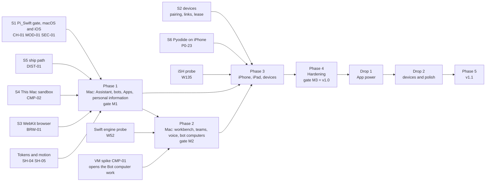

# Roadmap

**Status:** Draft 4 · 2026-10-20 · re-planned 2026-10-22 for one builder and the Mac, iPhone and iPad scope, then for Python, notebooks and Swift-file cards, then for personal use, the Swift engine and iSH, then for the Swift engine's rules, multi-device correctness, security across devices and budget slices, then for the Mac sandbox's fallback order, Mac sleep, checkpoints and where programs run, then for live Apple-data cards, recovery rules, the recovery key and the model catalog, then for the reference devices, an open model on the phone and the domain for public files, then for the review's tables 1–6 on the Swift engine, cards and policy, the object model and protocol, the architecture, computers and browsers, the platform, bots and the Assistant, the experience, design, coding and security, and the roadmap, risks, Phase 0 and product, and last for the staged calendar: v1.0 on Fri 2028-11-24, then two feature drops ([D44](decisions.md#d44)–[D87](decisions.md#d87)); reconciled 2026-10-23 for offline queuing and the Code Mode backend gates ([D88](decisions.md#d88), [D89](decisions.md#d89)), with phase totals and dates unchanged
**Updated 2026-10-23 for [D91](decisions.md#d91):** P0-19 is source-informed and P0-22 records provenance/rights review, not a paid-lawyer prerequisite to private work. Inspection, selective reuse and a personal Kuvo fork are options; none selects a fork, frontend replacement or architecture cutover. D87's dates, phase/drop scope and capacity estimates remain unchanged; no reuse saving is assumed.
**Updated 2026-10-23 for [D92](decisions.md#d92) and [D93](decisions.md#d93):** one coherent Apple-native assistant family uses Viticci-led personal-assistant interactions and Kuvo workbench depth, with scenario-based design review rather than exact competitor appearance/behavior parity, including coding surfaces. The builder and coding agents implement with user design review; a designer hire, fixed contractor days and payment are not dependencies. Existing estimates, cuts, phase/drop placements and D87 dates stay; neither reference/reuse work nor optional design help establishes saved weeks.
**Updated 2026-11-13 for [D106](decisions.md#d106)–[D122](decisions.md#d122):** the calendar is D122's and replaces D87's, so the dates, week numbers and design hierarchy in the three notes above are history. Phases keep their numbers; M1, M2 and M3 name the gates at the ends of Phases 1, 2 and 4, and v1.0 is M3 passed, estimated for Fri 2030-09-27 after 197 plan weeks. Phase 1 (46 plan weeks) gains the shell rebuilt after Cognitio's design, streamed catalog cards, the App contract with page Apps, mail and the built-in panes, search, the connector catalog, bot-to-bot messages and Claude through Claude Code. Phase 2 (83) gains Groups, Goals, outside coding agents, team mode, voice on the Mac, Bot computers, GUI computer use, Cloud computers, connector events and image and video generation. Phase 3 (55) gains the panes, Apps and voice on iPhone and iPad, Remote machines with the always-on Mac host, and takeover from the phone. Phase 4 (8) hardens the larger surface. Drop 1 is 10 weeks and Drop 2 is 9; v1.1 keeps shared rooms, Telegram, teach by demonstration and webhook ingress. Phase 0's text, dates, tickets, spikes and evidence statements are unchanged, except that S6's fallback week follows the Swift engine probe to W52. Every date after the Phase 0 gate is an estimate, and the cut order now keeps every row inside v1.0 unless a decision moves it ([D117](decisions.md#d117)).
**Updated 2026-11-13 for [D123](decisions.md#d123)–[D133](decisions.md#d133):** the code review's decisions add no weeks and move no date. The ways out of the two device holds ([D124](decisions.md#d124)), the five items [D130](decisions.md#d130) had moved to Phase 1 and the host-call deadline rule were built on 2026-11-13, before the Phase 0 gate, as fixes to existing behaviour ([D131](decisions.md#d131)); they are not Phase 1 work, and no product feature started early. The full S2 rerun that [D123](decisions.md#d123) requires is filed and passed. [D133](decisions.md#d133) then closed the limits the runs reported, before the gate and with no product feature started: device groups are qualified at 8 devices, group state is saved as a journal, and S2 asks the authority itself about a revoked device that held a lease. The records on commit `4db72e2` ([S2 record](../../../evidence/2026-11-13-memoshi-canonical-s2/s2-full-04/README.md), [CI record](../../../evidence/2026-11-13-memoshi-canonical-s2/canonical-ci-05/README.md)) removed the earlier caveat that the authority itself was never asked; since [D134](decisions.md#d134) the records are on `f22517d`, `4658dcd`, `7df84f9` and, current, `a2ac274` (next note). The earlier records on `918cb25` ([record](../../../evidence/2026-11-13-memoshi-canonical-s2/s2-full-02/README.md)) and `3b503de` remain the records of those commits. A first full run failed at the 45th device and is kept; [D132](decisions.md#d132) fixed it: pairing messages travel in fragments, and a device group holds at most 64 devices. The filed gate record is not edited, the Phase 0 gate recommendation stays No-go for its other reasons, and no ticket status or date changes.
**Updated 2026-11-14 for [D134](decisions.md#d134):** Pi_Swift tagged `slice-1` and `slice-2` on 2026-11-12, and Memoshi now builds against `slice-2`. From this pin on, S1 results count for the gate ([D90](decisions.md#d90)); results recorded on the old candidate stay development evidence. The engine call that settles an interrupted step is in `slice-2`; Memoshi did not use it at the move and uses it since `71111a6` ([D138](decisions.md#d138)), which offers Run again, Skip and Mark as done. No week, date or ticket moves. The canonical CI run and the full S2 run were repeated on `f22517d`, the commit that holds the move: CI 17 of 17 steps with 1,242 Swift tests in 15 runs and 74 release-tooling tests ([CI record](../../../evidence/2026-11-13-memoshi-canonical-s2/canonical-ci-06/README.md)); S2 passed with no failures, the D123 check 60 of 60, revocation refused at all five points (relay, authority, claim, renewal and link) with 0 grants and 0 writes after it, and hand-over p50 62.58 ms with 8 devices and 208.41 ms with 54 ([S2 record](../../../evidence/2026-11-13-memoshi-canonical-s2/s2-full-05/README.md)). After the work of 2026-11-14 they passed on `4658dcd`, with a clean tree: CI 17 of 17 steps with 1,305 Swift tests in 15 runs and 74 release-tooling tests ([CI record](../../../evidence/2026-11-13-memoshi-canonical-s2/canonical-ci-11/README.md)); S2 passed with no failures, the D123 check 60 of 60, revocation refused at all five points (relay, authority, claim, renewal and link) with 0 grants and 0 writes after it, and hand-over p50 57.28 ms with 8 devices and 169.69 ms with 54 ([S2 record](../../../evidence/2026-11-13-memoshi-canonical-s2/s2-full-06/README.md)). The records of `7df84f9` are CI 17 of 17 steps with 1,305 Swift tests in 15 runs and 74 release-tooling tests ([CI record](../../../evidence/2026-11-13-memoshi-canonical-s2/canonical-ci-12/README.md)) and a full S2 run with no failures and the D123 check of that time at 60 of 60 ([S2 record](../../../evidence/2026-11-13-memoshi-canonical-s2/s2-full-07/README.md)). The record of `8e7bd5b` (2026-11-19, clean tree) is CI 17 of 17 steps with 1,474 Swift Testing tests in 16 runs plus 6 XCTest tests and 105 release-tooling tests ([CI record](../../../evidence/2026-11-13-memoshi-canonical-s2/canonical-ci-17/README.md)). The current canonical CI record is on `7f766c8` (2026-11-21, clean tree): CI 18 of 18 steps with 1,562 Swift Testing tests in 16 runs and 111 release-tooling tests ([CI record](../../../evidence/2026-11-13-memoshi-canonical-s2/canonical-ci-25/README.md)); no full S2 run was made on either. The latest full S2 run is on `a2ac274`, after the 2026-11-18 review fixes, with a clean tree: CI 17 of 17 steps with 1,465 Swift Testing tests in 15 runs plus 6 XCTest tests and 105 release-tooling tests ([CI record](../../../evidence/2026-11-13-memoshi-canonical-s2/canonical-ci-15/README.md)); S2 passed with no failures, the fail-closed D123 check 61 of 61, revocation refused at all five points (relay, authority, claim, renewal and link) with 0 of 2,703 grants and 0 writes after it, and hand-over p50 56.31 ms with 8 devices and 209.17 ms with 54 ([S2 record](../../../evidence/2026-11-13-memoshi-canonical-s2/s2-full-08/README.md)). The records on earlier commits remain those commits' records.
**Owns:** Phases 0–6 and the two drops between v1.0 and v1.1: goals, deliverables by feature ID, measurable exit criteria, demos, dependencies, risks and lanes; the calendar and its item-by-item sizing ([D122](decisions.md#d122)); release stages; the cut order; the one-builder working rules; the dogfooding plan; the phase-gate review template.
**Depends on:** [MASTER_PLAN.md](MASTER_PLAN.md) · [decisions.md](decisions.md) · [feature-catalog.md](feature-catalog.md) · [phase-0.md](phase-0.md) · [risks.md](risks.md) · [01-product.md](01-product.md) · [03-design-system.md](03-design-system.md) · [04-architecture.md](04-architecture.md) · [06-computers-and-browsers.md](06-computers-and-browsers.md)

Adapted from Draft 3 `docs/04-roadmap.md`. Draft 3 built the workbench first and added the team later ([D9 of Draft 3](decisions.md#mapping-from-draft-3)); Draft 4 is Assistant-led ([D2](decisions.md#d2)), so the Assistant and bots come first, then the workbench, then the iPhone, iPad and devices ([D47](decisions.md#d47)). Feature IDs are those in [feature-catalog.md](feature-catalog.md); a phase's deliverables are the catalog rows with that phase number, and a drop's are the rows marked D1 or D2 ([D87](decisions.md#d87)).

Since [D117](decisions.md#d117) and [D122](decisions.md#d122) the gates carry milestone names: **M1** is the gate at the end of Phase 1, **M2** at the end of Phase 2 and **M3** at the end of Phase 4, and v1.0 is M3 passed. "Phase N" says when work happens; M1, M2 and M3 name gates. Internal milestones inside a phase are written M1.1, M2.1, M3.1 and so on, numbered by phase: M3.1 to M3.3 are inside Phase 3, not parts of the gate M3. Only this document sets their weeks. The scope by milestone is in [AMENDMENT_2026-11-13.md](AMENDMENT_2026-11-13.md).

---

## 1. Sequencing principles

1. **Prove the spine on a real model before any surface.** Phase 0 proves durability, policy and the ship path with real providers, on macOS and on iOS ([D46](decisions.md#d46)). Draft 3 proved them only against Pi's fake model.
2. **Front door first.** The Assistant, bots, Chats, Cards, Handoffs and the Inbox (Phase 1) come before projects (Phase 2), because the home is the Assistant's Chat ([D2](decisions.md#d2)) and delegation by Handoff carries the product thesis ([D24](decisions.md#d24)). Driving bots and sessions directly is first-class beside it ([D109](decisions.md#d109)).
3. **Safety ships with the capability, never after it.** The first tool call in Phase 1 already passes the policy engine; the red-team suite starts in Phase 1; spend limits ship with the first routine ([RT-12](feature-catalog.md), BU-07).
4. **Add objects, not screens.** Every phase adds or deepens first-class objects ([principle 12](MASTER_PLAN.md#3-principles)).
5. **Dogfood early and for real.** The builder uses bots daily from Phase 1, an optional friendly alpha may join in Phase 1 ([D67](decisions.md#d67)), and Memoshi is built with Memoshi from Phase 2 ([§11](#dogfooding-plan)).
6. **No phase starts on an unproven dependency** ([§8](#critical-path)).
7. **Exits are measurable.** Every exit criterion names a number, a method and, where one exists, the feature ID it verifies. "Done" means the gate review says so with evidence ([§12](#gate-template)).
8. **One writer from the first store.** Per-conversation stores with lease epochs ship in Phase 1 on one device, so Phase 3 adds devices without migrating stores ([D49](decisions.md#d49), [D74](decisions.md#d74)).
9. **Foundations before features.** v1.0 carries the foundations that later features build on, such as the core Swift language, per-value tracking, per-conversation leases, merged settings and the devices' MLS group, so Drop 1 and Drop 2 add features without rework ([D87](decisions.md#d87)).
10. **The hardest surface first.** In Phase 1 the transcript is built and measured first, then the conversation's states, then the shell around them ([D106](decisions.md#d106), [risks R64](risks.md#r64), [03 §12.4](03-design-system.md#124-transcript-first)).
11. **Bots can build before the engine lands.** Streamed catalog cards and page Apps ship in Phase 1; the Swift engine follows in Phase 2, and a Swift App can replace a page App and keep its data ([D114](decisions.md#d114), [D115](decisions.md#d115), [risks R51](risks.md#r51)).
12. **Usable milestones, nothing deferred.** Each of M1, M2 and M3 ends in something the builder uses daily, and nothing leaves v1.0 without a new decision ([D117](decisions.md#d117)). The dates are estimates, and a gate review may re-date a later phase ([D122](decisions.md#d122)).

---

## 2. Timeline at a glance

**Weeks to v1.0: 5 + 46 + 83 + 55 + 8 = 197 plan weeks; with Drop 1 (10) and Drop 2 (9), 216 plan weeks before v1.1**, for one builder with coding agents ([D45](decisions.md#d45), [D122](decisions.md#d122)). Plan weeks are working weeks; the year-end breaks (2026-12-21 → 2027-01-01, 2027-12-20 → 2027-12-31, 2028-12-25 → 2029-01-05, 2029-12-24 → 2030-01-04 and 2030-12-23 → 2031-01-03 [INFERENCE: the dates of the last three]) are outside them. A break affects only dates after that break. With these breaks already included, M1 lands on Fri 2027-10-29, M2 on Fri 2029-06-29, the Phase 3 gate on Fri 2030-08-02, M3, the v1.0 gate, on Fri 2030-09-27, Drop 1's gate on Fri 2030-12-06 and Drop 2's on Fri 2031-02-21, and v1.1 starts Mon 2031-02-24. Every duration is an [INFERENCE] estimate, and every date after the Phase 0 gate on Fri 2026-11-27 is an estimate: a gate review may re-date a later phase by a note, without a new decision, when measured progress differs ([D122](decisions.md#d122)). This calendar supersedes the one of 2026-10-23 ([D87](decisions.md#d87): 105 plan weeks to a v1.0 gate on Fri 2028-11-24, and 126 before v1.1) and every calendar before it. v1 is for the user's own Mac, iPhone and iPad; a public release is decided after v1.0 (O13).

**Where the weeks come from.** [D87](decisions.md#d87) sized Phase 1 at 19 plan weeks, Phase 2 at 35, Phase 3 at 40 and Phase 4 at 6, with Drop 1 at 11 and Drop 2 at 10. Those sizes hold the foundations that the review of inferred choices ([D71](decisions.md#d71)–[D86](decisions.md#d86)) put into v1.0: the core Swift language (value types, `@Observable` classes, protocols, closures), per-value tracking, permission lists, migrations at publish, the per-bot engine helper and the typed API; per-conversation leases, merged settings, the stable runner, safe failover and merged app data; the devices' MLS group with the recovery key, synced keys and biometric approvals; budget slices, bot isolation on iPhone and iPad and Python's rules; the sandbox guard, checkpoints and Mac sleep; the recovery rules and the model catalog; and the foundation rows of tables 1–6. [D106](decisions.md#d106)–[D121](decisions.md#d121) add about 92 plan weeks to v1.0: about 27 in Phase 1, 48 in Phase 2, 15 in Phase 3 and 2 in Phase 4 [INFERENCE] ([D122](decisions.md#d122)). Most of what moved in from v1.1 and v2 had never been sized. [Sizing, item by item](#sizing) lists every line; the lines marked INFERENCE are the roadmap review's estimates of 2026-11-13, made without measured velocity, and each phase's blocks in [§5](#phase-1) place them in weeks.

| Phase | Name | Weeks | Plan weeks | Dates | Gate | Outcome |
|---|---|---|---|---|---|---|
| **0** | Foundations and spikes | 5 | W1–W5 | 2026-10-26 → 2026-11-27 | Fri 2026-11-27 | The Pi_Swift gate passed on macOS and iOS, or its fallbacks taken ([D46](decisions.md#d46)); spikes answered |
| **1** | Mac: Assistant, bots, Apps, personal information | 46 | W6–W51 | 2026-11-30 → 2027-10-29 | **M1**, Fri 2027-10-29 | Memoshi is the builder's daily Mac app for chat, bots, mail and calendar: the builder uses it instead of Cognitio for chat and bots; the Assistant delegates through Handoffs; a bot builds a working pane in one conversation and changes it on request; inbox triage and the week view are used daily; no T4 action without a card outside Bypass, except mail sent by a bot the user lets send mail by itself ([D116](decisions.md#d116)) |
| **2** | Mac: workbench, teams, voice, bot computers | 83 | W52–W134 | 2027-11-01 → 2029-06-29 | **M2**, Fri 2029-06-29 | Memoshi is the daily Mac engineering tool: first accepted diff within 10 minutes for a new project; a team-mode change lands only after its checks pass; a call hands work to a bot and speaks the result; a bot finishes a web chore in its own computer while watched; a Swift App replaces a page App and keeps its data; bots run Python and notebooks on the Mac |
| **3** | iPhone, iPad, devices | 55 | W135–W189 | 2029-07-02 → 2030-08-02 | Fri 2030-08-02 | Every bot on every device with one history; durable no-model offline queuing and model-available side threads ([D88](decisions.md#d88)); approvals reach a phone away from home; a week-long routine stays within budget; Python, notebooks, live cards, Apps and the built-in panes on iPhone and iPad; the iSH computer; a voice call from the Action Button; a bot's computer watched and taken over from the phone; a bot running on a Mac mini while the laptop sleeps |
| **4** | Hardening | 8 | W190–W197 | 2030-08-05 → 2030-09-27 | **M3**, the v1.0 gate, Fri 2030-09-27 | All v1.0 gates green on the user's own Mac, iPhone and iPad, with the security review covering mail, Apps, voice and Bot computers; no App Review and no store release ([D67](decisions.md#d67)) |
| **D1** | Drop 1: App power | 10 | W198–W207 | 2030-09-30 → 2030-12-06 | Fri 2030-12-06 | Apps refresh in background jobs and offer widgets; the signed bytecode cache; the rest of Swift; rich styling; the adaptive kit ([D87](decisions.md#d87)) |
| **D2** | Drop 2: devices and polish | 9 | W208–W216 | 2030-12-09 → 2031-02-21 | Fri 2031-02-21 | The open model on the phone, with true offline answers after download and the no-model queue fallback; browser sign-ins across devices; coding on iPhone and iPad; notebook extras; live Apple-data cards; visual views; live QuickAsk drafts; the Apple tools proposal ([D87](decisions.md#d87), [D88](decisions.md#d88)) |
| **5** | v1.1: reach and shared rooms | Sized at the v1.0 gate | — | From Mon 2031-02-24 | — | Shared rooms, Telegram, teach by demonstration, webhook ingress through the relay |
| **6** | v2 Shared and ambient | — | — | Sized at the Phase 5 gate | — | Team bots, bot identities, channels, the hosted offer |

**Catalog rows per stage** ([feature-catalog.md](feature-catalog.md), Summary): Phase 0, 12 (10 P0, 2 P1); Phase 1, 177 (107 P0, 67 P1, 3 P2); Phase 2, 101 (40 P0, 43 P1, 18 P2); Phase 3, 45 (28 P0, 9 P1, 8 P2); Phase 4, 10 (6 P0, 4 P1). v1.0 holds 345 rows: 191 P0, 125 P1 and 29 P2. Drop 1 has 6 (4 P0, 2 P1), Drop 2 has 8 (2 P0, 6 P1), Phase 5 has 4 and Phase 6 has 10.

<a id="sizing"></a>
### Sizing, item by item

The roadmap review of 2026-11-13 sized each stage line by line ([D122](decisions.md#d122)). "Planned" lines are [D87](decisions.md#d87)'s sizes; a line marked INFERENCE is an estimate for one builder with coding agents, with no measurement behind it. A negative line is work that left the stage, with the same weeks added where it went.

**Phase 1: 46 weeks**

| Item | Weeks | Basis |
|---|---:|---|
| Planned Phase 1 scope ([D87](decisions.md#d87)) | 19 | D87's calendar |
| Shell rebuilt on Cognitio's design: custom transcript, composer with queue and steer, side panel, split view, beyond the planned shell ([D106](decisions.md#d106)) | 3 | INFERENCE: the planned shell was already new code; this is the extra transcript and composer depth |
| Streamed catalog cards with the tabs block, A2UI-aligned (CH-19, CH-25 from Phase 2) ([D115](decisions.md#d115)) | 2 | From Phase 2's 3-week block of cards, watches and intents |
| Native diagrams, charts and math ([D115](decisions.md#d115)) | 1 | INFERENCE |
| App contract: side-panel pane, exported functions, view tools, selection carry; page Apps and interactive artifacts (TP-07 from Phase 2); snapshot self-check ([D110](decisions.md#d110), [D114](decisions.md#d114)) | 4 | INFERENCE |
| `mail.*` tools for Gmail, Microsoft 365 and IMAP with a local cache, and the Mail pane ([D116](decisions.md#d116), [D118](decisions.md#d118)) | 5 | INFERENCE |
| Calendar, Reminders and Contacts tools (from Phase 2's AP-10) and the Calendar, Reminders with Tasks, Contacts, Notes and Files with Library panes ([D116](decisions.md#d116)) | 5 | 1.5 weeks moved from Phase 2, plus INFERENCE for the panes |
| `web_search`, `x_search` and source chips ([D112](decisions.md#d112)) | 1 | INFERENCE |
| Connector catalog with connect cards ([D112](decisions.md#d112)) | 2 | INFERENCE |
| Bot-to-bot messages (GR-06) ([D109](decisions.md#d109)) | 1 | INFERENCE |
| Global Tasks view, recommended picks, pause on rate limit, subscription plan meters ([D109](decisions.md#d109), [D117](decisions.md#d117)) | 1.5 | INFERENCE |
| Claude Code as a model on the Mac ([D108](decisions.md#d108)) | 1.5 | INFERENCE |

**Phase 2: 83 weeks**

| Item | Weeks | Basis |
|---|---:|---|
| Planned Phase 2 scope ([D87](decisions.md#d87)) | 35 | D87's calendar |
| Moved to Phase 1: catalog cards and tabs, the Calendar, Reminders and Contacts tools, interactive artifacts | −4 | The same weeks added to Phase 1 |
| Groups ([D109](decisions.md#d109)) | 4 | INFERENCE: v1.1 was unsized |
| Goals ([D109](decisions.md#d109)) | 2 | INFERENCE |
| Outside coding agents: Codex app-server, ACP agents, Claude Code as a worker ([D110](decisions.md#d110)) | 4 | INFERENCE: v1.1 was unsized |
| Team mode, the code-only landing gate, parallel reviewers, Attempts ([D110](decisions.md#d110)) | 4 | INFERENCE |
| Voice on the Mac: cloud realtime and on-device engines, call card, read aloud, voice memos, navigation and read-back, narrator ([D111](decisions.md#d111)) | 6 | INFERENCE: v2 was unsized |
| Bot computers: the VM spike, a Linux VM per bot with a desktop and Chromium, live view, takeover, sleep, snapshots, egress ([D113](decisions.md#d113)) | 12 | INFERENCE: v1.1's largest item, unsized |
| GUI computer use inside a bot's computer ([D113](decisions.md#d113)) | 2 | INFERENCE |
| Cloud computers behind the same seam: E2B, Orgo, Daytona; cost preview ([D113](decisions.md#d113), [D120](decisions.md#d120)) | 4 | INFERENCE: v2 was unsized |
| Connector event triggers (RT-14 from Phase 3) and Composio ([D112](decisions.md#d112)) | 2 | 1 week moved from Phase 3, plus INFERENCE |
| Image and video generation with three providers ([D112](decisions.md#d112), [D120](decisions.md#d120)) | 2 | INFERENCE |
| Swift Apps with exported functions, project-scoped Apps, the digest of user actions (CH-31 from Drop 1) ([D114](decisions.md#d114)) | 3 | 1 week moved from Drop 1, plus INFERENCE |
| Plugin developer mode: compiled Swift plugins in a helper, Full access on this Mac ([D114](decisions.md#d114)) | 3 | INFERENCE |
| Screens provided by connectors (MCP Apps) ([D115](decisions.md#d115)) | 1 | INFERENCE |
| Model roles with fallback lists; reflection proposals; context-fill triggers; cache warming; developer view of model input ([D117](decisions.md#d117)) | 3 | INFERENCE |

**Phase 3: 55 weeks**

| Item | Weeks | Basis |
|---|---:|---|
| Planned Phase 3 scope ([D87](decisions.md#d87)) | 40 | D87's calendar |
| Moved to Phase 2: connector event triggers | −1 | The same week added to Phase 2 |
| Mail tools and the six panes on iPhone and iPad ([D116](decisions.md#d116)) | 4 | INFERENCE |
| Apps as panes and page Apps on iPhone and iPad ([D114](decisions.md#d114)) | 1 | INFERENCE |
| Voice on iPhone and iPad: both engines, Action Button, Live Activity, Start Voice Chat intent ([D111](decisions.md#d111)) | 3 | INFERENCE |
| Remote machines over SSH and the always-on Mac host ([D113](decisions.md#d113)) | 5 | INFERENCE: v1.1 was unsized |
| Watching and taking over a bot's browser or computer from iPhone and iPad (BRW-15 from Drop 2) ([D113](decisions.md#d113)) | 2 | 1.5 weeks moved from Drop 2, rounded up |
| Groups, Goals and team mode surfaces on iPhone and iPad ([D109](decisions.md#d109), [D110](decisions.md#d110)) | 1 | INFERENCE |

**Phase 4: 8 weeks**

| Item | Weeks | Basis |
|---|---:|---|
| Planned Phase 4 scope ([D87](decisions.md#d87)) | 6 | D87's calendar |
| Hardening for the larger surface: security review of mail, Apps, voice and Bot computers ([D117](decisions.md#d117)) | 2 | INFERENCE |

**Drop 1: 10 weeks.** Planned scope ([D87](decisions.md#d87)), 11 weeks; the digest of user actions (CH-31) moved to Phase 2, −1.

**Drop 2: 9 weeks.** Planned scope ([D87](decisions.md#d87)), 10 weeks; takeover from any device (BRW-15) moved to Phase 3, −1 (its 1.5 weeks counted as 1).

<a id="calendar"></a>
## 3. Calendar

Indicative, Monday to Friday. "M" rows are internal milestones inside a phase, numbered by phase; the gates M1, M2 and M3 end Phases 1, 2 and 4 ([D117](decisions.md#d117)). The phase and drop totals are [D122](decisions.md#d122)'s; the split of each phase's weeks among its rows is an [INFERENCE] estimate, and so is every date after the Phase 0 gate. Plan weeks number continuously from W1; the year-end breaks are not plan weeks. Rows after Phase 0 give both dates in full.

| Weeks | Dates | Phase | Milestones |
|---|---|---|---|
| W1 | 2026-10-26 – 10-30 | 0 | Kickoff; ship-path probe; Pi_Swift slice-ready (`slice-1`, planned Fri 10-30; tagged with `slice-2` on 2026-11-12) is the first dependency ([D90](decisions.md#d90)); P0-22 opens the licence/provenance/redistribution review without gating P0-19 ([D91](decisions.md#d91)) |
| W2–W3 | 11-02 – 11-13 | 0 | S1 on macOS, S4 and S5 running; the S2 devices probe starts; Memoshi records Code Mode's workload, cold/warm p95 limits and memory ceiling by Mon 11-09 ([D90](decisions.md#d90)), and Pi_Swift measures both wasm2c and WasmKit in Release on the iPhone 14 Pro on Thu 11-12 ([D89](decisions.md#d89)); the user picks the domain for public files by Fri 11-13, when Pi_Swift needs it for E29 ([D80](decisions.md#d80)) |
| W4 | 11-16 – 11-20 | 0 | S1 on iOS; S3; S2's lease hand-over; S6 Pyodide on iPhone (one day; first on the Phase 0 cut list, else W52) |
| W5 | 11-23 – 11-27 | 0 | Spike reports Wed; demo rehearsal Thu; **Phase 0 gate Fri 2026-11-27** (the D46 gate) |
| W6–W13 | 2026-11-30 – 2027-02-05 | 1 | The transcript first, then the conversation's states (Cards, approvals, permission modes, the composer's queue, steer and stop), then the shell (card window, sidebar, side panel, tabs, split view), the roster and the This Mac sandbox; **M1.1** (end of W13): the builder starts daily use. The break 2026-12-21 → 2027-01-01 is not plan weeks |
| W14–W16 | 2027-02-08 – 2027-02-26 | 1 | Streamed catalog cards (CH-19) with the tabs block (CH-25); native diagrams, charts and math (CH-41) |
| W17–W25 | 2027-03-01 – 2027-04-30 | 1 | Memory, routines, watches, the Inbox with the global Tasks view, notifications, the budget floor with plan meters and pause on a rate limit, Claude Code as a model; **M1.2** (end of W25): dogfood build; the optional friendly alpha may be invited ([D67](decisions.md#d67)) |
| W26–W35 | 2027-05-03 – 2027-07-09 | 1 | Handoffs and bot-to-bot messages, proposals, the daily brief, connectors with the catalog and connect cards, `web_search` and `x_search`, the WebKit browser, the red-team suite at full size; **M1.3** (end of W35) |
| W36–W39 | 2027-07-12 – 2027-08-06 | 1 | The App contract (pane, exported functions, `view.*` tools, selection carry), page Apps, interactive artifacts, the self-check snapshot; **M1.4** (end of W39): a bot builds a page App as a pane and changes it on request |
| W40–W44 | 2027-08-09 – 2027-09-10 | 1 | The `mail.*` tools for Gmail, Microsoft 365 and IMAP, the mail policy classes and the Mail pane |
| W45–W49 | 2027-09-13 – 2027-10-15 | 1 | The Calendar, Reminders and Contacts tools; the Calendar, Reminders with Tasks, Contacts, Notes and Files with Library panes; **M1.5** (end of W49): daily inbox triage and the week view start |
| W50–W51 | 2027-10-18 – 2027-10-29 | 1 | Onboarding and templates; `bot.md` format frozen; **M1, the Phase 1 gate, Fri 2027-10-29** |
| W52–W60 | 2027-11-01 – 2028-01-14 | 2 | The Swift engine probe (W52, 3 days, [04 §4.17](04-architecture.md#swift-engine-probe)); projects, sessions, coding tools, terminal, files, git, turn checkpoints, Changes review and worktrees; commit, push and PR Drafts; project memory; preview; the rest of the Apple tool catalog on the Mac (AP-10); **M2.1** (end of W60); **building Memoshi with Memoshi starts**. The break 2027-12-20 → 2027-12-31 is not plan weeks; dogfood routines keep running under BU-07 caps |
| W61–W65 | 2028-01-17 – 2028-02-18 | 2 | CI and issue watches; local webhook triggers; App Intents; outside coding agents: Codex app-server, Claude Code as a worker and ACP agents (R11-08 – R11-10) |
| W66–W69 | 2028-02-21 – 2028-03-17 | 2 | Team mode, the landing gate, parallel reviewers and Attempts (CODE-18 – CODE-20, R11-15) |
| W70–W84 | 2028-03-20 – 2028-06-30 | 2 | The Swift engine on the Mac (CH-24): parser, compiler and interpreter for the core language (value types, `@Observable` classes, protocols, closures), the component kit, limits and compile errors, permission lists, per-value tracking, migrations at publish and the per-bot engine helper; live Swift cards (CH-21), then Swift Apps (CH-22); **M2.2** (end of W84): a bot builds an App on the Mac, and a live card acts inline, both through policy |
| W85–W91 | 2028-07-03 – 2028-08-18 | 2 | Swift Apps with a pane and exported functions, project-scoped Apps and the digest of the user's actions (CH-31); plugin developer mode (CH-44); screens provided by connectors (CH-45) |
| W92–W96 | 2028-08-21 – 2028-09-22 | 2 | Python in each bot's This Mac sandbox (PY-01) and the notebook view (PY-02); moderated new-user tests |
| W97–W102 | 2028-09-25 – 2028-11-03 | 2 | Groups with their caps and the Group's own budget; Goals (GR-13) |
| W103–W108 | 2028-11-06 – 2028-12-15 | 2 | Voice on the Mac: both engines, the call card, read aloud, voice memos, navigation and read-back, the narrator (V2-09, VO-01 – VO-04); **M2.3** (end of W108): Groups, Goals and voice in the dogfood build |
| W109–W115 | 2028-12-18 – 2029-02-16 | 2 | Connector event triggers and Composio; image and video generation; model roles with fallback lists, reflection proposals, context-fill triggers, cache warming and the developer view of model input. The break 2028-12-25 → 2029-01-05 is not plan weeks [INFERENCE: the dates]; internal TestFlight builds and dogfood routines keep running under BU-07 caps |
| W116–W127 | 2029-02-19 – 2029-05-11 | 2 | The VM spike (CMP-01), which opens the Bot computer work and decides O2, O3 and O4; Bot computers: a Linux VM per bot with a desktop and Chromium, live view, takeover, sleep, snapshots and egress; **M2.4** (end of W127): a bot finishes a web chore in its own computer while watched |
| W128–W129 | 2029-05-14 – 2029-05-25 | 2 | GUI computer use inside a bot's computer (R11-12) |
| W130–W133 | 2029-05-28 – 2029-06-22 | 2 | Cloud computers behind the same seam (V2-02) |
| W134 | 2029-06-25 – 2029-06-29 | 2 | Fixes and the dogfood share; **M2, the Phase 2 gate, Fri 2029-06-29** |
| W135–W142 | 2029-07-02 – 2029-08-24 | 3 | The iSH probe (W135, 3 days, [06 §12](06-computers-and-browsers.md#ish-probe)); pairing and the devices' MLS group with its recovery key, the direct link, the relay and the iCloud link; the iPhone and iPad app shell; **M3.1** (end of W142): a Mac bot's turn followed and approved on a paired iPhone, at home and away |
| W143–W153 | 2029-08-27 – 2029-11-09 | 3 | The stable runner with forwarding and safe failover, per-conversation leases with rebalancing, replicas, merged settings, cross-device tools, the in-app environment with each bot's isolation, and the shell front end; **M3.2** (end of W153): one bot used from Mac, iPhone and iPad with one history; internal TestFlight builds on the user's devices |
| W154–W156 | 2029-11-12 – 2029-11-30 | 3 | Pyodide on iPhone and iPad (PY-03), one per bot, and the notebook view there (PY-04) |
| W157–W161 | 2029-12-03 – 2030-01-18 | 3 | Cards on iPhone and iPad (CH-20) and the Swift engine there: live cards and Apps, with App panes and page Apps (CH-23). The break 2029-12-24 → 2030-01-04 is not plan weeks [INFERENCE: the dates] |
| W162–W167 | 2030-01-21 – 2030-03-01 | 3 | Durable no-model offline queuing and separately tested model-available side threads (DEV-09, [D88](decisions.md#d88)), memory sync, keys synced through iCloud Keychain, biometric approvals, Trash, iPad layouts, budgets with budget slices, and cost preview |
| W168–W170 | 2030-03-04 – 2030-03-22 | 3 | Voice on iPhone and iPad: both engines, the Action Button, a Live Activity, the Start Voice Chat intent (VO-05, VO-06) |
| W171–W175 | 2030-03-25 – 2030-04-26 | 3 | Remote machines over SSH and the always-on Mac host (CMP-13, CMP-14, R11-07) |
| W176–W177 | 2030-04-29 – 2030-05-10 | 3 | Watching and taking over a bot's browser or computer from iPhone and iPad (BRW-15); **M3.3** (end of W177): a voice call from the phone, a bot's computer taken over from it, and a bot running on the always-on Mac |
| W178–W181 | 2030-05-13 – 2030-06-07 | 3 | The `mail.*` tools and the six built-in panes on iPhone and iPad (CON-20, AP-21) |
| W182 | 2030-06-10 – 2030-06-14 | 3 | Groups, Goals and team mode shown on iPhone and iPad (IOS-07) |
| W183–W185 | 2030-06-17 – 2030-07-05 | 3 | The iSH computer (IOS-06): Alpine with its package manager, ffmpeg, Python, Git and SSH; app commands as real programs; policy on every command |
| W186–W189 | 2030-07-08 – 2030-08-02 | 3 | Week-long soak; v1.0 feature freeze; **Phase 3 gate Fri 2030-08-02** |
| W190 | 2030-08-05 – 2030-08-09 | 4 | Release candidates to the user's Macs on Sparkle's beta channel and to the user's iPhone and iPad through internal TestFlight; security review and WCAG audit start |
| W191–W192 | 2030-08-12 – 2030-08-23 | 4 | Hardening for the larger surface: the security review of mail, Apps, voice and Bot computers |
| W193–W195 | 2030-08-26 – 2030-09-13 | 4 | Fixes, data and audit export, install and uninstall; RC1 |
| W196–W197 | 2030-09-16 – 2030-09-27 | 4 | RC2 and RC3; **M3, the v1.0 gate, Fri 2030-09-27** |
| W198–W201 | 2030-09-30 – 2030-10-25 | D1 | The rest of Swift (CH-29) and the signed bytecode cache (CH-28) |
| W202–W205 | 2030-10-28 – 2030-11-22 | D1 | App background jobs on Mac, iPhone and iPad (CH-26) and App widgets (CH-27) |
| W206–W207 | 2030-11-25 – 2030-12-06 | D1 | Rich styling (CH-30) and the adaptive kit (CH-32); **Drop 1 gate Fri 2030-12-06** |
| W208–W211 | 2030-12-09 – 2031-01-17 | D2 | The open model on the phone (MOD-09); browser sign-ins synced between devices (BRW-14); coding on iPhone and iPad (CODE-17); notebook extras (PY-05). The break 2030-12-23 → 2031-01-03 is not plan weeks [INFERENCE: the dates] |
| W212–W216 | 2031-01-20 – 2031-02-21 | D2 | Live Apple-data cards (AP-12), visual task and artifact views (TP-10), live QuickAsk drafts (AS-10) and the Apple tools proposal (AP-13); **Drop 2 gate Fri 2031-02-21** |
| Phase 5 | From Mon 2031-02-24 | 5 | v1.1, sized at the v1.0 gate; Apple's next developer betas are expected around WWDC in June 2031 [INFERENCE] |

### Release stages

Adapted from Draft 3 §13.

| Stage | From | Audience | Channel |
|---|---|---|---|
| Internal builds | W1 | The builder | CI builds, notarized from Phase 1 (DIST-02); internal TestFlight builds from S5, uploaded nightly whenever main changed ([D86](decisions.md#d86)) |
| Builder dogfood | M1.1 (end of W13) | The builder | Nightly notarized build |
| Friendly alpha (optional, [D67](decisions.md#d67)) | M1.2 (end of W25), if the builder invites it | Up to 10 builders who bring their own keys | Notarized DMG, weekly, manual update; on iPhone and iPad as internal TestFlight testers from M3.2 (end of W153), after the GPL self-check ([D86](decisions.md#d86)) |
| M1 and M2 | W51, Fri 2027-10-29, and W134, Fri 2029-06-29 | The builder, and the alpha if it runs | Gates, not releases: the dogfood channels above carry the builds ([D117](decisions.md#d117)) |
| Release candidates | W190 | The builder, on their own devices | Sparkle's beta channel (DIST-05, DIST-06) and internal TestFlight (DIST-08) |
| v1.0 (M3 passed) | W197, Fri 2030-09-27 | The user's own Macs, iPhones and iPads ([D67](decisions.md#d67)) | Sparkle's stable channel on the Mac; on iPhone and iPad, internal TestFlight builds that CI refreshes before their 90-day expiry, or Xcode development builds |
| Drop 1: App power | W207, Fri 2030-12-06, after its gate review | The same devices | An update on v1.0's channels ([D87](decisions.md#d87)) |
| Drop 2: devices and polish | W216, Fri 2031-02-21, after its gate review | The same devices | An update on v1.0's channels ([D87](decisions.md#d87)) |
| v1.1 | Phase 5, from Mon 2031-02-24 | Sized at the v1.0 gate; its audience follows O13 | v1.0's channels, unless O13 chose another |
| Public release | After v1.0 (O13) | Public | Decided by O13: a public beta, the App Store or another channel; IOS-05 and DIST-08's App Store part return first |

Versions stay `0.x` until v1.0, then follow SemVer: Drop 1 and Drop 2 ship as minor versions, so this plan's release names (v1.0, Drop 1, Drop 2, v1.1) are not version numbers [INFERENCE]. Memoshi.app and memoshid ship together, and protocol negotiation refuses a daemon outside the supported range (DIST-04). The iPhone and iPad app negotiates the same protocol with paired devices [INFERENCE].

---

<a id="staffing"></a>
## 4. One builder, with agents

[D45](decisions.md#d45), amended by [D93](decisions.md#d93): one person builds Memoshi, directing coding agents. The builder and agents deliver Phase 0 tokens, base components, motion, avatar prototypes and performance evidence against user-approved references; the user reviews design. Design QA remains required throughout and before Phase 4. There is no mandatory freelancer, hire, fixed paid allocation or payment dependency. Targeted external artwork, accessibility or polish help is optional only for a concrete identified gap with separately approved scope and cost; capacity estimates and cuts stay unchanged until measured evidence supports replanning. Pi_Swift is built in its own repository by its own agent; Memoshi takes it through the [D46](decisions.md#d46) gate. The working rules are in [§10](#solo-builder-variant).

Since 2026-11-13 the interface is rebuilt in Memoshi's own code after Cognitio's design, as one SwiftUI codebase for Mac, iPad and iPhone ([D106](decisions.md#d106)); from Phase 1 on, the Viticci and Kuvo references named in Phase 0's deliverables are history. Cognitio itself keeps developing in its own repository, on the builder's other time ([D107](decisions.md#d107)): it is the behaviour reference and the oracle for ports, and Memoshi's agents do not edit it. Two live codebases share one builder's attention; the plan weeks count Memoshi work only and reserve nothing for Cognitio [INFERENCE] ([risks R63](risks.md#r63)).

The plan's role codes stay as **hats**, lanes of work that one person wears with agents:

| Hat | Lane |
|---|---|
| **APP** | The Mac and the iPhone and iPad apps: shell, conversation, Cards, Inbox, design-system implementation, UI performance; the transport end to end; App panes, the built-in panes and the voice surfaces |
| **NAT** | Native services: the Browser service (WebKit), Apple services and the Apple tool catalog, devices (pairing, links, CloudKit, push), packaging and distribution; Bot computers, Cloud computers and Remote machines; audio and Apple speech |
| **RT** | The runtime in memoshid and in the app: the Pi_Swift adapter, policy engine, scheduler, memory, connectors, usage, stores and leases; the typed tools for search, mail, image and video; App functions; outside coding agents |
| **PD** | Product and design: scope, flows, templates, cut decisions, gate reviews, the dogfood program |
| **QA** | Chaos, smoke, red-team, performance and soak harnesses; release checks. Agents run most of it, and the builder reviews |
| **EL** | Technical arbitration, licensing, the dependency watch list (including Pi_Swift's pin) |

The additions to APP, NAT and RT follow where the new parts run ([amendment §6](AMENDMENT_2026-11-13.md#6-where-the-new-parts-run)) [INFERENCE: the lane split].

**Costs** ([INFERENCE] estimates): Apple Developer Program $99 a year; test hardware: the base 16 GB M1 reference box, the lowest-RAM supported Mac per [09-platform-macos.md](09-platform-macos.md), since the user's own iPhone 14 Pro and iPad Pro 12.9-inch (M1) are the iPhone and iPad references ([D80](decisions.md#d80)), so less than the $1,500–2,500 estimated with a phone and a tablet; a self-hosted Apple-silicon Mac mini as the CI runner, while the reference box keeps the performance CI ([D86](decisions.md#d86)); hosting for the relay (O11); model spend capped by the [dogfood budget](#dogfooding-plan); the user's own provider keys for search, cloud voice, image and video generation and Cloud computers ([D120](decisions.md#d120)), where a Cloud computer's charges count against its bot's budget; and the subscription plans the user already holds, whose usage shows as price unknown ([D108](decisions.md#d108)).

---

## 5. Phases 0–4 (v1.0) and the two drops

<a id="phase-0"></a>
### Phase 0 — Foundations and spikes (5 weeks, W1–W5)

**Full plan:** [phase-0.md](phase-0.md).

- **Goals:** a repository with the Mac app, the Swift memoshid and a minimal iPhone and iPad host; the protocol as Swift types, with the JSON Schema generated from them ([D78](decisions.md#d78)); the event store with per-conversation stores ([D74](decisions.md#d74)); the Pi_Swift adapter with contract tests; design primitives on provisional tokens; P0-19's unified Viticci-led assistant + Kuvo workbench design-reference/reuse assessment at the planned `docs/specs/design-reference.md`, mapping accepted personal-resource, delegation, project-review and App journeys across devices/states, with observations, token/motion inputs, provenance and frontend-reuse viability ([D91](decisions.md#d91), [D92](decisions.md#d92)); and six spikes that settle the riskiest decisions.
- **Deliverables:** SH-01, SH-02, SH-03, SH-04, SH-05 (P1), BOT-01 (P1); spikes CH-01, MOD-01, SEC-01 (S1, the Pi_Swift gate), the devices spike (S2), BRW-01 (S3), CMP-02 (S4), DIST-01 (S5), and the Pyodide spike (S6, P0-23: cold start, memory and background behaviour on the iPhone 14 Pro, [D60](decisions.md#d60), [D80](decisions.md#d80)). S6 is first on the Phase 0 cut list and may move to Phase 2's first week (W52).
- **Exit criteria** (full list: [phase-0 §9](phase-0.md#exit-criteria)):
  1. The D46 gate on macOS and on iOS: 50 of 50 kills resume correctly with 0 duplicated effects, 10 of 10 pending approvals survive a kill, and the three iOS scenarios pass. Code Mode follows [D89](decisions.md#d89): upstream Node-oracle differential parity before wasm2c becomes the default, Release cold/warm measurements of wasm2c and WasmKit on the iPhone 14 Pro against the workload, p95 limits and memory ceiling recorded before measurement, and the integrated memory, interrupt, trap/Swift-C safety, policy and recovery gates. An unset workload or absent device evidence is not a pass.
  2. 100% of tool calls, including nested Code Mode and MCP-bridge calls, decided by policy and audited.
  3. 1,000 forced reconnects with 0 event gaps or duplicates.
  4. A notarized DMG signed with a G2 certificate launches on a clean macOS 27 VM with no Gatekeeper warning, and memoshid survives app quit, kill and replace; the TestFlight build installs on an iPhone and an iPad.
  5. O10 set from S2; P-STREAM and P-IDLE met or the gaps owned; P0-19's unified design-reference/reuse spec v0 filed, with Viticci-led assistant and Kuvo workbench roles, scenario/state coverage and adoption decisions; unchecked Draft 3 values remain provisional, and source values are not Memoshi tokens without named evidence and Memoshi scenario/accessibility/performance review ([D92](decisions.md#d92)). Scenario-based user review and design QA cover Phase 0's prototypes without pulling later features forward. P0-22's provenance/rights findings are recorded, not a hired-lawyer gate ([D91](decisions.md#d91)); every marginal spike result has an owner and a Phase 1 ticket ([phase-0 §5](phase-0.md#spikes)); the Python route for iPhone and iPad is recorded from S6 (Pyodide, or a fallback in [D79](decisions.md#d79)'s order), or S6's move to W52 recorded.
  6. **The S2 rerun** ([D123](decisions.md#d123), added 2026-11-13): the full S2 run (devices, authority, revocation) is repeated on a committed tree with the stricter harness and filed as the new record before the gate relies on S2. It is filed and passed. The records of `7df84f9` are CI 17 of 17 steps with 1,305 Swift tests in 15 runs and 74 release-tooling tests ([CI record](../../../evidence/2026-11-13-memoshi-canonical-s2/canonical-ci-12/README.md)) and a full S2 run with no failures and the D123 check of that time at 60 of 60 ([S2 record](../../../evidence/2026-11-13-memoshi-canonical-s2/s2-full-07/README.md)). The current canonical CI record is on `7f766c8` (2026-11-21, clean tree: 18 of 18 steps, 1,562 Swift Testing tests in 16 runs and 111 release-tooling tests; [CI record](../../../evidence/2026-11-13-memoshi-canonical-s2/canonical-ci-25/README.md)), with no full S2 run on it; `8e7bd5b`'s record is [canonical-ci-17](../../../evidence/2026-11-13-memoshi-canonical-s2/canonical-ci-17/README.md). The latest full S2 run is on `a2ac274`, after the 2026-11-18 review fixes, with a clean tree: CI 17 of 17 steps with 1,465 Swift Testing tests in 15 runs plus 6 XCTest tests and 105 release-tooling tests ([CI record](../../../evidence/2026-11-13-memoshi-canonical-s2/canonical-ci-15/README.md)); S2 passed with no failures, the fail-closed D123 check 61 of 61, revocation refused at all five points (relay, authority, claim, renewal and link) with 0 of 2,703 grants and 0 writes after it, and hand-over p50 56.31 ms with 8 devices and 209.17 ms with 54 ([S2 record](../../../evidence/2026-11-13-memoshi-canonical-s2/s2-full-08/README.md)). The records on `4658dcd` (CI 17 of 17 steps with 1,305 Swift tests in 15 runs and 74 release-tooling tests ([CI record](../../../evidence/2026-11-13-memoshi-canonical-s2/canonical-ci-11/README.md)); S2 passed with no failures, the D123 check 60 of 60, revocation refused at all five points (relay, authority, claim, renewal and link) with 0 grants and 0 writes after it, and hand-over p50 57.28 ms with 8 devices and 169.69 ms with 54 ([S2 record](../../../evidence/2026-11-13-memoshi-canonical-s2/s2-full-06/README.md))) and on `f22517d` ([S2 record](../../../evidence/2026-11-13-memoshi-canonical-s2/s2-full-05/README.md)) remain those commits'. The figures that follow are from the record on commit `4db72e2`, which remains that commit's record, after [D133](decisions.md#d133)'s changes, with `s2 --load --real-expiry`; its report, the independent load verifier, the D123 check (60 of 60) and an extra check (`recovery.unacceptedOldEpochReported` 0) passed ([record](../../../evidence/2026-11-13-memoshi-canonical-s2/s2-full-04/README.md)). The tree had no tracked change; the only line of `git status --short` was an untracked document from another session. Measured: revocation refused at the relay, the authority, the claim, the renewal and the link, 1 each, none accepted; the revoked device held a lease before its revocation (1 grant, 3 commits, 1 renewal), and after it got 0 of 2,702 grants and made 0 writes (3 refused). This removes the earlier caveat that the authority was never asked and the revoked device never held a lease. The expiry two-writer audit found no epoch with two writers: 1,774 commits in the qualified phase and 1,068 in the stress phase, each with 2 writers and 40 epochs. A real pairing-code expiry was refused. The qualified phase had 8 devices: hand-over p50 54 ms (p95 463 ms), 2,142 accepted writes; the stress phase had 54: p50 176 ms (p95 272 ms), 1,715 accepted writes. 5 and 45 probes paired, with 0 unexpected refusals. The canonical `scripts/ci.sh` passed on the same commit: 1,230 Swift tests in 15 runs and 72 release-tooling tests ([record](../../../evidence/2026-11-13-memoshi-canonical-s2/canonical-ci-05/README.md)). The earlier hand-over finding (p50 637 ms at 54 devices, with the group state rewritten for every message, up to about 29 MB) is resolved by D133's group-state journal: about 21 KB per message with 8 devices and 31 KB with 54. A group change still rewrites most of the native MLS state, about 1.4 MB at 54 devices; that is the remaining floor. The earlier records remain the records of their commits: `918cb25` (clean tree, D123 check 36 of 36; [S2 record](../../../evidence/2026-11-13-memoshi-canonical-s2/s2-full-02/README.md), [CI record](../../../evidence/2026-11-13-memoshi-canonical-s2/canonical-ci-03/README.md)) and `3b503de` ([index](../../../evidence/2026-11-13-memoshi-canonical-s2/README.md)). A first full run on `67e750d` failed and is kept: the 45th device could not pair because the welcome message had outgrown one encrypted message; [D132](decisions.md#d132) fixed it with pairing messages in fragments up to 256 KiB and at most 64 devices in a group. These are loopback numbers, not deployed capacity; no physical iPhone or iPad, no CloudKit against Apple's servers and no deployed relay is part of this. The filed gate record ([gates/phase-0.md](gates/phase-0.md)) is not edited; the gate review reads the new record, and the gate recommendation stays No-go for its other reasons. The tickets, thresholds and dates above are unchanged.
- **Demo:** [phase-0 §8](phase-0.md#exit-demo): install, talk to the Assistant on a real model on the Mac and on an iPhone, approve a sandboxed command, run Code Mode with MCP, kill memoshid and the iPhone app mid-task, hand one conversation's lease from the Mac to the iPhone, browse with the windows closed.
- **Fallbacks** ([D46](decisions.md#d46)): if the Mac misses the gate, memoshid goes back to upstream Pi in bundled Node; if iOS misses it, the iPhone and iPad app ships v1.0 as a remote screen for Mac bots. Code Mode's backend choice is separately fixed by [D89](decisions.md#d89): the pinned upstream `quickjs.wasm` ships through wasm2c, with WasmKit as reference and compatibility fallback, no JavaScriptCore backend, and S1.19's JavaScriptCore experiment retired. WasmKit is not a presumed faster escape from a missed device limit. If S6 shows Pyodide failing on the iPhone 14 Pro, PY-03 falls back in a fixed order ([D79](decisions.md#d79)): first a trimmed, lazily loaded Pyodide; then phones use the Mac's Python; native CPython for iOS only if both fail.
- **Dependencies:** Pi_Swift slice-ready, as its requirements §4 define it (in the Pi_Swift repository; [D90](decisions.md#d90)); Pi_Swift tagged `slice-1` and `slice-2` on 2026-11-12, and Memoshi builds against `slice-2` since 2026-11-14 ([D134](decisions.md#d134)), so S1 results count from that pin on; Memoshi's Code Mode workload, cold/warm p95 limits and memory ceiling recorded by Mon 2026-11-09 for both backends' Release measurements on the reference iPhone on Thu 2026-11-12 ([D89](decisions.md#d89)); the Apple developer account; a private GitHub repository with its self-hosted runner (P0-01, [D90](decisions.md#d90)); the user's release of the execution hold, by Mon 2026-11-02 for S1's kill cases and Mon 2026-11-09 for device and chaos runs ([HANDOFF §8](../HANDOFF.md#8-next-moves)); the user's domain for public files, picked by Fri 2026-11-13, when Pi_Swift needs it for E29 ([D80](decisions.md#d80)). P0-19 has no P0-22 or paid-lawyer dependency ([D91](decisions.md#d91)); any chosen import still needs its applicable terms, provenance and scoped enforcement recorded before consumption. P0-13 is builder/agent work with user review, not dependent on a designer appointment ([D93](decisions.md#d93)).
- **Risks:** [R2](risks.md#r2), [R3](risks.md#r3), [R26](risks.md#r26), [R27](risks.md#r27), [R13](risks.md#r13), [R34](risks.md#r34), [R37](risks.md#r37), [R43](risks.md#r43) (the authority-load measurements in [S2.12](phase-0.md#s2-12)), [R48](risks.md#r48) (S6), and [R39](risks.md#r39) (the Pi_Swift gate).
- **Lanes:** every hat; loads in [phase-0 §4](phase-0.md#tickets).

<a id="phase-1"></a>
### Phase 1 — The Mac: Assistant, bots, Apps and personal information (46 weeks, W6–W51)

- **Goals:** Memoshi becomes the builder's daily Mac app for chat, bots, mail and calendar ([amendment §3](AMENDMENT_2026-11-13.md#3-milestones)).
  - **Shell.** It follows Cognitio's design, rebuilt in Memoshi's own code as the SwiftUI codebase that iPhone and iPad later share ([D106](decisions.md#d106)): the transcript first, then the conversation's states, then the card window with its sidebar, side panel, tabs and split view.
  - **Assistant and bots.** The Assistant is useful on day one with no project open ([D2](decisions.md#d2)); it does small things itself and hands anything long-running to a bot through a Handoff ([D24](decisions.md#d24), [D109](decisions.md#d109)), and bots message each other under a grant, the 8-hop cap and their budgets. A team of persistent bots with identities, memory, a permission mode, a sandboxed computer and a browser each; proactivity with a hard spend floor; every risky action behind a Card as the bot's mode requires ([D52](decisions.md#d52)).
  - **Cards and Apps.** Bots answer with catalog cards that draw as they stream, and with native diagrams, charts and math ([D115](decisions.md#d115)); they build page Apps that open as panes beside the chat, export functions and are driven with the `view.*` tools ([D114](decisions.md#d114)).
  - **Personal information.** Mail, Calendar, Reminders with Tasks, Contacts, Notes and Files with the Library each get a built-in pane on the same App contract, over the `mail.*` tools and the Calendar, Reminders and Contacts tools ([D116](decisions.md#d116), [D118](decisions.md#d118)).
  - **Reach.** `web_search`, `x_search` and a connector catalog with connect cards ([D112](decisions.md#d112)); Claude through Claude Code as a model on the Mac ([D108](decisions.md#d108)).
  - **Stores** are per conversation, with lease epochs, from the first build ([D49](decisions.md#d49), [D74](decisions.md#d74)).
- **Deliverables** (P1 and P2 rows may slip one phase):

| Domain | P0 | P1 / P2 |
|---|---|---|
| Shell | SH-06 (the card window with its side panel, tabs and split view, [D106](decisions.md#d106)), SH-07, SH-08, SH-10, SH-11, SH-12, SH-14 | SH-09, SH-13, SH-15, SH-20 (Mac sleep during runs, [D77](decisions.md#d77)) |
| Assistant | AS-01, AS-02, AS-03, AS-04, AS-06 | AS-05, AS-09 (AS-07, the routing card, is retired) |
| Handoffs and bot-to-bot messages | AS-08 (delegation by Handoff from the user or the Assistant to one bot), GR-04 (Handoff record, re-injected every turn), GR-06 (bot-to-bot messages under the `bot_messaging` grant, the 8-hop cap and budgets, [D109](decisions.md#d109)) | GR-08 (Handoff controls: hand off from any message, cancel, reassign, extend) |
| Bots | BOT-02 – BOT-09 | BOT-10 |
| Chats and Cards | CH-02 – CH-11, CH-15 (subagents and child tasks; Handoff tasks render through it), CH-19 (catalog cards, streamed and A2UI-aligned, [D115](decisions.md#d115)) | CH-12 – CH-14, CH-25 (the tabs block), CH-41 (native diagrams, charts and math), CH-42 (question cards with a recommended pick); CH-16 (P2) |
| Apps | CH-33 (the App pane and the places an App may add to), CH-37 (page Apps) ([D114](decisions.md#d114)) | CH-34 (App functions), CH-35 (view tools), CH-36 (selection carry), CH-38 (self-check snapshot, [D110](decisions.md#d110)), CH-39 (Apps for all bots by grant), CH-40 (App-drawn function calls); TP-07 (interactive artifacts) |
| Inbox | IN-01, IN-02 | IN-03 – IN-07, IN-08 (the global Tasks view) |
| Memory | MEM-01 – MEM-06 (user, bot and team scopes) | MEM-07 – MEM-10 (MEM-09 is the nightly consolidation with boop's proposer, adversary and judge, [D22](decisions.md#d22)) |
| Routines, wakes, watches | RT-01 – RT-12 | — |
| Budget floor | BU-01 usage metering, BU-07 per-bot spend cap (monthly cap, 80% warning, hard stop), RT-12 per-run caps ($1 default for unattended runs) | BU-02, BU-08 (subscription plan meters), BU-09 (pause on a provider's rate limit) |
| Stores | DEV-01 (per-conversation stores with lease epochs, on one device) | — |
| Computers | CMP-03, CMP-04, CMP-05 | — |
| Browsers | BRW-02 – BRW-08 | BRW-09; BRW-10 (P2) |
| Connectors, search and skills | CON-01 – CON-04 | CON-05 – CON-07, CON-09, CON-10, CON-13, CON-14 (the connector catalog and connect cards), CON-15 (`web_search`), CON-16 (`x_search`) ([D112](decisions.md#d112)) |
| Mail and personal information | CON-08 (the `mail.*` tools for Gmail, Microsoft 365 and IMAP), SEC-28 (the mail policy classes, [D118](decisions.md#d118)), AP-14 (Calendar, Reminders and Contacts tools on the Mac), AP-15 (the Mail pane), AP-16 (the Calendar pane) ([D116](decisions.md#d116)) | AP-17 (Reminders and Tasks pane), AP-18 (Contacts pane), AP-19 (Notes pane), AP-20 (Files and Library pane) |
| Models | MOD-02, MOD-04 | MOD-03, MOD-05, MOD-08 (Sign in with ChatGPT, [D54](decisions.md#d54)), MOD-10 (the model catalog, [D79](decisions.md#d79)), MOD-11 (Claude through Claude Code as a model, [D108](decisions.md#d108)); MOD-06 (P2) |
| Safety | SEC-02 – SEC-07 (SEC-03 is the permission modes), SEC-09 – SEC-13, SEC-15, SEC-16 | SEC-08, SEC-14, SEC-17, SEC-20, SEC-22 – SEC-25 |
| Apple platform and tools | AP-01, AP-02, AP-09 (the typed tool schema, [D50](decisions.md#d50)) | AP-03, AP-04 |
| Onboarding | ON-01 – ON-06 | ON-07, ON-08 |
| Export | EXP-01 (`bot.md` import; templates are `bot.md` files; format frozen at the gate) | EXP-02 (export; may slip to Phase 3) |
| Artifacts and distribution | DIST-02, DIST-03 (narrowed by [D108](decisions.md#d108) to "no Anthropic sign-in flow inside the app"), DIST-04 | TP-06 |

- **Blocks** [INFERENCE: the split and the weeks; the sizing lines are in [§2](#sizing)]:

| Plan weeks | Weeks | Block | Catalog rows |
|---|---:|---|---|
| W6–W13 | 8 | The transcript first, built and measured against [03 §12.4](03-design-system.md#124-transcript-first)'s fixtures; then the conversation's states: Cards, approvals, permission modes and the composer's queue, steer and stop; then the shell: card window, sidebar, side panel, tabs and split view, with the roster and the This Mac sandbox (5 planned weeks and 3 added for the rebuilt shell) | CH-02 – CH-11, CH-16, SEC-02 – SEC-07, SEC-09 – SEC-13, SEC-16, MOD-02, MOD-04, SH-06 – SH-09, SH-11 – SH-14, AP-01, AP-03, AS-01, AS-02, BOT-02 – BOT-06, CMP-03 – CMP-05, DEV-01, DIST-02 – DIST-04 |
| W14–W16 | 3 | Catalog cards that draw as they stream, with the tabs block (2 weeks); native diagrams, charts and math (1) | CH-19, CH-25, CH-41 |
| W17–W25 | 9 | Memory, routines, wakes, watches, the Inbox, notifications and the budget floor (6 planned weeks); the global Tasks view, recommended picks, pause on a rate limit and plan meters (1.5); Claude Code as a model (1.5) | MEM-01 – MEM-10, RT-01 – RT-12, IN-01 – IN-08, AP-02, AP-04, SH-10, SH-15, SH-20, BU-01, BU-02, BU-07 – BU-09, CH-12 – CH-14, CH-42, AS-03, AS-05, AS-09, BOT-07 – BOT-10, MOD-03, MOD-05, MOD-06, MOD-08, MOD-10, MOD-11, SEC-22 |
| W26–W35 | 10 | Handoffs, proposals, the daily brief, connectors, the WebKit browser and the red-team suite at full size (6 planned weeks); bot-to-bot messages (1); the connector catalog with connect cards (2); `web_search`, `x_search` and source chips (1) | AS-04, AS-06, AS-08, GR-04, GR-06, GR-08, CH-15, CON-01 – CON-07, CON-09, CON-10, CON-13 – CON-16, AP-09, BRW-02 – BRW-10, SEC-08, SEC-14, SEC-15, SEC-17, SEC-20, SEC-23 – SEC-25 |
| W36–W39 | 4 | The App contract: a pane in the side panel, exported functions, the `view.*` tools and selection carry; page Apps and interactive artifacts; the self-check snapshot | CH-33 – CH-40, TP-06, TP-07 |
| W40–W44 | 5 | The `mail.*` tools for Gmail, Microsoft 365 and IMAP with a local cache, the mail policy classes and the Mail pane | CON-08, SEC-28, AP-15 |
| W45–W49 | 5 | The Calendar, Reminders and Contacts tools, and the Calendar, Reminders with Tasks, Contacts, Notes and Files with Library panes | AP-14, AP-16 – AP-20 |
| W50–W51 | 2 | Onboarding, templates and polish; the `bot.md` format frozen; M1, the Phase 1 gate, on Fri 2027-10-29 | ON-01 – ON-08, EXP-01, EXP-02 |

- **Engineering items from the code review:** none is Phase 1 work. The ways out of the two device holds ([D124](decisions.md#d124)), the five items [D130](decisions.md#d130) had moved here (the event-log identity in the daemon's hello, retiring old de-duplication history in the CloudKit transport, the relay-route handshake deadline, localization tables for the app package's shared modules, and the browser lab's cookie-probe reset with numbered generations) and the host-call deadline rule were built on 2026-11-13, before the Phase 0 gate, as fixes to existing behaviour ([D131](decisions.md#d131)). No product feature started early, and no week count or date moves.
- **Internal milestones** (inside Phase 1; M1 itself is the gate): **M1.1** (end of W13, Fri 2027-02-05): the transcript measured, and the conversation spine (Chats, streaming, chips, Cards, approvals, permission modes, the roster, the This Mac sandbox) in the new shell; the builder starts daily use. **M1.2** (end of W25, Fri 2027-04-30): memory, routines, wakes, watches, the Inbox, notifications and the budget floor in the dogfood build; the optional friendly alpha may be invited ([D67](decisions.md#d67)). **M1.3** (end of W35, Fri 2027-07-09): Handoffs with their records, Cards and reports; bot-to-bot messages; connectors and search; the WebKit browser; proposals; the daily brief; the full red-team suite. **M1.4** (end of W39, Fri 2027-08-06; new on 2026-11-13): a bot builds a page App as a pane in one conversation and changes it on request. **M1.5** (end of W49, Fri 2027-10-15; new on 2026-11-13): mail and the six panes in the dogfood build; daily inbox triage and the week view start, and run through the last 10 working days. W50–W51: onboarding, templates, polish and the M1 gate review. The year-end break (2026-12-21 → 2027-01-01) is not plan weeks.
- **Exit criteria** (measured over the last 10 working days unless stated):
  1. **Daily use and delegation:** the builder uses Memoshi instead of Cognitio for chat and bots: the builder, and each alpha tester if the optional alpha runs ([D67](decisions.md#d67)), uses the Assistant or a bot on at least 8 of 10 working days, the gate review records that the builder's chat and bot work on those days ran in Memoshi [INFERENCE: how "instead of Cognitio" is recorded], and at least 3 bots run a routine or watch each (usage ledger, BU-01). At least 20 Handoffs from the user or the Assistant complete, each with a report that cites evidence, and an audit query finds 0 delegations without a Handoff record (AS-08, GR-04).
  2. **Safety:** in Ask first and Auto bots, 0 T4 actions without a Draft Card, except mail sent by a bot the user lets send mail by itself ([D116](decisions.md#d116)), and 0 T5 actions without typed confirmation; in Bypass bots, 0 money or credential actions and 0 changes to their own grants without a card; across the red-team suite (SEC-15: at least 100 cases, covering every injection source × permission mode × T3–T5 tier × origin, [D86](decisions.md#d86)) and every dogfood audit log (SEC-13); 0 escalations by triggered runs (SEC-09). Mail is among the suite's sources: an injected email that tries to change an App leaves the new version held for approval, and no mail is sent without a Draft in a run started by arriving mail; until connector event triggers ship in Phase 2 (RT-14) this is a fixture run with the connector-event origin (SEC-28, [risks R65](risks.md#r65)).
  3. **Durability:** at least 500 chaos kills across Chats, routines, Code Mode and approvals: at least 99% correct, 0 duplicated effects, 0 silent reruns of tools that are not replay-safe; interrupted steps with a definite outcome check resolve without a card (CH-11, [D51](decisions.md#d51)).
  4. **Proactivity:** at most 10% of routine runs notify without news (RT-05, [MASTER_PLAN §14](MASTER_PLAN.md#14-success-metrics)); watches spend 0 model tokens between changes (RT-09).
  5. **Cost:** 0 runs past their RT-12 caps beyond one in-flight model call; a BU-07 soak never overruns a bot's cap by more than one in-flight model call per runner ([D76](decisions.md#d76)); BU-01 within 5% of provider-reported usage.
  6. **Memory:** 100% of entries carry provenance; 0 user- or team-scope writes without an accepted proposal (MEM-03); write scanning flags 100% of seeded secrets and injection strings (MEM-04).
  7. **Computer and browser:** the CMP-03 escape suite blocks 100%; sign-in Cards fill on 5 test sites with 0 canary leaks; take over and hand back work (BRW-04, BRW-06).
  8. **Responsiveness** on the baseline Mac: first token < 1.5 s p50 and < 3 s p95 (provider permitting); conversation switch < 150 ms, held on the 1,000, 5,000 and 20,000-message transcript fixtures, with P-SCROLL and P-STREAM measured on the same fixtures and recorded ([03 §12.4](03-design-system.md#124-transcript-first), [D106](decisions.md#d106)); cold launch < 2 s; the P-STREAM, P-IDLE, P-AMBIENT and P-HIDDEN budgets in [03-design-system.md](03-design-system.md#performance-budgets).
  9. **Onboarding:** 3 of 3 people new to Memoshi reach a useful result within 10 minutes, unassisted (ON-05).
  10. **Quality:** accessibility checks pass on every Phase 1 surface (SH-14); crash-free sessions at least 99% in dogfood.
  11. **Decisions:** O7 (starter team) decided; the `bot.md` format frozen (EXP-01).
  12. **Phase 0 marginals:** every measurement marked marginal at the Phase 0 gate is re-measured and passes, or its spike's fallback is applied ([phase-0 §5](phase-0.md#spikes)).
  13. **Stores:** the chaos suite finds 0 stores with two writers, and a writer with a stale epoch is rejected (DEV-01).
  14. **Apps:** on the Mac a bot builds a working fixture page App in one conversation, opens it as a pane in the side panel and changes it on request (CH-33, CH-37; M1 exit, [amendment §3](AMENDMENT_2026-11-13.md#3-milestones)); every tool call it makes has its policy decision in the audit log, and the runner refuses a call outside the approved permission list; the bot reads a rendered snapshot of the App before it reports done (CH-38); a bot calls an App's function under `app.call` and arranges panes with the `view.*` tools (CH-34, CH-35) [INFERENCE: fixture].
  15. **Personal information:** inbox triage in the Mail pane and the week view in the Calendar pane are each used on at least 8 of the last 10 working days [INFERENCE: the measure] (AP-15, AP-16; M1 exit). With a Gmail, a Microsoft 365 and an IMAP fixture account connected at once, a bot lists, searches and reads threads and prepares a reply as a Draft; `mail.send` is T4 and a Draft, except where the user let that bot send mail by itself ([D116](decisions.md#d116)), and a run started by an incoming email never sends by itself, tested as a fixture run with the connector-event origin until connector event triggers ship in Phase 2 (RT-14) (CON-08). The first `mail.organize` call asks, a standing rule then covers only its bot and mail account until it expires, and an archive made under a rule is undone from its audit row (SEC-28, [D118](decisions.md#d118)). Each AP-14 tool passes its fixture on macOS, and each write produces the card its tier and mode require; AP-17's to AP-20's Done when hold.
  16. **Streamed cards:** at least 50 fixture cards [INFERENCE] render natively from valid JSON; a fixture card draws block by block while its JSON streams, and a stream cut off mid-card leaves the blocks already validated or the plain fallback, never a crash; invalid JSON falls back without a crash; every card action has its policy decision in the audit log (CH-19); a card with a `tabs` block switches tabs with no event sent to the bot (CH-25); a message with a Mermaid diagram, a chart and a formula renders all three natively and offline (CH-41). Moved here from Phase 2's exit by [D115](decisions.md#d115).
  17. **Bot-to-bot messages:** without the `bot_messaging` grant a bot's message to another bot is blocked; with it, the receiving run has origin `bot`, the strictest regime in its chain and only its own grants; a fixture chain stops at the 8-hop cap with one Inbox item (GR-06).
  18. **Search and connectors:** `web_search` and `x_search` return results whose source links show as chips, each call with its T3 decision in the audit log and its results labelled untrusted (CON-15, CON-16); a catalog connector connects from its card without the user typing a URL, and its token stays in Keychain (CON-14).
  19. **Claude through Claude Code:** a bot whose model is Claude Code answers a turn through the user's own signed-in Claude Code; Memoshi holds no Claude credential, DIST-03's check finds no Anthropic sign-in flow or client ID in the build, and the turn's usage shows as price unknown (MOD-11, BU-08).
  20. **Tasks and pauses:** every running and recently finished Task and Handoff shows in the global Tasks view with its status and owner (IN-08); a rate-limit fixture pauses every running bot with one notice, and Play resumes without losing a turn (BU-09).
- **Demo, "Monday morning":** the Assistant opens with the daily brief (AS-04) and an Inbox of three items. It hands the Researcher a brief by Handoff; the Handoff shows live in both Chats, and the report returns with sources as evidence, found with `web_search` and shown as chips (AS-08, GR-04, CON-15). The Researcher proposes a weekly routine with its run limits (RT-07, RT-12); the user approves. A model-free watch on a status page fires once, on change only (RT-09). In the Mail pane the user triages the inbox, and the Correspondent archives newsletters under a standing `mail.organize` rule and prepares a reply that waits as a Draft (CON-08, SEC-28, SEC-06). The Calendar pane shows the week. The user asks for a reading list: a bot builds a page App that opens as a pane, and adds a filter when asked (CH-33, CH-37). A bot asks for a login through a sign-in Card, then a takeover (BRW-04, BRW-06). A memory proposal to the user scope is accepted (MEM-03). All windows close; a routine with nothing new ends quietly, leaving only a run-history row; one with news posts a single summary line and an actionable notification, approved from the banner (RT-05, AP-02).
- **Dependencies:**
  - The D46 gate passed on macOS (or the Node fallback taken), and S5 passed. S3 passed or its fallback recorded at the Phase 0 gate. S4 passed, or a fallback in [D77](decisions.md#d77)'s fixed order passed the full S4 escape suite; otherwise CMP-03 and every ticket that runs bot commands or file tools waits ([phase-0 §1](phase-0.md#1-what-phase-0-must-prove)).
  - Tokens and motion primitives (SH-04, SH-05), reused where they fit in a shell that starts from Cognitio's layout ([D106](decisions.md#d106)); the [design reference](../specs/design-reference.md) as revised for D106; and a written behaviour description for each surface before its block, because Cognitio's source may not be copied. Values remain provisional until evidence is named and Memoshi scenario, accessibility and performance review supports adoption ([D91](decisions.md#d91)).
  - Child tasks (CH-15) in the same phase as Handoffs.
  - The App contract (CH-33) before the built-in panes (AP-15 – AP-20); the mail tools and their classes (CON-08, SEC-28) before the Mail pane; AP-09 before AP-14.
  - The [policy.md](../specs/policy.md) tier table, with [D121](decisions.md#d121)'s classes for the new tools and [D118](decisions.md#d118)'s mail classes, and [bot-definition.md](../specs/bot-definition.md) for templates.
  - Claude Code installed and signed in by the user, for MOD-11 ([D108](decisions.md#d108)); the user's own provider keys for `web_search` and `x_search`, after a short measured comparison of the search default ([D120](decisions.md#d120)).
- **Risks:** [R6](risks.md#r6), [R23](risks.md#r23), [R28](risks.md#r28), [R4](risks.md#r4), [R13](risks.md#r13), [R1](risks.md#r1) (Phase 1 also carries Handoffs and per-conversation stores), [R29](risks.md#r29), [R14](risks.md#r14), [R64](risks.md#r64) (the rebuilt interface and the transcript's performance), [R65](risks.md#r65) (bot-written code beside mail), [R68](risks.md#r68) (Claude Code's and the mail providers' terms), [R62](risks.md#r62) and [R63](risks.md#r63) (the estimates, and Cognitio's parallel development).
- **Cut order:** the P2 rows first (CH-16, BRW-10, MOD-06), to Phase 2; then the P1 rows in [§9](#cut-order)'s order, the protected rows last, before any P0 row. A row that slips to Phase 2 stays in v1.0 ([D117](decisions.md#d117)).
- **Lanes:** see [§4](#staffing). RT carries the most P0 rows, including the Handoff engine, the per-conversation stores and the `mail.*` tools; APP the transcript, the shell and the panes [INFERENCE].

<a id="phase-2"></a>
### Phase 2 — The Mac: workbench, teams, voice and bot computers (83 weeks, W52–W134)

- **Goals:** Memoshi becomes the daily Mac engineering tool, and bots speak and get computers of their own ([amendment §3](AMENDMENT_2026-11-13.md#3-milestones)).
  - **Workbench.** Bots work in the user's projects with Pi's coding tools (through Pi_Swift) inside the bot's computer, and the user reviews the result like a pull request. Codex app-server, Claude Code and ACP agents join as workers on the Mac, with every tool call under Memoshi policy. A project may turn on team mode: a lead per piece of work in its own worktree, helper tasks, several reviewers merged into one verdict, and a landing gate that is a program, not a model ([D110](decisions.md#d110)).
  - **Teams.** Groups of 2–6 bots with one lead, under [D24](decisions.md#d24)'s caps and with the Group's own budget ([D25](decisions.md#d25)), and Goals that a bot works toward hands-off inside its budgets ([D109](decisions.md#d109)).
  - **The Swift engine.** Bots write SwiftUI-style Swift, which Memoshi compiles locally to bytecode, runs with no JIT and draws with native components, as live cards inline in conversations and as Swift Apps with versions and an "Ask the bot to change it" box ([D68](decisions.md#d68)). A Swift App opens as a pane beside the chat or as a sheet over its conversation, with Open in Window, Full Screen and a per-App preference ([D85](decisions.md#d85), [D114](decisions.md#d114)), and it can replace a page App and keep its data. Each program calls only what its approved permission list names, and an App may span several files ([D71](decisions.md#d71)). The language is the core of Swift (value types, `@Observable` classes, protocols, closures), publishing migrates saved data, and exposure is tracked per value ([D72](decisions.md#d72)); on the Mac, programs run in a sandboxed engine helper per bot ([D78](decisions.md#d78)). These are the engine's foundations; Drop 1 adds background jobs, widgets, the signed bytecode cache, the rest of Swift and rich styling on top of them ([D87](decisions.md#d87)).
  - **Around the engine.** The bot's digest of what the user did in an App, project-scoped Apps behind a trust prompt, plugin developer mode on the Mac (compiled Swift plugins in a separate helper, and Full access on this Mac per App or plugin) and screens that connectors provide ([D114](decisions.md#d114), [D115](decisions.md#d115)).
  - **Voice on the Mac.** A call with a bot on the cloud realtime engine or the on-device engine, with work handed to the bot's queue; reading a reply aloud, voice memos, voice navigation with read-back and an optional narrator ([D111](decisions.md#d111)).
  - **Reach.** The rest of the Apple tool catalog ([D50](decisions.md#d50)), connector event triggers, Composio as an optional route that is off by default, and image and video generation ([D112](decisions.md#d112)); model roles with fallback lists and the other items [D117](decisions.md#d117) adopted.
  - **Python and notebooks.** Bots run Python with NumPy, pandas, SciPy and Matplotlib in their This Mac sandbox for research and backtests, and notebooks open, change and run in a native view ([D60](decisions.md#d60)).
  - **Computers.** At the end of the phase each bot can have a Bot computer: a Linux VM with a desktop and Chromium, live view, takeover and sleep when idle. GUI computer use inside it follows, and then Cloud computers behind the same seam, so the user chooses per bot between This Mac (sandboxed), a Bot computer and a Cloud computer ([D113](decisions.md#d113), [D120](decisions.md#d120)).
- **Deliverables:**

| Domain | P0 | P1 / P2 |
|---|---|---|
| Projects and sessions | PR-01, PR-02, PR-03, PR-04, PR-06, PR-07 | PR-05, PR-08; PR-09 (P2) |
| Coding and review | CODE-01 – CODE-04, CODE-06, CODE-07, CODE-08, CODE-16 (hardened host git, sandboxed hooks) | CODE-05 (checkpoints to restore or fork from, [D77](decisions.md#d77)), CODE-09 – CODE-12 (CODE-12: bot review through a Handoff), CODE-15 (coding subagents); CODE-13, CODE-14 (P2) |
| Outside coding agents and team mode | CODE-18 (team mode), CODE-19 (the landing gate) ([D110](decisions.md#d110)) | R11-08 (Codex app-server), R11-09 (Claude Code as a worker), R11-10 (ACP agents), CODE-20 (parallel reviewers), R11-15 (Attempts) |
| Terminal, preview, artifacts | TP-01 | TP-02 – TP-05, TP-08; TP-09 (P2) |
| Memory and skills | MEM-11 (project scope) | CON-11 (project skills), MEM-12 (reflection proposals) |
| Groups and Goals | GR-01, GR-02, GR-03, GR-05, GR-07 (Groups, with the Group's own budget) ([D109](decisions.md#d109)) | GR-09, GR-13 (Goals); GR-10, GR-11 (P2) |
| Swift engine and Apps | CH-24 (the Swift engine and component kit: the core language, permission lists, per-value tracking, migrations at publish and the per-bot engine helper), CH-21 (live Swift cards), CH-22 (Swift Apps on the Mac) ([D68](decisions.md#d68), [D71](decisions.md#d71), [D72](decisions.md#d72), [D78](decisions.md#d78)), CH-31 (the digest of program actions, [D114](decisions.md#d114)) | CH-43 (project-scoped Apps), CH-44 (plugin developer mode: plugins and Full access on this Mac), CH-45 (screens from connectors) |
| Apple tools | AP-10 (the rest of the Apple tool catalog on the Mac: Music, Weather, Maps, Photos, Shortcuts, Notifications and Files) | AP-05 |
| Voice | V2-09 (voice conversation on the Mac, both engines) ([D111](decisions.md#d111)) | VO-01, VO-02, VO-03; VO-04 (P2) |
| Computers | CMP-01 (the VM spike), CMP-06 – CMP-11 (CMP-07 publishes each image's full source packages beside it, [D83](decisions.md#d83)), BRW-11, BRW-12 ([D113](decisions.md#d113)) | CMP-12, CMP-15, CMP-16, CMP-19, CMP-20, R11-12 (GUI computer use), V2-02 (Cloud computers); CMP-17, CMP-18 (P2) |
| Python and notebooks | PY-01 (Python in each bot's This Mac sandbox, with its own package environment), PY-02 (notebooks on the Mac) ([D60](decisions.md#d60)) | — |
| Routines and reach | — | RT-13 (local webhook triggers: a loopback-only HTTP receiver with a path and signing secret per routine and no control methods, plus the `memoshi` CLI and Shortcuts; [D13](decisions.md#d13), [D23](decisions.md#d23)), RT-15 (context-fill trigger), CON-17, CON-18 (image and video generation); RT-14 (connector event triggers), CON-19 (Composio) (P2) |
| Models | — | MOD-12 (model roles with fallback lists), MOD-13 (developer view of model input); MOD-07, MOD-14 (P2) |
| Other | — | ON-09; SH-16, SH-17, CH-17, CH-18, SEC-26 (P2) |

- **Blocks** [INFERENCE: the split and the weeks; the sizing lines are in [§2](#sizing)]:

| Plan weeks | Weeks | Block | Catalog rows |
|---|---:|---|---|
| W52–W60 | 9 | The Swift engine probe (W52, 3 days, [04 §4.17](04-architecture.md#swift-engine-probe)), and S6 if Phase 0 cut it; projects, sessions, files, git status, coding tools, the terminal and turn checkpoints; Changes review with line comments, accept and reject, and worktrees; commit, push and PR as Drafts, project memory, preview, tests and the rest of the Apple tool catalog (7 and 2 planned weeks) | PR-01 – PR-09, CODE-01 – CODE-10, CODE-13, CODE-14, CODE-16, TP-01 – TP-05, TP-08, TP-09, MEM-11, CON-11, AP-10, ON-09, SH-16, SH-17, CH-18 |
| W61–W65 | 5 | CI and issue watches, bot review, coding subagents, local webhook triggers and App Intents (1 planned week); outside coding agents: Codex app-server, ACP agents and Claude Code as a worker (4 weeks added) | CODE-11, CODE-12, CODE-15, RT-13, AP-05, R11-08 – R11-10 |
| W66–W69 | 4 | Team mode, the landing gate, parallel reviewers and Attempts | CODE-18 – CODE-20, R11-15 |
| W70–W84 | 15 | The Swift engine on the core language: parser, compiler, interpreter, component kit, limits and compile errors, permission lists, per-value tracking, migrations at publish and the per-bot engine helper; live Swift cards, then Swift Apps | CH-24, CH-21, CH-22, CH-17 |
| W85–W91 | 7 | Swift Apps with a pane and exported functions, project-scoped Apps and the digest of the user's actions (3 weeks); plugin developer mode: compiled Swift plugins in a helper, and Full access on this Mac (3); screens provided by connectors (1) | CH-31, CH-43, CH-44, CH-45 |
| W92–W96 | 5 | Python in each bot's This Mac sandbox and the notebook view; moderated new-user tests | PY-01, PY-02 |
| W97–W102 | 6 | Groups with their caps and the Group's own budget (4 weeks); Goals (2) | GR-01 – GR-03, GR-05, GR-07, GR-09 – GR-11, GR-13 |
| W103–W108 | 6 | Voice on the Mac: the cloud realtime and on-device engines, the call card, read aloud, voice memos, navigation and read-back, the narrator | V2-09, VO-01 – VO-04 |
| W109–W115 | 7 | Connector event triggers and Composio (2 weeks); image and video generation with three providers (2); model roles with fallback lists, reflection proposals, context-fill triggers, cache warming and the developer view of model input (3) | RT-14, CON-19, CON-17, CON-18, MOD-07, MOD-12 – MOD-14, MEM-12, RT-15, SEC-26 |
| W116–W127 | 12 | The VM spike (CMP-01), which opens the block and decides O2, O3 and O4; then Bot computers: a Linux VM per bot with a desktop and Chromium, live view, takeover, sleep, snapshots and egress | CMP-01, CMP-06 – CMP-12, CMP-15 – CMP-20, BRW-11, BRW-12 |
| W128–W129 | 2 | GUI computer use inside a bot's computer | R11-12 |
| W130–W133 | 4 | Cloud computers behind the same seam: E2B, Orgo and Daytona; the cost shown first | V2-02 |
| W134 | 1 | Fixes and the dogfood share; M2, the Phase 2 gate, on Fri 2029-06-29 | — |

- **Internal milestones** (inside Phase 2; M2 itself is the gate): **M2.1** (end of W60, Fri 2028-01-14): Changes review with line comments, accept and reject, worktrees, and commit, push and PR as Drafts; dogfood stage B starts ([§11](#dogfooding-plan)). **M2.2** (end of W84, Fri 2028-06-30): a bot builds an App on the Mac, and a live card acts inline, both through policy. **M2.3** (end of W108, Fri 2028-12-15; new on 2026-11-13): Groups, Goals and voice on the Mac in the dogfood build: a call hands work to a bot and speaks the result. **M2.4** (end of W127, Fri 2029-05-11; new on 2026-11-13): a bot finishes a web chore in its own Bot computer while watched. The year-end breaks (2027-12-20 → 2027-12-31, and 2028-12-25 → 2029-01-05 [INFERENCE: the dates]) are not plan weeks. M2.1 now closes the block that includes commit, push and PR Drafts, which stage B's guardrails use; before [D122](decisions.md#d122) it closed two planned weeks earlier.
- **Exit criteria:**
  1. **First accepted diff within 10 minutes:** at least 3 of 5 builders new to Memoshi accept a diff within 10 minutes of adding a project, timed from PR-01 to CODE-04, on the sample project (ON-09) or their own repo. ([MASTER_PLAN §14](MASTER_PLAN.md#14-success-metrics) sets 50% for a public release, O13.)
  2. **Review loop:** line comments queued into the next message are addressed in that turn in 10 of 10 scripted cases (CODE-03).
  3. **Performance:** a 1,000-line diff renders in < 100 ms [INFERENCE target, from Draft 3], and a 10,000-line diff opens in < 500 ms with lazy rows ([D86](decisions.md#d86)); conversation and terminal hold P-STREAM during a 10-minute build.
  4. **Safety:** coding tools run only in the bot's computer; the path-guard suite passes 100%, including symlinks and hard links (SEC-12); push and PR are Drafts in Ask first and Auto bots (CODE-08, SEC-06).
  5. **Worktrees:** 100 kills during worktree and commit operations lose 0 uncommitted changes (CODE-06, CODE-07).
  6. **Dogfood:** at least 20% of the PRs merged into the Memoshi repo in W131–W134 were produced in Memoshi sessions [INFERENCE target].
  7. **Accessibility:** a pre-audit of Phase 1 and 2 surfaces finds no open WCAG 2.2 AA blocker ([risks R30](risks.md#r30)).
  8. **Generated cards:** CH-19's and CH-25's criteria passed at M1 ([Phase 1](#phase-1), criterion 16; [D115](decisions.md#d115)); the same fixture cards are re-run here against the Swift engine's kit, which draws the same blocks (CH-24) [INFERENCE].
  9. **Apple tools:** each AP-10 tool (Music, Weather, Maps, Photos, Shortcuts, Notifications and Files) passes its fixture on macOS, and each write produces the card its tier and mode require; Calendar, Reminders and Contacts passed at M1 (AP-14).
  10. **Python on the Mac:** a bot runs a pandas backtest on fixture price data in its This Mac sandbox and returns the result as a chart card; every package install is a T2 command with its policy decision in the audit log and a DependencyBadge, and packages arrive only through the package-registries egress preset (PY-01).
  11. **Notebooks:** a fixture `.ipynb` changed and run in the native view saves as a notebook that Jupyter opens with the same cells and outputs; text, table and image outputs render natively; a bot reads, writes and runs a notebook through its tools (PY-02).
  12. **Swift engine:** every fixture in the subset compiles to bytecode and runs in the interpreter, drawn only with kit components; a file with an unsupported construct fails at compile time with its line, column and a suggested fix, and the bot's corrected file then compiles; a fixture that loops forever or allocates without bound stops at its limit while the app stays responsive; a fixture that calls a file, network or Apple API outside Memoshi's tools fails to compile (CH-24) [INFERENCE: limits set from the probe]. Each fixture's permission list names every tool and web host it calls, and the runner refuses a call outside the approved list ([D71](decisions.md#d71)); a value from an untrusted fixture page that reaches a call's arguments applies the exposure effects to that call ([D72](decisions.md#d72)); killing one bot's engine helper stops only that bot's programs ([D78](decisions.md#d78)).
  13. **Live cards and Apps:** a bot builds a task-tracker App on the Mac that opens as a sheet over its conversation, offers Open in Window and Full Screen, remembers its per-App presentation preference and keeps its data across relaunches ([D85](decisions.md#d85)); it also opens as a pane in the side panel (CH-33, [D114](decisions.md#d114)); its permission list is approved when it first appears; every tool call it makes asks policy and has its decision in the audit log; "Ask the bot to change it" yields a new version, and the previous one can be restored; a fixture App of three files compiles, and a bot's change rewrites only the file it edited (CH-22). A Swift App replaces a fixture page App and keeps its data (CH-22; M2 exit, [amendment §3](AMENDMENT_2026-11-13.md#3-milestones)). A live card updates inline in a Chat, and its actions pass policy (CH-21).
  14. **The core language:** a fixture that uses `@Observable` classes and a protocol with an extension compiles to bytecode and runs on the Mac, and a fixture that uses an excluded construct, such as `#if` or an unsafe pointer, fails at compile time with a fix (CH-24, [D72](decisions.md#d72)). The program's own generics, `async let`, task groups and actors follow in Drop 1 (CH-29, [D87](decisions.md#d87)).
  15. **Saved-data migrations:** a new version of the task tracker that renames a saved field without a migration fails to publish, and the bot gets the error with a fix; with the bot's migration, the version publishes and every task keeps its data (CH-24, [D72](decisions.md#d72)).
  16. **Team mode:** with team mode on for a fixture project, a piece of work gets one lead in its own worktree and helper tasks build under it; a change whose check fails twice does not land, one whose check fails once and passes on the rerun lands by fast-forward, nothing lands with a check unrun, and no model call decides a landing (CODE-18, CODE-19; M2 exit). Several reviewers with different lenses return one verdict (CODE-20).
  17. **Outside coding agents:** a Codex worker, a Claude Code worker and a reference ACP agent each complete a coding task on the Mac with 100% of their tool calls routed through Memoshi policy, with the user signed in to each vendor CLI themselves (R11-08, R11-09, R11-10; [D11](decisions.md#d11), [D110](decisions.md#d110)). Moved here from Phase 5's exit.
  18. **Groups without loops:** 20 scripted goals for a lead and 3 members: 0 threads beyond 4 rounds per user message or 8 bot-to-bot hops; the loop guard stops 100% of injected loops (GR-05); every delegation has a Handoff record (GR-04, AS-08); a Group's runs stop at the Group's own budget ([D25](decisions.md#d25)). Moved here from Phase 5's exit by [D109](decisions.md#d109).
  19. **Goals:** a fixture Goal with two checkable criteria runs with no user input until its criteria hold or a budget stops it; its log lists each decision the bot took, and every call has an unattended policy decision in the audit log (GR-13).
  20. **Voice on the Mac:** a call hands work to a bot and speaks the result on each engine (M2 exit); on the cloud engine turn gaps are under 500 ms p50 and under 1 s p95 on the baseline Mac, and the call shows that audio leaves the device; the on-device engine completes a call with the network off, against a target set by measurement; a second call cannot start while one runs, and a finished call leaves its card with length and transcript (V2-09, [D111](decisions.md#d111)).
  21. **Bot computer:** wake < 5 s p50 and < 10 s p95 on the reference box; the O4 awake cap holds without sustained swapping; live view, takeover and hand back work (CMP-08, CMP-09, BRW-12); the egress no-bypass suite blocks 100% (CMP-11); Chromium in the VM completes S3's task set at 90% or better with all windows closed (BRW-11); a bot finishes a web chore in its own computer while watched (M2 exit). Moved here from Phase 5's exit by [D113](decisions.md#d113).
  22. **GUI computer use and Cloud computers:** GUI computer use runs only inside a Bot computer or a Cloud computer, with approvals and a stop button, and every action is a tiered tool call (R11-12). A bot moves between a Bot computer and a Cloud computer keeping its home and browser; the cost estimate is always shown before a Cloud computer starts, on the approval card where the mode asks and otherwise as a notice that does not block; the budget gate applies in every mode, and the charges appear in the bot's usage (V2-02). A Cloud computer is treated like a Bot computer only for a provider whose egress control Memoshi has verified; otherwise the Remote machine rules apply ([policy.md §3.7](../specs/policy.md#37-network)).
  23. **Around the engine:** the bot's next turn after a fixture session carries a digest of the calls the user started in its App (CH-31); a project's App does not load before the user answers its trust prompt (CH-43); with plugin developer mode off no plugin builds or loads, with it on a plugin runs only in the separate helper after a typed confirmation, and no bot, App or plugin can turn on Full access on this Mac (CH-44); a reference MCP server's screen renders in the sandboxed web view and cannot draw an approval, draft, sign-in or purchase card (CH-45).
  24. **Reach:** a connector event starts one run that cannot escalate (RT-14); an image and a video are generated on the user's provider key, each call under `media.generate` with its T3 decision in the audit log (CON-17, CON-18); Composio stays off until the user turns it on and reads its token-custody notice (CON-19).
  25. **Models and memory:** MOD-12's, MOD-13's, MEM-12's and RT-15's Done when hold.
  26. **Decisions:** O2, O3 and O4 decided from the VM spike and crash data, at the start of the Bot computer work ([D113](decisions.md#d113), [D122](decisions.md#d122)).
- **Demo, "Fix the failing test in Memoshi":** the Coder, attached to the Memoshi project, takes an issue, works in a worktree, runs the tests in its sandbox, fails, fixes, passes. The diff appears in Changes; the user comments on two lines; the bot addresses them in the next turn; the user accepts, commits, and approves the push and PR from a Draft Card. The Researcher then runs a pandas backtest in its sandbox, opens the notebook in the native view, and posts a live Swift card with Summary, Trades and Chart tabs; the card's button runs through policy. Finally the user asks for a task tracker: a bot writes it as a Swift App, the user adds tasks, quits and relaunches and finds them, then types "add due dates" in the change box and gets a new version.
- **Demo, "Launch crew"** (moved from Phase 5): the Assistant hands a goal to a Group by Handoff: a lead, the Researcher, the Coder and the Operator on its Bot computer. The Operator uses Chromium in its VM; a login needs the user, who takes over from the live view and hands back. The Group stays inside its caps, the budget warns at 80%, and the lead reports with evidence. A Claude Code worker fixes a bug with every tool call passing Memoshi policy, and the team-mode change lands only after its checks pass. The user then calls the lead by voice, asks for the result and hears it.
- **Dependencies:** the Phase 1 policy engine, This Mac sandbox and memory service; the S4 file-tool guard; project memory needs MEM-01; the typed tool schema (AP-09) for AP-10; egress allowlists (SEC-11) with the package-registries preset for Python (PY-01); CH-19 and its block catalog, from Phase 1, before the Swift engine's kit (CH-24); CH-24 before live cards and Apps (CH-21, CH-22); page Apps (CH-37) from Phase 1 for the replace-and-keep-data exit; the Swift engine probe passed in W52, or its fallback recorded ([04 §4.17](04-architecture.md#swift-engine-probe)); Phase 1's Handoffs and bot-to-bot messages (AS-08, GR-04, GR-06) for Groups; the user's own Codex and Claude Code installs and sign-ins for R11-08 and R11-09 ([D11](decisions.md#d11), [D108](decisions.md#d108)); the plugin interface for plugin developer mode, designed in this phase ([amendment §8](AMENDMENT_2026-11-13.md#8-open-items) item 10); the VM spike (CMP-01) passed or an O2 alternative chosen before CMP-06; Bot computers before GUI computer use and Cloud computers; and a short measured comparison of each default provider before its block: cloud voice, the on-device voice, image and video generation, and the Cloud computer provider ([D120](decisions.md#d120)).
- **Risks:** [R4](risks.md#r4), [R5](risks.md#r5), [R11](risks.md#r11), [R15](risks.md#r15), [R30](risks.md#r30), [R36](risks.md#r36) (the loopback webhook receiver), [R51](risks.md#r51) (the Swift engine's size), [R52](risks.md#r52) (Swift engine escapes and runaway code), [R20](risks.md#r20) (VM complexity and RAM), [R25](risks.md#r25) (the crash radius of app-hosted capabilities, O3), [R67](risks.md#r67) (Cloud computers' cost and lock-in), [R66](risks.md#r66) (Full access on this Mac), [R69](risks.md#r69) (voice latency and audio privacy), [R68](risks.md#r68) and [R31](risks.md#r31) (provider terms and subscription rules), and [R62](risks.md#r62) (the estimates; this is the longest phase).
- **Cut order:** the P2 rows first; then the P1 rows in [§9](#cut-order)'s order, the protected rows last (among them CON-18 and V2-02, which [D117](decisions.md#d117) names as staying). A Mac row that slips is built during Phase 3's weeks. No P0 row moves without a decision; a late phase is first re-dated by its gate review ([D122](decisions.md#d122)).
- **Lanes:** see [§4](#staffing). RT carries the engine, outside coding agents, the landing gate, Groups and Goals; NAT the Bot computers, Cloud computers and voice audio; APP the workbench surfaces, App panes and the call card [INFERENCE].

<a id="phase-3"></a>
### Phase 3 — iPhone, iPad and devices (55 weeks, W135–W189)

- **Goals:** the iPhone and iPad app in v1.0 ([D47](decisions.md#d47)), built from the same SwiftUI codebase as the Mac's shell, following Cognitio's design with Viticci's grammar for phone navigation ([D106](decisions.md#d106)); every bot on every device and one history ([D49](decisions.md#d49)), an awake runner that keeps each conversation while other devices forward to it, settings that merge across devices, and safe failover ([D73](decisions.md#d73), [D74](decisions.md#d74)), linked directly, through the relay and through iCloud ([D48](decisions.md#d48)); durable unsent messages with **Waiting for connection** when neither the runner nor an available allowed model is reachable, and real side threads only when an allowed model is available ([D88](decisions.md#d88)); security across devices: one MLS group that encrypts everything crossing devices, keys synced through iCloud Keychain, Face ID, Touch ID or the passcode for T4 and T5 approvals, and a global Stop All Bots ([D75](decisions.md#d75)); typed tools with a shell front end on iPhone and iPad ([D50](decisions.md#d50)); cards on every device, and the Swift engine with live cards and Apps, full screen on iPhone and as a side-panel tab or full screen on iPad ([D68](decisions.md#d68), [D114](decisions.md#d114)); an optional emulated Linux computer through iSH ([D69](decisions.md#d69)); full Budgets with cost preview; Python on iPhone and iPad through Pyodide, with notebooks on every device and long runs sent to the Mac ([D60](decisions.md#d60)). Since [D109](decisions.md#d109)–[D116](decisions.md#d116) the phase also carries: page Apps, the `mail.*` tools and the six built-in panes on iPhone and iPad ([D114](decisions.md#d114), [D116](decisions.md#d116)); voice with both engines, the Action Button, a Live Activity and the Start Voice Chat intent ([D111](decisions.md#d111)); Groups, Goals and team mode shown and followed on these devices; Remote machines over SSH and the always-on Mac host; and watching and taking over a bot's browser or computer from iPhone and iPad ([D113](decisions.md#d113)). The app reaches the user's own devices through internal TestFlight, with no App Review ([D67](decisions.md#d67)). Browser sign-ins that follow each bot and the open model on the phone come in Drop 2; App jobs, widgets and the signed bytecode cache come in Drop 1, so each device compiles source locally in v1.0 ([D87](decisions.md#d87)).
- **Deliverables:**

| Domain | P0 | P1 / P2 |
|---|---|---|
| Devices and links | DEV-02 – DEV-05 (pairing, revocation and the devices' MLS group, [D75](decisions.md#d75), with a recovery key in iCloud Keychain, [D79](decisions.md#d79); the direct link, the relay with push, the iCloud link) | — |
| Bots on every device | DEV-06 – DEV-11 (a stable runner with forwarding and safe failover, live replicas, cross-device tool calls, persistent offline queuing and model-available side threads, memory and settings sync, approvals on every device with Face ID, Touch ID or the passcode for T4 and T5; [D73](decisions.md#d73), [D75](decisions.md#d75), [D88](decisions.md#d88)), SEC-27 (cross-device policy), and SEC-10's keys synced through iCloud Keychain ([D75](decisions.md#d75)) | DEV-12 (Trash on every device, [D74](decisions.md#d74)); SEC-22's Stop All Bots on every device ([D75](decisions.md#d75)) |
| iPhone and iPad app | IOS-01 – IOS-04 (the app and iPad layouts, the in-app engine host, the in-app environment, the shell front end), BRW-13 (WebKit on iOS), AP-11 (Apple tools on iOS), CH-20 (cards on iPhone and iPad), CH-23 (live cards and Swift Apps on iPhone and iPad, [D68](decisions.md#d68); App panes and page Apps reach these devices with it, [D114](decisions.md#d114)) | CMP-21 (the shell front end as a Mac command-line tool); IOS-06 (the emulated Linux computer through iSH, [D69](decisions.md#d69)); IOS-07 (Groups, Goals and team mode shown and followed, [D109](decisions.md#d109), [D110](decisions.md#d110)). IOS-05 (App Review readiness) is deferred to before a public release ([D67](decisions.md#d67)) |
| Personal information | — | CON-20 (the `mail.*` tools on iPhone and iPad), AP-21 (the six built-in panes there) ([D116](decisions.md#d116)) |
| Voice | VO-05 (calls with both engines on iPhone and iPad), VO-06 (the Action Button, a Live Activity and the Start Voice Chat intent) ([D111](decisions.md#d111)) | — |
| Computers and takeover | CMP-13 (Remote machine over SSH), R11-07 (the always-on Mac host), BRW-15 (watching and taking over a bot's browser or computer from any device) ([D113](decisions.md#d113)) | CMP-14 (Remote health and files) |
| Python and notebooks | PY-03 (Pyodide in the in-app environment, bundled with NumPy, pandas, SciPy and Matplotlib; [D60](decisions.md#d60)) | PY-04 (notebooks on iPhone and iPad, run on the device or on the Mac) |
| Budgets | BU-03 (routine and per-Handoff budgets, menu-bar status), BU-04, BU-05 | BU-06 |
| Other (P2) | — | CON-12, SEC-18, SEC-19, AP-06, AP-07, EXP-03, EXP-04, EXP-05 |

- **Blocks** [INFERENCE: the split and the weeks; the sizing lines are in [§2](#sizing)]:

| Plan weeks | Weeks | Block | Catalog rows |
|---|---:|---|---|
| W135–W142 | 8 | The iSH probe (W135, 3 days, [06 §12](06-computers-and-browsers.md#ish-probe)); pairing and the devices' MLS group with its recovery key, the direct link, the relay and the iCloud link; the iPhone and iPad app shell on the shared SwiftUI codebase; approvals on the phone | DEV-02 – DEV-05, DEV-11, IOS-01 |
| W143–W153 | 11 | The stable runner with forwarding and safe failover, per-conversation leases with rebalancing, replicas, merged settings, cross-device tools, the in-app environment with each bot's isolation, the shell front end, the bot's browser and the Apple tools on iOS | DEV-06 – DEV-08, DEV-10, SEC-27, IOS-02 – IOS-04, BRW-13, AP-11, CMP-21 |
| W154–W156 | 3 | Pyodide on iPhone and iPad, one per bot, and the notebook view there | PY-03, PY-04 |
| W157–W161 | 5 | Cards and the Swift engine on iPhone and iPad (4 weeks); App panes and page Apps there (1 week added) | CH-20, CH-23 |
| W162–W167 | 6 | Durable no-model offline queuing and separately tested model-available side threads ([D88](decisions.md#d88)), memory sync, keys synced through iCloud Keychain, biometric approvals, Trash, iPad layouts, budgets with budget slices, and cost preview (7 planned weeks, less the week that left with RT-14); the phase's P2 rows last | DEV-09, DEV-12, BU-03 – BU-06, CON-12, SEC-18, SEC-19, AP-06, AP-07, EXP-03 – EXP-05 |
| W168–W170 | 3 | Voice on iPhone and iPad: both engines, the Action Button, a Live Activity, the Start Voice Chat intent | VO-05, VO-06 |
| W171–W175 | 5 | Remote machines over SSH and the always-on Mac host | CMP-13, CMP-14, R11-07 |
| W176–W177 | 2 | Watching and taking over a bot's browser or computer from iPhone and iPad | BRW-15 |
| W178–W181 | 4 | The `mail.*` tools and the six built-in panes on iPhone and iPad | CON-20, AP-21 |
| W182 | 1 | Groups, Goals and team mode shown and followed on iPhone and iPad | IOS-07 |
| W183–W185 | 3 | The iSH computer: Alpine with its package manager, ffmpeg, Python, Git and SSH; app commands as real programs; policy on every command | IOS-06 |
| W186–W189 | 4 | The week-long soak; v1.0 feature freeze; the Phase 3 gate on Fri 2030-08-02 | — |

- **Internal milestones** (inside Phase 3; the gate M3 ends Phase 4): **M3.1** (end of W142, Fri 2029-08-24): a Mac bot's turn streams to a paired iPhone and an approval is decided there, at home and away. **M3.2** (end of W153, Fri 2029-11-09): one bot used from Mac, iPhone and iPad with one history; internal TestFlight builds on the user's devices. **M3.3** (end of W177, Fri 2030-05-10; new on 2026-11-13): the three exits the amendment adds pass in the dogfood build: a voice call started on the phone, a bot's computer watched and taken over from the phone, and a bot running on the always-on Mac while the laptop sleeps. The year-end break (2029-12-24 → 2030-01-04 [INFERENCE: the dates]) is not plan weeks. The P0 blocks come first; the P1 blocks (the panes, IOS-07 and the iSH computer) come last, so they are the first to slip ([§10](#solo-builder-variant) rule 1). The iSH probe still opens the phase, because its result decides whether IOS-06 is built as designed or on a fallback.
- **Exit criteria:**
  1. **One history everywhere:** 100 runner hand-overs between Mac, iPhone and iPad over each link: 0 split histories and 0 duplicated effects; replica lag within O10's targets (DEV-06, DEV-07).
  2. **Away from home:** with the Mac on another network, an approval reaches the iPhone over the relay and, with the relay off, over iCloud, and is decided there; neither the relay nor CloudKit holds readable content (DEV-04, DEV-05, DEV-11).
  3. **Offline, without inventing a model:** on the reference iPhone 14 Pro in airplane mode with Wi-Fi and every other link disabled and no available model, 10 of 10 fixture conversations retain unsent messages and their original client `requestId`s across an app restart, show **Waiting for connection**, and allow cancellation before delivery. While queued, there are 0 model turns, fabricated answers or summaries, authoritative conversation-store writes, lease acquisitions, tool calls or external effects. After reconnect, including repeated reconnects and restarts, each uncanceled message reaches the current confirmed runner exactly once through existing forwarding/idempotent submission, with current grants, budgets and recovery holds applied; canceled messages never arrive. Separately, with the runner unreachable but an allowed model available, actual side threads rejoin once with model-written summaries and exact effect lists matching their records; no store ever has two writers (DEV-09, DEV-01, [D88](decisions.md#d88)). MOD-09 is not a Phase 3 dependency: actual fully disconnected answers on this iPhone wait for Drop 2.
  4. **Cross-device tools:** a phone-run bot completes a Mac shell task; a call the executing device's grants deny fails (DEV-08, SEC-27).
  5. **iPhone engine and tools:** the S1 iOS scenarios pass in the shipping app (IOS-02); the shell front end maps every command to typed calls with the same policy decisions (IOS-04); each AP-11 tool passes its fixture on iOS.
  6. **A week-long routine stays within budget:** a 7-day soak with at least 5 routines across at least 3 bots, the Mac app's windows closed and one bot used daily from the iPhone: 0 overruns beyond one in-flight model call per runner, with each runner spending within its budget slice (BU-03, BU-05, [D76](decisions.md#d76)); at most 10% of runs notify without news.
  7. **Cost preview** on 100% of routine enables and proposals (BU-04).
  8. **Swift engine on iPhone and iPad:** the Phase 2 live-card and App fixtures compile locally from source and run unchanged on the iPhone 14 Pro and the iPad Pro 12.9-inch (M1) within the engine's time and memory limits; Apps open full screen and their saved data survives an app relaunch (CH-23). The signed bytecode cache is not a v1.0 requirement (CH-28, Drop 1, [D87](decisions.md#d87)).
  9. **Python on iPhone and iPad:** on the iPhone 14 Pro, a bot runs a NumPy, pandas, SciPy and Matplotlib fixture in the in-app environment within S6's cold-start and memory targets ([phase-0 S6](phase-0.md#s6)) with the network off, and a package installed at run time has its policy decision in the audit log ([D67](decisions.md#d67)); a long run goes to the Mac's Python through cross-device tools (PY-03, DEV-08).
  10. **Notebooks everywhere:** a notebook changed on the Mac and on an iPhone round-trips with no lost cell or output, and its cells run on the iPhone's Python and, over each link, on the Mac's (PY-04).
  11. **iSH computer:** on the iPhone 14 Pro, ffmpeg converts a fixture file inside the iSH computer, and `reminders add` runs there as a real command and creates the reminder through the typed tool, each command with its policy decision in the audit log; with the computer turned off, the shell front end is unchanged; the license scan finds GPL code only in the iSH module, which the Mac app does not link (IOS-06, DIST-03).
  12. **Forwarding:** a message typed on the iPhone while the Mac runs the bot streams the Mac's answer on the iPhone, and the lease stays on the Mac (DEV-06, [D73](decisions.md#d73)).
  13. **Safe failover:** killing the runner mid-effect makes the next runner run the step's outcome check, never repeat the effect; a provisional runner makes no external effect until iCloud or the relay confirms its lease (DEV-06, [D73](decisions.md#d73)).
  14. **Decisions:** O8 (name) decided before any brand work; the hosted relay is free and capped for the user and invited testers, with its caps set before any tester joins, and the rest of O11 waits for a public release, with O13 ([D86](decisions.md#d86)).
  15. **Voice from the phone:** on the iPhone 14 Pro and the iPad Pro 12.9-inch (M1) a call hands work to a bot's queue and speaks the result on each engine, and the on-device engine completes a call with the network off (VO-05); a call starts from the Action Button on an iPhone that has one, the Live Activity shows the call and ends with it, and the Start Voice Chat intent starts a call from Shortcuts (VO-06; M3 exit, [amendment §3](AMENDMENT_2026-11-13.md#3-milestones)).
  16. **A bot's computer from the phone:** from the iPhone the user takes over a browser hosted on the Mac, answers a CAPTCHA fixture and hands it back, and the bot issues no browser action during the takeover; from the iPhone the user watches a Bot computer hosted on the Mac, takes it over and hands it back (BRW-15; M3 exit).
  17. **Remote machine and always-on Mac host:** a full session runs on a Mac mini over SSH, and a host-key mismatch blocks with a clear message (CMP-13); the team runs on an always-on Mac mini for 7 days with the laptop closed, and routines keep running while the laptop sleeps (R11-07; M3 exit). Moved here from Phase 5's exit by [D113](decisions.md#d113).
  18. **Personal information on iPhone and iPad:** CON-08's mail fixture passes with the device as runner, and nothing is sent without a decision (CON-20); each of the six panes passes its Mac fixture on the iPhone 14 Pro and the iPad Pro 12.9-inch (M1), and a Draft prepared on the Mac is sent from the iPhone's Mail pane with one resolution across devices (AP-21).
  19. **Apps on iPhone and iPad:** a page App built on the Mac opens full screen on the iPhone and as a side-panel tab on the iPad, with the same permission list and policy decisions (CH-23, CH-33, CH-37) [INFERENCE: fixture].
  20. **Groups, Goals and team mode:** a fixture Group's thread, a Goal's log and a team-mode change's status show the same content on the iPhone and the iPad as on the Mac, and a card decided there writes the same event (IOS-07).
- **Demo, "Pick it up anywhere":** the Researcher starts a brief on the Mac. On the train, the iPhone shows the run live over the relay, and a Draft is approved there. With the relay switched off, the next approval arrives through iCloud. In airplane mode with all other links off and no available model, the user asks the same bot a question: it stays **Waiting for connection**, with no answer or effect, survives an app restart, and keeps its original `requestId`. A second queued message is canceled. After landing, reconnect delivers only the uncanceled message once to the current confirmed runner; another reconnect does not deliver it again. A separate model-available scenario makes the runner unreachable while an allowed model remains reachable: a real side thread answers and later rejoins with its summary and exact recorded effect list ([D88](decisions.md#d88)). On the iPad, with the Mac asleep and an allowed model reachable, the user hands the bot a reminders task; once the conversation's Mac lease expires and the authority confirms the iPad as runner, a Mac-only shell step shows "Waiting for your Mac" until the Mac wakes. The user then opens Phase 2's backtest notebook on the iPad, changes a parameter and runs the cell there; the full backtest runs on the Mac. Back on the iPhone, a bot builds a packing-list App that opens full screen, and in the iSH computer it converts a recording with ffmpeg and adds a reminder with `reminders add`. The user presses the Action Button and asks a bot by voice for the brief's status; the answer is spoken, and the call leaves its card. The user watches the Operator's Bot computer, which the Mac hosts, takes it over for a login and hands it back. With the laptop closed, a routine keeps running on the always-on Mac mini, and the inbox is triaged in the Mail pane on the iPad.
- **Dependencies:** the D46 gate passed on iOS (otherwise its fallback: the iPhone and iPad app is a remote screen, and DEV-06 – DEV-08, DEV-10 and IOS-02 – IOS-04 move to v1.1; DEV-09's local side-thread execution follows that engine fallback, but its app-owned durable no-model queue remains required by [D88](decisions.md#d88)); S2 answered, including [S2.12's authority-load measurements](phase-0.md#s2-12), and O10 set; per-conversation stores from Phase 1 (DEV-01); existing forwarding and idempotent submission for DEV-09 reconnect, preserving `requestId` and current policy/recovery checks; an available allowed model for the separate real-side-thread gate, not MOD-09, which stays Drop 2; Phase 1 usage history for cost preview (BU-04); the typed tool schema (AP-09), the Mac tool catalog (AP-14, AP-10) and generated cards (CH-19) from Phases 1 and 2; the Swift engine and Apps (CH-24, CH-22) from Phase 2 for CH-23, compiling source locally until Drop 1's signed cache; the App contract and page Apps (CH-33, CH-37), the mail tools and the Mac's panes (CON-08, AP-14 – AP-20) from Phase 1 for CON-20 and AP-21; voice on the Mac (V2-09) and App Intents (AP-05) from Phase 2 for VO-05 and VO-06; Bot computers with their live view and takeover (CMP-09, BRW-12) from Phase 2 for BRW-15's computer part; Groups, Goals and team mode (GR-01 – GR-03, GR-13, CODE-18) from Phase 2 for IOS-07; S6 answered, or its fallback chosen in [D79](decisions.md#d79)'s order, before PY-03; Python and notebooks on the Mac (PY-01, PY-02) for PY-04 and long runs; for IOS-06, the iSH probe passed in W135 or its fallback recorded, the in-app environment and shell front end (IOS-03, IOS-04), and the probe's confirmation of the host-side adapter through which Pi_Swift's environment reaches the guest, with the pi-env daemon in the guest only if conformance needs it ([06 §12](06-computers-and-browsers.md#ish-probe), [D69](decisions.md#d69), [D81](decisions.md#d81)).
- **Risks:** the devices, relay, CloudKit and iOS background risks in [risks.md](risks.md), particularly [R40](risks.md#r40) (queue/reconnect and real-side-thread correctness), [R15](risks.md#r15) (retaining unsent messages across restart) and [R43](risks.md#r43) (authority load); [R23](risks.md#r23), [R7](risks.md#r7), [R48](risks.md#r48) (Pyodide on iPhone), [R51](risks.md#r51) and [R52](risks.md#r52) (the Swift engine on iPhone and iPad), [R53](risks.md#r53) (iSH speed, memory and battery), [R54](risks.md#r54) (the GPL module boundary), [R19](risks.md#r19) (SSH and pi-env reliability, for Remote machines), [R69](risks.md#r69) (voice latency and audio privacy) and [R62](risks.md#r62) (the estimates).
- **Cut order:** the P2 rows first, then the P1 rows in [§9](#cut-order)'s order (IOS-07, AP-21, CON-20 and CMP-14 before the protected DEV-12, IOS-06 and PY-04), before any P0 row. No feature phase follows Phase 3 inside v1.0, so a row that misses the feature freeze leaves v1.0 only by a decision ([D117](decisions.md#d117)); a late phase is first re-dated by its gate review ([D122](decisions.md#d122)).
- **Lanes:** NAT carries devices, the Apple tools, Remote machines with the always-on host, voice audio and the iSH computer, RT the leases, replicas, side threads and the `mail.*` tools on the device, APP the durable unsent queue and reconnect forwarding, the iPhone and iPad app, the built-in panes and the Swift engine there [INFERENCE]. D88 is app-owned behavior, not a new Pi_Swift engine feature.

<a id="phase-4"></a>
### Phase 4 — Hardening and v1.0 (8 weeks, W190–W197)

- **Goals:** harden, audit and ship v1.0 on the user's own Mac, iPhone and iPad ([D67](decisions.md#d67), [D87](decisions.md#d87)). Its gate is M3, and v1.0 is M3 passed ([D117](decisions.md#d117)). The security review covers the larger surface that [D106](decisions.md#d106)–[D116](decisions.md#d116) brought into v1.0: mail, Apps, voice and Bot computers. There is no App Review and no store release: release candidates reach the user's Macs on Sparkle's beta channel and the user's iPhone and iPad through internal TestFlight.
- **Deliverables:** SH-18, SH-19, SEC-21, EXP-06, DIST-05, DIST-08 (P0; DIST-08 is now internal TestFlight builds, and its App Store part is deferred); EXP-07, DIST-06, DIST-07, DIST-09 (P1).
- **Week plan** [INFERENCE: the split]: W190 the first release candidates go to the user's devices, and the security review (SEC-21) and WCAG audit (SH-18) start. W191–W192 hardening for the larger surface: the security review of mail, Apps, voice and Bot computers, and the fixes it asks for (2 weeks added by [D117](decisions.md#d117), [D122](decisions.md#d122)). W193–W195 fixes, data and audit export, install and uninstall, and RC1. W196 RC2. W197 RC3 and M3, the v1.0 gate, on Fri 2030-09-27. SH-19 needs three consecutive release candidates that meet every budget.
- **Exit criteria:** every item in the [v1.0 definition of done](feature-catalog.md) (catalog Part VI, items 1–25) is green with evidence, and in particular:
  1. SEC-21: no open critical or high finding, with mail, Apps (page Apps, Swift Apps, plugin developer mode and Full access on this Mac), voice, Bot computers and Cloud computers in the review's scope ([D117](decisions.md#d117); [risks R65](risks.md#r65), [R66](risks.md#r66), [R69](risks.md#r69)).
  2. SH-18: WCAG 2.2 AA audit passes with no open AA failure.
  3. SH-19: every [MASTER_PLAN §14](MASTER_PLAN.md#14-success-metrics) responsiveness target met on three consecutive RCs.
  4. DIST-05: an update from the last release candidate to v1.0 during a running routine loses no run; a failed update leaves the previous version installed and runnable (Sparkle has no rollback).
  5. Crash-free sessions at least 99.5% across the release candidates and the builder's dogfood.
  6. Activation and builder activation (§14) need a cohort of new users, so their targets are measured at a public release (O13, [D67](decisions.md#d67)); in v1.0 the moderated sessions of Phases 1 and 2 stand in. Retention (§14) waits for a public release too.
  7. 30 days of dogfood by the builder, and by the alpha if it runs, with no data loss ([risks R15](risks.md#r15)).
  8. The v1.0 build installs on the user's iPhone and iPad from internal TestFlight, and CI uploads the next build before the installed one expires (DIST-08).
  9. Decisions: O6 (first v1.1 channel) decided at the gate, where v1.1 is also sized ([D87](decisions.md#d87)); O1 (business model) and the rest of O11 (the hosted relay, free and capped for the user and invited testers until then, [D86](decisions.md#d86)) wait for a public release, with O13 [INFERENCE: v1 has no public beta, [D67](decisions.md#d67)].
  10. **M3:** the exits that [amendment §3](AMENDMENT_2026-11-13.md#3-milestones) adds to Phase 3's and Phase 4's still pass on the release candidates: a voice call from the Action Button, a bot's computer watched and taken over from the phone, and a bot running on a Mac mini while the laptop sleeps ([Phase 3](#phase-3) criteria 15–17).
- **Launch checklist** (adapted from Draft 3 §9):
  - **Product:** onboarding under 10 minutes; every v1.0 object reachable on the Mac, and the Assistant, bots, Inbox, approvals, Apps, the built-in panes and voice on iPhone and iPad.
  - **Quality:** the gates above.
  - **Packaging:** Developer ID-signed (G2 certificate), notarized and stapled DMG; the Swift memoshid signed; Sparkle tested; uninstall removes the LaunchAgent and Keychain items; the certificate renewal date on the release calendar (DIST-09); the iPhone and iPad app on the user's devices from internal TestFlight, with CI uploading fresh builds before their 90-day expiry; the GPL-3.0 iSH module linked only into the iPhone and iPad app ([D69](decisions.md#d69)).
  - **Provenance:** `NOTICE` and the third-party register complete; review of the tree and app bundles finds no unattributed, unauthorized or incompatible copied code, strings or assets. Since [D106](decisions.md#d106) the interface holds no Kuvo- or Cognitio-derived source file, asset or string, and DIST-03 checks it; [D91](decisions.md#d91)'s permitted Kuvo reuse is not taken for the interface. Any attributed reuse outside the interface keeps its PolyForm Noncommercial 1.0.0 terms/notices, with revision, paths, changes and licence coverage recorded. Permissive dependencies (SwiftTerm, Textual, WhisperKit and the usage-meter library) come from their original upstreams, not from Cognitio's forks. Check third-party terms separately. Original branding and separate rights for art remain required. The dependency scanner alone proves neither vendored-source provenance nor compatibility; no blanket PolyForm allowlist or weakened CI.
  - **Before a public release (O13) or commercial redistribution:** rights/legal review of the actual retained material, including any Kuvo terms and compatibility with the GPL-linked iSH mobile app; replacing the engine or separating a module does not erase retained-code obligations or establish compatibility ([D91](decisions.md#d91)). Claude Code's terms and the mail providers' review of apps that read mail are re-checked ([D108](decisions.md#d108), [amendment §8](AMENDMENT_2026-11-13.md#8-open-items) items 8 and 9). For a public release: go-to-market (demo video, getting-started docs, support channel, privacy policy and telemetry disclosure, license); App Review readiness (IOS-05) and DIST-08's App Store part; the source offer for the iPhone and iPad app, which is a GPL-3.0 combined work ([D67](decisions.md#d67), [D69](decisions.md#d69)).
- **Demo:** the launch demo is first launch to value: name the Assistant, connect a model, grant a folder, meet the starter team, get a useful result and an accepted diff, all inside 10 minutes on the baseline Mac, then pick the same bot up on an iPhone and ask it for the result by voice.
- **Dependencies:** v1.0 feature freeze at the Phase 3 gate; O8 decided; DIST-04 migrations (Phase 1) for the Sparkle path; the App Store Connect record from Phase 0 (P0-16), which internal TestFlight builds use.
- **Risks:** all open risks are re-scored ([risks §5](risks.md#gate-risks)); [R6](risks.md#r6), [R28](risks.md#r28), [R30](risks.md#r30), [R3](risks.md#r3), [R35](risks.md#r35) and [R54](risks.md#r54) (the GPL module boundary) carry the gate, with [R65](risks.md#r65), [R66](risks.md#r66) and [R69](risks.md#r69) for the larger surface and [R62](risks.md#r62) for the estimates behind the date. The App Review risk ([R45](risks.md#r45)) is deferred to a public release ([D67](decisions.md#d67)).
- **Cut order:** Phase 4 has no P2 rows. Its P1 rows (EXP-07, DIST-06, DIST-07, DIST-09) have no later phase inside v1.0, so each leaves v1.0 only by a decision ([§9](#cut-order), [D117](decisions.md#d117)).
- **Lanes:** see [§4](#staffing).

<a id="drop-1"></a>
<a id="drop-1--mini-app-power-11-weeks-w106w116"></a>
### Drop 1 — App power (10 weeks, W198–W207)

- **Goals:** the Swift engine's power features, built on the foundations that v1.0 ships ([D87](decisions.md#d87)): background jobs that refresh Apps on the runner of their conversation, and App widgets on Mac, iPhone and iPad ([D71](decisions.md#d71)); the signed bytecode cache, so a device runs bytecode that one of the user's paired devices signed ([D71](decisions.md#d71)); the rest of Swift: the program's own generics, `async let`, task groups and actors ([D72](decisions.md#d72)); rich styling in Apps within the accessibility guards ([D72](decisions.md#d72)); and a kit that adapts by device ([D81](decisions.md#d81)). The bot's digest of what the user did in its Apps left this drop for Phase 2 (CH-31, [D114](decisions.md#d114)), which took one week with it ([D122](decisions.md#d122)).
- **Deliverables:** P0: CH-28 (the signed bytecode cache), CH-29 (the rest of Swift), CH-30 (rich styling), CH-32 (the adaptive kit); P1: CH-26 (App background jobs), CH-27 (App widgets).
- **Week plan** [INFERENCE]: W198–W201 the rest of Swift and the signed bytecode cache. W202–W205 background jobs on Mac, iPhone and iPad, then widgets. W206–W207 rich styling and the adaptive kit, and the gate on Fri 2030-12-06.
- **Exit criteria:** every Drop 1 row's Done when holds with evidence, and in particular:
  1. **Background jobs:** with the app's windows closed, a fixture App's scheduled job and its on-change job run in the sandboxed engine helper on the Mac, save data the App shows when opened, and notify through the notification tool, each call with its unattended policy decision in the audit log; no program code runs in memoshid, and a canary secret never reaches the helper. With the iPhone 14 Pro as the runner of the App's conversation, the same jobs run inside the app when iOS grants background time (CH-26).
  2. **Widgets:** on the Mac, the iPhone 14 Pro and the iPad Pro 12.9-inch (M1), the App's widget, added from the system widget gallery, shows its saved data, shows new data after a job saves it, draws with the cached bytecode and opens the App on a tap (CH-27).
  3. **Signed bytecode:** cached bytecode with a bad signature, from a device that is not paired, for another engine version or rejected by the verifier never runs, and the source is compiled instead (CH-28).
  4. **The rest of Swift:** a fixture that uses a generic type of its own, `async let`, a task group and an actor compiles and runs on the Mac and on the iPhone 14 Pro (CH-29).
  5. **Styling and kit:** a styled App whose text fails the contrast check fails to compile with a fix (CH-30); a part a program marks Mac-only shows its lighter fallback on the iPhone (CH-32).
  6. **No regression:** the v1.0 gate's budgets and suites still pass on the drop's release candidates [INFERENCE].
- **Demo, "The tracker tends itself":** with the Mac's windows closed, Phase 2's task-tracker App runs its nightly job and posts one notification; on the iPhone, its widget shows the new tasks and opens the App on a tap. The user asks for a weekly view; the bot writes it with a generic list type and an actor, and styles it with materials and shadows that pass the contrast check. The iPad runs the bytecode the Mac signed, and a part the bot marked Mac-only shows its lighter fallback on the iPhone.
- **Release:** after its gate review, an update on v1.0's channels ([§3](#calendar)).
- **Dependencies:** v1.0 shipped, with the engine, kit, live cards and Apps (CH-21 – CH-24); the signed bytecode cache (CH-28) before widgets (CH-27), which draw with it.
- **Risks:** [R51](risks.md#r51) (the Swift engine's size), [R52](risks.md#r52) (Swift engine escapes and runaway code), [R55](risks.md#r55) (the synced bytecode trust path).
- **Cut order:** CH-26 and CH-27 are protected P1 rows: they may slip to Drop 2 and leave the drops only by a decision; the P0 rows leave Drop 1 only by a decision ([§9](#cut-order)).
- **Lanes:** RT carries the engine and the bytecode cache, APP the kit and widgets [INFERENCE].

<a id="drop-2"></a>
### Drop 2 — Devices and polish (9 weeks, W208–W216)

- **Goals** ([D87](decisions.md#d87)): the open model on the phone or tablet that answers while the Mac is away and, once downloaded, while fully offline, retaining DEV-09's safe queue fallback when no allowed model is available ([D74](decisions.md#d74), [D80](decisions.md#d80), [D88](decisions.md#d88)); browser sign-ins that follow each bot between devices ([D75](decisions.md#d75)); coding on iPhone and iPad, with Changes and Files, Accept, comments and Commit run on the Mac, and the terminal mirrored read-only ([D85](decisions.md#d85)); notebook extras: HTML and Plotly outputs, the user's edit winning over a bot's on the same cell, and a notebook's folder synced to the device that runs its kernel ([D82](decisions.md#d82), [D85](decisions.md#d85)); live Apple-data cards ([D79](decisions.md#d79)); and three adopted NEXT_VERSION proposals: the visual task and artifact views, live QuickAsk drafts and the Apple tools proposal ([D86](decisions.md#d86)). Taking over a bot's browser or computer from iPhone and iPad left this drop for Phase 3 (BRW-15, [D113](decisions.md#d113)), which took one week with it ([D122](decisions.md#d122)).
- **Deliverables:** P0: BRW-14 (browser sign-ins synced between devices), AP-12 (live Apple-data cards); P1: MOD-09 (the open model on the phone), CODE-17 (coding on iPhone and iPad), PY-05 (notebook extras), TP-10 (visual task and artifact views), AS-10 (live QuickAsk drafts), AP-13 (the Apple tools proposal).
- **Week plan** [INFERENCE]: W208–W211 the open model on the phone, browser sign-ins across devices, coding on iPhone and iPad, and the notebook extras. The break (2030-12-23 → 2031-01-03 [INFERENCE: the dates]) is not plan weeks. W212–W216 live Apple-data cards, the visual views, live QuickAsk drafts, the Apple tools proposal and the gate on Fri 2031-02-21.
- **Exit criteria:** every Drop 2 row's Done when holds with evidence, and in particular:
  1. **The Mac away and fully offline:** with the Mac asleep, a bot on a local model answers on the iPhone 14 Pro with the open model by default, downloaded on first use; after the download, it gives an actual answer with all connectivity disabled, showing which model answered. Repeat without an available downloaded or other allowed model: it passes DEV-09's persistent queue, restart, cancellation, no-execution and exactly-once reconnect checks, not a side-thread answer (MOD-09, [D88](decisions.md#d88)).
  2. **Browsers across devices:** a bot signed in to a fixture site on the Mac is signed in there on the iPhone without signing in again, and revoking the iPhone erases its cookies (BRW-14). Taking over a browser or a computer from the iPhone is a Phase 3 exit (BRW-15).
  3. **Coding on iPhone and iPad:** on the iPad the user accepts a fixture diff with a comment and commits it; the commit runs on the Mac through typed calls, and the terminal shows the Mac's output read-only (CODE-17).
  4. **Notebooks:** HTML and Plotly outputs render in the sandboxed artifact view; a bot's change to a cell the user is editing appears as a proposal; a phone notebook that imports a Mac-only package runs on the Mac with its folder synced there (PY-05).
  5. **Live Apple-data cards:** a reminder changed in Reminders while its card shows updates the card; a write after an outside change shows the conflict instead of overwriting; a write that times out shows "Outcome unknown" and is not retried on its own (AP-12).
  6. **Views, QuickAsk and Apple tools:** TP-10's, AS-10's and AP-13's Done when hold; no keystroke reaches a remote model unless the disclosed setting is on (AS-10).
  7. **No regression:** as in Drop 1.
- **Demo, "Everywhere, finished":** with the Mac asleep and the open model already downloaded, the iPhone answers while fully disconnected. Without an available model, it instead preserves **Waiting for connection** across restart, lets the user cancel a message and delivers only uncanceled messages once after reconnect. With connectivity restored and the Mac awake, a bot signed in to a site on the Mac uses it on the iPhone without signing in. On the iPad the user accepts and commits a diff, which the Mac runs. A notebook shows a Plotly chart, and a reminder card updates when the reminder changes in Reminders. In QuickAsk, "remind me to call Sam at 5" becomes a typed draft before the user presses Return, and nothing is sent until they confirm.
- **Release:** after its gate review, an update on v1.0's channels ([§3](#calendar)); v1.1 starts on the next Monday, 2031-02-24.
- **Dependencies:** v1.0 shipped; the in-app engine host and its turn-taking of the heavy runtimes (IOS-02), plus DEV-09's persistent no-model queue and idempotent reconnect path, for MOD-09; a completed model download before its fully disconnected answering gate; the devices' MLS group and links (DEV-02 – DEV-05) and BRW-13 for BRW-14; Changes review and commit (CODE-02 – CODE-07) and cross-device tool calls (DEV-08) for CODE-17; PY-02 and PY-04 for PY-05; AP-14, AP-10 and AP-11 for AP-12; S5's check of the WeatherKit framework under Developer ID for Weather on the Mac in AP-13 ([D86](decisions.md#d86)).
- **Risks:** [R57](risks.md#r57) (secrets and sessions on every device), [R60](risks.md#r60) and [R61](risks.md#r61) (the on-device model on a 6 GB iPhone).
- **Cut order:** the unprotected P1 rows (CODE-17, PY-05, TP-10, AS-10, AP-13) slip to v1.1 in the order the gate review sets; MOD-09 is protected; the P0 rows leave Drop 2 only by a decision ([§9](#cut-order)).
- **Lanes:** NAT carries the browsers, the Apple tools and the on-device model, APP the coding, notebook and view surfaces [INFERENCE].

<a id="phase-5"></a>
## 6. Phase 5 — v1.1: reach and shared rooms (sized at the v1.0 gate)

- **Goals:** reach beyond the user's own devices, and rooms shared with other people ([MASTER_PLAN §11](MASTER_PLAN.md#11-scope)). Most of what [D47](decisions.md#d47) had moved here returned to v1.0 on 2026-11-13: bot-to-bot messages to Phase 1 and Groups to Phase 2 ([D109](decisions.md#d109)); Codex, Claude Code and ACP workers and Attempts to Phase 2 ([D110](decisions.md#d110), [D117](decisions.md#d117)); Bot computers and GUI computer use to Phase 2, and Remote machines with the always-on Mac host to Phase 3 ([D113](decisions.md#d113)). What stays is shared rooms ([D86](decisions.md#d86)), the first external channel, teach by demonstration and webhook ingress through the relay. Native Apps and the emulated Linux computer moved into v1 earlier ([D68](decisions.md#d68), [D69](decisions.md#d69)), so R11-16 and R11-17 are retired. v1.1 starts on Mon 2031-02-24, after Drop 2, and is sized at the v1.0 gate.
- **Deliverables:** GR-12 (P1: shared rooms), R11-06 (P1: Telegram, O6's default channel), R11-11 (P1: teach by demonstration); R11-14 (P2: webhook ingress through the relay). Drop 2's P1 rows that slipped join them ([§9](#cut-order)).
- **Design pass 1** (default slot; [D43](decisions.md#d43), amended by [D92](decisions.md#d92) and [D106](decisions.md#d106)): later polish within the same family, the shell that follows Cognitio's design, from the [03 backlog](03-design-system.md#design-pass-backlog); not a second skin.
  - Scope: Aiden-derived motion, the Grok-style roster with livelier avatars, optional Metal shader effects, and the UI and UX fixes found in dogfooding. [D115](decisions.md#d115)'s later passes, generated motion and shader effects and native 3D and Gaussian-splat views (EXPL-13, EXPL-14), sit in the same backlog and have no phase.
  - Scheduling: the v1.0 gate sizes it and runs it in parallel with the v1.1 work. An earlier gate may pull it forward when its phase is ahead.
  - Exit: design QA on every changed surface, with the §12.2 budgets still met ([03 §14](03-design-system.md#design-qa)).
- **Exit criteria:**
  1. Telegram messages reach the Assistant, and runs they trigger cannot escalate; the owner's messages count as the user only for T0–T1 calls, and T2 and up are confirmed in the app (R11-06, [D81](decisions.md#d81)).
  2. Teach by demonstration drafts a skill from a recording that replays on a second, similar site (R11-11).
  3. **Shared rooms:** GR-12's Done when holds: routing picks who answers and never grants permission ([D86](decisions.md#d86)).
  4. A signed webhook relayed to the Mac starts one run, and unsigned ones are dropped at the Mac (R11-14).
- **Dependencies:** Groups from Phase 2 (GR-01 – GR-03, GR-05), whose routing shared rooms extend; the relay from Phase 3 for webhook ingress (R11-14), and local webhook triggers (RT-13) from Phase 2; the bot's browser from Phase 1 for teach by demonstration (R11-11); O6 decided at the v1.0 gate.
- **Risks:** [R12](risks.md#r12) (the next macOS and iOS betas arrive mid-phase), [R6](risks.md#r6) and [R4](risks.md#r4) (a room message carries no grant), and [R45](risks.md#r45) and [R68](risks.md#r68) if a public release is chosen (O13). The VM, SSH and crash-radius risks ([R20](risks.md#r20), [R19](risks.md#r19), [R25](risks.md#r25)) moved to the Phase 2 and Phase 3 gates with their features.
- **Demo, "The shared room"** [INFERENCE: provisional until the phase is sized]: the user opens a room with a colleague and two bots. Routing picks which bot answers; the colleague's request for a send still waits for the bot owner's approval. A Telegram message reaches the Assistant and cannot escalate. The user records a flow in a bot's browser, and the bot drafts a skill that replays on a similar site. The "Launch crew" demo, a Group with an Operator on its Bot computer, moved to [Phase 2](#phase-2).
- **Lanes:** sized at the v1.0 gate. The relay runs from Phase 3, free and capped for the user and invited testers ([D86](decisions.md#d86)); on-call duty for other users starts with a public release (O13) [INFERENCE].

## 7. Phase 6 — v2 Shared and ambient (unscheduled)

- **Goals:** shared and ambient Memoshi: team bots, bot identities, more channels and the hosted offer. Cloud computers and voice left this phase for Phase 2 (V2-02, V2-09; [D113](decisions.md#d113), [D111](decisions.md#d111)).
- **Deliverables:** V2-01 (P0: team bots); V2-03, V2-04, V2-07, V2-08, V2-13 (P1); V2-05, V2-06, V2-11, V2-12 (P2). V2-13 is the hosted, paid offer; Cloud computers on the user's own provider key are already in v1.0. V2-10 (sync) is retired: devices sync in v1 ([D49](decisions.md#d49)).
- **Sizing:** at the Phase 5 gate, using O1 and, once a public release (O13) provides them, retention data. Team bots first if teams ask; the hosted offer follows O1. "Works with the lid closed" ([risks R7](risks.md#r7)) no longer orders this phase: Cloud computers and the always-on Mac host answer it inside v1.0.
- **Exit criteria** (provisional): two people share a team bot with private notes that never leak between them.
- **Demo** (provisional): a team bot answers two people in Slack, each with their own private notes.
- **Dependencies:** O1 (business model, for Memoshi Cloud), the computer seam and Cloud computers from Phase 2 (V2-02) for the hosted offer, the relay from Phase 3, and `bot.md` import and export (V2-08).
- **Risks:** [R32](risks.md#r32) (cloud vendors churn), [R16](risks.md#r16) (the open-core boundary becomes real), [R35](risks.md#r35).
- **Lanes:** sized at the Phase 5 gate; hosted services need operations capacity beyond one builder [INFERENCE].

---

<a id="critical-path"></a>
## 8. Critical path and dependencies



**The longest chains inside the phases** [INFERENCE]. Phase 1: the transcript, then the conversation's states, then the shell with its side panel, then the App contract, then the built-in panes, which are Apps. Phase 2: the workbench, then outside coding agents, then team mode; the Swift engine, then Swift Apps; and the VM spike, then Bot computers, then GUI computer use and Cloud computers behind the same seam. Phase 3: the links, then the runner and replicas, then everything else on the phone. No buffer weeks are reserved: slack comes from the cut order ([§9](#cut-order)), its one-week extension rule and [D122](decisions.md#d122)'s re-dating at a gate review.

**Hard dependencies** (adapted from Draft 3 §14):

| Needs (phase) | Before it can start | Because |
|---|---|---|
| CH-05 Code Mode cards (Ph 1) | SEC-01 nested-call hook (Ph 0) | Scripts must not bypass policy ([D9](decisions.md#d9)) |
| RT-01 – RT-11 routines (Ph 1) | RT-12 and BU-07 in the same phase | No autonomy without a spend floor ([risks R23](risks.md#r23)) |
| BRW-02 – BRW-08 (Ph 1) | BRW-01, SEC-10, SEC-11 | Secrets by reference and egress allowlists come first |
| CMP-03 This Mac (Ph 1) | CMP-02, SEC-12 | File tools must run in the sandboxed Pi environment, not in memoshid ([phase-0 S4](phase-0.md#s4), [D16](decisions.md#d16)) |
| CODE-01 (Ph 2) | CMP-03, SEC-12 | Coding tools run only in the bot's computer |
| CODE-08 push and PR (Ph 2) | SEC-06 draft-before-send | Push is a T4 action |
| AS-08, GR-04 Handoffs (Ph 1) | CH-15 subagents and child tasks (Ph 1, same phase) | Handoff tasks render through child tasks |
| RT-13 local webhook triggers (Ph 2) | RT-01 scheduler, SEC-09 origin rules (Ph 1) | Webhook runs are untrusted and never escalate ([risks R36](risks.md#r36)) |
| GR-06 bot-to-bot messages (Ph 1) | AS-08, GR-04, CH-15, SEC-09 origin rules (Ph 1, same phase) | A run another bot started has origin `bot`, the strictest regime in its chain and only its own grants; the 8-hop cap holds from Phase 1 ([D109](decisions.md#d109), [D121](decisions.md#d121)) |
| CH-33 – CH-40 the App contract and page Apps (Ph 1) | SH-06's side panel and CH-19's block catalog (Ph 1, earlier blocks); SEC-01 policy hooks (Ph 0) | A pane, its functions and its page run under one tool bridge, permission list and policy ([D114](decisions.md#d114)) |
| CON-08 mail tools (Ph 1) | SEC-06 draft-before-send, SEC-10 secrets by reference, SEC-11 egress allowlists (Ph 1, earlier blocks); SEC-28 (same block) | `mail.send` is T4 and a Draft, except where the user let that bot send mail by itself; tidying runs under `mail.organize` and its standing rules ([D116](decisions.md#d116), [D118](decisions.md#d118)) |
| AP-15 – AP-20 built-in panes (Ph 1) | CH-33 the App contract (Ph 1, earlier block); CON-08 for Mail; AP-14 for Calendar, Reminders and Contacts | The panes are written against the App contract, so bots can drive and extend them ([D114](decisions.md#d114), [D116](decisions.md#d116)) |
| CON-15, CON-16 search (Ph 1) | SEC-11 egress allowlists, SEC-24 exposure rule (Ph 1) | `search.web` is T3, and results are untrusted content ([D121](decisions.md#d121)) |
| MOD-11 Claude through Claude Code (Ph 1) | DIST-03's narrowed check (Ph 1) | No Anthropic sign-in flow or client ID is in the build ([D108](decisions.md#d108)) |
| AP-14, AP-10, AP-11 Apple tools (Ph 1, 2, 3) | AP-09 typed tool schema (Ph 1) | One tool definition serves every device ([D50](decisions.md#d50)); Calendar, Reminders and Contacts come first, on the Mac ([D116](decisions.md#d116)) |
| CH-20 cards on iPhone and iPad (Ph 3) | CH-19 generated cards (Ph 1) | One card JSON and catalog ([D53](decisions.md#d53)) |
| CH-24 Swift engine and kit (Ph 2) | CH-19 generated cards (Ph 1); the Swift engine probe (W52) | The kit draws D53's blocks natively, and the probe sizes the subset, the limits and the parser ([D68](decisions.md#d68), [04 §4.17](04-architecture.md#swift-engine-probe)) |
| CH-21, CH-22 live cards and Apps (Ph 2) | CH-24 (Ph 2, same phase), SEC-01 policy hooks (Ph 0) | Their code reaches data only through Memoshi's tools, which pass policy ([D68](decisions.md#d68)) |
| CH-22 a Swift App replacing a page App (Ph 2) | CH-37 page Apps (Ph 1) | The replacement keeps the page App's data ([D114](decisions.md#d114)) |
| CH-25 tabs block (Ph 1) | CH-19 (Ph 1, same phase) | It is a block in the card catalog, for JSON cards and the kit |
| CH-23 Swift Apps on iPhone and iPad (Ph 3) | CH-21, CH-22, CH-24 (Ph 2); CH-20, IOS-02 (Ph 3) | One engine, kit and bytecode format on every device, running inside the app; each device compiles source locally until CH-28's signed cache in Drop 1 ([D68](decisions.md#d68), [D87](decisions.md#d87)) |
| PY-01, PY-02 Python and notebooks on the Mac (Ph 2) | CMP-03 This Mac sandbox, SEC-11 egress allowlists (Ph 1) | Python runs in the bot's sandbox, and packages arrive only through the package-registries preset ([D60](decisions.md#d60)) |
| R11-08 – R11-10 outside coding agents (Ph 2) | CODE-01, CODE-06 (Ph 2, earlier block); CMP-03 (Ph 1) | They run as child processes inside the bot's sandbox, on the Mac only, and every tool call passes Memoshi policy ([D11](decisions.md#d11), [D110](decisions.md#d110)) |
| CODE-18 – CODE-20 team mode (Ph 2) | CODE-06, CODE-07, CODE-10, CODE-12, PR-08 (Ph 2, earlier blocks) | A lead works in its own worktree, and the landing gate runs the project's checks before it fast-forwards ([D110](decisions.md#d110)) |
| CH-44 plugin developer mode (Ph 2) | The plugin interface, designed in Phase 2 ([amendment §8](AMENDMENT_2026-11-13.md#8-open-items) item 10) | Plugins run in a separate helper, never in memoshid or the app ([D114](decisions.md#d114)) |
| GR-13 Goals (Ph 2) | BU-07, RT-12 (Ph 1) | A Goal runs hands-off under the unattended regime, inside its bot's budgets ([D109](decisions.md#d109), [D121](decisions.md#d121)) |
| V2-09, VO-01 – VO-04 voice on the Mac (Ph 2) | CH-07 the queue, SEC-10 the Keychain broker, CH-35 view tools (Ph 1) | A voice session is a client of the conversation's queue, and the cloud session key comes through the broker ([D111](decisions.md#d111), [amendment §6](AMENDMENT_2026-11-13.md#6-where-the-new-parts-run)) |
| RT-14 connector event triggers (Ph 2) | RT-13 (Ph 2, earlier block); CON-01 – CON-04, SEC-09 (Ph 1) | Event-started runs are untrusted and never escalate ([D112](decisions.md#d112)) |
| R11-12 GUI computer use, V2-02 Cloud computers (Ph 2) | CMP-06, CMP-09, CMP-11 (Ph 2, earlier block) | Both sit behind the Bot computer's seam: GUI input only inside a Bot or Cloud computer, and Cloud computers after the local ones ([D113](decisions.md#d113)) |
| PY-03 Pyodide on iPhone and iPad (Ph 3) | S6 (Ph 0, or W52), IOS-03 in-app environment (Ph 3) | S6 chooses Pyodide or a fallback in [D79](decisions.md#d79)'s order (a trimmed Pyodide, then the Mac's Python, then native CPython); Python runs as a tool in the in-app environment ([D60](decisions.md#d60)) |
| PY-04 notebooks on iPhone and iPad (Ph 3) | PY-02 (Ph 2), DEV-08 cross-device tools (Ph 3) | One notebook view; cells run on the device or on the Mac over the links |
| DEV-02 – DEV-05 links (Ph 3) | SH-02 protocol with the device layer (Ph 0), S2 | Every link carries the same protocol ([D48](decisions.md#d48)) |
| DEV-06 – DEV-10 (Ph 3) | DEV-01 (Ph 1), S2 including [S2.12](phase-0.md#s2-12), and O10 | One writer per conversation store from the first build; hand-over and renewal policy need measured authority load and lease targets ([D49](decisions.md#d49), [D74](decisions.md#d74)) |
| DEV-09 offline messages and side threads (Ph 3 P0) | Existing persistent unsent/outbox conventions and DEV-06 forwarding/idempotent submission; an available allowed model only for the separate real-side-thread case | Preserve `requestId` and re-check current grants, budgets and recovery holds on delivery; no turn or effects while queued. MOD-09 is not a v1.0 dependency ([D88](decisions.md#d88)) |
| IOS-02 – IOS-04 (Ph 3) | The D46 gate on iOS | Otherwise the iPhone and iPad app is a remote screen ([D46](decisions.md#d46)) |
| IOS-06 the iSH computer (Ph 3) | IOS-03, IOS-04 (Ph 3); the iSH probe (W135) | It is an extra computer next to the in-app environment. Pi_Swift's environment reaches the guest through a host-side adapter by default, which the probe confirms, and through a pi-env daemon in the guest only if conformance needs it ([D69](decisions.md#d69), [D81](decisions.md#d81), [06 §12](06-computers-and-browsers.md#ish-probe)) |
| BU-04 cost preview (Ph 3) | BU-01 history from Phase 1 runs | Estimates come from past runs |
| VO-05, VO-06 voice on iPhone and iPad (Ph 3) | V2-09, AP-05 App Intents (Ph 2); IOS-01, IOS-02 (Ph 3, earlier blocks) | The same voice session runs on the phone, and the Start Voice Chat intent passes policy like any intent ([D111](decisions.md#d111)) |
| CMP-13, CMP-14, R11-07 Remote machines and the always-on Mac host (Ph 3) | DEV-02 – DEV-06 (Ph 3, earlier blocks) | A Remote machine is reachable from any of the user's devices, and the host becomes every bot's home device ([D83](decisions.md#d83), [D113](decisions.md#d113)) |
| BRW-15 takeover from iPhone and iPad (Ph 3) | BRW-13, DEV-02 – DEV-05 (Ph 3, earlier blocks); CMP-09, BRW-12 (Ph 2) | Screens and input cross devices encrypted to the devices' MLS group ([D75](decisions.md#d75), [D83](decisions.md#d83), [D113](decisions.md#d113)) |
| CON-20, AP-21 mail and the panes on iPhone and iPad (Ph 3) | CON-08, AP-14 – AP-20 (Ph 1); AP-11, CH-23 (Ph 3, earlier blocks) | The panes are Apps, and App panes reach iPhone and iPad with CH-23 ([D114](decisions.md#d114), [D116](decisions.md#d116)) |
| IOS-07 Groups, Goals and team mode on iPhone and iPad (Ph 3) | GR-01 – GR-03, GR-13, CODE-18 (Ph 2); IOS-01 (Ph 3) | The phone shows and follows them; the coding work stays on the Mac |
| DIST-05 Sparkle (Ph 4) | DIST-04 migrations (Ph 1) | Updates must migrate data |
| DIST-08 internal TestFlight builds (Ph 4) | DIST-02 CI builds (Ph 1), the App Store Connect record (P0-16) | Internal TestFlight needs no App Review; the App Store part waits for a public release (O13), with IOS-05 first ([D67](decisions.md#d67)) |
| CH-26 App background jobs (Drop 1) | CH-22, CH-24 (Ph 2); CH-23 (Ph 3) on iPhone and iPad | Jobs run an App's code in a sandboxed engine helper, under the unattended rules and budgets ([D71](decisions.md#d71)) |
| CH-27 App widgets (Drop 1) | CH-22, CH-24 (Ph 2); CH-23 (Ph 3); CH-28 (Drop 1, same drop) | Widgets draw an App's saved data with its cached, signed bytecode ([D71](decisions.md#d71)) |
| CH-28 – CH-30, CH-32 (Drop 1) | CH-24 (Ph 2), CH-23 (Ph 3) | They extend the engine and kit that v1.0 ships ([D87](decisions.md#d87)); CH-31 moved to Phase 2 ([D114](decisions.md#d114)) |
| MOD-09 the open model on the phone (Drop 2) | IOS-02 and DEV-09 (Ph 3); completed model download before disconnected answering | The heavy runtimes take turns on the iPhone; actual offline answers use the downloaded model, and its absence falls back to the existing durable queue ([D80](decisions.md#d80), [D88](decisions.md#d88)) |
| BRW-14 browser sign-ins on every device (Drop 2) | BRW-13, DEV-02 – DEV-05 (Ph 3) | Cookies cross devices encrypted to the devices' MLS group ([D75](decisions.md#d75)) |
| CODE-17 coding on iPhone and iPad (Drop 2) | CODE-02 – CODE-07 (Ph 2), DEV-08 (Ph 3) | Accept, comments and Commit run on the Mac through typed calls ([D85](decisions.md#d85)) |
| PY-05 notebook extras (Drop 2) | TP-06 (Ph 1), PY-02 (Ph 2), PY-04 (Ph 3) | HTML outputs use the artifacts' sandboxed web view, and a notebook's folder syncs to the device that runs its kernel ([D82](decisions.md#d82), [D85](decisions.md#d85)) |
| AP-12 live Apple-data cards (Drop 2) | AP-14 (Ph 1), AP-10 (Ph 2), AP-11 (Ph 3) | They make the native Apple-data cards live views of the item ([D79](decisions.md#d79)) |
| AP-13 the Apple tools proposal (Drop 2) | AP-10 (Ph 2), AP-11 (Ph 3); S5 (Ph 0) | Weather uses the WeatherKit framework on the Mac only if S5 confirms it under Developer ID ([D86](decisions.md#d86)) |
| CMP-06 – CMP-11, BRW-11, BRW-12 Bot computers (Ph 2) | CMP-01 passed or an O2 alternative (Ph 2, opens the block) | [D17](decisions.md#d17) is spike-gated; O2, O3 and O4 are decided there ([D113](decisions.md#d113), [D122](decisions.md#d122)) |
| CMP-10 projects in VMs (Ph 2) | PR-01 (Ph 2, earlier block) | Projects exist before the Bot computer work starts |
| GR-01 – GR-03, GR-05, GR-07 Groups (Ph 2) | AS-08, GR-04, GR-06 (Ph 1) | Every group assignment is a Handoff, and members message each other under the Phase 1 grant ([D109](decisions.md#d109)) |
| GR-12 shared rooms (Ph 5) | GR-01 – GR-03, GR-05 (Ph 2) | Rooms extend Groups' routing, which never grants permission ([D86](decisions.md#d86)) |
| R11-14 webhook ingress through the relay (Ph 5) | RT-13 (Ph 2), DEV-04 (Ph 3) | v1 accepts local senders only |
| V2-08 signed bundles (Ph 6) | EXP-01, EXP-02 | Bundles extend `bot.md` |

---

<a id="cut-order"></a>
## 9. Cut order if behind

**Triggers.** At a phase's midpoint, if the burn-up is below 70% of plan, apply level 1 for that phase at once. At 75% of the phase, if the forecast still misses the gate, apply level 2 items in order until it fits. A phase may be extended by at most one week, by a written decision; the extension comes out of the next phase, not out of Phase 4. Beyond that week, a gate review may re-date a later phase by a note, without a new decision, when measured progress differs from the estimates ([D122](decisions.md#d122)). Each drop follows the same triggers and rules, with its own gate review ([D87](decisions.md#d87)). Every cut is recorded in the gate review; a level 3 cut needs a new decision that supersedes [D5](decisions.md#d5) or the decision named ([change control](decisions.md#change-control)).

**Nothing leaves v1.0 without a decision ([D117](decisions.md#d117)).** Levels 1 and 2 move a row to a later phase inside v1.0; they never take it out. P2 rows slip before P1 rows, and every P1 row of a phase slips before any P0 row of that phase moves. A row that would miss the v1.0 feature freeze at the Phase 3 gate, or a Phase 4 row that would miss M3, leaves v1.0 only at level 3. [D45](decisions.md#d45)'s rule that level 1 applies from the start stays: a P2 row needs no trigger to slip. What D117 changes is where a slipped row goes: to a later phase, where the earlier order let P2 rows drop out of v1.0 and unprotected P1 rows slip to a drop or to v1.1 [INFERENCE: how D45 and D117 read together; D117 does not name D45].

**Level 1: P2 rows slip first, to the next phase, with no decision needed** (applied from the start, [§10](#solo-builder-variant)). Phase 1: CH-16, BRW-10, MOD-06. Phase 2: SH-16, SH-17, CH-17, CH-18, RT-14, GR-10, GR-11, PR-09, CODE-13, CODE-14, TP-09, CMP-17, CMP-18, CON-19, MOD-07, MOD-14, SEC-26, VO-04. Phase 3: CON-12, SEC-18, SEC-19, AP-06, AP-07, EXP-03, EXP-04, EXP-05; no feature phase follows Phase 3 inside v1.0, so for these the order only says which rows the user is asked about first, at level 3.

**Level 2: P1 rows slip to the next phase, in this order.** A drop's P1 rows slip to the next drop or to v1.1. For Phase 3 and Phase 4 rows the order says which rows the user is asked about first, at level 3.

1. AP-03 dictation and AP-04 Foundation Models jobs, and nothing else from this group (both have fallbacks, [D41](decisions.md#d41); PY-04 is protected, [D86](decisions.md#d86)).
2. IN-03 – IN-07 Inbox refinements and IN-08 the global Tasks view; SEC-14 permissions overview; SEC-17 diagnostics.
3. TP-06, TP-07, TP-08 artifacts and libraries.
4. CON-05, CON-06, CON-07, CON-10 connector tooling; then CON-16 `x_search`, CON-15 `web_search` and CON-14 the connector catalog (connectors added by hand remain).
5. ON-07 routine templates, ON-08 progressive teaching, AS-09 ask from anywhere.
6. EXP-02 `bot.md` export to Phase 3, then EXP-07 and BU-06 reports.
7. CODE-09, CODE-10, CODE-11, CODE-12, CODE-15; TP-02, TP-03, TP-05.
8. CMP-21 the shell front end as a Mac command-line tool; MOD-08 Sign in with ChatGPT and MOD-11 Claude through Claude Code, with BU-08 their plan meters (API keys remain).
9. DIST-06 release channels, DIST-07 uninstall (uninstall moves to a documented script), DIST-09's CI check (the renewal date stays on the calendar).
10. The other P1 rows that [D109](decisions.md#d109)–[D117](decisions.md#d117) added or moved in, phase by phase [INFERENCE: the order]:
    - Phase 1: CH-40, CH-36, CH-39, CH-38, CH-42, BU-09, CH-41; then the panes AP-18, AP-19, AP-20 and AP-17; CH-34 and CH-35 last, because bots drive the built-in panes through them.
    - Phase 2: MOD-13, RT-15, MEM-12, MOD-12; CH-45, CH-43, CH-44; VO-02, VO-01, VO-03; R11-15, CODE-20; R11-10, R11-09, R11-08; CON-17; R11-12; GR-13, GR-09; CMP-12, CMP-15, CMP-16, CMP-19, CMP-20.
    - Phase 3: IOS-07, AP-21, CON-20, CMP-14.
11. In Drop 2, its unprotected P1 rows (CODE-17, PY-05, TP-10, AS-10, AP-13) slip to v1.1, in the order its gate review sets [INFERENCE].

**Protected P1 rows.** These slip last at level 2. They may slip one phase or drop, but they leave their release (v1.0, or the drop that holds them) only through a level 3 decision, because a decision, a later phase or a definition of done depends on them: SH-09, SH-13 (keyboard access, required by [D30](decisions.md#d30)), SH-15, AS-05, BOT-10, CH-12 – CH-14, GR-08 (Handoff controls, including cancel), MEM-07 – MEM-10, RT-13 (local webhooks are a v1 trigger, [D23](decisions.md#d23)), BU-02, PR-05, PR-08, TP-04, BRW-09, CON-09, CON-11, CON-13, MOD-03, MOD-05, SEC-08, SEC-20 (the hash-chained audit log is a v1 rule in [MASTER_PLAN §10](MASTER_PLAN.md#10-safety-at-a-glance)), SEC-22 – SEC-25, AP-05, ON-09, CH-25 (the tabs block is part of [D68](decisions.md#d68)), CH-26 and CH-27 (App background jobs and widgets, in Drop 1 by [D71](decisions.md#d71) and [D87](decisions.md#d87)), DEV-12 (Trash, in v1.0 by [D74](decisions.md#d74)) and MOD-09 (the local-model fallback, in Drop 2 by [D80](decisions.md#d80), [D87](decisions.md#d87) and [D88](decisions.md#d88)), CODE-05 and SH-20 (checkpoints and Mac sleep are in v1.0 by [D77](decisions.md#d77)), MOD-10 (the model catalog is in v1.0 by [D79](decisions.md#d79)) and IOS-06 (the iSH computer is in v1.0 by [D69](decisions.md#d69)) [INFERENCE: the last nine], PY-04 (notebooks on iPhone and iPad, protected by [D86](decisions.md#d86)), and CON-18 and V2-02 (video generation and Cloud computers, named by [D117](decisions.md#d117) as staying in v1.0).

**Level 3: P0 scope, and any row leaving v1.0, each needing a new decision.** [D47](decisions.md#d47) applied the former level 3 cuts on 2026-10-22 and moved Remote machines, Groups and Bot computers to v1.1; [D109](decisions.md#d109) and [D113](decisions.md#d113) brought them back into v1.0 on 2026-11-13, and [D117](decisions.md#d117) keeps everything in. A level 3 cut therefore amends D117 as well as the decision that placed the row. The P0 rows that D109–D113 brought in (Groups, team mode, voice, Bot computers, Remote machines, takeover from the phone) have no standing cut candidate: the user chose milestones over cuts, so a late phase is first re-dated by its gate review ([D122](decisions.md#d122)). If Phase 2 still runs behind, the candidates are, in this order: Swift Apps (CH-22, with CH-23, CH-31 and CH-43) move to v1.1 while live Swift cards stay and bots keep building page Apps (CH-37); then the Swift engine itself (CH-21, CH-24) moves to v1.1, and bots keep writing CH-19's catalog cards and page Apps [INFERENCE]. Either cut takes the Drop 1 rows built on it (CH-26 – CH-30, CH-32) to v1.1 too. If Phase 3 still runs behind, these are the candidates, in this order; each needs the user's decision:

1. IOS-06 the iSH computer moves to v1.1; the shell front end stays the default, and heavy work goes to Pyodide or the Mac (a protected P1 row, so cut before the P0 rows below; D117 names iSH as staying, so this amends it) [INFERENCE].
2. Only by a new decision amending [D88](decisions.md#d88), DEV-09's real side-thread execution and reconciliation could move to v1.1. Its durable no-model queue, cancellation and idempotent reconnect delivery remain required in v1.0; "wait for a link" is not permission to discard messages or fabricate an answer. The accepted plan still keeps DEV-09 Phase 3 P0 and MOD-09 Drop 2.
3. The hosted relay instance moves to v1.1; the self-hostable relay and iCloud stay (DEV-04, DEV-05).
4. CH-23 the Swift engine on iPhone and iPad moves to v1.1; phone bots fall back to catalog cards (CH-20), and Swift Apps stay on the Mac. Page Apps and App panes reach iPhone and iPad with CH-23, so the decision must say whether they stay [INFERENCE].
5. CH-20 follows CH-23 to v1.1, with Drop 1's iPhone and iPad parts: generated cards, live cards and Apps stay on the Mac, and native cards stay on every device [INFERENCE].
6. PY-03 Pyodide on iPhone and iPad moves to v1.1; phone bots run Python on the Mac through cross-device tools (DEV-08), where PY-04's notebooks also run their cells [INFERENCE]. D117 names Python and notebooks on iPhone and iPad as staying, so this amends it.

A drop's P0 rows leave it only by a new decision, like any P0 row.

**Never cut** (the thesis): durability (CH-01, CH-11); policy, Cards and drafts (SEC-01 – SEC-07, SEC-09 – SEC-13, SEC-15, SEC-16); the Assistant, bots, Chats, Handoffs and the Inbox (AS-01 – AS-04, AS-08, GR-04, BOT-02 – BOT-09, CH-02 – CH-10, CH-15, IN-01, IN-02); memory governance (MEM-01 – MEM-06); routines with limits and budgets (RT-01 – RT-12, BU-01, BU-03 – BU-05, BU-07); This Mac and the WebKit browser (CMP-03 – CMP-05, BRW-02 – BRW-08); the review loop and safe git (PR-01 – PR-04, CODE-01 – CODE-04, CODE-06 – CODE-08, CODE-16, TP-01); bots on every device (DEV-01 – DEV-03, DEV-05 – DEV-08, DEV-10, DEV-11, and DEV-04's self-hostable relay) and the iPhone and iPad app (IOS-01 – IOS-04); accessibility (SH-14, SH-18); the ship path and data export (DIST-01 – DIST-05, DIST-08's internal TestFlight builds, EXP-06); the security review (SEC-21).

Any other P0 row, such as the shell (SH-06 – SH-08, SH-10 – SH-12), connectors (CON-01 – CON-04), models (MOD-02, MOD-04), onboarding (ON-01 – ON-06), `bot.md` import (EXP-01) or the rows the milestone exits rest on (CH-33, CH-37, CON-08, SEC-28, AP-15, AP-16, CODE-18, CODE-19, V2-09, BRW-11, VO-05, VO-06, BRW-15, R11-07), is not on the cut list at all: the catalog already makes cutting a P0 row a decision ([feature-catalog, Priorities](feature-catalog.md)). The never-cut list is the subset that no decision should touch, because it is the product's thesis.

---

<a id="solo-builder-variant"></a>
## 10. One-builder working rules

The plan is for one builder with coding agents ([D45](decisions.md#d45), amended by [D93](decisions.md#d93)); these rules replace the earlier solo variant [INFERENCE throughout: the durations in §2 are estimates].

1. **Level 1 applies from the start** ([D45](decisions.md#d45)): a P2 row needs no trigger to slip to the next phase. Level 2 items are scheduled last in each block, phase and drop, so they are the first to slip. Since [D117](decisions.md#d117) a slip keeps the row inside v1.0 ([§9](#cut-order)).
2. **Phase 0 runs its spikes in risk order:** S1 and S5 first (they gate Phase 1), then S4, S2 and S3; S6 runs in W4 and is first on the Phase 0 cut list, moving to W52 if cut ([phase-0](phase-0.md), [D60](decisions.md#d60)). Two later probes open their phases, 3 days each: the Swift engine probe in W52 ([04 §4.17](04-architecture.md#swift-engine-probe)) and the iSH probe in W135 ([06 §12](06-computers-and-browsers.md#ish-probe)). The VM spike (CMP-01) opens the Bot computer work inside Phase 2 and decides O2, O3 and O4 ([D113](decisions.md#d113), [D122](decisions.md#d122)).
3. **Builder/agent design delivery and user review:** Phase 0 tokens, components and the avatar prototype stay in P0-13, with design QA throughout and before Phase 4. No mandatory designer, fixed contractor days or paid-hire dependency remains ([D93](decisions.md#d93)). External artwork, accessibility or polish help is optional only for a concrete identified gap with separately approved scope/cost; its absence does not waive QA or establish saved builder days.
4. **Coding agents from day one.** Until Phase 2 lands, the builder uses external coding agents in the usual way; from M2.1 the work moves into Memoshi sessions ([§11](#dogfooding-plan)), where Codex, Claude Code and ACP agents then run as workers under Memoshi's policy (R11-08 – R11-10, [D110](decisions.md#d110)).
5. **Technical gates stay the same.** [D67](decisions.md#d67) moves the cohort targets (activation, retention) to a public release (O13); [D91](decisions.md#d91) replaces the clean-room/legal-before-P0-19 gate with source-informed assessment and provenance/rights records, retaining rights/legal review before public/commercial redistribution; since [D106](decisions.md#d106) no Kuvo- or Cognitio-derived source enters the interface, which is rebuilt from written behaviour descriptions. Where a criterion needs several people, moderated sessions with people new to Memoshi, or the optional alpha, stand in.
6. **Agents never hold release secrets:** signing certificates, notarization credentials and App Store Connect keys.
7. **Weekly rhythm:** one planning hour on Monday against the catalog, one written status note on Friday, and a gate review at the end of every phase and drop with the [template](#gate-template).
8. **Cognitio stays separate ([D107](decisions.md#d107)).** It keeps its own development in its own repository, on the builder's other time; Memoshi's agents do not edit it. Memoshi reads it as the behaviour reference and as the oracle for ports. Plan weeks count Memoshi work only [INFERENCE]; if Cognitio takes plan time, the burn-up shows it and §9 applies ([risks R63](risks.md#r63)).
9. **A behaviour description before each surface.** Because Cognitio's source may not be copied, each surface is built from a written description of how it behaves ([D106](decisions.md#d106)); a block that rebuilds a surface starts with it.

---

<a id="dogfooding-plan"></a>
## 11. Dogfooding plan: build Memoshi with Memoshi

| Stage | From | What happens in Memoshi | Measured |
|---|---|---|---|
| **A. Daily bots** | M1.1 (end of W13) | The Assistant runs the builder's day and the daily brief, and from M1.3 hands work to bots by Handoff. The Researcher keeps the landscape brief current with a weekly routine, and from M1.3 searches with `web_search`. The Scout runs model-free watches on Pi and Pi_Swift releases, Apple developer news and competitor changelogs. From M1.4 bots build page Apps for the builder's own chores. From M1.5 the Correspondent drafts replies to waitlist mail with the `mail.*` tools, never sending, and the builder triages the inbox in the Mail pane and reads the week in the Calendar pane. The optional alpha may join from M1.2 ([D67](decisions.md#d67)). | Days active per person; Handoffs completed with evidence; routine notify-without-news rate; approvals per day and expiry rate; days with inbox triage and the week view |
| **B. Build Memoshi with Memoshi** | M2.1 (end of W60) | The Memoshi repository is a Project. Coding bots take tickets in worktrees; the builder reviews in Changes and approves push and PR Drafts. A CI watch and an issue-triage watch run on the repo. Outside coding agents and team mode join as their blocks land (R11-08 – R11-10, CODE-18). From M2.3 the builder hands work to Groups and Goals and talks to bots by voice; from M2.4 the Operator works in its own Bot computer. | Share of merged PRs produced in Memoshi sessions (≥ 20% in W131–W134, ≥ 40% in Phase 3 [INFERENCE targets]); time to first review |
| **C. Devices** | M3.1 (end of W142) | The builder runs the team from the iPhone and iPad as well as the Mac: approvals away from home, side threads offline, a Mac-based coding bot reached from the phone. From M3.3: voice calls from the phone, a bot's computer watched and taken over from it, and the team hosted on an always-on Mac. The optional alpha may follow as internal TestFlight testers from M3.2. | Hand-overs; replica lag and approval latency on each link; side threads rejoined |
| **D. Release candidates** | W190 | The builder, and the alpha if it runs, on the release candidates; their data feeds the M3 review, the v1.0 gate. A public beta waits for O13 ([D67](decisions.md#d67)). | Crash-free sessions; data-loss incidents (target 0) |
| **E. Drops** | W198 | The builder uses each drop's builds on every device as they land; their data feeds the drop's gate ([D87](decisions.md#d87)). | Crash-free sessions; data-loss incidents (target 0) |

**Guardrails.**

- Bots never push to `main`; every push, PR and issue filing is a Draft (T4).
- Signing certificates, notarization credentials, App Store Connect keys and release secrets are never granted to any bot.
- Dogfood state is separate: development builds use `MEMOSHI_STATE_DIR`, and only the nightly notarized build touches the real Application Support folder. A nightly script backs up every store until the user feature EXP-04 exists.
- Bugs are filed through the Assistant as issue Drafts, so filing exercises T4 drafts too.

**Budget.** A model-spend cap of $300 a month for the builder until M2.1, enforced by BU-07 from M1.2; from M2.1, when coding moves into Memoshi, a larger cap that the user sets ([D86](decisions.md#d86)). Usage on a subscription plan, the ChatGPT plan or Claude Code, shows as price unknown, never as free, and is followed on the plan meters (BU-08, [D108](decisions.md#d108)). Search, cloud voice, image and video generation and Cloud computers run on the user's own provider keys ([D120](decisions.md#d120)); a Cloud computer's charges count against its bot's budget ([D121](decisions.md#d121)). Alpha testers, if any, bring their own keys [INFERENCE]. Watches stay model-free; routines use cheaper or local models by default; stable prompt sections keep provider caches warm ([phase-0 S1](phase-0.md#s1)). Spend is reviewed weekly ([risks R11](risks.md#r11)).

**Rituals.** A 30-minute dogfood review each week (top issues, metrics, spend) and a dogfood section in every gate review.

---

<a id="gate-template"></a>
## 12. Phase-gate review template

One page per phase or drop, filed in `docs/plan/gates/phase-N.md` (`drop-1.md` and `drop-2.md` for the drops, [D87](decisions.md#d87)) on the gate day ([change control rule 6](decisions.md#change-control)). The reviews of Phases 1, 2 and 4 are the milestone gates M1, M2 and M3 ([D117](decisions.md#d117)). Adapted from Draft 3 `05-decisions-risks.md` §6 and `04-roadmap.md` §16.

```markdown
# Phase N gate review: <name>
Date: <YYYY-MM-DD> · Owner: the builder · Reviewers: review agents, plus an alpha tester from Phase 2 if the optional alpha runs
Milestone: M1 | M2 | M3 (v1.0), when this gate is one (D117)
Decision: Go | Go with cuts | No-go (re-gate on <date>)

## 1. Shipped vs planned
| ID | Pri | Shipped? | Evidence (PR, test run, recording) | Note |

## 2. Exit criteria
| # | Criterion | Target | Measured | Evidence | Pass |

## 3. Demo
Script: <link> · Recording: <link> · Ran twice without unscripted help: yes/no

## 4. Budgets
Responsiveness (MASTER_PLAN §14) · Motion (P-STREAM, P-IDLE, P-AMBIENT, P-HIDDEN) ·
Accessibility checks · Dogfood spend vs cap
Design review (D106; scenario-based, as D92 set): delivered personal-resource, delegation, project-review and App journeys ·
Relevant devices/states · Same-state visual/measurement evidence · Semantic-token coherence ·
Honest state/actions · VoiceOver, keyboard, Dynamic Type, Reduce Motion and contrast ·
User review and design QA, not exact competitor screenshot scores

## 5. Risks
Re-scored register (risks.md §5 items for this gate) · New · Materialized · Closed

## 6. Decisions
New or superseded Dn · Open decisions closed (On) · Decisions due next phase

## 7. Cuts and carry-over
Cut-order items applied (IDs, level) · Carry-over to next phase with owners ·
Re-dating note for a later phase, if measured progress differs from the estimates (D122)

## 8. Dogfood
Stage · Active days · Key metrics · Top three issues

## 9. Lessons
Keep (3) · Change (3)

## 10. Next-phase readiness
Dependencies proven (with evidence) · Lanes · First-week tickets
```

**The gate rule** (adapted from Draft 3 §16). A phase or drop is done when the demo runs twice without hand-waving, every exit criterion is checked in writing with evidence, dogfood ran for at least one week of it, scenario-based user design review and design QA pass for its delivered surfaces, the performance, motion and accessibility budgets pass or have owned gaps, and the next phase's or drop's dependencies are proven rather than assumed. A failed gate is fixed before the next phase or drop starts, using the cut order.

---

## 13. What could change the plan

Adapted from Draft 3 §15.

| Trigger | Response |
|---|---|
| Pi_Swift misses the D46 gate on macOS | memoshid goes back to upstream Pi in bundled Node (D6, D12, D13 and D15 as they read on 2026-10-20); re-plan Phase 1 with the S1 report's sizing |
| Pi_Swift misses the gate on iOS | The iPhone and iPad app ships v1.0 as a remote screen for Mac bots; DEV-06 – DEV-08, DEV-10 and IOS-02 – IOS-04 move to v1.1, with DEV-09's side-thread execution; DEV-09's durable no-model queue stays in v1.0 ([D46](decisions.md#d46), [D88](decisions.md#d88)). The iPhone and iPad rows that [D109](decisions.md#d109)–[D116](decisions.md#d116) added (VO-05, VO-06, CON-20, AP-21, IOS-07) are re-planned in the same gate review [INFERENCE] |
| Pi itself breaks badly | D44's last-resort fallback (the agent loop plus our own durability layer), sized in S1 |
| The devices spike (S2) fails for one link | The other links carry it: the relay or iCloud alone is enough away from home ([D48](decisions.md#d48)); the gate review records the gap |
| Lease hand-over misses O10's targets | Forwarding keeps each bot on its awake runner, so only failover waits longer, and side threads cover the rest ([D73](decisions.md#d73)); a new decision if the targets stay out of reach |
| WebKit cannot automate with windows closed (S3) | This Mac browsing becomes foreground-only until Chromium arrives with Bot computers at the end of Phase 2 (BRW-11, [D113](decisions.md#d113)) |
| No This Mac sandbox passes the S4 escape suite, including [D77](decisions.md#d77)'s fallbacks in their fixed order (S4's other design, then a separate unprivileged macOS user account with Seatbelt, and a Linux VM only for work that runs on Linux) | Phase 1 starts without bot commands and file tools: CMP-03 and the work on it wait, and a new decision replaces [D16](decisions.md#d16) ([phase-0 §1](phase-0.md#1-what-phase-0-must-prove)) |
| Pyodide's cold start or memory fails S6 on the iPhone 14 Pro | PY-03 falls back in [D79](decisions.md#d79)'s fixed order: first a trimmed, lazily loaded Pyodide; then phones use the Mac's Python; native CPython for iOS only if both fail |
| The Swift engine probe fails in W52 | Shrink the first subset, compile on the Mac and run only bytecode on iPhone and iPad, or use a smaller parser than SwiftSyntax ([04 §4.17](04-architecture.md#swift-engine-probe)); catalog cards ([D53](decisions.md#d53)) and page Apps (CH-37, [D114](decisions.md#d114)) keep working from Phase 1, and any scope cut follows §9 |
| The iSH probe fails in W135 | The fallback order is fixed ([D83](decisions.md#d83)): first the Mac's real shell, reached as a Mac tool; then Blink (ISC); then v86 (BSD-2); if memory fails, one guest at a time, with heavy work sent to the Mac; if the guest's traffic cannot be routed through the gateway, iSH ships with guest networking off ([06 §12](06-computers-and-browsers.md#ish-probe), [D81](decisions.md#d81)); any scope cut follows §9 |
| The VM spike (CMP-01) fails for direct Virtualization.framework | An O2 alternative, Containerization or Gondolin, is chosen from the spike report before the Bot computer work continues ([D17](decisions.md#d17), [D113](decisions.md#d113)); moving Bot computers out of v1.0 would need a new decision that amends D113 and [D117](decisions.md#d117) |
| Builders pull coding-first in the alpha | Keep the Assistant-led home ([D2](decisions.md#d2)); driving bots and sessions directly is first-class too ([D109](decisions.md#d109)); pull P1 coding rows forward inside Phase 2 |
| A public release is chosen (O13) | App Review applies again: IOS-05 and DIST-08's App Store part return, R45 is re-scored, and live cards, Apps, the iSH computer and run-time packages are checked against 2.5.2 and 4.7; the iPhone and iPad app is a GPL-3.0 combined work, so its source must be offered ([D67](decisions.md#d67), [D69](decisions.md#d69)). Rights/legal review resolves the redistribution terms of any copied material before release ([D91](decisions.md#d91)); the interface holds no Kuvo- or Cognitio-derived code ([D106](decisions.md#d106)). Claude Code's terms and the mail providers' review of apps that read mail are re-checked first ([D108](decisions.md#d108), [amendment §8](AMENDMENT_2026-11-13.md#8-open-items) items 8 and 9, [risks R68](risks.md#r68)) |
| A vendor tightens subscription rules | No v1 change for API keys and local models; Sign in with ChatGPT follows OpenAI's terms ([D54](decisions.md#d54)). Claude through Claude Code is one route among several: a terms change can remove it as a model (MOD-11) and as a worker (R11-09), and API keys, the other providers and the Codex and ACP workers stay ([D108](decisions.md#d108), [risks R68](risks.md#r68)) |
| A default provider fails its comparison, or its prices or terms change | The default changes by a note in the gate review; each capability keeps several built-in providers on the user's own key ([D120](decisions.md#d120)) |
| The trademark search or the Memoh assessment fails | Rename before Phase 4 brand work (O8) |
| The next macOS or iOS changes WebKit, BackgroundTasks, CloudKit or SwiftUI behavior | Each year's betas are expected around WWDC in June [INFERENCE]: 2027's arrive during Phase 1, 2028's and 2029's during Phase 2 and 2030's during Phase 3, before its gate. Each phase's beta lane absorbs them, and Phase 4 re-tests on the newest ([risks R12](risks.md#r12)) |
| Measured progress differs from [D122](decisions.md#d122)'s estimates | The cut order (§9) applies inside the phase; then the gate review re-dates a later phase by a note, without a new decision ([D122](decisions.md#d122), [risks R62](risks.md#r62)) |
| Cognitio's own development takes plan time ([D107](decisions.md#d107)) | The burn-up shows it as a phase behind plan; §9's slips apply, and the gate review records the share and re-dates if needed ([risks R63](risks.md#r63)) [INFERENCE] |

---

## Open questions

1. **Year-end breaks.** The plan keeps 2026-12-21 → 2027-01-01, 2027-12-20 → 2027-12-31, 2028-12-25 → 2029-01-05, 2029-12-24 → 2030-01-04 and 2030-12-23 → 2031-01-03 [INFERENCE: the last three's dates] outside the 216 plan weeks. Working through a break moves every later date two weeks earlier.
2. **Phase 1 load.** Phase 1 carries single-bot Handoffs ([D24](decisions.md#d24)), per-conversation stores ([D49](decisions.md#d49), [D74](decisions.md#d74)) and, since [D106](decisions.md#d106)–[D116](decisions.md#d116), the rebuilt shell, streamed cards, Apps, mail and the built-in panes: 177 rows in 46 plan weeks. If the burn-up at M1.3 is below 70%, level 1 and level 2 slips for Phase 1 apply first; Handoffs themselves are never cut.
3. **Testers.** v1.0 has no public beta, and the friendly alpha is optional ([D67](decisions.md#d67)). Should a few friends join as internal TestFlight testers in Phase 3, when the iPhone and iPad app joins, after the GPL self-check ([D86](decisions.md#d86))? A public beta's length is decided with O13.
4. **Phase 6 order.** Team bots or the hosted offer (V2-13) first: decided at the Phase 5 gate with O1 and any retention data from a public release. Cloud computers no longer wait for it; they are in Phase 2 (V2-02, [D113](decisions.md#d113)).
5. **Gate files.** Gate reviews are filed in `docs/plan/gates/` (`phase-0.md` is there); the document map in [MASTER_PLAN §16](MASTER_PLAN.md#16-document-map) does not list the folder yet.
6. Risk-driven questions (image hosting, RAM floor, security review) are in [risks.md](risks.md#open-questions); open decisions O1–O13 are in [decisions.md](decisions.md#open-decisions).
7. **Cognitio's time.** The plan weeks count Memoshi work only, and Cognitio keeps its own development ([D107](decisions.md#d107)). No share of a plan week is reserved for it [INFERENCE]. Should the calendar reserve one? Reviewed at each gate with the burn-up ([risks R63](risks.md#r63)).
8. **The always-on Mac host's hardware.** R11-07's exit needs a Mac mini that hosts the team for a week. Whether that is the CI runner's Mac mini or another machine is not decided. Before Phase 3's Remote machines block.
9. **The Action Button device.** The M3 exit asks for a voice call from the Action Button; the reference iPhone 14 Pro has none (catalog VO-06). The device is named at the M3 gate.
10. **Behaviour descriptions.** Each surface needs a written behaviour description before it is built ([D106](decisions.md#d106)). Who writes them, and when inside each block, is [amendment §8](AMENDMENT_2026-11-13.md#8-open-items) item 11; the blocks in §5 assume the description is ready when its block starts [INFERENCE].
11. **Internal milestone names.** M1.4, M1.5, M2.3, M2.4 and M3.3 are new on 2026-11-13. M3.1–M3.3 are inside Phase 3, while the gate M3 ends Phase 4; should the internal milestones be renamed to avoid the clash? Design of the next gate template.

## Sources

- Binding contract: [MASTER_PLAN.md](MASTER_PLAN.md) (§11 scope, §12 roadmap, §14 metrics, §15 risks), [decisions.md](decisions.md).
- [feature-catalog.md](feature-catalog.md) (IDs, phases, priorities, Part VI definition of done), read 2026-10-22; [decisions.md](decisions.md) D44–D87 (2026-10-22), with the review record [inferred-choices-review.md](inferred-choices-review.md) (table 6 rows that name this doc).
- Revision of 2026-11-13: [decisions.md](decisions.md) D106–D122, and D123, D124 and D130–D132 from the code review of the same day; [AMENDMENT_2026-11-13.md](AMENDMENT_2026-11-13.md) (scope by milestone and the milestone exits in §3); [feature-catalog.md](feature-catalog.md) as revised that day (the Summary and the phase index give the rows per phase); and the roadmap review's calendar with its item-by-item sizing, which [D122](decisions.md#d122) accepts as estimates and §2 carries.
- Draft 3 (superseded): `~/Documents/Memoshi-Plan/docs/04-roadmap.md` (sequencing principles, phase format, launch checklist, team and costs, release cadence, critical path, plan triggers, gate rule) and `docs/05-decisions-risks.md` §6 (gate review).
- [phase-0.md](phase-0.md), [risks.md](risks.md), [03-design-system.md](03-design-system.md#performance-budgets) (motion budgets).
- Research: [landscape README](../research/agentic-workspace-landscape/README.md), [execution environments](../research/agentic-workspace-landscape/landscape/execution-environments.md), [in-house assets](../research/agentic-workspace-landscape/landscape/in-house-assets.md) and its [Draft 3 build audit](../research/agentic-workspace-landscape/landscape/in-house-assets.md#draft-3-build).
- [Pi_Swift requirements](../../../Pi_Swift/docs/research/apple-bots-engine-requirements.md) (the engine gate and E1–E20).
- Sibling alignment (2026-10-20): Product (catalog IDs, BU-07, RT-12, EXP-01/02 phases), Bots (budget floor, delegation and memory phasing, starter team), Architecture, Computers, Platform and Design (Phase 0 content).
