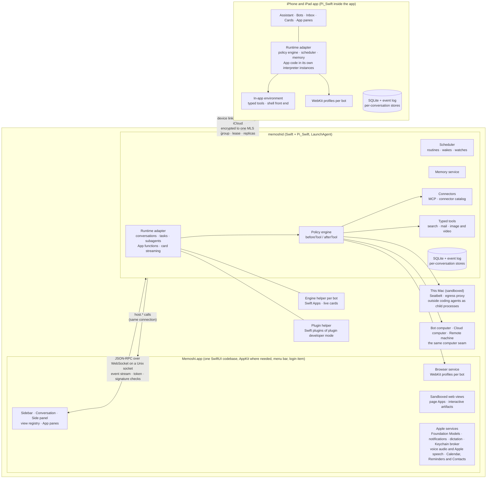

# Memoshi — Master Plan

**Status:** Draft 4 · 2026-10-20 · updated through [D96](decisions.md#d96) on 2026-10-27 and through [D133](decisions.md#d133) on 2026-11-13 · this repo is the single source of truth.
**Supersedes:** Draft 3 in `~/Documents/Memoshi-Plan` (commit `3570e71`). Its useful parts are folded into this plan; the decision mapping is in [`decisions.md`](decisions.md#mapping-from-draft-3). That repository continues as a separate prototype with its own agent, and it does not bind this plan ([D65](decisions.md#d65)).
**Product:** Memoshi (working name; trademark check pending, [D34](decisions.md#d34))
**Platforms:** Mac, iPhone and iPad ([D47](decisions.md#d47)): a native Mac app (SwiftUI + AppKit) on macOS 27+ on Apple silicon ([D31](decisions.md#d31)), and one universal iPhone and iPad app on iOS 27+ and iPadOS 27+ ([D56](decisions.md#d56)). v1 is for the user's own devices, with no App Store ([D67](decisions.md#d67)); the reference devices are the user's own iPhone 14 Pro and iPad Pro 12.9-inch (M1) ([D80](decisions.md#d80))
**Engine:** Pi_Swift, the native Swift port of Pi, always on the latest upstream ([D44](decisions.md#d44)). It runs in memoshid, a Swift LaunchAgent, on the Mac, and inside the app on iPhone and iPad; no Node ships ([D46](decisions.md#d46)). A gate at the Phase 0 review (Fri 2026-11-27) decides each OS: if the Mac misses it, memoshid goes back to upstream Pi in bundled Node; if iOS misses it, the v1 iPhone and iPad app is a remote screen for bots on the Mac.
**Code Mode:** the same pinned upstream `quickjs.wasm`, translated with `wasm2c` for shipping; WasmKit is the reference and compatibility fallback, not JavaScriptCore. Parity, safety and Release iPhone measurements gate the default ([D89](decisions.md#d89)).

Conventions used in every plan doc: `[INFERENCE]` marks our reasoning rather than a sourced fact; `Dn` links to [`decisions.md`](decisions.md); research evidence lives under [`../research/`](../research/).

**Proposed next version:** [NEXT_VERSION.md](NEXT_VERSION.md) combines the [requested-source refresh](../research/2026-10-20-comparison-report.md) with this baseline, especially native Apple resource views and device-aware execution. D44–D56 adopted its native Apple direction, the engine on every device, permissions and cards; D79 adopted live Apple-data resources and recovery rules; D86 adopted QuickAsk, visual views, Apple tools and shared rooms, staged by D87 and, where features moved, by [D117](decisions.md#d117). D92 adopted the Viticci-led assistant/Kuvo-informed workbench hierarchy, which [D106](decisions.md#d106) supersedes as the lead; D93 removes mandatory design contracting, not design QA. The rest remains proposed. Its adoption map follows the current decisions, including [D88](decisions.md#d88)'s no-model waiting contract.

**This Mac qualification ([D96](decisions.md#d96)):** after the measured live-folder failures, the next native route uses independently admitted private working copies rather than direct live source roots. Original source grants/path classes remain authoritative; export is a separate immutable, policy/approval- and conflict-checked host file-data operation. The [bounded filesystem/policy proof](../HANDOFF.md#s4-private-working-copies) is not complete S4, a production tool enablement or a calendar/stage change.

**Updated 2026-11-13 for [D106–D122](decisions.md#d106):** Cognitio's design leads the shell on every device and is rebuilt in Memoshi's own code ([D106](decisions.md#d106), [D107](decisions.md#d107)). Bot-to-bot messages, Groups, Goals, outside coding agents, team mode, voice, search, the connector catalog, Bot computers, Cloud computers and Remote machines are now in v1.0 ([D108](decisions.md#d108)–[D113](decisions.md#d113)). The mini app is renamed **App** and gains panes, exported functions and wider scope, with page Apps and Swift Apps ([D114](decisions.md#d114), [D115](decisions.md#d115), [D119](decisions.md#d119)). Mail, Calendar and the other built-in panes join ([D116](decisions.md#d116)), with the policy classes of [D118](decisions.md#d118) and [D121](decisions.md#d121) and the default providers of [D120](decisions.md#d120). Milestones M1–M3 name the gates of an estimated calendar of 197 plan weeks to v1.0 ([D117](decisions.md#d117), [D122](decisions.md#d122)). Every section below was revised; [`AMENDMENT_2026-11-13.md`](AMENDMENT_2026-11-13.md) is the summary of record for what changed.

---

## 1. The product

> **Your Assistant and its team of bots, on your Mac, iPhone and iPad.**

Memoshi is a native app for Mac, iPhone and iPad where a personal **Assistant** runs a team of persistent **bots**. Each bot has a name, a face, a job, its own memory, its own **computer** and its own **browser**, and the same bots are on every device you pair ([D49](decisions.md#d49)). A bot's computer is a sandbox on your Mac, or a full computer of its own that you can watch: a local virtual machine or a cloud computer, chosen per bot ([D113](decisions.md#d113)). You message bots like contacts, or talk to them by voice ([D111](decisions.md#d111)). There are two ways of working, both first-class: talk to the Assistant and let it coordinate the team, or drive bots and coding sessions directly ([D109](decisions.md#d109)). Bots work in your **projects**, including writing and reviewing code. They read your mail and calendar, tidy your mailbox and prepare drafts for you to send ([D116](decisions.md#d116)). They build **Apps**, panes beside the chat that they change while you talk ([D114](decisions.md#d114)). They act on schedules, on triggers and on their own initiative, inside budgets you set, and they ask before anything risky. Everything runs on your devices by default, with your models and your keys.

The category is "always-on AI teammates": Grok Bot set the shape on 2026-08-11 and the big labs followed within seven weeks ([landscape §1](../research/agentic-workspace-landscape/README.md#1-executive-summary)). Memoshi competes on what none of them combine ([white space](../research/agentic-workspace-landscape/README.md#6-white-space-memoshi-can-own)):

1. **One assistant that runs a team, and a team you can drive yourself.** The Assistant coordinates through visible Handoffs, and every bot and session can also be driven directly ([D109](decisions.md#d109)). A coordinating assistant is no longer white space on its own. Memoshi's claim is its combination with the points below: local-first with your own models, per-bot isolation, governed memory, budgets, a real coding workbench, native Apple data and Apps that bots build under policy ([merge assessment §1](../research/2026-11-12-memoshi-cognitio-bot-hq-merge.md#1-conclusion)).
2. **Isolation by default, cheaply.** Grok Bot runs all of a user's bots on one shared computer, and its docs say per-bot screens are not security boundaries ([profile](../research/agentic-workspace-landscape/projects/grok-bot.md)). Memoshi gives every bot its own sandboxed computer and browser on every device: This Mac (sandboxed) on the Mac, the in-app environment on iPhone and iPad. From Phase 2 a bot may instead have a full computer of its own, a Bot computer (a local VM) or a Cloud computer, and a shared computer is only ever the user's explicit choice ([D113](decisions.md#d113)).
3. **Governed memory.** The user can see, edit and scope everything every bot remembers, with provenance.
4. **Cost you see before you spend it.** Budgets with hard stops, cost previews, and model-free watches as the default way to "keep an eye on X".
5. **Native, local, yours.** Real Mac, iPhone and iPad apps, not web wrappers. The engine runs on your devices with your models and keys. A provider's cloud is used only where you opt in, per bot and on your own key: a Cloud computer, or a cloud voice call ([D111](decisions.md#d111), [D113](decisions.md#d113)). Devices link directly, through Memoshi's self-hostable relay or through your own iCloud, always end-to-end encrypted ([D48](decisions.md#d48)).
6. **A real workbench.** Bots can code in your projects, and you review the result like a pull request. Outside coding agents work behind the same policy, and an optional team mode lands a change only after the project's checks pass ([D110](decisions.md#d110)).

## 2. What we combine, and from where

| Source | What we take | License consequence |
|---|---|---|
| Cognitio (`~/Projects/Cognitio`, the user's Kuvo-derived Mac app; [merge assessment](../research/2026-11-12-memoshi-cognitio-bot-hq-merge.md)) | Lead design reference for the shell on Mac, iPad and iPhone: card window, sidebar, transcript, composer, bot identity and editor, side panel, workbench and settings ([D106](decisions.md#d106)). Also the behaviour reference and the oracle for capability ports: its tests and vectors describe behaviour that Memoshi re-implements in Swift on Pi_Swift ([D107](decisions.md#d107)) | Kuvo-derived under PolyForm Noncommercial 1.0.0: **rebuilt in Memoshi's own code**; no Kuvo- or Cognitio-derived source file, asset or string enters this repository ([D106](decisions.md#d106)) |
| [Viticci's Apple-native assistants](../research/2026-10-23-design-direction-review.md) | Interaction grammar for native Apple-data cards, Apps and phone navigation ([D106](decisions.md#d106)). It led the whole assistant family under [D92](decisions.md#d92); that preview is frozen at git tag `design-preview-2026-11-13` | Interaction principles only; no copied artwork, private content or proprietary product wording |
| [Kuvo Code](../research/agentic-workspace-landscape/projects/kuvo-code.md) | Publicly documented behaviour: model-free watches, wakes, avatar state vocabulary and sign-in cards. Its workbench depth (projects, files, terminal, diffs and review) now reaches Memoshi through Cognitio's design | PolyForm Noncommercial: **no code in the interface**. [D106](decisions.md#d106) leaves unused the personal/noncommercial reuse that [D91](decisions.md#d91) permits |
| [Aiden Agent](../research/agentic-workspace-landscape/projects/aiden-agent.md) | The motion system and its restraint rules (later design passes); Pi embedding patterns; persona kept in the app record; bounded memory; bots propose routines; `[SILENT]` quiet runs; explicit Resume after a crash | MIT: **reuse with attribution** |
| [Grok Bot](../research/agentic-workspace-landscape/projects/grok-bot.md) | Bot roster UX (its look in a later design pass), group chats with handoffs, typed in-chat cards, teach-by-demonstration, bot identities (email, Slack), Team Bots (later) | Proprietary: **ideas only**; never its assets |
| [Pi](../research/agentic-workspace-landscape/landscape/agent-harnesses.md#pi) | The engine, through Pi_Swift, its native Swift port on the latest upstream ([D44](decisions.md#d44)): durable conversations, tasks, subagents, Code Mode, MCP, execution environments, model layer | MIT: **dependency** |
| Pi's p2 (`earendil-works/pi`, `apps/p2`) and Ultimate (`HazAT/ultimate`) ([merge assessment §12](../research/2026-11-12-memoshi-cognitio-bot-hq-merge.md#12-malleable-software-pis-p2-ultimate-mail-and-calendar)) | Apps that bots build and change inside the app: a pane beside the chat, functions an App exports to its bot, view tools and selection carry ([D114](decisions.md#d114)). From Ultimate: team mode with parallel reviewers and a code-only landing gate ([D110](decisions.md#d110)), question cards with a recommended pick, and the smaller items adopted with [D117](decisions.md#d117). Their unsandboxed plugin code with no approval step is taken only as the opt-in plugin developer mode on the user's own Mac | **Ideas only; no code** |
| bot-hq (`nickvasilescu/bot-hq`) ([merge assessment §1](../research/2026-11-12-memoshi-cognitio-bot-hq-merge.md#1-conclusion)) | Voice that hands work to the bot's queue ([D111](decisions.md#d111)); search and a connector catalog with connect cards ([D112](decisions.md#d112)); a global Tasks view; a live caption of what the bot is thinking | **Ideas only; no code**; never its bot artwork |
| [Noodle](../research/agentic-workspace-landscape/projects/noodle.md) | Native per-bot sandbox, VM and browser apps; a messenger tool as the only author of user-visible messages; typed wake events; starter team | Apache-2.0: **reuse** |
| [Rakazo](../research/agentic-workspace-landscape/projects/rakazo.md) | Computer seam (lifecycle / exec / files / desktop); portable workspace as the durable unit; approval by tool verb; tools restricted by trigger origin; self-edits as proposals | Apache-2.0: **reuse** |
| [Lorca](../research/agentic-workspace-landscape/projects/lorca.md) | Group protocol (silent PASS, round and hop caps); handoff contracts; relay-blind pairing; model-free pre-checks; auto-pause | GPL-3.0: **ideas only** |
| [Gondolin](../research/agentic-workspace-landscape/landscape/execution-environments.md) | Host-side egress allowlists; secrets the sandbox sees only as placeholders | Apache-2.0: **reuse** |
| Big labs ([Muse](../research/agentic-workspace-landscape/projects/meta-muse.md), [Dots](../research/agentic-workspace-landscape/projects/openai-dots.md), [Cowork](../research/agentic-workspace-landscape/projects/claude-cowork.md)) | Safety enforced outside the agent; stand-in tokens; egress through a host proxy | Ideas |
| Ours: [boop](../research/agentic-workspace-landscape/landscape/in-house-assets.md), [Apollo](../research/agentic-workspace-landscape/landscape/in-house-assets.md#apollo), the [2026-10-17 blueprint](../research/prior/apollo-zeron-unpeel-2026-10-17.md), the [Draft 3 build](../research/agentic-workspace-landscape/landscape/in-house-assets.md#draft-3-build) | Dispatcher-style assistant, memory consolidation (proposer, adversary and judge), draft-before-send, Apple integrations, "memory is evidence, not authority" (the blueprint's rule, which Apollo implements as evidence rows and abstaining recall), policy/approval and event-store patterns | MIT (boop template) and own code: reuse where it fits |

## 3. Principles

1. **The Assistant is the front door; bots are the team; projects are the work.** Two ways of working are both first-class: talk to the Assistant, which coordinates the team, or drive bots and sessions directly ([D109](decisions.md#d109)).
2. **Every bot is a someone:** identity, job, memory, computer, browser.
3. **Isolation by default.** No bot runs outside a sandbox by default. Bots share a computer only when the user explicitly chooses it. A single App or plugin gets **Full access on this Mac** only inside plugin developer mode, by the user's own typed confirmation ([D114](decisions.md#d114)).
4. **Safety lives outside the model.** One policy engine decides, on whichever device runs the bot ([D49](decisions.md#d49)); the UI renders; deterministic rules come before any model-based review.
5. **Show the work.** Every tool call, script, diff, approval, cost and memory write is inspectable and audited.
6. **Durable by default.** Close the window and work continues. After a crash, replay-safe work resumes on its own. Anything that could repeat a side effect is checked first and, if the check cannot tell, waits for a Resume card ([D42](decisions.md#d42), [D51](decisions.md#d51)). A side effect never silently runs twice.
7. **Proactive, not noisy.** Bots act on schedules and triggers within budgets, and stay quiet when there is nothing new.
8. **Native first.** One SwiftUI codebase for the three devices, with AppKit or UIKit only where a surface needs it ([D106](decisions.md#d106)), and Liquid Glass for chrome only. Cards are drawn natively, generated ones included ([D53](decisions.md#d53)). Web views are used only for content inside a pane, a card or a window, never for the app's own chrome: previews, artifacts, inline widgets, browsing, page Apps and the screens that connectors provide ([D114](decisions.md#d114), [D115](decisions.md#d115)).
9. **Motion with meaning.** Animate state, causality and progress, never decoration. Reduce Motion is always respected.
10. **Local-first, your models.** Your devices, your keys, your files. Our relay and your iCloud carry only end-to-end-encrypted data, and either can be turned off ([D48](decisions.md#d48)). Cloud computers and cloud voice are opt-in per bot, on your own provider key: a Cloud computer shows its cost before it starts, and the interface says when audio leaves the device ([D111](decisions.md#d111), [D113](decisions.md#d113)).
11. **Progressive disclosure.** Guided defaults and Developer depth over the same objects.
12. **Every feature earns its surface.** No new sidebar section unless it is a first-class object.

## 4. Who it is for

**First user ([D3](decisions.md#d3)):** builders on a Mac, meaning developers, technical founders and technical operators. They run both work and life through agents: they bring API keys or local models, grant folders deliberately, and want both a team and a workbench.

| Job to be done | Who does it in Memoshi |
|---|---|
| "Brief me every morning on what changed and what needs me." | Assistant, with a routine and the Inbox |
| "Keep my repo green; triage new issues; tell me when CI breaks." | A bot attached to a project, with a watch on CI |
| "Build this feature in project X and show me the diff." | Assistant or a coding bot, in a project session |
| "Research this topic weekly and keep a running brief." | A research bot with a browser and memory |
| "Draft replies to my email; never send without me." | A bot with the `mail.*` tools and the Mail pane; sending stays a Draft ([D116](decisions.md#d116)) |
| "Watch this page, price or status and tell me when it changes." | A model-free watch that wakes a bot only on change |
| "Do this multi-step web chore for me." | A bot with its own browser; from the end of Phase 2, in its own Bot computer or Cloud computer while you watch ([D113](decisions.md#d113)) |

**Design rule:** depth is opt-in, safety is the default. New users start in **Guided** mode (plain-language summaries), and every new bot starts in **Ask first**, which asks before writes and commands ([D52](decisions.md#d52)). **Developer** mode is opt-in. Both use the same objects and surfaces ([D3](decisions.md#d3)). Guided and Developer are levels of detail in the interface. Neither is [D114](decisions.md#d114)'s **plugin developer mode**, the separate Mac-only setting defined in [§5](#5-vocabulary-and-object-model).

**Non-goals for v1:** Windows, Linux and the web as app platforms; non-technical consumer onboarding as a target market (the bot UX still never requires code); enterprise compliance (SSO, SCIM, DLP); teams and shared bots; the App Store on any device (v1 is for the user's own devices, and a public release is O13, [D67](decisions.md#d67)); a model lab; a no-code app builder; reselling model tokens.

## 5. Vocabulary and object model

These names are binding across all docs and the UI ([D4](decisions.md#d4), amended by [D119](decisions.md#d119)). The UI says **Bot**, not "agent". Field-level detail lives in [`../specs/object-model.md`](../specs/object-model.md).

| Object | Definition |
|---|---|
| **Assistant** | The user's personal assistant: a special, pinned bot that owns the user profile memory, is the front door, delegates to bots, triages the Inbox, and can propose new bots. It orchestrates lightly: it does small things itself and hands anything long-running or code-running to a bot or a session's lead through a Handoff ([D109](decisions.md#d109)). Exactly one per user. The user picks its display name. ([D20](decisions.md#d20)) |
| **Bot** | A persistent teammate: name, avatar, job, persona, model, computer, browser, grants, memory, routines. ([D21](decisions.md#d21)) |
| **Chat** | A bot's one continuous direct conversation with the user (its home thread). Every bot has exactly one. |
| **Project** | A folder or repo the user grants: files, git, project memory (`AGENTS.md`), skills, trust level. |
| **Session** | A working thread led by one bot (or the Assistant). It belongs to a project, or to no project; project-less sessions are listed in the sidebar's **Sessions** section. Coding happens in sessions. |
| **Group** | A room with 2–6 bots plus the user, one lead bot and a shared goal ([D24](decisions.md#d24)). Groups arrive in Phase 2 ([D109](decisions.md#d109)); shared rooms with other people stay in v1.1. |
| **Task** | A durable unit of work inside a Chat, Session or Group (a Pi Durable task). It can own child tasks and subagents, and carries usage and an outcome. |
| **Handoff** | A delegation record from one party to another: goal, context references, expected output, acceptance criteria, deadline, status and evidence ([D24](decisions.md#d24)). |
| **Goal** | An outcome with criteria that a bot works toward hands-off, inside its budgets and the normal policy, keeping a log of each decision it took. Its runs take the unattended regime. Goals arrive in Phase 2 (GR-13; [D109](decisions.md#d109), [D121](decisions.md#d121)). |
| **Routine** | Work that runs on a **trigger**: schedule, interval, one-time, webhook or connector event. It belongs to a bot and has a budget ([D23](decisions.md#d23)). |
| **Watch** | A model-free check (command, HTTP, file or feed) that wakes its bot only when the result changes and stays changed. |
| **Wake** | A one-time or repeating wake-up a bot schedules for itself. |
| **Computer** | Where a bot's tools run: **This Mac (sandboxed)** on the Mac, or the in-app environment on iPhone and iPad ([D16](decisions.md#d16), [D50](decisions.md#d50)). The user may choose another computer per bot ([D113](decisions.md#d113)): a **Bot computer** (a Linux VM per bot, end of Phase 2) or a **Cloud computer** (a provider sandbox behind the same seam, Phase 2, after Bot computers). A **Remote machine** (SSH) arrives in Phase 3. A bot keeps its home and browser profile when it moves. |
| **Browser** | A bot's persistent browser profile. The engine is WebKit on every device; Chromium inside a Bot computer arrives with Bot computers at the end of Phase 2 ([D18](decisions.md#d18), [D113](decisions.md#d113)). |
| **Memory** | Entries in a scope (**user**, **bot**, **team**, **project**), each with provenance, author, validity window and visibility ([D22](decisions.md#d22)). |
| **Connector** | An MCP server or app connection plus the accounts behind it, granted per bot. Connectors are added by hand or, from Phase 1, from the built-in catalog's connect cards ([D112](decisions.md#d112)). |
| **Skill** | A `SKILL.md` package of instructions, scripts and resources, scoped to a bot, a project or global. |
| **Card** | An interactive element inside a conversation. There are 21 kinds today: approval, draft, question, form, secure form, sign-in, purchase, handoff, routine proposal, memory proposal, bot proposal, grant request, budget warning, budget stop, run summary, error, takeover request, resume, Apple data, generated, and setup checklist (`setup_checklist`, what an imported bot still needs, [D82](decisions.md#d82)) ([object model §4.18](../specs/object-model.md#418-card-crd_)). A 22nd, `voice_call` [INFERENCE: set in Phase 2], is the card a finished voice call leaves ([D111](decisions.md#d111), [cards.md §8.3](../specs/cards.md#83-the-call-card)). A connect card is a sign-in card ([D112](decisions.md#d112)). Generated cards are drawn natively from a catalog of SwiftUI blocks: either as JSON, aligned with the open A2UI standard and streamed as the model writes (Phase 1, [D115](decisions.md#d115)), or as live cards written in Swift that Memoshi's Swift engine runs. Every other kind is a native card built by hand ([D53](decisions.md#d53), [D68](decisions.md#d68)). |
| **App** | A program inside Memoshi with its own screen, saved data and functions ([D114](decisions.md#d114), [D119](decisions.md#d119)). Written with a capital A; "the app" in lower case still means Memoshi itself. **Built-in Apps** are Memoshi's own: Mail, Calendar, Reminders merged with Tasks, Contacts, Notes (Markdown files) and Files with the Library ([D116](decisions.md#d116)). **Bot-built Apps** are written by a bot, with versions, saved data and an "Ask the bot to change it" box. Both follow one contract, so bots can drive and extend the built-in ones too. <br/>**Kinds:** a **page App** is a sandboxed web page (Phase 1); a **Swift App** is SwiftUI-style Swift that Memoshi's Swift engine runs (the Mac in Phase 2, iPhone and iPad in Phase 3, [D68](decisions.md#d68)), and one can replace a page App and keep its data. <br/>**Panes:** an App opens as a pane beside the chat (a side-panel tab on Mac and iPad, full screen on iPhone, or inline), or as a sheet, a window or full screen ([D85](decisions.md#d85)). <br/>**Functions:** an App exports functions to the bot as a Code Mode namespace; the bot opens and arranges panes with the `view.*` tools; and the user's selection in a pane travels with the next message, once, behind a removable chip. <br/>**Scope:** the bot that made it, or all the user's bots by grant; a project-scoped App lives in the project folder behind a trust prompt (Phase 2). <br/>**Places an App may add to:** a side-panel tab, a row under Apps, a ⌘K command, the look of its own function calls in the transcript, a widget and an App Intent. Never approval, draft, sign-in or purchase cards, permission sheets, the composer or the title bar. <br/>**Rules:** bot-written code is sandboxed, has a permission list per version that the user approves, and reaches data only through Memoshi's tools, which pass policy ([D72](decisions.md#d72), [object model](../specs/object-model.md)). Identifiers keep their earlier names: the `mini_app` tool, `miniApps.*`, `mini_app.*` events and the `app_` prefix. |
| **Approval** | A pending decision on a tool call, tied to a task and a policy rule. Never implicit; it expires to denied. |
| **Draft** | A staged external action (email, message, post, calendar change, push) waiting for the user. |
| **Artifact** | Durable output: a document, page, small app, chart, file set or diff bundle. |
| **Inbox** | The single "needs you" queue: approvals, drafts, questions, proposals, finished-with-news, failures. |
| **Budget** | Token and money limits per bot, routine or Handoff, and per group with Groups in Phase 2, with a warning at 80% and a hard stop at 100% ([D25](decisions.md#d25), [D109](decisions.md#d109)). Image and video generation is budgeted like a model call, and a Cloud computer's charges count against its bot's budget ([D121](decisions.md#d121)). |
| **Grant** | A capability given to a bot: folders, connectors and accounts (a mail account included), computer level (a Bot computer or Cloud computer included), browser sites, spend, messaging other bots, and a cloud voice session. An App is opened to all the user's bots by grant ([D114](decisions.md#d114), [D121](decisions.md#d121)). |
| **Permission mode** | How much a bot may do without asking, set per bot and the same on every device: **Ask first** (every new bot starts here), **Auto** or **Bypass** ([D52](decisions.md#d52), [§10](#10-safety-at-a-glance)). |
| **Team mode** | An optional way of coding in a project, beside direct sessions ([D110](decisions.md#d110)): a lead bot per piece of work in its own worktree; helper tasks that build; several reviewers, each with a different lens, merged into one verdict; and a landing gate that is a program, not a model. The gate merges, runs the project's checks, reruns a failing check once, and only then fast-forwards. Phase 2 (CODE-18 to CODE-20). |
| **Plugin developer mode** | A Mac-only setting, off by default, in which a bot may write compiled Swift plugins ([D114](decisions.md#d114)). A plugin runs in a separate helper process, never in memoshid or the app. Inside plugin developer mode the user may switch a single App or plugin to **Full access on this Mac** after a typed confirmation that names the risks; it carries a badge wherever it appears. Neither exists on iPhone or iPad. Phase 2 (CH-44). It is not the Guided or Developer level of detail of [§4](#4-who-it-is-for), and Full access on this Mac is not a permission mode. |

### Relationships

```
User 1 ── 1 Assistant (a Bot with special powers)
Bot 1 ── 1 Chat                      Bot 1 ──< Routine ──< Run (Task)
Bot 1 ── 1 Computer per device       Bot 1 ──< Watch / Wake
Bot 1 ── 1 Browser per device        Bot 1 ──< Memory (bot scope)
Project 1 ──< Session >── 1 lead Bot
Group 1 ──< member Bots (2–6), 1 lead
Chat | Session | Group 1 ──< Task ──< Task (child) / subagent
Task 1 ──< Approval, Draft, Artifact
Handoff: from (Assistant | Bot | User) → to (Bot), owns 1 Task
Goal >── 1 Bot (the bot that works toward it)
App: built-in (Memoshi's own) | bot-built (made by 1 Bot; used by that bot, or by all the user's bots by grant; or kept in 1 Project)
App kinds: page App · Swift App
Memory scopes: user (Assistant-owned) · bot · team · project
```

### Rules

1. **Every bot has exactly one Chat, and one default Computer and one Browser profile on each device** ([D47](decisions.md#d47)). On the Mac the default is the computer the user chose for the bot: This Mac (sandboxed), a Bot computer or a Cloud computer ([D113](decisions.md#d113)). A Session may override the computer, for example to work in a project folder on This Mac.
2. **Routine runs are Tasks.** A run with news posts one summary line in the bot's Chat. A quiet run (`no_update`) leaves no Chat line; it appears only in the routine's run history. A run opens a Session only when the work is project work. Routines never create clutter.
3. **Conversations are Pi Durable conversations.** Tasks are Pi Durable tasks; subagents are child conversations; a Computer is a Pi `env`. Bot identity, instructions and memory are rendered into every request, never frozen when a conversation is created ([D7](decisions.md#d7)).
4. **Delegation is always a Handoff.** A bot never silently does another bot's work, and every Handoff is visible. A bot messages another bot only under the messaging grant, the cap of 8 hops per thread and budgets ([D109](decisions.md#d109)).
5. **Approvals, drafts and proposals always surface as Cards in the conversation and in the Inbox.**
6. **Everything that matters writes an event in the same transaction** ([`../specs/events.md`](../specs/events.md)).
7. **An App never draws a decision.** Approval, draft, sign-in and purchase cards, permission sheets, the composer and the title bar are Memoshi's own, and every call an App's code makes passes policy ([D114](decisions.md#d114)).

## 6. Experience at a glance

Full detail: [`02-experience.md`](02-experience.md) (structure and flows) and [`03-design-system.md`](03-design-system.md) (look and motion).

- **Design lead** ([D106](decisions.md#d106)): Cognitio's design leads the shell on Mac, iPad and iPhone: card window, sidebar, transcript, composer, bot identity and editor, side panel, workbench and settings. It is rebuilt in Memoshi's own code as one SwiftUI codebase for the three devices. Viticci's grammar stays for native Apple-data cards, Apps and phone navigation.
- **Working window (Mac):** the card window, **Sidebar | Conversation | Side panel**, with tabs and split view. The side panel is tabbed.
- **iPhone and iPad:** one universal app with the same bots, Cards and Inbox; iPad layouts use a sidebar and split view ([D47](decisions.md#d47)). An App's pane is a side-panel tab on iPad and full screen on iPhone ([D114](decisions.md#d114)).
- **Sidebar, top to bottom:**
  - **Inbox** (badge);
  - **Assistant** (pinned);
  - **Bots** (the working list; the pinned avatar grid and user-made sections come in a later design pass);
  - **Groups** (Phase 2, [D109](decisions.md#d109));
  - **Projects**, each expanding to its sessions (Phase 2, with the workbench);
  - **Sessions** (sessions without a project);
  - **Apps** (the built-in Apps and the Apps that bots build): Memoshi's own section ([D81](decisions.md#d81), [D119](decisions.md#d119)).

  Footer: computers, devices, usage, settings.
- **Conversation:** the spine, built from streaming messages, tool calls that fold open under one steps line, a live caption of what the bot is thinking, task chips, Code Mode cards, and Cards, which stream as the model writes them ([D115](decisions.md#d115)). An App draws the look of its own function calls. The composer carries bot or model and effort, the bot's permission mode (Ask first / Auto / Bypass, [D52](decisions.md#d52)), attachments, `@` files, queue, steer and stop, a side question and dictation; `/` commands follow in Phase 2 (CH-18). A selection made in a side-panel pane travels with the next message, once, behind a removable chip ([D114](decisions.md#d114)). Coding sessions also offer `/plan` and `/review`.
- **Side panel:** tabs of four kinds ([D106](decisions.md#d106), [D114](decisions.md#d114), [D116](decisions.md#d116)):
  - **Inspector tabs, by context.** Bot: Profile · Memory · Routines · Computer · Browser · Files · Library. Project session: Changes · Files · Terminal · Browser/Preview · Tasks · Artifacts. Group (Phase 2): Members · Plan & handoffs · Files.
  - **App panes:** any App, opened by the user or by a bot through the `view.*` tools, with the layout kept per device.
  - **The six built-in panes:** Mail, Calendar, Reminders merged with Tasks, Contacts, Notes (Markdown files) and Files with the Library; the Mac in Phase 1, iPhone and iPad in Phase 3.
  - **Live views** of a bot's browser or computer.
- **Live view and takeover:** watch any bot's browser or computer and take control from the side panel or a detached window ([D19](decisions.md#d19)). Bot computers and Cloud computers join at the end of Phase 2, with GUI computer use; watching and taking over from iPhone and iPad arrives in Phase 3 ([D113](decisions.md#d113)).
- **Voice** ([D111](decisions.md#d111)): a voice call with a bot only listens and speaks. Work goes to the bot's normal queue as your message, and the result is spoken back. One call runs at a time, and a finished call leaves a card with its length and transcript. There are two engines, chosen per bot or per call: a cloud realtime voice, where audio leaves the device and the interface says so, and an on-device engine that works offline. With it come reading a reply aloud, voice memos from bots, a voice bot that opens views and reads an answer back before it commits it, and a spoken narrator for background events, off until you turn it on. The Mac gets voice in Phase 2 (V2-09, VO-01 to VO-04); iPhone and iPad in Phase 3, with the Action Button, a Live Activity for the call and a Start Voice Chat App Intent (VO-05, VO-06).
- **Everywhere:** command palette (⌘K) and menu bar extra (running bots, Inbox, usage) on the Mac, and actionable notifications (approve, deny, reply) on every device.
- **Onboarding:** name your Assistant, connect a model, grant a first folder, then meet a starter team (templates). A new bot's first message asks what its job is.
- **Look and motion** ([D29](decisions.md#d29), [D106](decisions.md#d106)):
  - **Design lead:** Cognitio's look and behaviour, rebuilt. Each surface gets a written behaviour description before it is built, because the source may not be copied: no Kuvo- or Cognitio-derived source file, asset or string enters this repository. The new shell starts from Cognitio's layout and reuses Memoshi's own tokens and avatar set where they fit. This supersedes [D92](decisions.md#d92)'s hierarchy as the lead. Scenario-based design review still replaces blanket 100/100 competitor parity, and the accessibility and performance gates remain ([D92](decisions.md#d92), [D93](decisions.md#d93)). [`../specs/design-reference.md`](../specs/design-reference.md) holds the reference assessment.
  - **Earlier preview** ([D94](decisions.md#d94)): the Viticci-style Mac and iPhone preview is frozen at git tag `design-preview-2026-11-13`. It is no longer the lead reference.
  - **Later design passes,** once the system is stable (the first alongside Phase 5 by default):
    - Aiden-derived motion: streaming reveal, thinking shimmer, live activity ticker, card entrances, dictation pill;
    - a Grok-style roster with livelier bot avatars of our own;
    - optional Metal shader effects, and generated motion and shader effects ([D115](decisions.md#d115));
    - native 3D and Gaussian-splat views ([D115](decisions.md#d115)).
  - Avatar states inspired by Kuvo: working, needs you, has news, asleep until its next wake, watching, idle, paused, error. Each state also has a non-motion cue.
  - Our own avatar set (shapes × colors) inspired by Grok's sheet.
  - Every motion has a Reduce Motion form and a performance budget.

## 7. Architecture at a glance

Full detail: [`04-architecture.md`](04-architecture.md), [`../specs/protocol.md`](../specs/protocol.md).



Key choices:

1. **Two processes on the Mac, one app on iPhone and iPad.**
   - **Memoshi.app** is the UI, one SwiftUI codebase shared with the iPhone and iPad app ([D106](decisions.md#d106)), and the host for native capabilities: WebKit browsers, the sandboxed web views of page Apps, Foundation Models, notifications, dictation, voice audio and Apple speech, the Calendar, Reminders and Contacts calls, and the Keychain broker. It keeps running in the menu bar when windows close.
   - **memoshid** is the brain on the Mac: a signed Swift program running Pi_Swift, packaged as an app-shaped helper with its own provisioning profile so it can use iCloud and push itself, and registered as a LaunchAgent. It survives app restarts, crashes and updates ([D46](decisions.md#d46), [D58](decisions.md#d58)).
   - **The iPhone and iPad app** runs Pi_Swift inside the app, with no daemon. A turn keeps running in the background in a `BGContinuedProcessingTask` that shows its progress, and committed turns resume at launch ([D46](decisions.md#d46)).
   - **Computers** are where tools run.
   - **Fallback:** native capabilities can move into a separate helper if crash isolation demands it, reviewed with the VM spike at the start of the Bot computer work in Phase 2 ([D12](decisions.md#d12), [D113](decisions.md#d113), [D122](decisions.md#d122), O3).
2. **Pi_Swift behind our adapter.** Only the runtime adapter imports Pi_Swift types. Memoshi follows the latest Pi_Swift, which follows upstream Pi's `main`. Every engine update passes the contract tests, and one that migrates stored data backs up the store first ([D44](decisions.md#d44)).
3. **One policy engine** hooks the engine's `beforeTool`/`afterTool`. Those hooks also see nested Code Mode and MCP-bridge calls, so scripts cannot bypass policy ([D9](decisions.md#d9)). They see every call that an App's exported function makes for a bot, and outside coding agents' calls come back through policy by each agent's own permission protocol ([D11](decisions.md#d11), [D121](decisions.md#d121)). Policy decides on the runner of the conversation that makes the call, and a device that runs a tool for another device re-checks its own grants ([D49](decisions.md#d49), [D74](decisions.md#d74)).
4. **Bots on every device.** Every bot, the Assistant included, is on every paired device with one history ([D49](decisions.md#d49)):
   - one device at a time per conversation, its **runner**, writes the conversation's store under a lease with a fencing epoch, and a write with an older epoch is rejected, so one bot can be active on two devices at once ([D74](decisions.md#d74));
   - the other devices keep live **replicas** and forward the user's messages to the runner, which keeps its conversation while it is awake and reachable; the lease moves only when the runner cannot be reached ([D73](decisions.md#d73)), or back to the bot's home Mac when the conversation is idle ([D74](decisions.md#d74), [D83](decisions.md#d83));
   - a device unable to reach the runner may answer in a **side thread** only with an available allowed model; a fully disconnected answer requires an on-device model. Otherwise it retains a cancelable, restart-safe **Waiting for connection** message outside canonical history, with its original `requestId`, for normal idempotent forwarding to the confirmed runner on reconnect. Queueing runs no model or tool and takes no lease. The phone's open model, MOD-09, stays in Drop 2 ([D88](decisions.md#d88)).
5. **Typed tools with a shell front end.** Every capability is a typed tool that declares its effects, risk tier, where it can run, whether it is replay-safe and how to check its outcome. Tools run where they live. On iPhone and iPad the bot also gets an emulated shell whose command lines are parsed into typed calls before policy judges them; on the Mac the same app commands work in the real sandboxed shell ([D50](decisions.md#d50)).
6. **Computers are Pi `env`s.**
   - **This Mac (sandboxed):** a per-bot pi-env daemon in a Seatbelt sandbox with an egress proxy, so file tools, exec and the terminal are all sandboxed. Anthropic's `sandbox-runtime` is a Node library, so spike S4 decides between a Swift port and our own profile and proxy ([D16](decisions.md#d16), [D46](decisions.md#d46)). If S4 fails, a fixed order follows: S4's other design, then a separate unprivileged macOS user account for bots with Seatbelt, and a Linux VM only for work that runs on Linux ([D77](decisions.md#d77)).
   - **In-app environment:** on iPhone and iPad, the bot's folder in the app's container plus folders the user links ([D50](decisions.md#d50)).
   - **Emulated Linux (iSH):** on iPhone and iPad, an optional Alpine Linux computer next to the in-app environment, where Memoshi's app commands are real programs. iSH lives in its own GPL-3.0 module that only the iPhone and iPad app links ([D69](decisions.md#d69)).
   - **Bot computer** (end of Phase 2): a Linux VM per bot on Virtualization.framework, with a desktop and Chromium ([D17](decisions.md#d17), [D113](decisions.md#d113)). The VM spike at the start of that work decides O2, O3 and O4 ([D122](decisions.md#d122)).
   - **Cloud computer** (Phase 2, after Bot computers): a provider sandbox behind the same seam, E2B by default, with Orgo and Daytona selectable ([D113](decisions.md#d113), [D120](decisions.md#d120)). It is treated like a Bot computer only for a provider whose egress control Memoshi has verified; otherwise the Remote machine rules apply ([`policy.md` §3.7](../specs/policy.md#37-network)).
   - **Remote machine** (Phase 3): any SSH host, next to the always-on Mac host ([D113](decisions.md#d113)).
   - **One seam, four providers:** This Mac, Bot computer, Cloud computer and Remote machine. The user chooses per bot between This Mac (sandboxed), a Bot computer and a Cloud computer, and a bot keeps its home and browser profile when it moves.
7. **One tool API for browsers:** a WebKit profile per bot on every device; Chromium/CDP inside a Bot computer comes with Bot computers at the end of Phase 2 ([D18](decisions.md#d18), [D113](decisions.md#d113)).
8. **Cards are native, and generated interface comes in three layers** ([D115](decisions.md#d115)). Apple data and decisions use hand-built SwiftUI cards. Apple-data cards become live views of their item in Drop 2: they re-read it before a write and show a conflict when it changed elsewhere ([D79](decisions.md#d79), [D87](decisions.md#d87)). Everything else can be generated:
   - **Layer 1, catalog cards** (Phase 1): JSON from a catalog of 26 SwiftUI blocks, aligned with the open A2UI standard and streamed as the model writes. The runtime emits partial card data, and the app validates it as it arrives and draws it natively ([D53](decisions.md#d53)).
   - **Layer 2, bot-written Swift** (the Mac in Phase 2, iPhone and iPad in Phase 3): live cards and Swift Apps in SwiftUI-style Swift, which Memoshi's own interpreter runs with no JIT and native components draw ([D68](decisions.md#d68)). On the Mac these programs run in a sandboxed engine helper per bot, with no secrets, files or network; on iPhone and iPad they run in the app, each in its own interpreter instance ([D78](decisions.md#d78)).
   - **Layer 3, a sandboxed web page** (Phase 1 for page Apps and interactive artifacts): page Apps, interactive artifacts and the screens that connectors provide (MCP Apps, Phase 2), with the same tool bridge and permission list ([D114](decisions.md#d114)).
   - Diagrams, charts and math are native: Pele_Swift for Mermaid, and Swift Charts.

   Bot-written code reaches data only through Memoshi's tools, under policy and inside the permission list the user approved. An App opens as a pane beside the chat, or as a sheet, window or full screen ([D85](decisions.md#d85), [D114](decisions.md#d114)).
9. **SQLite is the source of truth** (WAL) on each device: memoshid owns it on the Mac, the app on iPhone and iPad. Each conversation has its own durable store, and bot-wide records such as memory and settings merge; secrets live only in Keychain ([D14](decisions.md#d14), [D49](decisions.md#d49), [D74](decisions.md#d74)).
10. **Transport and device links:**
    - **Control (Mac):** app ↔ daemon speak JSON-RPC 2.0 in both directions over a WebSocket on a Unix domain socket (mode 0600), with a per-launch token, code-signature and team ID checks on both sides, and one multiplexed event stream with replay ([D13](decisions.md#d13), [D46](decisions.md#d46)). Swift types are the protocol's source of truth, with the JSON Schema generated from them, and the iPhone and iPad app calls its in-process engine through the same typed Swift API ([D78](decisions.md#d78)).
    - **Webhooks:** a separate loopback-only receiver accepts webhook triggers only.
    - **Devices:** pairing by a one-time QR code that adds the new device to the user's MLS group (RFC 9420), then three links, all encrypted to that group with forward secrecy, tried in this order: direct (Bonjour, or a tailnet or VPN address), Memoshi's relay (self-hostable, with a hosted instance) and the user's iCloud (CloudKit private database). The relay or iCloud alone is enough to catch up ([D48](decisions.md#d48), [D75](decisions.md#d75)).
11. **No Node.** No Node, native addon or JIT entitlement ships. If the Mac misses the Pi_Swift gate, memoshid goes back to upstream Pi in bundled Node ([D46](decisions.md#d46)). Outside coding agents are the user's own installed programs, run as child processes; an agent whose kit needs a JavaScript runtime stays out ([D110](decisions.md#d110)).
12. **Where the new parts run** ([amendment §6](AMENDMENT_2026-11-13.md#6-where-the-new-parts-run)):
    - **View registry and App panes:** the app. App code runs in the bot's engine helper on the Mac and inside the app on iPhone and iPad; page Apps run in a sandboxed web view. Their tool calls go to the conversation's runner.
    - **App functions:** the runtime. An App's functions are an extension installed and replaced in place, exposed to the bot as a Code Mode namespace ([D114](decisions.md#d114)).
    - **Voice:** audio and Apple speech in the app. The cloud session's key comes through the Keychain broker, and the voice session is a client of the conversation's queue ([D111](decisions.md#d111)).
    - **Search, mail, image and video:** typed tools in the runtime, through the egress gateway ([D112](decisions.md#d112), [D116](decisions.md#d116)). **Calendar, Reminders and Contacts:** host calls in the app, like the plan's other Apple tools.
    - **Outside coding agents:** child processes that the runtime starts inside the bot's sandbox, on the Mac only ([D110](decisions.md#d110)).
    - **Claude Code as a model:** the unmodified program that the user installed and signed in to, relayed on the Mac. Such a bot's runner is the Mac; from iPhone and iPad its messages forward there and wait while the Mac is unreachable ([D108](decisions.md#d108)).
    - **Plugins of plugin developer mode:** a separate helper process on the Mac, never memoshid and never the app ([D114](decisions.md#d114)).

## 8. Computers and browsers at a glance

Full detail: [`06-computers-and-browsers.md`](06-computers-and-browsers.md).

| Computer | What it is | Default for | Cost |
|---|---|---|---|
| **This Mac (sandboxed)** | Tools run on the Mac in a per-bot Seatbelt sandbox. Access is limited to the bot's home folder plus granted folders. Network goes through an allowlist proxy. Python 3 runs here with its own package environment per bot, and bots on iPhone and iPad reach it through cross-device tools (Phase 2, [D60](decisions.md#d60)). | Every bot on the Mac, until the user chooses another computer for it: the Assistant, chat and research bots, coding in projects, Python research and backtests | None |
| **In-app environment** (iPhone and iPad) | Tools run inside the app: the bot's folder in the app's container plus folders the user links, typed tools for the Apple frameworks, and an emulated shell generated from them. Python runs as a tool through Pyodide in a hidden web view, and long runs go to the Mac (Phase 3, [D60](decisions.md#d60)). The app cannot start processes ([D50](decisions.md#d50)). | Every bot on iPhone and iPad | None |
| **Emulated Linux (iSH)** (iPhone and iPad, Phase 3, [D69](decisions.md#d69)) | Alpine Linux in iSH (Open Minis's ARM64 version) inside the app: a package manager, a real shell, Python, Git, SSH and ffmpeg. Memoshi's app commands are real programs inside it, and every command passes policy. iSH is GPL-3.0, so it lives in its own module that only the iPhone and iPad app links | Optional, as an extra computer; the in-app environment and its shell front end stay the default | Every instruction is emulated, so it is slow and uses memory and battery; numeric Python stays on Pyodide or the Mac |
| **Bot computer** (end of Phase 2, [D113](decisions.md#d113)) | A Linux VM (Virtualization.framework) with a desktop: pi-env daemon, Chromium, toolchains. It has no NAT; all traffic goes through Memoshi's egress gateway. It sleeps when idle (saved state) and is watched or taken over in a native view. GUI computer use arrives with it. | Bots that browse in the background, run untrusted code, or need Linux or a desktop, by the user's choice per bot | About 4 GB RAM while awake; the number of awake VMs is capped by installed RAM (none by default on 8 GB Macs) [INFERENCE] |
| **Cloud computer** (Phase 2, after Bot computers, [D113](decisions.md#d113)) | Provider sandbox behind the same seam: E2B by default, with Orgo and Daytona selectable ([D120](decisions.md#d120)). It is treated like a Bot computer only for a provider whose egress control Memoshi has verified; otherwise the Remote machine rules apply ([`policy.md` §3.7](../specs/policy.md#37-network)). GUI computer use arrives with it. | Opt-in per bot. The cost estimate is always shown before it starts: on the approval card where the mode asks, otherwise as a notice that does not block. Its charges count against the bot's budget, and the budget gate applies in every mode ([D121](decisions.md#d121)) | About $4–14 per bot-month when paused while idle; about $120–175 kept awake 24/7 ([cost model](../research/agentic-workspace-landscape/landscape/execution-environments.md#3-cost-model-for-n-always-on-bots)) |
| **Remote machine** (Phase 3, [D113](decisions.md#d113)) | Any SSH host (Mac mini, server) via pi-env | Builds and long jobs on a stronger machine, next to the always-on Mac host, which arrives in the same phase. Jobs stop 30 s after the link drops unless detached | The user's hardware |

- **The user chooses per bot** ([D113](decisions.md#d113)): This Mac (sandboxed), a Bot computer or a Cloud computer. A bot keeps its home and browser profile when it moves. Isolation stays per bot ([D16](decisions.md#d16)); a shared computer is only ever the user's explicit choice.
- **Live view and takeover.** A bot's browser or computer can be watched and taken over on the Mac, and from iPhone and iPad in Phase 3 ([D19](decisions.md#d19), [D113](decisions.md#d113)).
- **Browsers.** Every bot has a persistent profile on each device, and both engines expose the same tool API:
  - **Every device:** a WebKit profile hosted by the app. It is visible and ready for takeover, and sign-in cards fill credentials straight into the page.
  - **Bot computer (end of Phase 2):** Chromium inside the VM, driven over CDP, which keeps running with the window closed.
- **Secrets.** Stored in Keychain and used by reference. By default they are injected host-side, through browser fill or egress-gateway placeholders. Exec-time environment injection happens only by opt-in. Secrets are scrubbed from outputs, and the model never sees them.

## 9. Bots, the Assistant, memory and proactivity at a glance

Full detail: [`05-bots-and-assistant.md`](05-bots-and-assistant.md), [`../specs/bot-definition.md`](../specs/bot-definition.md).

- **Creating a bot.** By conversation ("What's my job?") or from a template. The persona lives in the app record and cannot be edited by the bot itself; changes the bot proposes become cards. A bot can be exported and imported as `bot.md` ([D26](decisions.md#d26)).
- **Two ways of working, both first-class** ([D109](decisions.md#d109)): talk to the Assistant, which coordinates the team, or drive bots and sessions directly, as in a workbench.
- **What the Assistant can do** ([D20](decisions.md#d20), [D109](decisions.md#d109)):
  - do small things itself: answers, memory, to-dos and lookups;
  - hand anything long-running or code-running to a bot or a session's lead through a Handoff, and every Handoff is visible;
  - answer a bot's question itself when the user already gave the answer; otherwise the question card reaches the user with a recommended pick;
  - read the user profile, and write to it through proposals;
  - read every bot's status and the Inbox;
  - propose new bots, routines and grants;
  - write the daily brief.

  It cannot bypass policy and has no Bot computer by default.
- **Memory** ([D22](decisions.md#d22)):
  - scopes: user · bot · team · project;
  - a bot writes its own scope freely within a bounded budget;
  - writes to the user and team scopes are proposals;
  - writes are scanned for secrets and injection;
  - a nightly consolidation pass (proposer, adversary and judge, ported from boop) produces a reviewable diff;
  - a reflection pass turns failures and corrections into proposals (Phase 2, MEM-12, [D117](decisions.md#d117));
  - search is SQLite FTS5;
  - entries sync across devices one at a time, and a scope is never overwritten ([D49](decisions.md#d49)).

  Memory is evidence, not authority: before consequential actions, a bot re-checks the current source.
- **Proactivity** ([D23](decisions.md#d23)):
  - triggers: schedules (minimum 5 minutes), self-scheduled wakes, model-free watches and webhooks; from Phase 2 on the Mac, connector events (RT-14), an arriving email included, and a conversation's context passing a set fill level (RT-15) ([D112](decisions.md#d112), [D117](decisions.md#d117));
  - bots propose routines and users approve them;
  - a run with nothing new ends quietly through a `no_update` result;
  - missed-run and concurrency policies;
  - auto-pause after repeated failures or a week of user inactivity;
  - check-ins stay quiet when you just wrote, and every bot pauses when a provider reports a rate limit, with Play to resume (BU-09, [D117](decisions.md#d117));
  - routines, wakes and watches run on an awake Mac when one is available, and a routine that needs Mac tools waits for the Mac ([D49](decisions.md#d49));
  - runs started by a trigger can never change instructions, grants or the roster.
- **Bot-to-bot messages** (Phase 1, GR-06, [D109](decisions.md#d109)): a bot messages another bot only under the `bot_messaging` grant, the cap of 8 bot-to-bot hops per thread and budgets. A run that such a message starts has origin kind `bot`, and it never escalates without an attended user decision.
- **Groups** (Phase 2, [D24](decisions.md#d24), [D109](decisions.md#d109)):
  - 2–6 bots with a lead;
  - the lead plans and assigns; members work in their own tasks and report back;
  - silent PASS turns; at most 4 rounds per user message; at most 8 bot-to-bot hops per thread;
  - every delegation is a Handoff record;
  - shared rooms with other people stay in v1.1.
- **Goals** (Phase 2, GR-13, [D109](decisions.md#d109)): an outcome with criteria that a bot works toward hands-off, inside its budgets and the normal policy, keeping a log of each decision it took. A Goal's runs take the unattended regime ([D121](decisions.md#d121)).
- **Search, connectors and media** ([D112](decisions.md#d112), [D120](decisions.md#d120)):
  - `web_search` and `x_search` are typed tools from Phase 1 (CON-15, CON-16), and results carry their source links, shown as chips;
  - connectors come from a built-in catalog over MCP with one-tap connect cards (Phase 1, CON-14), with tokens in Keychain by reference; Composio is an optional extra, off by default, with a notice that it holds the user's tokens on its servers (Phase 2, CON-19);
  - image and video generation are tools from Phase 2 (CON-17, CON-18);
  - each capability is a setting with several built-in providers on the user's own key. The defaults are [D120](decisions.md#d120)'s, and each gets a short measured comparison before the phase that ships it.
- **Mail and personal information** ([D116](decisions.md#d116), [D118](decisions.md#d118)): typed `mail.*` tools over Gmail, Microsoft 365 and IMAP, several accounts at once (CON-08), and the Calendar, Reminders and Contacts tools through Apple's frameworks (AP-14). A bot prepares a draft and the user sends it; the user may let a trusted bot send mail by itself, which never applies to a run started by incoming mail or other outside content ([D57](decisions.md#d57)). All message content carries the untrusted label.
- **Budgets** ([D25](decisions.md#d25)):
  - per bot, routine and Handoff, and per group with Groups, in Phase 2 ([D109](decisions.md#d109)), with a warning at 80% and a hard stop at 100%;
  - image and video generation is budgeted like a model call, and a Cloud computer's charges count against its bot's budget ([D121](decisions.md#d121));
  - a cost preview before a routine is enabled, and before a Cloud computer starts ([D113](decisions.md#d113));
  - usage shown in the menu bar, with subscription plan meters; subscription usage shows as price unknown, never as free ([D108](decisions.md#d108)).

  A budget floor (a per-run cap for unattended runs and a monthly stop per bot) ships with routines in Phase 1.

## 10. Safety at a glance

Full detail: [`08-security-and-privacy.md`](08-security-and-privacy.md), [`../specs/policy.md`](../specs/policy.md).

| Tier | Examples | Ask first (default for new bots) | Auto | Bypass | Unattended runs in Ask first and Auto (routines, wakes, watches) |
|---|---|---|---|---|---|
| **T0 Read** | Read granted files, search memory, list, fetch allowlisted pages; call an App's function, open and arrange views, message another bot under the grant | Allow | Allow | Allow | Allow |
| **T1 Local write** | Edit files in the bot home or a granted project | Ask | Allow | Allow | Allow inside the bot home; ask for project files |
| **T2 Execute** | Shell or code in the bot's sandbox; GUI input inside a Bot computer or Cloud computer | Ask | Allow | Allow | Ask on This Mac unless granted; allow in a Bot computer, and in a Cloud computer whose provider's egress control Memoshi has verified (Phase 2) |
| **T3 Reach out** | Network beyond the allowlist, web and X search, reading private connector data or mail, preparing a mail draft, tidying a mailbox, generating images or video, a cloud voice session, starting a Cloud computer, using a credential by reference | Ask | Ask | Allow, logged; unknown tools still ask, and using a credential still shows a sign-in card ([D57](decisions.md#d57)) | Deny unless granted |
| **T4 Act externally** | Send, post, send mail, create events, push, file issues | Draft card | Draft card | Runs without a draft card, except in runs started by outside content ([D57](decisions.md#d57)); the draft is still recorded and audited | Draft card; never auto |
| **T5 Critical** | Money, revealing or granting credentials, permission or instruction changes, destructive operations outside the workspace, deleting mail or changing mail filters, building or loading a plugin in plugin developer mode | Ask with typed confirmation | Ask with typed confirmation | Money still asks; credentials show a sign-in card; changes to the bot's own permissions, grants, instructions or persona stay proposals; patches to files that run code outside the sandbox still ask; a plugin keeps its typed confirmation; anything else runs, logged | Deny |

**Modes** ([D52](decisions.md#d52)): each bot has one permission mode, the same on every device, and every new bot starts in **Ask first**, in Guided and Developer mode alike. **Bypass** is off by default: it is turned on per bot after a confirmation that names the risks, and a Bypass badge marks the bot wherever it appears. In every mode, the sandbox and granted folders, every denial (the untrusted regime's included), budgets, the audit log, Resume cards, the origin rule, approval expiry and standing rules stay the same. **Plan and Read-only are no longer modes:** Plan is a per-session coding option (`/plan`) that proposes without running anything above T0, and read-only is a property of a grant, such as a read-only folder. The full mode × tier × origin matrix is in [`../specs/policy.md`](../specs/policy.md).

**Unattended runs use the last column in Ask first and Auto alike** ([D27](decisions.md#d27), [D57](decisions.md#d57)), so a routine needs no mode of its own. A Bypass bot's routines skip the column's asks and send T4 drafts at once, and every denial stays. Runs started by webhooks, connector events or App Intents keep T4 draft cards in every mode, Bypass included ([`../specs/policy.md` §4.3–§4.4](../specs/policy.md#43-unattended-originrootkind--routine-wake-watch)).

**Tools added on 2026-11-13** ([D118](decisions.md#d118), [D121](decisions.md#d121)). [`../specs/policy.md` §3.1](../specs/policy.md#31-operation-classes) is normative: it may tighten one of these tiers, and loosening one needs a new decision.
- **T0:** a bot calling an App's function (`app.call`), where every tool call the function makes is classified on its own, inside the App's approved permission list; the `view.*` tools; a bot's message to another bot, which needs the `bot_messaging` grant and obeys the hop cap, and whose run has origin kind `bot`; a voice session on the on-device engine.
- **T2:** GUI input inside a Bot computer or Cloud computer (`computer.input`).
- **T3:** `web_search` and `x_search` (`search.web`), whose results are untrusted content; reading mail (`mail.read`) and preparing a draft (`mail.stage`); image and video generation (`media.generate`); a cloud voice session (`voice.cloud`), granted per bot because audio leaves the device; starting a Cloud computer (`computer.cloud_start`). The cost estimate is always shown before a Cloud computer starts: on the approval card where the mode asks, otherwise as a notice that does not block; the budget gate applies in every mode.
- **`mail.organize`, T3:** reversible changes inside one mailbox: archive, mark read or unread, label, move and star. It asks the first time; a standing rule may then cover it per bot and per mail account for up to 90 days. In a run started by an arriving email or other outside content it runs only under a rule the user set for that trigger. Every change is audited and can be undone. The class belongs only to the built-in `mail.*` tools; on an MCP mail connector the same verbs stay T4.
- **T4:** `mail.send` (send, reply, forward) is T4 and a Draft, except where the user let that bot send mail by itself ([D116](decisions.md#d116)). That setting, **Send mail by itself**, never applies to a run started by incoming mail or other outside content ([D57](decisions.md#d57)).
- **T5:** deleting mail, unsubscribing and changing filters or mail forwarding (`mail.destroy`); building or loading a plugin in plugin developer mode (`plugin.install`), which is attended only, with typed confirmation, on the Mac only.
- **User-only settings:** plugin developer mode, **Full access on this Mac** and **Send mail by itself** are changed only by the user; Full access on this Mac needs a typed confirmation and is not a permission mode. No tool, bot, App or plugin can turn one on.
- **The user's own actions** in the Mail pane are the user's, not a bot's, and never ask.
- **Goals** run under the unattended regime. **Outside coding agents'** calls map to the existing classes ([D11](decisions.md#d11)).

Rules ([D27](decisions.md#d27)):
- **Regimes.** Every task runs under a regime set by where its chain started:
  - **attended:** the user started it;
  - **unattended:** a routine, wake or watch started it, or the run works toward a Goal ([D121](decisions.md#d121));
  - **untrusted:** a webhook, a connector event (an arriving email included) or an App Intent started it.

  Delegated work takes the strictest regime in its chain and uses only its own grants.
- **Escalation.** Runs started by a trigger or another bot never escalate without an attended user decision.
- **MCP tools** are classified by verb. Unknown tools ask, and are denied in `/plan` sessions and untrusted runs.
- **Approvals** expire to denied after 30 minutes (attended) or 10 minutes (unattended); T5 approvals always expire after 10 minutes. An expired card for a T1–T3 action offers "Always allow next time". Standing rules last 1–90 days and never cover T4 or T5.
- **Interrupted steps** run their tool's outcome check first. If the answer is not definite, a Resume card offers Run again, Skip or Mark as done, in every mode ([D51](decisions.md#d51)).
- **Bot-written code** ([D72](decisions.md#d72), [D114](decisions.md#d114)): the code of Apps and live cards is sandboxed, carries a permission list per version that the user approves, passes policy on every call and labels each value's exposure. A version written after untrusted content needs approval before it first runs.
- **Voice** ([D111](decisions.md#d111)): a voice session only listens and speaks. Work is handed to the bot's normal queue as the user's message, so policy, Cards and budgets apply unchanged, and the interface says when audio leaves the device.
- **Audit.** Every decision is recorded in an audit log protected by a hash chain.
- **Telemetry** is off by default and never carries content ([D28](decisions.md#d28)).

## 11. Scope

<a id="v10-phases-04-105-plan-weeks-the-assistant-a-team-a-workbench-a-computer-and-a-browser-per-bot-on-mac-iphone-and-ipad"></a>
### v1.0 (Phases 0–4, 197 plan weeks): the Assistant, a team, Apps, a workbench, voice, and a computer and a browser per bot, on Mac, iPhone and iPad

v1 is built for the user's own Macs, iPhones and iPads ([D67](decisions.md#d67)). Milestones name the gates ([D117](decisions.md#d117), [D122](decisions.md#d122)): **M1** is the gate at the end of Phase 1, **M2** the gate at the end of Phase 2 and **M3** the gate at the end of Phase 4. **v1.0 is M3 passed,** estimated for Fri 2030-09-27. Each milestone is usable on its own, and nothing left v1.0 when [D106](decisions.md#d106)–[D116](decisions.md#d116) moved features into it. v1.0 carries the foundations that the two drops build on, so they add features without rework ([D87](decisions.md#d87)). A public release, through the App Store or otherwise, is decided after v1.0 (O13); App Review readiness and the store release wait for it. The same scope by area, with catalog IDs, is in [`AMENDMENT_2026-11-13.md` §4](AMENDMENT_2026-11-13.md#4-scope-by-area).

**Phase 0, foundations and spikes** (unchanged; gate Fri 2026-11-27): [§12](#12-roadmap-at-a-glance) and [`phase-0.md`](phase-0.md).

**Phase 1, the Mac: the Assistant, bots, Apps and personal information** (gate M1):

- **Shell** ([D106](decisions.md#d106)): the card window with a sidebar, the conversation and a tabbed side panel, with tabs and split view, rebuilt on Cognitio's design in Memoshi's own code:
  - the transcript: fast scrolling, tool calls that fold open, one steps line, a live caption of what the bot is thinking, find, and selection across messages;
  - the composer: model and effort picker, permission-mode chip, attachments, `@` files, queue, steer, stop, a side question and dictation; `/` commands follow in Phase 2 (CH-18);
  - message actions, the context meter and compaction; QuickAsk; fork from a checkpoint follows in Phase 2 (CODE-05) and transcript export in Phase 3 (EXP-03);
  - design system and motion, ⌘K, menu bar extra, actionable notifications, settings with search, onboarding with a starter team, Guided and Developer modes.
- **Bots and the Assistant:**
  - the Assistant as a light orchestrator, with the daily brief ([D109](decisions.md#d109)), and the bot roster (avatars with states);
  - Chats, Cards and the Inbox, with a global Tasks view (IN-08) and question cards that carry a recommended pick (CH-42);
  - Handoffs from the user and the Assistant to one bot, and subagents;
  - bot-to-bot messages under the grant, the 8-hop cap and budgets (GR-06, [D109](decisions.md#d109));
  - the memory service with governance, and nightly consolidation;
  - routines, wakes and watches;
  - a budget floor, the usage display and subscription plan meters (BU-08); every bot pauses when a provider reports a rate limit, with Play (BU-09, [D117](decisions.md#d117));
  - skills;
  - `bot.md` export and import.
- **Engine and models:** Pi_Swift ([D44](decisions.md#d44), [D46](decisions.md#d46)): durable conversations, tasks and subagents; Code Mode ([D89](decisions.md#d89)); MCP connectors with OAuth; models via API keys and local endpoints, plus Sign in with ChatGPT in open-source builds ([D54](decisions.md#d54)); Claude through Claude Code as the model of any bot on the Mac, with no Anthropic sign-in inside the app (MOD-11, [D108](decisions.md#d108)); Apple Foundation Models for small on-device jobs where supported, not on the iPhone 14 Pro ([D80](decisions.md#d80)); dictation.
- **Computers, browsers and reach:**
  - This Mac (sandboxed) for every bot on the Mac;
  - a WebKit browser per bot, with live view and takeover;
  - sign-in cards, secrets by reference, egress allowlists;
  - `web_search` and `x_search`, with source chips (CON-15, CON-16), and the built-in connector catalog with connect cards (CON-14, [D112](decisions.md#d112)).
- **Apps and generated interface** ([D114](decisions.md#d114), [D115](decisions.md#d115)):
  - native cards from the block catalog, aligned with the open A2UI standard and streamed as the model writes, with the tabs block (CH-19, CH-25); native diagrams, charts and math (CH-41);
  - the App contract: a side-panel pane, exported functions, the `view.*` tools and selection carry (CH-33 to CH-36), with the look of an App's function calls drawn by the App (CH-40);
  - page Apps (CH-37) and interactive artifacts (TP-07) in a sandboxed web view, with the tool bridge and the permission list;
  - an App usable by all your bots, by grant (CH-39);
  - a bot looks at a rendered snapshot of what it built before it reports done (CH-38, [D110](decisions.md#d110)).
- **Personal information** ([D116](decisions.md#d116), [D118](decisions.md#d118)): `mail.*` tools for Gmail, Microsoft 365 and IMAP (CON-08), under their own policy classes (SEC-28); the Calendar, Reminders and Contacts tools (AP-14); and the built-in panes (AP-15 to AP-20): Mail, Calendar, Reminders merged with Tasks, Contacts, Notes (Markdown files) and Files with the Library.

**Phase 2, the Mac: the workbench, teams, voice and bot computers** (gate M2):

- **Coding** ([D110](decisions.md#d110)):
  - projects and sessions with Pi coding tools in the bot's computer;
  - Changes review with line comments, accept and reject, checkpoints and undo;
  - terminal, files and preview; `/plan` and `/review`;
  - worktrees, commit, push and PR, tests, CI watches and bot review;
  - bots attached to projects;
  - Codex app-server, Claude Code and ACP agents as workers (R11-08 to R11-10), Mac only, with every tool call through Memoshi's policy ([D11](decisions.md#d11));
  - team mode, optional per project (CODE-18 to CODE-20), and Attempts: the same task in several worktrees, compared (R11-15).
- **Teams** ([D109](decisions.md#d109)): Groups of 2–6 bots with a lead (GR-01 to GR-03, GR-05, GR-07, GR-09 to GR-11), and Goals (GR-13).
- **Voice on the Mac** ([D111](decisions.md#d111)): a voice call with a bot on the cloud realtime engine or the on-device engine, with work handed to the bot's queue and a call card with the transcript (V2-09); reading a reply aloud; voice memos; a voice bot that opens views and reads an answer back before it commits it; an optional spoken narrator (VO-01 to VO-04).
- **Apps and generated interface:**
  - the Swift engine's foundations, with live Swift cards and Swift Apps on the Mac (CH-21, CH-22, CH-24; [D68](decisions.md#d68)); a Swift App can replace a page App and keep its data ([D114](decisions.md#d114));
  - the bot's digest of what the user did in an App (CH-31); project-scoped Apps behind a trust prompt (CH-43);
  - plugin developer mode on the Mac: compiled Swift plugins in a separate helper, and Full access on this Mac per App or plugin (CH-44);
  - screens that connectors provide (MCP Apps) (CH-45, [D115](decisions.md#d115)).
- **Reach** ([D112](decisions.md#d112)): triggers from connector events and local webhooks on the Mac (RT-13, RT-14); Composio as an optional route, off by default (CON-19); image and video generation (CON-17, CON-18); the Music, Weather, Maps, Photos, Shortcuts and Notifications tools with native cards (AP-10); App Intents, Siri and Shortcuts (AP-05).
- **Models and memory** ([D117](decisions.md#d117)): model roles with ordered fallback lists (MOD-12); a reflection pass that turns failures and corrections into proposals (MEM-12); triggers when a conversation's context passes a set fill level (RT-15); prompt-cache warming after a break, off by default (MOD-14); a developer view of what the model was sent (MOD-13).
- **Python and notebooks on the Mac** ([D60](decisions.md#d60)): Python with NumPy, pandas, SciPy and Matplotlib in each bot's This Mac sandbox; `.ipynb` notebooks in a native view, which bots read, write and run.
- **Bot computers and Cloud computers** ([D113](decisions.md#d113), [D120](decisions.md#d120)): at the end of the phase, a Linux VM per bot with a desktop and Chromium, live view, takeover and sleep when idle (CMP-06 to CMP-12, CMP-15 to CMP-20, BRW-11, BRW-12); after it, Cloud computers behind the same seam, with the cost shown first (V2-02); the per-bot choice between This Mac (sandboxed), a Bot computer and a Cloud computer; and GUI computer use inside both (R11-12). The VM spike (CMP-01) starts the Bot computer work and decides O2, O3 and O4 ([D122](decisions.md#d122)). Each VM image is published with its full source packages ([D83](decisions.md#d83)).

**Phase 3, iPhone, iPad and devices:**

- **The iPhone and iPad app** with Pi_Swift inside ([D46](decisions.md#d46), [D47](decisions.md#d47)): the in-app environment, with typed tools for the Apple frameworks and a generated shell front end ([D50](decisions.md#d50)); an optional emulated Linux computer through iSH ([D69](decisions.md#d69)); Python through Pyodide, with long runs on the Mac, and notebooks ([D60](decisions.md#d60)); a WebKit browser per bot.
- **Devices** ([D48](decisions.md#d48), [D49](decisions.md#d49)):
  - pairing by a one-time QR code that adds the device to the user's MLS group, with revocation from any paired device, which erases its replicas ([D75](decisions.md#d75)), and a recovery key in iCloud Keychain that lets a new device join when no old device is left ([D79](decisions.md#d79));
  - direct, relay and iCloud links, all encrypted to that group; the relay is self-hostable, and we run a hosted instance;
  - every bot on every device: one runner per conversation at a time under a lease with a fencing epoch, live replicas, model-available side threads, and persistent no-model waiting with cancel and idempotent reconnect delivery ([D88](decisions.md#d88));
  - push, Cards and approvals on every device.
- **On iPhone and iPad, what the Mac already has:** catalog cards, Swift Apps, App panes and page Apps (CH-20, CH-23; [D114](decisions.md#d114)); the `mail.*` tools (CON-20) and the six built-in panes (AP-21) ([D116](decisions.md#d116)); voice on both engines, with the Action Button, a Live Activity for the call and the Start Voice Chat App Intent (VO-05, VO-06; [D111](decisions.md#d111)); and the Groups, Goals and team mode surfaces (IOS-07).
- **Computers** ([D113](decisions.md#d113)): Remote machines over SSH (CMP-13, CMP-14) and an always-on Mac as host, so a Mac mini can host the whole team (R11-07); watching and taking over a bot's browser or computer from iPhone and iPad (BRW-15).
- **Budgets** for routines and Handoffs, cost preview and usage reports (BU-03 to BU-06).
- Alarms, Health (read) and Home tools; Spotlight; widgets.

**Phase 4, hardening** (gate M3, which is the v1.0 gate): performance, the security review (mail, Apps, voice and bot computers included, [D117](decisions.md#d117)), the accessibility audit, signed Mac releases and internal TestFlight builds.

**Trust, required from Phase 1 and unchanged:** policy engine with tiers T0–T5 and three permission modes ([D52](decisions.md#d52)), approvals and drafts, interrupted-step checks and Resume cards ([D51](decisions.md#d51)), secrets by reference, egress allowlists, the hash-chained audit log, the red-team suite and Stop All Bots; Developer ID (G2 certificates) and notarization on the Mac from Phase 1; internal TestFlight or Xcode builds on the user's own iPhone and iPad from Phase 3; Sparkle updates and the full data export in Phase 4 (DIST-05, EXP-06); no App Store or App Review in v1 ([D67](decisions.md#d67)).

**If iOS misses the Pi_Swift gate,** the v1 iPhone and iPad app is a remote screen for bots on the Mac, running bots on the phone or tablet moves to v1.1, and the v1.0 gate keeps its place ([D46](decisions.md#d46)).

### Drop 1 and Drop 2: between v1.0 and v1.1

Two feature drops follow v1.0. Each has its own gate review and ships as an update on v1.0's channels ([D87](decisions.md#d87)). They keep everything [D106](decisions.md#d106)–[D116](decisions.md#d116) did not move ([D117](decisions.md#d117)); their sizes and gates are [D122](decisions.md#d122)'s estimates:

- **Drop 1, App power** (10 plan weeks, gate Fri 2030-12-06): App background jobs and widgets on Mac, iPhone and iPad ([D71](decisions.md#d71)); the signed bytecode cache; the rest of Swift: the program's own generics, actors, `async let` and task groups ([D72](decisions.md#d72)); rich styling in Apps; and a kit that adapts by device ([D81](decisions.md#d81)). The bot's digest of what the user did in its live cards and Apps moved to Phase 2 ([D114](decisions.md#d114)).
- **Drop 2, devices and polish** (9 plan weeks, gate Fri 2031-02-21): the small open model on the iPhone or iPad for genuine offline answers when downloaded and available, retaining the waiting queue when it is unavailable ([D80](decisions.md#d80), [D88](decisions.md#d88)); browser sign-ins synced between devices ([D75](decisions.md#d75)); coding on iPhone and iPad, run on the Mac ([D85](decisions.md#d85)); notebook extras: HTML and Plotly outputs, co-editing and folder sync to the device that runs the kernel ([D82](decisions.md#d82), [D85](decisions.md#d85)); live Apple-data cards ([D79](decisions.md#d79)); and three adopted NEXT_VERSION proposals: the visual task and artifact views, live QuickAsk drafts and the Apple tools ([D86](decisions.md#d86)). Watching and taking over a bot's browser or computer from iPhone and iPad moved to Phase 3 (BRW-15, [D113](decisions.md#d113)).

### v1.1 (Phase 5): reach

v1.1 starts Mon 2031-02-24, after Drop 2, and is sized at the v1.0 gate ([D87](decisions.md#d87), [D122](decisions.md#d122)). Bot computers, Remote machines, the always-on Mac host, Groups, bot-to-bot messages, external coding agents, Attempts and GUI computer use moved from here into v1.0 ([D109](decisions.md#d109), [D110](decisions.md#d110), [D113](decisions.md#d113), [D117](decisions.md#d117)). What stays:

- **Shared rooms:** the user, other people and bots work together; routing picks who answers and never grants permission, a rule from v1.0 ([D86](decisions.md#d86), [D109](decisions.md#d109)).
- Telegram channel.
- Teach-by-demonstration (record in the bot's browser, then draft a skill).
- Public webhooks through the relay ([D23](decisions.md#d23)).

### v2 (Phase 6+): shared and ambient

Cloud computers and voice conversation moved from here into v1.0 ([D111](decisions.md#d111), [D113](decisions.md#d113)). What stays:

- Team bots with private per-person notes.
- Bot email addresses and more channels (Slack, iMessage, email).
- Sharing and a bot gallery.
- The hosted, paid offer (V2-13). Sync between devices is already in v1 ([D49](decisions.md#d49)).
- Windows and Linux exploration.

## 12. Roadmap at a glance

Full detail: [`10-roadmap.md`](10-roadmap.md), [`phase-0.md`](phase-0.md).

| Phase | Name | Weeks | Outcome | Exit (short) |
|---|---|---|---|---|
| **0** | Foundations and spikes | 5 | Repo, app and Swift daemon skeleton, protocol, Pi_Swift adapter with contract tests, design primitives, six spikes: S1 the Pi_Swift gate on macOS and iOS; S2 devices (pairing, direct link, CloudKit, relay prototype, lease hand-over); S3 WebKit browser on Mac and iOS; S4 This Mac sandbox without Node; S5 ship path; S6 Pyodide on iPhone (first on the cut list) | The Pi_Swift gate passed on macOS and iOS, or its fallbacks taken; spikes answered; kill/resume proven on a real model |
| **1** | Mac: Assistant, bots, Apps, personal information | 46 | The shell rebuilt on Cognitio's design; Assistant, roster, Chats, streamed catalog cards, Inbox and a global Tasks view, Handoffs to one bot, bot-to-bot messages, policy with the three permission modes, memory, routines, wakes, watches, budget floor, MCP and the connector catalog, `web_search` and `x_search`, WebKit browser, This Mac sandbox, the App contract with page Apps, the `mail.*` tools and the six built-in panes, Claude Code as a model, notifications, onboarding | The builder (and the optional friendly alpha, [D67](decisions.md#d67)) uses Memoshi instead of Cognitio for chat and bots; the Assistant delegates through Handoffs; a bot builds a working pane in one conversation and changes it on request; Inbox triage and the week view are used daily; no T4 action without a card outside Bypass, except mail sent by a bot the user lets send mail by itself ([D116](decisions.md#d116)); **M1**, Fri 2027-10-29 |
| **2** | Mac: workbench, teams, voice, bot computers | 83 | Projects, sessions, coding tools in the sandbox, Changes review, terminal, worktrees, commit/PR, bots on projects; outside coding agents, team mode and Attempts; Groups and Goals; the Swift engine's foundations, with live Swift cards and Swift Apps on the Mac, opened by the Swift engine probe (W52); plugin developer mode; voice on the Mac; connector events, Composio, image and video generation; Python and notebooks on the Mac; at the end, Bot computers, then Cloud computers, with GUI computer use | First accepted diff within 10 minutes for a new project; a team-mode change lands only after its checks pass; a call hands work to a bot and speaks the result; a bot finishes a web chore in its own computer while watched; a Swift App replaces a page App and keeps its data; live cards render and act through policy; bots run Python and notebooks on the Mac; **M2**, Fri 2029-06-29 |
| **3** | iPhone, iPad, devices | 55 | The iPhone and iPad app with Pi_Swift inside, the in-app environment and its shell front end; pairing; direct, relay and iCloud links; bots on every device (runner, lease, replicas, model-available side threads, no-model waiting); push and approvals; budgets for routines and Handoffs, and cost preview; Python through Pyodide and notebooks; the Swift engine, Swift Apps, App panes, the `mail.*` tools, the built-in panes and voice on iPhone and iPad; Remote machines and the always-on Mac host; watching and taking over from iPhone and iPad; the iSH computer, opened by its W135 probe | Every bot on every device with one history; no-model messages survive restart, cancel without execution and deliver once after reconnect ([D88](decisions.md#d88)); approvals reach a phone away from home; a week-long routine stays within budget; a notebook runs on the iPhone and Mac; ffmpeg runs in iSH on the iPhone 14 Pro; a voice call from the Action Button; a bot's computer watched and taken over from the phone; a bot running on a Mac mini while the laptop sleeps; Phase 3 gate Fri 2030-08-02 |
| **4** | Hardening | 8 | Performance, security review (mail, Apps, voice and Bot computers included), accessibility audit, signed Mac releases, internal TestFlight builds; no App Review or store release ([D67](decisions.md#d67)) | All v1.0 gates green on the user's own devices; **M3**, the v1.0 gate, Fri 2030-09-27 |
| **D1** | Drop 1: App power | 10 | App background jobs and widgets, the signed bytecode cache, the rest of Swift, rich styling, the adaptive kit ([D87](decisions.md#d87)) | Every Drop 1 row done, with evidence at its own gate review; Drop 1 gate Fri 2030-12-06 |
| **D2** | Drop 2: devices and polish | 9 | The open model on the phone, browser sign-ins across devices, coding on iPhone and iPad, notebook extras, live Apple-data cards, visual views, live QuickAsk drafts, the Apple tools proposal ([D87](decisions.md#d87)) | Every Drop 2 row done, with evidence at its own gate review; Drop 2 gate Fri 2031-02-21 |
| **5** | v1.1: reach and shared rooms | Sized at the v1.0 gate; from Mon 2031-02-24 | Shared rooms, Telegram, teach-by-demonstration, public webhooks through the relay; the first design pass by default | — |
| **6** | v2 Shared and ambient | Sized at the Phase 5 gate | Team bots, bot identities, channels, the hosted offer | — |

**Calendar ([`10-roadmap.md`](10-roadmap.md), [D122](decisions.md#d122)):** every duration and date after Phase 0 is an [INFERENCE] estimate for one builder with coding agents. Phase 0 runs Mon 2026-10-26 → Fri 2026-11-27 (W1–W5); Phase 1, 2026-11-30 → the M1 gate on Fri 2027-10-29 (W6–W51, 46 plan weeks); Phase 2, 2027-11-01 → the M2 gate on Fri 2029-06-29 (W52–W134, 83); Phase 3, 2029-07-02 → its gate on Fri 2030-08-02 (W135–W189, 55); Phase 4, 2030-08-05 → M3, the v1.0 gate, on Fri 2030-09-27 (W190–W197, 8), after 197 plan weeks. Drop 1 runs 2030-09-30 → Fri 2030-12-06 (10 plan weeks) and Drop 2 2030-12-09 → Fri 2031-02-21 (9), which makes 216 plan weeks before v1.1. Phase 5 (v1.1) starts Mon 2031-02-24. Plan weeks are working weeks; the breaks 2026-12-21 → 2027-01-01 (in Phase 1), 2027-12-20 → 2027-12-31 and 2028-12-25 → 2029-01-05 (in Phase 2), 2029-12-24 → 2030-01-04 (in Phase 3) and 2030-12-23 → 2031-01-03 (in Drop 2) sit outside them (the last three [INFERENCE: the dates]). The Swift engine probe opens Phase 2 in W52, and the iSH probe opens Phase 3 in W135. A gate review may re-date a later phase by a note, without a new decision, when measured progress differs from these estimates. This replaces [D87](decisions.md#d87)'s 105-week calendar, whose v1.0 gate was Fri 2028-11-24.

**Team ([D45](decisions.md#d45), [D93](decisions.md#d93)):** one builder directing coding agents, with user design review and no mandatory designer contract or fixed external allocation. Design QA remains required before Phase 4; targeted outside help is optional for a concrete gap and separately chosen scope/cost. The plan's roles are hats that one person wears; nothing assumes people working in parallel. The [cut order](10-roadmap.md#cut-order) stays the safety valve, as [D45](decisions.md#d45) set it and [D117](decisions.md#d117) amends it: P2 rows slip to the next phase from the start, with no trigger; every P1 row of a phase slips before any P0 row moves; and a row leaves v1.0 only by a recorded decision. Pi_Swift is built in its own repository by its own agent. Cognitio continues beside Memoshi in its own repository and under its own licence: it does not bind this plan and Memoshi's agents do not edit it, but two live codebases share the one builder's attention; the plan weeks count Memoshi work only and reserve nothing for Cognitio, and each gate review checks the burn-up for it ([D107](decisions.md#d107), [risks R63](risks.md#r63)).

**Phase 1 carries the most catalog rows:** 177 of the 345 v1.0 rows, which hold 191 P0, 125 P1 and 29 P2 rows. Phase 2 has 101 rows and is the longest phase, at 83 plan weeks; Phase 3 has 45. Drop 1 has 6 rows and Drop 2 has 8, of the catalog's 386 ([feature-catalog](feature-catalog.md#summary)). Before [D106](decisions.md#d106)–[D122](decisions.md#d122), v1.0 held 259 rows: 37 moved in from Drop 1, Drop 2, v1.1 and v2, and 49 are new. Single-bot Handoffs are never cut. If Phase 1 falls behind, its P2 rows slip to Phase 2 first and its P1 rows next, in the roadmap's order; none leaves v1.0 without a decision ([D117](decisions.md#d117)).

## 13. What we reuse

| Asset | License | Take | Mode |
|---|---|---|---|
| Pi_Swift (`~/Documents/memoshi/Pi_Swift`) | MIT | The engine on every device: durable conversations and tasks, subagents, Code Mode, MCP, environments and models (PiAI), ported from upstream Pi | Dependency through the Phase 0 gate ([D44](decisions.md#d44), [D46](decisions.md#d46)); built in its own repository by its own agent |
| Draft 3 build (`~/Documents/Memoshi-Plan`) | own | Protocol schemas (JSON Schema, without Zod), transport and replay, store and event-log pattern, policy and approvals, schedule/ids/bus utilities, smoke and chaos harnesses | Port selectively, into Swift. Its runtime only ever ran Pi's fake model, and its agent tools act directly on the host ([audit](../research/agentic-workspace-landscape/landscape/in-house-assets.md#draft-3-build)) |
| [boop](../research/agentic-workspace-landscape/landscape/in-house-assets.md) | MIT (own fork) | Memory tiers, extraction, consolidation, drafts, automations, connector scoping | Port the logic; replace Convex with SQLite |
| [Apollo](../research/agentic-workspace-landscape/landscape/in-house-assets.md#apollo) (`~/Memo/apollo-agent`) | MIT (built on the boop template) | Apple integrations (App Intents, widgets, EventKit, Contacts), evidence-backed memory, capability-only Code Mode, a Virtualization.framework VM module worth reading for the VM spike at the start of the Bot computer work in Phase 2 ([D113](decisions.md#d113)) | Reference and port |
| Aiden Agent | MIT | Motion and design system, bot memory and soul patterns, Pi embedding | Reference; port design tokens |
| Noodle | Apache-2.0 | Seatbelt profiles, VM and browser apps, harness adapters | Reference; port with attribution |
| Rakazo, OpenMausBot (core) | Apache-2.0 | Sandbox contract, approval by verb, egress gate, driver patterns | Reference; port with attribution |
| sandbox-runtime | Apache-2.0 | Seatbelt profile and egress proxy for This Mac (a Node library) | Port to Swift, or replace with our own profile and proxy; spike S4 decides ([D46](decisions.md#d46)) |
| Gondolin | Apache-2.0 | Egress and secret policy | Reference; its design is adopted |
| T3 Code, Happy | MIT | Remote routes and pairing; E2E design (fix its pairing flaws) | Reference |
| Cognitio (`~/Projects/Cognitio`, the user's Kuvo-derived Mac app) | PolyForm Noncommercial 1.0.0 (Kuvo-derived) | The design of the shell on every device, and the behaviour that capability ports must match: its tests and vectors describe behaviour that Memoshi re-implements in Swift on Pi_Swift | Reference and oracle only ([D106](decisions.md#d106), [D107](decisions.md#d107)): each surface is described in words and written new in Memoshi; code is not translated file by file, and no source file, asset or string enters this repository. Cognitio continues in its own repository, and Memoshi's agents do not edit it |
| Kuvo Code | PolyForm Noncommercial 1.0.0 | Publicly documented behaviour only: watches, wakes, the avatar state vocabulary and sign-in cards. No interface code is reused | [D106](decisions.md#d106), amending [D91](decisions.md#d91): the personal/noncommercial code reuse that D91 permits is not taken for the interface, and no Kuvo-derived source file, asset or string enters this repository |
| SwiftTerm, Textual, WhisperKit and the usage-meter library that UsageKit forks | Permissive ([merge assessment §7](../research/2026-11-12-memoshi-cognitio-bot-hq-merge.md#7-constraints-that-bind-the-merge)) | Libraries that Cognitio also uses | Usable as dependencies from their original upstreams, never from Cognitio's forks ([D106](decisions.md#d106)) |
| bot-hq, Pi's p2, Ultimate | bot-hq: MIT code, with the bot artwork excluded from the grant; p2 and Ultimate: no licence recorded, because no code is taken | Ideas only. bot-hq: voice that hands work to the bot, search and the connector catalog. p2 and Ultimate: bot-built Apps with panes, functions and view tools. Ultimate: team mode, parallel reviewers and the landing gate | Never copy code, text or assets ([merge assessment](../research/2026-11-12-memoshi-cognitio-bot-hq-merge.md#12-malleable-software-pis-p2-ultimate-mail-and-calendar)); their unsandboxed plugin code with no approval step is not taken |
| Kuvo Box, OpenBot, Lorca, multica, Grok Bot | non-permissive | Ideas only | Never copy code, text or assets; D91's exception is specific to Kuvo Code, and [D106](decisions.md#d106) leaves it unused for the interface |
| iSH (`OpenMinis/ish-arm64`, Open Minis's ARM64 version) | GPL-3.0 | The emulated Linux computer on iPhone and iPad, with an Alpine user space ([D69](decisions.md#d69)) | Dependency in its own GPL-3.0 module that only the iPhone and iPad app links; the Mac app and the rest of the repository stay Apache-2.0 |

No Node ships: Node libraries are ported to Swift or used only as references ([D46](decisions.md#d46)).

## 14. Success metrics

| Stage | Metric | Target |
|---|---|---|
| Activation | A bot delivers a useful result within 10 minutes of first launch. "Useful" means an explicit signal: marked Useful, an accepted proposal, a sent draft, an accepted diff, or a saved artifact ([`01-product.md`](01-product.md)) | ≥ 60% of new users, measured at a public release (O13) |
| Activation (builders) | First accepted diff within 10 minutes of opening a project | ≥ 50%, measured at a public release (O13) |
| Responsiveness | First token after send | < 1.5 s p50, < 3 s p95 (provider permitting) |
| Responsiveness | Switch conversation | < 150 ms |
| Responsiveness | Cold launch to usable | < 2.0 s p95, whether or not memoshid is already running ([D83](decisions.md#d83)) |
| Durability | Kill the engine mid-task (memoshid on the Mac, the app on iPhone and iPad), then resume | ≥ 99% on macOS and on iOS; zero duplicated external side effects |
| Safety | T4 and T5 actions without an approval or a draft, in Ask first and Auto bots; money and credential actions without a card, in any mode ([D52](decisions.md#d52)); T4 actions without a draft in runs started by outside content, in any mode ([D57](decisions.md#d57)) | 0; 0; 0 |
| Proactivity | Routine runs that notify without news (a notification whose run produced no new information the user acted on or kept) | ≤ 10% |
| Cost | Budget overruns beyond the hard stop | 0 (tolerance: one in-flight model call per runner, [D76](decisions.md#d76)) |
| Computers | Wake a sleeping Bot computer to a usable state | < 5 s p50 [INFERENCE; validate in the VM spike at the start of the Bot computer work in Phase 2] |
| Voice | Gap between turns in a voice call | Cloud engine: < 500 ms p50, < 1 s p95 (V2-09's target, [D111](decisions.md#d111)); on-device engine: set by measurement |
| Retention | Weekly active / monthly active | ≥ 45%, measured at a public release (O13) |
| Quality | Crash-free sessions | ≥ 99.5% |
| Accessibility | WCAG 2.2 AA audit | Pass |

Activation and retention need a cohort of other users, so they are measured at a public release (O13). v1 is for the user's own devices: its gates check the other targets as their features land, and moderated first-run sessions stand in for activation ([D67](decisions.md#d67)).

## 15. Top risks

Full register: [`risks.md`](risks.md).

1. **Scope.** v1.0 now holds what was v1.0, v1.1 and part of v2: 197 plan weeks where [D87](decisions.md#d87) had 105 ([D122](decisions.md#d122)), with one builder ([D45](decisions.md#d45)) and a second live codebase ([D107](decisions.md#d107)). It is a union of several products, and v1 also builds a Swift interpreter and an emulated Linux computer ([D68](decisions.md#d68), [D69](decisions.md#d69)). Mitigation: milestones that are each usable ([D117](decisions.md#d117)), phase gates, the cut order in [`10-roadmap.md`](10-roadmap.md), a gate review that may re-date a later phase, "every feature earns its surface", and the probes that open Phases 2 and 3.
2. **Pi_Swift readiness.** The engine is early (on 2026-10-21 only three of its packages type-checked) and follows upstream `main`. Mitigation: the gate at the Phase 0 review on macOS and iOS, with its fallbacks (upstream Pi in bundled Node on the Mac; a remote-screen iPhone and iPad app), the adapter and contract tests, and the sized agent-loop fallback ([D46](decisions.md#d46)).
3. **Bots on every device.** Distributed state, iOS background limits, CloudKit quotas, push throttling and running a hosted relay alone are new to us. Mitigation: the Phase 0 devices spike (O10), epoch-fenced leases so no store ever has two writers, and either the relay or iCloud alone being enough to catch up ([D48](decisions.md#d48), [D49](decisions.md#d49)).
4. **Prompt injection through browsers, connectors, mail and channels.** Mail is now the main injection path ([D116](decisions.md#d116)), and bot-written code sits beside it: an injected email could steer a bot into changing an App. Mitigation: origin rules, draft-before-send, secrets by reference, egress allowlists, exposure labels, [D72](decisions.md#d72)'s rule that a version written after untrusted content waits for approval, and a red-team suite from Phase 1. Bypass skips draft cards, so there the sandbox, grants, budgets and audit log limit and record the damage ([D52](decisions.md#d52)).
5. **Motion and performance drift.** Mitigation: motion tokens, budgets and Reduce Motion parity checked at every phase gate.
6. **One builder.** One person builds Memoshi with coding agents ([D45](decisions.md#d45)), while Cognitio continues in parallel ([D107](decisions.md#d107)). Mitigation: the cut order as the safety valve, under [D45](decisions.md#d45) as amended by [D117](decisions.md#d117): P2 rows slip to the next phase from the start with no trigger, P1 rows slip before any P0 row moves, and a row leaves v1.0 only by a recorded decision; a gate review may re-date a later phase ([D122](decisions.md#d122)); Pi_Swift built in its own repository by its own agent; scenario-based design review with optional gap-specific outside help ([D93](decisions.md#d93)); the optional friendly alpha ([D67](decisions.md#d67)); and the dogfood loop (build Memoshi with Memoshi from Phase 2).
7. **The Swift engine's size** ([R51](risks.md#r51); likelihood and impact both high). One engine runs live cards and Swift Apps on every device, and D71–D78 grew it with background jobs, widgets, permission lists, signed bytecode, nearly all of Swift and a helper per bot on the Mac, so its front end is v1's largest single build [INFERENCE]. The risk is unchanged, and more now depends on the engine. Mitigation: page Apps and streamed catalog cards in Phase 1 mean bots can build before the engine lands ([D114](decisions.md#d114), [D115](decisions.md#d115)); v1.0 carries the engine's foundations (the core language, per-value tracking, permission lists, migrations at publish and the per-bot engine helper), and background jobs, widgets, signed bytecode and the rest of Swift come in Drop 1 ([D87](decisions.md#d87)); the Swift engine probe that opens Phase 2 (W52) measures it before Phase 2 builds on it; the language comes in stages, the constructs models use most first; JSON cards stay as the fallback; and the [cut order](10-roadmap.md#cut-order) stays available if Phase 2 runs behind.
8. **The rebuilt interface.** Cognitio's transcript is custom text layout tuned over a long time; matching it in new code, without copying any, is the hardest single surface [INFERENCE] ([D106](decisions.md#d106)). Mitigation: build and measure the transcript first in Phase 1.
9. **Full access on this Mac.** It removes the sandbox for one App or plugin ([D114](decisions.md#d114)). Mitigation: Mac only, inside plugin developer mode, turned on only by the user with a typed confirmation, and badged wherever it appears; it never exists on iPhone or iPad.
10. **Virtual machines and cloud computers.** Memory per awake VM; provider cost and lock-in ([D113](decisions.md#d113)). Mitigation: caps by installed memory (O4), the cost shown before a Cloud computer starts, and one seam for all providers.
11. **Provider terms.** Claude through Claude Code ([D108](decisions.md#d108)), the mail providers' review of apps that read mail, and X search's need for an xAI key. Mitigation: each is one route among several, and each is re-checked before a public release (O13).

## 16. Document map

| File | Owns |
|---|---|
| [`MASTER_PLAN.md`](MASTER_PLAN.md) | This summary and the binding vocabulary |
| [`decisions.md`](decisions.md) | Decision log (D1…), mapping from Draft 3, open decisions, change control |
| [`AMENDMENT_2026-11-13.md`](AMENDMENT_2026-11-13.md) | What v1.0 contains after D106–D122, by milestone, and the reviews those decisions trigger |
| [`01-product.md`](01-product.md) | Users, jobs, journeys, scope per release, success metrics |
| [`feature-catalog.md`](feature-catalog.md) | Every feature with ID, phase, priority and definition of done |
| [`02-experience.md`](02-experience.md) | Information architecture, surfaces, flows, Cards, onboarding, keyboard |
| [`03-design-system.md`](03-design-system.md) | Visual language, components, motion, avatars, accessibility, performance budgets |
| [`04-architecture.md`](04-architecture.md) | Processes, Pi integration, storage, protocol summary, packaging, testing, observability |
| [`05-bots-and-assistant.md`](05-bots-and-assistant.md) | Bot anatomy, the Assistant, memory governance, routines, groups, budgets, skills |
| [`06-computers-and-browsers.md`](06-computers-and-browsers.md) | Computer levels, VM design, browsers, takeover, secrets and egress |
| [`07-coding.md`](07-coding.md) | Coding in projects, review loop, worktrees, external coding agents |
| [`08-security-and-privacy.md`](08-security-and-privacy.md) | Threat model, policy, approvals, secrets, audit, privacy |
| [`09-platform-macos.md`](09-platform-macos.md) | OS floors (macOS, iOS, iPadOS), Apple frameworks, memoshid as an app-shaped Swift helper, signing, entitlements, distribution, and the iPhone and iPad rules (TestFlight in v1; the App Store and App Review before a public release) |
| [`10-roadmap.md`](10-roadmap.md) | Phases, milestones, the estimated calendar, deliverables, exit criteria, staffing, cut order |
| [`phase-0.md`](phase-0.md) | The executable first five weeks |
| [`risks.md`](risks.md) | Risk register, assumptions, open questions |
| [`remaining-work.md`](remaining-work.md) | All remaining work (2026-11-18): the Phase 0 gate's owner decisions, inputs and runs, then every phase, block, exit and open decision to v1.0 and beyond |
| [`../specs/`](../specs/) | Object model, events, protocol, policy, bot definition, cards, design reference, design tokens |
| [`../research/`](../research/) | Landscape research, prior research and the in-house audit |
| [`../HANDOFF.md`](../HANDOFF.md) | Context snapshot for anyone (human or agent) picking this up |
