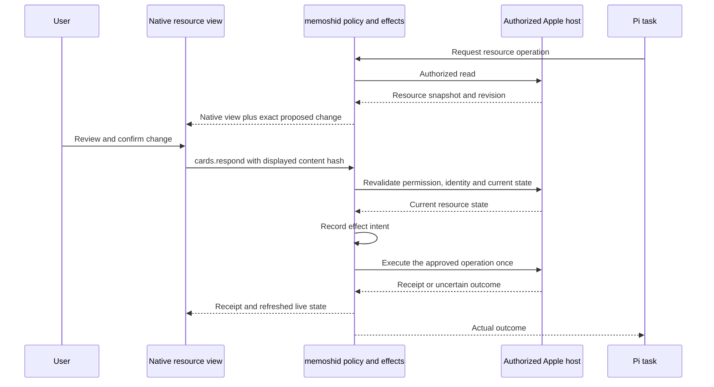
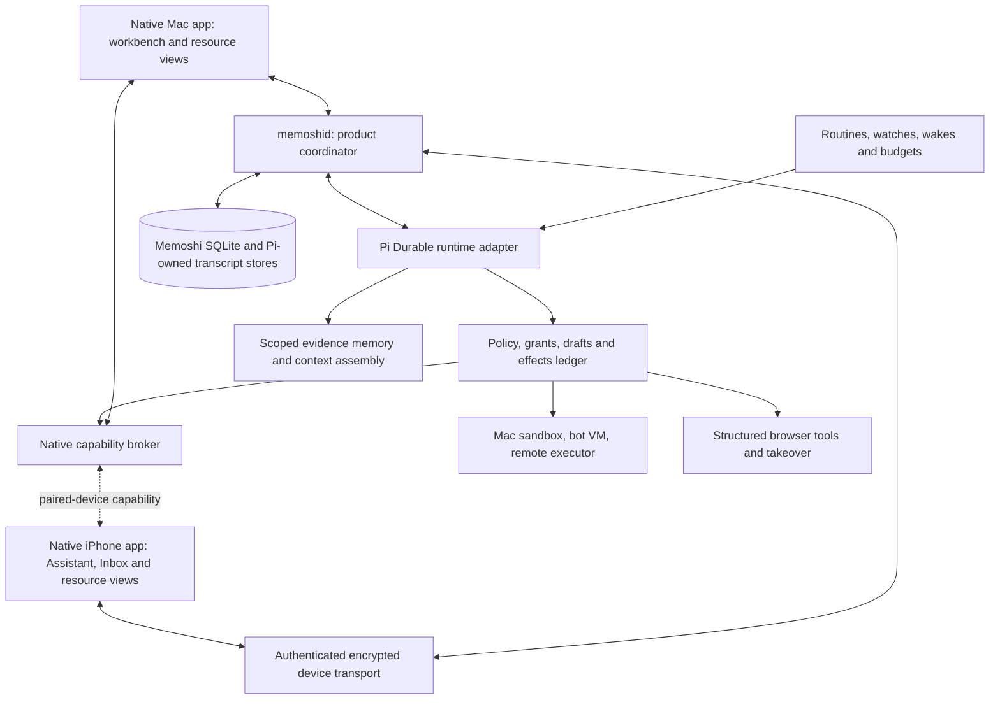

# Memoshi — next-version proposal

**Status:** Proposed design revision, 2026-10-20; partly adopted on 2026-10-22 by [D44](decisions.md#d44)–[D87](decisions.md#d87), with adoption boundaries reconciled on 2026-10-23 for [D88](decisions.md#d88)–[D93](decisions.md#d93) (see the notes below); adoption notes and the adoption map updated on 2026-11-13 for [D106](decisions.md#d106)–[D122](decisions.md#d122), which change the design direction and move stages (see [the 2026-11-13 note](#updated-2026-11-13)). **Deliverable:** a combined product and architecture specification, not an implemented application.

**Adopted 2026-10-22.** Decisions D44–D56 adopted four of this proposal's directions, in their own form:
- the native Apple direction: v1 on Mac, iPhone and iPad, typed tools for the Apple frameworks, and App Review rules ([D47](decisions.md#d47), [D50](decisions.md#d50), [D56](decisions.md#d56)). [D67](decisions.md#d67) later set App Review aside for v1, which is for the user's own devices;
- the engine on every device: Pi_Swift on the Mac and inside the iPhone and iPad app, device links, and tools that run where they live ([D44](decisions.md#d44), [D46](decisions.md#d46), [D48](decisions.md#d48), [D49](decisions.md#d49)). This replaces the published Node/Pi runtime this proposal kept;
- permissions: grants re-checked on the device that executes, and one mode per bot, Ask first, Auto or Bypass ([D49](decisions.md#d49), [D52](decisions.md#d52));
- cards: native cards for Apple data and decisions, plus generated cards drawn from a block catalog ([D53](decisions.md#d53)).

**Adopted 2026-10-22, later:** [D79](decisions.md#d79) adopted two more: the native resource views for Apple data ([§4](#4-native-resource-views-the-missing-contract): live views of the real object, re-read before writes, conflicts, "outcome unknown" after a timeout) and the recovery rules (hold the thread during recovery, re-check grants at dispatch, safe output from failed redactors, no automatic retry after a lost computer link). [D87](decisions.md#d87) keeps the recovery rules in v1.0 and stages the live Apple-data views in Drop 2 (AP-12); adoption does not move those views into v1.0.

**Adopted 2026-10-22, last:** the review of inferred choices settled this proposal's remaining choices ([D86](decisions.md#d86)), and [D87](decisions.md#d87) placed them in the staged calendar:
- QuickAsk in full ([§4](#quick-actions-and-compact-evidence)): v1.0 ships it with both of its rules (no keystrokes go to a remote model without a disclosed setting; Undo is a new authorized act), and its live typed drafts arrive in Drop 2;
- the visual task and artifact views ([§10](#10-workspaces-artifacts-and-visual-task-views)), in Drop 2; the Group explanations arrive with Groups in v1.1 (since 2026-11-13 Groups are Phase 2, [D109](decisions.md#d109), and the explanations ship with these views; see the note below);
- human-agent rooms ([§6](#human-agent-rooms)), in v1.1 with Groups (rooms stay in v1.1; Groups moved to Phase 2 on 2026-11-13, [D109](decisions.md#d109)), while "the router never grants permission" is a rule from v1;
- the Apple tools ([§4](#native-scope-by-device), [§11 B](#b-shazam-to-playback-to-reminder)), in Drop 2, with the WeatherKit framework on the Mac if spike S5 confirms the capability, and AlarmKit on the iPad as well as the iPhone;
- `bot.md` imports keep [D26](decisions.md#d26)'s rules instead of this proposal's team-package boundary ([§6](#6-persistent-bots-without-uncontrolled-autonomy)).

**Current implementation boundaries, reconciled 2026-10-23:**
- **One authority per conversation.** [D73](decisions.md#d73) and [D74](decisions.md#d74) replace this proposal's single-host assumptions: each conversation has one store, writer and lease; another UI device forwards to the awake, reachable runner rather than taking its lease. Routines and watches own lanes and leases ([D83](decisions.md#d83)).
- **Mini apps and their stages.** The core Swift engine, permission lists, per-value tracking and saved-data migrations are v1.0; each device compiles source locally. Jobs, mini-app widgets, the signed bytecode cache, the remaining Swift language, rich styling, action digests and the adaptive kit stay Drop 1 ([D87](decisions.md#d87)). On the Mac a mini app opens as a sheet over its conversation, with Open in Window, Full Screen and a per-app preference ([D85](decisions.md#d85)); iPhone and iPad keep full-screen mini apps. **Changed 2026-11-13:** the object is now called an App ([D119](decisions.md#d119); identifiers such as `mini_app` stay). [D114](decisions.md#d114) adds a pane beside the chat, exported functions, view tools and selection carry; puts page Apps in Phase 1 and Swift Apps in Phase 2 on the Mac and Phase 3 on iPhone and iPad; and moves the action digest (CH-31) from Drop 1 to Phase 2.
- **No model, no answer.** [D88](decisions.md#d88) keeps DEV-09 Phase 3 P0: if neither runner nor an allowed model is available, messages remain in the persistent device-local unsent queue with **Waiting for connection**, survive restart with the same client `requestId`, and can be canceled before delivery. Queuing is not a model turn, side-thread answer or summary, authoritative store write, lease acquisition, tool call or effect. Reconnect uses existing idempotent forwarding to the current confirmed runner under current grants, budgets and recovery holds. Real side threads still execute with an available allowed model and rejoin with a model-written summary plus the exact recorded effect list. MOD-09 remains Drop 2, adding actual offline answers after a model download and retaining the no-model queue fallback. This is app-owned behavior, not a new Pi_Swift engine capability.
- **Code Mode.** [D89](decisions.md#d89) supersedes the old backend ladder: the same pinned upstream `quickjs.wasm` ships through wasm2c, with WasmKit as reference and compatibility fallback and no JavaScriptCore backend. Upstream Node-oracle differential parity gates the default; the integrated memory, interruption, trap/Swift-C safety, policy and recovery gates still apply. Memoshi records the workload, cold/warm p95 limits and memory ceiling by 2026-11-09 ([D90](decisions.md#d90)), before both backends' Release measurements on the iPhone 14 Pro on 2026-11-12. Missing workload/device evidence is not a pass; S1.19's JavaScriptCore experiment is retired. No phase total or date changes.
- **Kuvo source.** [D91](decisions.md#d91) permits source inspection and personal/noncommercial code reuse with provenance and applicable terms, superseding the clean-room source ban. No fork or frontend import is selected; Pi_Swift and the existing runtime/domain contracts remain. **Changed 2026-11-13:** [D106](decisions.md#d106) amends D91: the permitted reuse is not taken for the interface, and no Kuvo- or Cognitio-derived source file, asset or string enters the repository.
- **Design and staffing.** After the [Viticci-guided review](../research/2026-10-23-design-direction-review.md), [D92](decisions.md#d92) adopts a Viticci-led Apple-native assistant family with a Kuvo-informed workbench, not blanket competitor parity. P0-19's planned reference is `docs/specs/design-reference.md`. [D93](decisions.md#d93) removes mandatory design contracting; builder + agents and user review retain design QA, accessibility and performance gates. No accepted feature stage or date moves. **Changed 2026-11-13:** [D106](decisions.md#d106) supersedes D92's hierarchy and [D94](decisions.md#d94)'s preview as the lead reference. Cognitio's design leads the shell on Mac, iPad and iPhone, rebuilt in Memoshi's own code; Viticci's grammar stays for native Apple-data cards, Apps and phone navigation; the earlier preview is frozen at git tag `design-preview-2026-11-13`. D93 is unchanged. Feature stages and dates did move on that date; see the note below.

<a id="updated-2026-11-13"></a>
**Updated 2026-11-13 for [D106](decisions.md#d106)–[D122](decisions.md#d122).** These decisions adopt, change or move the proposals in the table. The proposal text below is unchanged, apart from non-negotiable choice 3 in §1, which already tracked D91 and D92. The dated notes above are kept as written; where one gives a stage or a design rule that this table changes, the table and the decisions govern. The scope by stage is in [AMENDMENT_2026-11-13.md](AMENDMENT_2026-11-13.md). M1, M2 and M3 are the gates at the end of Phases 1, 2 and 4, and v1.0 is M3 passed ([D117](decisions.md#d117), [D122](decisions.md#d122)).

| Proposal | Before | Now | Decision |
|---|---|---|---|
| Design direction (§1, §3) | A Viticci-led assistant family with a Kuvo-informed workbench (D92, D94) | Cognitio's design leads the shell on Mac, iPad and iPhone, rebuilt in Memoshi's own code as one SwiftUI codebase. Viticci's grammar stays for native Apple-data cards, Apps and phone navigation. The earlier preview is frozen at git tag `design-preview-2026-11-13` | [D106](decisions.md#d106) |
| Kuvo source (§1) | Reuse permitted for personal use, none selected (D91) | Not taken for the interface: no Kuvo- or Cognitio-derived source file, asset or string enters the repository. Cognitio continues in its own repository as the behaviour reference | [D106](decisions.md#d106), [D107](decisions.md#d107) |
| Mac shell: Sidebar, Conversation, Inspector (§3) | Three panes with an inspector | A card window with sidebar, conversation and side panel, tabs and split view; an App opens as a side-panel tab | [D106](decisions.md#d106), [D114](decisions.md#d114) |
| Native Calendar and Reminders (§2, §4, §11 A; delivery gate B) | Calendar, Reminders and Contacts tools in Phase 2 (AP-10), with cards only | Those tools in Phase 1 on the Mac (AP-14, split from AP-10), with built-in panes: Mail, Calendar, Reminders merged with Tasks, Contacts, Notes and Files with the Library; the Mac in Phase 1 (AP-15–AP-20), iPhone and iPad in Phase 3 (AP-21). The live Apple-data views (AP-12) and the Apple tools proposal (AP-13) stay in Drop 2 | [D116](decisions.md#d116) |
| Groups (§3, §6) and the Group explanations (§10) | v1.1 | Groups in Phase 2, with D24's rules unchanged; bot-to-bot messages (GR-06) in Phase 1. The explanations now ship with the visual views in Drop 2 (TP-10), because Groups precede them | [D109](decisions.md#d109) |
| Human-agent rooms (§6) | v1.1, arriving with Groups | Still v1.1 (GR-12); Groups no longer wait for them | [D109](decisions.md#d109) |
| Third-party coding agents as workers (§1; delivery gate G) | v1.1 | Phase 2, on the Mac only: Codex app-server, Claude Code and ACP agents (R11-08–R11-10), with every tool call passing Memoshi policy. Claude Code is also a model for any bot on the Mac in Phase 1 (MOD-11) | [D108](decisions.md#d108), [D110](decisions.md#d110) |
| Computers and browser work (§7; delivery gate E) | Bot computers and Remote machines in v1.1; Cloud computers in v2; takeover from any device in Drop 2 | Bot computers at the end of Phase 2; Cloud computers (V2-02) in Phase 2, after the local ones; GUI computer use inside a Bot or Cloud computer (R11-12) with them; Remote machines (CMP-13, CMP-14) and the always-on Mac host (R11-07) in Phase 3; watching and taking over from iPhone and iPad (BRW-15) in Phase 3. Cua as the driver stays a proposal, and D41's exclusion of GUI control on the host Mac is not amended | [D113](decisions.md#d113) |
| Event-driven routines (§9) | Connector event triggers in Phase 3 (RT-14) | Phase 2, on the Mac | [D112](decisions.md#d112) |
| Generated HTML and apps as untrusted artifacts (§10) | Interactive artifacts in Phase 2 (TP-07) | Phase 1, beside page Apps (CH-37) in a sandboxed web view. The visual task and artifact views (TP-10) stay in Drop 2 | [D114](decisions.md#d114), [D115](decisions.md#d115) |
| Generated cards from a block catalog (the 2026-10-22 note on D53) | Phase 2 (CH-19) | Phase 1, streamed as the model writes and aligned with the open A2UI standard | [D115](decisions.md#d115) |
| Mini apps (the 2026-10-23 note above) | A sheet over its conversation on the Mac; the action digest in Drop 1 | Called an App; gains a pane beside the chat, exported functions, view tools and selection carry; page Apps in Phase 1, Swift Apps in Phase 2 on the Mac and Phase 3 on iPhone and iPad; the action digest (CH-31) in Phase 2. Jobs, widgets, the signed bytecode cache and the rest of Swift stay in Drop 1 | [D114](decisions.md#d114), [D119](decisions.md#d119) |
| Calendar (§12, §13) | D87: one v1.0 gate on Fri 2028-11-24, then two drops | Estimates: M1 on Fri 2027-10-29, M2 on Fri 2029-06-29, M3 and v1.0 on Fri 2030-09-27; the Drop 1 gate on Fri 2030-12-06 and the Drop 2 gate on Fri 2031-02-21; v1.1 from Mon 2031-02-24. Nothing leaves v1.0 | [D117](decisions.md#d117), [D122](decisions.md#d122) |

Not proposed here, and now in v1.0: voice conversation with a cloud realtime engine and an on-device engine, the Mac in Phase 2 and iPhone and iPad in Phase 3 (V2-09, VO-01–VO-06; [D111](decisions.md#d111)); `web_search`, `x_search`, a built-in connector catalog, and image and video generation (CON-14–CON-18; [D112](decisions.md#d112)); typed `mail.*` tools (CON-08, SEC-28; [D116](decisions.md#d116), [D118](decisions.md#d118)); Goals (GR-13; [D109](decisions.md#d109)); and team mode (CODE-18–CODE-20; [D110](decisions.md#d110)). D111 leaves dictation unchanged, and it does not move the proposal's recognition and music items (delivery gate D).

The review kept the computer, takeover, memory, routine and verification proposals (§7–§9, §14) as written; they stay proposals. [D112](decisions.md#d112) and [D113](decisions.md#d113) later moved the stages of accepted features those sections touch (the 2026-11-13 note above); the proposals themselves are not adopted by them.

Everything else here remains a proposal, including the memory experiment, host GUI control and the delivery gates. Where this document conflicts with D44–D122, the decisions win; the accepted release stages and gates are in [10-roadmap.md](10-roadmap.md) and [feature-catalog.md](feature-catalog.md), not this proposal's delivery order.

**Evidence:** [comparison report](../research/2026-10-20-comparison-report.md), [Kuvo](../research/2026-10-20-kuvo-base.md), [native Apple direction](../research/2026-10-20-native-apple-direction.md), [Pi](../research/2026-10-20-pi-brain-refresh.md), [Cua](../research/2026-10-20-cua-spaces-refresh.md), [memory and Orbs](../research/2026-10-20-memory-orbs.md), [new products](../research/2026-10-20-new-products.md).

**Relationship to Draft 4:** Draft 4 remains the accepted implementation baseline. This document is the requested new combined version for evaluation. It does not silently change D1–D43, the 17-kind decision-Card schema, the deployment floor, or the dated roadmap. Sections 12–13 enumerate the proposed additions and the exact migration work needed to adopt them. Recommendations and designs below are [INFERENCE], not claims about shipped Memoshi behaviour, except where the notes above record a decision on them.

## 1. The product

> A native personal assistant that can act through your Apple apps, run a persistent team of bots, and do serious work in your projects—with one Pi brain and one permission system.

The combination is not twelve products glued together:

- **Kuvo supplies the workbench:** native navigation, sessions, projects, terminal, browser, worktrees and review.
- **Grok supplies the teammate model:** persistent identities, conversations, delegation, routines, live work and explicit intervention.
- **The Apple-native examples supply the interaction model for daily life:** real objects and controls in the conversation, not prose pretending to have changed an app.
- **Pi Durable supplies execution:** persistent conversations and tasks, tool execution, child work and recovery.
- **Memoshi owns the guarantees:** permissions, scoped memory, budgets, approvals, effect reconciliation and the contract between devices.

**Do not call this SOTA until measured.** The goal is a stronger combination of capabilities. The verification programme in section 14 must establish whether it is actually more useful and reliable.

### Non-negotiable choices

1. SwiftUI + AppKit on Mac; a native SwiftUI iPhone client. No web view for application chrome.
2. Pi is the one embedded brain. Third-party coding agents, if added, are workers—not competing schedulers, permission systems or memory stores.
3. Cognitio's design leads the shell on Mac, iPad and iPhone, rebuilt in Memoshi's own code; Viticci's grammar stays for native Apple-data cards, Apps and phone navigation ([D106](decisions.md#d106), which supersedes the Viticci-led hierarchy of [D92](decisions.md#d92)). [D91](decisions.md#d91) authorizes Kuvo code reuse for personal/noncommercial use, but that reuse is not taken for the interface: no Kuvo- or Cognitio-derived source file, asset or string enters the repository, and no fork is selected. Preserve original branding and keep private captures outside the repository.
4. Every action names its executor: this Mac, a bot VM, a remote host, or this iPhone. A remote chat window does not move execution.
5. Apple APIs first, structured browser actions second, GUI control only when neither is sufficient.
6. The model proposes actions; deterministic code validates and executes them. Tool output, web pages, memory and generated interfaces cannot confer authority.
7. User decisions are inspectable, revision-bound and recoverable. A model saying “done” is never the completion signal.

## 2. What improves over the current plan

Draft 4 already contains most of the Grok + Kuvo + Pi architecture. Replacing it wholesale would discard useful contracts. This revision concentrates on gaps rather than renaming existing features.

| Area | Draft 4 | Proposed next version |
|---|---|---|
| Personal assistant | Chat, delegation, routines and connectors | A first-class daily-life surface with native Calendar, Reminders, music and recognition views |
| Cards | Seventeen kinds for decisions, proposals and receipts | Preserve these; add a separate live resource presentation contract, not a second approval system |
| Apple integration | Strong platform hooks; individual resource workflows less explicit | Typed, permissioned resource reads/writes and live reconciliation with the original app |
| iPhone | Reach milestone after Mac v1 | Explicit native product experience, capability-aware device routing and resource cards—not just remote chat |
| Computer use | WebKit/Chromium, VMs; host GUI control excluded | Keep defaults; evaluate Cua Driver separately without importing Spaces' product runtime or weakening D41 |
| Memory | Scoped evidence entries, FTS5 and consolidation | Keep authority store; evaluate compression separately under correctness, cost and deletion gates |
| Collaboration | Bots in bounded Groups | Keep single-user team first; later human membership requires explicit group access control, not shared private histories |
| Outputs | Files, previews, artifacts | Make durable outputs easy to reopen and use; offer a visual task/artifact view without making a graph the primary navigation |
| Quality | Large feature catalogue and release gates | Add a compact cross-product scenario benchmark with real-world side-effect and native-state checks |

## 3. One app, two depths

### Mac

Keep the existing **Sidebar | Conversation | Inspector** shell and its vocabulary.

- **Assistant** is the front door. A brief is a conversation containing live resource views, proposals and results—not another dashboard with its own data model.
- **Inbox** remains the single queue for things needing the user.
- **Bots** are persistent teammates. Status indicates working, needs you, has news, asleep, watching, paused or error. Every state has text and a non-motion cue.
- **Projects and Sessions** are the workbench. The same conversation view can carry a research brief, a task plan, a diff, a reminder proposal or a browser takeover.
- **Groups** show a bounded discussion, assigned Handoffs, dependencies and final evidence. They are not an unrestricted bot-to-bot broadcast loop.
- **Inspector** reveals the current object: live resource details, Changes, Files, Terminal, Browser, Computer, Memory or task history. The transcript does not move when these appear.

Do not add a separate sidebar destination for every inspiration. A visual task board is a projection of existing Tasks and Handoffs. A saved output is an Artifact. A personal reminder remains an external Apple resource, not a duplicate Memoshi Task unless it actually launches agent work.

### iPhone

Use compact native navigation: Assistant, Inbox and a library of Bots/Projects. Reuse identities and wire contracts, not Mac-sized layouts.

- Read, reply, inspect results, review a bounded approval and hand work to a selected executor.
- Native resource controls use that device's account and permission state, not the Mac's assumed permissions.
- Show where work will run before submitting it.
- Show connection, freshness and waiting-for-device state. “Mac asleep” is actionable information, not an indefinite thinking animation.
- Use Share extensions and App Intents as entry points, widgets for redacted status, notifications to open the exact pending object, and Live Activities only for suitable ongoing work.
- Never treat iOS as a continuously running Node/Pi daemon or an unrestricted desktop automation host. Long work belongs on the selected always-available executor.

### Visual rules

Kuvo remains the shared-shell reference under D43. New personal-action surfaces use system typography, familiar controls, adaptive layouts and semantic colour. Glass is chrome, not a translucent document background. Resource views carry content; decision Cards carry choices; progress communicates actual state. Reduce Motion, VoiceOver, keyboard access and Dynamic Type are acceptance criteria, not a later theme pass.

The point of the Viticci direction is **native utility**, not merely rounded rectangles or a screenshot of Apple's Reminders inside a chat bubble. Exact observations and demonstration limits are in the [Apple research](../research/2026-10-20-native-apple-direction.md).

```svg
<svg xmlns="http://www.w3.org/2000/svg" viewBox="0 0 960 460" fill="none">
  <rect x="1" y="1" width="958" height="458" rx="16" stroke="var(--border)"/>
  <path d="M1 42H959M184 42V459M704 42V459" stroke="var(--border)"/>
  <g fill="var(--muted)">
    <circle cx="21" cy="22" r="4"/><circle cx="37" cy="22" r="4"/><circle cx="53" cy="22" r="4"/>
  </g>
  <g font-family="system-ui, sans-serif" font-size="14" fill="var(--fg)">
    <text x="204" y="27">Assistant</text>
    <text x="727" y="27" fill="var(--muted)">This Mac · Connected</text>
    <text x="21" y="78">Inbox</text>
    <text x="152" y="78" fill="var(--accent)">2</text>
    <rect x="10" y="94" width="164" height="34" rx="8" fill="none" stroke="var(--accent)"/>
    <text x="21" y="116" fill="var(--accent)">Assistant</text>
    <text x="21" y="160" fill="var(--muted)">BOTS</text>
    <text x="21" y="188">Researcher</text>
    <text x="21" y="217">Builder</text>
    <text x="21" y="246">Scout</text>
    <text x="21" y="291" fill="var(--muted)">PROJECTS</text>
    <text x="21" y="320">Website</text>
    <text x="34" y="347" fill="var(--muted)">Review navigation</text>
    <text x="21" y="433" fill="var(--muted)">Usage · Settings</text>
    <text x="208" y="80" font-size="18">Your afternoon</text>
    <text x="208" y="106" fill="var(--muted)">Live resources, with changes kept for review.</text>
    <rect x="205" y="126" width="476" height="106" rx="12" fill="none" stroke="var(--border)"/>
    <text x="222" y="152">Reminders · Personal</text>
    <text x="569" y="152" font-size="12" fill="var(--muted)">Updated now</text>
    <circle cx="229" cy="179" r="7" fill="none" stroke="var(--muted)"/>
    <text x="247" y="184">Book dentist</text>
    <text x="582" y="184" fill="var(--muted)">Today</text>
    <text x="222" y="214" fill="var(--accent)">Open original</text>
    <rect x="205" y="247" width="476" height="108" rx="12" fill="none" stroke="var(--border)"/>
    <text x="222" y="275">Calendar · Proposed focus block</text>
    <text x="222" y="300" fill="var(--muted)">15:00–16:00 · No change made yet</text>
    <rect x="222" y="313" width="139" height="29" rx="7" fill="none" stroke="var(--accent)"/>
    <text x="234" y="333" fill="var(--accent)">Review 2 changes</text>
    <rect x="205" y="386" width="476" height="51" rx="12" fill="none" stroke="var(--border)"/>
    <text x="222" y="416" fill="var(--muted)">Ask, attach, or dictate…</text>
    <text x="726" y="78">Resource details</text>
    <text x="726" y="116" fill="var(--muted)">Source</text>
    <text x="726" y="140">Apple Calendar</text>
    <text x="726" y="180" fill="var(--muted)">Executor</text>
    <text x="726" y="204">This Mac</text>
    <text x="726" y="244" fill="var(--muted)">Access</text>
    <text x="726" y="268">Read granted</text>
    <text x="726" y="292">Writes require review</text>
    <text x="726" y="338" fill="var(--accent)">Inspect action history</text>
    <text x="726" y="365" fill="var(--accent)">Manage permission</text>
  </g>
</svg>
```

Conceptual composition only: original schematic, not a running app, a measured Kuvo parity frame, or copied third-party artwork.

## 4. Native resource views: the missing contract

### A view of a real object, not a generated imitation

**Adopted scope:** these live native Apple-data views ship in Drop 2 (AP-12, [D79](decisions.md#d79), [D87](decisions.md#d87)). The compiled-view boundary below applies to native resource views; generated Swift live cards and Apps follow [D68](decisions.md#d68)'s separate engine contract and the staged limits above. The Calendar, Reminders and Contacts tools and the built-in panes that [D116](decisions.md#d116) puts in Phase 1 on the Mac are separate from these live views, which stay in Drop 2.

Use a small registry of compiled SwiftUI views. The model can supply validated semantic data or request a resource; it cannot emit Swift code, arbitrary selectors, entitlement requests or executable callbacks.

| Resource view | Visible content | Actions | Source of truth |
|---|---|---|---|
| Reminder/list | Title, list, completion, due date/time zone, notes, source and refresh state | Review creation/edit/completion; open original | EventKit-backed resource on the authorized device |
| Calendar/event | Time zone, participants where available, calendar, conflicts, recurrence | Review creation/change; open original | Selected calendar account |
| Music | Track, artist, artwork where licensed, device and actual playback state | Play/pause/queue where supported; open Music | Authorized player/catalogue, not the language model |
| Recognition | Listening indicator, duration, match or no-match, catalogue link | Explicitly start/stop; play matched item where permitted | ShazamKit result plus player response |
| File/document | Name, origin, version, preview, permissions | Quick Look, reveal, share, attach to a session | Granted filesystem or Artifact |
| Browser/computer | Current executor, page/window, action trace, takeover state | Take over, return control, stop | Selected browser/computer adapter |
| Work result | Summary, changed files, check evidence, cost, related output | Open Changes, comment, revise, review publication | Task, Artifact and project store |

Platform availability and entitlement details must follow the [Apple feasibility matrix](../research/2026-10-20-native-apple-direction.md), not a blanket “works on Mac and iPhone” promise.

### Native scope, by device

**Historical recommendation, superseded by [D44](decisions.md#d44):** the Viticci reference is his private **“Apple Bots” prototype**, not a downloadable dependency. Four supplied posts show it in still images; the fifth is Grok Bot. He says he ported “most of” Pi Durable to Swift. That does not establish source availability or replay equivalence. This proposal originally recommended keeping the published Node/Pi runtime and a native Swift capability host rather than introducing a second harness port.

**Historical evidence update, 2026-10-21.** These findings did not themselves decide the runtime; D44 and D46 subsequently did.
- A reply video shows the prototype resuming a task after a force-quit.
- Public Swift routes to Pi Durable exist: PiDurableKit runs upstream 1.3.0 inside JavaScriptCore (CC0-1.0), and PiSwift is a native port of 1.1.0 (MIT).

Where Pi runs was then an open discussion ([full record](../research/2026-10-21-viticci-apple-bots-record.md#8-swift-ports-of-pi-durable)). [D44](decisions.md#d44) and [D46](decisions.md#d46) now choose Pi_Swift on each device, subject to its gates; [D89](decisions.md#d89) excludes JavaScriptCore from Memoshi's Code Mode backends. The JavaScriptCore mention above is historical evidence about a different port, not a fallback instruction.

**Adopted by [D86](decisions.md#d86)** for Drop 2 ([D87](decisions.md#d87)), with two changes in the rows below: the Mac uses the WeatherKit framework if spike S5 confirms the capability under Developer ID ([phase-0 S5.16](phase-0.md#s5)), and AlarmKit serves the iPad as well as the iPhone.

| Capability | Native Developer ID Mac app | iPhone client | Product rule |
|---|---|---|---|
| Reminders/Calendar | Public EventKit; our own event editor | Public EventKit and supported system editor | No promise of Reminders tags, subtasks, sections or smart lists through public APIs |
| Music | In-app `ApplicationMusicPlayer` | In-app playback and permitted Music-app player access | “Here” names the player/device; no Mac Music.app control via undocumented shortcuts |
| Shazam | Microphone-backed recognition | Microphone-backed recognition | Explicit recording and Stop; no system-audio taps in this proposal |
| Alarms/timers | App timers/notifications, not AlarmKit alarms | AlarmKit with authorization, on iPhone and iPad ([D86](decisions.md#d86)) | Never claim a Mac notification overrides Silent/Focus like an iPhone alarm |
| Weather | The WeatherKit framework if S5 confirms the capability under Developer ID ([D86](decisions.md#d86)); otherwise WeatherKit REST, protecting signing credentials and showing attribution | WeatherKit with entitlement and attribution | Apple's capability table does not offer WeatherKit to Developer ID, so S5 checks it; without it, REST is a distinct connector |
| Health/Home | No native Mac data/control API for this target | Per-type/per-home permissions on an attended device | Sensitive data excluded from shared rooms and default memory; operations individually classified |
| Photos/Maps/location | Public native APIs and scoped access | Public native APIs and scoped access | User-selected content first; no blanket photo-library upload |
| Widgets/Live Activities | Widgets; phone activities may be mirrored | System-budgeted updates and bounded activities | Status, not an unrestricted background runtime or an approval bypass |

Apple Events, Full Disk Access/private Reminders databases and Core Audio taps are **not adopted**. They require their own decision and permission model. Prototype screenshots of Mac alarm cards do not prove the implementation uses public native-Mac APIs.

Before enabling MusicKit/ShazamKit, prove their App Services in the actual Developer ID–signed macOS 27 build. Phone tools require an available, authorized device provider. Content-free push remains the default: remote Live Activity updates carry state/counts, not personal resource contents. In-app local updates can use authorized data.

### Quick actions and compact evidence

**Adopted by [D86](decisions.md#d86):** QuickAsk ships in full, with both rules below; its live typed drafts arrive in Drop 2 ([D87](decisions.md#d87)).

QuickAsk can select a typed draft while the user types, inspired by Personal Agent Proxy. Classification and field completion have no external effects. Do not send keystrokes to a remote model without a disclosed setting. The visible action button presents the required review and submits the exact typed operation through policy; no hidden tool call is triggered by typing.

Keep a compact work chip with elapsed time and step count; expand it into real tool evidence in the Inspector. A change view can show old/new values and offer Undo, but Undo is a new authorized compensating action against current state—not a guarantee that every external operation is reversible.

### Separate three things

1. **Snapshot:** what was observed at a time, with source and resource identity.
2. **Live view:** the latest authorized projection of that resource, labelled with freshness and availability.
3. **Decision/receipt:** what the user approved and what was actually attempted or committed.

A completed Approval or Draft Card never reopens. Later edits create a new proposal; refreshing the live view never rewrites the historical receipt. This preserves [object-model §4.18](../specs/object-model.md#418-card-crd_).

### Proposed value contract

These are design shapes, not implemented protocol methods:

- `ResourceRef`: resource kind, connector/account identity, opaque provider object ID and executor identity. A reference is not a capability or a secret.
- `ResourceSnapshot`: reference, observation time, revision/fingerprint when supported, redacted typed fields, availability (`current`, `stale`, `unavailable`, `deleted`, `permission_required`).
- `ResourceAction`: an allowlisted operation, exact requested changes, expected revision/fingerprint and request ID. Its executable handler and required grants come from the installed registry, never the model's payload.

The projection is a **view**, not a new top-level product object. A transcript can retain the snapshot and link to the live view. Sensitive snapshots follow the same retention/deletion policy as the source conversation; they are not indexed by Spotlight by default.

### Action sequence



Under current policy, Apple writes are T4 and therefore drafts, including reminder changes. Do not quietly turn a checkbox into an approval bypass. An inline “Complete reminder” confirmation can resolve the exact prepared Draft only after the proposed change is visible and the content hash is bound. If a one-tap personal-action policy is desired, it needs a separately reviewed rule; it is not assumed here. Playback and microphone operations also need explicit reviewed policy classifications before implementation.

### Consistency and failure behaviour

- Re-read before a write. If the item changed elsewhere, display the conflict rather than overwriting it.
- Many native frameworks do not provide an atomic compare-and-swap transaction with a remote calendar service. A fingerprint check reduces stale writes but cannot promise serializability across devices. Use supported change semantics and surface unresolved conflicts.
- An optimistic animation is provisional. Mark success only from the executor receipt; roll back or expose uncertainty on failure.
- Permission revocation invalidates the live projection and blocks actions; a cached item cannot authorize new work.
- Deleted/moved resources show that state; they are not silently recreated from a memory or chat snapshot.
- A timeout after dispatch is `outcome_unknown`, not automatic retry. Reconcile by provider identity/receipt where possible.
- Music and microphone state belong to a device. “Play here” and “play on Mac” are distinct requests. Recognition must visibly stop; raw audio is not retained by default.

## 5. System architecture

Do not import an additional product backend merely to obtain one feature. The diagram below preserves this proposal's original single-Mac topology for context; active implementation follows Pi_Swift on each device and one authoritative store/writer/lease per conversation ([D44](decisions.md#d44), [D46](decisions.md#d46), [D73](decisions.md#d73), [D74](decisions.md#d74)), not a single coordinator for all bots.



**Adopted, replacing the original single-host restriction:** [D48](decisions.md#d48) and [D49](decisions.md#d49) provide paired-device links and tool execution, with grants re-checked on the executing device. A change of UI does not move a conversation's lease ([D73](decisions.md#d73), [D74](decisions.md#d74)); reaching a phone's native capability still requires the authenticated device/tool path and its local permissions. No-model offline messages follow [D88](decisions.md#d88)'s queue instead of implying that a device can answer or execute unavailable capabilities.

### Deep modules and seams

| Module | Small interface | Behaviour hidden behind it |
|---|---|---|
| Runtime | Submit work, steer, cancel, observe | Pi conversation/task IDs, nested work, replay, per-turn instructions, model/provider events |
| Authorized actions | Prepare and resolve an operation | Grants, origin, budget, policy, draft contents, effect intent, dispatch and reconciliation |
| Memory | Retrieve evidence, propose/edit/retract knowledge | Scoping, revision history, provenance, ranking, consolidation and export/deletion |
| Native resources | Observe a typed resource; execute an authorized operation | OS permission state, accounts, device routing, native framework calls and change notifications |
| Computers | Acquire execution context, run, inspect, release | Sandbox/VM/SSH lifecycle, egress and resource caps |
| Presentation | Render events and submit user intent | Native platform layouts, accessibility and view state—not policy decisions |

Depth matters: if all callers must understand crash recovery or EventKit permissions, those concerns have leaked across the seam. The implementation can have internal seams; do not invent a general plugin platform where only one implementation exists.

### Pi package roles

**Historical package proposal, superseded by [D44](decisions.md#d44):** the [verified package inventory](../research/2026-10-20-pi-brain-refresh.md) recorded `@earendil-works/pi-durable`, `pi-ai`, `pi-codemode`, `pi-mcp` and `pi-env`, **exactly 1.3.0 with the recorded npm integrity pins**, with `chord` and `pi-telemetry` as dependencies. In that proposal Durable was the execution root; Code Mode attached through `pi-durable/codemode`; Memoshi wrapped MCP tools; `pi-env` represented execution; `pi-ai` supplied models. The accepted plan instead pins a tested Pi_Swift commit and follows its upstream-sync process; Code Mode follows [D89](decisions.md#d89). The coding CLI can be a developer/worker surface, never a second owner of the same conversation.

Pi does **not** supply Memoshi's product database, Apple permissions, native views, scheduler, memory governance, relay or effect idempotency. Keep those responsibilities explicit. Pin the tested package set; an upstream version number is not an integration result.

### Runtime gates revealed by the refresh

The recovery behavior below was adopted by [D79](decisions.md#d79) for v1.0. Published-package observations remain historical evidence, not proof that Pi_Swift passes the same cases. The accepted [Phase 0 S1 gate](phase-0.md#s1) and [D89](decisions.md#d89)'s Code Mode parity/device gates require that evidence.

- **Hold the whole thread file when explicit recovery is required.** In published 1.3.0, `submit`, `abort`, `compact` and wait calls enable the Harness scheduler just as `resume()` does. Safe mode is read-only. New input into a held thread must resolve recovery explicitly or start a separate thread; it cannot accidentally restart all recovered work. Finer-grained holds require a separate proven design.
- **Revalidate at dispatch, not only at admission.** Recovery does not rerun `beforeTool` after intent is recorded. Replayed operations still face current grants in the executor/action broker. Unknown external effects remain quarantined.
- **Do not implement fail-closed policy by throwing from a non-blocking hook.** `afterTool` failures are reported and skipped; a redactor must return a safe replacement on its own failure and cover text and structured output. Model budgets/credentials are enforced by the provider wrapper, not an assumed fail-closed `beforeRequest` throw.
- **A lost pi-env link means unknown in-flight mutations.** Do not retry them automatically. pi-env has no detach feature; declared long-lived jobs need host-owned process lifecycle and reconciliation.
- **Historical pin recommendation, superseded by [D44](decisions.md#d44).** The inspected main branch contained unreleased breaking changes and an irreversible SQLite migration while its manifests still said 1.3.0, so this proposal recommended published artifacts rather than `main`. The accepted plan follows Pi_Swift's upstream-sync process with a tested commit pin, backup and migration verification.
- **Ship the notices and only permitted auth.** The inspected npm archives omitted Pi's root MIT file; include the relevant repository licence and dependency notices. The proposal's API-key/local-endpoint-only rule was amended by [D54](decisions.md#d54): Sign in with ChatGPT is the permitted plan-usage flow under its conditions; [D79](decisions.md#d79) keeps OpenRouter and Radius usage-billed-key sign-ins. Other subscription credential shortcuts remain excluded.

Gondolin and `pi-durable-components` remain references, not extra runtimes. The latter's scheduling/UI/voice packages are local-only in its current release. Do not depend on removed `pi-server`, `pi-client` or `pi-protocol`, stale chat demos, the unlicensed private UI, or credential-routing shortcuts. These are deliberate exclusions from “all the Pi stuff,” not missing integration work.

## 6. Persistent bots without uncontrolled autonomy

Preserve one Assistant and explicit specialist bots. Start with a small configurable team rather than requiring a bot for every app:

- Assistant: route work and maintain user-approved personal context.
- Researcher: sources, documents and briefs.
- Builder: project implementation and review-ready changes.
- Scout: model-free watches and exception reporting.

“Best features from all products” means selecting good mechanics:

- A job, stable identity and scoped memory.
- Per-task context and evidence, not a shared global prompt.
- Explicit Handoff acceptance criteria and completion receipts.
- Bounded Groups, concurrency, rounds and budget.
- Separate bot homes/profiles and explicit computer assignment.
- No default full access and no automatic credential sharing.

A task can create temporary subagents without creating permanent roster identities. A Group can plan with several bots while only the assigned worker gets write permission. A human collaborator later joins through an explicit access model; membership does not disclose private user memory or grant access to a member's Mac.

Proactivity means a bounded, evidence-backed offer or a declared Routine/Watch—not an endless bot conversation. Let the user tune quiet hours, notification thresholds and spending before enabling unattended work. A taught workflow becomes a reviewable Skill proposal with explicit inputs and required capabilities; demonstrations do not authorize future side effects.

Portable team definitions carry identity, jobs and reviewed skill/routine references. They never carry credentials, grants, memory, conversations or computer access; imported routines start paused. This takes the useful MausBot team-package boundary without importing its permission defaults. Aiden supplies the closest Durable/recovery reference, Rakazo the provider/policy seam, and Noodle the rule that required confinement failing prevents launch. None justifies running a nested worker with permission checks disabled.

**Settled by [D86](decisions.md#d86):** `bot.md` keeps [D26](decisions.md#d26)'s rules instead: grants and routines in an imported file arrive as proposals the user accepts (EXP-01), and memory goes into an export only when the user opts in.

### Human-agent rooms

**Adopted by [D86](decisions.md#d86):** shared rooms ship in v1.1 ([D87](decisions.md#d87)). [D109](decisions.md#d109) moves Groups to Phase 2 and leaves shared rooms (GR-12) in v1.1; the rule that the router selects who speaks and never grants permission holds from v1.

Borrow agentes.chat's clearest distinction: the router selects who speaks; it never grants permission. Every shared bot has an accountable owner, an audience, permitted resources and a pre-call budget. These are enforced records, not personality instructions. See the [new-product evidence](../research/2026-10-20-new-products.md).

A room message is a request, not an inherited grant to its sender's files, browser sessions, Apple account or private memory. Show which person can resolve each approval. Promote a proposed lesson into shared knowledge only through the existing scoped memory workflow. The inaccessible waitlist product is design evidence, not proof that these controls work.

### External sessions and collaboration

Reason Network is a useful **optional interoperability reference**, not Memoshi's root of trust. Its MIT/Apache engine supplies a live-session directory, declared push/next-turn/pull delivery, per-machine accept/hold/refuse, and bounded peer messaging. Its shipped Pi extension targets the coding-agent surface, not automatically Pi Durable.

Keep Memoshi's own event log authoritative. Derive worker activity from observed events; label delivery as queued, delivered or acknowledged instead of calling all three “sent.” External peer text stays untrusted. Reject self-delegation and wait cycles; cap outstanding requests and conversational hops. On restart, an interrupted external ask needs reconciliation rather than blind replay, following Codync's useful pattern.

A signed peer response proves an origin, not authorization for a Memoshi action. Any local effect still goes through the normal grant/Draft/Card path. Do not accept an XML-looking approval in conversation text as a valid decision, and do not install Reason's closed CLI merely because its open engine is reusable.

Agent Bump's cross-person handshake is a useful invitation metaphor, not an identity protocol. Any later “introduce our agents” action exchanges a revocable invitation and an explicit audience/resource scope. It must never share API keys, raw session cookies or someone's private memory merely because two devices were paired.

## 7. Computers and browser work

**Staged by [D113](decisions.md#d113) (2026-11-13):** in the accepted plan, Bot computers arrive at the end of Phase 2, Cloud computers in Phase 2 after them with the cost estimate shown before one starts, GUI computer use inside a Bot or Cloud computer with them, and watching and taking over from iPhone and iPad in Phase 3. The Cua evaluation below stays a proposal, and D41 is not amended.

Use an escalation ladder, not a GUI action for everything:

1. Native/resource API or scoped connector.
2. Structured DOM/browser tools in the bot's isolated profile.
3. Terminal/file tools in the assigned sandbox or VM.
4. GUI computer control only on an explicitly permitted executor.

Cua is evaluated at the driver/VM seam, not adopted as a second agent platform. The [fresh component audit](../research/2026-10-20-cua-spaces-refresh.md) establishes these gates:

- **Candidate:** MIT Cua Driver inside the Linux Bot computer, behind the existing computer tools. Prove the published arm64 binary on the chosen guest; its docs currently name x86_64 and its releases are pre-release.
- **Do not bundle:** FSL `cua-spacesd`, Spaces streaming/Keyvault/teleport libraries, or the Swift Mac/iPhone bot samples. The MIT client/overlay does not make the server and renderer permissive.
- **Do not depend on old hosting:** Cua documents Cloud/Fleets as ended on 18 October 2026. Its hosted relay is a separate surviving dependency.
- **Optional later adapter:** attach an existing user-managed Space using the MIT client only, subject to a licensing/security review and fail-closed encrypted transport. The default relay can inspect session plaintext; an encryption preference that silently falls back is insufficient.
- **Borrow the result vocabulary:** distinguish confirmed, unverifiable, suspected-no-op, partial and refused effects. Delivered input is not proof that an app changed.

The `@injaneity` post asks a bot to install Cua and grant itself KVM access. It is a researched example, not an instruction or an authorization to change this machine. Bot prompts are not a substitute for the executor's enforced permissions.

Human takeover owns an exclusive input lease: agent action dispatch pauses, buffered coordinate actions are discarded, and the agent observes fresh state after control returns. A stale screenshot or accessibility element must not be replayed after takeover. A separate desktop/Space can reduce interference; it is not proof of security isolation.

D41's host-Mac GUI exclusion remains in force until changed. Native EventKit/MusicKit actions do not require granting blanket Accessibility access. iPhone must never be presented as an arbitrary third-party UI automation target.

## 8. Memory: four stores with different jobs

| Layer | Purpose | Authority |
|---|---|---|
| Durable execution history | Resume tasks, inspect what happened, recover tool results | Pi-owned records; not all history belongs in every prompt |
| Context assembly/compaction | Fit the current task into a model's context | Derived and replaceable; never permissions or the only copy of user knowledge |
| Long-term knowledge | User/bot/team/project facts, preferences, procedures and episodes | Memoshi's scoped, versioned evidence store |
| External app state | Today's reminders, current calendar, playing track, project files | Original provider/device/resource; memory is only a hint |

Retain Draft 4's scoped SQLite/FTS5 approach as the baseline. Add semantic retrieval only when a measured workload shows it helps. The user can inspect, correct, retract, change visibility, export and delete memory. A shared room is not consent to promote everything to team knowledge.

Borrow Codync's memory hygiene as requirements rather than as an assumption that regex filters solve injection: protect user-authored entries, preserve correction/deletion tombstones, reject hidden instructions/secrets where detected, and make consolidation bounded and reversible. The current Codync docs describe a user-evidence-only “dreaming” pass, not the older Tierroom keeper workflow. Memoshi still requires source and scope checks before any proposal becomes active knowledge.

**Do not integrate OptMem itself.** The inspected repository has no licence, no governed scopes or per-fact deletion; its `forget` removes summaries that are rebuilt from the unchanged log. The supplied gist is **OptChat/UniiChat**, a transcript-context recipe, not a scoped memory service. Its separately published Apache-2.0 implementation is a permissible reference, not a proven replacement. See the [memory investigation](../research/2026-10-20-memory-orbs.md).

Adopt the useful Orbs memory mechanics in Memoshi's own store:

- `operationId` deduplicates writes; `expectedRevision` rejects stale edits.
- Forget creates a text-free tombstone and suppresses extraction from the same source range, including work already in flight.
- Human promotion is explicit; a room tool cannot silently turn private facts into organization-wide memory.
- Show capture state and provenance. Explain separately what forgetting knowledge, resetting context and deleting a transcript remove. Do not promise that a fact is erased everywhere while old transcripts or backups retain it.

An optional tree-shaped context summary may be evaluated through Pi's `beforeCompact`, preserving raw history and read-only zoom references. This is **not** the baseline: the full UniiChat view assumes cache breakpoints that pi-ai 1.3.0 does not provide inside the growing view. Reconcile the existing 04/05 disagreement about whether `beforeCompact` is used, then measure token/cache costs, summary fidelity and deletion behaviour before adoption. Summaries are evidence, never instructions or “the latest truth.” **Settled 2026-11-13 by [D128](decisions.md#d128):** the 04/05 disagreement is closed. Memoshi uses the `beforeCompact` hook for a silent memory flush and for summary instructions; the tree-shaped summary stays an experiment, not the baseline.

Evaluation must compare the same model, histories, task set and context/cost limits against the existing baseline. Measure factual support, temporal corrections, cross-bot leakage, irrelevant recall, abstention, latency, maintenance cost and forgetting—not just a single recall percentage.

## 9. Routines, watches and always-on operation

Keep three distinct concepts already present in Draft 4:

- **Routine:** meaningful scheduled/event-driven work.
- **Watch:** model-free check; wake only on a stable relevant change.
- **Wake:** a bot's bounded request to continue later.

Before execution, resolve the host, current grants, trigger origin and budget. A computer being offline produces a visible pending/skipped outcome with the configured catch-up policy. There is no hidden claim that a sleeping laptop is always on.

A timer resuming after a crash is not evidence that its external action is safe to repeat. Retain intent/outcome recording, idempotency where the provider supports it, and explicit reconciliation for unknown effects. Quiet runs stay in history; only a useful update enters the Chat/Inbox.

Use LightVela's useful task taxonomy without adding three new product objects: a Routine can deliver fixed text, run an explicitly authorized deterministic script, or request an agent turn. The first two need no model call. A script still receives the same executor, budget, egress and effect policy; “zero tokens” does not mean harmless. Chaining passes a typed prior result and its provenance, not ambient credentials or the previous task's authority.

## 10. Workspaces, artifacts and visual task views

**Adopted by [D86](decisions.md#d86):** the visual task and artifact views below ship in Drop 2 ([D87](decisions.md#d87)); [D109](decisions.md#d109) moves Groups from v1.1 to Phase 2, ahead of these views, so Orbs's Group explanations now ship with them in Drop 2 (TP-10).

Kuvo's workbench stays central: folder grants, worktree per parallel attempt, session ownership, terminal/preview/browser, inline comments and a review-to-commit/PR path. Model-generated success summaries never replace actual check output.

Combine the workspace with clear projections of existing objects:

- Show task dependencies, executor state, output ownership and blocked work.
- Open an Artifact without digging through a long transcript.
- Let a user move between the conversation, the task plan and the actual output.
- A spatial layout may be optional. Keyboard and list views remain complete.
- Generated HTML/apps run as untrusted artifacts with separate capabilities. They cannot mimic native approval Cards or call privileged host operations directly.

Orbs contributes **“why this bot answered”** and **“queued behind this bot”** explanations for Groups, plus the memory mechanics above. It is not an artifact-workbench template: its inspected Media tab is an empty state, and no produced-file browser was found. Do not adopt its Pi RPC backend, unsandboxed daemon, hosted Jev routing/auto-approval or avatar assets. [Orbs evidence](../research/2026-10-20-memory-orbs.md)

## 11. End-to-end product journeys

### A. A useful morning, not a chat summary

1. User asks for today's plan.
2. Assistant reads authorized Calendar/Reminders resources on a named device and returns native views with observation times.
3. It proposes moving one reminder and adding a focus block; the exact two changes are visible as drafts.
4. User edits the time and confirms. Policy checks current grants and re-reads current state.
5. The resource changes in the original app; the view refreshes and the receipt preserves the approved version.
6. A coding task is delegated separately to Builder in the chosen project. Personal data is not copied into that task unless needed and permitted.

### B. Shazam to playback to reminder

1. User explicitly starts recognition on the current device.
2. A visible listening view exposes Stop; denied microphone permission leads to a precise explanation, not a fake match.
3. The recognition result becomes a track view. Play requires an available/authorized player and respects subscription or catalogue limits.
4. “Remind me to buy tickets Friday” creates a reminder draft with the interpreted date/time zone; it does not buy tickets.
5. The model receives only the necessary match and operation result, not retained raw audio.

### C. Build and review a feature

1. Assistant records a Handoff with acceptance criteria and budget.
2. Builder works in an assigned worktree and sandbox through Pi tools.
3. Research and review can run in child tasks with narrower grants.
4. User sees actual diffs and check evidence, comments on a line and sends a revision request.
5. Commit/PR publication follows the existing policy. No artifact, README or tool result can approve publication.

### D. Background browsing with interruption

1. Scout detects a stable change without a model call and wakes a bot.
2. The bot uses its selected browser/computer, not the user's foreground tabs.
3. A sign-in or uncertain action becomes a Card. Human takeover pauses automation.
4. After hand-back, the bot observes the current page anew; it does not replay old coordinates.
5. The result is a durable artifact or one useful update, with cost and evidence.

### E. Approve from iPhone without pretending the Mac is the phone

1. Phone opens the exact pending Card over the paired transport.
2. The view states where the operation will run and what account/resource it affects.
3. The user reviews the full payload; the response carries the displayed revision/hash.
4. The authoritative daemon rejects stale or duplicate decisions.
5. If the host is offline, the operation stays pending; the phone does not falsely show completed work.

## 12. Adoption map: changes versus preserved contracts

This map distinguishes adopted planning contracts from still-proposed work; it is not an implementation claim. The adoption notes above and the decisions control each row's scope and release stage. Updated on 2026-11-13 for [D106](decisions.md#d106)–[D122](decisions.md#d122): four rows changed and the last four were added.

| Proposed change | Preserve | Adoption status and affected contracts |
|---|---|---|
| Native resource projections | One-shot Card state and `cards.respond` | Adopted by D79 as live Apple-data cards, AP-12 in Drop 2 under D87. `specs/object-model.md` owns value shapes/ownership; `specs/protocol.md` resource reads/preparation; `specs/events.md` invalidation; `02-experience.md` and `03-design-system.md` the views |
| Calendar/Reminders execution | T3 reads, T4 writes, hash-bound Drafts | The typed tool catalog is AP-10, AP-11 and AP-14 in v1.0. [D116](decisions.md#d116) moves the Calendar, Reminders and Contacts tools from Phase 2 to Phase 1 on the Mac (AP-14, split from AP-10) and adds built-in Calendar, Reminders-with-Tasks and Contacts panes (AP-16–AP-18 on the Mac in Phase 1; AP-21 on iPhone and iPad in Phase 3). Live views (AP-12) and the remaining Apple tools proposal (AP-13) stay Drop 2 under D87. `specs/policy.md`, `09-platform-macos.md`, `04-architecture.md` and `feature-catalog.md` carry the accepted boundaries |
| Music and recognition | One policy engine and explicit microphone use | Classify playback/queue/mic operations in policy; define permission and lifecycle behaviour in platform/experience specs before enabling tools. Adopted with the Apple tools for Drop 2 ([D86](decisions.md#d86), [D87](decisions.md#d87)) |
| Paired iPhone capabilities | One authoritative coordinator per conversation; device-local permissions | Adopted by D48/D49, refined by D73/D74: authenticated device/tool routing and local grants, a stable runner and idempotent forwarding. D88 distinguishes durable unsent messages from real model-available side threads; DEV-09 is Phase 3 P0, while MOD-09 stays Drop 2 |
| Native personal assistant milestone | Mac core, Kuvo shell, Pi_Swift and workbench | The accepted calendar is [D122](decisions.md#d122)'s estimate, which supersedes D87's: M1 on Fri 2027-10-29, M2 on Fri 2029-06-29, and M3, the v1.0 gate, on Fri 2030-09-27, then Drop 1 and Drop 2 ([D117](decisions.md#d117)). [D106](decisions.md#d106) replaces the Kuvo shell in the Preserve column with Cognitio's design, rebuilt in Memoshi's own code, and [D116](decisions.md#d116) puts the personal-information panes in Phase 1 on the Mac. D88/D89 changed acceptance/backend contracts without changing dates. Drop 1 and Drop 2 keep what D106–D116 did not move; this proposal's delivery order pulls nothing else into v1.0 |
| Optional host GUI control | D41 exclusion until evidence and a new decision | Not adopted: it needs a new decision explicitly superseding the relevant exclusion; `06-computers-and-browsers.md`, policy, entitlements and threat model. [D113](decisions.md#d113) brings GUI computer use inside a Bot or Cloud computer into Phase 2 and does not amend D41 for the host Mac |
| Memory experiment | Existing evidence store and scope semantics | Experimental evaluation contract only; change D22 and storage contracts only if results justify replacement |
| Published Pi recovery and packaging | D9 policy and D42 uncertain-effect handling | D79 adopts whole-thread recovery holds, dispatch-time grant checks, safe redactor failures and no automatic retry after a lost computer link for v1.0. D44 replaces the package/runtime choice; D89 fixes Code Mode's wasm2c/WasmKit roles and parity/device gates. Current requirements live in `04-architecture.md`, policy/protocol/events and Phase 0, not the historical npm pin |
| Memory write and forgetting mechanics | D22 scopes, visibility and evidence-not-authority | Define idempotent revision checks and extraction suppression in memory/storage contracts; reconcile `beforeCompact` text in 04/05 before any experiment. [D128](decisions.md#d128) settled that on 2026-11-13: the hook carries the memory flush and the summary instructions, and the tree-shaped summary stays an experiment |
| Human-agent shared rooms | Private user/bot context | New membership/account/resource access design before changing Group semantics; adopted for v1.1 ([D86](decisions.md#d86)). [D109](decisions.md#d109) moves Groups to Phase 2 and leaves shared rooms (GR-12) in v1.1 |
| Design direction and Kuvo reuse (§1, §3) | Original branding; private captures outside the repository; design QA, accessibility and performance gates | Changed by [D106](decisions.md#d106): Cognitio's design leads the shell on every device, rebuilt in Memoshi's own code, with Viticci's grammar for native Apple-data cards, Apps and phone navigation; no Kuvo- or Cognitio-derived code in the interface. `02-experience.md`, `03-design-system.md` and `specs/design-reference.md` |
| Bounded Groups (§3, §6) | D24's rules: 2–6 bots with one lead, at most 4 rounds per user message and 8 bot-to-bot hops per thread | Moved from v1.1 to Phase 2 by [D109](decisions.md#d109); bot-to-bot messages (GR-06) move to Phase 1; the Group explanations ship with TP-10 in Drop 2. `05-bots-and-assistant.md` |
| Third-party coding agents as workers (§1) | Pi as the one embedded brain; one policy engine | Adopted for Phase 2 on the Mac by [D110](decisions.md#d110): Codex app-server, Claude Code and ACP agents, each tool call passing Memoshi policy ([D11](decisions.md#d11)). [D108](decisions.md#d108) also lets Claude Code serve as a bot's model on the Mac in Phase 1. `07-coding.md` |
| Bot computers, browser work and takeover (§7) | Isolation per bot ([D16](decisions.md#d16)); D41's exclusion of GUI control on the host Mac | Staged by [D113](decisions.md#d113): Bot computers at the end of Phase 2, Cloud computers in Phase 2 after them, Remote machines in Phase 3, takeover from iPhone and iPad (BRW-15) in Phase 3. The Cua driver stays a proposal. `06-computers-and-browsers.md` |

No generated schema, caller or runtime has been migrated: none exists in this repository yet. Accepted portions are reconciled into the plan and detailed specs; unadopted proposals remain proposals. Implementing a single new method without the corresponding policy/event/state work would be incomplete.

## 13. Delivery order and stop conditions

These remain proposed dependency gates, not new calendar promises or a reduction of the full product target. The accepted roadmap wins: core Swift/permissions/tracking/migrations are v1.0; App power features are Drop 1, except the action digest, which [D114](decisions.md#d114) moves to Phase 2; the phone model, synced cookies, phone coding, notebook extras, live Apple-data views, visual views, live QuickAsk drafts and the Apple tools proposal are Drop 2, while cross-device browser takeover moves to Phase 3 ([D113](decisions.md#d113)); shared rooms stay v1.1 ([D87](decisions.md#d87), as [D109](decisions.md#d109)–[D117](decisions.md#d117) amend its stages). D88's queue/reconnect acceptance does not require bringing MOD-09 forward.

| Gate | Complete slice | Exit evidence |
|---|---|---|
| A. Execution truth | Native Mac shell ↔ memoshid ↔ real Pi model, tools, persistence, policy and effects | Kill/reopen preserves work; held files never schedule through submit/abort/wait; redaction failure returns safe output; uncertain effects are not repeated |
| B. Native daily-life loop | Read/edit real Reminders and Calendar through native views and reviewed Drafts | Original Apple apps and conversation agree after edits, revocation and external changes |
| C. Workbench and team | Projects, worktrees, review, bounded Handoffs, routines/watches, inspectable memory | Reviewable feature result; scheduled work within budget; no cross-bot memory leak |
| D. Multimodal utility | Dictation, explicit recognition, authorized music control | Correct denial/no-match/offline behaviour; real player state; no unconsented audio capture |
| E. Computers | Bot VM/browser execution, takeover, selected Cua capabilities if justified | Isolation and input-ownership scenarios pass; no foreground-mouse interference claim without measurement |
| F. Native iPhone | Pairing, replay-safe remote decisions, native views and device-aware capability routing, in their accepted release stages | Same task and resource identities across devices; stale approvals expire correctly; v1.0 no-model messages persist across restart, support cancellation, execute nothing while queued and deliver once after reconnect with the original `requestId` and current policy/recovery checks; real side threads are tested with an available allowed model, and actual disconnected phone-model answers plus queue fallback wait for Drop 2 ([D88](decisions.md#d88)) |
| G. Shared/advanced | Human-agent rooms, optional memory optimizer, visual task projections and external workers | Each addition passes its own access, cost, correctness and deletion gates |

No gate is “a fake model plus a screenshot.” Do not import a second runtime to make a demo appear complete. The existing Phase 0 work and reusable own-code contracts remain the starting material, subject to fresh validation—not assumed production-ready because an older audit lists them.

## 14. What would prove the combination is better

Run the same scenarios on the applicable reference products and Memoshi. Fix model/configuration where possible; record where a hosted product prevents parity. Report task completion, human interventions, irreversible mistakes, latency, model cost and host availability separately. An unavailable feature is not a failed benchmark run.

Run only where access and terms permit. agentes.chat is waitlist-only; LightVela's terms restrict publishing benchmarks without consent and using service outputs to build competing platforms. This proposal relies on public descriptions, not LightVela-generated outputs. Exclude it from published comparison runs unless the necessary permission is obtained.

Required scenarios:

1. Calendar/read plus reminder creation; ambiguous date asks; correct time zone and recurrence.
2. External edit while a Draft is open; stale approval rejected, original object not overwritten silently.
3. Kill between effect dispatch and receipt; no automatic duplicate event/message.
4. Forget a fact; it disappears from recall, derived summaries, indexes and exported active knowledge under the documented retention policy.
5. Cross-bot/private-data probe; unauthorized retrieval returns no private content.
6. Long research task; source-backed answer at equal context/cost limits before and after any memory optimization.
7. Two parallel coding tasks; reviewable changes without overwriting the user's checkout.
8. Browser login and takeover; credentials absent from model-visible logs; fresh observation after hand-back.
9. Routine across sleep, restart and daylight-saving transition; declared catch-up behaviour and budget hold.
10. iPhone decision on an expired/revised Card; no stale side effect and no false completion.
11. Recognition no-match/permission denial; playback unavailable/subscription limits; accurate UI state.
12. Keyboard/VoiceOver/Reduce Motion/Dynamic Type paths; the complete workflow does not depend on a canvas or animation.

**Current verification status:** these are required future product scenarios. This task produced research and a specification only. No Memoshi app, Pi integration, Apple resource write, permission flow, model benchmark or competitor task was executed as proof of implementation.
