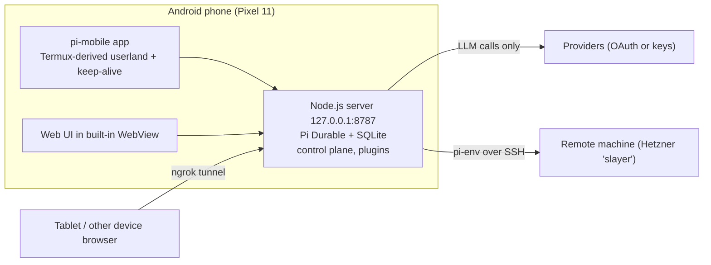

# Viticci follow-ups: accounts, Tailscale, tools, Pi's phone app, JavaScript engine, upstream tracking

**Status:** Research · 2026-10-22
**Owns:** Answers to six follow-up questions on the [Viticci full record](2026-10-21-viticci-full-record-sep-oct.md). Covers which model accounts his app and ours can use; how we know he uses Tailscale; where his tool design comes from and what the state of the art is; how Mario Zechner's phone app is built; what is known about his JavaScript engine; and how Pi_Swift should follow upstream Pi.
**Depends on:** [Viticci full record](2026-10-21-viticci-full-record-sep-oct.md) (corrected here, §8) · [Agent harnesses §4, subscription-auth policy](agentic-workspace-landscape/landscape/agent-harnesses.md#4-subscription-auth-policy-verbatim-dated) · [Pi brain refresh](2026-10-20-pi-brain-refresh.md) · [decisions](../plan/decisions.md) (binding, notably D10 and D11)
**Mirrored in:** `~/Documents/memoshi/Pi_Swift/docs/research/`. Edit this copy first, then copy it across.

Research is evidence, not decisions ([index](README.md)). Labels: **Observed** (seen in a post, screenshot, frame, file or document), **Claim** (an author's statement not verified), **[INFERENCE]** (our reasoning).

## 1. Summary

1. **How Viticci signs in to GPT-6.1 Sol and Claude Opus 5.5 in his app is not shown** (Observed). The only credential his screens name is the "xAI API key" that voice needs. He uses his ChatGPT plan in other apps: Open Minis "via Codex sub", and T3 Code's "Sign in with ChatGPT". The record's "configured with his own keys" overstated this and is corrected (§8).
2. **Pi, and Pi_Swift's port of it, can sign in to subscriptions.** Pi 1.4.0 has login flows for Anthropic (Claude Pro/Max), OpenAI (the Codex CLI flow and OpenAI's official "Sign in with ChatGPT" flow), xAI, Meta, GitHub Copilot, Kimi, OpenRouter and Pi's own Radius gateway. What vendors allow differs (Observed, §2):
   - OpenAI documents plan usage for open-source and locally hosted apps.
   - Anthropic forbids third-party apps from routing requests through Claude plans. Since 7 October, Max plans include $100–$200 a month of API credits for "your own apps and agents".
3. **Tailscale is certain** (Observed, §3). He writes "my Tailnet", and says NotesCTL's MCP server "also works with Tailscale". He asks how to "stay on Tailscale" on iOS. His Builder bot reports "Removed from Tailscale … Funnel is off".
4. **Open Minis as the source of his tool design is an inference, not a fact** (§4). The state of the art on iOS is in-process native tools, offered to the model three ways: function tools, Code Mode, and an optional virtual shell. iOS apps cannot launch child processes, so Open Minis has to emulate Linux to offer one [INFERENCE].
5. **Mario Zechner's phone app runs the agent on the phone and serves its UI to other devices** (Observed, §5). It is an unpublished Android app called pi-mobile. A Node.js server with Pi Durable and SQLite runs on a Pixel 11. The UI is a web app, shown in a built-in WebView or in any browser that can reach the phone. He kept parts of Termux for its Linux environment and to keep the process running. "No such luck on iOS," he says; on iPhones, the phone-as-server design does not carry over.
6. **Viticci said "I ended up not going the JSCore route"** for his port (Observed). Which engine runs his Code Mode is unknown. QuickJS is upstream Pi's Code Mode engine, and Pi_Swift's (§6).
7. **Pi 1.4.0 was released on 21 October** (Observed, §7). It contains the SQLite schema-2 change that made 1.3.0 look like the safe target. Pi_Swift's pin is 22 commits behind 1.4.0. **Decision (user, 2026-10-22): Pi_Swift follows the latest upstream `main`.** The delta tool and the first worklist are in Pi_Swift (§7.3).
8. **Two more iOS precedents, checked 2026-10-22 (later)** (Observed, §4.5, §5.5).
   - Armin Ronacher's Python IDE for iOS has a pi-durable coding agent, Pyodide Python with packages, a debugger, and a reactive Python UI layer that brings up native-looking screens.
   - Ronith's Swift interpreter runs SwiftUI apps straight from `.swift` files. It is a closed prototype, and the company that built it has been acquired.

## 2. Model accounts: API keys and subscriptions

### 2.1 What Viticci shows

| Date (UTC) | Item | What it says |
|---|---|---|
| 4 Sep | [2095950124136427971](https://x.com/viticci/status/2095950124136427971) | "Astra is here! Pro account, just got it." (ChatGPT Pro) |
| 6 Sep 20:25 | [2096696337475481606](https://x.com/viticci/status/2096696337475481606) | In Open Minis: "I use Astra on Medium with Fast mode (via Codex sub)" |
| 1 Oct 00:39 | [2105457582013911394](https://x.com/viticci/status/2105457582013911394) | "how can I enable T3 Code 'Sign in with ChatGPT' for my Business account? (You can't right now; Plus and Pro only.)" |
| 8 Oct 13:55 | [2108194498069344679](https://x.com/viticci/status/2108194498069344679) | Asked to open-source the port: "I'll try as soon as my Opus limits reset" (a plan's usage limits; context is coding) |
| 17 Oct | week-one screens ([2111418614343504107](https://x.com/viticci/status/2111418614343504107)) | Settings: "Providers & Models 8", "Speech & Dictation: ElevenLabs", "Voice Mode: Ara", "Images: GPT Image 2.5 Sunburst", "Secrets". Voice Mode: "needs an xAI API key". Chats run "GPT-6.1 Sol · Fast" |
| 20 Oct | macOS screens ([2112555465313853810](https://x.com/viticci/status/2112555465313853810)) | Bots on "Claude Opus 5.5 · Fast"; no account shown |

[INFERENCE] Signing in with his ChatGPT plan is plausible for GPT models, because Pi supports it and he does it elsewhere. It is not shown. Image generation and realtime voice need API keys whichever way chat is signed in: OpenAI's plan-usage preview excludes image generation and audio input (§2.3).

### 2.2 What Pi and Pi_Swift implement

Sources: upstream `packages/ai/src/auth/oauth/` at v1.4.0 and Pi_Swift `Sources/PiAI/Auth/` (Observed).

| Flow | Upstream module | How it signs in | In Pi_Swift |
|---|---|---|---|
| Anthropic (Claude Pro/Max) | `anthropic.ts` | Browser PKCE with Claude Code's public client ID; token at `platform.claude.com` | `BrowserOAuth.swift` (same client ID) |
| OpenAI Codex (ChatGPT plan) | `openai-codex.ts` | Codex CLI's client ID, `localhost:1455` callback or device code | `BrowserOAuth.swift` |
| OpenAI Sign in with ChatGPT | `openai-chatgpt.ts` | "OpenAI Responses API token sharing through Sign in with ChatGPT": dynamic client registration, PKCE, loopback callback, requests to `api.openai.com` | `BrowserOAuth.swift` (`dynamic_agent_client`, `ext_agent_host_id`) |
| xAI | `xai.ts` | Device code | `DeviceOAuth.swift` |
| Meta | `meta.ts` | Device code; the comment names it the "Muse Code CLI client id" | `DeviceOAuth.swift` |
| Radius (Pi's gateway, `radius.pi.dev`) | `radius.ts` | OAuth or `RADIUS_API_KEY` | `Providers/Radius.swift` and others |
| GitHub Copilot, Kimi, OpenRouter | `github-copilot.ts`, `kimi-coding.ts`, `openrouter.ts` | Vendor OAuth | Ported in `PiAI/Auth` |

Mario's and Armin Ronacher's phone apps both show a "Radius" sign-in (§5).

### 2.3 What the vendors allow (retrieved 2026-10-22 unless marked)

**OpenAI.** From the [Sign in with ChatGPT plan-usage overview](https://developers.openai.com/siwc/token-sharing-open-source.md):
- "your open-source app can request permission to use the user's ChatGPT plan for eligible Responses API requests."
- "These docs explain ChatGPT plan usage for open-source and locally hosted apps. If you're interested in offering it in a paid or remotely hosted app, complete the interest form."
- One authorized client can have several hosts, "such as a laptop installation or a self-hosted VM", each with its own stable `ext_agent_host_id`.

OpenAI's partner directory lists Pi and T3 among the open-source integrations (retrieved 2026-10-20, [agent harnesses §4](agentic-workspace-landscape/landscape/agent-harnesses.md#openai-chatgpt-gopluspro)).

[Preview limitations](https://developers.openai.com/siwc/token-sharing-open-source/preview-limitations.md):
- `store: false` and `stream: true` are required, with no `previous_response_id`.
- Image generation, file search, Code Interpreter, native computer use, hosted MCP and hosted `tool_search` are unsupported.
- Audio and video input are unsupported.

**Anthropic.** The [legal and compliance page](https://code.claude.com/docs/en/legal-and-compliance) (retrieved 2026-10-20): "Anthropic does not permit third-party developers to offer Claude.ai login into their own applications, or to route requests through Free, Pro, or Max plan credentials on behalf of their users … sign-in to a Claude account must complete through Anthropic's own flow." It allows "an end user … signing in to the unmodified Claude Code binary with their own Claude subscription".

The [Help Center, update of 7 October](https://support.claude.com/en/articles/15036540-use-the-claude-agent-sdk-with-your-claude-plan): "You can still use the Claude Agent SDK, `claude -p`, and third-party apps with your subscription limits." [INFERENCE] Read with the legal page, "third-party apps" means apps that run Anthropic's own sign-in, such as the unmodified Claude Code or the Agent SDK. It does not mean apps that embed Claude Code's client ID, which is what Pi's Anthropic flow does.

[Monthly API credits](https://support.claude.com/en/articles/17154008):
- Max 5x gets $100 a month and Max 20x $200; Team gets $20 or $100 per seat, pooled up to $500.
- The credits are "to build Claude into your own apps and agents with the Claude API". They are claimed into a Claude Console organization and used with its API keys.

**Google, Meta and xAI:** unchanged from [agent harnesses §4](agentic-workspace-landscape/landscape/agent-harnesses.md#4-subscription-auth-policy-verbatim-dated). Google prohibits third-party use and has banned accounts. Meta's subscription is "for use with Muse Code only". xAI has published no third-party policy beyond its Hermes precedent.

### 2.4 What this means for our app [INFERENCE]

| Provider | In-app path that fits the vendor's terms | Avoid |
|---|---|---|
| OpenAI | Sign in with ChatGPT plan usage (Pi's `openai-chatgpt` flow) for open-source or locally hosted builds; the interest form for a paid or hosted build. One host ID per device (iPhone, iPad, Mac). API keys for images and voice | The Codex CLI client-ID flow in a product |
| Anthropic | An API key. Max and Team plans now include monthly API credits for exactly this. On a Mac host, the unmodified Claude Code as a delegated worker the user signs in to (D11) | Pi's Anthropic OAuth flow in any shipped build |
| xAI | An API key (voice uses one in Viticci's app) | SuperGrok OAuth, absent a published policy |
| Google, Meta | API keys | Subscription OAuth |
| Local models | OpenAI-compatible endpoints on a Mac | — |

- **Personal builds.** Viticci's app is a personal build. Pi's flows work technically, and the risk falls on the account holder. Armin Ronacher, 16 Oct: "For some reason pi durable is not blocked by Anthropic. YMMV." ([2111162089305678077](https://x.com/mitsuhiko/status/2111162089305678077)). Anthropic has enforced against third-party subscription use since January 2026 ([agent harnesses §4](agentic-workspace-landscape/landscape/agent-harnesses.md#anthropic-claude-freepromax)).
- **Change-control question.** D10 is stricter than OpenAI's terms. It allows "Sign in with ChatGPT" "only after OpenAI approves Memoshi as a commercial partner", but OpenAI now documents plan usage for open-source and locally hosted apps without approval. Relaxing D10 for an open-source build would need a decision through change control; this note does not change D10.
- **Pi_Swift** therefore needs a build-time switch that leaves the Anthropic, Google, Meta and Codex-client-ID flows out of product builds. The SIWC flow and API keys stay ([Pi_Swift requirements](../../../Pi_Swift/docs/research/apple-bots-engine-requirements.md) E11).

## 3. Tailscale: how we know

| Date (UTC) | Item | Evidence (Observed) |
|---|---|---|
| 25 Sep 16:50 | [2103527607493148971](https://x.com/viticci/status/2103527607493148971) | NotesCTL preview "featuring … a local MCP server that also works with Tailscale" |
| 1 Oct 09:54 | [2105597229130232291](https://x.com/viticci/status/2105597229130232291) | A per-app VPN is suggested to him; he asks: "Is there a way to do this on iOS so that I can also stay on Tailscale?" |
| 3 Oct 10:05 | [2106324671926825444](https://x.com/viticci/status/2106324671926825444) | "Claude in T3 Code can now orchestrate computer use on another Mac on my Tailnet" |
| 20 Oct | [2112555465313853810](https://x.com/viticci/status/2112555465313853810), image 3 | Builder, "On Federico's Mac Studio", reports: "Removed from Tailscale: :8443 Stems Editor. Funnel is off …"; "/ on 443, the Index Ring bridge. RemCTL, MailCTL, MusicCTL, NotesCTL and PhotoCTL share that address and still work"; "I saved a copy of the Tailscale setup … in ~/agent/state/porta/backups/" |

- **What is certain.** His Macs and iPhone are on a tailnet. His Apple-app CLIs are served from the Mac Studio on one Tailscale Serve address, and Funnel exposed some services publicly until Builder turned it off.
- **What is not shown.** Whether the iPhone app's "MCP Servers 3" are those Mac services. If they are, those tools need the Mac [INFERENCE].

### 3.1 What the CTL tools are

His "CTL" tools ("control", as in `systemctl`) are command-line tools that open one Apple app each to scripts and agents. Each prints JSON, and each ships its own MCP server.

| Tool | What it is | Status | Source (Observed) |
|---|---|---|---|
| RemCTL | Reminders. Every read command has `--json`, and every reminder has a stable ID. A small signed app, "RemCTL Capability Host", holds the Reminders, Automation and Full Disk Access permissions: "You grant access to that one app, and the terminal, scripts, and AI apps use it." Sections, tags, subtasks, rich links and smart lists have no public API; "These writes use Apple's private ReminderKit framework, never the database directly." It ships plugins for Claude Code and Codex, and an MCP extension for ChatGPT | Open source (MIT); 2.0 on 30 Sep, 2.1.0 on 1 Oct | [README](https://github.com/viticci/remctl); [2105318261898322344](https://x.com/viticci/status/2105318261898322344), [2105785691569533333](https://x.com/viticci/status/2105785691569533333) |
| NotesCTL | Notes. He "reverse-engineered every aspect of how Notes works": tags, subfolders, pinning, rich links, attachments, checklists, headings, tables, audio recordings and highlights. It also turns SVGs into editable PencilKit drawings, transcribes recordings and exports Markdown. Its MCP server "also works with Tailscale" | Club MacStories+ beta since 27 Aug; open source "later this fall" | [MacStories preview](https://www.macstories.net/news/notesctl-a-club-macstories-preview-of-federicos-advanced-apple-notes-cli-tool/); [2103527607493148971](https://x.com/viticci/status/2103527607493148971) |
| MailCTL | Mail: "an Apple Mail CLI … plus a frontend that uses Claude to categorize messages and batch archive them" | Unreleased; "basically ready" (28 Sep) | [2104570012241715639](https://x.com/viticci/status/2104570012241715639), [2104571400514396666](https://x.com/viticci/status/2104571400514396666) |
| PhotoCTL | Photos CLI | Unreleased; "basically ready" (28 Sep) | [2104571400514396666](https://x.com/viticci/status/2104571400514396666) |
| MusicCTL | Named only in Builder's 20 Oct message. A Music CLI, judging by the name [INFERENCE] | Unreleased, undescribed | [2112555465313853810](https://x.com/viticci/status/2112555465313853810) |

Also public: [GoodLinksCTL](https://github.com/viticci/GoodLinksCTL) ("A human- and agent-friendly macOS CLI for the GoodLinks local API") and [frames-cli](https://github.com/viticci/frames-cli).

Why they live on the Mac [INFERENCE]: they reach what an App Store iPhone app cannot.
- RemCTL depends on a private framework. On iOS, public EventKit has no sections, tags or subtasks.
- iOS has no public framework for reading Notes or Mail.

Served over the tailnet as MCP, they work for any agent while the Mac is up, including his iPhone app.

## 4. Open Minis as a source, and the state of the art for tools

### 4.1 How sure the Open Minis link is

The link is an inference, built on four observed facts:
- He used Open Minis daily before building his app, and praised that "it can just do anything with iOS-native CLIs" (6 Sep).
- He ran a local Mac model "from my iPhone (with Open Minis)" (15 Sep).
- He wanted Muse to "mount specific folders on iOS, I.e. how Open Minis does it" (27 Sep).
- His app has the same features: "Linked Folders 2", "Python", shell-style steps, and a `cobots` command ("Ran cobots curl -s -X POST https://api.firecrawl.dev/v2/scrape …", the Mac build, 20 Oct).

Two things weaken the link:
- **He was already building CLIs.** He builds his own Apple-app CLIs with MCP servers (RemCTL, NotesCTL), so the CLI habit predates Open Minis on his Mac.
- **The iPhone internals are unknown.** No screen shows whether the iPhone build has a real shell, a virtual one, or none.

### 4.2 The iOS constraint

Open Minis's shell is an emulated Alpine Linux (iSH), sandboxed to the app (Observed, [MacStories review](https://www.macstories.net/reviews/open-minis-is-the-ios-agent-i-wish-siri-ai-could-be/)). Apps on iOS cannot start child processes, so a command line must run inside the app's own process [INFERENCE]. Hence iSH's emulation, or ios_system-style in-process commands as in a-Shell.

Mario's Android app does not face this. It ships a Termux-derived Linux userland and runs `node`, `python3`, `rg` and `curl` as processes (§5).

### 4.3 Options

| Layer | What it is | Strength | Cost |
|---|---|---|---|
| Native typed tools | One Swift tool per framework (EventKit, HealthKit, MusicKit, ShazamKit, WeatherKit, PhotoKit, MapKit, HomeKit, AlarmKit, Contacts, Files) | Permissions, typed results that become cards, per-tool approval and undo | Needs a tool loadout per bot, or deferred tools, to save context |
| Code Mode | The model writes a short script in which tools are functions; nested calls stay out of the context. Pi Durable's Code Mode replays a script "from a journal of the results it got" after a restart (upstream changelog) | Fewer turns; Mario: "frontier models love it", "smol models aren't great at codemode at all yet" ([2111521974455583168](https://x.com/badlogicgames/status/2111521974455583168)) | A script engine on the phone (§6) |
| Virtual shell | A bash interpreter with a virtual filesystem and custom commands, like [just-bash](https://github.com/vercel-labs/just-bash) (TypeScript, Apache-2.0, custom commands via `defineCommand`). Rob Carmo gives QuickJS "the semantics of bash for codemode" ([2111365894341308772](https://x.com/rcarmo/status/2111365894341308772)) | Models know shell idioms; Apple frameworks become commands | A Swift or JavaScript implementation to maintain |
| Emulated Linux | iSH (Open Minis) or a WASI userland | Real packages, Python, Git | Slow, heavy and battery-hungry on a phone [INFERENCE] |
| MCP client | Remote servers, including Mac CLIs over a tailnet | Reuses his model: Mac tools as network services | Needs the host to be up |
| App Intents and Shortcuts | Expose our bots to Siri, Spotlight and Shortcuts; run user shortcuts; iOS 27 notification-trigger automations | The only system routes. Apple offers no public API for one app to call another app's intents. At WWDC26, Apple announced MCP only for Xcode 27 ([Apple newsroom, June 2026](https://www.apple.com/newsroom/2026/06/apple-aids-app-development-with-new-intelligence-frameworks-and-advanced-tools/)) | Opening the Shortcuts app is a foreground step |

### 4.4 Recommendation [INFERENCE]

- **Build every Apple capability as a native typed Swift tool.** The tool's result type is also the card's view model.
- **Offer those tools to the model three ways:**
  - as deferred function tools (Pi Durable's `ToolRegistration.deferred`, loaded through `modelTools`);
  - as functions inside Code Mode;
  - optionally as commands in a small virtual shell, for models that do best with shell habits.
- **Add an MCP client** for Mac and third-party servers.
- **Add App Intents** so Siri and Shortcuts can reach our bots.
- **Skip an emulated Linux on iPhone and iPad.** On a Mac host, use the real shell and CLIs.

### 4.5 Native mini apps: Ronith's Swift interpreter (checked 2026-10-22)

A detailed pass covers the full video, 132 thread items, Interswift's source and App Review: [Python and native generative UI §3–§5](2026-10-22-python-and-native-generative-ui.md#3-roniths-swift-interpreter).

**Observed:** [2102163666422702538](https://x.com/ronithhh/status/2102163666422702538), 21 Sep, 1.76 M views: "Prototyped a Swift interpreter that runs native, fully interactive iOS apps directly from a .swift file".
- **The video** (30 s, no audio) shows a file list, `Weather.swift` and `WorkoutTracker.swift` opened as source, then each running as a native, interactive app: a weather screen with hourly rows, and a workout tracker with an active session.
- **His replies:**
  - "Compile step from swift source to bytecode, rest is interpreted".
  - "Right now I'm bundling frameworks into the app at build time".
  - "Couldnt just use wasm for this because it doesn't solve running swiftui code".
  - "one app that can run mini apps", "Ultimately this will be for simpler apps", "doesn't have full feature coverage yet".
  - On errors: "The app exits and displays an error message".
  - "Not open sourcing for the time being at least". It was meant for buoy.chat ("We want to generate native UIs on the fly").
- **21 Oct:** Interface Club was acquired by Variant, and buoy.chat sunsets on 15 Nov ([2113012284419457271](https://x.com/ronithhh/status/2113012284419457271)).

**What it means for us [INFERENCE]:**
- It shows that generated mini apps can be native SwiftUI rather than web pages.
- It is not available to us, and a Swift interpreter is a large build.
- A lighter route to the same result is a small declarative UI API that the sandboxed script calls and SwiftUI renders, as in Armin's reactive Python `ui` layer (§5.5).
- App Review's rules on running code the app did not ship with need checking before either route ships. Not verified here.

## 5. How Mario Zechner's phone app is built

### 5.1 Record (Observed unless marked)

| Date (UTC) | Post | What it shows |
|---|---|---|
| 3 Oct 07:34 | [2106286641551675411](https://x.com/badlogicgames/status/2106286641551675411) | "replacing Claude for Android with a little pi durable thing that runs fully on my phone. building it directly in pi on my phone. and it has subagents"; "not an official earendil product, just a personal project to battle test durable". The video shows Pi's coding agent in a Termux terminal (footer "pi-mobile"), then Chrome at `127.0.0.1:8787` with a chat, a "Subagent spawn" card, "Queue a follow-up…" and "Steer" |
| 3 Oct 13:57 | [2106383122183196709](https://x.com/badlogicgames/status/2106383122183196709) | "internal pi durable multiplayer achieved, all running on my Android phone, exposed via ngrok" |
| 3 Oct 18:32 | [2106452296087302173](https://x.com/badlogicgames/status/2106452296087302173) | "It runs on my phone directly, no cloud vm. I can live edit it. Its multiplayer. And I can pick any provider/model. Just added artifacts" |
| 3 Oct 19:09 | [2106461615793004817](https://x.com/badlogicgames/status/2106461615793004817) | "i'm building pim with pim on my phone" |
| 4 Oct 13:54 | [2106744840314589185](https://x.com/badlogicgames/status/2106744840314589185) | On iOS background limits: "don't care for iOS, they eventually have to open up anyways" |
| 4 Oct 17:44 | [2106802763103424598](https://x.com/badlogicgames/status/2106802763103424598) | "subagents are just another conversation inside the session, with which other conversations can communicate" |
| 4 Oct 21:12 | [2106855108680024232](https://x.com/badlogicgames/status/2106855108680024232) | "android native app achieved, no more termux needed … built in 2 days on my phone". Video frames: a "pi-mobile" notification prompt; a Providers list with "Radius · Signed in"; an in-app browser refused at `127.0.0.1` during OAuth ("the little oauth 404 localhost blunder"); tool steps `node`, `python3`, `rg`, `curl http://127.0.0.1:8787`; app data under `/data/user/0/works.earendil.pi.mobile/files/` |
| 5 Oct 14:49–14:52 | [2107121062655774922](https://x.com/badlogicgames/status/2107121062655774922), [2107121673811984637](https://x.com/badlogicgames/status/2107121673811984637) | File browser, git viewer and inline comments; switching the execution environment "so agent can jump from local to remote machine, while its brain still works on my phone"; "decided to not publish this. it's a slop design study for where pi coding agent may go next"; "12k loc, including 6k loc frontend code" |
| 5 Oct 22:09–22:59 | [2107231693568438767](https://x.com/badlogicgames/status/2107231693568438767), [2107236034199126242](https://x.com/badlogicgames/status/2107236034199126242), [2107238740230078520](https://x.com/badlogicgames/status/2107238740230078520), [2107244346336813341](https://x.com/badlogicgames/status/2107244346336813341) | "agents run on my phone, tablet connects to it"; "everything except the llm runs on my phone. pi durable is a library i use in this app … the rest is the control plane and ui on top of it". The tablet shows the web UI at `pim.ngrok.pro/s/…`: sessions grouped by working directory, tabs "Archived · Providers · Envs · Devices", and Files, Changes, Search and Comments panes. The agent says: "Pi Mobile is the app I'm running in, and it runs separately on an Android/Termux device. The commands run over SSH on slayer." |
| 11 Oct | [2109210439015862663](https://x.com/badlogicgames/status/2109210439015862663), [2109416099200565580](https://x.com/badlogicgames/status/2109416099200565580) | "hot reloadable, networked plugins have landed in pi-mobile … multi-user/multi-surface aware". Server log: "p2: http://127.0.0.1:8788 (data /home/badlogic/.pi/p2)", with Node's built-in SQLite. Also "durable codemode achieved internally", and "the only thing we haven't published yet is this app" |
| 16 Oct 20:16–21:57 | [2111189600685207559](https://x.com/badlogicgames/status/2111189600685207559), [2111214825154179397](https://x.com/badlogicgames/status/2111214825154179397), [2111214857244790880](https://x.com/badlogicgames/status/2111214857244790880) | "running entirely on my phone except the llm calls, for almost 2 weeks for all my work. i've since rewritten it twice"; "termux process is forcibly kept alive via a setting"; "(no such luck on iOS)" |
| 17 Oct 06:22–09:16 | [2111342152513208371](https://x.com/badlogicgames/status/2111342152513208371), [2111360091047727409](https://x.com/badlogicgames/status/2111360091047727409), [2111366160205987847](https://x.com/badlogicgames/status/2111366160205987847), [2111369852111786259](https://x.com/badlogicgames/status/2111369852111786259), [2111385729368740337](https://x.com/badlogicgames/status/2111385729368740337) | "pixel 11, not rooted, pi mobile takes a few hundred megs with many sessions running"; "don't need to dick around with a vpn. my phone is always with me"; "i just ripped the parts from termux i need and built a bespoke simple android app … the userland emu and the background process stuff so my shit doesn't die"; asked whether the WebView is built in: "baked in" |
| 17 and 20 Oct | [2111595722806300811](https://x.com/badlogicgames/status/2111595722806300811), [2112339320107364370](https://x.com/badlogicgames/status/2112339320107364370) | "proper hibernation support on serverless like CF DO or Vercel" and telemetry: "both are on main … tools will be hibernatable soon too" |

### 5.2 Structure

- The phone is the server. Other devices are clients, so sessions are "multiplayer" across devices.
- The agent's "brain" (Pi Durable state) stays on the phone. Its execution environment can move to a remote machine within a session (pi-env).
- Pi Durable is the library. Mario wrote the UI, control plane and plugins himself, in about 12k lines by 5 October, and has rewritten them twice since.

### 5.3 What carries over to an iPhone app [INFERENCE]

Pi-mobile's code is unpublished, so only its ideas can be reused.

- **Take:**
  - **The engine as a library.** We write the control plane and UI; Mario: "the rest is the control plane and ui on top of it".
  - **Subagents as conversations in one session**, plus a tool to list the other agents, message them and read their last message. These are his three primitives, posted on 18 Oct ([2111871414714183808](https://x.com/badlogicgames/status/2111871414714183808)).
  - **Moving the execution environment within a session.** The brain stays on the phone; the hands are on a Mac.
  - **Other devices attaching to a running session**, as his tablet does. For us, that is the phone attaching to a Mac-homed bot.
  - **A model per session, a live cost and context meter** ("$0.071 · 4%/272k"), **and Steer and Queue controls** (video frames).
  - **A file browser, git view and inline comments** for coding bots.
- **Skip:**
  - The phone as an always-on server. iOS suspends apps; his own words: "(no such luck on iOS)".
  - A Linux userland running `node`, `python3` and `rg` as processes. iOS apps cannot start processes.
  - A web UI in a WebView; we use native SwiftUI.
  - ngrok exposure; a relay or tailnet is the safer route.

### 5.4 Other phone and browser hosts of Pi Durable (Observed)

- **@mjf891** ([2108177206962790452](https://x.com/mjf891/status/2108177206962790452)): "the entire pi-durable core in-browser". A small Kotlin layer hosts the execution environment, a proot with Alpine utilities, "served as a WebView". Mario's reply: "pi durable was specifically designed to run there as well".
- **Upstream:** `IndexedDbStorage`, "a browser storage backed by IndexedDB", was committed on 21 October and released in 1.4.0.
- **Armin Ronacher's Python IDE for iOS:** see §5.5.
- **Finn Voorhees's PiDurableKit:** upstream JavaScript in JavaScriptCore. Mario: "creative use of JavaScriptCore" ([2108193659023950005](https://x.com/badlogicgames/status/2108193659023950005)).
- **Others:** Pi Pocket, which resumes from the same SQLite file after `kill -9` ([2106516088133693542](https://x.com/lovelylogicss/status/2106516088133693542)), and pi-phone ([2111650816532890103](https://x.com/ocbieuvang/status/2111650816532890103)). Pi's [Cloudflare Durable Objects walkthrough](https://x.com/pidotdev/status/2111100406612861105) (16 Oct).

### 5.5 Armin Ronacher's Python IDE for iOS (checked 2026-10-22)

A detailed pass covers every frame, the Accounts and debugger screens, and 38 replies: [Python and native generative UI §2](2026-10-22-python-and-native-generative-ui.md#2-armin-ronachers-ios-python-ide-pyslopnista).

**Observed:** [2110680120843444589](https://x.com/mitsuhiko/status/2110680120843444589), 15 Oct: "In an afternoon (mostly passive) + one flight I built an IDE for Python for iOS that runs Pyodide, has a debugger, embeds linter and formatter, pi-durable powered coding agent and does iCloud Drive and all the other things too." The 78 s video has a silent audio track. Frames show:
- an Examples folder;
- "Sign In to a Model Provider" → "Radius · Signing in…";
- an agent sheet on "Claude Sonnet 4.5" with Write, Edit and Run steps;
- a console installing numpy, matplotlib and pillow through micropip;
- "Finished in 8.3 s · Fractal rendered!", and "1 image shown to the model".

The editor has tabs, and scripts declare their dependencies in a `# /// script` header.

**Self-reply** ([2110680275516854588](https://x.com/mitsuhiko/status/2110680275516854588)): "Also has a solid-js inspired version for Python that can bring up native UI." The photos show:
- a debugger "Paused · line 143", with step controls, a variable inspector (`sqlite3.Connection`, `ReactiveDict`, `ui.Computation`) and a `>>>` REPL;
- a Reminders-style screen built in Python (Today, Overdue, All, Completed, My Lists);
- the code behind it: `ui.computed`, `ui.signal`, `ui.toast`, `ui.confirm`, `ui.Screen`, `ui.Text`, `ui.HStack` and `ui.Button`.

On 21 Oct the same app has iPhone Duo layouts ([2113038454942466410](https://x.com/mitsuhiko/status/2113038454942466410)). No release, repository or hosting details are given. Whether Pyodide and pi-durable run in a WKWebView or in JavaScriptCore is not stated.

**What it means for us [INFERENCE]:**
- **Python on an iPhone without Linux:** Pyodide, Python compiled to WebAssembly, with real packages. CPython's own iOS support is the other route.
- **Native mini apps from a script:** a small signals-and-components API that the script calls and the app renders natively. That is an alternative to Viticci's web mini apps.
- **A third confirmation** that a pi-durable agent works inside an iOS app.

## 6. The JavaScript engine

- **Observed:**
  - To Finn, who had just wrapped Pi Durable in JavaScriptCore, Viticci said: "ha! I ended up not going the JSCore route" ([2108192903688527912](https://x.com/viticci/status/2108192903688527912)). Mario answered: "not the worst choice, tbh! any chance you could oss the swift port?" ([2108193102821503043](https://x.com/badlogicgames/status/2108193102821503043)).
  - His screens show "Ran a script · Code Mode · 2 calls", and he wrote "Code mode works beautifully" (20 Oct).
- **Not known:** which engine runs his Code Mode scripts. "Not the JSCore route" describes the harness port. Code Mode could still use JavaScriptCore, a WKWebView or QuickJS.
- **Upstream's choice (Observed):** `pi-codemode` "Runs model-written JavaScript in a QuickJS VM (compiled to WebAssembly) where the only capability is calling injected tools", with dependency `quickjs-wasi` 3.6.2. Durable Code Mode replays a script "deterministically from a journal of the results it got".
- **Why Pi_Swift keeps QuickJS-WASI on WasmKit [INFERENCE]:**
  - The same engine binary as upstream gives the same script semantics. That matters when a journal written by one runtime is replayed by another.
  - It needs no JIT.
  - Its only capabilities are the injected tools.
  - Its speed on an iPhone is unmeasured (requirement E7). If it is too slow, see the options below.
- **The no-JIT rule (Apple platform rule, not re-checked in this pass).** A JIT turns hot JavaScript into machine code while it runs, which needs memory that is first written and then executed. iOS does not let ordinary apps create such memory. Only entitled processes can: WebKit's own web-content process, and alternative browser engines in the EU. So, inside an iPhone app:
  - V8 (Node) cannot use its JIT.
  - JavaScriptCore runs interpreted.
  - WKWebView does use a JIT, but in WebKit's separate process. It is reached asynchronously and suspended with the app.
  - QuickJS is an interpreter by design and WasmKit is a WebAssembly interpreter, so neither loses anything.
- **`quickjs-wasi` (Observed, its README):** "QuickJS-NG compiled to WASM with snapshot/restore support". It can "snapshot the entire VM state (including pending promises)". Pi_Swift ships the same `quickjs.wasm`; `Parity/PiCodeMode.json` records the same SHA-256 as upstream's `node_modules` copy.
- **Options:**

  | Engine host | Speed on iPhone | Isolation from the app | Same engine bytes as upstream | Whole-VM snapshot |
  |---|---|---|---|---|
  | `quickjs.wasm` on WasmKit (current) | Slowest: two interpreters stacked | Strong: the script lives in WebAssembly memory | Yes | Yes |
  | The same `quickjs.wasm` translated to C at build time (`wasm2c`, as Firefox's RLBox does) | Close to native QuickJS | Strong | Yes | Likely: state stays in linear memory [INFERENCE] |
  | QuickJS-NG compiled into the app | Fast | Relies on QuickJS alone | Same engine, different build | No |
  | JavaScriptCore | Fast interpreter | In-process; no public memory limit | No | No |
  | WKWebView | Fastest (JIT) | Separate process | No | No; suspended in the background |

- **Recommendation [INFERENCE]:**
  - Keep QuickJS and the upstream `quickjs.wasm`.
  - Start on WasmKit, because Code Mode scripts are mostly glue between tool calls, and measure on an iPhone.
  - If data-heavy scripts are too slow, translate the same `.wasm` to native code at build time rather than changing engines.
  - JavaScriptCore is the last resort.

## 7. Following upstream Pi

### 7.1 Facts (Observed, upstream git, 2026-10-22)

| Ref | Date | Notes |
|---|---|---|
| v1.3.0 | 2026-10-15 | npm version used by Apollo and Memoshi-Plan |
| `22dc6c26f` | 2026-10-20 | Pi_Swift's pin; package versions still said 1.3.0 |
| v1.4.0 | 2026-10-21 (tag commit 2026-10-22 00:29 +02:00) | 22 commits after the pin |
| `main` | 2026-10-22 | 1 commit after v1.4.0 (a new `[Unreleased]` section) |

- **Already in the pin, now released in 1.4.0:**
  - durable sleeps (`sleepUntil`, `setTimer`);
  - `Harness.wake()` and `onWake`, which tell a host "when the Session next needs a process", so a Cloudflare Durable Object can hibernate;
  - the crash-loop guard (`restartLimit`) and `afterFailedRun`;
  - retry backoffs that sleep "so a process can stop or hibernate during them";
  - the SQLite schema-2 migration ("cannot be opened by 1.3.0 or earlier").
- **Added after the pin:** `IndexedDbStorage`, client identity and User-Agent changes, a Sign in with ChatGPT fix for Business workspaces, classifier image input, and fixes. Across the product packages (durable, chord, ai, agent, env, codemode, mcp, telemetry) that is 85 files, +2,883/−643 lines. The CLI packages (coding-agent, tui, evals) add 41 files, +766/−487.
- **Main changes fast, and some changes do not survive:**
  - "feat(durable): replicate storages as a commit log" was committed and reverted 13 minutes later (21 October).
  - There were three releases in nine days (1.2.0 on 13 October, 1.3.0 on 15 October, 1.4.0 on 21 October).
  - 1.4.0 lists six breaking changes in durable alone.
- **Mario's view, 9 October:** "pi durable is still a tiny bit in flux, but the tests are very comprehensive, so following upstream should be easy" ([2108695021868532135](https://x.com/badlogicgames/status/2108695021868532135)).

### 7.2 The earlier recommendation is withdrawn

The Pi_Swift requirements doc (E13) said to retarget the port to v1.3.0, so its SQLite stores stayed readable by the npm 1.3.0 that Apollo and Memoshi-Plan run. This is withdrawn, for three reasons:
- **The schema change is now released.** It is in v1.4.0; Node consumers get it by upgrading.
- **No store is shared.** In the engine-per-device design no Node process opens a Swift engine's store, so cross-runtime store compatibility does not matter.
- **1.4.0 adds what a phone host needs:** sleeps, `onWake`, hibernation-safe backoffs and the crash-loop guard.

### 7.3 Recommended way to follow upstream [INFERENCE]

Track `main` continuously, but ship from release tags. Pi_Swift already has the pieces (Observed):
- `UPSTREAM.lock.json` pins the revision.
- `Parity/upstream-inventory.json` records every upstream file's Git object.
- `Parity/<Module>.json` maps each upstream file to its Swift files and each upstream test case to a Swift test, for PiAgent, PiCodeMode, PiEnv, PiMCP, PiTUI and PiTelemetry.

The loop:
1. **Delta.** A script diffs the pinned inventory against a new upstream revision. It joins each changed, added or removed upstream file and test against the ledgers, and outputs a per-module worklist. Upstream's per-package CHANGELOGs (Breaking Changes, Added, Changed, Fixed) are the porting notes.
2. **Oracle.** Run upstream's own tests at the new revision in Node (development only, as PORTING.md permits), and the mapped Swift tests. Check SQLite and JSONL interoperability in both directions.
3. **Advance the lock** only when the worklist is empty and both suites pass.
4. **Cadence.** Run the delta against `main` regularly as an early warning. Port in release-sized batches, so that commits reverted on `main` are never ported. Tag Pi_Swift releases against upstream releases.
5. **Gaps.** PiAI, PiDurable, Chord and PiCore have no parity ledger yet. They need one before the loop covers them.

**Decision (user, 2026-10-22): Pi_Swift follows the latest upstream `main`, not release tags.** This replaces item 4's release-sized cadence for Pi_Swift. Batching still happens naturally: the worklist is the net change between the pin and the new revision, so a change reverted inside a batch never needs porting.
- **Where it is recorded:** Pi_Swift `docs/PORTING.md`, section "Following upstream". The agent runbook is `docs/UPSTREAM-SYNC.md`, which `AGENTS.md` points to.
- **Tool:** Pi_Swift `Scripts/upstream-delta.swift`.
- **First worklist:** `Parity/upstream-delta.md`, covering 23 commits, 132 files and 12 modules, and including v1.4.0.
- **Memoshi:** [D44](../plan/decisions.md#d44) (2026-10-22) makes Pi_Swift the engine, on the latest upstream, and supersedes D6's npm pin. Memoshi-Plan moves to Pi_Swift too.

### 7.4 Node consumers

The "Never build Pi from `main`" rule in the [Pi brain refresh](2026-10-20-pi-brain-refresh.md) still holds for npm consumers. After D44 that means Apollo; Memoshi and Memoshi-Plan move to Pi_Swift. For an npm consumer, moving to 1.4.0 is a separate decision:
- SQLite stores migrate on open and cannot roll back.
- The six durable breaking changes need code review.
- D6 pinned the Pi packages "at 1.3.x, pinned to exact versions". For Memoshi, D44 supersedes that pin.
- npm publishes releases only. On 2026-10-22, every Pi package's only dist-tags are `latest` = 1.4.0 (published 2026-10-21 ~22:43 UTC) and, for some, `legacy-node20` (Observed, npm registry).
  - **Update, same day:** upstream commit `db774055e` ("Set up preview packages", 2026-10-22 09:43 UTC) publishes preview builds of `main`, and of same-repo PRs, to `pkg.earendil.com`. Installing them "requires a consumer token", and pi-env is left out "because its daemons are only built for releases".
  - So a Node consumer could now follow `main` without building from source. Pi_Swift ports from the source either way.

## 8. Corrections to earlier documents

| Document | Earlier text | Correction |
|---|---|---|
| [Viticci full record §1 item 5](2026-10-21-viticci-full-record-sep-oct.md#1-summary) | "configured with his own keys (GPT-6.1 Sol, Claude Opus 5.5, an xAI key for voice)" | Only the xAI API key for voice is shown; how chat models are signed in is not shown (§2.1) |
| [Viticci full record §10](2026-10-21-viticci-full-record-sep-oct.md#10-implications-for-memoshi-and-pi_swift-inference) | "providers configured with API keys, plus OpenAI-compatible endpoints" | API keys, Sign in with ChatGPT plan usage where OpenAI's terms allow it, and OpenAI-compatible endpoints (§2.4) |
| [Viticci full record §8](2026-10-21-viticci-full-record-sep-oct.md#8-others-building-the-same-pattern-observed-in-his-timeline) | Mario's "pi durable was specifically designed to run there as well" filed as "(browser)" | A reply to @mjf891's in-browser core with a Kotlin host and an Alpine proot, shown in a WebView (§5.4) |
| Pi_Swift `docs/research/apple-bots-engine-requirements.md` E11, E13 | "exclude subscription OAuth flows"; "Retarget to the v1.3.0 tag" | Exclude the Anthropic, Google, Meta and Codex-client-ID flows but keep Sign in with ChatGPT; target v1.4.0 and follow upstream (§7) |

## 9. Sources

- **Viticci's posts:** as linked above. Archive and media in `~/Documents/memoshi/evidence/2026-10-21-viticci-x-sweep/`.
- **Mario Zechner, Armin Ronacher and Ronith:** posts and media in `~/Documents/memoshi/evidence/2026-10-22-pi-mobile/`:
  - timelines with replies;
  - 13 photos;
  - 46 video frames and 9 contact sheets;
  - 72 files, 9.3 MB, MANIFEST sha256 `2d30f3cff273c305130ee286eef336a63b683b309b17183cb5156fd9e9986622`.
- **Upstream Pi:** `https://github.com/earendil-works/pi`, tags v1.3.0 and v1.4.0, commits `22dc6c26f`, `16f5f0af4`, `4c25119f5`, `cae9fd28a` and `4a080252f`, and the per-package `CHANGELOG.md` files at v1.4.0.
- **Vendors:**
  - [OpenAI: Sign in with ChatGPT plan usage](https://developers.openai.com/siwc/token-sharing-open-source.md) and [preview limitations](https://developers.openai.com/siwc/token-sharing-open-source/preview-limitations.md);
  - [Anthropic Help Center: Agent SDK with your plan](https://support.claude.com/en/articles/15036540-use-the-claude-agent-sdk-with-your-claude-plan) and [Monthly API credits](https://support.claude.com/en/articles/17154008);
  - [Claude Code legal and compliance](https://code.claude.com/docs/en/legal-and-compliance) (quoted from agent harnesses §4).
- **Apple and tools:** [Apple newsroom, WWDC26 developer tools](https://www.apple.com/newsroom/2026/06/apple-aids-app-development-with-new-intelligence-frameworks-and-advanced-tools/); [vercel-labs/just-bash](https://github.com/vercel-labs/just-bash).
