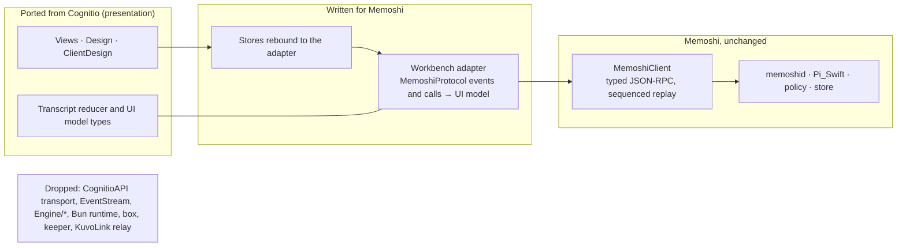
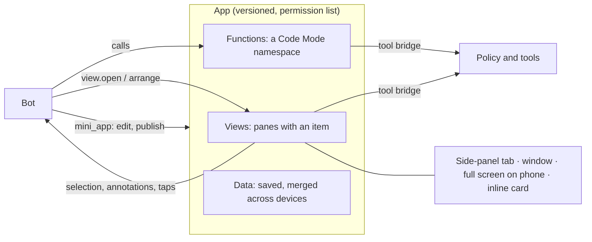

# Memoshi as base + Cognitio + bot-hq + malleable Apps: merge assessment

**Status:** Research · 2026-11-12 · requested by the user. The file itself proposes decisions and takes none; the user's choices of 2026-11-13 are recorded as [D106–D122](../plan/decisions.md#d106) and staged in the [scope amendment](../plan/AMENDMENT_2026-11-13.md), which supersede §8 and §9 below where they differ (§13).
**Question:** Use Memoshi (as finished per its plan) as the base, carry over Cognitio's UI/UX and capabilities, add what [`nickvasilescu/bot-hq`](https://github.com/nickvasilescu/bot-hq) has that both lack. Second pass, same day: add the "malleable software" idea shown by Pi's author (bot-built Mail and Calendar plugins inside Pi's own UI) and by [`HazAT/ultimate`](https://github.com/HazAT/ultimate). What is the best route and how far can the result go?
**Method:** read-only. Memoshi plan/specs/handoff and source tree; Cognitio (`~/Projects/Cognitio`, branch `work/2026-11-13`) source, plans and licence; shallow clones of `bot-hq` (`decf9a2`), `grokbot-clone`, `HazAT/ultimate` (`a416b01`) and a sparse clone of `earendil-works/pi` (`b8e1eec`: `apps/p2`, `apps/p2-mac`, `apps/p3`, Chord docs); Pi_Swift source; xAI's current Grok Bot docs (`docs.x.ai/grok-bot/*`); four posts by @badlogicgames of 2026-11-12 with their screenshots. Nothing was built, run or installed. `[INFERENCE]` marks reasoning. Licence statements are readings of the texts, not legal advice.

---

## 1. Conclusion

**Target in one line:** a native, local-first workspace where an Assistant runs a team of bots, with Cognitio's interface on Memoshi's engine and policy, extended by governed Apps that bots build and change while you talk, with Mail and Calendar as the first two.

| Layer | Source | What to take |
|---|---|---|
| Foundation: engine, policy, devices, Apple data | Memoshi's plan | As planned |
| Interface: Mac shell, transcript, composer, workbench, bot kit | Cognitio | Port the presentation layer; rewrite the logic in Swift |
| Malleability: Apps with panes, functions and data | Pi's p2, Ultimate, and Memoshi's own mini apps | Extend mini apps (§12); keep the sandbox and permission lists |
| Personal information: Mail and Calendar | The 2026-11-12 demo; EventKit; a mail tool set | New built-in Apps (§12.4) |
| Reach: voice, search, connector catalog, Tasks view | bot-hq, Grok Bot 1.0 | Features only |

1. **The target is reachable, and the direction is right: Memoshi's foundation is the only one that can carry the whole product.** It has a native Swift engine that runs in-process on iPhone/iPad, a policy engine outside the model, per-bot isolation, multi-device replication and the Apple-integration plan. Cognitio cannot get there (its capability logic is ~93k lines of TypeScript on Bun; no JavaScript runtime ships on iOS). bot-hq cannot either (a web shell over Hermes, Orgo, Composio and xAI cloud services). Pi's own Mac app, `p2-mac`, is a WKWebView around a Node server.
2. **Cognitio is the product that works today; Memoshi is the product that is planned.** Cognitio implements most of what Memoshi schedules for 2027–2029 (bots, groups, wake-ups, watches, worktrees, review, terminals, browser agent, five external coding agents, SSH machines, usage). Memoshi has ~144k lines of Phase 0 foundation Swift, a text-only chat, and a Phase 0 engineering recommendation of **No-go** as of 2026-11-06 ([gate record](../plan/gates/phase-0.md)). Treat Cognitio as two things: the **UX to carry** and the **executable specification** for capability ports.
3. **Best route: graft, don't merge.** Port Cognitio's presentation layer onto `MemoshiClient` through an in-app adapter; re-implement its capability logic in Swift on Pi_Swift using Cognitio's TypeScript and test vectors as the oracle; do not import its Bun runtime, box, keeper or relay protocol. Both products sit on Pi Durable semantics (Cognitio on the published TypeScript 1.5.0, Memoshi on the Swift port), so the mapping is engine-to-engine translation, not a redesign `[INFERENCE]`.
4. **bot-hq contributes five features, no code.** Realtime voice with work handoff, X search, an app-connector catalog with connect cards, a global Tasks view, and a live reasoning caption on the activity chip. Everything else it has is already in Memoshi's plan or in Cognitio. Its code is React/TypeScript and its bot artwork belongs to xAI.
5. **Malleable software is already half-planned in Memoshi, in a safer form.** Mini apps are bot-written, versioned, hot-swapped on request, with saved data and an "Ask the bot to change it" box. Four things are missing against p2 and Ultimate: a pane beside the chat, functions the App exports to the bot, tools for the bot to open and arrange views, and the user's selections travelling with the next message. One thing must not be copied: both references run agent-written code unsandboxed with no approval step (§12.2).
6. **Mail and Calendar fit as built-in Apps.** A Calendar pane over EventKit already sees every account added to the system calendar. Mail has no Apple read API, so it needs a typed `mail.*` tool set over provider APIs; every send stays a draft (§12.4).
7. **Three blockers must be decided before any of this starts** (§8): the licence consequence of Kuvo-derived code, the design lead (this request contradicts D92/D94), and the scope pulls against a 105-week one-builder calendar.
8. **State of the art moved this week.** Grok Bot 1.0 shipped 2026-11-11 with a primary Bot that coordinates the others, voice chat, phone calls, shopping, meeting notes, Team Bots in Slack and Teams, and native phone-app tools. Memoshi's first white-space claim ("one assistant that runs a team") is no longer unoccupied. The combined product still wins on: local-first, bring-your-own models, per-bot isolation, governed memory, budgets, a real coding workbench, native Apple data, and Apps that bots build under policy (§3).

## 2. The three projects, as observed

| | Memoshi | Cognitio | bot-hq |
|---|---|---|---|
| What it is | Planned native Mac + iPhone + iPad "Assistant and team of bots" | Working native Mac agent platform; noncommercial fork of Kuvo Code with the OpenCode engine replaced by Pi Durable | Web app that puts a Grok-Bot-style chat in front of Hermes agents |
| Engine | Pi_Swift (Swift port of Pi), in `memoshid` on Mac, in-process on iOS; no Node ([D44](../plan/decisions.md#d44), [D46](../plan/decisions.md#d46)) | Pi Durable 1.5.0 (TypeScript) on Bun 1.4.4; three Bun servers per computer plus a native C process owner | Hermes gateway per bot; app tools reach it over MCP |
| Code today | ~580 Swift files, ~144k lines; Phase 0 foundation and spikes; app composes no tools, MCP, Code Mode or subagents in normal builds | App 288 Swift files / 110k lines; packages 611 files / 86k lines; Runtime 46 TS files / 14k lines; Box 304 TS files / 80k lines; 236 app test files | 11k lines of TypeScript/TSX |
| Proof | 746 Swift tests in CI (2026-11-08); six spikes open; all ten Phase 0 exit criteria open | Large real-runtime suites with a stubbed model; genuine OpenAI-subscription runs (2026-11-05); no closed final-artifact acceptance; 2,227-commit upstream merge "pending suite and real-app verification" | One Playwright e2e that needs four live services; README says experimental, no security audit |
| Platforms | macOS 27+, iOS/iPadOS 27+ | macOS 26+ only; iPhone is a 17-PR plan with nothing implemented | Browser |
| Licence | Apache-2.0 open core ([D33](../plan/decisions.md#d33)); public release undecided (O13) | PolyForm Noncommercial 1.0.0; licensor is Kuvo's author, Serhat Andıç; the user is a licensee | MIT code; bot shapes, eyes and some icons are xAI/Cursor's and excluded from the grant |
| Calendar | v1.0 gate Fri 2028-11-24; Drop 2 2029-05-04; v1.1 from 2029-05-07 ([D87](../plan/decisions.md#d87)) | In daily development (4,773 commits, last on 2026-11-12) | Last commit 2026-11-11 |

Sizes are `wc -l` over source directories on 2026-11-12, excluding `build/`, `node_modules/` and `dist/`.

## 3. State-of-the-art baseline: Grok Bot 1.0 (2026-11-11)

Memoshi's [Grok Bot profile](agentic-workspace-landscape/projects/grok-bot.md) covers 0.72. The current docs add or confirm:

| Capability | Source | In Memoshi's plan? |
|---|---|---|
| A starred **primary Bot** that checks in unprompted, offers work and coordinates other Bots | [initiative](https://docs.x.ai/grok-bot/initiative), [how it works](https://docs.x.ai/grok-bot/how-grok-bot-works) | Yes: the Assistant (AS-01–06, Phase 1) |
| **Voice chat** (live call, mute, transcript, voice/speed/language, call card), **voice memos**, dictation | [chat](https://docs.x.ai/grok-bot/chat-and-collaboration) | Dictation only (AP-03); voice conversation is v2 (V2-09); no text-to-speech anywhere |
| iPhone **Siri/Shortcuts** (List Bots, Send Message, Start Dictation, Start Voice Chat), **Live Activities**, **Action Button** | [mobile](https://docs.x.ai/grok-bot/mobile) | App Intents AP-05 (Phase 2); Live Activity only for background turns (IOS-02) |
| Bot uses **phone apps**: Calendar, Contacts, Location, Alarms; iPhone-only Reminders and Home | [mobile](https://docs.x.ai/grok-bot/mobile) | Yes, and more (AP-10/11: also Music, Weather, Maps, Photos, Health read, Files); Location not listed |
| **Phone calls** to businesses with live transcript and take-over | [chat](https://docs.x.ai/grok-bot/chat-and-collaboration) | No |
| **Shopping**: product cards, order card, Vault cards and wallets | [chat](https://docs.x.ai/grok-bot/chat-and-collaboration), [vault](https://docs.x.ai/grok-bot/vault) | Purchase card kind exists; no commerce flow |
| **Meetings**: joins Meet/Zoom/Teams, notes, answers in chat, summary | [meetings](https://docs.x.ai/grok-bot/meetings) | No |
| **Pages** (reports, dashboards, trackers in a Library), **image and video generation** | [files and results](https://docs.x.ai/grok-bot/files-and-results) | Mini apps and artifacts exceed Pages; no image/video generation |
| **Team Bots**, Slack and Microsoft Teams, shared connectors, reviewed team learnings | [team bots](https://docs.x.ai/grok-bot/team-bots) | v2 (team bots), Telegram v1.1, Slack v2 |
| Bot **email address**, **X search without an account**, teach by demonstration | [computer and apps](https://docs.x.ai/grok-bot/computer-and-apps), [skills and routines](https://docs.x.ai/grok-bot/skills-routines-and-automations) | Email identity v2; no X search; teach v1.1 |
| One shared cloud computer; screens "are separate work surfaces, not separate security boundaries" | [computer and apps](https://docs.x.ai/grok-bot/computer-and-apps) | Memoshi isolates per bot: still a differentiator |

**Where the combined product would lead** `[INFERENCE]`: nobody ships local-first execution with the user's own models and subscriptions, a sandbox per bot, governed memory with provenance, budgets with hard stops, a pull-request-grade coding workbench, native live Apple-data cards, and bot-written native mini apps, on Mac, iPhone and iPad with one history. **Where it would trail:** team sharing, chat channels, phone calls, commerce, meetings, and anything needing a vendor cloud.

## 4. Capability matrix

Stage codes: P1–P4 = v1.0 phases, D1/D2 = drops, v1.1, v2. Memoshi IDs are from the [feature catalog](../plan/feature-catalog.md). "Cognitio" means implemented in source today. **Action** is this report's proposal.

| Capability | Memoshi plan | Cognitio today | bot-hq | Action |
|---|---|---|---|---|
| Transcript, tool calls, "Worked for…" steps chip | CH-02–08 P1; chip is a design rule | Custom TextKit transcript with virtualized rows, steps row, reasoning line, turn-end row, cross-row selection, Find | Thinking block with live reasoning caption; steps chip | Port Cognitio's stack; add the live reasoning caption |
| Composer, queue/steer/stop, side question | CH-05–08 P1; slash commands CH-18 P2 | Chips for mode, plan, model, worktree; `@` files, `/` commands, `!` shell, `&` agents; queue dock; `/btw` | Basic | Port |
| Assistant / primary bot, daily brief, check-ins | AS-01–06 P1 | None | Primary bot; check-ins skipped when the user wrote recently | Keep Memoshi's Assistant; adopt the skip-if-recent rule |
| Bot identity: look, personality, job, templates, limits, export | BOT-01–10 P1; `bot.md` EXP-01/02 | Looks (colours, shapes, animated faces), personalities, templates, work limits, `.kuvobot` recipes | 25 shapes × 11 colours (xAI artwork) | Port Cognitio's bot kit and editor onto Memoshi's bot record; recipes map to `bot.md`; never bot-hq's art |
| Groups, bot-to-bot | GR-01–11 **v1.1** | Groups with lead, seats across computers, meetings, proposed→done tasks, unattended seats, agent mail tools | Rooms, @mentions, `send_to_bot` with hop cap | **Pull forward** (§8); port rules from Cognitio's vectors; keep Memoshi's caps and Handoff records |
| Goals / Autopilot | Not planned | Goals with stages and checks, Autopilot, `may_spend` | None | New row to decide |
| Subagents | CH-15 P1, CODE-15 P2 | `task` tool with parent ownership | Dead code | As planned |
| Computers | This Mac sandbox P1; iOS environment P3; VM per bot and SSH **v1.1** | Local Mac and SSH machines (Linux, Mac), Seatbelt/Landlock, box-to-box moves | One shared Orgo computer, screen per bot, max four | Keep Memoshi's isolation; use Cognitio's machine design as the v1.1 reference |
| Watch and take over | Browser BRW-05/06 P1; any device D2; VM screen v1.1 | Browser takeover and hand-back; remote machine browser | noVNC watch/control, "hand back to bot" | As planned; desktop screens arrive with VMs |
| Browser agent | BRW-02–08 P1 (WebKit per bot) | WebKit agent, sign-in/OTP asks, passkeys, agent pointer overlay | Hermes over Chrome CDP, ungated | Port the asks and pointer UX; Memoshi's gateway and policy stay |
| Connectors | MCP only, CON-01–13 P1 | Integrations catalog with four routes (maker's MCP, token, own OAuth app, pinned package), MCP, elicitation | Composio catalog, connect card | **Add** a catalog and connect card on top of MCP |
| Event triggers | Webhooks RT-13 P2; connector events RT-14 P3 | None | Composio triggers | As planned |
| Policy and approvals | Tiers T0–T5, Ask first/Auto/Bypass, drafts, standing rules P1 | Ask First, Accept Edits, Auto with reviewer, Full Access; deny with reason | Composio writes only | Keep Memoshi's engine; adopt deny-with-reason and the card UI; never Full Access as a default |
| Memory | Governed scopes, proposals, consolidation MEM-01–10 P1 | `MEMORY.md` per bot | Hermes `MEMORY.md`, list and delete | Keep Memoshi's |
| Routines, wakes, watches | RT-01–12 P1 | Wake-ups, watches, `/loop`, group meetings, fired with the app closed | Cron routines | As planned; port the wake list UI |
| Dictation | AP-03 P1 | `SpeechAnalyzer` plus WhisperKit, project-word hints | xAI speech-to-text | Port `KuvoVoice` |
| **Realtime voice** | V2-09 **v2** | None | xAI realtime call; voice agent hands work to the bot's queue and speaks the result; call record | **Pull forward** (§6.1) |
| Text-to-speech, voice memos | Not planned | None | Voice preview | **Add** with voice |
| Models and sign-ins | API keys, local, ChatGPT sign-in P1; MLX D2 | Pi catalog, OpenAI subscription, Claude subscription (SDK), GitLab, Poe, Bedrock, Vertex; ordered failover lists | Hermes providers; sign-in on the bot's screen | Keep Memoshi's; consider failover lists; Claude subscription conflicts with DIST-03 (§7) |
| External coding agents | Codex, Claude Code, ACP **v1.1** ([D11](../plan/decisions.md#d11)) | Claude Code, Codex, Cursor, Grok, Antigravity, with handover | None | **Pull forward**, Mac only (§6.4) |
| Coding workbench | PR-01–09, CODE-01–12, TP-01–04 P2 | Worktrees, Changes with line comments, `/review`, undo with snapshots, `/plan`, PTY terminals, background jobs, PR draft | None | Port the UI; rewrite the logic in Swift |
| Files, Library, artifacts | CMP-04, TP-06 P1; TP-07–09 P2 | Files panel, "What X Made" shelf | Library tab | Port the panel; Library as planned |
| Generated UI | 17 native cards P1; JSON cards and Swift mini apps P2/P3; D1 extras | `show_widget` HTML in a web view; Mermaid in a web view | Four card kinds | Memoshi leads; render Mermaid natively with the user's `Pele_Swift` |
| Search | `web_fetch` only | `websearch` (selectable provider), `webfetch` | `x_search`; Hermes web search | **Add** `web_search`; `x_search` as an optional connector |
| Tasks | CH-15 P1; Tasks tab TP-05 P2 | Group tasks, goal stages | Task tools; global Tasks view with waiting count | **Add** the global view |
| Usage and budgets | BU-01–07 P1/P3 | UsageKit menu bar (11 providers), receipts, work limits | None | Keep budgets; reuse UsageKit (MIT) for subscription meters |
| Inbox and notifications | IN-01–07, AP-02 P1 | Needs-you notices, actionable notifications, Dock badge | Unread dots | As planned |
| Secrets | By reference, sign-in cards SEC-10 P1 | Vault (`vault_items`, `vault_ask`, `vault_run`), SSH agent, masking | `.env` | Keep Memoshi's; Cognitio's vault tools as reference |
| Multi-device | Engine on every device, MLS group, leases, replicas P3 | Host-side phone protocol only (Noise IK, relay client); no app, relay or APNs | Tabs in sync | Keep Memoshi's |
| Apple integrations | AP-01–13 P1–D2 | Notifications, Keychain, `SMAppService`, Sparkle | None | Keep Memoshi's; add Action Button and "Start Voice Chat" intent |

## 5. Gap lists

**5.1 Cognitio has it; Memoshi plans it late or not at all**

| Item | Memoshi stage | Note |
|---|---|---|
| Groups and bot-to-bot messaging | v1.1 | Cognitio ships rules plus `test/groups-rules.json` vectors |
| External coding agents | v1.1 | Cognitio drives five; three need a JavaScript runtime (§6.4) |
| SSH machines, moves between computers | v1.1 | Depends on a box/keeper model Memoshi does not have |
| Goals and Autopilot | absent | |
| Integrations catalog | absent | |
| `web_search` tool | absent | |
| Ordered model failover ("Custom Auto") | MOD-05 fallback only | |
| `/btw` side question, `/handoff`, deny with reason | partly | Side threads exist for offline devices, not as a user command |
| Subscription usage meters | BU-02 shows own usage | UsageKit reads vendor plan limits |

**5.2 bot-hq has it; neither Memoshi's plan nor Cognitio has it**

| Item | How bot-hq does it | Local-first form `[INFERENCE]` |
|---|---|---|
| Realtime voice call with work handoff | Browser connects to xAI realtime with a 300 s ephemeral secret; voice agent has `send_task`, `peek_activity`, `recall_text_messages`, `search_conversations`, `end_the_call`; finished work is injected and spoken | Same two-agent split behind a provider seam (xAI, OpenAI realtime); the voice agent is a client of the bot's normal queue, so policy and cards are unchanged |
| Voice settings and preview | Voice, speed, language; text-to-speech preview | Provider voices; `AVSpeechSynthesizer` as the offline fallback |
| `x_search` | xAI Responses API with the `x_search` tool; handles and date filters; up to 40 source links | An optional connector that needs the user's xAI key; tier T3 |
| App catalog with connect card | Composio catalog, OAuth popup, card resolves and resumes the bot | Cognitio's four-route catalog over MCP; Composio only as an optional MCP server, off by default |
| Global Tasks view | `create_task`/`update_task` with `needs_input`; sidebar count | A view over Memoshi Tasks and the Inbox |
| Live reasoning caption | Caption taken from the reasoning stream's bold title or first sentence | Presentation only |
| Per-bot engine panel with on-screen subscription sign-in | Runs the provider's own sign-in in a terminal on the bot's screen | Covered by per-bot model (MOD-04) and D11's "users sign in to each vendor's own CLI" |

bot-hq features **already covered**: steps chip, primary bot, check-ins, routines, groups, approval/question/connect cards, Library, skills, memory list, screen viewer, themes.

**5.3 Grok Bot 1.0 has it; none of the three has it**

Phone calls, shopping and payments, meeting attendance, bot email address, image and video generation, Team Bots with Slack/Teams, X `@bot` tagging. Recommended: image generation (a provider tool, small) and meeting notes as later candidates; leave the rest out, consistent with the v1 non-goals in [MASTER_PLAN §4](../plan/MASTER_PLAN.md#4-who-it-is-for).

## 6. How to carry each part

### 6.1 Cognitio's UI: the seam

- Cognitio's views read `@Observable` stores; stores call one concrete struct, `CognitioAPI` (~110 methods), and reduce ~45 named server events into a `Transcript`. That struct plus the event enum is the narrowest seam.
- **Recommended seam:** an adapter inside the Mac app that turns `MemoshiProtocol` calls and events into Cognitio's UI model types. `MemoshiProtocol`, policy and recovery stay authoritative. This is a presentation mapping, not the daemon-side OpenCode-compatibility facade that the [2026-10-23 reuse assessment](2026-10-23-kuvo-frontend-reuse.md) rejects. Memoshi's sequenced replay is a superset of Cognitio's refetch-on-reconnect feed `[INFERENCE]`.
- Known friction: `ToolCallView` switches on literal tool names; two views take `CognitioAPI` directly; approval modes differ (Cognitio has four including Full Access; Memoshi has three plus tiers); Cognitio has no `#if os` anywhere in the app.

| Surface | Portability on Mac | Reason |
|---|---|---|
| Design tokens, materials, motion, status marks, bot avatars (`ClientDesign`) | Drop-in | Already declares macOS and iOS |
| Terminal (SwiftTerm), Files panel, Textual, UsageKit | Drop-in | MIT dependencies or engine-independent |
| Transcript stack | Adapt | Renderer is engine-neutral; rows are typed on Cognitio messages and tool names |
| Composer, model picker, attention cards | Adapt | Mostly props and callbacks; reads catalog and workspace stores |
| Changes / diff panel | Adapt, near drop-in | Git is read locally; session scope, undo and comments need the daemon |
| Sidebar, card window shell, command palette | Adapt | Drop computer paging; map to Memoshi's Inbox, Assistant, Bots, Projects, Sessions, Apps |
| Bot editor, wake list | Adapt | Persistence maps to Memoshi's bot record and governed memory |
| Browser panel | Adapt | `WKWebView` UI ports; the tool server must register with `memoshid` and pass the gateway |
| Group chat | Views adapt, store rewrite | Turn-taking lives in TypeScript today |
| Settings | Shell drop-in, pages mixed | Agents, Permissions, Skills, MCP and Engine pages are rewrites; drop Machines and Phone |
| Stores for machines, phone link, moves, box, keeper | Drop | ~28% of store code |

Estimated survival `[INFERENCE, unmeasured]`: ~85% of view code and ~70% of store code on Mac. **iPhone and iPad need a new presentation layer**: ~35 `NSViewRepresentable` types and the TextKit transcript are AppKit-bound, and Cognitio's own package README says composer fields, reply renderers and app-state stores are deliberately not shared. `ClientDesign`, `KuvoVoice` and Textual do build for iOS.

### 6.2 Cognitio's capabilities: port against an oracle

| Logic | Lives in (TypeScript) | Route |
|---|---|---|
| Groups, seats, peer mail | `Packages/Box/src/agents/groups/*`, `link/letters/*` | Rewrite on Pi_Swift; assert against `test/groups-rules.json` |
| Wake-ups, watches, goals | `link/work/*`, `agents/goals.ts` | Memoshi's scheduler (RT-*) absorbs wakes and watches; goals are a new decision |
| Worktrees, snapshots, undo, `/review`, `/btw`, `/handoff` | `Runtime/src/projects.ts`, `agents/snapshots.ts`, `reviews.ts`, `btw.ts` | Rewrite; `worktrees.test.js` (25 cases) is the behavioural spec |
| Approval asks, Auto reviewer | `link/areas/approval.ts`, `link/work/reviewer.ts` | Map onto Memoshi's tiers; do not import the mode set |
| Vault tools | `link/vault/*` | Reference for SEC-10 |
| MCP host, OAuth, elicitation | `Runtime/src/mcp.ts` | Pi_Swift and `RuntimeMCP*.swift` already cover this |
| Durable contracts | `plans/kuvo-pi-research/06-durable-implementation-contracts.md` | Read as the mapping guide: same engine family, other language |

Not transferable: `Runtime/` as a whole, the process owner, keeper, SSH installer and box updater, and the engine half of `CognitioKit`.

### 6.3 Realtime voice

Pull V2-09 forward and add text-to-speech. Shape: a short-lived voice session whose model has only relay tools; real work is a normal message in the bot's queue, so every approval, draft and budget rule is the one already built. On iPhone add the "Start Voice Chat" App Intent, a Live Activity for the call, and Action Button support, matching Grok Bot 1.0. Keep the provider behind a seam; audio leaves the device, so the bot's disclosure and grant must say so.

### 6.4 External coding agents without Node

Cognitio drives Claude Code through the Claude Agent SDK (npm), Codex through `codex app-server` (JSON-RPC over stdio), Cursor through its SDK, and Grok and Antigravity through ACP. Under [D46](../plan/decisions.md#d46) only the subprocess protocols are usable: Codex app-server, ACP agents, and the unmodified Claude Code binary that [D11](../plan/decisions.md#d11) already names. Cursor's SDK needs a JavaScript host and would stay out `[INFERENCE]`. Mac only; impossible on iOS.

### 6.5 What not to take

- Cognitio's Bun runtime, box, keeper, process owner and updater: they duplicate `memoshid` and break the no-Node rule.
- The KuvoLink relay protocol and the 17-PR iPhone plan as written: a thin phone client of a Mac box contradicts [D49](../plan/decisions.md#d49). Its surface list (sessions, send/steer, notifications, bots, vault, changes, widgets, Siri, Live Activities) is a useful checklist for Phase 3.
- Full Access / approve-all defaults, `MEMORY.md` as the whole memory model, worktrees as isolation: already rejected in [Kuvo base](2026-10-20-kuvo-base.md).
- The Claude subscription (SDK) provider: CI rule DIST-03 fails builds containing Anthropic subscription flows; the SDK is "© Anthropic PBC. All rights reserved".
- `show_widget` HTML: Memoshi's native cards and mini apps replace it.
- Any bot-hq code or artwork; Orgo, Hermes and Composio as required services.

## 7. Constraints that bind the merge

1. **Licence (the largest).** Cognitio's app and `KuvoClient`, `KuvoLink`, `KuvoVoice`, `CognitioKit` are Kuvo-derived under PolyForm Noncommercial 1.0.0. The text permits personal use, modification and noncommercial redistribution with the notice; it does not permit commercial use or sublicensing. The upstream repository is live: `git ls-remote` returned its `main` head on 2026-11-12, and Cognitio merged upstream through `8866141a` on 2026-11-08. The "lookups returned 404" line in Cognitio's `plans/README.md` is out of date, so the author is reachable for decision 1(c).
   - A Memoshi build containing that code is noncommercial-only. That closes the paid paths under O1 and O13 until the author grants rights or the code is replaced `[INFERENCE]`.
   - The iPhone and iPad app is a GPL-3.0 combined work through iSH ([D69](../plan/decisions.md#d69)). GPL-3.0 forbids added restrictions, so Kuvo-derived code and iSH in one distributed binary is an unresolved conflict that [D91](../plan/decisions.md#d91) already flags. Own-device builds are the only clearly safe case `[INFERENCE]`.
   - Free of this: Textual, UsageKit, SwiftTerm, WhisperKit, Prism, browser-use's `buildDomTree.js` (MIT). Kuvo-authored edits inside the MIT forks need a per-file check, as the [reuse assessment](2026-10-23-kuvo-frontend-reuse.md#5-licence-and-provenance-scope) notes.
   - Cognitio's `Runtime/` was written for the fork rather than inherited from Kuvo; how much of it is the user's own original work, and so freely portable, needs a provenance pass `[INFERENCE]`.
2. **Engine.** Pi_Swift stays. `slice-2` was tagged on 2026-11-12 and is the recommended pin; Memoshi is still on `892585fc`. The Pi_Swift gate is Fri 2026-11-27.
3. **Policy.** One policy engine outside the model; external workers are tools, never a second permission system.
4. **Design.** [D92](../plan/decisions.md#d92) makes Viticci's assistant grammar the lead and Kuvo an input to the workbench only; [D94](../plan/decisions.md#d94) built the current preview on that. "I like Cognitio's UI and UX" reverses the lead for the Mac and needs a superseding decision and a design review (change-control rule 5).
5. **Vocabulary is binding.** Cognitio's session, chat, machine/box, wake-up and goal map to Memoshi's Session, Chat, Computer, Wake and (new) Goal; the UI says Bot.
6. **Calendar.** One builder, 105 plan weeks, Phase 1 already the heaviest phase. Every pull in §8 triggers a roadmap review (rule 3).

## 8. Decisions this needs

| # | Decision | Options | Recommendation |
|---|---|---|---|
| 1 | Reuse mode for Cognitio's UI | (a) port the code into a quarantined, provenance-recorded module; (b) re-implement the UX in Memoshi's own code, Cognitio as reference; (c) ask Kuvo's author for a licence | (a) for the Mac now, kept out of the iOS target and replaceable, plus (c) before any public release. (b) is the only route with no licence debt and costs the most time |
| 2 | Design lead | Cognitio leads Mac chat, bots and workbench; Viticci's grammar keeps Apple-data cards, mini apps and mobile | Supersede D92/D94 for the Mac shell only; keep them for native resource cards and iPhone/iPad |
| 3 | Groups and bot-to-bot | Stay v1.1, or move into v1.0 | Move to Phase 2: Cognitio supplies rules, vectors and UI |
| 4 | Realtime voice and text-to-speech | Stay v2, or move into v1.0 | Move: Mac in Phase 2, iPhone/iPad in Phase 3 |
| 5 | External coding agents | Stay v1.1, or move into v1.0 | Move Codex app-server and ACP to late Phase 2, Mac only; Claude Code as D11 states |
| 6 | New catalog rows | `web_search`, `x_search` connector, integrations catalog and connect card, global Tasks view, live reasoning caption, goals/Autopilot, model failover lists, image generation | Add the first five in Phase 1; decide goals, failover and image generation separately |
| 7 | What leaves v1.0 to pay for 3–6 | Candidates by the plan's own risk register: iSH ([D69](../plan/decisions.md#d69)), Swift-engine breadth (R51), Pyodide extras | The user's call; without cuts the 2028-11-24 gate does not hold `[INFERENCE]` |
| 8 | Cognitio's future | Keep developing both; or freeze Cognitio features and keep it as daily driver and oracle | Freeze features; cancel the 17-PR iPhone plan in favour of Memoshi's Phase 3 |
| 9 | Claude subscription | Drop, or lift DIST-03 | Drop the SDK provider; Claude through the Claude Code worker only |
| 10 | App model | Keep mini apps as sheets owned by one bot; or extend them to Apps with a pane beside the chat, exported functions, view tools and selection carry | Extend. Amends [D85](../plan/decisions.md#d85) and [`cards.md`](../specs/cards.md) §11.6 and §12.1 |
| 11 | Malleability before the Swift engine | (a) wait for Phase 2; (b) page Apps in Phase 1: a sandboxed web view with the tool bridge and permission list; (c) catalog panes with logic in Code Mode, which revives half of [D62](../plan/decisions.md#d62) | (b) now, Swift Apps as planned; (c) only if the W25 engine probe fails |
| 12 | Mail and Calendar | Connector and cards only, as planned; or built-in native Mail and Calendar panes with typed tools | Built-in panes; calendar tools move from Phase 2 to Phase 1 on the Mac; the open CON-08 question becomes "native `mail.*` tools" |
| 13 | App scope | Per bot only; or also user-wide and project-scoped (`.memoshi/apps/`) with a trust prompt | User-wide in v1.0; project-scoped with coding in Phase 2 |
| 14 | Trust for bot-written code | The references' model ("the instance is the trust boundary"); or Memoshi's sandbox, permission list and policy per call | Keep Memoshi's, with no exception for "it's my own device" |

## 9. Proposed order of work

Stages are Memoshi's existing phases; no dates are invented here.

| Stage | Work | Exit evidence |
|---|---|---|
| Phase 0 (to 2026-11-27) | No scope change. Adopt `slice-2`. Take decisions 1–2. Run one time-boxed **graft probe**: compile `ClientDesign` and the transcript stack into the Mac app behind an adapter fed by `LiveChatModel` | Measured: files changed, build result, a real streamed reply rendered, scroll and selection behaviour; this replaces the unmeasured estimates in §6.1 |
| Phase 1 (Mac: Assistant and bots) | Cognitio shell (card window, sidebar, transcript, composer, attention cards, model picker) on `MemoshiClient`; bot kit and editor on Memoshi's bot record; dictation from `KuvoVoice`; UsageKit; `web_search`, integrations catalog, Tasks view, reasoning caption. Apps: an App tab in the side panel, `view` tools, selection carry, page Apps with the tool bridge. Calendar and `mail.*` tools with built-in Calendar and Mail panes | The builder moves daily chat and bot use from Cognitio to Memoshi; a bot builds a working pane in one conversation and changes it on request; inbox triage and the week view are used daily |
| Phase 2 (workbench) | Changes, files, terminal, worktrees, `/review`, `/plan`, undo; groups; external agents; voice on Mac. Swift Apps with exported functions; project-scoped Apps; a code-only landing gate and parallel reviewers | Cognitio's coding sessions are no longer needed on the Mac; a Swift App replaces a page App with the same data |
| Phase 3 (iPhone, iPad, devices) | As planned, with a new SwiftUI presentation over the shared tokens and avatars; voice with Live Activity and Action Button | As planned, plus a call that hands work to a bot and speaks the result |
| v1.1 | VM computers with per-bot screens, SSH machines (Cognitio's design as reference), Telegram, teach by demonstration | As planned |
| Later | Meeting notes, image generation, phone calls, commerce, team sharing | — |

## 10. Risks

| Risk | Consequence | Mitigation |
|---|---|---|
| Noncommercial code inside an Apache-2.0 product | No paid or broadly distributed release | Quarantined module, provenance records, author contact, replacement path |
| Two live codebases | Cognitio (4,773 commits) keeps absorbing effort while Memoshi is two years from its gate | Decision 8: freeze, then port |
| Scope added to the heaviest phase | The v1.0 gate slips | Decision 7 before any pull; first usable milestone is "Mac at Cognitio's daily-use level", not v1.0 |
| The adapter hides a model mismatch | Views compile but misstate approvals, queueing or recovery | The graft probe; Memoshi's contract tests stay the authority |
| Pi_Swift readiness (R39) | Everything above waits | Unchanged: the 2026-11-27 gate and its fallbacks |
| The baseline keeps moving | Grok Bot went 0.72 → 1.0 in three weeks | Refresh this comparison at each phase gate |
| Bot-written code next to mail | An injected email steers a bot into changing an App | [D72](../plan/decisions.md#d72)'s rule stays: a version made after untrusted content needs approval before it runs; sends stay drafts; exposure labels per value |
| The references are moving targets | p2's README says "a prototype. It will be gone soon"; p3 has docs and no code | Copy mechanisms, not APIs; re-read `apps/p3/docs` at each Pi_Swift sync |

## 11. Verification limits

- Nothing was compiled or run. Cognitio "implemented" means source and its own test records were read; bot-hq "implemented" means code is present and wired.
- Survival percentages in §6.1 are estimates from file sizes and imports, not a port.
- Grok Bot facts are xAI's own documentation (vendor claims), fetched 2026-11-12; the 1.0 date comes from the product's X post as surfaced by search.
- Licence readings are of the licence texts only.
- Memoshi's `docs/HANDOFF.md`, `docs/plan/decisions.md` and `docs/plan/gates/phase-0.md` had uncommitted edits during this pass (decisions now run to D105); stage facts were read from the working tree.
- The four X posts were read through a search relay and their four screenshots were viewed directly; the Mail and Calendar plugins shown are not in any public repository, so §12.4's description of them comes from the screenshots only.
- p2's docs disagree in places (`plugin-hooks.md` is marked outdated; two statements differ on whether pages reload). Ultimate's per-extension behaviour comes from its READMEs with code present, not from line-by-line verification.
- Two platform statements in §12.4 are from platform knowledge and Memoshi's own plan notes, not tested here: that EventKit returns calendars from every account added to the system, and that no Apple API reads the Mail store.

## 12. Malleable software: Pi's p2, Ultimate, Mail and Calendar

### 12.1 What the references are

| | Pi p2 (`earendil-works/pi`, `apps/p2`) | Ultimate (`HazAT/ultimate`) |
|---|---|---|
| What it is | "A self-hosted Pi Durable UI built from independent Chord plugins"; 48 plugin folders; ~159k lines of TypeScript | "A local coding agent with a web UI that builds itself while it runs"; 59 extensions (15 core, 34 on, 10 off); ~155k lines |
| Maturity | README: "EXPERIMENTAL … p2 is a prototype. It will be gone soon." p3 is its planned rewrite: docs only | README: "A personal project, shared as inspiration"; fundamentals change without migration paths |
| A plugin is | A folder with `contract.ts` and facets `server.ts`, `worker.ts`, `web.tsx`, `tui.ts`, plus an optional skill | A folder with `server.ts` (tools, prompt sections, hooks, documents, actions) and `web.tsx` (slots, panels, surfaces, renderers, commands) |
| Where bot-written ones live | A user root `<data>/plugins/`; a built-in wins a name clash. Project plugins are designed, not built | Built-in → `~/.ultimate/` → `<project>/.ultimate/`, later wins; project code needs one trust decision |
| How a change goes live | The agent edits files with ordinary tools, then calls `reload_plugins`: one build, rollout server → workers → pages; "a failed build applies nothing"; per-plugin result with `file:line:column` errors | A file watcher: the server facet is reinstalled, the web bundle rebuilt in ~2 s; the core restarts through a type-checked generation swap with rollback |
| How the bot reaches a plugin | Plugin tools in a Code Mode namespace (one prompt line each); `view_open`, `view_arrange`, `view_list` | Typed server actions shared by UI and agent (`ultimate.action`), documents, durable events |
| How the user's view reaches the bot | Text selections and drawn annotations in any pane go with the next message, once | Durable UI state readable by the agent |
| State | Server store shared by all sessions; a session document for views; layout per device | SQLite documents per conversation and per project; nothing in module memory, so reload is free |
| Sandbox for plugin code | None. "`reload_plugins` has no requirements, like bash"; p3: "The instance is the trust boundary" | None. Server facets run in the core Node process; `SECURITY.md` puts chosen extensions and prompt injection out of scope |
| Mail or Calendar in the repo | No; the 2026-11-12 plugins are personal | No; it is a coding agent |

What the four posts show (screenshots): a session named Email in Pi's web UI; the agent adding swipe-to-archive, then "used reload_plugins · 2 steps"; a Mail pane as a tab beside the chat with account chips, an inbox list and a thread view; "can you do a calendar plugin as well?" answered with a Day/Week/Month Calendar pane about ten minutes later. The agent's own notes in the transcript say the data comes from the `gog` Google command-line tool, the inbox and events are in-memory caches shared by every session on the server, the open filter and calendar view are per session, only reply drafts are saved, sending takes two taps, and `mail_show` and `cal_show` move the pane.

Also in p2 and Ultimate, beyond plugins: a supervising session that starts and steers the others (p2 `familiar`, Ultimate's @ultimate); a local voice service (Parakeet speech-to-text, Supertonic or Kokoro text-to-speech, word-level barge-in); a live-voice agent with tools to hand off, navigate the UI and read answers back; session sharing with guests; a code-only landing gate that runs checks before merging; parallel reviewers with one merged verdict; zero-token watcher scripts; a reflection pass that turns failures into proposals; a context inspector.

### 12.2 What Memoshi already has, and the gap

| Aspect | p2 and Ultimate | Memoshi's plan | Action |
|---|---|---|---|
| Who writes it | The agent, in TypeScript and React | The bot, in SwiftUI-style Swift (CH-22 Phase 2 Mac, CH-23 Phase 3 iPhone/iPad); JSON cards (CH-19) | Keep |
| Going live | Explicit apply or file watcher; old version stays on failure | `mini_app` edit → compile → `publish`; a version the user asked for switches in by itself; a failed compile publishes nothing | Equivalent |
| Versions and rollback | Git, or none | Numbered versions, Restore, data snapshots | Memoshi ahead |
| Functions for the bot | Plugin tools and actions | None: "A program reaches data and the world only through Memoshi's tools"; the bot can only read an app's files, data and log | **Add** exported functions |
| Placement | Tabbed panes beside the chat; one pane at a time on phones | Sheet, window or full screen; a side pane "is not an accepted choice" (`02-experience.md`) | **Add** a side-panel tab |
| Bot drives the view | `view_open`, `view_arrange` | None | **Add** `view` tools |
| User's view reaches the bot | Selections and annotations with the next message | A digest of taps, from Drop 1 (CH-31) | **Add** selection carry; move the digest earlier |
| Ownership | Shared by all sessions | One bot owns each mini app | **Add** user-wide Apps by grant |
| In the repository | Ultimate: `.ultimate/` committed with the project | Only skills are project-scoped (CON-11) | **Add** later, with a trust prompt |
| Drawing outside its frame | Slots everywhere, whole surfaces | Forbidden, "so a program can never pass for Memoshi's own controls" | Keep the ban; allow a fixed set: a panel tab, an Apps row, a ⌘K command, a renderer for its own function calls, a widget, an App Intent |
| Sandbox and consent | None | Sandboxed engine helper; compiler-made permission list approved per version; policy on every call; exposure labels per value | **Keep.** This is the differentiator |
| Changing the core | Yes | No: components are "compiled into the app" and the app is signed | Not transferable; build first-party features on the same App contract instead |

Engine pieces already in Pi_Swift (code present): `Registry.install` with replace-in-place for tool bundles, `defineDoc` documents, Code Mode with runtime `registerTool`, and Chord `Host.reload` for facets linked into the app. Cognitio has `show_widget` (bot-written HTML in the transcript with a reply channel), `show_in_panel`, and a tabbed side panel whose tab kinds are a closed enum.

### 12.3 The App contract proposed for Memoshi

An **App** is today's mini app plus three additions. It needs no new sidebar section: the Apps section exists ([D81](../plan/decisions.md#d81)).

| Part | Rule |
|---|---|
| Views | A pane shows one item of one kind. It opens as a side-panel tab on Mac and iPad, full screen on iPhone, or inline in the transcript. Each pane has its own error boundary; a failed version leaves the previous one running |
| Functions | Named, typed operations the App exports. The bot sees one prompt line per App and asks for details on demand. A call runs inside the App's sandbox and its own tool calls pass policy like any other |
| View tools | `view.open`, `view.close`, `view.arrange`, `view.list`. Layout is remembered per device; the bot's arrangement is adopted once |
| Selection carry | Selected text or items in a pane go with the user's next message, once, and the composer shows a removable chip |
| Data | Saved data as planned. Add view state per conversation and per device, kept apart from shared data |
| Scope | A bot's own; user-wide by grant; later project-scoped in `.memoshi/apps/` behind a trust prompt |
| Authoring loop | The bot gets a rendered snapshot of a version before publishing, as Ultimate's agents screenshot a preview instance |

Runtime, in the order it can ship:

| Tier | Views | Logic | Stage | Note |
|---|---|---|---|---|
| Page App | HTML in a sandboxed web view with a state bridge | Page script; data only through the tool bridge and permission list | Phase 1 (TP-07 is Phase 2 today) | Fast, not native. p2's html artifacts and Cognitio's `show_widget` are this |
| Swift App | Native components through Memoshi's Swift engine ([D68](../plan/decisions.md#d68)) | Swift | Phase 2 Mac, Phase 3 iPhone/iPad, as planned | Native; the plan's largest single build (R51) |
| Catalog pane | The JSON block catalog ([D53](../plan/decisions.md#d53)) | Functions in Code Mode | Only if the engine probe fails | The fallback R51 already names; ranked first in the [generative-UI survey](2026-11-11-generative-ui-sota.md) |

### 12.4 Mail and Calendar

| | Calendar | Mail |
|---|---|---|
| Memoshi's plan today | EventKit tools with hand-built native cards: AP-10 Phase 2 (Mac), AP-11 Phase 3 (iOS); live cards in Drop 2 | CON-08, Phase 1: "A mail connector for the Correspondent template; every send is a Draft"; which connector is still open. No pane |
| Data source | EventKit. It returns every calendar the system has, including Google and Exchange accounts added in Settings, so no separate sign-in | No Apple API reads the Mail store (MailKit only offers extension points; Apple Events are excluded by [D41](../plan/decisions.md#d41)). Use provider APIs: Gmail, Microsoft Graph, IMAP |
| Tools | `calendar.*` as planned | New typed `mail.*`: list, thread, search, draft, send, archive, label. Tokens in Keychain by reference; traffic through the egress gateway; same tools on Mac and iPhone |
| Pane | Day, Week, Month; today marker; tap an event to open its native card | Account chips with counts, inbox list, folded thread view, reply box that saves a provider draft, swipe to archive, keyboard `j` `k` `e` `r` |
| Policy | A new or changed event is a T4 draft | Send is always a T4 draft card. Archive and mark-read are reversible connector writes that a standing rule can cover. All message content is labelled untrusted |
| Built how | Native SwiftUI, first-party, on the App contract | Same |

- Build both as first-party native panes rather than waiting for the Swift engine. They expose functions and data through the App contract from the start, so a bot can drive them and build bespoke page Apps beside them. Re-expressing them in the engine's kit, so a bot can fork the panes themselves, is a later candidate.
- The `gog` tool from the demo is a Mac-only shortcut inside the This Mac sandbox. It cannot run on iPhone or iPad.
- In-house: Apollo has a MailKit extension (`ios/ApolloApp/ApolloMailKitExtension`) and a Gmail proactive trigger worth reading before the `mail.*` design.

### 12.5 Other ideas worth taking

| Idea | From | Memoshi today | Action |
|---|---|---|---|
| Question cards with a recommended pick; the Assistant pre-answers what it can | Ultimate `questions` | Question card | Add the pick |
| Code-only landing gate: merge, run checks, rerun a flaky one once, then fast-forward | Ultimate `workspaces` | Commit and PR (CODE-07/08) | Add in Phase 2 |
| Parallel reviewers with different lenses, one verdict | Ultimate `reviewer` | Bot review (CODE-12) | Add in Phase 2 |
| Event- and context-triggered automations | Ultimate `automations` | Schedules, wakes, model-free watches | Add triggers |
| Reflection pass: failures and corrections become proposals | Ultimate `dream` | Nightly memory consolidation (MEM-09) | Extend the proposer |
| Model roles ("families") instead of fixed models per agent | Ultimate `models` | Per-bot model (MOD-04) | Add with failover lists |
| Local voice: on-device speech-to-text and text-to-speech with barge-in | p2 `voice-server` | Dictation only | The offline path for §6.3 |
| Voice agent that navigates the UI and reads an answer back before settling it | Ultimate `voice-live` | — | With voice |
| Function-call rendering owned by the App, from structured details | p2 `tool-ui` | Tool chips | With Apps |
| Pause every bot on a rate limit, with Play | Ultimate `pause` | Stop All Bots | Add |

Already covered: a supervising assistant (the Assistant), zero-token watchers (Watches), a side question (`/btw` from Cognitio), notification replies (AP-02), contract versions that keep old clients working (D74's expand-then-contract).

### 12.6 What not to take

- Unsandboxed bot-written code and an apply tool with no approval. Ultimate's own docs call its human-only actions "not a sandbox against arbitrary agent code"; its secrets are a plaintext file the agent's shell can read.
- A self-modifying core. It depends on Node loading TypeScript at run time; a signed Mac app and iOS allow neither.
- A web UI as the app's chrome. Pi's `p2-mac` is labelled a spike and has no native chat UI; that gap is Memoshi's opening.
- p2's and Ultimate's APIs as a compatibility target. Take the mechanisms in §12.3; the code is TypeScript and React and both authors say it will change.

## 13. What the user decided (2026-11-13)

The decisions in §8 were walked through one by one. Where the choice differs from this report's recommendation, the choice governs.

| Topic | This report recommended | Chosen | Decision |
|---|---|---|---|
| Cognitio's interface | Port its code into a quarantined Mac-only module and ask Kuvo's author for a licence | Rebuild the look and behaviour in Memoshi's own code; a public release stays possible | [D106](../plan/decisions.md#d106) |
| Design lead | Cognitio on the Mac, Viticci elsewhere | Cognitio on every device | [D106](../plan/decisions.md#d106) |
| Cognitio's future | Freeze its features | Keep developing both | [D107](../plan/decisions.md#d107) |
| Claude subscription | Claude Code as a coding worker only | Also as a model for any bot on the Mac | [D108](../plan/decisions.md#d108) |
| Orchestration, bot-to-bot, groups, goals | Groups in Phase 2 | As recommended, plus bot-to-bot messages in M1 | [D109](../plan/decisions.md#d109) |
| Outside coding agents, team mode | Agents in Phase 2 | As recommended, plus an optional team mode and self-checks | [D110](../plan/decisions.md#d110) |
| Voice | Cloud realtime, pulled into v1.0 | Cloud and on-device engines, with four extras | [D111](../plan/decisions.md#d111) |
| Search, connectors, events, media | Search and catalog in Phase 1; image generation undecided | As recommended, plus optional Composio, events in M2, image and video | [D112](../plan/decisions.md#d112) |
| Bot computers | Leave virtual machines in v1.1 | Local virtual machine or cloud computer per bot, in v1.0 | [D113](../plan/decisions.md#d113) |
| Apps | Extend mini apps; keep the sandbox | As recommended, plus a Mac developer mode with an opt-in full-access switch | [D114](../plan/decisions.md#d114) |
| Generated interface | Page Apps now, Swift Apps as planned | Three layers, catalog cards streamed in M1 | [D115](../plan/decisions.md#d115) |
| Mail and Calendar | Built-in panes | As recommended, plus Reminders, Contacts, Notes and Files panes | [D116](../plan/decisions.md#d116) |
| Calendar | Cut or re-date | Milestones, nothing deferred, dates by a roadmap review | [D117](../plan/decisions.md#d117) |
| Tidying mail | Left open (§12.4 suggested a standing rule) | A lighter class of its own, T3, coverable by a standing rule per bot and account | [D118](../plan/decisions.md#d118) |
| The name | Left open | "App" everywhere; identifiers stay | [D119](../plan/decisions.md#d119) |
| Default providers | Left open | The model's own search then Exa; xAI voice, images and video; Apple voices plus an optional open voice; E2B cloud computers; others selectable | [D120](../plan/decisions.md#d120) |
| Policy classes for the new tools | Not covered | Derived from the decisions and the existing policy rules | [D121](../plan/decisions.md#d121) |
| Dates | Not estimated | Estimates: M1 Fri 2027-10-29, M2 Fri 2029-06-29, v1.0 Fri 2030-09-27 (197 plan weeks) | [D122](../plan/decisions.md#d122) |

With the interface rebuilt rather than ported, §6.1's seam, survival estimates and graft probe no longer apply; Cognitio is a behaviour reference only.

## Sources

- Memoshi: [MASTER_PLAN](../plan/MASTER_PLAN.md), [feature catalog](../plan/feature-catalog.md), [roadmap](../plan/10-roadmap.md), [decisions](../plan/decisions.md), [Phase 0 gate record](../plan/gates/phase-0.md), [HANDOFF](../HANDOFF.md), [Kuvo frontend reuse](2026-10-23-kuvo-frontend-reuse.md), [Kuvo base](2026-10-20-kuvo-base.md), [landscape report](agentic-workspace-landscape/README.md); `~/Documents/memoshi/handoffs/2026-11-12-pi-swift-slice-2.md`.
- Cognitio (`~/Projects/Cognitio`): `README.md`, `LICENSE`, `NOTICE`, `plans/README.md`, `plans/kuvo-pi-research/01a-native-app.md` and `06-durable-implementation-contracts.md`, `plans/cognitio-ios/00-plan.md` and `02-code-survey.md`, `plans/upstream-integration-2026-11-08-gaps.md`, `plans/project-review-2026-11-06/README.md`, `KuvoCode/**`, `Packages/**`, `Runtime/src/**`.
- bot-hq: [repository](https://github.com/nickvasilescu/bot-hq) at `decf9a2` (`README.md`, `docs/ARCHITECTURE.md`, `server/src/**`, `web/src/**`, `THIRD_PARTY_NOTICES.md`); [grokbot-clone](https://github.com/nickvasilescu/grokbot-clone).
- Grok Bot: the `docs.x.ai/grok-bot/*` pages linked in §3; [Hermes Bot Mode](https://hermes-agent.nousresearch.com/docs/user-guide/bot-mode).
- Malleable software: [`earendil-works/pi`](https://github.com/earendil-works/pi) at `b8e1eec` (`apps/p2/README.md`, `docs/agent-plugins.md`, `docs/views.md`, `docs/artifacts.md`, `docs/plugin-loading.md`, `docs/plugin-practices.md`, `docs/tool-ui.md`, `plugins/**`, `apps/p2-mac/README.md`, `apps/p3/docs/**`, `packages/chord/docs/design.md`); [`HazAT/ultimate`](https://github.com/HazAT/ultimate) at `a416b01` (`README.md`, `AGENTS.md`, `SECURITY.md`, `extensions/**`, `docs/extensions/*.md`, `server/extensions.ts`, `bin/ultimate.ts`) and [its explainer](https://danielgriesser.com/ultimate/); posts by @badlogicgames: [1](https://x.com/badlogicgames/status/2120954639663485120), [2](https://x.com/badlogicgames/status/2120955784838427089), [3](https://x.com/badlogicgames/status/2120958455062397361), [4](https://x.com/badlogicgames/status/2120961057892266192); [`gog`](https://gogcli.sh/commands/gog-calendar-events.html); Memoshi [`cards.md`](../specs/cards.md) §11–§12 and [generative-UI survey](2026-11-11-generative-ui-sota.md); Pi_Swift `Sources/PiDurable/Harness/RegistryAgent.swift`, `Sources/Chord/Runtime/Reload.swift`, `Sources/PiCodeMode/Sandbox.swift`.
