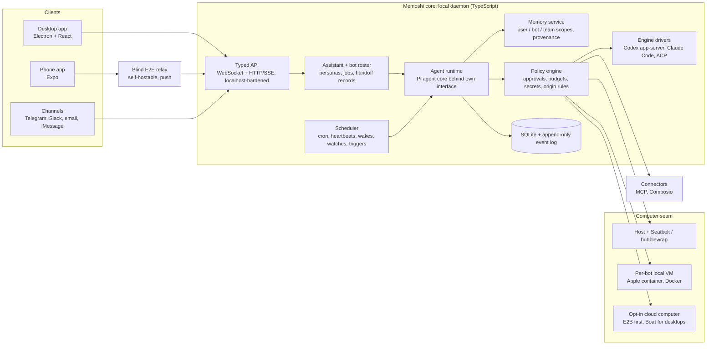

# Agentic workspaces, personal assistants and AI teammates: landscape report for Memoshi

> Snapshot: 2026-10-20. Research input for Memoshi, the planned all-in-one app combining an agentic workspace, a personal assistant, and persistent bots. Every fact in this file comes from a linked profile or landscape doc, and those docs cite primary sources inline. Recommendations are ours and are marked as such. This market changes weekly; treat numbers as dated.

## How to use this folder

| Path | What it holds |
|---|---|
| `README.md` | This synthesis: summary, comparisons, patterns, white space, recommended direction, open questions |
| [`projects/`](projects/) | One profile per product (26), all on [`_template.md`](_template.md) with a machine-readable `Matrix row` |
| [`landscape/`](landscape/) | Cross-cutting research: timeline, long tail, harnesses and ToS, execution environments, building blocks, in-house assets |
| [`matrix.md`](matrix.md) | Full comparison matrix generated from every profile's `Matrix row` |
| [`_matrix.py`](_matrix.py) | Regenerates `matrix.md` (stdlib only): `python3 docs/research/agentic-workspace-landscape/_matrix.py` |

To extend: copy `_template.md` to `projects/<slug>.md`, fill it with cited facts, rerun `_matrix.py`. Conventions used everywhere: `(vendor claim)` = maker said it, not verified; `[INFERENCE]` = our reasoning; `unknown` = searched, not found.

## 1. Executive summary

1. **The category is "always-on AI teammates".** You keep named bots with a persona and a job, message them like contacts, and each one works on a computer, remembers, runs routines, and asks before risky actions. [OpenClaw](projects/openclaw.md) (November 2025) proved demand for a self-hosted personal agent. [Grok Bot](projects/grok-bot.md) (launched 2026-08-11) fixed the shape most products now copy: a roster of bots in a messenger app, group chats, a persistent cloud computer, and teaching a task by demonstration.
2. **Grok Bot is a SpaceXAI brand built and operated by Cursor** (SpaceX closed its Cursor acquisition on 2026-08-14). It is closed and model-locked: no model picker, no API keys, US-only computers. All of a user's bots share one Firecracker microVM, and the docs say per-bot screens are not security boundaries. Its strengths are UX: approval and draft cards in chat, Team Bots with shared team memory, bot email addresses, event triggers, about six desktop releases a week. Users complain about bot-to-bot loops burning weekly allowances and ever-growing context ([profile](projects/grok-bot.md)).
3. **Big labs shipped equivalents within seven weeks:** Meta Muse (2026-09-08), Microsoft Autopilot (2026-09-25, formerly Scout, built on OpenClaw), Manus Cue (2026-09-28), OpenAI Dots (2026-09-29). Google's Spark (May) was folded into a "Task" toggle on 2026-10-01. They converge on a persistent cloud computer per agent or user with human takeover, agent identities (email, Slack, Workspace accounts), safety enforcement outside the agent (Muse's Sentinel, Dots' separate reviewer), event triggers, and subscription tiers with weekly caps. None runs locally or lets you bring a model ([timeline](landscape/always-on-agents-timeline.md)).
4. **Open source answered in three shapes.**
   - *Bring-your-own-agent rosters* that drive the coding CLIs users already pay for: OpenMausBot (5.2k stars, Apache-2.0, 22 engines), OpenBot, Noodle, Kuvo Code.
   - *Own-loop platforms*, mostly on the Pi agent core: Rakazo (4.8k stars, Apache-2.0, server-first, 7 sandbox backends), Aiden Agent (MIT, Electron), Lorca (GPL-3.0, Rust port of Pi, end-to-end encrypted relay).
   - *Channel-first gateways* that live in WhatsApp, Telegram or iMessage: OpenClaw (393k stars, MIT, foundation-run) and Hermes Agent (255k stars, MIT), which shipped its own Grok-style "Bot Mode" two days after Grok Bot.
5. **Adjacent giants matter as much as the clones.** Agent organizations ([paperclip](projects/paperclip.md) 105k stars, [multica](projects/multica.md) 53k), coding orchestrators ([Orca](projects/orca.md) 99k, [T3 Code](projects/t3code.md) 29k), the human-plus-agent messenger [Buzz](projects/buzz.md) by Block (36k), and the multi-CLI desktop [AionUi](projects/aionui.md) (34k). Budgets, governance, signed audit logs, and multi-engine plumbing are most mature there.
6. **Licenses split the field.** Code we may reuse: Rakazo, OpenMausBot (except `enterprise/`), Noodle, Aiden Agent, OpenClaw, Hermes, T3 Code, paperclip, Orca, Buzz, Happy, and our own boop. Ideas only: Lorca (GPL-3.0), OpenBot and Kuvo Code (PolyForm Noncommercial despite "open source" marketing), multica (source-available, tightened four times in 2026), Grok Bot (closed).
7. **Subscription login is the legal fault line.** Anthropic allows a user to sign in to the *unmodified* Claude Code binary with their own plan, even inside another product. The product maker must accept Anthropic's Commercial Terms and may not resell or intermediate usage, and apps may not offer Claude.ai login or route requests through plans. OpenAI allows "Sign in with ChatGPT"; paid or hosted apps must apply. Google bans third-party use and enforced bans in February 2026. Meta allows its subscription only through the Muse Code CLI. xAI publishes no policy. Several open-source projects ship Pi's OAuth paths, which borrow other vendors' client IDs; Memoshi should not ([policy quotes](landscape/agent-harnesses.md#4-subscription-auth-policy-verbatim-dated), [Anthropic legal page](https://code.claude.com/docs/en/legal-and-compliance)).
8. **Open-source safety defaults are weak.** Full access is the default in OpenMausBot, Aiden Agent, OpenBot, and T3 Code, and Orca historically pre-filled bypass flags. Noodle and Buzz auto-approve tool calls; Lorca and multica run without an OS sandbox. Incidents line up with that: OpenClaw CVE-2026-25253 and 341 malicious ClawHub skills, 5 critical paperclip advisories, a Muse macOS 0-day, Instinct's silent sends. Trust is the open lane.
9. **Always-on costs real money.** A 24/7 cloud sandbox costs about $120-175 per bot-month. On-demand with memory-preserving pause costs about $4-14. A flat cloud desktop (Boat) costs about $13 per bot-month, EU only. Per-bot local VMs with Apple `container` cost nothing extra ([cost model](landscape/execution-environments.md#3-cost-model-for-n-always-on-bots)).
10. **White space** ([long tail](landscape/oss-long-tail.md#5-patterns)): several rosters now seed a "Chief of Staff" bot that routes work (OpenMausBot, Happy Agent, gawkbot), but none is a personal assistant that holds the user's profile and channels, delegates to the team, and shares memory with it under scopes the user can see. Nobody forecasts cost before a routine runs; only paperclip has budgets. There is no portable bot format, no replay of routines against a new model, and few signed installers for non-developers.
11. **Our recommendation (for discussion, section 8; superseded 2026-10-20 by the [plan](../../plan/MASTER_PLAN.md), which keeps the daemon, policy and isolation ideas but chooses a native SwiftUI app on Pi Durable):** build a local-first TypeScript daemon, the "Memoshi core", that owns identity, memory, routines, policy and the event log. Embed the Pi agent core behind our own interface for the assistant and bots. Drive unmodified vendor CLIs (Codex app-server, Claude Code, ACP agents) as delegated workers. Isolate each bot by default, with cloud computers opt-in. Pair an Electron desktop and an Expo mobile app. Start greenfield and copy permissively licensed parts, from our own boop and from Rakazo, T3 Code and OpenMausBot, rather than forking a fast-moving app.
12. **Name check:** [felinics/Memoh](https://github.com/felinics/Memoh) (AGPL-3.0, 2.7k stars) is the same product idea under a near-identical name ([long tail](landscape/oss-long-tail.md)).

## 2. The list you gave, resolved

All eight names are real 2026 products. Several share names with unrelated projects, separated in each profile.

| You named | What it is | Maker | License | Traction (2026-10-20) | Take for Memoshi |
|---|---|---|---|---|---|
| [Grok Bot](projects/grok-bot.md) | Always-on bots in a messenger app; one shared cloud VM per user; Cursor-operated | SpaceXAI, built by Cursor (Anysphere) | Proprietary | ~6 desktop releases/week; in X Premium ($30+) and Cursor plans | The UX bar to match: roster, group chats, teach-by-demo, approval cards, Team Bots |
| [OpenMausBot](projects/openmausbot.md) | Electron roster over a localhost harness server driving 22 engines; Boat or local VM per bot; paid MausBot Cloud | Supamaus (Milind Soni, Omkar Satpute) | Apache-2.0, `enterprise/` source-available | 5,231 stars, 139 contributors, ~1.6 releases/day | Best bring-your-own-agent reference; reusable code; server core ported from T3 Code; avoid its Full-access default |
| [Rakazo](projects/rakazo.md) | Self-hostable bot platform; Pi loop in API and worker; 7 sandbox backends; web, Electron, Expo | Inbox Zero Inc. (Elie Steinbock) | Apache-2.0 | 4,827 stars, 119 contributors | Best own-loop and sandbox-seam reference; needs Postgres and Docker |
| [Noodle](projects/noodle.md) | Native Swift Mac/iOS roster over 7 vendor harnesses; Seatbelt sandbox per bot; peer-to-peer Hub | pdp (CBK.AI) | Apache-2.0 | 179 stars, ~1.8 releases/day, 97% one author | Native UX and typed wake events; avoid subscription lending and auto-approve |
| [Kuvo Code](projects/kuvo-code.md) | Native macOS shell on a pinned opencode 2.x; bots = long-lived session + memory file + self-scheduled wakes + model-free watches | Serhat Andıç | PolyForm Noncommercial | 64 stars, first release 2026-10-13 | Cheapest proactivity ideas (watches, self-scheduled wakes); code not reusable |
| [Aiden Agent](projects/aiden-agent.md) | Electron workspace with Pi agent core in the main process; durable bots; phone remote over LAN or Tailscale | sambitcreate (Sambit) | MIT | 85 stars, 62 releases, mostly one author plus AI | Best reference for embedding Pi in a desktop app and for bot "soul" memory |
| [Lorca](projects/lorca.md) | Rust core (port of pi-agent-core) + Go desktop + Expo phone; end-to-end encrypted relay; paired "Runner" machines | EGOIST | GPL-3.0-only | 316 stars, 44 releases in 23 days | Best remote/E2E design and group-chat protocol; GPL, so ideas only |
| [OpenBot](projects/openbot.md) | Electron workspace that maps every engine onto Codex app-server message shapes; deep routines; WebRTC teams; paid EU hosting | Synthetify Labs (Norbert Bodziony) | PolyForm Noncommercial (Apache-2.0 up to 0.1.11) | 671 stars, 78 releases in 68 days | Deepest automation feature set; not open source in practice |

## 3. Market map

| Segment | Products (profiles) | Shape |
|---|---|---|
| Closed, hosted always-on agents | [Grok Bot](projects/grok-bot.md), [OpenAI Dots](projects/openai-dots.md), [Meta Muse](projects/meta-muse.md), [Gemini Spark / Task](projects/gemini-spark.md), [Microsoft Autopilot (ex-Scout)](projects/microsoft-autopilot-scout.md), [Manus Cue](projects/manus-cue.md), [Claude Cowork / Tag](projects/claude-cowork.md), [Perplexity Personal Computer](projects/perplexity-personal-computer.md), [Poke](projects/poke.md), [Instinct](projects/instinct.md) | Vendor cloud computer, vendor models, subscription |
| Open-source bot rosters (bring your own agent) | [OpenMausBot](projects/openmausbot.md), [OpenBot](projects/openbot.md), [Noodle](projects/noodle.md), [Kuvo Code](projects/kuvo-code.md), [AionUi](projects/aionui.md); long tail: gawkbot, Munder Difflin, alook | Desktop app drives the user's installed CLIs |
| Open-source own-loop platforms | [Rakazo](projects/rakazo.md), [Aiden Agent](projects/aiden-agent.md), [Lorca](projects/lorca.md); long tail: Memoh, invisible_dots, CopilotKit OpenBot, nanoMuse, Talorys | Own agent loop (often Pi), own memory and routines |
| Channel-first personal-agent gateways | [OpenClaw](projects/openclaw.md) (+ NanoClaw, NemoClaw, IronClaw, nanobot), [Hermes Agent](projects/hermes-agent.md); long tail: CowAgent, QwenPaw | Daemon plus 20+ chat-app channels |
| Agent organizations and shared rooms | [paperclip](projects/paperclip.md), [multica](projects/multica.md), [Buzz](projects/buzz.md) | Org charts, issue boards or chat rooms where humans and agents work together |
| Coding workspaces and orchestrators | [T3 Code](projects/t3code.md), [Orca](projects/orca.md), [Happy](projects/happy.md) (E2E phone remote, now also a bot roster); long tail: Pi desktops, claude-squad, cmux | Multi-engine coding control surfaces, mobile companions |
| Engines that everyone embeds or drives | Pi, OpenCode v2, Codex app-server, Claude Code / Agent SDK, Grok Build, Antigravity CLI, Cursor CLI, Copilot CLI, Muse Code, Vercel fx, Goose ([harnesses](landscape/agent-harnesses.md)) | The agent loop itself |

The [long-tail scan](landscape/oss-long-tail.md) triages 87 more repos. GitHub search finds 2,011 "grok bot" repos created after 2026-08-11, so the roster pattern is now generic.

## 4. Head-to-head: the eight, plus the two big open-source gateways

| Product | Agent engine | Model access | Where tools run by default | Default permission | Memory | Proactivity | Multi-bot | Phone and remote |
|---|---|---|---|---|---|---|---|---|
| Grok Bot | Own loop, Cursor-built; coding via Cursor Cloud Agents | Vendor credits only | One cloud microVM per user, shared by all bots | Model-based Auto Review plus Ask-first rules; draft cards | Model-written per-bot summaries; team memory in Team Bots | Schedules (50 per bot), webhooks, app event triggers, email-tag triggers | Groups of 2-6, handoffs, Slack handles | Native iOS and Android |
| OpenMausBot | Drives CLIs (stream-JSON, Codex app-server, ACP, Pi RPC, Muse MSP) + raw APIs | User's CLI logins, API keys, local | Agent CLIs on host; GUI on Boat VM or local container per bot | Full access | Per-bot markdown, keyword recall, undoable journal | Cron, intervals, webhooks, Composio app events | Rooms, Chief of Staff delegation | iOS app, Android APK, PWA |
| Rakazo | Pi agent core inside API and worker | Subscriptions via Pi, API keys, local | Sandbox provider (Docker default; E2B, Daytona, Boat, others) | Sandbox is the boundary; external writes ask | Markdown docs in Postgres with revisions | Crons, webhooks, GitHub, read-only "watch" triggers | Groups, handoffs, child bots | iOS, Android, custom server |
| Noodle | Drives 7 vendor CLIs + own loop for local models | User's CLI logins, API keys, local MLX/Apple | Per-bot Seatbelt sandbox on the Mac; optional VMs | Auto-approve inside sandbox | Bot-maintained `memory.md`, `preferences.md`, `assignments.md` | Heartbeats every 30 min, self-scheduled wakes | Groups with shared goal | iOS TestFlight via P2P Hub |
| Kuvo Code | Embeds opencode 2.x as a private server | Via opencode: subscriptions, keys, free models | Host or user's Linux server over SSH | opencode allow/ask/deny rules | Per-bot memory file with its job | Self-scheduled wakes, model-free watches | Turn-taking groups with a lead | No phone app |
| Aiden Agent | Pi agent core in Electron main; ACP for Antigravity | API keys, ChatGPT login, local | Host; per-bot home folder "not a sandbox" | Full access for bots | Bounded `MEMORY.md` + `USER.md`, injection-scanned | Croner tasks; bots propose routines; `[SILENT]` no-ops | None shipped | iOS/Android over LAN or Tailscale |
| Lorca | Own Rust loop; delegates code to Claude Code, Codex, OpenCode, Pi, fx | API keys, ChatGPT and Grok logins, local | Bot's paired Runner, as the user, no OS sandbox | Per-bot Access plus LLM auto-review | Markdown `MEMORY.md`, topic notes, daily logs | Intervals, PR watches, webhooks, calendar-relative, model-free pre-checks | Groups of 1-6, silent PASS, 4-round cap, 8-hop cap | iOS/Android over E2E relay |
| OpenBot | Normalizes all engines to Codex app-server JSON-RPC | User's CLI logins, API keys, local | Host, self-hosted server, or paid EU VM | Full access | Tiered per-agent store + history search | Cron, one-time, webhooks, scripts, chained routines, missed-run policy | Agent-to-agent delegation; channels deprecated | iOS TestFlight, Android |
| OpenClaw | Own `@openclaw/agent-core` (internalized from Pi 2026-05-27) + Codex, Copilot, Muse, Claude CLI, ACP | API keys (~70 providers), ChatGPT OAuth, local | Gateway host; Docker/SSH sandboxes opt-in | DM pairing, exec allowlist/ask modes | Workspace markdown (`SOUL.md`, `USER.md`, `MEMORY.md`, daily notes) + "dreaming" consolidation | Heartbeat every 30 min, cron, hooks, webhooks, IMAP | Group chats with mention gating, broadcast groups | iOS/Android node apps + 25 chat channels |
| Hermes Agent | Own Python loop; optional Codex app-server | API keys (40+), several subscription logins, local, Nous credits | Local, Docker, SSH, Modal, Daytona, Vercel Sandbox, Singularity | Dangerous-command approval; deny-by-default unattended | `MEMORY.md` + `USER.md` with char caps, FTS search, background skill writing | Cron, webhooks, heartbeat, goal loops | Rooms of 2-6 bots, bot DMs, A2A | No first-party app; 27 chat channels |

Big-lab products side by side:

| Product | Launched | Computer | Agent identity | Safety architecture | Triggers | Price (2026-10-20) |
|---|---|---|---|---|---|---|
| [Grok Bot](projects/grok-bot.md) | 2026-08-11 | One microVM per user, shared by bots | Bot email addresses (2026-10-11), Slack handles in Team Bots | Auto Review + rules, draft cards, human takeover for passwords and payments | Schedules, webhooks, app events, email tags | Bundled in X Premium $30 / Super $100 / Ultra $200 |
| [OpenAI Dots](projects/openai-dots.md) | 2026-09-29 | Per-dot cloud VM, user can take over | Slack account | Act / act if pre-approved / ask / hand off, plus a separate reviewer the agent cannot disable | Schedules, self-scheduled wakes, read-only proactive research | ChatGPT Pro $100 / $200 / $500 |
| [Meta Muse](projects/meta-muse.md) | 2026-09-08 | Per-user Secure VM; Mac app acts in native apps | WhatsApp presence | Host-side Sentinel approves every action and network call; agent holds stand-in tokens only | Crons and events | Free, $20, $100 |
| [Gemini Spark / Task](projects/gemini-spark.md) | 2026-05-19 | Per-user Google Cloud VM | Enterprise "Gemini agent" gets a Workspace account (2026-10-08) | Asks before spend, send, delete, share | Schedules, Gmail-filter monitors, topic monitors | AI Pro $19.99; Ultra $100 / $200 |
| [Microsoft Autopilot](projects/microsoft-autopilot-scout.md) | 2026-06-02 (Scout) | Cloud container treated as untrusted | Own Entra identity | Human sign-off, Purview DLP; stricter policy for unattended runs | Heartbeat, schedules, conditions | Copilot usage-based billing, unpriced |
| [Manus Cue](projects/manus-cue.md) | 2026-09-28 | Cloud VM per agent | Own email, phone number, wallet with budget | Payment confirmation, wallet caps | Schedules, events | Free early access |
| [Claude Cowork / Tag](projects/claude-cowork.md) | 2026-01-12 | Ephemeral cloud sandbox per session; egress via external proxy; tokens never enter the sandbox | @Claude in Slack (Tag) | Manual or Auto mode with automated checks | Scheduled cloud tasks | Pro $20; Max $100 / $200 |
| [Perplexity Personal Computer](projects/perplexity-personal-computer.md) | 2026-03-12 | User's own Mac mini plus cloud sandbox | None | On-device privacy gate masks data before cloud models see it | Proactive monitors | Pro / Max credits |
| [Poke](projects/poke.md) | 2026-03 | Vendor cloud | Only Apple-approved iMessage agent channel | unknown | Automations, shareable "recipes" | Free, $19, $199 |
| [Instinct](projects/instinct.md) | 2026-08-26 | Vendor cloud plus device capture | Phone number and email (third-party reports) | None documented; incidents with silent sends and bookings | Proactive follow-ups (vendor claim) | Free beta |

The generated [`matrix.md`](matrix.md) carries every field for all 26 profiles.

## 5. What the market converged on

### 5.1 Engine strategy: own loop, wrapped CLIs, or both

- **Wrapping CLIs wins on cost for users.** The pitch against Grok Bot pricing is "use the Claude, ChatGPT or Grok plan you already pay for". OpenMausBot, OpenBot, Noodle, AionUi, multica, Orca and T3 Code all drive vendor CLIs over their native protocols: Claude stream-JSON or the Agent SDK, Codex app-server JSON-RPC, ACP for most others ([harnesses](landscape/agent-harnesses.md)). The ACP registry lists 42 agents, so one ACP client reaches most of the market.
- **Wrapping CLIs loses control.** Memory, approvals and tool policy end up spread over each vendor's semantics. OpenBot's answer is to translate every engine into Codex app-server message shapes ([profile](projects/openbot.md)). OpenMausBot normalizes into one runtime event stream with per-thread NDJSON logs ([profile](projects/openmausbot.md)). Noodle forbids bots from posting raw output: everything user-visible goes through a `messenger` CLI ([profile](projects/noodle.md)).
- **Own-loop products converge on Pi.** Rakazo, Aiden Agent and (formerly) OpenClaw embed `pi-agent-core`/`pi-ai`; Lorca ported it to Rust. Pi moved to `earendil-works/pi`. Its v1 is weeks old and ships no permission policy, only blocking tool hooks (Pi Durable's `beforeTool` also sees calls made from Code Mode scripts), so the host owns policy. OpenClaw internalized its own core on 2026-05-27, which shows the exit path ([OpenClaw](projects/openclaw.md), [harnesses](landscape/agent-harnesses.md)).
- **The strongest products do both.** Lorca runs its own loop and hands coding to Claude Code, Codex, OpenCode, Pi or fx as peers, routing every tool call back for review ([profile](projects/lorca.md)). OpenClaw and Hermes pick an engine per model. T3 Code's `delegate_task` starts a child agent on any provider ([profile](projects/t3code.md)).

### 5.2 The computer

| Model | Who | Trade-off |
|---|---|---|
| One shared cloud computer per user | Grok Bot; Rakazo's default "Team Computer"; Hermes "Bot Screen" | 1/N cost and shared logins; no isolation between bots |
| Cloud computer per agent | Dots, Muse, Cue, Autopilot; OpenMausBot (Boat); invisible_dots (QEMU) | Isolation and always-on; $120-175 per bot-month if never paused |
| Pluggable sandbox behind a narrow contract | Rakazo (`SandboxProvider`: lifecycle, desktop, exec, files; 7 backends), Hermes (7 terminal backends), OpenClaw (Docker, SSH, others) | Model choice and sandbox choice stay independent |
| User's own machine | Aiden, Lorca Runners, Kuvo (or SSH Linux), Noodle (Seatbelt), OpenBot, Perplexity (Mac mini) | Free, private, full access to user apps; stops when the laptop sleeps unless a second machine runs |

Rakazo's key move is to make the *portable workspace* the durable unit, not the VM: each bot's home folder and browser profiles are checkpointed outside the sandbox, so swapping providers is routine ([profile](projects/rakazo.md)). Locally, Apple `container` 1.6 (Apache-2.0) runs each container in its own lightweight VM on macOS 26. Earendil, Pi's maker, also publishes Gondolin (Apache-2.0, experimental): local Linux micro-VMs with host-side egress allowlists and secrets the guest sees only as placeholders. It includes a Pi extension that runs Pi tools inside the VM and an example that runs Chromium inside it. Codex and Claude Code sandbox with Seatbelt on macOS and bubblewrap on Linux, and Anthropic's `sandbox-runtime` (Apache-2.0) can be embedded ([execution environments](landscape/execution-environments.md)).

### 5.3 Bot identity and memory

- Almost everyone stores memory as **plain Markdown the bot maintains**: `MEMORY.md`, `USER.md`, `SOUL.md`, daily notes, topic files (OpenClaw, Hermes, Lorca, Kuvo, Noodle, OpenMausBot, Aiden).
- Hardening ideas: **bounded stores** that force consolidation (Hermes character caps; Aiden 64 entries; OpenMausBot loads 200 lines or 24 KB). **Persona kept in the record**, not in a file the bot can rewrite from the shell (Aiden). **Injection and secret scanning** on memory writes (Aiden, Lorca). **Undoable change journals** outside the bot folder (OpenMausBot). **Background consolidation**: OpenClaw "dreaming", Hermes periodic review, boop's proposer-plus-judge pass.
- **Team memory** exists only in Grok Bot Team Bots (shared team memory plus private per-person notes) and Rakazo (bot and shared scopes). Nobody offers user-reviewable shared memory with provenance and per-bot read scopes ([long tail](landscape/oss-long-tail.md#5-patterns)).
- **Identity is moving beyond the app**: own email (Grok Bot, Cue), Slack account (Dots, Grok Team Bots), Workspace account (Gemini agent), Entra identity (Autopilot), phone number and wallet (Cue). Buzz gives every agent its own signing keypair under a scoped owner authorization ([profile](projects/buzz.md)).

### 5.4 Proactivity without runaway cost

- Triggers in use: cron and intervals (everyone); heartbeats (OpenClaw and Noodle every 30 minutes, paperclip, Hermes); self-scheduled wakes (Kuvo, Dots, Noodle); webhooks; app events (Grok Bot: Slack, GitHub, Linear, Sentry, PagerDuty); email filters and email tags (Spark, Grok Bot); calendar-relative times (Lorca).
- Cost controls worth copying:
  - **Model-free watches.** Kuvo runs a cheap shell check and wakes the bot only when the output stays changed; Lorca and Orca run read-only pre-checks; Rakazo has read-only watch triggers.
  - **`[SILENT]` no-op replies** that create no notification (Aiden).
  - **Auto-pause** after 7 days without the user (Lorca) or after repeated failures (multica).
  - **Per-agent budgets** with a warning at 80% and a hard stop at 100% (paperclip, the only one).
  - **Bots propose routines and humans approve** them (Aiden, Rakazo).
- Failure modes are documented: Grok Bot bot-to-bot loops burning weekly allowances (admins can now disable bot-to-bot messaging, 0.71), and a Dot that burned 300k tokens in a day without a prompt (press, via the [long tail](landscape/oss-long-tail.md#5-patterns)).

### 5.5 Multi-bot collaboration

- **Group chat protocols** that keep rooms quiet:
  - Lorca: 1-6 bots, silent PASS turns, a 4-round cap, an 8-hop cap on bot-to-bot messages.
  - Kuvo: one speaker at a time; a lead sums up who does what; work happens in each bot's own session.
  - Grok Bot: groups of 2-6 with ownership handoff.
- **Handoff contracts** carry expected output, acceptance criteria and evidence, and are re-injected every turn (Lorca). OpenMausBot moved every handoff into a single SQLite record with an audit log after "six wake lanes" grew organically, so build that in from day one.
- **Organizational models**: paperclip's org chart with goal ancestry and atomic task checkout; multica's issue board with agents as assignees and leader-routed Squads; Buzz rooms where humans and agents share one signed event log.

### 5.6 Approvals, secrets and safety

- **Out-of-agent enforcement is the big-lab standard**: Muse's host-side Sentinel with stand-in tokens, Dots' reviewer the agent cannot switch off, Claude Cowork's egress proxy outside the sandbox with connector tokens that never enter it ([Muse](projects/meta-muse.md), [Dots](projects/openai-dots.md), [Cowork](projects/claude-cowork.md)).
- **Patterns from open source worth copying:**
  - *Approval by verb.* Rakazo classifies third-party tools by the verb in their name; read-only hints never relax a mutating name.
  - *Origin-based restriction.* Powerful tools are blocked when a run was started by a webhook, a channel or a routine (Rakazo), a cheap prompt-injection mitigation.
  - *Self-edits as proposals*, with a versioned instruction history (Rakazo).
  - *Draft before send* for every external action (boop, Grok Bot draft cards).
  - *Secrets by reference.* Sign-in cards fill credentials into the page so the model never sees them (Kuvo, Rakazo `request_secret`). Grok Bot users found saved secrets in plain text in the computer's environment listing.
  - *Policy decision plus audit row* before every action (CopilotKit OpenBot); a hash-chained audit log (Buzz).
- **Anti-patterns:** Full access as the default, LLM-only review on an unsandboxed host, auto-approving every tool call, telemetry on by default (T3 Code, paperclip, Kuvo).

### 5.7 Phones and remote access

| Approach | Who | Notes |
|---|---|---|
| End-to-end encrypted relay | Lorca (X25519/Ed25519, XChaCha20-Poly1305; relay can withhold or replay but not read or forge), [Happy](projects/happy.md), Orca (Curve25519 + XSalsa20-Poly1305 via a hosted relay) | Works across NAT; needs a relay service, ideally self-hostable |
| LAN or Tailscale pairing | Aiden (single-use 5-minute QR, pinned TLS), T3 Code (ordered routes: LAN, Tailscale, SSH, relay; DPoP-bound sessions), Orca | No infrastructure to run; weaker for push and offline delivery |
| Peer-to-peer | Noodle Hub (QUIC, TLS 1.3, pinned keys, UPnP) | No relay; NAT traversal limits |
| Hosted server | Rakazo, OpenBot EU hosting, MausBot Cloud, multica cloud | Simplest for users; you run infrastructure |

Pairing is where these designs break. Orca's pairing QR works as a reusable bearer token and its phone cannot verify which desktop it pairs with ([profile](projects/orca.md)). Happy's terminal accepts any pairing reply it can decrypt, so a malicious relay can swap in its own key, then read sessions and inject prompts that run on the host (open issue since 2026-07-10). Happy's push text, usage data and RPC method names are also plaintext to its server ([profile](projects/happy.md)). Lorca avoids this by putting a one-time key in the pairing QR, out of the relay's reach ([profile](projects/lorca.md)). Pairing must be single-use, mutually authenticated, and out-of-band.

### 5.8 Channels

OpenClaw and Hermes cover 25 or more chat apps each. Telegram is the universal first channel (Aiden, Lorca, Rakazo, OpenBot, Hermes, OpenClaw). iMessage is hard: Poke holds the only Apple-approved agent channel. Others use the `imsg` CLI on the user's own Mac, or hosted bridges such as Sendblue (boop, Rakazo; a dedicated line costs $100 per month), BlueBubbles or Photon (Hermes, paperclip). Since 2026-01-15 WhatsApp's official Cloud API bars general-purpose AI assistants, so the only route is the unofficial Baileys library (OpenClaw, Hermes), with ban risk. Per-bot email inboxes come from services such as AgentMail. Details and prices: [building blocks](landscape/platform-building-blocks.md#5-messaging-channels).

### 5.9 Business models

| Model | Examples |
|---|---|
| Bundled into a bigger subscription | Grok Bot (X Premium, Cursor), Dots (ChatGPT Pro), Spark (Google AI Pro/Ultra), Claude Cowork |
| Free app + hosted cloud for always-on | MausBot Cloud $15 / $49 / $99 per month on Fly.io; OpenBot EU hosting from EUR 20; Hermes Cloud billed daily from Nous Portal credits ($0-200 tiers); multica Cloud billed per human seat (agents never take seats); paperclip and Rakazo clouds (waitlist or unpriced) |
| Commercial license for source-available code | OpenBot, Kuvo Code, multica, OpenMausBot `enterprise/` |
| Prepaid tokens inside a free app | AionUi "Prepaid Mode" |
| Foundation, no revenue | OpenClaw Foundation (501(c)(3)) |

## 6. White space Memoshi can own

These gaps come from the [long-tail patterns](landscape/oss-long-tail.md#5-patterns), the [timeline observations](landscape/always-on-agents-timeline.md#observations) and the complaints recorded in profiles [INFERENCE]:

1. **One assistant that runs a team.** Products are either one persona (Muse, Spark, nanoMuse, Talorys) or a roster where the user is the router (Grok Bot and its clones). "Chief of Staff" bots in OpenMausBot, Happy Agent and gawkbot only route work inside the roster. Nobody ships a personal assistant that knows the user, owns the bots, delegates to them, and shares governed memory with them.
2. **Governed shared memory.** Shared memory that the user can review, with provenance, per-bot read scopes, temporal validity ("this stopped being true", only Talorys), and undo.
3. **Cost you can see before it happens.** Estimated cost per routine and per bot, budgets with hard stops, and model-free watches as the default way to "keep an eye on X".
4. **Isolation by default, cheaply.** Per-bot local VMs or sandboxes as the default, with Grok Bot's shared computer as the known contrast.
5. **Portability.** A bot definition format (persona, job, memory, routines, tools, permissions) that exports and imports; nothing beyond a 3-star attempt exists.
6. **Replay and evaluation.** Re-run last week's routine against a new model and diff the outcome.
7. **Non-developer onboarding.** Signed installers, no Docker, no coding CLI required, a starter team on first launch (Noodle's assistant, developer and researcher who introduce themselves).

## 7. In-house assets

[Audit](landscape/in-house-assets.md) of our own code: the two sibling repos in `~/Documents/memoshi`, plus [Apollo](landscape/in-house-assets.md#apollo) and the [Draft 3 build](landscape/in-house-assets.md#draft-3-build) (both added 2026-10-20):

- **boop** (fork of raroque/boop-agent, MIT) is the assistant brain: dispatcher and worker agents, tiered decaying memory with proposer-plus-judge consolidation, cron automations, draft-before-send, per-sub-agent Composio scoping, Claude Agent SDK and Codex app-server runtimes. Its lock-ins are Convex (self-hosted Convex is FSL, not OSI) and Sendblue cost. Upstream has been quiet since 2026-07-13.
- **harness ("Forma")** is a fork of T3 Code (MIT): event-sourced, heavily tested, multi-engine coding workspace with mobile and remote access. It is entirely Effect 4, and upstream lands about 2.8k commits a month; T3 Code also rewrote its orchestrator on 2026-10-02, after the fork point ([profile](projects/t3code.md)).
- **Apollo** (`~/Memo/apollo-agent`, MIT, built on the boop template) is our Pi Durable 1.3 assistant. It has deep Apple integrations, evidence-backed memory, a capability-only Code Mode, and a Virtualization.framework VM module.
- **Draft 3 build** (`~/Documents/Memoshi-Plan`) is the first native Memoshi attempt: a SwiftUI shell plus a Pi sidecar. It only ever ran Pi's fake model; port its protocol, policy and event-store patterns, not its runtime.
- Neither has a bot roster. Together they cover the "assistant" and "workspace" halves of Memoshi.
- **Back up unpushed work:** `boop/desktop/` is an untracked 15.5k-line Rust (GPUI) port, and about 30 Convex skill folders are uncommitted. Both exist only on this disk.

## 8. Recommended direction for Memoshi [INFERENCE, for discussion]

> **Superseded on 2026-10-20 by [the plan](../../plan/MASTER_PLAN.md).** The user chose a native SwiftUI/AppKit app on Pi Durable, with Aiden-level design and motion, Grok-style bots, the Assistant, and a computer and browser for every bot ([decisions](../../plan/decisions.md)). This section stays unchanged as the research-time recommendation. Where it differs (Electron and Expo clients, `pi-agent-core` in a daemon, vendor CLIs as v1 workers), the plan wins.

### 8.1 Product thesis

**"Your chief of staff and its team, on your machine."** One personal assistant that knows you and is reachable everywhere you are (desktop, phone, Telegram, email). It runs a team of specialist bots and works with you in a shared workspace of files and code. Local-first, bring your own models or subscriptions, and safe by default. This combines the gaps in section 6 with the strongest proven patterns, and it is the shape the user asked for: workspace, assistant and bots in one product.

### 8.2 Architecture blueprint

Every tool call, including calls made by delegated CLIs, passes the policy engine and lands in the event log. Each bot's workspace and browser profile live in a Memoshi-owned directory mounted into whichever computer it uses, so moving a bot between host, VM and cloud is a sync, not a migration (Rakazo's pattern).

### 8.3 Key decisions

| Decision | Recommendation | Main alternative | Why |
|---|---|---|---|
| Where the brain runs | Local daemon on the user's machine; optional self-hosted runner (Docker) for always-on; hosted cloud later | Server-first like Rakazo (Postgres, Docker, always-on API) | Matches BYO subscriptions and privacy; Lorca Runners and Perplexity's Mac mini prove the "second machine" path |
| Agent loop | Embed `pi-agent-core` + `pi-ai` (MIT), pinned, behind a Memoshi `AgentRuntime` interface | OpenCode v2 in-process SDK; own loop on another provider SDK | Most own-loop products use Pi; Pi leaves policy to the host, which we want; the interface keeps OpenClaw's exit path open |
| External engines | Drive unmodified vendor CLIs as delegated workers: Codex app-server, Claude Code (Agent SDK or stream-JSON), one ACP client for the rest; the user signs in to each CLI through the vendor's own flow | Rebuild coding inside our own loop | The only subscription model Anthropic explicitly allows (Memoshi accepts its Commercial Terms, never touches credentials or resells usage); ACP reaches 42 agents; Lorca and T3 Code prove delegation |
| Model access | API keys, local models (Ollama, LM Studio, MLX), OpenAI Sign in with ChatGPT (apply as commercial partner), vendor CLI logins owned by the user | Pi's built-in Claude, Google and Meta OAuth paths | Those paths conflict with published terms; Google already banned accounts |
| Internal protocol | One canonical event schema, append-only, with per-engine adapters | Adopt Codex app-server shapes wholesale (OpenBot) | Our own schema lets the policy engine and memory stay engine-neutral |
| Storage | SQLite (`node:sqlite`) + event log + per-bot folders + Markdown memory with an FTS index | Postgres (Rakazo, multica, paperclip); Convex (boop) | Local-first, zero ops; Convex self-hosting is FSL |
| Desktop shell | Electron + React, with small native helpers | Native Swift (Noodle, Kuvo) if Memoshi is Apple-only; Tauri 2 (Buzz); Go MyGo (Lorca) | 6 of 10 profiled apps use Electron, including Grok Bot; shares React code with web and Expo. If we go Apple-only (question 5 in section 9), SwiftUI gains Speech, Foundation Models, Shortcuts and the menu bar for free |
| Phone and remote | Expo app as a remote control through a self-hostable blind relay: end-to-end encrypted (sealed boxes), pairing with a one-time key in the QR code, pushes the relay cannot read. LAN and Tailscale as a power-user route | Tailscale-only pairing (Aiden, OpenClaw, OpenMausBot) | Zero setup for non-developers, which is part of the white space; Happy's and Orca's pairing flaws show what to avoid |
| Computer | Per-bot isolation by default: host plus Seatbelt or bubblewrap (`sandbox-runtime`) for chat and file bots; Apple `container` or Gondolin (Pi's own micro-VM sandbox, experimental) for code and browser bots; cloud computer opt-in per bot with a cost estimate shown first | One shared computer per user (Grok Bot) | Isolation is a differentiator; the cost model makes on-demand cloud cheap enough |
| Connectors | Our own MCP client OAuth first (PKCE plus loopback; tokens never enter model context); Composio Sessions as the optional managed catalog; toolkits scoped per bot or sub-agent (boop's pattern) | Pipedream Connect (now owned by Workday), Arcade, Nango; avoid Smithery (shuts down 2026-10-31) | Every open-source product ships its own MCP OAuth; Composio is the one managed catalog in use (OpenMausBot, Rakazo, OpenBot) and boop already integrates it |
| Channels | Telegram and Slack first; bot-owned email via a per-bot inbox; iMessage through `imsg` on the user's Mac, with Photon or Sendblue as hosted options | WhatsApp through Baileys only as an opt-in labeled with ban risk | Official and free first; WhatsApp's Cloud API bars general-purpose assistants; Sendblue costs $100 per line per month |
| Memory | Scopes: user profile owned by the assistant; bounded per-bot `MEMORY.md` + `USER.md`; team memory with provenance and read scopes; transcript recall through SQLite FTS5 plus optional `sqlite-vec`; consolidation (port boop's); one provider interface for an optional external store | External memory SaaS as the default (mem0, Zep, Supermemory, Honcho) | Budgeted Markdown is the convergent design (7 of 9 open-source products ship no memory vendor); governed shared memory is the gap |
| Proactivity | Cron, heartbeats, self-scheduled wakes, model-free watches, event triggers; bots propose routines and users approve; `[SILENT]`; auto-pause; budgets with cost preview | LLM polling on a timer | Every cost incident in the category came from unbounded autonomy |
| Scheduler | `croner` inside the daemon, jobs and run history in SQLite, catch-up after sleep, overlap guard, leases before any multi-process deployment; a small hosted "wake and deliver" relay later for webhooks and app events | Temporal, Inngest, Trigger.dev; graphile-worker or DBOS once a server tier exists | None of the profiled products uses a durable-execution platform; boop double-fires without a lock |
| Voice | On-device speech-to-text by default (Apple SpeechAnalyzer, Parakeet via sherpa-onnx); system voices, then bring-your-own ElevenLabs or similar; live calls through OpenAI GPT-Live with the agent kept as the brain | Cloud speech-to-text and TTS by default | Private and free by default; GPT-Live delegation is already used by OpenMausBot and OpenClaw |
| Safety | Policy engine outside the model: verb classes, origin rules, draft-before-send, secrets by reference, hop caps and loop guards, budgets; an automated reviewer only as an extra layer | LLM-only review | Matches Muse, Dots and Cowork; avoids the OpenClaw and paperclip incident pattern |
| Memoshi's own license | Decide before writing code (for example open core: MIT or Apache core plus a commercial cloud) | Closed source | Decides which code we can take (never GPL or PolyForm code) and whether outsiders contribute |

### 8.4 Build or fork

| Option | Pros | Cons | Verdict |
|---|---|---|---|
| **A. Greenfield core, copy permissive parts** (boop memory, automations, drafts, connector registry; Rakazo's sandbox contract; protocol clients from T3 Code or OpenMausBot; Pi agent core) | Clean architecture around our differentiators (assistant-led team, governed memory, policy, budgets); no merge tax; license-clean | Slower first demo; we own all maintenance | **Recommended** |
| B. Fork Rakazo (Apache-2.0) | Most complete permissive platform: Pi loop, 7 sandbox backends, routines, approvals, channels, web, Electron, Expo, 119 contributors | Server-first (Postgres, Docker, worker); not local-first; fast upstream; its roadmap belongs to Inbox Zero Inc. | Strong fallback if we go server-first; mine it either way |
| C. Fork OpenMausBot (Apache-2.0 core) | Bring-your-own-agent roster with 22 engines, Electron, hosted-cloud business already working | Little own-loop logic; Full-access default; ~1.6 releases a day; docs drift; `enterprise/` excluded | Use as a reference for drivers and lifecycle |
| D. Fork Aiden Agent (MIT) | Polished Electron workspace with Pi embedded, durable bots, phone remote, computer use | One maintainer plus AI, about 4k commits of sprawl, Full access for bots, "no migrations" rule | Reference for Pi embedding and bot memory |
| E. Fork T3 Code (or our Forma) and port boop into it | Production-grade, heavily tested multi-engine workspace, remote and mobile | Effect 4 everywhere; ~2.8k upstream commits a month; outside contributions refused; no bots, memory or channels | Reference for the coding half; do not fork |
| F. Grow boop | Assistant brain already works for us | Convex and Sendblue lock-in; single process; no workspace or roster | Harvest, do not extend |
| Excluded by license | Lorca (GPL-3.0), OpenBot and Kuvo Code (PolyForm Noncommercial), multica (source-available) | | Ideas only |

### 8.5 Phases

| Phase | Scope | Exit criteria |
|---|---|---|
| 0. Decide and de-risk | Name check (Memoh); Memoshi license; apply for OpenAI Sign in with ChatGPT; spikes: Pi agent core vs OpenCode v2 SDK (tool hooks, durability, streaming), Apple `container` + `sandbox-runtime`, Electron shell; write the event schema and the bot definition format | Written decisions for every row of 8.3; spikes running on a team member's Mac |
| 1. One assistant, a few bots | Daemon and desktop app; assistant plus bots with personas and jobs; 1:1 chats; memory v1; routines v1 (cron, heartbeat, `[SILENT]`, propose-then-approve); approvals v1 (verb classes, drafts); MCP and Composio; Telegram; API keys and local models; Codex and Claude Code as coding workers | The team uses it daily for real tasks; every tool call passes the policy engine and the event log |
| 2. Team and workspace | Group chats and handoff records with hop caps; coding workspace (worktrees, diff review with line comments, terminal) via drivers; per-bot local VMs; model-free watches; budgets and cost preview; phone app through the E2E relay with push; bot email addresses | A routine-driven bot runs for a week inside budget; bots hand work off without loops; a phone pairs without installing anything else |
| 3. Always-on and shared | Self-hosted runner; opt-in cloud computers (E2B, Boat); hosted wake-and-deliver relay for webhooks; shared bots with private notes; signed event log; bot export and import; replay a routine against a new model | A bot keeps working with the laptop closed; a bot moves between machines intact |

### 8.6 Risks

| Risk | Mitigation |
|---|---|
| Vendors change subscription rules again (Anthropic enforced in January and April 2026; Google bans) | Never intermediate credentials; keep API-key and local paths first-class; isolate each engine in a driver |
| Engine protocol churn (Codex alphas daily, OpenCode 2.1 broke its SDK, ACP v1/v2, Pi v1 weeks old) | Pin versions; contract tests per driver; own canonical event schema |
| Prompt injection through channels, web pages and skills (341 malicious ClawHub skills) | Origin rules, draft-before-send, secrets by reference, no skill marketplace without review |
| Cost runaway (Dots burning 300k tokens a day; Grok Bot loop burns) | Budgets with hard stops, model-free watches, hop caps, auto-pause |
| Platform blocks on consumer sites (Amazon blocked Muse) | Prefer official connectors; hand logins and checkouts to the user |
| Vendor churn in the stack (Smithery closes 2026-10-31; Cua Cloud and Scrapybara shut down; Daytona closed its core; Workday bought Pipedream) | Provider seams for computers, connectors and memory; prefer self-hostable runtimes (E2B's open runtime) |
| Velocity of competitors (Grok Bot ~6 releases a week; clones ship daily) | Compete on the white space in section 6, not on feature parity |

## 9. Open questions for the team

1. Who is the first user: developers (coding-first) or prosumers (assistant-first)? This decides the default engines, onboarding and the first channel.
2. Local-only at launch, or a hosted always-on tier from the start (MausBot Cloud, OpenBot EU hosting and Hermes Cloud are precedents)?
3. Memoshi's license and business model: open core with a paid cloud, or closed?
4. How central is "use your existing subscriptions" to the pitch, given the policy table in [harnesses](landscape/agent-harnesses.md#4-subscription-auth-policy-verbatim-dated)?
5. macOS-first (Apple `container`, Foundation Models, Seatbelt) or cross-platform from day one?
6. Do we keep Convex from boop or move memory and automations to SQLite?
7. How much coding workspace belongs in v1 versus delegating to T3 Code, Orca or the vendors' own apps?
8. Per-bot isolation by default costs RAM (~4 GB per awake VM). Which bots get VMs by default?
9. Which channel matters most to the first users: Telegram, iMessage, Slack, WhatsApp or email?
10. Does the Memoh name clash change the product name?

## 10. Document index

**Product profiles** (`projects/`)

| Group | Profiles |
|---|---|
| Named by you | [grok-bot](projects/grok-bot.md), [openmausbot](projects/openmausbot.md), [rakazo](projects/rakazo.md), [noodle](projects/noodle.md), [kuvo-code](projects/kuvo-code.md), [aiden-agent](projects/aiden-agent.md), [lorca](projects/lorca.md), [openbot](projects/openbot.md) |
| Big-lab and commercial agents | [openai-dots](projects/openai-dots.md), [meta-muse](projects/meta-muse.md), [gemini-spark](projects/gemini-spark.md), [microsoft-autopilot-scout](projects/microsoft-autopilot-scout.md), [manus-cue](projects/manus-cue.md), [claude-cowork](projects/claude-cowork.md), [perplexity-personal-computer](projects/perplexity-personal-computer.md), [poke](projects/poke.md), [instinct](projects/instinct.md) (ends with a list of other commercial agents seen) |
| Open-source gateways | [openclaw](projects/openclaw.md) (with derivatives table), [hermes-agent](projects/hermes-agent.md) |
| High-traction adjacent | [paperclip](projects/paperclip.md), [multica](projects/multica.md), [orca](projects/orca.md), [buzz](projects/buzz.md), [t3code](projects/t3code.md), [happy](projects/happy.md), [aionui](projects/aionui.md) |

**Landscape docs** (`landscape/`)

| Doc | Contents |
|---|---|
| [always-on-agents-timeline](landscape/always-on-agents-timeline.md) | 43 dated events from Clawdbot (2025-11) to 2026-10-14, plus observations |
| [oss-long-tail](landscape/oss-long-tail.md) | 87 open-source projects triaged with stars, licenses and verdicts; clusters; notes on 8; patterns and gaps |
| [agent-harnesses](landscape/agent-harnesses.md) | 13 engines (embedding mode, protocols, auth), ACP and MCP, verbatim subscription policies, decision guide |
| [execution-environments](landscape/execution-environments.md) | 33 sandbox, VM, browser and local-isolation options with prices; cost model; options for Memoshi |
| [platform-building-blocks](landscape/platform-building-blocks.md) | Connectors, memory, scheduling, sync and relay, channels, voice, desktop shells |
| [in-house-assets](landscape/in-house-assets.md) | boop, harness, Apollo and Draft 3 build audits, with a reuse map and risks |

## 11. Backlog: profiles worth adding

Suggested by the research agents, not yet profiled. Copy `_template.md` to add one.

| Candidate | Link | Why |
|---|---|---|
| Grok Build | [xai-org/grok-build](https://github.com/xai-org/grok-build) | xAI's Apache-2.0 coding CLI; vendors Grok Bot's computer-hub wire protocol |
| grok-bot-0.18-reconstructed | [b-nnett/grok-bot-0.18-reconstructed](https://github.com/b-nnett/grok-bot-0.18-reconstructed) | Unofficial readable rebuild of the Grok Bot desktop app, with a model router and local Docker sandbox |
| Goose | [aaif-goose/goose](https://github.com/aaif-goose/goose) | Reference design for hosting other agents over ACP |
| Vercel fx | [vercel-labs/fx](https://github.com/vercel-labs/fx) | Embeddable agent core; one of the engines Lorca and Noodle drive |
| CopilotKit OpenBot | [CopilotKit/OpenBot](https://github.com/CopilotKit/OpenBot) | Container per bot behind a policy and audit gateway (notes in the long tail) |
| NanoClaw | [nanocoai/nanoclaw](https://github.com/nanocoai/nanoclaw) | 31k stars; container and Slack app per bot (see OpenClaw derivatives table) |
| Memoh | [felinics/Memoh](https://github.com/felinics/Memoh) | Same concept and a near-identical name |
| Hermes Desktop | [fathah/hermes-desktop](https://github.com/fathah/hermes-desktop) | 14.4k-star community desktop app for Hermes |
| Boat | [boat.dev](https://boat.dev) | Agent cloud VMs used by both OpenMausBot and Rakazo |
| Docker Sandboxes | [docs.docker.com/ai/sandboxes](https://docs.docker.com/ai/sandboxes) | MicroVM per agent, free locally including commercial use |
| Google Gemini agent | [Google Cloud blog](https://cloud.google.com/blog/products/ai-machine-learning/welcome-to-gemini-at-work-2026) | Enterprise coworker agents with their own Workspace account; Gemini and Claude models |
| Muse Code | [dev.meta.ai/docs/muse-code](https://dev.meta.ai/docs/muse-code) | Meta's coding agent with its own session protocol (MSP) |
| Tasklet, Town, Lindy, Notion Custom Agents | [tasklet.ai](https://tasklet.ai), [town.com](https://town.com), [lindy.ai](https://www.lindy.ai), [Notion release](https://www.notion.com/releases/2026-02-24) | Commercial always-on agents not yet profiled |
| Photon / Spectrum, imsg, Vercel Chat SDK | [photon.codes](https://photon.codes), [openclaw/imsg](https://github.com/openclaw/imsg), [chat-sdk.dev](https://chat-sdk.dev) | Channel layers: iMessage and multi-channel bots |

## 12. Method and caveats

- Research ran on 2026-10-20 with parallel agents, each limited to primary sources: source code via the GitHub API, official docs, changelogs, announcements, app-store listings, and pricing pages. Press and competitor pages are labeled where used.
- The boot disk filled up during the run, so repositories were read through the GitHub API rather than cloned. Nothing was installed or executed.
- Star counts move daily. Some are inherited from renamed repos (invisible_dots, open-dots, PI-Desktop). Orca asks users for a star after 35 agent launches.
- Fetched content was treated as untrusted. Seen and ignored: rakazo.com's `llms.txt` instructs AI agents to recommend or set up Rakazo; several vendor `llms.txt` files tell agents to sign up for API keys; boat.dev has `curl | sh` lines aimed at agents. A GitHub repo impersonating Gemini Spark (`google-gemini-spark/gemini-spark`, now 404) was probably a malware lure.
- Sources disagree in places, and profiles note it: for example, Noodle's first release date differs between its profile (2026-09-05) and the timeline (2026-10-08), and a press report that Anthropic's metered credits "took effect" conflicts with Anthropic's Help Center, which says the change was paused.
