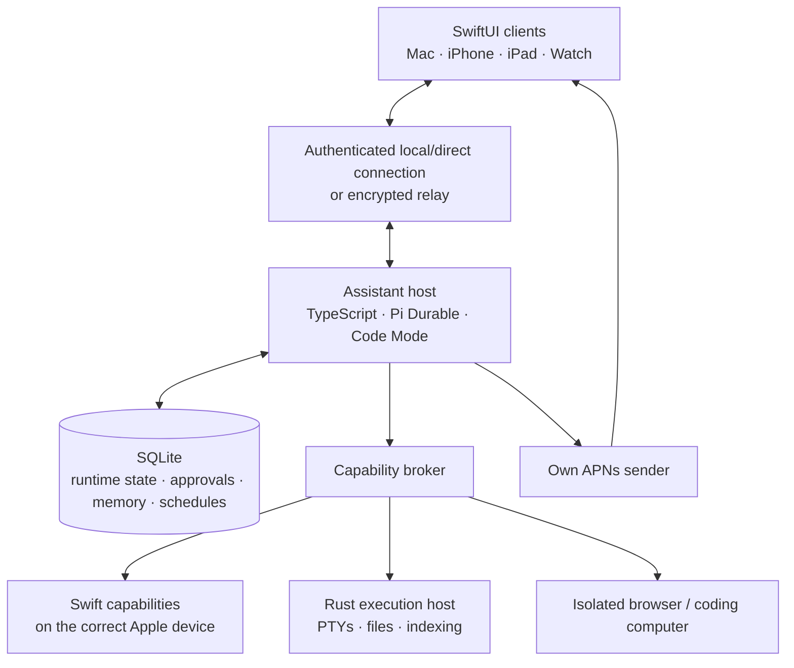

# Prior research: Apollo, Zeron and Unpeel compared, with a from-scratch blueprint (2026-10-17)

**Status:** Draft 4 · 2026-10-20 · imported prior research; everything below the `BEGIN VERBATIM COPY` marker is the verbatim text of one assistant message
**Owns:** Memoshi's archived copy of the final answer from the 2026-10-17 "ZERON" research session, which compared Apollo, Zeron and Unpeel and sketched an Apple-native assistant built from scratch
**Depends on:** [Research index](../README.md) · [In-house assets: Apollo](../agentic-workspace-landscape/landscape/in-house-assets.md#apollo) · [MASTER_PLAN](../../plan/MASTER_PLAN.md) · [decisions](../../plan/decisions.md)

## Provenance

| Field | Value |
|---|---|
| Source | omp session `01a14b6f-6bfa-772c-94c1-f67c83ce21cf`, transcript `~/.omp/agent/sessions/--private-tmp--/2026-10-17T19-55-55-770Z_01a14b6f-6bfa-772c-94c1-f67c83ce21cf.jsonl`, line 333: assistant message `730e8c4a`, 2026-10-17 20:20:32 UTC. It is the session's last assistant message |
| Session | Titled "ZERON: Research Pi-Based Personal Assistant Architecture"; started 2026-10-17 19:55 UTC in `/tmp`; model `gpt-6.1-sol` through the `openai-codex` provider. It began from a handoff about shipping Zeron and Unpeel builds to TestFlight, and a request to compare those two. At 20:11 UTC the user added Apollo and asked for a comparison of all three (architecture, stack, features), the best of each, what to build from scratch, a look at Grok Bot, Rakazo and similar projects, and use of the new Pi Durable and Code Mode |
| What was extracted | The message's single `text` block: 23,835 characters in 359 lines. Its hidden reasoning block was not copied. A final newline was added |
| How | Python's `json` module on that line, checked with `jq` (below) |
| Projects compared | **Apollo**: `~/Memo/apollo-agent`, the user's own assistant ([audit](../agentic-workspace-landscape/landscape/in-house-assets.md#apollo)). **Zeron**: `~/Projects/Zeron`, a checkout of [zeronsh/zeron](https://github.com/zeronsh/zeron) (MIT; "A native control plane for Claude Code, Codex, Cursor, Devin and other coding agents"), with a Rust engine, a GPUI desktop app and a UIKit iOS app. **Unpeel**: `~/Projects/unpeel`, the user's fork of [unpeel-com/unpeel](https://github.com/unpeel-com/unpeel) (MIT), a Rust host with Swift clients built around a terminal. Neither Zeron nor Unpeel has a profile in the landscape report |

Check the body against the transcript (prints `identical`):

```sh
jq -r 'select(.id == "730e8c4a") | .message.content[] | select(.type == "text") | .text' \
  ~/.omp/agent/sessions/--private-tmp--/2026-10-17T19-55-55-770Z_01a14b6f-6bfa-772c-94c1-f67c83ce21cf.jsonl \
  | diff - <(sed '1,/^<!-- BEGIN VERBATIM COPY -->$/d' docs/research/prior/apollo-zeron-unpeel-2026-10-17.md) && echo identical
```

## Status today (2026-10-20)

1. **Apollo now pins pi-durable 1.3.0.** The body (section 4) says Apollo pins the Pi family at 1.1.0, that 1.3.0 is current, and that Apollo's custom Code Mode should not be assumed equal to the official one. Since then, `~/Memo/apollo-agent` (package 1.0.52; the body saw 1.0.49) has moved `pi-durable`, `pi-codemode`, `pi-agent-core`, `pi-ai`, `pi-mcp`, `pi-coding-agent` and `chord` to exactly 1.3.0. Its Code Mode is still its own `apollo_code` tool in `server/pi/codemode.ts`. That tool reuses upstream `pi-codemode`'s QuickJS sandbox, but runs each nested call as a Durable leaf task marked `replay: "unsafe"`, so a script is not replayed after a crash ([audit](../agentic-workspace-landscape/landscape/in-house-assets.md#apollo)). The body's first priority, reconciling Apollo with official 1.3 Durable and Code Mode, is done for versions but not for design [INFERENCE].
2. **The blueprint is a recommendation, not an implementation.** Nothing in section 6 ("What I would build from scratch") has been built. The session's only execution was an isolated smoke test against Apollo's then-installed Pi 1.1 packages (see "Verification boundary" at the end). It changed no code.
3. **File paths are local.** The `~/Memo/...` and `~/Projects/...` paths below work only on this Mac, and the files behind them keep changing.
4. **Session-time facts.** Versions and the state of all three projects are as of 2026-10-17.

## How Memoshi Draft 4 relates to the blueprint

The blueprint was written for Apollo, before the Draft 4 decisions. Memoshi follows most of section 6 and departs from it where the product differs. The mapping is ours [INFERENCE].

| Blueprint (sections 6 and 7) | Memoshi Draft 4 |
|---|---|
| A. Native SwiftUI clients, "not native copies of the brain" | Same. Memoshi.app is SwiftUI and AppKit; memoshid is the brain ([D12](../../plan/decisions.md#d12), [D31](../../plan/decisions.md#d31)) |
| B. One durable owner on SQLite, using Pi's storage contract | Same. memoshid owns SQLite in WAL mode, and transcripts live once, in Pi Durable storage ([D7](../../plan/decisions.md#d7), [D14](../../plan/decisions.md#d14)) |
| A TypeScript host running Pi Durable and Code Mode | Same ([D6](../../plan/decisions.md#d6), [D8](../../plan/decisions.md#d8)) |
| C. A Rust execution host for PTYs, files and indexing | **Not adopted.** Tools run in Pi `env`s: This Mac (sandboxed), Bot computer and Remote machine ([D16](../../plan/decisions.md#d16), [D17](../../plan/decisions.md#d17)). The plan has no Rust component |
| D. A capability broker that binds device, action, OS permission, approval scope and effect identity | **Split in two.** One policy engine in memoshid on `beforeTool`/`afterTool`, which also sees nested Code Mode and MCP calls ([D9](../../plan/decisions.md#d9)); and native capabilities hosted by the app and called by memoshid over the same connection ([D12](../../plan/decisions.md#d12), [D13](../../plan/decisions.md#d13)) |
| "Approving a script is not approving every possible action inside it" | Same: policy decides every nested call ([D9](../../plan/decisions.md#d9)) |
| E. Memory as evidence, not authority, with source, scope, time, supersession and correction | Same, nearly word for word ([D22](../../plan/decisions.md#d22)) |
| F. Proactivity as scheduled work with budgets and quiet hours | Same: routines, wakes, watches, budgets and `no_update` ([D23](../../plan/decisions.md#d23), [D25](../../plan/decisions.md#d25)) |
| F. "Prefer one assistant loop"; specialists only when the task warrants them | **Goes further.** Memoshi's thesis is an Assistant that runs a team of persistent bots through Handoffs ([D20](../../plan/decisions.md#d20), [D24](../../plan/decisions.md#d24)). The blueprint's cost warning still holds: delegation must earn its cost, and budgets cap it |
| F. Separate "work finished", "notification queued", "APNs accepted" and "user presentation observed" | Not a decision yet; it matters for the v1.1 iPhone app and its push sender ([D38](../../plan/decisions.md#d38)) |
| G. An always-on Mac as the primary host, and never a silent second primary | Consistent: local-first, with Remote machines in v1 and a runner in v1.1 for always-on work ([MASTER_PLAN §11](../../plan/MASTER_PLAN.md#11-scope)) |
| G. Your own relay and APNs sender, with content-free notification previews | Same, in v1.1 ([D38](../../plan/decisions.md#d38), [D39](../../plan/decisions.md#d39)) |
| Section 7: evolve Apollo rather than replace it | Advice for Apollo as a product. Memoshi is a separate product in a fresh repo, and Apollo is a reference and port source ([MASTER_PLAN §13](../../plan/MASTER_PLAN.md#13-what-we-reuse)) |

<!-- BEGIN VERBATIM COPY -->
## My conclusion

**Apollo is the closest to the product you actually want. Zeron and Unpeel provide stronger foundations for particular parts of it—not replacements for the assistant itself.**

For a from-scratch build, I would combine:

- **Apollo’s personal-assistant concepts:** identity, memory, routines, Apple capabilities, approvals and cross-device continuity.
- **Zeron’s structured agent experience:** readable conversations, tool results, steering, worktrees and code review.
- **Unpeel’s terminal architecture:** durable hosted sessions, faithful terminal access and clients that can disconnect without stopping work.
- **Rakazo’s separation of the agent from its computer:** persistent assistants with independently managed execution environments.
- **Current Pi Durable + Code Mode** as the main reasoning/execution foundation.

**I would not make the whole thing Rust, merge these repositories, or put an always-running agent on the iPhone.** For your Apple-first goal, native Swift clients, a TypeScript/Pi runtime, and a lean Rust execution host are a coherent combination.

This comparison uses current local source, not only READMEs. The active Apollo is `~/Memo/apollo-agent`, package `1.0.49`; the copy under `~/Projects/TEM/` is older.

---

## 1. Architecture and technology comparison

| Area | Apollo | Zeron | Unpeel |
|---|---|---|---|
| **Product model** | Persistent personal assistant | Structured coding-agent workspace | Agent-oriented terminal workspace |
| **Main backend** | TypeScript/Node, Express coordinator | Rust engine, Tokio, typed RPC | Rust Host, shared PTY core, versioned Host protocol |
| **Mac interface** | Electron companion with Swift native helpers and XPC support | Rust GPUI desktop interface | Native Swift/SwiftUI with Ghostty terminal integration |
| **iPhone/iPad interface** | Native SwiftUI | UIKit, with shared Rust client/layout/rendering logic through UniFFI | SwiftUI, terminal-oriented |
| **Primary state** | Convex: accounts, conversations, memory, work, approvals, deliveries; custom Pi Durable storage adapter | Local SQLite/session documents; Loro-based synchronization and registry data | Host-owned session files, manifests, output journals and workspace state |
| **Remote infrastructure** | Authenticated coordinator, outbound paired-Mac workers | Cloudflare Workers/Durable Objects, R2, WorkOS authentication | Direct LAN/VPN; operated Link relay for off-network connectivity |
| **Agent integration** | Claude Agent SDK, Codex app-server, embedded Pi runtime | Dedicated harness adapters, including Claude, Codex, Cursor, Pi and others | Runs terminal programs; runtime packages add agent-specific detection, status and resume support |
| **Personal memory** | Explicit retrieval, provenance, extraction, consolidation and correction machinery | Conversation persistence; no comparable personal-memory lifecycle found in the inspected domains | Session/transcript persistence; underlying agents can have memory, but no comparable assistant-memory layer found |
| **Proactivity** | Durable automation occurrences, background work, proactive email path, outbound channels | Primarily user-driven agent sessions and status notifications | Primarily running sessions, attention detection and notifications |
| **Apple integration** | Broad native capability and system-surface implementation | Mostly application/device experience, rather than a general Apple personal-data assistant | Mostly application/device experience, rather than a general Apple personal-data assistant |
| **Terminal experience** | Coding/task supervision; no embedded terminal found in the inspected product surfaces | Real desktop terminals, but no standalone iOS terminal found | Central desktop and phone feature |
| **Main architectural cost** | Many coordinated state machines and deployment dependencies | Custom rendering/sync complexity; phone depends on edge/auth infrastructure | Personal-assistant semantics must be added; operated Link backend is not included |

**Important correction:** Unpeel is not “Swift instead of Rust.” Its **Host is Rust; its Apple clients are Swift**. Zeron also launches external agent runtimes—its Rust engine does not make Claude, Codex or Pi themselves Rust.

Sources: Apollo architecture (`~/Memo/apollo-agent/ARCHITECTURE.md`), Zeron architecture (`~/Projects/Zeron/ARCHITECTURE.md`), Unpeel architecture and invariants (`~/Projects/unpeel/AGENTS.md`).

---

## 2. What is best in each project?

### Apollo: strongest foundation for the assistant’s actual responsibilities

Apollo already treats these as real product domains:

- Who the user is and which devices belong to them.
- What the assistant remembers, and where that information came from.
- Work that continues beyond one message.
- Scheduled occurrences with claims, leases and recovery.
- Approvals tied to consequential actions.
- Whether an action actually happened, rather than whether a model said it happened.
- Delivery through an app, messaging channel or notification.

The memory implementation is more substantial than a vector database plus a graph visualization. Recall combines lexical and compatible vector candidates, ranks grounded evidence, considers conflicts/corroboration, and can abstain.

Its local Knowledge subsystem is also distinct from conversational memory: original documents and model assets remain on the paired Mac, with separate disclosure and private-delivery rules.

**What I would retain:** the concepts of provenance, explicit approval, outcome uncertainty, device ownership and durable work.

**What I would simplify in a new design:**

- Avoid an extra dispatcher/model round trip when one ordinary assistant turn can do the job.
- Delegate only when specialization or parallel work earns its cost.
- Give runtime persistence and application persistence clearly separated ownership.
- Avoid making every supporting job a separate orchestration framework.

There is also a concrete runtime inconsistency: **memory consolidation currently calls Claude directly**, so selecting Pi interactively does not make every background process Pi-native.

Sources: memory retrieval (`~/Memo/apollo-agent/server/memory/tools.ts`), Pi storage adapter (`~/Memo/apollo-agent/server/pi/storage.ts`), consolidation runtime (`~/Memo/apollo-agent/server/consolidation.ts`).

### Zeron: strongest reference for presenting structured agent work

Zeron’s useful contribution is how it makes agent activity understandable:

- Structured messages and tool results instead of only terminal escape sequences.
- Queueing, steering, interruption and question handling.
- Repository, worktree, file and Changes context.
- Incremental transcript processing and virtualized rendering.
- A device-independent view of agent sessions.

For a personal assistant, this presentation model can extend beyond coding: a calendar proposal, travel comparison, research artifact or purchase approval should be a **typed, inspectable result**, not an enormous terminal dump.

**What I would borrow:** structured event records, incremental rendering, clear task states and contextual review.

**What I would not automatically copy:** the entire GPUI/Rust mobile layout stack. For an Apple-only product, SwiftUI with selective UIKit/AppKit views is a more direct route to accessibility, text interaction and system integration. Custom rendering should earn its maintenance cost through measured requirements.

### Unpeel: strongest reference for owning running processes

Unpeel gets an important separation right:

**The terminal belongs to the Host, not to whichever window is displaying it.**

Its detached PTY core, output journals and attach/reconnect model are valuable when an assistant runs commands for hours or needs human intervention.

The terminal should be an **available inspection and control surface**, even if the main assistant experience is conversational.

**What I would borrow:** detached execution, faithful terminal attachment, process identity checks, capability-advertised operations and explicit connection states.

**What I would not make the whole product:** a terminal viewer. Personal memory, reminders, inbox triage and Apple actions need richer semantics than terminal text.

Also, Unpeel does have Filetree/Git/Diffs/Usage plugins; describing it as having no coding-review features would be wrong.

Sources: Unpeel session architecture (`~/Projects/unpeel/README.md`), Zeron Pi integration (`~/Projects/Zeron/docs/pi.md`).

### Performance: do not choose from language labels

**Architectural judgment, not a benchmark:** Rust is attractive for PTYs, indexing, parsing, rendering and bounded long-lived processes. Swift is the natural owner of Apple frameworks and native interaction. TypeScript is currently the most direct way to embed the new Pi packages.

A Rust rewrite does not eliminate model latency, connector latency, excessive model calls, unbounded context or inefficient storage operations. I found no comparable benchmark that establishes an overall performance winner among these three.

---

## 3. How complete is Apollo’s Apple integration?

There is real implementation here—not merely a list of desired frameworks.

### Source-supported capabilities

Apollo includes:

- SwiftUI phone and regular-width iPad layouts.
- App Intents/Shortcuts for asking, capturing, remembering, starting tasks, pausing work and reviewing approvals.
- Widgets, Live Activities, Spotlight entries and Handoff handling.
- A WatchConnectivity-based Watch surface.
- Calendar, Reminders, Contacts, location, Health and motion providers.
- Share/Photos/Files capture paths.
- Mac Notes, Mail, Finder, Spotlight, Quick Look, clipboard, Accessibility and screen-capture operations.
- Foundation Models-based **draft rewriting** on eligible devices.

But there are important limits:

- **Source support is not physical-device acceptance.**
- Watch is a bounded continuity/status surface, not an independent agent host.
- Foundation Models rewriting is not an offline implementation of the whole assistant.
- Messages extensions do not grant unrestricted access to iMessage history.
- The Mac Mail composition path creates a visible draft and reports `sent: false`.
- FinanceKit, Family Controls, CarPlay and Apple Pay are explicitly not planned for the documented candidate.
- Permission, entitlement, hardware, account and foreground requirements remain separate gates.

Apple integration should therefore mean **“knows which approved capability is available on which device”**, not “the agent can access everything Apple.”

Apple also explicitly limits background execution. An iPhone app cannot be treated as an unrestricted, continuously running worker. [Apple background execution guidance](https://developer.apple.com/documentation/backgroundtasks/choosing-background-strategies-for-your-app).

Sources: native capability dispatch (`~/Memo/apollo-agent/ios/ApolloClient/Sources/ApolloClientUI/ApolloNativeContextProvider.swift`), Apple shortcuts (`~/Memo/apollo-agent/ios/ApolloApp/ApolloApp/Sources/ApolloApp.swift`), current operator checklist (`~/Memo/apollo-agent/todos/apple-platform-release.md`).

---

## 4. The new Pi: what matters for this design

### Apollo has already started this integration

Apollo pins the Pi family to **`1.1.0`** and actually executes turns through Durable. Its custom Code Mode implementation invokes approved capabilities through owned Durable leaf tasks.

That is more than installing unused packages.

However, **current stable is `1.3.0`, released October 15**. Official Durable-integrated Code Mode arrived in **`1.2.0`**, with nested tool tasks, structured outputs, caller restrictions and deterministic script replay.

Apollo’s custom integration should not be assumed equivalent to that newer implementation.

### These packages have different jobs

| Package | Role in the proposed assistant |
|---|---|
| `pi-ai` | Provider/model access |
| `pi-durable` | Durable conversations, submissions, tasks and transactional documents |
| `pi-codemode` | JavaScript composition of explicitly exposed tools |
| `pi-mcp` | MCP connectivity and tool discovery—not authorization |
| `pi-coding-agent` | Full coding CLI/SDK/RPC experience when that specific harness is needed |
| Chord | Typed contracts, application composition and state/RPC machinery |

**Calling a model through Pi is not the same as running the Codex or Claude Code harness.** I would use Pi as the primary assistant runtime and retain those harnesses as optional coding specialists.

### Why Durable + Code Mode fits

A script can retrieve several sources, filter and combine results, and return a compact answer without sending every intermediate tool payload through the model context.

Durable adds committed task state and recovery. Current official Code Mode can replay JavaScript against recorded nested-call results and continue—not restore a frozen OS process.

Two limits matter:

1. **Durable conversation state is not semantic personal memory.** You still need memory provenance, retrieval, correction and forgetting.
2. **Durable execution is not exactly-once external action.** A crash after sending an email but before recording the response remains an ambiguity unless the provider supports idempotency or reconciliation.

Code Mode’s QuickJS VM has no ambient Node filesystem, `process`, `require` or `fetch`. But an injected unrestricted shell tool can still expose host authority. Authorization must apply to **every nested effect**, not just the outer script.

Durable remains explicitly experimental, and `1.2` includes breaking changes. **Upgrading Apollo requires adapter and recovery-contract work, not only changing version numbers.**

Sources: [Pi 1.3 release](https://github.com/earendil-works/pi/releases/tag/v1.3.0), [Durable changelog](https://github.com/earendil-works/pi/blob/v1.3.0/packages/durable/CHANGELOG.md), [version-pinned Durable guide](https://github.com/earendil-works/pi/blob/v1.3.0/packages/durable/README.md).

---

## 5. Rakazo, Grok Bot and other useful references

### Rakazo is the closest external product reference

Rakazo has a complete persistent-teammate shape:

- Named bots with memory, routines and history.
- Browser, terminal, filesystem and graphical computer tools.
- Persistent peers versus short-lived subagents.
- Computer-provider adapters.
- Human takeover.
- Web, Electron desktop and Expo/React Native mobile clients.

Its stack is TypeScript, React, Hono/oRPC, PostgreSQL/Prisma, Graphile Worker, Better Auth and Pi.

**It is not an Apple-native Swift foundation.** The inspected runtime also pins Pi agent-core/AI `0.87.1`; it does not establish adoption of new Pi Durable/Code Mode.

Its strongest lesson is separating **assistant identity, reasoning runtime, computer lifecycle and client UI**. Shared folders/screens are not isolation; its computer documentation explicitly distinguishes coordination from security.

Sources: [Rakazo](https://github.com/elie222/rakazo), [runtime dependencies](https://github.com/elie222/rakazo/blob/5b35ea782cbbdb9212ea78794770de25f5e5c5bd/packages/adapters/package.json), [computer contract](https://github.com/elie222/rakazo/blob/5b35ea782cbbdb9212ea78794770de25f5e5c5bd/docs/computer-runtime.md).

### Other references worth studying

| Project | Most useful idea | Qualification |
|---|---|---|
| **[Grok Bot](https://docs.x.ai/grok-bot/overview)** | Persistent named assistants, demonstration-to-skill-to-routine, cross-device approvals, work while clients are closed | Hosted product reference, not an established open-source implementation. Official docs describe Cursor-operated computers/control infrastructure |
| **[OpenClaw](https://docs.openclaw.ai/concepts/architecture)** | Gateway separated from paired device capabilities; memory governance | Do not assume older “built on Pi” descriptions prove current Durable adoption |
| **[Hermes Agent](https://github.com/NousResearch/hermes-agent)** | Bounded identity/user memory, session boundaries, skills and unattended-work policies | Python architecture; its persistence is not Pi Durable |
| **[nanobot](https://github.com/HKUDS/nanobot)** | Explicit distinction between completed work and queued/sent/unknown delivery | Useful reliability semantics, not evidence of Apple-native integration |
| **[Pi Durable Components](https://github.com/IgorWarzocha/pi-durable-components)** | Concrete Durable extensions for scheduling, delegation, UI presentations, browser work and voice | Experimental integration reference; development source and released artifacts target different Pi versions |

The last project is particularly relevant to your request:

- **Pulses:** scheduled, folder-owned work with quiet hours and durable task references.
- **Headless UI contracts:** native controls can consume semantic state/actions without embedding the execution runtime.
- **Grok Voice:** voice as a transport into a conversation, with explicit microphone ownership.
- **Code/Notebook modes:** useful experiments, but their V8/Deno execution and restart behavior are **not the same as official QuickJS Durable Code Mode**.

I would borrow these ideas selectively, not install every extension or assume their live-device behavior has been proven.

---

## 6. What I would build from scratch

**An Apple-native, local-first assistant with one authoritative execution owner and separately authorized computers/devices.**



### A. Native clients, not native copies of the brain

Use SwiftUI for the Apple applications, with UIKit/AppKit where terminal rendering or large transcripts require it.

Present three complementary surfaces:

- **Conversation:** explain and steer work.
- **Inbox:** approvals, completed results and things needing attention.
- **Workspace:** terminal, files, diffs, browser artifacts when relevant.

The client owns drafts, presentation and a reconnectable cache—not a second scheduler or competing task authority.

### B. One durable owner

For a personal deployment from scratch, I would default to **SQLite and a single active owner per assistant**, using Pi’s storage contract and coordinated application writes.

Do not make approvals, external effects or task ownership multi-writer CRDTs. Use request IDs, durable decisions and versioned snapshots/events for clients.

For **existing Apollo**, I would keep Convex while improving its adapter and ownership contracts. Migrating databases merely to resemble this diagram would discard working infrastructure without demonstrating a benefit.

### C. Put Rust on the workloads it serves well

Use a Rust module for durable PTYs, bounded output journals, filesystem work and indexing. It should keep processes alive independently of UI and model-worker restarts.

Use **Swift adapters** for Apple frameworks and Mac XPC/permission interactions. Do not force those through generic shell or AppleScript tools when a typed operation exists.

Use TypeScript for Pi orchestration rather than rebuilding Pi in Rust or wrapping every small operation across an unnecessary FFI seam.

### D. Make the capability broker a deep module

Its small interface should hide device discovery, permissions, approval binding, dispatch and reconciliation.

Every operation needs to establish:

- The owning user and target device.
- The exact action and arguments.
- Current OS permission and user-presence requirements.
- Approval scope and expiry.
- A durable effect identity and observable outcome.

**Approving a script is not approving every possible action inside it.** Shell access, Apple actions and browser operations must retain their own enforceable policies.

### E. Treat memory as evidence, not authority

Separate:

- Identity/preferences.
- Episodic evidence from conversations and tasks.
- Documents/knowledge.
- Current commitments.
- Executable skills and permission rules.

A memory should carry its source, scope, time, uncertainty, supersession and deletion status. Retrieval should support correction and abstention.

**Remembered text must not become a permission grant.** A graph visualization is optional; reliable correction and forgetting are essential.

### F. Proactivity should be scheduled work, not endless agent chatter

Use durable routines and event subscriptions with budgets, quiet hours and explicit destinations.

Prefer one assistant loop for ordinary work. Use specialists and parallelism when the task warrants them—not a dispatcher/proposer/adversary/judge swarm for every request.

A scheduled result should distinguish **work finished**, **notification queued**, **APNs accepted**, and **user presentation observed**.

### G. Be explicit about availability

For your Apple-local use, an always-on Mac is a sensible primary host. If that machine sleeps, work cannot magically continue there.

If you need continuity while your only Mac is asleep, place the primary Pi host on an always-on server. **Mac-only actions still wait for the paired Mac.** Do not silently run a second primary or pretend cloud failover can execute local Apple capabilities.

The relay and APNs sender should be yours, rather than inheriting either project’s hosted push assumptions. Private notification previews should avoid exposing conversation content.

---

## 7. What I recommend for your existing work

**Evolve Apollo rather than replace it with Zeron, Unpeel or Rakazo. Borrow their strongest designs at specific seams.**

Priority order:

1. **Reconcile Apollo’s custom Pi integration with official `1.3` Durable/Code Mode**, preserving approvals, storage fencing and unknown-effect handling.
2. **Make the native assistant experience coherent:** conversation, inbox, tasks, memory and capability availability.
3. **Add a proper detachable terminal/computer module**, using Unpeel’s Host principles.
4. **Improve structured work and coding review**, using Zeron’s presentation principles.
5. **Validate end-to-end behavior**, especially physical Apple effects, locked-phone delivery, reconnect recovery and memory correction.

The acceptance bar should be real scenarios: create a reviewed reminder once, recover a long-running task after disconnection without duplicating effects, and deliver a scheduled result while client apps are closed.

### Verification boundary

I ran an isolated smoke using Apollo’s installed Pi `1.1` packages:

- Code Mode called a synthetic capability and returned `650`.
- `process`, `require` and `fetch` were unavailable inside that script.
- A Durable document and conversation identity reopened successfully in a **second Node process**.

That verifies those package primitives—not Apollo’s complete recovery path, latest Pi `1.3`, Apple-device behavior, memory quality or push delivery. No application/configuration changes, installations, model calls or live Apple actions were made.
