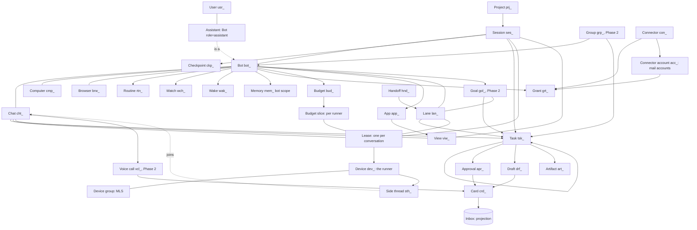
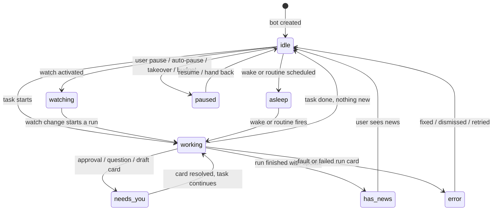
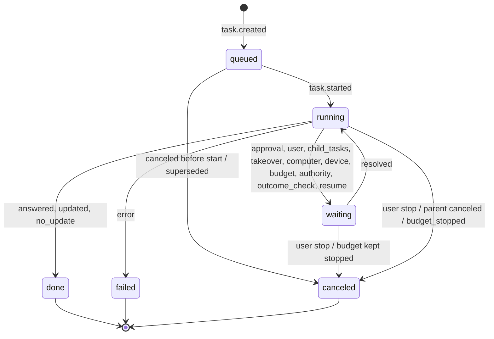
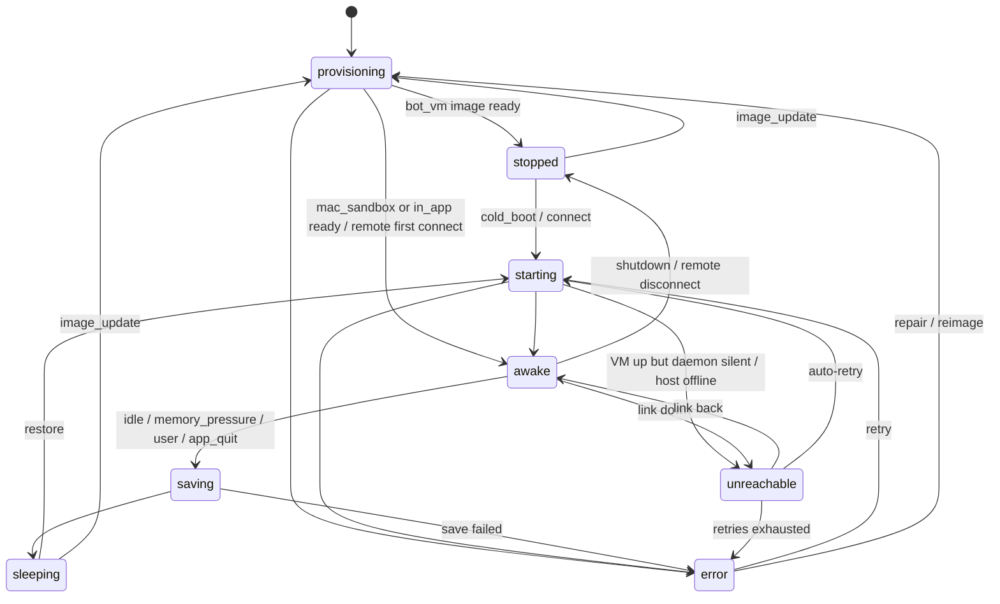
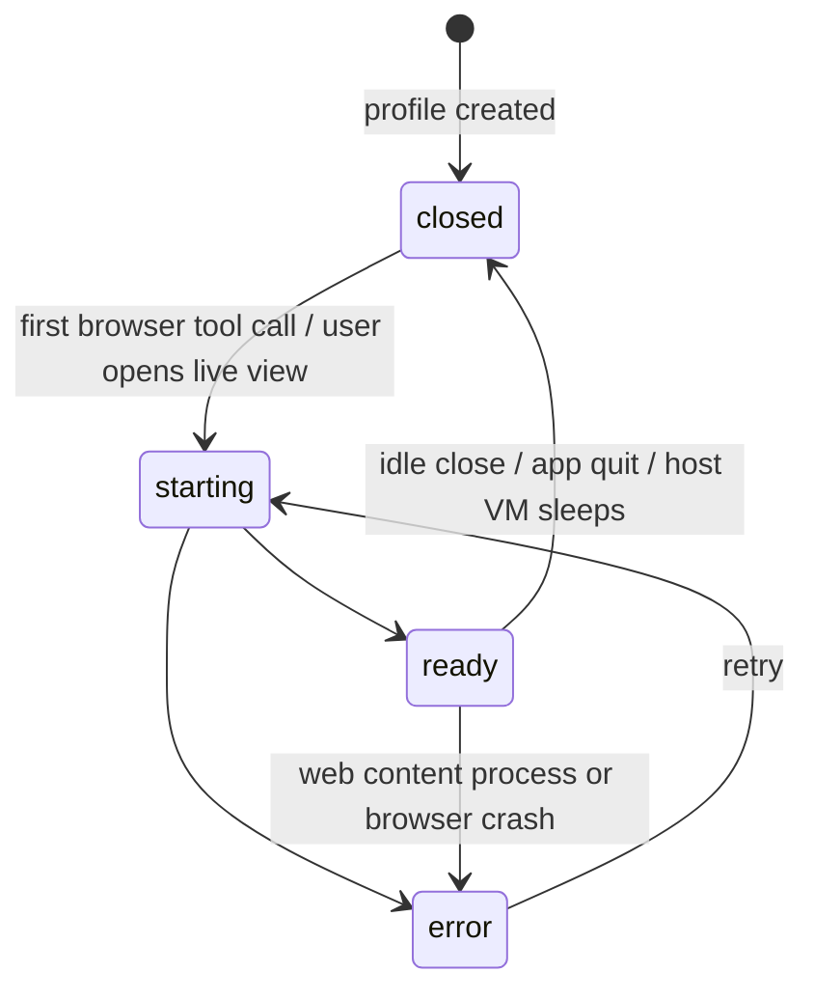
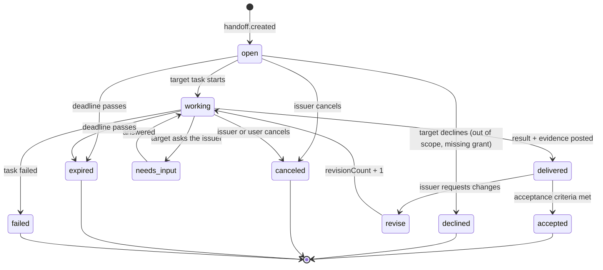

# Object Model

**Status:** Draft 4 · 2026-10-20 · updated 2026-10-23 for D44–D89 · updated 2026-11-13 for [D106](../plan/decisions.md#d106)–[D122](../plan/decisions.md#d122): the Mini app is now the **App** (identifiers unchanged), with its kinds, pane, exported functions, scope, places and plugin developer mode records; View, Goal and Voice call are new; Groups move to Phase 2 and bot-to-bot messages to Phase 1; Bot computers and Cloud computers move to Phase 2 and Remote machines to Phase 3; mail accounts, Claude Code as a bot's model, and a bot's voice, computer and mail-sending settings are added.
**Owns:** The canonical objects, fields, IDs, relations, invariants, storage owners, Pi mappings and state machines shared by Memoshi.app, memoshid, the iPhone and iPad app and the protocol, including devices and their group, leases, replicas, lanes, side threads versus local unsent messages, budget slices, checkpoints, Trash, secret entries and tool definitions; since 2026-11-13 also Apps with their views and plugin developer mode records, Goals, voice calls and mail accounts.
**Depends on:** [MASTER_PLAN §5](../plan/MASTER_PLAN.md#5-vocabulary-and-object-model), [decisions](../plan/decisions.md), [events.md](events.md), [protocol.md](protocol.md), [policy.md](policy.md), [bot-definition.md](bot-definition.md), [cards.md](cards.md), [04-architecture.md](../plan/04-architecture.md), [05-bots-and-assistant.md](../plan/05-bots-and-assistant.md), [06-computers-and-browsers.md](../plan/06-computers-and-browsers.md), [07-coding.md](../plan/07-coding.md), [08-security-and-privacy.md](../plan/08-security-and-privacy.md), [AMENDMENT_2026-11-13.md](../plan/AMENDMENT_2026-11-13.md)

This spec gives field-level detail for the vocabulary in [MASTER_PLAN §5](../plan/MASTER_PLAN.md#5-vocabulary-and-object-model), which is binding ([D4](../plan/decisions.md#d4)). If a feature does not fit one of these objects, either the feature is wrong or the model needs a deliberate change through [change control](../plan/decisions.md#change-control) (rule 4: an object-model change triggers a spec review). Structure (entity tables with invariants, lifecycles, global invariants) is adapted from Draft 3 `specs/object-model.md`; the content is rewritten for the Draft 4 decisions.

> **The rule.** The Assistant is the front door. Bots are who. Projects are where. Chats, Sessions and Groups are the thread. Tasks are the work. Computers and Browsers are where it runs.

---

## 1. Conventions

### 1.1 IDs

Every Memoshi record has a **prefixed ULID**: a lowercase three-letter prefix, an underscore, then a 26-character ULID in uppercase Crockford base32, for example `bot_01JC3F7Q9R2M8K4T6V5W0X1Y2Z`. ULIDs sort by creation time; IDs generated in the same millisecond are monotonic (the scheme of the Draft 3 `ids` utility, per the [Draft 3 build audit](../research/agentic-workspace-landscape/landscape/in-house-assets.md#draft-3-build), ported to Swift). IDs are never reused, never parsed for meaning beyond the prefix, and never shown to users except at the Developer experience level. Every device generates its own IDs; ULID randomness makes collisions between devices negligible.

| Prefix | Object | Kind |
|---|---|---|
| `usr_` | User | MASTER_PLAN object (the profile behind the Assistant) |
| `bot_` | Bot (including the Assistant) | MASTER_PLAN object |
| `cht_` | Chat | MASTER_PLAN object |
| `prj_` | Project | MASTER_PLAN object |
| `ses_` | Session | MASTER_PLAN object |
| `grp_` | Group | MASTER_PLAN object (Phase 2, [D109](../plan/decisions.md#d109)) |
| `tsk_` | Task | MASTER_PLAN object |
| `hnd_` | Handoff | MASTER_PLAN object |
| `rtn_` | Routine | MASTER_PLAN object |
| `wch_` | Watch | MASTER_PLAN object |
| `wak_` | Wake | MASTER_PLAN object |
| `cmp_` | Computer | MASTER_PLAN object |
| `brw_` | Browser | MASTER_PLAN object |
| `mem_` | Memory entry | MASTER_PLAN object |
| `con_` | Connector | MASTER_PLAN object |
| `skl_` | Skill | MASTER_PLAN object |
| `crd_` | Card | MASTER_PLAN object |
| `apr_` | Approval | MASTER_PLAN object |
| `drf_` | Draft | MASTER_PLAN object |
| `art_` | Artifact | MASTER_PLAN object |
| `bud_` | Budget | MASTER_PLAN object |
| `grt_` | Grant | MASTER_PLAN object |
| — | Inbox | MASTER_PLAN object; a projection over Cards, no ID and no table |
| `msg_` | Message index row | Supporting: maps to one Pi entry; holds no content ([D7](../plan/decisions.md#d7)) |
| `rev_` | Bot revision | Supporting: versioned job and persona ([D21](../plan/decisions.md#d21)) |
| `sec_` | Bot section | Supporting: user-made sidebar section |
| `acc_` | Connector account | Supporting: the account behind a Connector |
| `snp_` | Computer snapshot | Supporting: saved VM state or disk checkpoint (Phase 2, with Bot computers, [D113](../plan/decisions.md#d113)) |
| `mcn_` | Memory consolidation | Supporting: one nightly consolidation pass and its diff |
| `usg_` | Usage record | Supporting: append-only model-usage ledger row |
| `aud_` | Audit entry | Supporting: hash-chained audit row ([policy.md](policy.md)) |
| `rvc_` | Review comment | Supporting, owned by [07-coding.md](../plan/07-coding.md) |
| `ckp_` | Checkpoint | Supporting: a coding turn's files snapshot and conversation position ([D77](../plan/decisions.md#d77), [§4.6](#46-session-ses_)); its git mechanics are owned by [07-coding.md](../plan/07-coding.md) |
| `dev_` | Device | Supporting: a paired Mac, iPhone or iPad ([D48](../plan/decisions.md#d48)) |
| `sth_` | Side thread | Supporting: a child conversation on a device that could not reach its conversation's runner but has an available allowed model ([D49](../plan/decisions.md#d49), [D88](../plan/decisions.md#d88)) |
| `lan_` | Lane | Supporting: the conversation where a Handoff's work runs, owned by the receiving bot, with its own store and lease ([D74](../plan/decisions.md#d74)) [INFERENCE: names in Phase 2] |
| `nbk_` | Notebook | Supporting: a reference to an `.ipynb` file, where its cells run and how its last run went ([D60](../plan/decisions.md#d60)) |
| `app_` | App | MASTER_PLAN object ([D68](../plan/decisions.md#d68), [D114](../plan/decisions.md#d114), [D119](../plan/decisions.md#d119); called Mini app before D119): a built-in or bot-built program, a page App or a Swift App, shown in a pane beside its conversation, or as a sheet, a window or full screen ([D85](../plan/decisions.md#d85)), with versions, exported functions and saved data; page Apps from Phase 1, Swift Apps from Phase 2 on the Mac and Phase 3 on iPhone and iPad; background jobs and widgets arrive in Drop 1 ([D71](../plan/decisions.md#d71), [D87](../plan/decisions.md#d87)) |
| `gol_` | Goal | MASTER_PLAN object (Phase 2, GR-13, [D109](../plan/decisions.md#d109)): an outcome with criteria that a bot works toward unattended, keeping a decision log ([§4.36](#436-goal-gol_)) [INFERENCE: names in Phase 2] |
| `viw_` | View | Supporting: a view open beside a conversation, such as an App's pane ([D114](../plan/decisions.md#d114), [§4.37](#437-view-viw_)) [INFERENCE: names in Phase 1] |
| `vcl_` | Voice call | Supporting: the record of one voice call, behind the card it leaves (Phase 2 on the Mac, Phase 3 on iPhone and iPad; [D111](../plan/decisions.md#d111), [§4.38](#438-voice-call-vcl_)) [INFERENCE: names in Phase 2] |
| `plg_` | Plugin | Supporting, Mac only: a compiled Swift plugin a bot wrote in plugin developer mode, run in a separate helper process (Phase 2, CH-44; [D114](../plan/decisions.md#d114), [§4.32](#432-mini-app-app_)) [INFERENCE: names in Phase 2] |
| — | Lease | Supporting: one per conversation store, keyed by `conversationId` ([D49](../plan/decisions.md#d49), [D74](../plan/decisions.md#d74)) |
| — | Replica state | Supporting: one per conversation and device, keyed by `(conversationId, deviceId)` ([D49](../plan/decisions.md#d49), [D74](../plan/decisions.md#d74)) |
| — | Tool definition | Supporting: a static entry in the tool catalog, keyed by tool `name` ([D50](../plan/decisions.md#d50)) |
| — | Signed bytecode | Supporting, from Drop 1: a cache of a program's bytecode, signed by the runner of the program's conversation and keyed by `(sourceHash, engineVersion)` ([D71](../plan/decisions.md#d71), [D87](../plan/decisions.md#d87)) |
| — | Budget slice | Supporting: a runner's reserved share of a budget, keyed by `(budgetId, conversationId)` ([D76](../plan/decisions.md#d76)) [INFERENCE: names in Phase 2] |
| — | Device group | Supporting: the user's devices as one MLS group, keyed by `groupId` ([D75](../plan/decisions.md#d75)) [INFERENCE: names in Phase 2] |
| — | Secret entry | Supporting: what every device knows about a Keychain secret, its "this device only" flag included, keyed by `SecretRef` ([D75](../plan/decisions.md#d75)) [INFERENCE: names in Phase 2] |
| — | Trash | Supporting: a projection over deleted conversations and bots, kept 30 days ([D74](../plan/decisions.md#d74)); no ID and no table |
| — | Provider setting | Supporting: the user's provider for one capability (web search, cloud voice, media generation, cloud computer), keyed by `(capability, providerId)` ([D120](../plan/decisions.md#d120), [§4.39](#439-provider-setting)) [INFERENCE: names set in Phase 1] |
| — | Goal decision | Supporting: one entry in a Goal's decision log, keyed by `(goalId, seq)` ([D109](../plan/decisions.md#d109)) [INFERENCE: names in Phase 2] |
| — | View layout | Supporting: how a conversation's views are arranged on one device, keyed by `(conversationId, deviceId)`; device-local ([D114](../plan/decisions.md#d114)) [INFERENCE: names in Phase 1] |
| — | App view state | Supporting: what one App's view shows in one conversation on one device, keyed by `(appId, conversationId, deviceId)`; device-local and separate from saved data [INFERENCE: names in Phase 1] |
| — | Full access on this Mac | Supporting, Mac only: the user's switch for one App or plugin on one Mac, keyed by `(subject, deviceId)` (Phase 2, [D114](../plan/decisions.md#d114)) [INFERENCE: names in Phase 2] |

Pi Durable has its own identifiers. In the pi-durable 1.3.0 package they are branded numbers: `ConversationId`, `EntryId`, `TaskId`, `SubmissionId` and `DocumentId` are `number & brand`, and commit `Seq` is a number that is "strictly increasing ... gaps are permitted" (`dist/types.d.ts` in the local 1.3.0 package). Pi_Swift ports upstream's latest storage format ([D44](../plan/decisions.md#d44)), so these types are re-checked in spike S1. Memoshi stores them only in `pi_*` SQLite columns. They never appear in protocol methods or events, and only the runtime adapter may read them ([D6](../plan/decisions.md#d6), [D44](../plan/decisions.md#d44)).

### 1.2 Types and notation

| Notation | Meaning |
|---|---|
| `ID<bot>` | A prefixed ULID of that kind. `ID<conversation>` means `cht_`, `ses_`, `lan_`, `grp_` (Phase 2) or `sth_`. |
| `ms` | Unix epoch milliseconds, UTC, integer. Field names end in `At` (or `Until`). |
| `MicroUsd` | Integer millionths of a US dollar. Floats are never used for money. |
| `text(≤N)` | UTF-8 text with a hard limit in characters; single-line unless stated. |
| `md(≤N)` | Markdown text with a size limit in bytes. |
| `SecretRef` | An opaque Keychain item reference, never a secret value ([D14](../plan/decisions.md#d14)). The native model boundary distinguishes `kc_<UUID>` API-key entries from `cg_<UUID>` ChatGPT subscription entries; purpose-bound paths are not interchangeable ([protocol implementation scope](protocol.md#current-implementation-scope)). General SecretEntry synchronization follows [§4.35](#435-secret-entry) and [D75](../plan/decisions.md#d75); the current PiAI ChatGPT store is device-only and does not qualify iCloud credential synchronization. |
| `Actor` | `{ kind, id? }`; `kind` is `user`, `assistant`, `bot`, `trigger`, `system`, or `external_agent` (Phase 2, Mac only; R11-08 to R11-10, [D110](../plan/decisions.md#d110)). Same shape as the event envelope ([events.md §2](events.md#2-envelope)). |
| `Origin` | `{ kind, id?, rootKind, hops }`; see [§3.3](#33-origin-and-regime). |
| `Null` column | `yes` means the field may be `null`; otherwise it is always present. |

- **Casing:** JSON fields are camelCase; enum values are lowercase snake_case; SQLite tables are plural snake_case and columns snake_case. Swift maps enum values to camelCase cases (`needs_you` → `.needsYou`) and keeps an `unknown(String)` case for forward compatibility.
- **Storage owners:** **D** = the device's SQLite database `memoshi.sqlite` (WAL; the source of truth on that device, [D14](../plan/decisions.md#d14)), owned by memoshid on the Mac and by the app on iPhone and iPad. Every device keeps its own: a conversation's records are written only by that conversation's runner, and bot-wide records merge ([§3.4](#34-runner-replicas-and-record-ownership)); **P** = Pi Durable storage, one file per conversation (`pi/<cht_, ses_, lan_, grp_ or sth_ id>.sqlite`) holding its transcripts and Pi task state: each file is that conversation's durable store, written under its own lease ([D7](../plan/decisions.md#d7), [D49](../plan/decisions.md#d49), [D74](../plan/decisions.md#d74), [04-architecture.md](../plan/04-architecture.md)); **K** = Keychain, whose secrets sync through iCloud Keychain unless marked this device only ([D75](../plan/decisions.md#d75)); **F** = files (bot folders, projects, skills, artifacts); **A** = app-managed state (WebKit data stores, whose cookies sync per bot, [D75](../plan/decisions.md#d75); VM bundles from Phase 2), referenced from D.
- **Writes:** every change to a D object writes its event rows in the same SQLite transaction ([MASTER_PLAN §5 rule 6](../plan/MASTER_PLAN.md#rules), [events.md](events.md)).
- **Deletion:** objects are archived (`archivedAt`) before they are deleted. Deleting a conversation or a bot moves it to [Trash](#434-trash) on every device for 30 days, and any device can restore it; **Empty Trash**, or the end of the 30 days, purges it everywhere ([D74](../plan/decisions.md#d74)). Deletion is a user action, is audited, and never deletes user folders. Audit rows survive deletion (their payloads may be purged, [policy.md](policy.md)).
- **Engine:** where this spec says memoshid, read "the engine": memoshid on the Mac, and the iPhone and iPad app on iPhone and iPad, which runs Pi_Swift in process with no daemon ([D46](../plan/decisions.md#d46)). Text about the Mac only (the loopback webhook receiver, `git_push`, Remote machines) means memoshid itself.

---

## 2. Object map



| Object | Prefix | Storage | Pi mapping (detail in [§6](#6-pi-mapping)) | First phase |
|---|---|---|---|---|
| User | `usr_` | D | none | 0 |
| Assistant | `bot_` | D | as Bot | 1 |
| Bot | `bot_` | D, F (home) | identity rendered into system-prompt sections each request | 1 |
| Chat | `cht_` | D (record), P (`pi/cht_<id>.sqlite`) | the root conversation of its own Pi store, under its own lease ([D74](../plan/decisions.md#d74)) | 1 |
| Project | `prj_` | D, F | env `cwd` | 2 |
| Session | `ses_` | D, P (`pi/ses_<id>.sqlite`) | the root conversation of its own Pi store, under its own lease; a fork is a new Session with its own store, started from its parent's history at the fork point ([D80](../plan/decisions.md#d80)) | 2 (sessions without a project in 1) |
| Group | `grp_` | D, P (`pi/grp_<id>.sqlite`) | the root conversation of its own Pi store, under its own lease; members work in their own lanes | 2 ([D109](../plan/decisions.md#d109)) |
| Task | `tsk_` | D (projection), P (state, in its thread's store) | a submission or a Memoshi task kind | 1 |
| Handoff | `hnd_` | D | none; its work is a `handoff` task in a lane | 1 (user, Assistant or bot to one bot; bot-to-bot messages under the `bot_messaging` grant and the hop cap, GR-06, [D109](../plan/decisions.md#d109)), 2 (groups) |
| Lane | `lan_` | D (record), P (`pi/lan_<id>.sqlite`) | the root conversation of its own Pi store, under its own lease, run as its bot: a Handoff's receiving bot, or the bot of the routine or watch it serves ([D74](../plan/decisions.md#d74), [D83](../plan/decisions.md#d83)) | 1 |
| Routine | `rtn_` | D | runs are background tasks in its own lane ([D83](../plan/decisions.md#d83)) | 1 |
| Watch | `wch_` | D | none (model-free); a change starts a run in its own lane ([D83](../plan/decisions.md#d83)) | 1 |
| Wake | `wak_` | D | none until it fires | 1 |
| Computer | `cmp_` | D, A, F | an `ExecutionEnv` per call | 1 (This Mac), 2 (Bot computer, at the end of the phase; Cloud computer after it, behind the same seam; [D113](../plan/decisions.md#d113)), 3 (in-app environment; emulated Linux, IOS-06; Remote machine) |
| Browser | `brw_` | D, A | none (Memoshi tools and app capability) | 1 (WebKit on the Mac), 2 (Chromium inside a Bot computer, BRW-11, [D113](../plan/decisions.md#d113)), 3 (WebKit on iPhone and iPad) |
| Memory | `mem_` | D (FTS5) | rendered into sections | 1 |
| Connector | `con_` | D, K | Pi's MCP deferred tools; the built-in mail Connector's `mail.*` tools are typed tools ([§4.16](#416-connector-con_)) | 1 |
| Skill | `skl_` | D, F | rendered into sections, loaded on demand | 1 |
| Card | `crd_` | D, P (anchor entry) | custom entry `memoshi.card` | 1 (native; generated JSON cards, CH-19, streamed, [D115](../plan/decisions.md#d115)), 2 (live Swift cards, CH-21; the `voice_call` card, V2-09) |
| Approval | `apr_` | D | `beforeTool` decision | 1 |
| Draft | `drf_` | D | `beforeTool` staging plus replaced result | 1 |
| Artifact | `art_` | D, F | none | 1 |
| Inbox | — | derived from D | none | 1 |
| Budget | `bud_` | D, plus an authority record per budget in CloudKit or on the relay for its slices [INFERENCE] | checked before requests; fed by `pi.usage` | 1 (bot scope: the monthly per-bot cap, BU-07), 3 (routine and handoff scopes, cost preview: BU-03, BU-04; slices across devices, [D76](../plan/decisions.md#d76)); group scope arrives with Groups in Phase 2 ([D109](../plan/decisions.md#d109)) |
| Grant | `grt_` | D | consulted by the policy hooks | 1 |
| Device | `dev_` | D, K (its private keys and its device group secrets) | none | 1 (this device), 3 (pairing and the device group, DEV-02) |
| Lease | — | D, plus an authority record per lease in CloudKit or on the relay [INFERENCE] | extends the exclusive store lock to each conversation's store (Pi_Swift requirements E4, E16) | 1 (one device, DEV-01), 3 (hand-over and rebalancing, DEV-06) |
| Replica state | — | D, device-local | Pi_Swift snapshots and change feed of each conversation's store (E17) | 3 (DEV-07) |
| Side thread | `sth_` | D, P (`pi/sth_<id>.sqlite` on its device; replicated read-only once it joins, [D82](../plan/decisions.md#d82)) | a child conversation in its own store, only when an allowed model is available; local unsent messages are not side threads ([D88](../plan/decisions.md#d88)) | 3 (DEV-09); the no-model v1.0 path queues, and MOD-09 adds the phone model in Drop 2 |
| Tool definition | — | the tool catalog (code) | a Pi tool definition | 1 (AP-09) |
| Notebook | `nbk_` | D (the reference), F (the `.ipynb` file) | none; cell runs are `python` tool calls | 2 (Mac, PY-02), 3 (iPhone and iPad, PY-04) |
| App | `app_` | D (record, versions, saved data); its view state is device-local | none for the program; its own tool calls run as Pi tool tasks under `app` tasks, and a bot's call to one of its functions is a nested Code Mode call ([§6](#6-pi-mapping)) | 1 (page Apps and the built-in Apps on the Mac; [D114](../plan/decisions.md#d114), [D116](../plan/decisions.md#d116)), 2 (Swift Apps on the Mac, CH-22; project-scoped Apps, CH-43; plugin developer mode, CH-44), 3 (iPhone and iPad, CH-23); Drop 1 (background jobs CH-26 and widgets CH-27 on all three, [D87](../plan/decisions.md#d87)) |
| Signed bytecode | — | D, replicated as a cache | none; v1.0 devices compile source locally | Drop 1 (CH-28 on Mac, iPhone and iPad, [D87](../plan/decisions.md#d87)) |
| Trash | — | derived from D | none | 1 (this device), 3 (every device) [INFERENCE] |
| Secret entry | — | D (the entry), K (the value) | none | 1 (this device), 3 (synced, [D75](../plan/decisions.md#d75)) |
| Goal | `gol_` | D | none; its work is `run` tasks in its own lane [INFERENCE: set in Phase 2] | 2 ([D109](../plan/decisions.md#d109)) |
| View | `viw_` | D (the open views, a conversation record); layout and selection device-local | none; a sent selection is part of its message's entry | 1 (Mac), 3 (iPhone and iPad) ([D114](../plan/decisions.md#d114)) |
| Voice call | `vcl_` | D (the record); its transcript in P [INFERENCE] | none for the call; its work enters as the user's message, a normal submission | 2 (Mac), 3 (iPhone and iPad) ([D111](../plan/decisions.md#d111)) |
| Provider setting | — | D (the setting), K (the key) | none | 1 (search), 2 (voice, image, video, cloud computer) ([D120](../plan/decisions.md#d120)) |
| Plugin | `plg_` | D (a device record of its Mac), F | none | 2 (Mac only, CH-44, [D114](../plan/decisions.md#d114)) |

---

## 3. Shared shapes

### 3.1 Conversation core

Chat, Session, Lane, Group (Phase 2) and Side thread are **conversations**. Each includes these fields.

| Field | Type | Null | Notes |
|---|---|---|---|
| `id` | `ID<conversation>` | no | `cht_`, `ses_`, `lan_`, `grp_` or `sth_` |
| `lastCseq` | int | no | Last conversation sequence number written ([events.md §2](events.md#2-envelope)). Gapless; assigned by the conversation's writer (its runner), so it is the same on every device ([§3.4](#34-runner-replicas-and-record-ownership)) |
| `lastMessageAt` | ms | yes | |
| `lastReadMessageId` | `ID<msg>` | yes | Read cursor. Unread state is derived from it. |
| `unreadCount` | int | no | Projection |
| `contextResetAt` | ms | yes | Last "start fresh" (Pi `reset(note)`); older entries stay in storage |
| `lastCompactedAt` | ms | yes | Last Pi compaction |
| `runnerDeviceId` | `ID<dev>` | yes | Derived from the conversation's [Lease](#427-lease): the device that runs it now. `null` for a side thread, whose device is its only writer ([D74](../plan/decisions.md#d74)) |
| `deletedAt`, `purgeAfter` | ms | yes | Set while the conversation is in [Trash](#434-trash); `purgeAfter` is 30 days after `deletedAt` ([D74](../plan/decisions.md#d74)) |
| `createdAt`, `updatedAt` | ms | no | |

Storage-only columns: `pi_store` (the conversation whose Pi file holds it: its own ID for every Chat, Session, forks included ([D80](../plan/decisions.md#d80)), Lane and Group; a child conversation's is its thread's) and `pi_conversation_id` (the reserved root conversation of a top-level thread's store). A Pi file is deleted only when it is purged from Trash and no Chat, Session, Lane or Group references it as `pi_store` ([04-architecture.md](../plan/04-architecture.md)).

### 3.2 Message index (`msg_`)

Transcripts live once, in Pi storage ([D7](../plan/decisions.md#d7)). memoshid keeps a **content-free** index row for every entry the UI or another object must address: user and bot messages, cards, run summaries, handoff notes, and wake notes. The index lets the protocol use stable `msg_` IDs instead of Pi numbers. Crash reconciliation reads Pi_Swift's change feed from a cursor saved in D, and falls back to scanning the entries after a conversation's last linked `msg_` row ([events.md §8](events.md#8-pi-projection), [D82](../plan/decisions.md#d82)).

| Field | Type | Null | Notes |
|---|---|---|---|
| `id` | `ID<msg>` | no | |
| `conversationId` | `ID<conversation>` | no | Root Memoshi conversation; subagent and run work maps here with `taskId` |
| `taskId` | `ID<tsk>` | yes | Set when the entry belongs to a child conversation of a task |
| `role` | enum | no | `user`, `bot`, `system` |
| `authorId` | `ID<usr>` or `ID<bot>` | yes | Group threads have many bot authors |
| `kind` | enum | no | `text`, `card`, `run_summary`, `handoff_note`, `handoff_result` (a Handoff's result, joined from its lane, [§4.33](#433-lane-lan_)) [INFERENCE: names in Phase 2], `wake_note`, `watch_note`, `side_thread_summary` (a side thread that rejoined, [§4.29](#429-side-thread-sth_)), `system_note` |
| `cardId` | `ID<crd>` | yes | For `kind = card` |
| `replyToMessageId` | `ID<msg>` | yes | |
| `createdAt` | ms | no | |

Storage-only: `pi_store`, `pi_entry_id` (unique per store), `pi_conversation_id`, `pi_commit_seq` (diagnostics only). Tool calls are addressed by `(conversationId, toolCallId)`, where `toolCallId` is the provider's call ID; they get no `msg_` row.

**Unsent is not a Message index row** ([D88](../plan/decisions.md#d88)). When neither the conversation's runner nor an available allowed model is reachable, keep the message in the existing persistent device-local unsent queue, with its destination, input and original client `requestId` ([protocol.md §9](protocol.md#9-idempotency)). It survives app restart and shows **Waiting for connection**; cancellation before delivery leaves nothing to send. It has no authoritative Pi entry, `msg_` row, Task, side-thread answer, model-written summary, lease acquisition, tool call or external effect. On reconnect, uncanceled inputs go through the normal forwarding and idempotent submission path to the current confirmed runner, retaining `requestId` and obeying current grants, budgets and recovery holds. The runner's admission confirms the existing optimistic row; the queue is not another conversation writer or scheduler.

### 3.3 Origin and regime

`Origin` says why work exists; it drives the trigger-origin rule ([D23](../plan/decisions.md#d23), [D27](../plan/decisions.md#d27)).

| Field | Type | Notes |
|---|---|---|
| `kind` | enum | `user`, `assistant`, `bot`, `routine`, `wake`, `watch`, `webhook`, `connector_event`, `intent` (App Intents and Shortcuts), `app` (a live card's or App's own call, outside a user gesture: a timer, an on-open call or a background job, [D71](../plan/decisions.md#d71)), `goal` (a [Goal](#436-goal-gol_)'s run, Phase 2, [D109](../plan/decisions.md#d109)) [INFERENCE: name in Phase 2] (v1.1 adds `channel`) |
| `id` | ID | `usr_`, `bot_`, `rtn_`, `wak_`, `wch_` or `gol_`; for `webhook` and `connector_event`, the `rtn_` whose trigger fired; for `app`, the `app_` or `crd_` of the program; absent for `intent` |
| `rootKind` | enum | The `kind` at the root of the delegation chain |
| `hops` | int | Bot-to-bot hops from the root (0 at the root); at most 8 per thread ([D24](../plan/decisions.md#d24)). Bot-to-bot messages, and with them this cap, ship in Phase 1 under the `bot_messaging` Grant (GR-06, [D109](../plan/decisions.md#d109)); Groups follow in Phase 2 |

**Regime** is derived, never stored independently: `attended` when `rootKind = user`; `unattended` when `rootKind` is `routine`, `wake`, `watch`, `goal` ([D121](../plan/decisions.md#d121)) or `app` ([policy.md §10.7](policy.md#107-live-cards-and-mini-apps)); `untrusted` when `rootKind` is `webhook`, `connector_event` or `intent` (Shortcuts automations can run intents unattended with arbitrary parameters). **Attendance** (on approvals and policy decisions) is `attended` when the regime is `attended`, else `unattended`. A Handoff from the Assistant inside the user's conversation is therefore attended, and the same Handoff inside a routine run is not. A tap in a live card or App is the user's own action (`user`); the program's timers and its code that runs when a view appears are `app` [INFERENCE]. Runs whose regime is not attended can never change instructions, grants or the roster ([D23](../plan/decisions.md#d23)). An external coding agent (Phase 2, Mac only, [D110](../plan/decisions.md#d110)) is an actor (`external_agent`), not an origin. A voice call hands its work to the bot's queue as the user's message, so that work is `user`-rooted and attended ([D111](../plan/decisions.md#d111), [§4.38](#438-voice-call-vcl_)). A run started by arriving mail is a `connector_event` run of the routine whose trigger fired, so it is untrusted ([D116](../plan/decisions.md#d116), [D118](../plan/decisions.md#d118), [§4.16](#416-connector-con_)).

### 3.4 Runner, replicas and record ownership

Every bot, the Assistant included, is on every paired device with the same identity, settings, memory and one continuous history ([D49](../plan/decisions.md#d49)). Each device keeps its own `memoshi.sqlite`, event log and Pi stores. Each conversation (a Chat, a Session, a [lane](#433-lane-lan_); a Group from Phase 2) has its own store and its own [Lease](#427-lease), and the device that holds the lease is that conversation's **runner**. One bot's conversations may have different runners, so a bot can run on two devices at once ([D74](../plan/decisions.md#d74)). Who writes what:

| Records | Writer | On other devices |
|---|---|---|
| **Conversation records:** the conversation and its Pi store, with its messages, tasks (subagents, runs and `app` tasks included), the handoffs issued there, cards, approvals, drafts, artifacts, usage, checkpoints and budget slices; the wakes that fire in it; the Apps made in it, with their versions and, from Drop 1, signed bytecode ([D87](../plan/decisions.md#d87)); the [views](#437-view-viw_) open beside it and the [voice calls](#438-voice-call-vcl_) made in it [INFERENCE: wakes, Apps, views and voice calls] | Only the conversation's **runner**, the device that holds its [Lease](#427-lease) ([D49](../plan/decisions.md#d49), [D74](../plan/decisions.md#d74); [INFERENCE] for the records in D). Decisions made elsewhere (card answers, approvals and drafts) go to that runner ([D73](../plan/decisions.md#d73)) | Read-only **replicas**, kept live by the conversation's replication stream and caught up from the log ([protocol.md §12.7](protocol.md#127-replication-and-catch-up)) |
| **Bot-wide records** ([D73](../plan/decisions.md#d73), [D74](../plan/decisions.md#d74)): the Bot and its revisions, its settings (its model and local-model fallback, its voice engine, its computer choice and its mail-sending setting included), permission mode, grants and budgets, its routines, watches, [Goals](#436-goal-gol_) and skills [INFERENCE: which records count] | Any device, offline included | Merged field by field with hybrid logical clocks, and lists as add-wins sets. Restrictive changes win: a revoked grant, a lowered permission mode, a paused routine or a stop beats a concurrent loosening, until the user loosens again on a device that has seen the restriction ([policy.md §7](policy.md#7-grants)) |
| **Bot-wide limits:** budget spend; runs per day per routine and pending wakes per bot | Budgets: each runner spends within a [slice](#423-budget-bud_) it reserved through the lease authority ([D76](../plan/decisions.md#d76)). Other caps: each device counts its own [INFERENCE: which caps] | Budget spend reaches the authority as slices are renewed and returned; other counts merge as counters that can briefly overshoot ([D74](../plan/decisions.md#d74), [policy.md §12](policy.md#12-budgets)) |
| **App saved data** ([D73](../plan/decisions.md#d73)) | Any device that opens the App, offline included, and the runner of its conversation for a background job | A CRDT: edits apply at once and merge per item and per field when devices meet ([§4.32](#432-mini-app-app_)) |
| **Device-local view state** ([D114](../plan/decisions.md#d114)): [view layout](#437-view-viw_), an unsent selection and [App view state](#432-mini-app-app_) | The device the user is using | Never replicated: each device keeps its own [INFERENCE] |
| **Device records:** the [Device](#426-device-dev_) row, the bot's Computer and Browser on that device, Projects (folders on that device), [Notebooks](#431-notebook-nbk_) (files on that device), `mcp_stdio` Connectors; on a Mac, its plugin developer mode setting, its plugins and its Full access on this Mac switches ([§4.32](#432-mini-app-app_)) | The device that holds them; any paired device may revoke a Device | Replicated read-only, so every device can show them. A bot's browser cookies sync between its profiles on every device ([§4.14](#414-browser-brw_), [D75](../plan/decisions.md#d75)) |
| **Memory entries** | The engine that writes them: any conversation's runner, or a side thread | Merged entry by entry: validity windows, statuses and deletions; a whole scope is never overwritten ([D49](../plan/decisions.md#d49)) |
| **User-level records:** the User, the [device group](#426-device-dev_), bot sections, global Skills, other Connectors with their accounts (mail accounts included), the built-in Apps' records [INFERENCE], [Provider settings](#439-provider-setting), [Secret entries](#435-secret-entry), the kill switch | Any device | Merged field by field like bot-wide records, restrictive changes winning ([D73](../plan/decisions.md#d73), [D75](../plan/decisions.md#d75)) |
| **[Side threads](#429-side-thread-sth_)** | The device that opened it with an available allowed model | A real side thread joins its parent as one model-written summary plus its exact recorded effect list, which that conversation's runner writes; once joined, it replicates read-only like other conversations ([D82](../plan/decisions.md#d82), [D88](../plan/decisions.md#d88)) |
| **Local unsent messages** ([§3.2](#32-message-index-msg_)) | The client on the device that queued them | Not replicated as authoritative messages or side threads; reconnect delivers uncanceled messages to the current confirmed runner with their existing `requestId` ([D88](../plan/decisions.md#d88)) |

- **Replication order.** A conversation's runner gives every change to that conversation's records a replication sequence `rseq`: gapless per conversation, increasing across its lease epochs, and stamped with the epoch that wrote it. A replica applies a conversation's changes in `rseq` order and rejects a change from an epoch older than one it has already applied. Bot-wide and user-level records have no `rseq`: they merge on arrival ([D74](../plan/decisions.md#d74)).
- **Sequences.** Each device's event log has its own `seq`. A conversation's `cseq` is assigned by its runner, so it is the same on every device ([events.md §2](events.md#2-envelope)).
- **Work follows its store.** Subagents and wake runs work in child conversations inside the store of the conversation that holds them, so they run on its runner. Each routine and each watch has a lane of its own, with its own store and lease, where its runs work; project work opens a Session instead ([§4.33](#433-lane-lan_), [D83](../plan/decisions.md#d83)). A Handoff's work runs in a lane of the receiving bot, under that lane's own lease ([§4.33](#433-lane-lan_)). A live card's or App's calls and background jobs belong to the program's conversation, whose runner decides them ([§4.32](#432-mini-app-app_)); a bot's call to an App's exported function runs inside that bot's own task, on its conversation's runner. From Phase 2 a Goal's runs work in a lane of its own ([§4.36](#436-goal-gol_)) [INFERENCE].
- **Rebalancing** ([D74](../plan/decisions.md#d74), [D83](../plan/decisions.md#d83)). When a conversation is idle, its lease returns to the bot's home Mac (`homeDeviceId`, [§4.3](#43-bot-bot_)) if it is awake and reachable, and otherwise to another awake Mac, picked as below, so routines and Mac tools run there again; other devices forward to it ([§4.27](#427-lease)).
- **Which device serves** ([D82](../plan/decisions.md#d82), [D83](../plan/decisions.md#d83)). When more than one device could run a tool call, a watch's check or a run, the awake, reachable device that holds the data and the grant the work needs runs it. Among those, the device the user pinned for the bot's work (`homeDeviceId`) comes first; for Mac work that is the bot's home Mac, which serves Mac-only tools for runners on other devices. Then a device on mains power ([§4.26](#426-device-dev_) `power`). The same order picks which awake Mac takes a rebalanced lease.
- **Messages and decisions from another device** ([D73](../plan/decisions.md#d73)). A message sent on a device that is not the conversation's runner is forwarded to that runner while it is reachable, and the answer streams back; the lease moves only when the runner cannot be reached, or to rebalance. Card answers go to the runner of the card's conversation; one made while that runner is unreachable waits until its card expires, and is dropped, with the user told, if the card is no longer pending ([protocol.md §12.6](protocol.md#126-leases-and-hand-over)).
- **Older app versions** ([D74](../plan/decisions.md#d74)). Store migrations expand, then contract, so a device on the previous app version can still read and run every store. A device on anything older keeps read-only replicas, shows **Update Memoshi**, and never takes a lease ([§4.26](#426-device-dev_)).
- **Encryption.** Everything that crosses devices is encrypted to the user's device group ([§4.26](#426-device-dev_), [D75](../plan/decisions.md#d75)).
- **Remote screen.** If iOS misses the Pi_Swift gate, iPhone and iPad keep replicas and forward intents but never take a lease ([D46](../plan/decisions.md#d46)).

---

## 4. Objects

### 4.1 User (`usr_`)

The profile behind the Assistant. Exactly one, shared by all of the user's paired devices (teams are v2).

| Field | Type | Null | Notes |
|---|---|---|---|
| `id` | `ID<usr>` | no | |
| `displayName` | text(≤60) | yes | How bots address the user |
| `assistantBotId` | `ID<bot>` | no | The one Assistant |
| `experience` | enum | no | `guided` (default) or `developer` ([D3](../plan/decisions.md#d3)) |
| `timeZone` | string | no | IANA name; default for routines and wakes |
| `locale` | string | no | BCP 47 |
| `telemetryOptIn` | bool | no | Default `false` ([D28](../plan/decisions.md#d28)) |
| `relaunchAppForCapabilities` | bool | no | Mac only. Default `true`: memoshid may relaunch Memoshi.app hidden ([D12](../plan/decisions.md#d12)) |
| `links` | object | no | `{ relay: { enabled, url }, icloud: { enabled } }`. Both on by default; the user can turn either off, and with both off devices sync only while directly connected ([D48](../plan/decisions.md#d48)). `url` is the hosted relay unless the user points it at a self-hosted one |
| `createdAt`, `updatedAt` | ms | no | |

Storage: D (a user-level record, [§3.4](#34-runner-replicas-and-record-ownership)). The user's profile memory is Memory with `scope = user`, owned by the Assistant ([D22](../plan/decisions.md#d22)).

### 4.2 Assistant

The Assistant is a **Bot with `role = assistant`** ([D20](../plan/decisions.md#d20)). It has every Bot field and one Chat, and a Computer and a Browser on each device.

Invariants:

1. Exactly one Bot has `role = assistant`; it cannot be archived or deleted, and `role` never changes. Import never creates a second one ([bot-definition.md](bot-definition.md)).
2. Its name is chosen by the user at onboarding ([02-experience.md](../plan/02-experience.md)).
3. It owns the `user` memory scope. It reads that scope and writes to it only through proposals.
4. It reads every bot's status and the Inbox. It reads another bot's memory only through a `memory_read` Grant ([D20](../plan/decisions.md#d20)).
5. It orchestrates lightly ([D109](../plan/decisions.md#d109)): it does small things itself (answers, memory, to-dos, lookups) and hands anything long-running or code-running to a bot or a session's lead through a Handoff, and every Handoff is visible. It delegates only through Handoffs and holds a `bot_messaging` Grant for all bots by default. It answers a bot's question itself when the user already gave the answer; otherwise the `question` card reaches the user with a recommended pick (CH-42).
6. Its default computer is This Mac (`mac_sandbox`) on each Mac and the in-app environment (`in_app`) on each iPhone and iPad, like every bot's default ([D47](../plan/decisions.md#d47), [D113](../plan/decisions.md#d113)). Like every bot, it runs on every device ([D20](../plan/decisions.md#d20), [D49](../plan/decisions.md#d49)).
7. It proposes bots, routines and grants only through Cards. It never bypasses policy.

### 4.3 Bot (`bot_`)

A persistent teammate ([D21](../plan/decisions.md#d21)).

| Field | Type | Null | Notes |
|---|---|---|---|
| `id` | `ID<bot>` | no | |
| `role` | enum | no | `assistant`, `bot` |
| `name` | text(≤40) | no | Single line; control and bidi characters stripped; unique among non-archived bots (case-insensitive) |
| `handle` | text(≤24) | no | The @handle for mentions and deterministic routing; unique ignoring case, and reserved handles such as `@assistant` and `@memoshi` cannot be taken ([05](../plan/05-bots-and-assistant.md), [D84](../plan/decisions.md#d84)) |
| `avatar` | object | no | `{ shape, color }`, stable IDs from [design-tokens.json](design-tokens.json) `avatar.*`: 12 shapes × 12 colors ([03-design-system.md](../plan/03-design-system.md)). No uploaded images in v1. |
| `job` | text(≤280) | no | What it is for; the sidebar subtitle is its first line. Versioned through `BotRevision`. Empty only before the first-run "What's my job?" answer. |
| `persona` | md | no | The persona body, at most 4,000 characters ([05](../plan/05-bots-and-assistant.md), [bot-definition.md](bot-definition.md)). Lives in the record; the bot cannot edit it. Versioned. |
| `revision` | int | no | Current applied `BotRevision.version`. One version covers persona, job, name, avatar, model and effort, permission mode, computer level and grants ([05](../plan/05-bots-and-assistant.md)) |
| `model` | object | no | `{ ref, effort, fallback? }`. `ref` is `provider/model` or `default`; `effort` is one of PiAI's thinking levels ([D44](../plan/decisions.md#d44)): `off`, `minimal`, `low`, `medium`, `high`, `xhigh`, `max` (`MODEL_THINKING_LEVELS` in pi-ai 1.3.0; re-checked on Pi_Swift). `fallback` applies only when `ref` is a local model on the Mac: what the bot is allowed to use while that Mac is unreachable ([D74](../plan/decisions.md#d74), [D80](../plan/decisions.md#d80)). `{ kind: open_model }` is the default preference: a small open model on MLX, sized per device, about 1.7B parameters on the iPhone 14 Pro and about 4B on the iPad (for example Qwen3). MOD-09 arrives in Drop 2; it downloads on first use when connectivity permits and works privately offline only once available ([D87](../plan/decisions.md#d87), [D88](../plan/decisions.md#d88)). The choice of model is per device and is not stored here [INFERENCE]. Other kinds are `{ kind: apple }` (Apple's on-device model, where available; the iPhone 14 Pro has none), `{ kind: cloud, ref }` (a cloud model the user picks) and `{ kind: wait }` (wait for the Mac). A device without Apple's model uses the open-model preference for `apple` [INFERENCE]. No available allowed model and no reachable runner means the local unsent queue, not an answer (§3.2) [INFERENCE: field names in Phase 2]. From Phase 1 `ref` may also name Claude through Claude Code on the Mac ([D108](../plan/decisions.md#d108); invariant 9) [INFERENCE: the form of that `ref` is set in Phase 1]. |
| `computerId` | `ID<cmp>` | yes | The computer the user chose for this bot ([D113](../plan/decisions.md#d113)): a Bot computer (end of Phase 2), a Cloud computer (Phase 2) or a Remote machine (Phase 3). `null`, the default and the only value in Phase 1: the bot uses its This Mac computer on each Mac and its in-app environment on each iPhone and iPad ([§4.13](#413-computer-cmp_)). Only the user changes it, and the bot keeps its home and browser profile when it moves |
| `homeDeviceId` | `ID<dev>` | yes | The device the user pinned for the bot's work ([D82](../plan/decisions.md#d82), [D83](../plan/decisions.md#d83)). When several devices could serve a call or a run, it comes first ([§3.4](#34-runner-replicas-and-record-ownership)); for Mac work it is the bot's **home Mac**, which serves the bot's Mac-only tools for runners on other devices and receives the leases of its idle conversations ([§4.27](#427-lease)). From Phase 3 an always-on Mac host (R11-07, [D113](../plan/decisions.md#d113)) becomes every bot's home device by default. Until the user sets it: the Mac the bot was created on, or the first paired Mac [INFERENCE] |
| `voice` | object | yes | The bot's voice engine ([D111](../plan/decisions.md#d111), [D120](../plan/decisions.md#d120); Phase 2 on the Mac, Phase 3 on iPhone and iPad): `{ engine: cloud or on_device, provider?, voiceId? }`. `cloud` is a realtime voice on the user's key (xAI by default, OpenAI selectable), where audio leaves the device and the interface says so; `on_device` is Apple's speech recognition and voices, or the optional downloadable open voice, and works offline. A call may choose the other engine ([§4.38](#438-voice-call-vcl_)). `null` = the app's default [INFERENCE: names and the default are set in Phase 2] |
| `mailSendByItself` | bool | no | Default `false`. When `true`, this bot's `mail.send` is sent at once in Ask first and Auto, with the Draft still recorded and audited (`autoSend`, [§4.20](#420-draft-drf_)); Bypass keeps [D52](../plan/decisions.md#d52)'s behaviour. It never applies to a run started by incoming mail or other outside content ([D57](../plan/decisions.md#d57)), nor to an App version written after untrusted content before the user approves it ([D72](../plan/decisions.md#d72)). Set only by the user; never by a bot, a proposal or an import ([D116](../plan/decisions.md#d116), [policy.md](policy.md)) [INFERENCE: name set in Phase 1] |
| `chatId` | `ID<cht>` | no | Its one Chat (rule 1) |
| `budgetId` | `ID<bud>` | yes | Bot budget: the monthly per-bot spend cap (BU-07, Phase 1); `null` means no bot-level cap |
| `runLimits` | object | no | Default caps for this bot's unattended runs (RT-12): `{ maxSteps, maxTokens, maxWallSec, maxMicroUsd, maxRunsPerDay }`. Defaults from [05-bots-and-assistant.md](../plan/05-bots-and-assistant.md): 40 steps, 200,000 tokens, 900 s wall time (at most 3,600) and 1,000,000 micro-USD ($1; templates may override). `maxTokens` does not count cache reads ([D84](../plan/decisions.md#d84)). Runs per day per routine follow its trigger: its scheduled fires per day plus a margin, or 48 for a routine triggered by events (`webhook`, `connector_event`) ([D82](../plan/decisions.md#d82)). Routines may override. |
| `permissionMode` | enum | no | `ask_first` (the default for every new bot, in Guided and Developer alike), `auto` or `bypass` ([D52](../plan/decisions.md#d52)). The same on every device, for all of the bot's work. Only the user changes it (audited as `bot.permission_mode_changed`); turning on Bypass needs a confirmation that names the risks, and a Bypass badge then marks the bot wherever it appears. A bot can only propose a change ([D21](../plan/decisions.md#d21)). Plan is a Session option and read-only a grant property; neither is a mode |
| `sectionId` | `ID<sec>` | yes | User-made sidebar section; `null` = unsectioned |
| `pinOrder` | int | yes | Position in the pinned avatar grid; `null` = not pinned |
| `status` | enum | no | **Derived** ([§5.1](#51-bot-status)): `idle`, `working`, `needs_you`, `has_news`, `asleep`, `watching`, `paused`, `error` |
| `pausedAt` | ms | yes | Set while paused |
| `pauseReason` | enum | yes | `user`, `away` (auto-pause after 7 days without the user), `budget`. Takeover is shown by `takenOver`, not by a pause reason. |
| `keepRunningWhileAway` | bool | no | Default `false`. When `true`, the 7-day away rule does not pause this bot, so its routines, watches and wakes keep running. Set only by the user in the bot's Profile; never by a bot, a proposal or an import ([05-bots-and-assistant.md](../plan/05-bots-and-assistant.md)). Changing it is audited (`bot.updated`). |
| `fault` | object | yes | `{ code, message, since }`: a blocking problem (model auth failed, computer `error`, invalid configuration) |
| `nextWakeAt` | ms | yes | Derived: earliest scheduled wake or routine fire |
| `unreadCount` | int | no | Derived |
| `lifecycle` | enum | no | `active`, `archived`, `deleted` (in [Trash](#434-trash) on every device for 30 days, then purged everywhere, [D74](../plan/decisions.md#d74)) |
| `archivedAt`, `deletedAt`, `purgeAfter` | ms | yes | `purgeAfter` is 30 days after `deletedAt` |
| `createdBy` | `Actor` | no | `user`, `assistant`, `bot` (through an accepted proposal) or `system` (starter team) |
| `templateKey` | string | yes | Starter template it came from ([05-bots-and-assistant.md](../plan/05-bots-and-assistant.md), [O7](../plan/decisions.md#open-decisions)) |
| `importedFrom` | object | yes | `{ formatVersion, exportedAt, sourceBotId }` from [bot-definition.md](bot-definition.md); `sourceBotId` is informational only |
| `createdAt`, `updatedAt` | ms | no | |

Relations: 1 Chat; 1 Computer and 1 Browser per device; a Lease for each of its conversations (its Chat, the Sessions it leads and its lanes), with a Replica state per conversation on each device; many Routines, Watches, Wakes, Memory entries (bot scope), Grants, Skills (bot scope), Budget slices, Lanes, Side threads and Apps, and from Phase 2 Goals and Voice calls; member of Groups (Phase 2); lead of Sessions; attached to Projects.

Invariants:

1. Every bot has exactly one Chat, created in the same transaction as the bot, and one Computer and one Browser profile on each device that runs bots ([MASTER_PLAN rule 1](../plan/MASTER_PLAN.md#rules), [D47](../plan/decisions.md#d47), [D49](../plan/decisions.md#d49)). A device creates the bot's Computer and Browser records when the bot first reaches it, and the computer's folder and the browser's WebKit data store on their first use ([D82](../plan/decisions.md#d82)).
2. No bot runs outside a sandbox by default; bots share a computer only by explicit user choice ([D16](../plan/decisions.md#d16)). Full access on this Mac is a switch for a single App or plugin, never for a bot ([D114](../plan/decisions.md#d114), [§4.32](#432-mini-app-app_)).
3. `job` and `persona` change only through an applied `BotRevision`. A bot or the Assistant can only *propose* one (a `bot_proposal` Card); a revision from a non-attended regime is rejected by policy ([D21](../plan/decisions.md#d21), [D23](../plan/decisions.md#d23)).
4. A bot is created only by the user, by an accepted `bot_proposal`, by import, or by the starter team at onboarding ([D21](../plan/decisions.md#d21)).
5. Identity, instructions, memory and grants are rendered into every model request from these records; nothing is frozen at conversation creation ([D7](../plan/decisions.md#d7)).
6. Archiving a bot cancels its live tasks, pauses its routines and watches, cancels its wakes, stops its computers, and keeps its Chat read-only. Deleting it (after archive) moves it, with its Chat and its lanes, to [Trash](#434-trash) on every device (`lifecycle = deleted`), where any device can restore it for 30 days ([D74](../plan/decisions.md#d74)). **Empty Trash**, or the end of the 30 days, purges it everywhere: its records, its conversations' Pi files and their replicas once no other conversation references them, and, after a confirmation that names the folder, its home folder on each device. Projects are never touched.
7. **Writers** ([§3.4](#34-runner-replicas-and-record-ownership)). The bot's records and settings are bot-wide: any device writes them, and they merge ([D73](../plan/decisions.md#d73)). Each of its conversations has one writer at a time, the runner that holds that conversation's [Lease](#427-lease), and every other device keeps a read-only replica of it. Its conversations may run on different devices at once ([D49](../plan/decisions.md#d49), [D74](../plan/decisions.md#d74)).
8. **Local-model fallback** ([D74](../plan/decisions.md#d74), [D80](../plan/decisions.md#d80), [D88](../plan/decisions.md#d88)). A bot whose `model.ref` is a local model on the Mac calls it there while the Mac is reachable, whichever device runs the conversation ([§4.30](#430-tool-definition)). While the Mac is unreachable, another device follows `model.fallback` only if that allowed model is available: its own open model (MOD-09, Drop 2), Apple's on-device model or the chosen cloud model; `wait` holds an already admitted turn with `waitingOn = device`, "Waiting for your Mac". A preference is not an installed model or permission to choose another fallback. If neither the runner nor an allowed model is reachable, new user messages stay unsent with **Waiting for connection** (§3.2). Fully disconnected answers require an available on-device model; an unreachable runner with a reachable allowed model may instead permit a real side thread (§4.29). On the iPhone the heavy runtimes (the open model, Pyodide and the iSH guest) take turns instead of loading together [INFERENCE]. The first request after the Mac is reachable again uses the local model [INFERENCE].
9. **Claude Code as the model** ([D108](../plan/decisions.md#d108); MOD-11, Phase 1, Mac only). A bot's model may be Claude through Claude Code, the unmodified program the user installs and signs in to. Memoshi starts no Anthropic sign-in and never reads, stores or forwards Claude credentials, so no `SecretRef` exists for it. Such a bot has the Mac as its runner: its conversations' leases stay on a Mac [INFERENCE: the bot's home Mac when there are several], messages from iPhone and iPad are forwarded there ([D73](../plan/decisions.md#d73)), and while the Mac is unreachable they wait unsent ([D88](../plan/decisions.md#d88), [§3.2](#32-message-index-msg_)); `model.fallback` does not apply [INFERENCE]. Subscription usage is recorded with `costKnown = false`: price unknown, never free ([§4.23](#423-budget-bud_)).

Storage: D; the bot's folder on each device is F (path layout in [04-architecture.md](../plan/04-architecture.md)).

**BotRevision (`rev_`).** `{ id, botId, version, changes, reason?, status, proposedBy: Actor, proposedByTaskId?, cardId?, appliedAt?, createdAt }`. `changes` holds the new values, with a diff, for any of persona, job, name, avatar, model and effort, permission mode, computer level and grants. `status` is `proposed`, `applied`, `rejected` or `superseded`. Versions increase by one per applied revision. History is kept for the life of the bot. Revisions are bot-wide records ([§3.4](#34-runner-replicas-and-record-ownership)): edits applied on two devices while they were apart merge when the devices meet, and the merged profile becomes the next version, with each device's change kept in History ([05](../plan/05-bots-and-assistant.md)) [INFERENCE].

**BotSection (`sec_`).** `{ id, name text(≤40), order int, createdAt }`. Removing a section ungroups its bots without deleting them. Collapse state is app-local.

### 4.4 Chat (`cht_`)

A bot's one continuous direct conversation with the user, its home thread. Fields: the [conversation core](#31-conversation-core) plus `botId: ID<bot>`.

Invariants: exactly one per bot, created with it, never deleted while the bot exists: it goes to [Trash](#434-trash) with its bot, and is restored or purged with it; archived (read-only) with the bot. Routine and watch runs keep their working transcript in their own lane ([§4.33](#433-lane-lan_), [D83](../plan/decisions.md#d83)), and wake runs in a task-owned child conversation. Only a run with news posts one summary line here; a quiet `no_update` run leaves no line and sends no notification, and appears only in the routine's run history ([MASTER_PLAN rule 2](../plan/MASTER_PLAN.md#rules), [D23](../plan/decisions.md#d23)). A Chat grows without bound, so Pi auto-compaction and memory keep it going. Nothing resets it automatically: after at least 6 idle hours a **Start fresh?** chip offers a reset, and only the user resets, with the chip or the explicit "start fresh" ([D78](../plan/decisions.md#d78)); a reset keeps older entries in storage.

Pi: the reserved root conversation of the Chat's own store `pi/cht_<id>.sqlite`, carrying a `memoshi.binding` document (`{ thread, kind, botId, … }`, [04 §4.3](../plan/04-architecture.md#43-mapping-memoshi-objects-to-pi)) so hooks and sections can resolve the Memoshi records. Wake-run anchors, their child conversations and subagents spawned from this Chat live in the same file, so they run on the Chat's runner; the bot's routines and watches, and the handoffs issued here, run in lanes with files of their own ([§4.33](#433-lane-lan_), [D83](../plan/decisions.md#d83)). Only the Chat's runner writes it, under the Chat's lease ([§3.4](#34-runner-replicas-and-record-ownership), [D74](../plan/decisions.md#d74)).

### 4.5 Project (`prj_`)

A folder or repo the user grants.

| Field | Type | Null | Notes |
|---|---|---|---|
| `id` | `ID<prj>` | no | |
| `name` | text(≤80) | no | Defaults to the folder name |
| `rootPath` | string | no | Absolute, symlink-resolved (realpath), unique among the device's active projects |
| `deviceId` | `ID<dev>` | no | The device that holds the folder; the project's file and shell tools run there ([D49](../plan/decisions.md#d49)) |
| `gitRoot` | string | yes | `null` for non-git folders |
| `trust` | enum | no | `restricted` (the default, including fresh clones: T0 only; instruction files such as `AGENTS.md` are found but not loaded) or `trusted` ([policy.md](policy.md) §3.5.2, PR-02). Changing it is audited (`project.trust_changed`). |
| `trustedForUnattended` | bool | no | Derived: an active project-scoped standing rule (a `tool_rule` Grant with `scope.kind = project`, [policy.md](policy.md) §8) lets unattended work act here. Not a trust level. |
| `agentsMdPath` | string | yes | Project memory file (`AGENTS.md`), relative to `rootPath` |
| `defaultBotId` | `ID<bot>` | yes | Lead for new sessions |
| `commands` | object | no | `{ test?, build?, dev?, lint? }` command strings |
| `ignoredPaths` | string[] | no | Extra ignore globs |
| `teamMode` | bool | no | Default `false`. Phase 2: turns on team mode for this project's work, beside direct sessions (CODE-18, [D110](../plan/decisions.md#d110)); its lead per worktree, helpers, reviewers and landing gate are specified in [07-coding.md](../plan/07-coding.md) [INFERENCE: name set in Phase 2] |
| `createdAt`, `lastOpenedAt` | ms | no, yes | |
| `archivedAt` | ms | yes | |

**ProjectBot** (join, no ID): `{ projectId, botId, attachedAt, attachedBy: Actor }`. An attached bot appears in the project and may lead its sessions; it still needs a `folder` Grant to touch files.

Invariants: removing a project never deletes the folder; it removes app state only. Paths are resolved with realpath and every file access is re-checked against the grant (the Draft 3 guard missed symlink escapes; [Draft 3 build audit](../research/agentic-workspace-landscape/landscape/in-house-assets.md#draft-3-build)). Storage: D; files F.

### 4.6 Session (`ses_`)

A working thread led by one bot (or the Assistant), in a project or in no project. Fields: the [conversation core](#31-conversation-core) plus the following (names agreed with [07-coding.md](../plan/07-coding.md)).

| Field | Type | Null | Notes |
|---|---|---|---|
| `projectId` | `ID<prj>` | yes | `null` = a session without a project, listed in the sidebar section **Sessions** ("Chat" always means a bot's home thread, [D4](../plan/decisions.md#d4)) |
| `leadBotId` | `ID<bot>` | no | |
| `title` | text(≤120) | no | Generated (Foundation Models where available), editable |
| `model` | object | yes | Override of the lead bot's `{ ref, effort }` |
| `computerId` | `ID<cmp>` | yes | Override with another of the lead bot's computers: a Bot computer or Cloud computer (Phase 2) or a Remote machine (Phase 3) ([D113](../plan/decisions.md#d113)); `null` = the lead bot's own choice (`Bot.computerId`) |
| `plan` | bool | no | The `/plan` option for coding ([D52](../plan/decisions.md#d52)): while `true`, the session proposes and runs nothing above T0. Default `false`. The session otherwise works under its lead bot's permission mode |
| `workspaceKind` | enum | yes | `local` or `worktree`; `null` without a project |
| `worktreePath` | string | yes | |
| `branch` | string | yes | |
| `baseRef` | string | yes | Branch name at start |
| `baseSha` | string | yes | Commit at start |
| `attemptGroupId` | string | yes | Parallel attempts (R11-15), Phase 2 since [D117](../plan/decisions.md#d117) |
| `parentSessionId` | `ID<ses>` | yes | Set by fork |
| `forkedAtMessageId` | `ID<msg>` | yes | |
| `origin` | `Origin` | no | Who opened it: user, a routine run, a handoff |
| `activity` | enum | no | Derived: `idle`, `working`, `needs_you`, `error` |
| `archivedAt` | ms | yes | |

Invariants: exactly one lead bot; at most one computer at a time; a project session requires the lead bot to hold a `folder` Grant on the project (otherwise its first file access asks); a session is never hard-deleted while its worktree has uncommitted changes (kept from Draft 3). Review comments (`rvc_`) belong to a session and are specified in [07-coding.md](../plan/07-coding.md); checkpoints are below.

Pi: the reserved root conversation of its own store `pi/ses_<id>.sqlite`, under its own lease ([D74](../plan/decisions.md#d74)). A fork is a new Session with its own store and its own lease, so it may run on another device than its parent ([D80](../plan/decisions.md#d80)). Its store starts from the parent's history at the fork point: the parent's entries up to that point, verbatim, with a fresh provider identity [INFERENCE: the Pi_Swift copy of a conversation prefix into a new store is set in Phase 0]. The environment's `cwd` is the project root or worktree.

**Checkpoint (`ckp_`)** ([D77](../plan/decisions.md#d77); [07 §6.2](../plan/07-coding.md#62-diff-pipeline)). Each coding turn is a checkpoint: `{ id, sessionId, taskId, kind: start, turn or before_restore, files?: { treeSha, ref }, position: { messageId, cseq }, createdAt }` [INFERENCE: names in Phase 2]. `files` is the snapshot of the working tree, untracked files included, taken before the turn's first change and kept alive under `refs/memoshi/`, with its SHA in D as the source of truth (07); it is `null` in a session without a project. `position` is the conversation's last entry before the turn. From a turn's checkpoint the user can restore (`scope`):
- `files`: the workspace returns to the snapshot byte for byte;
- `conversation`: the Session continues from `position`, so the bot no longer sees the later messages, which stay readable in the Session's history [INFERENCE: a Pi fork at that entry inside the Session's own file, which the Session then follows];
- `both`.

Or the user can **fork** a new Session from it ("Fork from here"): the conversation up to `position` and, with a project, the checkpoint's files in a worktree of its own (07). A restore first takes a `before_restore` checkpoint of the current state, so it can itself be undone. Restores and forks are the user's own actions, audited and never a bot's ([policy.md §3.10](policy.md#310-checkpoint-restores-and-forks)). The Session's runner writes its checkpoints ([§3.4](#34-runner-replicas-and-record-ownership)); the snapshot itself is taken on the device that holds the project's files ([§4.5](#45-project-prj_)).

### 4.7 Task (`tsk_`)

A durable unit of work inside a Chat, Session, Lane, Group (Phase 2) or Side thread. It can own child tasks and subagents, and carries usage and an outcome.

| Field | Type | Null | Notes |
|---|---|---|---|
| `id` | `ID<tsk>` | no | |
| `conversationId` | `ID<conversation>` | no | The Memoshi conversation it belongs to |
| `parentTaskId` | `ID<tsk>` | yes | Child tasks and subagents |
| `botId` | `ID<bot>` | no | The bot doing the work |
| `kind` | enum | no | `turn` (an interactive input until its answer), `run` (routine, wake, watch, webhook or connector-event work, and from Phase 2 a Goal's), `subagent`, `handoff` (delegated work), `app` (one tool call from a live card or App, [policy.md §10.7](policy.md#107-live-cards-and-mini-apps)), `group_turn` (one user message in a Group, up to 4 rounds; Phase 2), `landing` (one run of a project's landing gate in team mode; Phase 2, CODE-19, [D110](../plan/decisions.md#d110)) [INFERENCE: `landing` set in Phase 2] |
| `origin` | `Origin` | no | [§3.3](#33-origin-and-regime) |
| `regime` | enum | no | Derived: `attended`, `unattended`, `untrusted` |
| `title` | text(≤120) | no | |
| `status` | enum | no | `queued`, `running`, `waiting`, `done`, `failed`, `canceled` ([§5.2](#52-task)) |
| `waitingOn` | enum | yes | Set iff `status = waiting`: `approval`, `user` (question, form, sign-in), `child_tasks`, `takeover`, `computer`, `device` (a tool, or a local model, on another device that is unreachable: "Waiting for your Mac", under the normal approval expiry, after which a tool call returns `device_unreachable`, never a denial, [D49](../plan/decisions.md#d49), [D74](../plan/decisions.md#d74), [D82](../plan/decisions.md#d82)), `budget` (a budget stop, or a budget slice that cannot be renewed yet, [D76](../plan/decisions.md#d76)), `authority` (a provisional runner's external effect waits for the authority to confirm its lease, [D73](../plan/decisions.md#d73)), `outcome_check` (an interrupted step's automatic check is running, [D51](../plan/decisions.md#d51)), `resume` (an interrupted step waits behind a Resume card, [D51](../plan/decisions.md#d51)) |
| `outcome` | enum | yes | Set iff terminal: `answered`, `updated`, `no_update`, `failed`, `canceled`, `budget_stopped` |
| `summary` | text(≤500) | yes | One-line result; for runs, the summary line posted in the Chat |
| `error` | object | yes | `{ code, message, retryable }` |
| `routineId` | `ID<rtn>` | yes | Runs of a routine |
| `watchId`, `wakeId` | ID | yes | Runs started by a watch or wake |
| `goalId` | `ID<gol>` | yes | Runs of a Goal (Phase 2, [§4.36](#436-goal-gol_)) [INFERENCE: name in Phase 2] |
| `handoffId` | `ID<hnd>` | yes | |
| `teamRole` | enum | yes | Team mode (Phase 2, CODE-18, CODE-20, [D110](../plan/decisions.md#d110)): `helper` (a task the lead delegated, which builds in the lead's worktree) or `reviewer` (one reviewer run, with its lens in `title`). The lead needs no value: it is the Session's `leadBotId`. `null` outside team mode [INFERENCE: set in Phase 2; the record of the merged verdict is set there too, with [07-coding.md](../plan/07-coding.md)] |
| `landing` | object | yes | For `kind = landing`: `{ branch, baseBranch, headSha, baseSha, step: merge, check, rerun or fast_forward; attempts, result?: landed, conflict, checks_failed or canceled; landedSha?, failedChecks? }`. `null` otherwise [INFERENCE: set in Phase 2] |
| `source` | object | yes | `app` tasks: `{ kind: live_card or mini_app, id, version, trigger: gesture, appear, change, timer or job, job? }`, where `job` names a background job [INFERENCE]; the trigger sets the origin ([§3.3](#33-origin-and-regime)) |
| `scheduledFor` | ms | yes | Runs: the fire time being served |
| `requestId` | string | no | Idempotency key for the Pi submission or task, e.g. `run:rtn_…:<scheduledFor>` |
| `budgetIds` | `ID<bud>`[] | no | Budgets charged: routine, then bot, then group or handoff |
| `usage` | object | no | `{ inputTokens, outputTokens, cacheReadTokens, cacheWriteTokens, costMicroUsd, costKnown }`, rolled up from `usg_` rows including children |
| `resumeMode` | enum | no | `auto` or `explicit`: what a restart or an expired lease does to this task ([D42](../plan/decisions.md#d42)). `explicit` while a step that could repeat a side effect is in flight; see invariant 5 |
| `interruptedStep` | object | yes | Set while the task holds an interrupted step ([D51](../plan/decisions.md#d51)): `{ toolCallId, tool, check, cardId?, since }`, with `check` one of `pending`, `happened`, `not_happened`, `inconclusive` or `none` (the tool declares no outcome check) |
| `cancelRequestedAt` | ms | yes | |
| `startedAt`, `endedAt` | ms | yes | |
| `createdAt` | ms | no | |

Storage-only: `pi_store`, `pi_task_id`, `pi_submission_id`, `pi_child_conversation_id`.

Invariants:

1. A task belongs to exactly one conversation; a child task's conversation is its parent's ([Draft 3](#9-mapping-from-draft-3)).
2. `status ∈ {done, failed, canceled}` is terminal and immutable except for usage roll-ups.
3. `outcome` agrees with `status`: `answered`, `updated` and `no_update` mean `done`; `failed` means `failed`; `canceled` and `budget_stopped` mean `canceled`. A run stopped by a run limit (RT-12) ends with `budget_stopped`, `error.code` naming the limit (`steps`, `tokens`, `wall_time`, `money`), and an `error` card with variant `limit_reached` (`limit: run_cap`).
4. Canceling a task cancels its queued children; running children are asked to abort (Pi aborts bottom-up), then marked canceled.
5. **Restart and hand-over semantics** ([D42](../plan/decisions.md#d42), [D51](../plan/decisions.md#d51)). A step whose tool is `replaySafe` (idempotent or keyed) resumes on its own (`resumeMode = auto`). A step with side effects that was cut off before its outcome was recorded (`resumeMode = explicit`: a pending T4/T5 step, a tool that is not replay-safe, or a nested call interrupted before its result was committed) shows in place as "Interrupted: may have happened" and is held in `interruptedStep`. If its tool declares an `outcomeCheck` ([§4.30](#430-tool-definition)), that read-only check runs at once (`waitingOn = outcome_check`). A definite answer is recorded and the bot carries on: `happened` continues, and `not_happened` runs the step again under normal policy. Otherwise the task waits (`waitingOn = resume`) behind a `resume` card that shows what may have happened and what will run next, with Run again, Skip and Mark as done; Bypass never skips it ([D52](../plan/decisions.md#d52)). The model then receives the check's evidence, the new result or the user's choice as the step's result, which also says that the step was interrupted, when, and how it was settled, so the bot re-checks state before relying on it ([D82](../plan/decisions.md#d82)). This holds for every task kind, interactive or background, after a crash, a restart or a lease that expired mid-step ([D49](../plan/decisions.md#d49)). Side-effecting tools record an intent before they run and the outcome after; an unknown outcome is never retried automatically. Pi_Swift's recovery reports interrupted steps (requirements E2); how the adapter holds them is re-checked on Pi_Swift in spike S1 ([D46](../plan/decisions.md#d46), [04-architecture.md](../plan/04-architecture.md#411-replay-and-idempotency)).
6. Routine runs are Tasks (`kind = run`, `origin.kind = routine`) ([MASTER_PLAN rule 2](../plan/MASTER_PLAN.md#rules)). Skipped firings create no Task ([§5.5](#55-routine-run)).
7. A `run` task with a project opens a Session and belongs to it. A Goal's run without a project belongs to the Goal's own lane ([§4.36](#436-goal-gol_)) [INFERENCE: set in Phase 2]. Without a project, a routine's or a watch's run belongs to that routine's or watch's own lane and runs on the lane's runner ([§4.33](#433-lane-lan_), [D83](../plan/decisions.md#d83)); a wake's run belongs to the conversation that set the wake and does its work in a task-owned child conversation in that conversation's Pi store, on its runner ([D74](../plan/decisions.md#d74)).
8. A `handoff` task belongs to its lane: a conversation of the receiving bot with its own store and lease, where the work runs with that bot's memory, tools and grants ([§4.33](#433-lane-lan_), [D74](../plan/decisions.md#d74)); project work runs in a new Session of the receiving bot instead. Its result joins the issuing conversation as one `handoff_result` entry, and the receiving bot's Chat gets a `handoff_note` entry linking to the lane.
9. An `app` task carries one tool call from a live card or App, a background job's included ([§4.32](#432-mini-app-app_)). A bot's call to an App's exported function is not an `app` task: it is a nested call inside the bot's own task, like a Code Mode call. It belongs to the program's conversation (the live card's, or the App's `conversationId`), whose runner decides it; it posts nothing to the transcript, and is interrupted and resumed like any step (invariant 5).
10. **Subagents** ([D83](../plan/decisions.md#d83)). A subagent is one level deep: it never gets the `subagent` tool itself. A task runs at most 8 subagents at once; further calls queue until one finishes, and every subagent spends within the bot's budgets.
11. **Landing gate** ([D110](../plan/decisions.md#d110); Phase 2, CODE-19) [INFERENCE: set in Phase 2]. A run of the landing gate is a Task with `kind = landing` in the Session whose change it lands; its `tsk_` ID is the `landingId` of [events.md](events.md) and [protocol.md](protocol.md), so a landing has no record or prefix of its own. The gate is a program in the engine, not a model: the Task makes no model call and has no usage, its `botId` is the Session's lead bot, whose computer runs the project's checks, and its `origin` is the user's Merge. `landed` ends it `done` with outcome `updated`; `conflict` and `checks_failed` end it `failed`; `canceled` ends it `canceled`.

### 4.8 Handoff (`hnd_`)

A delegation record from one party to another ([D24](../plan/decisions.md#d24)); field set agreed with [05-bots-and-assistant.md](../plan/05-bots-and-assistant.md). Handoffs from the user, the Assistant or another bot to a single bot ship in Phase 1: a bot-to-bot message is a Handoff from a bot, under the `bot_messaging` Grant, the 8-hop cap and budgets (GR-06, [D109](../plan/decisions.md#d109)). Handoffs inside Groups follow in Phase 2.

| Field | Type | Null | Notes |
|---|---|---|---|
| `id` | `ID<hnd>` | no | |
| `from` | `Actor` | no | `kind` is `user`, `assistant` or `bot` |
| `toBotId` | `ID<bot>` | no | Handoffs always go to a bot |
| `goal` | text(≤500) | no | |
| `contextRefs` | object[] | no | References: `{ kind: message, memory, artifact, file, url, task, id_or_path }` |
| `excerpt` | md(≤4 KB) | yes | Issuer-chosen context copied into the record |
| `expectedOutput` | text(≤500) | no | |
| `acceptanceCriteria` | text(≤200)[] | no | At least one |
| `deadline` | ms | yes | |
| `status` | enum | no | `open`, `working`, `needs_input`, `delivered`, `accepted`, `revise`, `declined`, `canceled`, `expired`, `failed` ([§5.8](#58-handoff)) |
| `evidence` | object[] | no | `{ kind: message, artifact, diff, url, check, summary }` with references |
| `taskId` | `ID<tsk>` | yes | The task that does the work (`kind = handoff`) |
| `conversationId` | `ID<conversation>` | no | Where it was issued |
| `targetConversationId` | `ID<conversation>` | yes | Where the work runs: the receiving bot's lane (default, [§4.33](#433-lane-lan_)), a new Session for project work, or the Group (Phase 2) |
| `parentHandoffId` | `ID<hnd>` | yes | Chains |
| `groupId` | `ID<grp>` | yes | Phase 2 |
| `hop` | int | no | 1 for a first delegation; at most 8 per thread ([D24](../plan/decisions.md#d24)), enforced from Phase 1, with bot-to-bot messages ([D109](../plan/decisions.md#d109)) |
| `revisionCount` | int | no | Times sent back with `revise` |
| `budgetId` | `ID<bud>` | yes | Budget charged: the Handoff's own optional cap (`ownerKind = handoff`, set by whoever delegates and clamped to the target bot's remaining budget; from Phase 3, [D25](../plan/decisions.md#d25)), otherwise the target bot's |
| `createdAt`, `updatedAt` | ms | no | |

Invariants: delegation is always a Handoff; a bot never silently does another bot's work ([MASTER_PLAN rule 4](../plan/MASTER_PLAN.md#rules)). The issuer needs a `bot_messaging` Grant covering the target. A bot-to-bot message is such a Handoff with `from.kind = bot` (Phase 1, GR-06; class `bot.handoff`, [D121](../plan/decisions.md#d121)): without the Grant it is blocked; with it, the receiving run has origin `bot`, the strictest regime in its chain and only its own grants. The active handoff contract is re-injected into every turn of the working task so compaction cannot drop it ([D24](../plan/decisions.md#d24); Lorca's pattern, [profile](../research/agentic-workspace-landscape/projects/lorca.md)). A Handoff owns exactly one Task. The Handoff record belongs to the issuing conversation, whose runner writes it; the lane's runner reports status, evidence and the result to it, and the result joins that conversation as one `handoff_result` entry ([D74](../plan/decisions.md#d74), [protocol.md §12.10](protocol.md#1210-handoff-lanes)) [INFERENCE: the reporting].

**Acceptance checks** ([D84](../plan/decisions.md#d84)). When a Handoff is delivered, its deterministic checks (`check` evidence against the acceptance criteria) run first, and a failing check blocks acceptance; a model reviews the remaining criteria.

### 4.9 Group (`grp_`)

**Phase 2 ([D109](../plan/decisions.md#d109), which moved Groups from v1.1 with [D24](../plan/decisions.md#d24)'s rules unchanged; shared rooms with other people, GR-12, stay in v1.1).** A room with 2–6 bots plus the user, one lead bot and a shared goal ([D24](../plan/decisions.md#d24)). Fields: the [conversation core](#31-conversation-core) plus:

| Field | Type | Null | Notes |
|---|---|---|---|
| `name` | text(≤60) | no | |
| `goal` | md | no | Shared goal, at most 600 characters ([05](../plan/05-bots-and-assistant.md)), rendered into members' requests in this group |
| `leadBotId` | `ID<bot>` | no | |
| `projectId` | `ID<prj>` | yes | Default project |
| `budgetId` | `ID<bud>` | yes | Group budget |
| `limits` | object | no | `{ maxRoundsPerUserMessage: 4, maxHopsPerThread: 8 }`; may be lowered, never raised above these |
| `status` | enum | no | `active`, `paused`, `archived` |

**GroupMember** (join): `{ groupId, botId, role: lead or member, joinedAt }`.

Invariants: 2–6 member bots; exactly one lead, which is also a member; the Assistant may be a member or the lead. Members reply or PASS silently; PASS turns are never shown (Lorca, [profile](../research/agentic-workspace-landscape/projects/lorca.md)). Each user message creates one `group_turn` task; it ends after a silent round or round 4. Member work runs in their own lanes ([§4.33](#433-lane-lan_)) and reports back. Group history is visible to members only while they are members. A Group's `goal` is its shared purpose, not a [Goal](#436-goal-gol_) object.

### 4.10 Routine (`rtn_`)

Work that runs on a trigger ([D23](../plan/decisions.md#d23)); field set agreed with [05-bots-and-assistant.md](../plan/05-bots-and-assistant.md).

| Field | Type | Null | Notes |
|---|---|---|---|
| `id` | `ID<rtn>` | no | |
| `botId` | `ID<bot>` | no | |
| `name` | text(≤80) | no | |
| `instructions` | md(≤8 KB) | no | The prompt each run receives |
| `trigger` | object | no | See below |
| `budgetId` | `ID<bud>` | yes | Routine budget ([D25](../plan/decisions.md#d25); BU-03, Phase 3): by default 1.5 times its cost preview, rounded up, and capped at the bot's monthly limit, not its remaining budget ([D84](../plan/decisions.md#d84)); `null` before then, when the bot's cap and run limits apply |
| `runLimits` | object | yes | Overrides of the bot's `runLimits` for this routine's runs |
| `projectId` | `ID<prj>` | yes | Project work opens a Session per run |
| `computerId` | `ID<cmp>` | yes | Override of the bot's computer |
| `missedRun` | enum | no | `skip`, `run_once` |
| `concurrency` | enum | no | `skip`, `queue_one`, `cancel_previous` |
| `notify` | enum | no | `always`, `on_update` (default), `never`. A quiet `no_update` run never notifies, whatever the setting ([D23](../plan/decisions.md#d23)) |
| `status` | enum | no | `proposed`, `active`, `paused`, `auto_paused`, `archived` |
| `pausedReason` | enum | yes | `user`, `away`, `failures`, `budget`, `auth` (a connector account needs re-authorization) |
| `archivedReason` | enum | yes | `rejected`, `user`, `bot_archived` |
| `consecutiveFailures` | int | no | Reset by a successful run |
| `costPreview` | object | yes | `{ perRunMicroUsd, perMonthMicroUsd, basis: prices or past_runs }`, shown before enabling |
| `lastRunAt`, `nextRunAt` | ms | yes | |
| `lastRunTaskId` | `ID<tsk>` | yes | |
| `createdBy` | `Actor` | no | |
| `proposedByTaskId` | `ID<tsk>` | yes | |
| `enabledAt` | ms | yes | When the user approved |
| `laneId` | `ID<lan>` | yes | Its own lane, where its runs without a project work, under the lane's own lease ([§4.33](#433-lane-lan_), [D83](../plan/decisions.md#d83)); created when the routine is first enabled [INFERENCE] |
| `createdAt`, `updatedAt` | ms | no | |

**Trigger** (`trigger.kind`):

| Kind | Fields | Constraints |
|---|---|---|
| `schedule` | `cron` or `rrule`, `tz` | At most one fire per 5 minutes ([D23](../plan/decisions.md#d23)) |
| `interval` | `everySec`, `tz` | `everySec ≥ 300` |
| `once` | `at` | In the future when enabled |
| `webhook` | `path` (per routine), `signingSecretRef: SecretRef` | Received by memoshid's separate loopback-only HTTP receiver on the Mac, which accepts webhook triggers only and offers no control methods (local senders: CLI, Shortcuts, local tools) in v1; public webhooks arrive through the relay in v1.1 ([D13](../plan/decisions.md#d13), [D23](../plan/decisions.md#d23)). Unsigned or mis-signed requests are rejected (`routine.webhook_rejected`); the payload is untrusted input. |
| `connector_event` | `connectorId`, `event`, `filter` | Phase 2, on the Mac (RT-14, [D112](../plan/decisions.md#d112)). Payload is untrusted input. A run started by arriving mail is this trigger on the built-in mail Connector ([§4.16](#416-connector-con_)) |

Invariants: a bot never creates an active routine; it proposes (`status = proposed`, a `routine_proposal` Card) and the user enables it ([D23](../plan/decisions.md#d23)). Disabling cancels future runs but not running ones. Auto-pause (`status = auto_paused`) triggers: repeated failures, 7 days without the user (`away`), an exhausted budget, or a connector needing re-authorization. Each firing is claimed exactly once, in one transaction, by the runner of the routine's lane, which holds its runs ([§4.33](#433-lane-lan_), [§5.5](#55-routine-run), [D83](../plan/decisions.md#d83)). Rebalancing returns an idle lane's lease to the bot's home Mac, so routines and watches run there whenever it is awake and reachable ([D74](../plan/decisions.md#d74), [D83](../plan/decisions.md#d83)). When an iPhone or iPad runs them, the relay wakes it with a content-free push at each fire time, and a routine fire that starts later than a grace window counts as missed and follows the routine's `missedRun` ([D82](../plan/decisions.md#d82)) [INFERENCE: the window's length is set in Phase 3]. A routine that needs Mac tools waits for the home Mac ([D49](../plan/decisions.md#d49), [D83](../plan/decisions.md#d83)).

### 4.11 Watch (`wch_`)

A model-free check that wakes its bot only when the result changes and stays changed (Kuvo's watches, [profile](../research/agentic-workspace-landscape/projects/kuvo-code.md)).

| Field | Type | Null | Notes |
|---|---|---|---|
| `id` | `ID<wch>` | no | |
| `botId` | `ID<bot>` | no | |
| `name` | text(≤80) | no | |
| `kind` | enum | no | `command`, `http`, `file`, `feed` |
| `spec` | object | no | `command`: `{ command, cwd?, timeoutSec }`; `http`: `{ url, selector?, headerRefs? }`; `file`: `{ path, mode: content, mtime, exists or glob }`; `feed`: `{ url }` |
| `computerId` | `ID<cmp>` | yes | Where a `command` check runs. `null` (the default) = This Mac under the `readonly` sandbox profile, on an awake Mac ([D49](../plan/decisions.md#d49)); pointing a watch at a Bot computer arrives with Bot computers at the end of Phase 2 ([D113](../plan/decisions.md#d113), [05 §6.4](../plan/05-bots-and-assistant.md#64-watches)). `http`, `file` and `feed` checks run in the engine |
| `intervalSec` | int | no | Minimum 300 (the 5-minute floor of [D23](../plan/decisions.md#d23)); minimum 1800 for `command` watches on a Bot computer (Phase 2; so checks do not keep a VM awake); default 900 |
| `confirmations` | int | no | Default 2: a differing reading is re-checked 120 s later, and the watch fires only if the readings still differ from the baseline (Kuvo's "still different a couple of minutes later"; details in [05-bots-and-assistant.md](../plan/05-bots-and-assistant.md)) |
| `baselineHash` | string | yes | Hash of the accepted output |
| `candidateHash` | string | yes | Hash of a differing output not yet confirmed |
| `candidateCount` | int | no | |
| `onChange` | md(≤2 KB) | no | Instructions for the run a confirmed change starts |
| `laneId` | `ID<lan>` | yes | Its own lane, where the runs its confirmed changes start work, under the lane's own lease ([§4.33](#433-lane-lan_), [D83](../plan/decisions.md#d83)); created when the watch is first enabled [INFERENCE] |
| `status` | enum | no | `proposed`, `active`, `paused`, `auto_paused`, `error` |
| `pausedReason` | enum | yes | `user`, `away`, `failures`, `budget`, `auth` (same values as Routine) |
| `consecutiveErrors` | int | no | Failed checks do not count as changes |
| `lastCheckedAt`, `lastFiredAt` | ms | yes | |
| `createdBy` | `Actor` | no | |
| `createdAt`, `updatedAt` | ms | no | |

Invariants: every bot-created watch starts `proposed` (HTTP and feed checks reach the network; command checks run code); user-created watches start `active`. Checks run under policy like any tool call, where [05 §6.4](../plan/05-bots-and-assistant.md#64-watches) places them, but no model is called. A confirmed change starts one `run` task with `origin.kind = watch` in the watch's lane ([D83](../plan/decisions.md#d83)), and watch output is untrusted input.

### 4.12 Wake (`wak_`)

A one-time or repeating wake-up a bot schedules for itself.

| Field | Type | Null | Notes |
|---|---|---|---|
| `id` | `ID<wak>` | no | |
| `botId` | `ID<bot>` | no | |
| `conversationId` | `ID<conversation>` | no | Where it fires; default the bot's Chat. A wake has no lane: its run stays in this conversation, on its runner ([D83](../plan/decisions.md#d83)) |
| `at` | ms | yes | One-time wakes |
| `rrule`, `tz` | string | yes | Repeating wakes |
| `note` | text(≤500) | no | Delivered as a wake note entry, not as a user message |
| `createdByTaskId` | `ID<tsk>` | no | |
| `status` | enum | no | `scheduled`, `fired`, `canceled` |
| `fireCount` | int | no | |
| `maxFires` | int | no | 1 for one-time; at most 10 for repeating |
| `nextFireAt` | ms | yes | |
| `chainDepth` | int | no | Wakes scheduled by wake runs without a user event in between |
| `createdAt` | ms | no | |

Caps (from [05-bots-and-assistant.md](../plan/05-bots-and-assistant.md)): at most 20 pending wakes per bot, counted across its conversations' runners with a merged counter that can briefly overshoot ([§3.4](#34-runner-replicas-and-record-ownership), [D74](../plan/decisions.md#d74)); the first fire at least 5 minutes away; fires at least 5 minutes apart; horizon at most 90 days; repeating wakes need an interval of at least 60 minutes; at chain depth 5 without a user event, the next wake is held behind an `error` card with variant `limit_reached` (`limit: wake_chain`) until the user allows more.

A past-due wake, one that came due while its bot was paused or while no device could run it, fires once when it can, however late: missed repeats of a repeating wake fold into that one fire, and the run's input tells the bot how late it is. A wake never expires ([05 §6.3](../plan/05-bots-and-assistant.md#63-wakes), [D84](../plan/decisions.md#d84)).

### 4.13 Computer (`cmp_`)

Where a bot's tools run ([D16](../plan/decisions.md#d16), [D47](../plan/decisions.md#d47), [D50](../plan/decisions.md#d50), [D113](../plan/decisions.md#d113)); field set agreed with [06-computers-and-browsers.md](../plan/06-computers-and-browsers.md). A bot has one default computer per device: This Mac (sandboxed) on each Mac and the in-app environment on each iPhone and iPad. The user may choose another per bot (`Bot.computerId`, [D113](../plan/decisions.md#d113)): a Bot computer, a Linux VM per bot on the Mac with a desktop and Chromium, at the end of Phase 2; a Cloud computer (V2-02), in Phase 2 after the local ones and behind the same computer seam; or, from Phase 3, a Remote machine over SSH (CMP-13). From Phase 3 a bot may also have the optional emulated Linux computer, iSH, on iPhone and iPad ([D69](../plan/decisions.md#d69)). A bot keeps its home and browser profile when it moves between computers. A computer also carries the bot's Python, if it has one (`pythonEnv`, [D60](../plan/decisions.md#d60)).

| Field | Type | Null | Notes |
|---|---|---|---|
| `id` | `ID<cmp>` | no | Also the Pi `ExecutionEnv` `id`, so equal IDs see the same files |
| `botId` | `ID<bot>` | no | Owning bot |
| `deviceId` | `ID<dev>` | no | The device that hosts it: the Mac for `mac_sandbox` and for a `bot_vm`; the iPhone or iPad for `in_app` and `linux_emulated`. A `remote_ssh` computer (Phase 3) has no fixed device: any paired device that reaches the host connects to it, with the SSH key that iCloud Keychain syncs ([D75](../plan/decisions.md#d75), [D82](../plan/decisions.md#d82)), and the field names the device that added it [INFERENCE]. A `cloud` computer runs at its provider, and the field likewise names the device that added it [INFERENCE] |
| `sharedWithBotIds` | `ID<bot>`[] | no | Explicit sharing only ([D16](../plan/decisions.md#d16)); empty by default |
| `kind` | enum | no | `mac_sandbox` ("This Mac (sandboxed)"), `in_app` ("In-app environment": the bot's folder in the app container plus folders the user links, [D50](../plan/decisions.md#d50)), `linux_emulated` ("Emulated Linux", Phase 3: an optional, extra computer on iPhone and iPad, iSH with an Alpine user space, [D69](../plan/decisions.md#d69)), `bot_vm` ("Bot computer", end of Phase 2), `remote_ssh` ("Remote machine", Phase 3), `cloud` ("Cloud computer", Phase 2) ([D113](../plan/decisions.md#d113)) |
| `name` | text(≤60) | no | |
| `state` | enum | no | `provisioning`, `stopped`, `starting`, `awake`, `saving`, `sleeping`, `unreachable`, `error` ([§5.6](#56-computer)) |
| `stateReason` | enum | yes | `cold_boot`, `restore`, `connect`, `image_update`, `app_update` (a Sparkle relaunch saves VMs), `idle`, `paused_idle` (the VM is paused after 2 minutes idle while `state` stays `awake`; resume is instant), `memory_pressure`, `battery` (sleep sooner on battery or Low Power), `ssd_budget` (daily state-write budget spent: cold stop instead of save), `user`, `app_quit`, `auth_failed`, `host_key_mismatch`, `digest_mismatch`, `restore_failed` |
| `control` | enum | no | `bot` or `user` (user = takeover active, [D19](../plan/decisions.md#d19)) |
| `controlSince` | ms | yes | |
| `controlDeviceId` | `ID<dev>` | yes | While `control = user`: the device the user took control from. From Phase 3 it may be an iPhone or iPad that is not the host (BRW-15, [D113](../plan/decisions.md#d113)), as for a Browser ([§4.14](#414-browser-brw_)) [INFERENCE: name] |
| `image` | object | yes | `bot_vm`: `{ channel, version, digest }`; `linux_emulated`: the Alpine base's `{ version, digest }` |
| `resources` | object | yes | `bot_vm`: `{ vcpus, memoryMiB, diskGiB }`; defaults per [O4](../plan/decisions.md#open-decisions) |
| `homePath` | string | no | The bot's folder on this computer: its home on This Mac, or its folder in the app container for `in_app` and `linux_emulated`, which keeps the guest's root file system there ([D50](../plan/decisions.md#d50), [D69](../plan/decisions.md#d69)) |
| `pythonEnv` | object | yes | The bot's Python on this computer ([D60](../plan/decisions.md#d60)). `mac_sandbox`: `{ runtime: cpython, version, path }`, a package environment in the bot's home, created on first use, on the one pinned, hash-checked CPython that memoshid installs once and every bot shares read-only ([D83](../plan/decisions.md#d83)). `in_app`: `{ runtime: pyodide, version, packages, state, startedAt?, lastUsedAt?, closedReason? }`: the bundled Pyodide with NumPy, pandas, SciPy and Matplotlib, plus packages installed at run time ([D67](../plan/decisions.md#d67)), in one Pyodide instance per bot, so bots' Python state never mixes. It starts on first use (`state`: `stopped`, `starting`, `ready`) and closes when idle or under memory pressure (`closedReason`: `idle`, `memory_pressure`); an open notebook counts as active, so it keeps its Pyodide running ([D76](../plan/decisions.md#d76), [D83](../plan/decisions.md#d83)) [INFERENCE: names in Phase 2]. `null` before first use and on kinds without Python; on `linux_emulated`, Python is a guest package used through its shell. A project's own pinned environment is not recorded here; it lives in the project ([07-coding.md](../plan/07-coding.md)) |
| `host` | object | yes | `remote_ssh`: `{ hostname, port, user, keyRef: SecretRef }` |
| `hostKeyFingerprint` | string | yes | `remote_ssh` and `bot_vm` |
| `provider` | enum | yes | `cloud`: `e2b` (the default), `orgo` or `daytona` ([D120](../plan/decisions.md#d120)); `null` otherwise [INFERENCE: names in Phase 2] |
| `providerRef` | string | yes | `cloud`: the provider's own ID for the machine. The provider key stays in Keychain, behind a [Secret entry](#435-secret-entry) [INFERENCE: names in Phase 2] |
| `cost` | object | yes | `cloud`: `{ preview: { microUsdPerHour, basis }, spentMicroUsd, costKnown }`. The cost estimate is always shown before a Cloud computer starts (class `computer.cloud_start`, [D121](../plan/decisions.md#d121); V2-02): on the approval card where the mode asks, otherwise as a non-blocking notice. Its charges count against the bot's budget, and the budget gate applies in every mode ([§4.23](#423-budget-bud_)); `null` otherwise [INFERENCE: names and the preview's unit in Phase 2] |
| `awakeSince`, `lastSleptAt` | ms | yes | |
| `awakeLeaseUntil` | ms | yes | Keep-awake lease while a task needs it |
| `lastError` | object | yes | `{ code, message, at }` |
| `createdAt`, `updatedAt` | ms | no | |

**ComputerSnapshot (`snp_`; Phase 2, with Bot computers, CMP-19).** `{ id, computerId, label, reason: manual or before_risky or pre_update, sizeBytes, createdAt }`.

Invariants: every bot has one default computer per device; the user may choose another for the bot (`Bot.computerId`), and a Session or Routine may override it with another of the bot's computers ([D113](../plan/decisions.md#d113)). Isolation stays per bot: a shared computer is only ever the user's explicit choice ([D16](../plan/decisions.md#d16)). GUI input inside a Bot or Cloud computer arrives with them (R11-12; class `computer.input`, [D121](../plan/decisions.md#d121), [policy.md](policy.md)). A Cloud computer is treated like a Bot computer only for a provider whose egress control Memoshi has verified; otherwise the Remote machine rules apply ([policy.md §3.7](policy.md#37-network)). From Phase 3 an iPhone or iPad may also host a bot's `linux_emulated` computer, an optional extra next to its default `in_app` one, added with a typed `computer_level` grant ([D69](../plan/decisions.md#d69), [policy.md §3.9](policy.md#39-the-emulated-linux-computer-ish)). A `bot_vm` hosts at most one Browser engine instance per bot using it. The network allowlist for a computer is the union of the owning bot's active `network_domain` Grants; secrets reach a computer only by reference ([D17](../plan/decisions.md#d17), Gondolin's model, [execution environments](../research/agentic-workspace-landscape/landscape/execution-environments.md)). Storage: D, VM bundles A (Phase 2), bot folders F (an emulated Linux guest's file system included).

### 4.14 Browser (`brw_`)

A bot's persistent browser profile ([D18](../plan/decisions.md#d18)). In v1 every bot has a WebKit profile on each device ([D47](../plan/decisions.md#d47)); Chromium inside a Bot computer arrives with it at the end of Phase 2 (BRW-11, [D113](../plan/decisions.md#d113)).

| Field | Type | Null | Notes |
|---|---|---|---|
| `id` | `ID<brw>` | no | |
| `botId` | `ID<bot>` | no | |
| `deviceId` | `ID<dev>` | yes | `webkit`: the device that holds the profile. The bot's cookies sync end to end between its profiles on every paired device, so a bot signed in on one device is signed in on all ([D75](../plan/decisions.md#d75)); its other site data stays on the device [INFERENCE] |
| `cookieSync` | object | yes | `webkit`: `{ revision, lastSyncedAt }`, the merge state of the bot's synced cookies on this device [INFERENCE: names in Phase 2] |
| `engine` | enum | no | `webkit` (hosted by Memoshi.app on the Mac, and by the app on iPhone and iPad) or `chromium` (inside a Bot computer, over CDP; end of Phase 2) |
| `computerId` | `ID<cmp>` | yes | Required for `chromium`: the `bot_vm` that hosts it [INFERENCE: whether a Cloud computer hosts one the same way is set in Phase 2] |
| `dataStoreId` | string | yes | `webkit`: the UUID for `WKWebsiteDataStore(forIdentifier:)` |
| `state` | enum | no | `closed`, `starting`, `ready`, `error` ([§5.7](#57-browser)) |
| `control` | enum | no | `bot` or `user` |
| `controlSince` | ms | yes | |
| `controlDeviceId` | `ID<dev>` | yes | While `control = user`: the device the user took control from, which may not be the host; the host applies the input forwarded from it ([D83](../plan/decisions.md#d83)); from an iPhone or iPad in Phase 3 (BRW-15, [D113](../plan/decisions.md#d113)) [INFERENCE: name] |
| `lastActiveAt` | ms | yes | |
| `createdAt` | ms | no | |

The current URL and title are live-only (UI events), not stored. Site permissions are Grants of kind `browser_site` ([§4.24](#424-grant-grt_)). Page content is untrusted input. Sign-in cards fill credentials into the page host-side; the model never sees them ([D18](../plan/decisions.md#d18)). **Live view on any device** ([D83](../plan/decisions.md#d83)): the host streams the browser's screen to any of the user's devices that open its live view, and during a takeover from another device it applies the input forwarded from there; the frames are UI-only and never stored ([protocol.md §12.13](protocol.md#1213-browser-live-view-across-devices)). **Synced browser sessions** ([D75](../plan/decisions.md#d75)): each bot's cookies sync between its WebKit profiles on every paired device, encrypted to the device group ([§4.26](#426-device-dev_)) and merged per cookie (domain, path and name) with hybrid logical clocks [INFERENCE]; clearing a bot's cookies on one device clears them everywhere [INFERENCE]. Biometric approvals and revoke-erase bound the risk of live sessions on every device ([policy.md §10.1](policy.md#101-lifecycle)). Storage: D; cookies and site data A, cookies synced through the device layer ([protocol.md §12.12](protocol.md#1212-browser-cookies)).

### 4.15 Memory (`mem_`)

Entries in a scope, each with provenance, author, validity window and visibility ([D22](../plan/decisions.md#d22)); field set agreed with [05-bots-and-assistant.md](../plan/05-bots-and-assistant.md).

| Field | Type | Null | Notes |
|---|---|---|---|
| `id` | `ID<mem>` | no | |
| `scope` | enum | no | `user` (owned by the Assistant), `bot`, `team` (the whole roster, not a Group), `project` |
| `scopeId` | ID | yes | `usr_`, `bot_` or `prj_`; `null` for `team` |
| `kind` | enum | no | `fact`, `preference`, `procedure`, `episode`, `note`. The job is a Bot field, not a memory kind. |
| `content` | text(≤1000) | no | Plain text; scanned for secrets and injection |
| `provenance` | object | no | `{ origin: OriginKind, exposure: { untrusted: bool, privateData: bool }, eventSeq?, conversationId?, taskId?, messageId?, url? }`. `exposure` mirrors the policy flags ([policy.md](policy.md)): `untrusted` = the regime was untrusted, or the turn read untrusted content (page, fetched URL, mail or connector data, watch output, webhook payload, an untrusted project) before the write; `privateData` = the turn read granted private files or connector data. |
| `author` | object | no | `{ kind: user, assistant, bot, consolidation, import; id? }` |
| `validFrom` | ms | no | |
| `validTo` | ms | yes | `null` = currently true. Once `validTo ≤ now` the entry is "past": not loaded by default, still searchable. |
| `visibility` | enum | no | `private` (owner and user only; no Grant unlocks it), `shared` (owner, user, and holders of a `memory_read` Grant on the scope; default for bot scope), `team` (every roster bot and the Assistant; default for team scope; for user-scope entries it means "in every bot's user-profile slice") |
| `status` | enum | no | `active`, `proposed`, `rejected`, `superseded` (merged), `retracted` (was never true), `archived` (low-value; not loaded, still searchable and restorable), `quarantined` |
| `quarantineReason` | string | yes | Scanner finding |
| `supersedes` | `ID<mem>` | yes | |
| `pinned` | bool | no | Always loaded |
| `confidence` | number | no | 0..1 |
| `tags` | string[] | no | |
| `useCount`, `lastUsedAt` | int, ms | no, yes | |
| `createdAt`, `updatedAt` | ms | no | |

Invariants: a bot writes its own scope freely within a bounded per-turn load budget (initially 64 entries or 8 KB); writes to `user` and `team` are `proposed` ([D22](../plan/decisions.md#d22)). Project-scope entries are readable by bots granted the project; `private` narrows that. Memory is evidence, not authority (the rule comes from the 2026-10-17 blueprint, [apollo-zeron-unpeel-2026-10-17.md](../research/prior/apollo-zeron-unpeel-2026-10-17.md); Apollo implements the mechanism): it never carries permissions, and a bot re-checks the current source before a consequential action. Secrets are never stored as memory. Search is SQLite FTS5 (`memories_fts`). Memory syncs across devices entry by entry, merging validity windows, statuses and deletions; a whole scope is never overwritten, and memory written in a side thread syncs the same way ([D49](../plan/decisions.md#d49), DEV-10).

**MemoryConsolidation (`mcn_`).** `{ id, scopes, status: running, proposed, applied, rejected, failed; proposals: { op, memoryIds, result? }[], cardId?, usage, startedAt, endedAt? }` with `op` one of `merge`, `supersede`, `retire` (sets `validTo`), `archive` (boop's prune) and `promote` (bot to team scope, itself a proposal) ([05-bots-and-assistant.md](../plan/05-bots-and-assistant.md)). The nightly pass ports boop's three stages, proposer, adversary and judge (`server/consolidation.ts`, [in-house](../research/agentic-workspace-landscape/landscape/in-house-assets.md)). Bot-scope changes apply directly with a 30-day undo; user-, team- and project-scope changes arrive as one batched `memory_proposal` Card.

### 4.16 Connector (`con_`)

An MCP server or app connection plus the accounts behind it, granted per bot. From Phase 1 a built-in catalog offers connectors with one-tap connect cards ([D112](../plan/decisions.md#d112)), and typed `mail.*` tools reach mail accounts over the providers' own interfaces ([D116](../plan/decisions.md#d116)).

| Field | Type | Null | Notes |
|---|---|---|---|
| `id` | `ID<con>` | no | |
| `ref` | string | no | Stable local name (`github`, `mail`); what `bot.md` refers to |
| `name` | text(≤60) | no | |
| `kind` | enum | no | `mcp_stdio`, `mcp_http`, `native` (Apple frameworks exposed by Memoshi.app), `builtin` (Memoshi's own typed tools over a provider's interface: mail, [D116](../plan/decisions.md#d116)) [INFERENCE: name set in Phase 1] |
| `deviceId` | `ID<dev>` | yes | `mcp_stdio`: the Mac that runs the server; its tools run there ([D49](../plan/decisions.md#d49)). `null` for `mcp_http`, `native` and `builtin` |
| `config` | object | no | `mcp_stdio`: `{ command, args, envRefs }`; `mcp_http`: `{ url, headerRefs }`. Secret values only as `SecretRef`. |
| `status` | enum | no | `needs_auth`, `connected`, `degraded`, `error`, `disabled` |
| `tools` | object[] | no | `{ name, verb, tier, classifiedBy: verb, manual, unknown; deferred: true }` |
| `toolsHash` | string | yes | A change in the tool list is audited and re-classified |
| `catalogKey` | string | yes | The entry of the built-in connector catalog it was connected from ([D112](../plan/decisions.md#d112)); `null` for a connector the user added by hand [INFERENCE: name set in Phase 1] |
| `createdAt`, `updatedAt` | ms | no | |

**ConnectorAccount (`acc_`).** `{ id, connectorId, label, externalId, provider?, settings?, secretRef, scopes[], status: active, needs_reauth, revoked; lastUsedAt, createdAt }`. `provider` and `settings` are set for mail accounts (below) [INFERENCE: names set in Phase 1].

Invariants: credentials live only in Keychain; a bot reaches a connector or account only through a `connector` or `account` Grant; MCP tools are classified by verb and unknown tools ask ([D27](../plan/decisions.md#d27)). Pi: tools arrive through Pi's MCP bridge as deferred tools found with `tool_search` ([D8](../plan/decisions.md#d8)).

**Connect cards and the catalog** ([D112](../plan/decisions.md#d112); CON-14, Phase 1). Connecting a catalog entry creates the Connector with its `catalogKey` in `needs_auth` and posts a connect card: a `sign_in` Card with `variant: connector` ([§4.18](#418-card-crd_)), which resolves with `connector.authorized`. Tokens stay in Keychain by reference. Composio (CON-19, Phase 2, off by default) is an optional route for connectors outside the catalog; it holds the user's tokens on its servers, and the interface says so [INFERENCE: how a connector reached through Composio is marked is set in Phase 2].

**Mail account** ([D116](../plan/decisions.md#d116), [D118](../plan/decisions.md#d118); CON-08 on the Mac in Phase 1, CON-20 on iPhone and iPad in Phase 3; classes in SEC-28). A mail account is a ConnectorAccount of the built-in mail Connector (`ref: mail`, `kind: builtin`), one per mailbox, several at once. `provider` is `gmail`, `microsoft_365` or `imap`; `externalId` is its address; `secretRef` is its token or password in Keychain; `settings` holds its server settings for `imap` [INFERENCE: names set in Phase 1]. The `mail.*` tools (`mail.list`, `mail.thread`, `mail.search`, `mail.draft`, `mail.send`, `mail.archive`, `mail.label`) run in the runtime, and their traffic passes the egress gateway. What a bot may do with an account:

| Access | Record | Notes |
|---|---|---|
| Read | An `account` Grant with `target: { accountId }` and `access: read` ([§4.24](#424-grant-grt_)) | Listing, reading and searching mail |
| Organize | The same Grant with `access: write`. A standing rule for it is a `tool_rule` Grant constrained to `{ accountId }`: per bot and per mail account, for at most 90 days | The `mail.organize` class ([D118](../plan/decisions.md#d118)): archive and un-archive, mark read or unread, label and un-label, move between folders, star. Every change is audited and can be undone. In a run started by arriving mail or other outside content it runs only under a standing rule the user set for that trigger, and is otherwise denied |
| Send | The same Grant with `access: write` makes `mail.send` reachable; it never lets mail go out by itself. `mail.send` (send, reply, forward) is T4 and a Draft (`draftKind = email`, with the account as `accountId`, [§4.20](#420-draft-drf_)), except where the user let that bot send mail by itself ([D116](../plan/decisions.md#d116)) | The setting is `Bot.mailSendByItself` ([§4.3](#43-bot-bot_)); it never applies to a run started by incoming mail or other outside content ([D57](../plan/decisions.md#d57)) |
| Delete, unsubscribe, filters and forwarding | The same Grant with `access: write`; no standing rule covers it | The `mail.destroy` class, T5 ([D118](../plan/decisions.md#d118)): typed confirmation when attended in Ask first and Auto, denied when not attended; Bypass follows [policy.md §4.7](policy.md#47-bypass) |

The classes and tiers of these tools are [policy.md](policy.md)'s ([D118](../plan/decisions.md#d118), [D121](../plan/decisions.md#d121)); this table names only the records; `mail.draft` (`mail.stage`) needs `access: write`, like every mail class but `mail.read` ([policy.md §7](policy.md#7-grants)). The user's own actions in the Mail pane are the user's, not a bot's, and never ask. MCP mail connectors stay possible and keep the verb classification of [policy.md §3.3](policy.md#33-mcp-tools-verb-classification). Calendar, Reminders and Contacts stay `native`: host calls through Apple's frameworks, on the Mac from Phase 1 (AP-14, [D116](../plan/decisions.md#d116)).

**Message content** ([D116](../plan/decisions.md#d116), [D121](../plan/decisions.md#d121)). Mail a bot reads enters a conversation only as the results of `mail.*` tool calls, like other connector data, and carries the `untrusted` and `privateData` exposure flags ([policy.md §6](policy.md#6-exposure-rule)). No Memoshi object holds a mailbox: D holds the account and its grants, never messages. Whether the Mail pane keeps a local cache of messages, where it lives and whether it crosses devices is not decided ([open question 21](#open-questions)).

### 4.17 Skill (`skl_`)

A `SKILL.md` package of instructions, scripts and resources.

| Field | Type | Null | Notes |
|---|---|---|---|
| `id` | `ID<skl>` | no | |
| `name` | string | no | Lowercase with hyphens; unique within its scope |
| `description` | text(≤1024) | no | From the `SKILL.md` front matter (the Agent Skills limit, [05](../plan/05-bots-and-assistant.md)) |
| `scope` | enum | no | `global`, `bot`, `project` |
| `scopeId` | ID | yes | `bot_` or `prj_` |
| `path` | string | no | Folder containing `SKILL.md` |
| `source` | object | no | `{ kind: builtin, user, import, git, registry; url?; sha256 }` |
| `hasScripts` | bool | no | Scripts run only as tool calls under policy |
| `status` | enum | no | `proposed`, `active`, `disabled` |
| `createdBy` | `Actor` | no | |
| `createdAt`, `updatedAt` | ms | no | |

Invariants: names and descriptions are rendered every turn and bodies load on demand (progressive disclosure, as Lorca and Kuvo do, [profiles](../research/agentic-workspace-landscape/projects/lorca.md)); a bot-authored or demonstrated skill (v1.1) starts `proposed` and reaches `active` only through a `bot_proposal` Card with `op: skill_change` (typed confirmation, attended runs only); user-initiated installs from Settings › Skills use the same review as a sheet, not a Card (CON-10); importing a bot never installs a skill ([bot-definition.md](bot-definition.md)). A skill's scripts run where a shell exists: the Mac's sandboxed shell, or the emulated shell on iPhone and iPad, which runs only commands generated from typed tools ([D50](../plan/decisions.md#d50)).

### 4.18 Card (`crd_`)

An interactive element inside a conversation; kinds and statuses agreed with [02-experience.md](../plan/02-experience.md). Every kind except `generated` is a **native** card drawn by the app. A `generated` card is either a JSON card that a bot writes from the block catalog ([D53](../plan/decisions.md#d53); from Phase 1, streamed as the model writes and aligned with A2UI, [D115](../plan/decisions.md#d115)), or a live card: Swift that Memoshi's engine runs ([D68](../plan/decisions.md#d68)). Decisions (approvals, drafts, sign-in, purchases, Resume) are never generated ([D53](../plan/decisions.md#d53), [cards.md](cards.md)).

| Field | Type | Null | Notes |
|---|---|---|---|
| `id` | `ID<crd>` | no | |
| `kind` | enum | no | See the table below |
| `variant` | string | yes | Kind-specific subtype: `approval` `patch` (a host write shown as a diff); `question` `single` or `multi`; `sign_in` `site` or `connector`; `draft` the `draftKind`; `memory_proposal` `project_file` (a change to a project instruction file); `bot_proposal` the `op`; `grant_request` `project_trust`; `error` `run_failed`, `fault`, `blocked_missing_grant` or `limit_reached`; `apple_data` the data kind: `reminders`, `calendar`, `music`, `weather`, `maps`, `contacts` or `photos` |
| `conversationId` | `ID<conversation>` | no | |
| `messageId` | `ID<msg>` | no | Anchor: a `memoshi.card` entry in the transcript |
| `botId` | `ID<bot>` | no | |
| `taskId` | `ID<tsk>` | yes | |
| `subject` | object | yes | `{ kind, id }` of the domain object it presents |
| `status` | enum | no | `pending`, `resolved`, `expired`, `canceled` |
| `outcome` | object | yes | Kind-specific result, e.g. `{ action: allow, scope: task }` |
| `inbox` | bool | no | Listed in the Inbox while pending or unseen |
| `needsYou` | bool | no | Counts toward the bot's `needs_you` status |
| `title` | text(≤120) | no | |
| `payload` | json | no | Kind-specific display data, redacted; no secrets. For a JSON card: the validated card JSON ([cards.md §2](cards.md#2-envelope)), drawn only from the run's data. For a live card: `{ title, summary, engineVersion, kitVersion, sourceHash }` ([cards.md §11.1](cards.md#111-pipeline-and-where-it-runs)) |
| `sourceFormat` | enum | yes | For `generated`: `json` (a JSON card) or `swift` (a live card, run by the engine; [D68](../plan/decisions.md#d68), [cards.md §11](cards.md#11-the-swift-engine)). `null` for native kinds |
| `sourceText` | text | yes | For `sourceFormat = swift`: the live card's Swift source, with no fixed size limit ([D71](../plan/decisions.md#d71)). It is the stored, runnable form: v1.0 devices compile it locally; from Drop 1 a device may run the runner's signed bytecode after its checks pass and otherwise compiles this source ([D87](../plan/decisions.md#d87), [§4.32](#432-mini-app-app_)). The bot edits it to post a newer card with `replaces`. It is never scrubbed: a live card whose source holds a secret fails to publish, with a compile error at the secret's line, so stored source is never silently altered ([D82](../plan/decisions.md#d82), [cards.md §11.7](cards.md#117-compile-step-and-errors)) |
| `permissions` | PermissionList | yes | For `sourceFormat = swift`: the live card's permission list and what the user approved of it ([§4.32](#432-mini-app-app_), [cards.md §11.11](cards.md#1111-permission-lists)). A card posted by a task exposed to untrusted content also needs the user's approval before its first run ([D72](../plan/decisions.md#d72)) [INFERENCE]. `null` otherwise |
| `resource` | object | yes | From Drop 2, for live `apple_data` cards ([D79](../plan/decisions.md#d79), [D87](../plan/decisions.md#d87)): `{ kind, account?, objectId, executorDeviceId, revision?, observedAt, availability: current, stale, unavailable, deleted or permission_required }` [INFERENCE: field names]. The card shows the item's current state and re-reads it before any write; a change made elsewhere shows as a conflict, and a write that timed out shows "outcome unknown" ([cards.md](cards.md)). A reference is not a capability: actions on it pass policy. `null` otherwise |
| `expiresAt` | ms | yes | From the subject (approvals, drafts) |
| `seenAt` | ms | yes | For `run_summary` and news |
| `resolvedBy` | `Actor` | yes | |
| `resolvedAt` | ms | yes | |
| `createdAt` | ms | no | |

There are 21 kinds until Phase 2: the 20 agreed with [02-experience.md](../plan/02-experience.md) on 2026-10-20, and `setup_checklist`, added by [D82](../plan/decisions.md#d82). From Phase 2 there are 22, with `voice_call` ([D111](../plan/decisions.md#d111)).

| Kind | Subject | Resolution actions | Domain event on resolve |
|---|---|---|---|
| `approval` | Approval; `variant: patch` for a host write (`host_exec`) shown as a unified diff with `contentHash`, applied by memoshid only after typed confirmation | allow once, allow for task, always allow, deny (a `patch` allows once only) | `approval.resolved` |
| `draft` | Draft (`draftKind`) | send (carries the `contentHash` shown), edit, discard | `draft.send_started` (then `draft.sent` or `draft.failed`), `draft.updated`, `draft.discarded` |
| `question` | Task (`waitingOn = user`) | answer (single or multi choice, text) | task resumes |
| `form` | Task | submit, cancel | task resumes |
| `secure_form` | Task | submit (values go to Keychain or the page, never the model) | `secret.stored` |
| `sign_in` | Browser or Connector (`target: site or connector`) | sign in, cancel | `browser.signin_completed`, `connector.authorized` |
| `purchase` | Approval (T5) | confirm with typed confirmation, decline | `approval.resolved` |
| `handoff` | Handoff | accept delivery, request revision, cancel | `handoff.status_changed` |
| `routine_proposal` | Routine (`proposed`) | enable, edit, reject | `routine.enabled`, `routine.archived` |
| `memory_proposal` | Memory (`proposed`) or MemoryConsolidation; `variant: project_file` for a project instruction file (`AGENTS.md`, `CLAUDE.md` and similar): `{ path, unifiedDiff, contentHash }`, typed confirmation (T5) | accept, edit, reject (per item) | `memory.accepted`, `memory.rejected`; for `project_file`, the file write is audited (`tool.completed`) |
| `bot_proposal` | `op: create` (an inline bot definition), `op: profile_edit` (a BotRevision), `op: grant_change` (a standing Grant change not tied to a waiting run), `op: skill_change` (a Skill in `proposed` state: `action` add, update, enable or disable; `scope` bot or global; files, scripts and `contentHash`; typed confirmation; attended runs only) | apply or create, edit, reject | `bot.created`, `bot.persona_changed`, `bot.revision_rejected`, `grant.granted`, `skill.installed`, `skill.updated`, `skill.enabled`, `skill.disabled` |
| `grant_request` | Grant (`requested`); `variant: project_trust` for "Trust this project?" (subject Project), posted when a `restricted` project is hit by a T1+ call in an attended run | grant, deny; for `project_trust`: trust, trust for unattended work (also creates the project-scoped standing rule), deny | `grant.granted`, `grant.denied`; `project.trust_changed` |
| `budget_warning` | Budget | acknowledge, raise | `budget.updated` |
| `budget_stop` | Budget | raise, keep stopped | `budget.updated` |
| `run_summary` | Task (`run`) | open, seen | `card.seen` |
| `error` | Task or bot fault; `variant`: `run_failed`, `fault`, `blocked_missing_grant` (an unattended run was blocked by a missing grant, a missing standing rule, or a proposal only attended runs may make; it never asks), `limit_reached` (payload `limit`: `wake_chain`, `run_cap` or `group_cap` (the hop cap from Phase 1, group rounds from Phase 2; [D109](../plan/decisions.md#d109)), for the wake-chain guard, per-run caps and group round or hop caps) | retry, grant (creates the grant or `tool_rule`), dismiss; for `limit_reached` one primary action (allow 5 more, raise cap, keep going) | `task.resumed`, `grant.granted`; for `limit_reached` the held work resumes (`task.resumed`, `wake.scheduled`) or the cap changes (`routine.updated`, `group.updated`) |
| `takeover_request` | Browser or Computer | take over, dismiss | `takeover.started` |
| `resume` | Task (`waitingOn = resume`) and its `interruptedStep`: what may have happened and what will run next ([D51](../plan/decisions.md#d51)) | run again (`run_again`), skip (`skip`), mark as done (`mark_done`); shown in every mode, Bypass included ([D52](../plan/decisions.md#d52)) | `tool.interruption_resolved`, then `task.resumed`. Current code (2026-11-20) sends no `task.resumed` after a Resume answer; it sends `task.resumed` only with `by: system`, for a turn Pi continues by itself after a restart ([events.md §5.5](events.md#55-task)) |
| `apple_data` | An Apple-data card (`variant`); from Drop 2 a live view of the item (`resource`; [D53](../plan/decisions.md#d53), [D79](../plan/decisions.md#d79), [D87](../plan/decisions.md#d87)) | none: display only; a control is a tool call under policy, and from Drop 2 the live item is re-read just before a write | — |
| `generated` | A bot-described card: a JSON card from the block catalog, drawn natively, where a block that fails validation renders as a plain fallback, and a block the device's version does not know as a fallback with **Update Memoshi** ([D53](../plan/decisions.md#d53), [D81](../plan/decisions.md#d81), [cards.md](cards.md)); or a live card (`sourceFormat: swift`), a program the engine runs ([D68](../plan/decisions.md#d68), [cards.md §11](cards.md#11-the-swift-engine)) | none: display only. A JSON card's button names a declared action: a tool call under policy, a message to the bot, or an open ([cards.md §5](cards.md#5-actions)); a live card's tool calls go through the bridge under policy ([policy.md §10.7](policy.md#107-live-cards-and-mini-apps)). A money or credential action opens a native `purchase` or `sign_in` card | — |
| `setup_checklist` | Bot: what an imported bot still needs, built by the app with no model call: connectors to set up or sign in to, grant requests still pending, missing skills, a model that fell back to the default ([bot-definition.md §5.5](bot-definition.md#55-commit), [D82](../plan/decisions.md#d82)) [INFERENCE: name in Phase 2] | open an item, which starts its native flow (a sign-in, a grant, a skill install, the model setting); dismiss | none of its own: each item resolves through its flow (`connector.authorized`, `grant.granted`, `skill.installed`, `bot.updated`), and the card resolves when every item is done or the user dismisses it |
| `voice_call` | From Phase 2 (V2-09; VO-05 on iPhone and iPad in Phase 3): a [Voice call](#438-voice-call-vcl_), shown with its length, its engine and its transcript folded behind a disclosure. The app builds it from the call's record when the call ends, with no model call, and a bot cannot post one ([D111](../plan/decisions.md#d111), [cards.md §8.3](cards.md#83-the-call-card)) [INFERENCE: set in Phase 2] | none: display only | — |

**Kinds and [D106](../plan/decisions.md#d106)–[D122](../plan/decisions.md#d122).** One kind is added, `voice_call`, from Phase 2: the card a finished voice call leaves ([D111](../plan/decisions.md#d111)), with `subject = { kind: voice_call, id }` and payload `{ durationMs, engine, provider?, startedAt, endedAt, transcriptMessageId }`; the transcript is not copied into the payload ([cards.md §8.3](cards.md#83-the-call-card)) [INFERENCE: set in Phase 2]. A connect card from the built-in connector catalog ([D112](../plan/decisions.md#d112); CON-14) is not a new kind: it is a `sign_in` card with `variant: connector`, whose subject is the Connector and which resolves with `connector.authorized` ([§4.16](#416-connector-con_)). An App adds no card kind and never draws or replaces approval, draft, sign-in or purchase cards ([D114](../plan/decisions.md#d114), [§4.32](#432-mini-app-app_)); the look of its own function calls in the transcript is not a Card.

**Updating in place** ([D115](../plan/decisions.md#d115); Phase 1, with CH-19) [INFERENCE: set in Phase 1]. A bot changes a JSON card it posted with the card tool's `update` operation ([cards.md §2.2](cards.md#22-updating-a-card-in-place)): the Card keeps its `id`, its `messageId` and its place in the transcript, the runner validates the result as a whole, stores the new `payload` and emits the existing `card.updated`, and `status` does not change. `replaces` stays for a new card that should appear as the newest entry, and it is the only way to change a live card; a card that a newer one `replaces` can no longer be updated.

`draftKind` (agreed with [02-experience.md](../plan/02-experience.md), [06-computers-and-browsers.md](../plan/06-computers-and-browsers.md) and [07-coding.md](../plan/07-coding.md)): `email`, `message`, `post`, `calendar`, `reminders` and `contacts` (a write to Reminders or Contacts through Apple's frameworks, staged like a `calendar` write: class `apple.write`, AP-14, [D116](../plan/decisions.md#d116)) [INFERENCE: names set in Phase 1], `git_push`, `pull_request`, `issue` (with `op`: `create`, `comment`, `update`), `connector_action`, `browser_action` (a T4 click in the bot's browser such as send, post, publish, delete or confirm: `{ site, url without query, verb, element role and name, form-field summary with filled values masked, screenshot? }`; Send releases the held browser call after re-checking that the page and element still match, Discard returns a denial; money verbs stay `purchase`, T5). `git_push` and `pull_request` execute host-side in memoshid after checking that the branch tip still equals the reviewed SHA ([07-coding.md](../plan/07-coding.md)).

Invariants: approvals, drafts and proposals always surface as Cards in the conversation and in the Inbox ([MASTER_PLAN rule 5](../plan/MASTER_PLAN.md#rules)), except a Bypass bot's T4 drafts, which are recorded without a card ([D52](../plan/decisions.md#d52)). A card is resolved only through the `cards.respond` RPC ([protocol.md](protocol.md)), which writes the domain event and then `card.resolved` in one transaction. Cards show on every device. An answer given on a device that is not the runner of the card's conversation is forwarded to that runner, which applies the first answer it receives; a later answer from any device gets `card_resolved` ([D49](../plan/decisions.md#d49), DEV-11). A T4 or T5 decision (a Send, a money or a credential approval) needs Face ID, Touch ID or the device passcode on the device where it is made ([D75](../plan/decisions.md#d75)), and a T4 or T5 card whose arguments come only from memory shows "From memory, not re-checked" with **Check now** ([D78](../plan/decisions.md#d78); [policy.md §10.3](policy.md#103-card-actions)). `apple_data`, `generated` and, from Phase 2, `voice_call` cards are display cards: never in the Inbox, never `needsYou`, no expiry ([cards.md](cards.md)). A card's status never returns to `pending`. Pi: a `memoshi.card` entry written with a write submission (no model-visible content, so it is appended immediately); the card's mutable state lives in D.

### 4.19 Approval (`apr_`)

A pending decision on a tool call, tied to a task and a policy rule; it expires to denied ([D27](../plan/decisions.md#d27)). Fields agreed with [policy.md](policy.md).

| Field | Type | Null | Notes |
|---|---|---|---|
| `id` | `ID<apr>` | no | |
| `botId`, `conversationId`, `taskId` | ID | no | |
| `toolCallId` | string | no | Provider call ID |
| `parentToolCallId` | string | yes | Nested Code Mode or MCP-bridge call (`call.parent`, [D9](../plan/decisions.md#d9)) |
| `tool` | string | no | |
| `verb` | string | yes | Classified verb for connector tools |
| `tier` | int | no | 0–5 (shown as T0–T5) |
| `permissionMode` | enum | no | The bot's permission mode at request time: `ask_first`, `auto` or `bypass` ([D52](../plan/decisions.md#d52)) |
| `origin` | `Origin` | no | |
| `attendance` | enum | no | `attended`, `unattended` |
| `exposure` | object | no | `{ untrusted: bool, privateData: bool }` (the policy exposure flags, [policy.md](policy.md)) |
| `computerKind` | enum | yes | The Computer `kind` the call targets |
| `deviceId` | `ID<dev>` | no | The device that will run the call: the runner, or another device for a cross-device call ([D49](../plan/decisions.md#d49)) |
| `targets` | string[] | no | Canonical paths, hosts, accounts |
| `argsHash` | string | no | SHA-256 of canonical arguments |
| `argsPreview` | json | no | Redacted; shows the exact command for T2+ |
| `ruleId` | string | no | The policy rule that asked |
| `reasonCode` | string | no | |
| `policyVersion` | string | no | |
| `confirmationText` | string | yes | T5: the token the user must type |
| `status` | enum | no | `pending`, `allowed`, `denied`, `expired`, `canceled` ([§5.3](#53-approval)) |
| `scope` | enum | yes | When allowed: `once`, `task`, `always` |
| `grantId` | `ID<grt>` | yes | The `tool_rule` Grant created by `task` or `always` |
| `expiresAt` | ms | no | Default: 30 minutes attended, 10 minutes unattended or untrusted. A T5 approval always expires after 10 minutes, in every regime ([policy.md §10.1](policy.md#101-lifecycle)) |
| `decidedBy` | `Actor` | yes | |
| `decidedAt` | ms | yes | |
| `deviceAuth` | enum | yes | T4 and T5 only: how the deciding device checked its owner, `face_id`, `touch_id` or `passcode` ([D75](../plan/decisions.md#d75)) [INFERENCE: names in Phase 2] |
| `createdAt` | ms | no | |

Invariants: one approval per tool call; never implicit; expiry means denied; an approval never spans conversations; every state change is audited. `always` is impossible for T4 and T5, and a T5 decision is valid only with the deciding device's owner check ([D75](../plan/decisions.md#d75)). Which calls ask in each permission mode, including what Bypass still asks for, is in [policy.md](policy.md) ([D52](../plan/decisions.md#d52)). When the bot moves to Auto or Bypass while approvals are pending, Memoshi asks once whether to decide them under the new mode; No leaves them pending ([D78](../plan/decisions.md#d78), [policy.md §4.1](policy.md#41-definitions)).

### 4.20 Draft (`drf_`)

A staged external action (draft-before-send for T4 actions, [D27](../plan/decisions.md#d27)). In Ask first and Auto it waits for the user; in Bypass it is sent at once without a card, and the draft is still recorded and audited ([D52](../plan/decisions.md#d52)). A bot the user let send mail by itself (`Bot.mailSendByItself`, [§4.3](#43-bot-bot_)) sends its `mail.send` drafts the same way in Ask first and Auto ([D116](../plan/decisions.md#d116)).

| Field | Type | Null | Notes |
|---|---|---|---|
| `id` | `ID<drf>` | no | |
| `draftKind` | enum | no | See [§4.18](#418-card-crd_) |
| `botId`, `conversationId`, `taskId` | ID | no | |
| `connectorId`, `accountId` | ID | yes | |
| `tool` | string | no | The T4 tool whose call was staged |
| `target` | object | no | Display summary: recipients, channel, repo, calendar |
| `content` | json | no | The exact arguments that will be sent; user-editable |
| `version` | int | no | Increments on every edit |
| `contentHash` | string | no | SHA-256 of canonical `content` at this version; Send must carry the hash the user saw |
| `status` | enum | no | `pending`, `sending`, `sent`, `discarded`, `expired`, `failed`, `superseded` ([§5.4](#54-draft)) |
| `idempotencyKey` | string | no | The draft ID |
| `sendToken` | string | yes | Internal, never on the wire: single-use token issued on Send; connector adapters refuse mutating calls without it |
| `externalRef` | string | yes | Provider message or object ID after sending |
| `uncertain` | bool | no | `true` when a crash left the send outcome unknown |
| `autoSend` | bool | no | `true` when the bot was in Bypass, or the draft is a `mail.send` of a bot with `mailSendByItself` ([D116](../plan/decisions.md#d116)), and the run was not started by outside content: no card was shown, and the engine started the send itself, as the bot ([D52](../plan/decisions.md#d52), [D57](../plan/decisions.md#d57), [policy.md](policy.md)) |
| `error` | object | yes | |
| `validUntil` | ms | yes | Expiry; defaults to 7 days after creation only for drafts created by unattended work |
| `sentAt` | ms | yes | |
| `sendDeviceAuth` | enum | yes | How the device where the user pressed Send checked its owner: `face_id`, `touch_id` or `passcode`; `null` with `autoSend` ([D75](../plan/decisions.md#d75)) [INFERENCE: names in Phase 2] |
| `createdAt`, `updatedAt` | ms | no | |

Invariants: the model never sends. In Ask first and Auto, when the user presses Send with the `contentHash` they saw ("what you see is what you send") and passes Face ID, Touch ID or the device passcode on that device ([D75](../plan/decisions.md#d75)), memoshid issues the single-use `sendToken` and performs the exact staged call itself, under policy, keyed by the draft ID; with `autoSend` it does the same at once, without a card ([D52](../plan/decisions.md#d52)). The model learns the outcome as a later entry. A draft in `sending` at restart is never re-sent automatically ([§5.4](#54-draft)). Draft content is user content, stored in D (it is not a transcript copy). Lifecycle and token rules: [policy.md](policy.md).

### 4.21 Artifact (`art_`)

Durable output.

| Field | Type | Null | Notes |
|---|---|---|---|
| `id` | `ID<art>` | no | |
| `kind` | enum | no | `document`, `page`, `app`, `chart`, `file_set`, `diff_bundle` (a session's change set as a patch series) |
| `title` | text(≤120) | no | |
| `botId`, `conversationId` | ID | no | |
| `taskId`, `projectId` | ID | yes | |
| `rootPath` | string | no | F, under the bot home or project |
| `entry` | string | yes | Entry file for `page` and `app` |
| `mimeType` | string | yes | |
| `sizeBytes` | int | no | |
| `sha256` | string | no | |
| `version` | int | no | |
| `permissions` | object | no | `{ network: none or allowlist, clipboard: bool, storage: bool }`; default no network |
| `status` | enum | no | `active`, `archived` |
| `createdAt`, `updatedAt` | ms | no | |

Invariants: previews run in a `WKWebView` with JavaScript off and a CSP unless the artifact is an `app` the user opened (ported Draft 3 ArtifactPreview, [Draft 3 build audit](../research/agentic-workspace-landscape/landscape/in-house-assets.md#draft-3-build)); deleting a conversation archives its artifacts and never deletes files without confirmation. An Artifact of kind `app` is an interactive artifact (TP-07, Phase 1 since [D115](../plan/decisions.md#d115)), not an App ([§4.32](#432-mini-app-app_)), which has its own record, versions and permission list.

### 4.22 Inbox

The single "needs you" queue. It is a **projection over Cards**, not a source of truth: every `pending` card with `inbox = true`, plus unseen `run_summary` cards with outcome `updated` (finished with news) and `error` cards. View fields: `{ cardId, kind, botId, conversationId, title, needsYou, createdAt, expiresAt }`. Sort: expiring first, then `needsYou`, then newest. Counts are pushed as the UI-only `inbox.changed` event ([events.md](events.md#510-card-and-inbox)). Every device projects the same Inbox from its replicas, including `resume` cards ([D49](../plan/decisions.md#d49), [D51](../plan/decisions.md#d51)).

### 4.23 Budget (`bud_`)

Token and money limits ([D25](../plan/decisions.md#d25)).

| Field | Type | Null | Notes |
|---|---|---|---|
| `id` | `ID<bud>` | no | |
| `ownerKind` | enum | no | `account` (the account-wide monthly cap, set at onboarding, over every bot's budgets, [D84](../plan/decisions.md#d84)), `bot`, `routine`, `group` (Phase 2, with Groups, [D109](../plan/decisions.md#d109)); `handoff` for an optional per-handoff cap (Phase 3, [D25](../plan/decisions.md#d25)) |
| `ownerId` | ID | no | |
| `period` | enum | no | `day`, `week`, `month`, `lifetime`. Per-run caps are not Budgets; they are run limits (`runLimits` on Bot and Routine, RT-12). |
| `limitTokens` | int | yes | At least one limit is set |
| `limitMicroUsd` | MicroUsd | yes | |
| `warnRatio` | number | no | 0.8 |
| `stopRatio` | number | no | 1.0 |
| `spentTokens`, `spentMicroUsd` | int | no | Current period: the spend reported to the budget's authority record as slices renew and return ([D76](../plan/decisions.md#d76)) |
| `reservedTokens`, `reservedMicroUsd` | int | no | Current period: what open slices hold and have not yet reported ([D76](../plan/decisions.md#d76)) [INFERENCE: names in Phase 2] |
| `periodStartedAt` | ms | no | |
| `periodEndsAt` | ms | yes | |
| `state` | enum | no | `ok`, `warned`, `exhausted` |
| `createdAt`, `updatedAt` | ms | no | |

Invariants: before each model request, every budget in the task's `budgetIds` is checked and the most restrictive wins; the check runs against the conversation's slice of that budget (below). At `warnRatio` one `budget.warned` per period; at `stopRatio` work stops: the budget gate that wraps PiAI's model calls fails the next request before any provider call, `budget.exhausted` is emitted and one `budget_stop` card is posted. A task whose regime is not attended ends cleanly with outcome `budget_stopped`; an attended task instead waits with `waitingOn = budget` for the card's Allow this turn, Raise or Keep paused ([04 §4.13](../plan/04-architecture.md#413-models-usage-and-budgets), [05 §8.2](../plan/05-bots-and-assistant.md#82-enforcement), [policy.md §12](policy.md#12-budgets)). A Code Mode script's model calls (`models.*`) pass the same gate within the runner's slice, and each script also stops at its own spend cap ([D83](../plan/decisions.md#d83), [04 §4.7](../plan/04-architecture.md#47-code-mode)) [INFERENCE: the cap's default is set in Phase 1]. The tolerance is one in-flight model call per runner ([D76](../plan/decisions.md#d76), [MASTER_PLAN §14](../plan/MASTER_PLAN.md#14-success-metrics)). Unknown prices are recorded as `costKnown = false` and count against token limits only. Raising a limit is a user action (T5 class, audited).

**UsageRecord (`usg_`).** Append-only ledger: `{ id, botId, conversationId, taskId?, routineId?, groupId?, provider, model, source: generation, compaction, consolidation, reviewer, on_device; inputTokens, outputTokens, cacheReadTokens, cacheWriteTokens, costMicroUsd, costKnown, createdAt }`. Fed from Pi's per-conversation `pi.usage` totals (which count failed and aborted attempts too). Corrections are new rows. Usage through Claude Code on the user's subscription is recorded with `costKnown = false`: price unknown, never free ([D108](../plan/decisions.md#d108)). Image and video generation are budgeted like a model call, and a Cloud computer's charges count against the bot's budget ([D121](../plan/decisions.md#d121)) [INFERENCE: their `source` values and rows are set in Phase 2].

**BudgetSlice** (no ID; keyed by `(budgetId, conversationId)`, [D76](../plan/decisions.md#d76)) [INFERENCE: names in Phase 2]: `{ budgetId, conversationId, deviceId, leaseEpoch, grantedTokens, grantedMicroUsd, spentTokens, spentMicroUsd, renewedAt, status: active, returned or lapsed }`. A conversation's runner reserves a slice of each budget its work charges through the lease authority (a compare-and-swap on the budget's authority record), spends locally within it, renews it before it runs out, and returns the unspent part when the conversation goes idle or its lease ends ([protocol.md §12.11](protocol.md#1211-budget-slices)). A provisional runner ([§4.27](#427-lease)) spends only the slice it already holds. A side thread reserves a slice when the authority answers, and otherwise spends from a standby slice its device holds for that purpose ([D84](../plan/decisions.md#d84)). A slice that lapses with its lease counts as fully spent until that device's usage rows arrive and settle it [INFERENCE]. With slices, a bot never overruns a cap by more than one in-flight model call per runner ([policy.md §12](policy.md#12-budgets)). On a single device the slice can be the whole remaining budget [INFERENCE].

### 4.24 Grant (`grt_`)

A capability given to a bot; field set agreed with [policy.md](policy.md).

For This Mac, a `folder` grant's `target` remains the **original source**, not a private sandbox allowance ([D96](../plan/decisions.md#d96)). Its existing `access: read` permits checked admission but cannot authorize export; export requires active write authority plus the applicable policy/approval and conflicts check. Internal source/copy bindings preserve the original identity, relative paths and policy classes without adding a Grant kind, access value, permission mode or Workspace object.

| Field | Type | Null | Notes |
|---|---|---|---|
| `id` | `ID<grt>` | no | |
| `botId` | `ID<bot>` | no | |
| `kind` | enum | no | `folder`, `connector`, `account`, `computer_level`, `browser_site`, `network_domain`, `spend`, `bot_messaging`, `memory_read`, `tool_rule` |
| `target` | object | no | Kind-specific: `{ path, deviceId, bookmarkRef? }` (a folder lives on one device; on iPhone and iPad a folder the user links is a security-scoped bookmark, [D50](../plan/decisions.md#d50)), `{ connectorId }`, `{ accountId }`, `{ level }`, `{ sitePattern, level: read, interact, sign_in }`, `{ host }`, `{ capMicroUsd }`, `{ botIds or all }`, `{ scope, scopeId }`, `{ tool, verb? }` |
| `access` | enum | yes | `read`, `write` or `use`, where meaningful. A read-only folder is a grant with `access: read`; read-only is not a mode ([D52](../plan/decisions.md#d52)) |
| `scope` | object | no | `{ kind: task, session, project, routine, bot, mini_app, card; id? }`. `mini_app` and `card` scope a standing rule to one program's own calls ([policy.md §8](policy.md#8-standing-rules)) |
| `attendance` | enum | no | `attended`, `unattended`, `any` |
| `constraints` | json | no | Path globs, hosts, verbs, command prefix, amount caps; for `account`: `{ secretRef, injection: browser_fill, egress_placeholder, exec_env; hosts }` |
| `tierCeiling` | int | yes | `tool_rule` only; at most 3 (there are never rules for T4 or T5) |
| `effect` | enum | yes | `tool_rule` only: `allow` (default) or `deny`. User-authored deny rules (the Developer experience level, Phase 2) are evaluated with the hard denies and can never be relaxed. |
| `status` | enum | no | `requested`, `active`, `denied`, `revoked`, `expired` |
| `expiresAt` | ms | yes | Required for `tool_rule`: 1, 7, 30 (default) or 90 days |
| `requestedBy`, `grantedBy` | `Actor` | yes | |
| `sourceApprovalId` | `ID<apr>` | yes | |
| `reason` | text(≤280) | yes | |
| `useCount`, `lastUsedAt` | int, ms | no, yes | |
| `createdAt`, `updatedAt` | ms | no | |

Invariants: a standing "always allow" is a `tool_rule` Grant, never an implicit setting; grants from an import are `requested` until approved; a run whose regime is not attended can never create or widen a grant ([D23](../plan/decisions.md#d23)). The device that runs a call re-checks the bot's grants for that call before running it ([D49](../plan/decisions.md#d49), SEC-27). Full rules: [policy.md](policy.md).

**Grants the 2026-11-13 decisions use.** No kind is added.

- `bot_messaging` (`{ botIds or all }`) gates bot-to-bot messages from Phase 1 (GR-06, [D109](../plan/decisions.md#d109)); the Assistant holds it for all bots by default ([§4.2](#42-assistant)).
- `account` with `{ accountId }` of a mail account makes the built-in `mail.*` tools reachable there: `mail.read` with `access: read`, every other mail class with `access: write`. It never lets mail go out by itself; the standing rule for `mail.organize` is a `tool_rule` constrained to `{ accountId }`, for at most 90 days ([D118](../plan/decisions.md#d118), [§4.16](#416-connector-con_), [policy.md §7](policy.md#7-grants)).
- `computer_level` with `{ level }` names the kind of computer a bot may use beyond its default: `linux_emulated`, from Phase 2 `bot_vm` and `cloud`, and from Phase 3 `remote_ssh` ([D113](../plan/decisions.md#d113)) [INFERENCE: the level values]. The choice itself is `Bot.computerId`.
- Cloud voice is granted per bot ([D121](../plan/decisions.md#d121)) [INFERENCE: as a `tool_rule` Grant on the `voice.cloud` class with `scope.kind = bot`; whether it gets a kind of its own is [open question 23](#open-questions)].
- An App's `all_bots` scope is the user's grant of that App to every bot ([D114](../plan/decisions.md#d114)). It is recorded on the App (`scope`, [§4.32](#432-mini-app-app_)), not as a Grant row per bot [INFERENCE: set in Phase 1].
- **Full access on this Mac** is not a Grant: only the user can turn it on, and no tool, bot, App or plugin can ([D121](../plan/decisions.md#d121), [§4.32](#432-mini-app-app_)).

### 4.25 Audit entry (`aud_`)

Append-only, hash-chained in v1 (Phase 1). Every audited event ([events.md §4](events.md#4-event-classes)) writes one row in the same transaction: `{ id, seq, type, actor, subject, scope, origin, deviceId, payloadHash, payload (redacted, purgeable), prevHash, entryHash, createdAt }`, where `deviceId` is the device that made the decision (DEV-11). The chain construction, keying, retention (default 1 year) and payload purge are specified in [policy.md](policy.md). Each device keeps its own chain; its rows replicate read-only to the user's other paired devices, and `audit.export` merges the chains ([D81](../plan/decisions.md#d81), [policy.md §14.3](policy.md#143-tamper-evidence)). Each device signs its chain head with its device signing key, its peers anchor the signed heads they receive, and `audit.verify` checks every chain a device holds, so history deleted on one device shows on the others ([D82](../plan/decisions.md#d82)).

### 4.26 Device (`dev_`)

A paired Mac, iPhone or iPad ([D48](../plan/decisions.md#d48)). Every device runs every bot ([D49](../plan/decisions.md#d49)), except a remote screen (the iOS fallback of [D46](../plan/decisions.md#d46)).

| Field | Type | Null | Notes |
|---|---|---|---|
| `id` | `ID<dev>` | no | Created when Memoshi first starts on the device |
| `name` | text(≤60) | no | Shown in "Running on …" and "Waiting for your …"; the user can rename it |
| `platform` | enum | no | `mac`, `iphone`, `ipad` |
| `osVersion`, `appVersion` | string | no | `appVersion` sets what the device may do with the stores: the previous release still reads and runs them, and anything older only reads (invariant 4) |
| `runsBots` | bool | no | `false` only for a remote screen: an iPhone or iPad when iOS misses the Pi_Swift gate ([D46](../plan/decisions.md#d46)). It keeps replicas and never takes a lease |
| `developerMode` | bool | no | Default `false`; always `false` on iPhone and iPad. Phase 2, Mac only: plugin developer mode on this Mac (CH-44, [D114](../plan/decisions.md#d114)), in which a bot may build compiled Swift plugins and the user may switch one App or plugin to Full access on this Mac ([§4.32](#432-mini-app-app_)). Set only by the user, on that Mac, and audited. It is not the Guided/Developer interface level of [D3](../plan/decisions.md#d3) (`User.experience`), which keeps its name; the two are separate settings [INFERENCE: the field name, and that it is kept per Mac, are set in Phase 2] |
| `publicKeys` | object | no | `{ signing, agreement }`. Each device has its own keys; the private halves never leave its Keychain ([D48](../plan/decisions.md#d48)). The signing key also identifies it in the device group [INFERENCE] |
| `group` | object | yes | Its membership in the user's [device group](#426-device-dev_) ([D75](../plan/decisions.md#d75)): `{ leafIndex, joinedEpoch, removedEpoch? }`; `null` until pairing adds it [INFERENCE: names in Phase 2] |
| `status` | enum | no | `active`, `revoked` |
| `pairedByDeviceId` | `ID<dev>` | yes | The device that admitted it; `null` for the first device |
| `pairedAt` | ms | no | |
| `revokedAt` | ms | yes | |
| `revokedByDeviceId` | `ID<dev>` | yes | Any paired device can revoke a lost one |
| `lastSeenAt` | ms | yes | Last message received from it over any link |
| `links` | object | no | Live-only, not stored: `{ direct, relay, icloud }`, each `up`, `down` or `off` |
| `power` | enum | no | Live-only, not stored: `mains` or `battery`, as the device last reported it. Device selection prefers a device on mains power ([§3.4](#34-runner-replicas-and-record-ownership), [D82](../plan/decisions.md#d82)) [INFERENCE: name] |
| `createdAt`, `updatedAt` | ms | no | |

Invariants:

1. Pairing uses a one-time key in a QR code, mutually authenticated and never reusable ([D48](../plan/decisions.md#d48), [protocol.md §12.2](protocol.md#122-pairing)): a Noise IKpsk2 handshake with the key as its pre-shared key, and the key expires after 5 minutes or as soon as its QR screen closes ([D82](../plan/decisions.md#d82)). It adds the new device to the device group, authenticated by that key, at a new group epoch ([D75](../plan/decisions.md#d75)).
2. Revocation is final. The revoked device reads and writes nothing afterwards (DEV-02): it leaves the device group at a new group epoch, so it can decrypt nothing sent afterwards; its replicas are erased by withdrawing its data keys; and it loses every lease it held, each moving on at a new lease epoch ([D75](../plan/decisions.md#d75)). It must pair again as a new device.
3. Private keys never leave their device, and device names are never exported ([bot-definition.md](bot-definition.md)).
4. **Versions** ([D74](../plan/decisions.md#d74)). Store migrations expand, then contract, so a device on the previous app version still reads and runs every store. A device on any older version is a read-only replica: it shows **Update Memoshi** and never takes a lease [INFERENCE: each store records the oldest app version that can run it, and a contract migration raises it].
5. **Backups** ([D79](../plan/decisions.md#d79), [D80](../plan/decisions.md#d80)). Bot stores are excluded from device backups, so a restored device never brings back stale leases; it re-syncs from the user's other devices or from iCloud. The one exception is a device that is the user's only device while both iCloud and the relay are off: its stores are included in its backups, because there is no other copy and no lease that could go stale. The device re-checks this whenever pairing, iCloud or the relay changes [INFERENCE].

Storage: D. Each device writes its own row; any paired device may write `revoked`.

**DeviceGroup** (keyed by `groupId`; one per user, [D75](../plan/decisions.md#d75)) [INFERENCE: names in Phase 2]: `{ groupId, epoch, cipherSuite, members: [{ deviceId, leafIndex }], recoveryKeyRef, epochChangedAt }`. The user's devices form one MLS group (RFC 9420). Everything that crosses devices, the iCloud sync log and store-and-forward messages included, is encrypted to the group, with forward secrecy. The group epoch rises whenever a device joins or is revoked; the lease authority's compare-and-swap orders the commits that change it, so two devices never move it at once [INFERENCE, as D75 notes: through `awslabs/mls-rs`]. Each device's group secrets stay in its own Keychain and never sync. **Recovery key** ([D79](../plan/decisions.md#d79)): a credential kept in iCloud Keychain (`recoveryKeyRef`) lets a new device join the group and read the iCloud sync log when no old device is left ([protocol.md §12.2](protocol.md#122-pairing)). A device's replicas are encrypted at rest under data keys it gets through the group, and revoking it withdraws them, which erases its replicas [INFERENCE: the keys lapse unless renewed through the group, so a revoked device that stays offline loses them when they lapse; the lapse time is set in Phase 3]. Storage: D, a user-level record ([§3.4](#34-runner-replicas-and-record-ownership)); the authority keeps the current group epoch beside the leases' records ([protocol.md §12.4](protocol.md#124-encryption-and-what-the-services-see)).

### 4.27 Lease

One per conversation store, keyed by `conversationId`: a Chat, a Session (a fork included, [D80](../plan/decisions.md#d80)), a [Lane](#433-lane-lan_), or a Group from Phase 2 ([D74](../plan/decisions.md#d74)). It lets exactly one device, that conversation's **runner**, write the conversation's records and Pi store ([D49](../plan/decisions.md#d49)), and one bot's conversations may have different runners. A side thread has none, because its device is its only writer ([§4.29](#429-side-thread-sth_)). It extends Pi_Swift's exclusive store lock to each conversation's store (requirements E4, E16).

| Field | Type | Null | Notes |
|---|---|---|---|
| `conversationId` | `ID<conversation>` | no | Key |
| `botId` | `ID<bot>` | no | The bot the conversation belongs to: the Chat's bot, the Session's lead, the lane's receiving bot, or a Group's lead (Phase 2) [INFERENCE] |
| `runnerDeviceId` | `ID<dev>` | no | The device that holds it |
| `epoch` | int | no | The fencing epoch: one higher with every grant, never reused. Every write to the conversation's store and records and every cross-device call it makes carries it, and anything carrying an older epoch is rejected |
| `expiresAt` | ms | no | The runner renews the lease before this time; if it cannot, the lease lapses here. The timeout is set by the Phase 0 devices spike ([O10](../plan/decisions.md#open-decisions)) |
| `authority` | enum | no | Where the last grant was decided: `icloud` (a compare-and-swap on the lease's record in the user's CloudKit database, when iCloud is on), `relay` (a compare-and-swap on the relay, when iCloud is off), `direct` (neither was reachable: a hand-over between two directly connected devices) |
| `reason` | enum | no | Why it last moved: `created`, `expired` (the runner was unreachable), `revoked` (the runner was revoked), `rebalanced` (an idle conversation returned to an awake Mac, [D74](../plan/decisions.md#d74)) [INFERENCE: names in Phase 2]. Since [D73](../plan/decisions.md#d73) a message sent on another device no longer moves it |
| `handingOverTo` | `ID<dev>` | yes | Set while the runner finishes its step for a hand-over |
| `provisional` | bool | no | `true` while the authority has not confirmed a direct hand-over; a provisional runner makes no external effect and spends only the budget slices it already holds ([D73](../plan/decisions.md#d73), [D76](../plan/decisions.md#d76), [policy.md §2](policy.md#2-where-policy-runs-and-what-it-sees)) [INFERENCE: name] |
| `grantedAt` | ms | no | |

Invariants:

1. At every epoch exactly one device holds a conversation's lease. A write or a cross-device call with an older epoch is rejected, so two devices never run the same conversation; two conversations of one bot may run on two devices at once ([D74](../plan/decisions.md#d74)).
2. **A stable runner** ([D73](../plan/decisions.md#d73), superseding D49's "the runner follows the user"). An awake, reachable runner keeps its conversation, and other devices forward the user's messages to it. The lease moves only when the runner cannot be reached, by expiry and hand-over, or to rebalance (invariant 3). A free lease goes to an awake Mac first ([protocol.md §12.6](protocol.md#126-leases-and-hand-over)).
3. **Rebalancing** ([D74](../plan/decisions.md#d74), [D83](../plan/decisions.md#d83)). When a conversation is idle (no task in it is running [INFERENCE]), its runner hands the lease (`reason: rebalanced`) to the bot's home Mac if it is awake and reachable, and otherwise to another awake Mac, picked by device selection ([§3.4](#34-runner-replicas-and-record-ownership), [D82](../plan/decisions.md#d82)), so routines and Mac tools run there again; other devices forward to it.
4. **First lease.** A new conversation's lease is free, so an awake, reachable Mac takes it first; otherwise the device that creates it does (`reason: created`) [INFERENCE]. A lane's first lease follows the same rule ([§4.33](#433-lane-lan_)).
5. **Expiry.** If the runner is unreachable (a sleeping Mac, a phone app that was killed), the lease lapses at `expiresAt`, and another device continues from the last committed step it holds. Anything in flight follows [D42](../plan/decisions.md#d42) and [D51](../plan/decisions.md#d51) ([§4.7](#47-task-tsk_) invariant 5), and steps that never reached the new runner rejoin later (invariant 10).
6. Without iCloud and the relay, the lease moves only between directly connected devices.
7. A device with `runsBots = false`, or on an app version older than the previous release, never holds a lease ([D46](../plan/decisions.md#d46); [§4.26](#426-device-dev_) invariant 4).
8. Inside one device, one writer per store holds across the app, widgets, intents and extensions ([D46](../plan/decisions.md#d46), Pi_Swift requirements E4). Bot stores stay private in the app's container: widgets read an exported snapshot from the App Group, and Shortcuts actions run in the app's own process, so only the engine opens a store ([D79](../plan/decisions.md#d79)).
9. **Safe failover** ([D73](../plan/decisions.md#d73)). Before an external effect runs, the runner copies its intent to another device or the relay, so a runner that takes over after a failure runs the step's outcome check ([D51](../plan/decisions.md#d51)) instead of repeating the effect [INFERENCE: how the copy is kept].
10. **Stranded commits** ([D82](../plan/decisions.md#d82), [D88](../plan/decisions.md#d88)). A step that the old runner committed but had not replicated when its lease lapsed is not lost. When that device reconnects, it joins those steps to the conversation the way a real side thread joins ([§4.29](#429-side-thread-sth_)): an available allowed model writes their gist, and the conversation's runner writes one `side_thread_summary` entry with that gist and the exact recorded effect list. Summary generation waits if no allowed model is available; it never substitutes a fabricated summary. Histories are never merged. Write-ahead intents (invariant 9) already cover their external effects, so the new runner repeats none of them.

Storage: D on every device, replicated; the authority keeps one record per lease, in the user's CloudKit private database or on the relay [INFERENCE: one record per lease, so compare-and-swaps on different conversations never contend].

### 4.28 Replica state

One per conversation and device, keyed by `(conversationId, deviceId)`: how current this device's copy of the conversation is ([D49](../plan/decisions.md#d49), [D74](../plan/decisions.md#d74)). Bot-wide records have none: they merge on arrival ([§3.4](#34-runner-replicas-and-record-ownership)).

| Field | Type | Null | Notes |
|---|---|---|---|
| `conversationId`, `deviceId` | ID | no | Key |
| `botId` | `ID<bot>` | no | The conversation's bot |
| `role` | enum | no | `runner` (this device holds the conversation's lease) or `replica` (a read-only copy) |
| `state` | enum | no | `live` (changes stream in real time), `catching_up` (applying the log after time offline), `offline` (no link reaches the runner, the relay or iCloud; the data is as of `appliedAt`), `update_required` (this app is older than the previous release: the copy stays read-only, as of the last change this version could read, until Memoshi updates, [D74](../plan/decisions.md#d74)) [INFERENCE: name] |
| `appliedRseq` | int | no | The last replication sequence applied ([§3.4](#34-runner-replicas-and-record-ownership)) |
| `appliedEpoch` | int | no | The lease epoch of that change |
| `appliedAt` | ms | yes | |
| `lagMs` | int | yes | Live-only: how far it trails the runner. Targets are set by the Phase 0 devices spike ([O10](../plan/decisions.md#open-decisions)) |
| `via` | enum | yes | Live-only: the link in use, `direct`, `relay` or `icloud` |

Storage: D, device-local: each device tracks its own copies.

### 4.29 Side thread (`sth_`)

A child conversation that a device opens when it can neither reach the conversation's runner nor take its lease, **and an allowed model is available**, so a real model turn can run there ([D49](../plan/decisions.md#d49), [D88](../plan/decisions.md#d88)). Runner reachability is not internet reachability: a reachable allowed cloud model can serve a side thread while the runner is unreachable, but a fully disconnected answer requires an available on-device model. With no such model, keep the input in the local unsent queue (§3.2), not a side thread. A side thread has no lease: its device is the only writer of its store. Fields: the [conversation core](#31-conversation-core) plus:

| Field | Type | Null | Notes |
|---|---|---|---|
| `botId` | `ID<bot>` | no | The parent bot |
| `parentConversationId` | `ID<conversation>` | no | The Chat or Session the user was in |
| `deviceId` | `ID<dev>` | no | The device that holds it; the only writer of its store |
| `baseCseq` | int | no | The parent's last `cseq` this device had; the side thread starts from that context |
| `status` | enum | no | `open`, `joining` (the device reconnected and sent a real model-written summary), `joined` (the parent conversation's runner wrote the summary entry) |
| `summary` | text(≤2000) | yes | The gist of what was actually asked and done, written by an available allowed model when the real side thread rejoins. An offline model can write it only if available; otherwise summary generation waits for an allowed model on reconnect. An unsent message has no side-thread summary ([D80](../plan/decisions.md#d80), [D82](../plan/decisions.md#d82), [D88](../plan/decisions.md#d88)) |
| `effects` | object[] | no | The exact list of what its tool calls changed, appended to the summary entry: `{ toolCallId, tool, effects, target, outcome }`. The device builds it from the side thread's own records, never from the model, so the parent's runner knows every effect exactly ([D82](../plan/decisions.md#d82)) [INFERENCE: fields] |
| `results` | object[] | no | What joins with the summary: `{ kind: artifact, draft, memory or task; id }` |
| `summaryMessageId` | `ID<msg>` | yes | The `side_thread_summary` entry in the parent conversation |
| `openedAt`, `joinedAt` | ms | no, yes | |

Invariants:

1. A side thread never writes its parent conversation's store. It has its own store on its device (`pi/sth_<id>.sqlite`), so no store ever has two writers.
2. A parent conversation (a Chat or a Session) has at most one open side thread. While the runner stays unreachable and an allowed model remains available, the user's further messages in that conversation on that device go to it; another conversation of the same bot gets a side thread of its own ([D82](../plan/decisions.md#d82)). If the model becomes unavailable too, new messages stay in the local unsent queue (§3.2), with no claimed answer ([D88](../plan/decisions.md#d88)).
3. Its tools run on its own device, and its cards are answered there.
4. On reconnect, an available allowed model summarizes the real side thread, and the device sends that summary, the exact effect list from its records and the results to the parent conversation's current confirmed runner, which writes one `side_thread_summary` entry so the bot sees it as context ([D88](../plan/decisions.md#d88)). Joining waits if summary generation has no allowed model; it does not fabricate one. The entry carries the side thread's exposure flags into the context it enters ([policy.md §6](policy.md#6-exposure-rule), [D82](../plan/decisions.md#d82)). Memory written in the side thread syncs like any memory. Conversation histories are never merged. Unsent messages instead use normal idempotent delivery (§3.2); they are never joined as completed side threads.
5. After joining, the side thread replicates read-only to every device, like other conversations, so any device can open it from its summary entry ([D82](../plan/decisions.md#d82)).
6. **Release gate** ([D87](../plan/decisions.md#d87), [D88](../plan/decisions.md#d88)). DEV-09 remains Phase 3 P0: the reference iPhone's airplane-mode no-model path must retain queued messages across restart, cancel them before delivery, execute nothing while queued and deliver each uncanceled `requestId` once after reconnect. Real side-thread reconciliation is a separate scenario with an available allowed model. MOD-09 stays Drop 2, whose gate additionally covers downloaded-model offline answers and the same queue fallback without that model.

Storage: D and P on its device; read-only replicas on the other devices once it joins ([D82](../plan/decisions.md#d82)).

### 4.30 Tool definition

A typed tool's declaration ([D50](../plan/decisions.md#d50), AP-09). Typed tools are the source of truth: the catalog is written once, ships with the app, and one definition serves every device whose OS has the tool's framework. The emulated shell on iPhone and iPad, and the same app commands installed as a command-line tool in the Mac's sandboxed shell, are generated from it. No ID and no table: entries are keyed by `name`.

| Field | Type | Null | Notes |
|---|---|---|---|
| `name` | string | no | Stable tool name |
| `description` | text | no | Shown to the model |
| `params` | JSON Schema | no | Typed parameters |
| `opClass` | string | no | The operation class policy classifies the call by ([policy.md](policy.md)) |
| `effects` | enum[] | no | What a call can change: `none` (read-only), `local` (files or state on the device that runs it), `external` (anything outside it: messages, posts, synced data such as reminders and events), `money`, `credential`, `self` (the bot's own permissions, grants, instructions or persona). The last three are the cases where Bypass still asks ([D52](../plan/decisions.md#d52)) |
| `tier` | int | no | Default risk tier 0–5 ([D27](../plan/decisions.md#d27)); policy may raise it from the arguments ([policy.md](policy.md)) |
| `location` | enum | no | Where it can run ([D49](../plan/decisions.md#d49)): `mac` (the shell, Mac files, Mac-only command-line tools, local models), `iphone_ipad` (frameworks that exist only on iOS and iPadOS), `any` (data iCloud already syncs, such as Reminders, Calendar and Contacts; Weather, Maps and the web). A runner calls a tool its device lacks on another device ([protocol.md §12.8](protocol.md#128-cross-device-tool-calls)); when more than one device could run it, device selection picks one ([§3.4](#34-runner-replicas-and-record-ownership), [D82](../plan/decisions.md#d82)) |
| `replaySafe` | bool | no | `true` if rerunning it cannot repeat an effect: the call is idempotent or keyed. A replay-safe step resumes on its own ([D51](../plan/decisions.md#d51)) |
| `outcomeCheck` | object | yes | How to tell whether an interrupted call happened ([D51](../plan/decisions.md#d51)): `{ tool, timeoutMs }`, a read-only T0 tool that gets the interrupted call's arguments and recorded intent and answers `happened`, `not_happened` or `inconclusive` ("does the reminder exist?", "is the message in Sent?"). `null`: an interrupted call always gets a Resume card |
| `shell` | object | yes | Its command in the shell front end, for example `{ command: reminders, subcommand: add }`, with flags mapped to `params` ([D50](../plan/decisions.md#d50)) |

Invariants:

1. Policy judges typed calls, never command text. A shell command line is parsed into typed calls before anything runs, and an unknown command fails ([D50](../plan/decisions.md#d50), [policy.md](policy.md)).
2. Every built-in tool declares a tier and a location (AP-09).
3. Every tool and command is documented in the app, with nothing hidden or dormant. App Review's 2.5.19 asked for this ([D56](../plan/decisions.md#d56)); since [D67](../plan/decisions.md#d67) it stays as a product rule, which also keeps a later public release open (O13).
4. Connector (MCP) tools get a derived definition: the tier from verb classification, the location of their server (`mac` for `mcp_stdio`, `any` for `mcp_http`), `replaySafe = false` and no outcome check.
5. The tools [D112](../plan/decisions.md#d112)–[D116](../plan/decisions.md#d116) add are entries in this catalog: `web_search` (CON-15) and `x_search` (CON-16); `mail.list`, `mail.thread`, `mail.search`, `mail.draft`, `mail.send`, `mail.archive` and `mail.label`; `view.open`, `view.close`, `view.arrange` and `view.list`; and, in Phase 2, image and video generation (CON-17, CON-18). Their classes and tiers are [policy.md](policy.md)'s ([D118](../plan/decisions.md#d118), [D121](../plan/decisions.md#d121)). An App's exported function is not a Tool definition: its version declares it (`functions`, [§4.32](#432-mini-app-app_)), and it reaches the bot as a Code Mode namespace.

### 4.31 Notebook (`nbk_`)

A reference to a Jupyter notebook (`.ipynb`) that a bot or the user works with in the native notebook view ([D60](../plan/decisions.md#d60); PY-02, PY-04). The file holds the cells and their saved outputs; this record holds only where the file is, where its cells run and how its last run went. It is created when a notebook is first opened or run.

| Field | Type | Null | Notes |
|---|---|---|---|
| `id` | `ID<nbk>` | no | |
| `botId` | `ID<bot>` | no | The bot whose computer runs its cells and whose tools read and write it |
| `deviceId` | `ID<dev>` | no | The device that holds the file |
| `path` | string | no | Canonical path inside one of the bot's roots on that device: its home or folder, a granted folder, or a project ([policy.md §3.5](policy.md#35-paths)) |
| `projectId` | `ID<prj>` | yes | Set when the file is in a project; cells then run in the project's Python environment if the project pins one ([07-coding.md](../plan/07-coding.md)) |
| `kernelDeviceId` | `ID<dev>` | no | The device whose Python runs its cells: the device's own (CPython on a Mac, Pyodide on iPhone and iPad), or a paired Mac's over the device links ([D48](../plan/decisions.md#d48)). By default the device that holds the file; a reachable Mac when the notebook's imports need packages only the Mac can run, such as numba ([D60](../plan/decisions.md#d60), [D82](../plan/decisions.md#d82)) |
| `lastRun` | object | yes | `{ at, by: Actor, cells, status, deviceId }`; `status` is a run outcome, shared with Apps: `ok`, `error`, `interrupted`, `canceled` or `limit_reached` ([§4.32](#432-mini-app-app_), [D82](../plan/decisions.md#d82)) |
| `createdAt`, `updatedAt` | ms | no | |

Invariants:

1. Cells, code and outputs live only in the file (F), never in D or the event log, except where a tool result already carries them.
2. Opening a notebook never runs it. A bot's cell run is a `python` tool call (op class `python.run`, T2); a user's is the user's own action, audited ([policy.md §3.8](policy.md#38-python-and-notebooks)).
3. A kernel's live state, the variables in memory, is never stored. A restart, or a new `kernelDeviceId`, starts a fresh kernel: the notebook view marks the saved outputs stale and offers **Run all above** in one tap, and cells run again only when someone runs them ([D82](../plan/decisions.md#d82)).
4. A notebook the bot downloaded is untrusted content ([policy.md §6](policy.md#6-exposure-rule)).
5. **Cells on another device** ([D82](../plan/decisions.md#d82)). When `kernelDeviceId` is not the device that holds the file, the notebook's folder syncs to the kernel device before a run, content-addressed, so files that did not change are never sent again; the run's outputs sync back to the file on the holding device.

Storage: D (the record), F (the file); written by the device that holds the file ([§3.4](#34-runner-replicas-and-record-ownership)).

<a id="432-mini-app-app"></a>
<a id="432-mini-app-app_"></a>
### 4.32 App (`app_`)

An **App** is a program that works beside a conversation: one a bot makes for the user, or one of the built-in ones (Mail, Calendar, Reminders merged with Tasks, Contacts, Notes, Files with the Library), which are written against the same contract so that bots can drive and extend them ([D114](../plan/decisions.md#d114), [D116](../plan/decisions.md#d116)). [D119](../plan/decisions.md#d119) makes "App" the word for what this spec called a Mini app; "the app" in lower case still means Memoshi. Identifiers keep the old name: the `mini_app` tool, the `miniApps.*` methods, the `mini_app.*` events, the `app_` prefix, `OpenMiniAppIntent`, `MiniAppEntity`, `MiniAppVersion` and the `mini_apps` tables.

There are two kinds. A **page App** is a sandboxed web page with the same tool bridge and permission list, from Phase 1 on the Mac (CH-37; [cards.md §12.7](cards.md#127-web-mini-apps)). A **Swift App** is run by Memoshi's Swift engine ([D68](../plan/decisions.md#d68); [cards.md §12](cards.md#12-swift-mini-apps)): CH-22 on the Mac in Phase 2, CH-23 on iPhone and iPad in Phase 3. A Swift App can replace a page App and keep its data.

An App opens in a **pane** beside the chat: a side-panel tab on Mac and iPad, full screen on iPhone, or inline ([D114](../plan/decisions.md#d114); CH-33). An open pane is a [View](#437-view-viw_). As before, on the Mac it can also open as a sheet over its conversation, with **Open in Window** and **Full Screen** one click away and a per-App opening preference ([D85](../plan/decisions.md#d85)). Background jobs and widgets arrive in Drop 1 ([D71](../plan/decisions.md#d71); CH-26, CH-27, [D87](../plan/decisions.md#d87)). The record holds the App's identity, kind and scope, its numbered versions with their files, permission lists, exported functions and places, its saved data and, from Drop 1, its jobs' state. The bot's first `mini_app` publish that compiles creates it; edits before then are the bot's working copy, which runs nowhere ([cards.md §12.1](cards.md#121-making-and-opening-one)).

| Field | Type | Null | Notes |
|---|---|---|---|
| `id` | `ID<app>` | no | |
| `kind` | enum | no | `page` (a page App) or `swift` (a Swift App) ([D114](../plan/decisions.md#d114), [D119](../plan/decisions.md#d119)): the kind of its current version. It changes when a Swift App replaces a page App [INFERENCE: names set in Phase 1] |
| `source` | enum | no | `bot` (a bot made it) or `built_in` (it ships with Memoshi) [INFERENCE: names set in Phase 1] |
| `builtInKey` | string | yes | For `source = built_in`, the same on every device: `mail`, `calendar`, `tasks` (Reminders merged with Tasks), `contacts`, `notes` (Markdown files) or `files` (Files with the Library) ([D116](../plan/decisions.md#d116); AP-15 to AP-20 on the Mac, AP-21 on iPhone and iPad). `null` otherwise [INFERENCE: names set in Phase 1] |
| `botId` | `ID<bot>` | yes | The bot that made it and changes it; `null` for a built-in App |
| `conversationId` | `ID<conversation>` | yes | Where it was made (`null` for a built-in App); change requests go there ([cards.md §12.2](cards.md#122-versions-and-ask-the-bot-to-change-it)). Its calls belong to this conversation: its runner decides the calls, compiles publications and writes this record; from Drop 1 it also runs the background jobs and signs the cached bytecode ([§3.4](#34-runner-replicas-and-record-ownership), [D74](../plan/decisions.md#d74), [D87](../plan/decisions.md#d87)) [INFERENCE] |
| `scope` | object | no | Which bots see it and may call its functions ([D114](../plan/decisions.md#d114)): `{ kind: bot, all_bots or project; projectId? }`. `bot`, the default: the bot that made it. `all_bots` (Phase 1, CH-39): all the user's bots, by the user's grant, audited. `project` (Phase 2, CH-43): the App's files live in that project's folder, and it loads only behind a trust prompt. A built-in App is `all_bots` [INFERENCE: names; how the grant and the trust answer are recorded is [open question 22](#open-questions)] |
| `presentation` | enum | no | The user's opening preference for this App ([D85](../plan/decisions.md#d85), [D114](../plan/decisions.md#d114)): `pane`, `sheet`, `window` or `full_screen`; iPhone shows a pane full screen [INFERENCE: the name, the default and whether it is kept per device are set in Phase 1] |
| `name` | text(≤40) | no | From the source's `name` |
| `summary` | text(≤200) | no | From the source's `summary`; also its VoiceOver description |
| `symbol` | string | yes | Its icon: an SF Symbol from the allowed list, drawn on a colored tile (`color`), Shortcuts-style, for its chip, tile and widgets. The bot picks both, and the user can change either ([D82](../plan/decisions.md#d82)) |
| `color` | string | yes | Its icon's tile color, an ID from the avatar palette (`avatar.colors` in [design-tokens.json](design-tokens.json)) ([D82](../plan/decisions.md#d82)) [INFERENCE: the palette] |
| `currentVersion` | int | no | The version that opens by default |
| `versions` | MiniAppVersion[] | no | Numbered from 1 and append-only (below) |
| `savedData` | json | no | The `@Saved` values by name, as JSON, with no fixed size limit ([D71](../plan/decisions.md#d71)). Scrubbed like any record; never holds a secret. The runner snapshots it before each write the bot makes ([D81](../plan/decisions.md#d81), [cards.md §12.3](cards.md#123-saved-data)) and when a version is replaced (`dataSnapshot`, below); snapshots are kept for 30 days within a size budget, and the last 3 always ([D82](../plan/decisions.md#d82)) [INFERENCE: the budget is measured in Phase 2] |
| `savedDataRevision` | int | no | The saved data's merge state: saved data is a CRDT, so edits made on several devices merge per item and per field ([D73](../plan/decisions.md#d73)) [INFERENCE: representation] |
| `savedDataLabels` | json | no | Provenance labels stored with the saved data, per `@Saved` key and per item in a collection; reading a value back restores its labels ([D72](../plan/decisions.md#d72), [cards.md §12.3](cards.md#123-saved-data)). A `secret`-labelled value is never saved ([D71](../plan/decisions.md#d71) correction) |
| `jobs` | object[] | no | Empty before Drop 1 ([D87](../plan/decisions.md#d87)); then the current version's refresh jobs and their state: `{ name, nextRunAt?, lastRun?: { at, deviceId, outcome } }`, where `outcome` is a run outcome (`lastRun`, below) or `skipped`, for a trigger that started no run. Only the runner of its conversation runs them ([cards.md §12.4](cards.md#124-background-jobs)) [INFERENCE: fields] |
| `lastRun` | object | yes | `{ at, deviceId, version, outcome }`: which device last ran it, which version, and how it ended. `outcome` is a run outcome, shared with notebooks: `ok`, `error`, `interrupted`, `canceled` or `limit_reached` ([§4.31](#431-notebook-nbk_), [D82](../plan/decisions.md#d82)) |
| `pinned` | bool | no | Pinned Apps are listed first in the sidebar's Apps section ([D81](../plan/decisions.md#d81)), the bot's Library and ⌘K, and the others follow by last use (`lastRun.at`) ([D82](../plan/decisions.md#d82)) |
| `status` | enum | no | `active`, `archived` |
| `createdAt`, `updatedAt` | ms | no | |
| `archivedAt` | ms | yes | |

**MiniAppVersion** (no ID; keyed by `(appId, version)`): `{ version, kind, files: [{ path, sourceText }], sourceHash, engineVersion, kitVersion, permissions, functions, places, jobs, widgets, migration?, note?, changeRequestMessageId?, createdByTaskId, exposure: { untrusted, privateData }, runApproval?, restoredFrom?, dataSnapshot?, createdAt }`. `files` hold the source, with no fixed size limit, and `sourceHash` covers them all [INFERENCE]. `permissions` is the version's PermissionList (below). `kind` is `page` or `swift`; a page App's `files` are its page's sources, and it has no `engineVersion` or `kitVersion` [INFERENCE]. `functions` lists the functions the version exports to bots, and `places` the places it adds to (both below) [INFERENCE: names set in Phase 1]. `jobs` lists its refresh jobs, each with a name and a trigger, a schedule or a change to data it uses, and `widgets` its widgets, each with a name and sizes ([cards.md §12.4](cards.md#124-background-jobs), [§12.5](cards.md#125-widgets)) [INFERENCE: fields]. `migration` is the code the bot wrote for renamed or removed saved fields, run once at publish ([D72](../plan/decisions.md#d72)) [INFERENCE: its form]. `exposure` holds the authoring task's exposure flags ([policy.md §6](policy.md#6-exposure-rule)); when `exposure.untrusted` is set, the version needs the user's approval before its first run, so `runApproval` (`{ approvedAt, approvedOnDeviceId }`) stays `null` and the runner refuses the version's calls until the user approves ([D72](../plan/decisions.md#d72), [policy.md §10.7](policy.md#107-live-cards-and-mini-apps)). Every version's files are kept. `dataSnapshot` is the saved data as it was when the next version replaced this one; data snapshots are kept for 30 days within a size budget, and the last 3 always ([D82](../plan/decisions.md#d82), [cards.md §12.3](cards.md#123-saved-data)).

**Version release boundary** ([D87](../plan/decisions.md#d87)). `jobs` and `widgets` are empty before Drop 1; their future shapes above do not require a v1.0 scheduler, widget runtime or signed-bytecode cache. Core Swift, permission lists, per-value labels and publish-time migrations remain v1.0 requirements. Page Apps, panes, exported functions, the view tools and selection carry are Phase 1 on the Mac; Swift Apps follow in Phase 2 on the Mac and Phase 3 on iPhone and iPad ([D114](../plan/decisions.md#d114)).

**PermissionList** (an App version's, or a live card's, [§4.18](#418-card-crd_)): `{ tools: [string], hosts: [string], risky: [string], approved: { tools: [string], hosts: [string] }, approvedAt?, approvedOnDeviceId? }`. `tools` and `hosts` are what the compiler listed, and `risky` names the abilities the approval sheet shows first. `approved` is what the runner allows: the whole list once the user approves it, and until then what the previous version's approved list held, or nothing for a first version [INFERENCE: carrying over]. The runner refuses every call outside `approved` ([policy.md §10.7](policy.md#107-live-cards-and-mini-apps), [cards.md §11.11](cards.md#1111-permission-lists)). Approving writes `approved` and `approvedAt` and emits `mini_app.permissions_approved` or `card.permissions_approved` ([events.md §5.19](events.md#519-live-cards-and-mini-apps)).

**Exported functions** ([D114](../plan/decisions.md#d114); CH-34, Phase 1) [INFERENCE: names set in Phase 1]. A version's `functions` is `[{ name, description, params: JSON Schema, result: JSON Schema }]`: the name, typed parameters and result of each function the App exports. The bot sees them as a Code Mode namespace [INFERENCE: named from the App]: the runtime installs the current version's function namespace and replaces it in place when a version is published ([amendment §6](../plan/AMENDMENT_2026-11-13.md#6-where-the-new-parts-run)). The function's code does not run in the runtime: it runs inside the App's sandbox, with no screen ([cards.md §12.9](cards.md#129-the-app-contract-panes-places-functions-and-selection)) [INFERENCE: in the bot's engine helper for a Swift App or the page's web view for a page App; set in Phase 1]. A bot inside the App's `scope` calls one as a nested call in its own task (class `app.call`, T0, [D121](../plan/decisions.md#d121)). Every tool call the function makes carries the trigger `function`, is refused outside the version's approved permission list, and is otherwise classified on its own and decided as the calling bot's call ([policy.md §10.7](policy.md#107-live-cards-and-mini-apps)). How those calls look in the transcript may come from the App (`places`).

**Places** ([D114](../plan/decisions.md#d114); CH-33, CH-40) [INFERENCE: value names set in Phase 1]. A version's `places` is `[{ kind, name? }]`, from a fixed set: `side_panel_tab` (a side-panel tab), `apps_row` (a row under Apps in the sidebar), `command` (a ⌘K command), `function_call_look` (the look of its own function calls in the transcript), `widget` (a widget; Drop 1, CH-27) and `app_intent` (an App Intent). An App never adds to, draws or replaces approval, draft, sign-in or purchase cards, permission sheets, the composer or the title bar.

**App view state** (no ID; keyed by `(appId, conversationId, deviceId)`) [INFERENCE: [D114](../plan/decisions.md#d114) fixes only that layout is kept per device; names and contents are set in Phase 1]: `{ appId, conversationId, deviceId, state: json, updatedAt }`. What one App's view shows in one conversation on one device, such as its open tab or item, its scroll position and its filters. It is device-local: never replicated and never part of saved data, and dropping it loses nothing the App saved. Saved data (`savedData`) is the App's shared data: one copy per App, the same in every conversation and on every device, merged as a CRDT (invariant 5). The user's selection in a view is neither: it travels once with the next message ([§4.37](#437-view-viw_)).

**Plugin developer mode — Phase 2, Mac only** (CH-44; [D114](../plan/decisions.md#d114), [D121](../plan/decisions.md#d121)) [INFERENCE: names in Phase 2; the plugin interface is designed in Phase 2, [amendment §8](../plan/AMENDMENT_2026-11-13.md#8-open-items) item 10]. Plugin developer mode is off by default (`Device.developerMode`, [§4.26](#426-device-dev_)), and neither record below exists on iPhone or iPad.

- **Plugin (`plg_`).** A compiled Swift plugin a bot wrote in plugin developer mode. It runs in a separate helper process, never in memoshid or the app. `{ id, botId, deviceId, name, summary, sourcePath, sourceHash, status: active or disabled, installApprovalId, createdByTaskId, builtAt, createdAt, updatedAt }`. Building or loading one is `plugin.install` (T5): attended only, with typed confirmation, so `installApprovalId` names the [Approval](#419-approval-apr_) that allowed this `sourceHash` [INFERENCE: a changed source needs a new one]. The user can disable a plugin and enable it again on that Mac; a re-enabled plugin loads again only after the same validation as an install [INFERENCE: set in Phase 2]. It is a device record of the Mac that built it ([§3.4](#34-runner-replicas-and-record-ownership)): it loads on no other device, and other devices see it read-only.
- **Full access on this Mac** (no ID; keyed by `(subject, deviceId)`): `{ subject: { kind: mini_app or plugin, id }, deviceId, enabledAt }`. Inside plugin developer mode the user may switch a single App or plugin to Full access on this Mac, after a typed confirmation that names the risks; it then carries a badge wherever it appears, on every device. Only the user can turn it on, on that Mac: no tool, bot, App or plugin can ([policy.md §5.2](policy.md#52-self-change-and-proposals)), and it is neither a Grant nor an autonomy mode: the permission modes stay Ask first, Auto and Bypass ([D52](../plan/decisions.md#d52)). It is a device record of that Mac, and turning plugin developer mode off turns every switch off [INFERENCE].

**Signed bytecode — Drop 1** ([D87](../plan/decisions.md#d87); no ID; keyed by `(sourceHash, engineVersion)`): `{ sourceHash, engineVersion, kitVersion, bytecode, bytecodeHash, signerDeviceId, signature, createdAt }`. Until Drop 1 every device compiles source locally. From Drop 1 the runner of the program's conversation writes this cache when a live card or App version compiles, and signs it with its device signing key ([§4.26](#426-device-dev_)) over the other fields and the program's permission list [INFERENCE: what the signature covers]. It replicates with the program's records as a cache: any device may drop it, and a device runs it only after the checks of [cards.md §11.12](cards.md#1112-signed-bytecode-cache). Bytecode that a device compiles itself stays in that device's own cache, keyed the same way, and never syncs [INFERENCE].

Invariants:

1. The source is the stored, runnable form, compiled locally on every device in v1.0. From Drop 1 bytecode is a signed, synced cache: the runner signs what it compiles, but another device runs it only after its own checks and otherwise compiles the source itself ([D71](../plan/decisions.md#d71), [D87](../plan/decisions.md#d87), [cards.md §11.12](cards.md#1112-signed-bytecode-cache)).
2. Versions are append-only. Restoring an earlier version publishes its files again as a new version (`restoredFrom`).
3. A version exists only if its files compiled together on the runner; a publish that fails creates nothing.
4. **Where a program runs** ([D78](../plan/decisions.md#d78)). On the Mac every live card and App runs in a sandboxed engine helper, one per bot, with no secrets, no files and no network, whose only way out is the tool bridge; the app draws the component tree the helper sends and returns the user's input, and a helper crash stops only that bot's programs. On iPhone and iPad programs run in the app, each in its own interpreter instance. Background jobs run on the runner of the program's conversation (in the bot's helper on the Mac), widgets in the widget extension, and nothing runs in memoshid. Its tool calls are its bot's calls, within its version's approved permission list, decided by the runner of its conversation under policy, and it holds no grants of its own ([policy.md §10.7](policy.md#107-live-cards-and-mini-apps)). A page App runs in a sandboxed web view with the same tool bridge and permission list ([D114](../plan/decisions.md#d114)). The one exception to the sandbox is an App or plugin the user switched to Full access on this Mac (invariant 12).
5. Saved data is a CRDT ([D73](../plan/decisions.md#d73)): edits apply at once on any device that opens the App, offline included, and on its conversation's runner for a background job, and merge per item and per field when devices meet [INFERENCE: merge rules per type].
6. Archiving hides an App from the sidebar's Apps section, the bot's Library, ⌘K and Spotlight, stops its background jobs [INFERENCE], and keeps its versions and data. Deleting one is a user action, audited, and removes its versions and saved data; deleting the bot moves its Apps to Trash with it, and the purge removes them ([§4.34](#434-trash)) [INFERENCE].
7. While a program runs, every value it holds carries provenance labels (`user`, `privateData`, `untrusted`, and `secret` for a revealed secret), and policy reads them from a call's arguments ([D72](../plan/decisions.md#d72), [policy.md §10.7](policy.md#107-live-cards-and-mini-apps)). Labels are stored only with saved data, per key and per item (`savedDataLabels`), so a value read back keeps its own.
8. Publishing compares the version's saved types with the stored data and runs its migration: new fields get their defaults, and a renamed or removed field with no migration fails the publish, which leaves the data unchanged ([D72](../plan/decisions.md#d72), [cards.md §12.3](cards.md#123-saved-data)).
9. **One contract** ([D114](../plan/decisions.md#d114), [D116](../plan/decisions.md#d116)). Built-in and bot-built Apps, page Apps and Swift Apps follow the same contract: panes, exported functions, the view tools and policy on every call. A built-in App's code is part of Memoshi: it has no bot-written versions (`versions` is empty and `currentVersion` is 0) [INFERENCE], and nothing changes the signed core at run time. Bots drive it through its functions and views.
10. **The rules for bot-written code stay** ([D114](../plan/decisions.md#d114)): sandboxed; a permission list per version that the user approves; policy on every call; exposure labels per value; and a version written after untrusted content needs approval before it first runs. They hold for page Apps, Swift Apps and exported functions alike.
11. **Scope** ([D114](../plan/decisions.md#d114)). Only a bot inside `scope` sees the App's namespace and may call its functions. Widening the scope is the user's act, audited; a bot can only ask. A project-scoped App (Phase 2) loads only after the user answers its trust prompt.
12. **Plugin developer mode** (CH-44; [D114](../plan/decisions.md#d114), [D121](../plan/decisions.md#d121)). Plugins and Full access on this Mac exist only on a Mac with plugin developer mode on; their records take effect on no other device. Full access on this Mac is per App or plugin, set only by the user with typed confirmation, and badged wherever the App or plugin appears.

Storage: D (the record, its versions, its saved data and, from Drop 1, its signed-bytecode cache), written by the runner of its conversation and replicated to every paired device; saved data merges from any device. App view state stays on its device. A built-in App's record is a user-level record [INFERENCE]. A project-scoped App's files are F, in the project folder (Phase 2), and a plugin's source and binary are F on its Mac. From Drop 1 the widget extension never opens a store: it reads a small exported snapshot, the saved data and usable bytecode its device has checked or compiled, from the App Group ([D79](../plan/decisions.md#d79), [D87](../plan/decisions.md#d87)).

### 4.33 Lane (`lan_`)

A conversation of one bot where delegated or scheduled work runs, with its own store `pi/lan_<id>.sqlite` and its own [Lease](#427-lease), so the work runs under that bot's lease, with its own memory, tools and grants, wherever its runner is ([D74](../plan/decisions.md#d74), [D83](../plan/decisions.md#d83)) [INFERENCE: names in Phase 2]. A Handoff's work runs in a lane of the receiving bot, and each routine and each watch has a lane of its own; from Phase 2 each Goal has one too ([§4.36](#436-goal-gol_)) [INFERENCE]. Fields: the [conversation core](#31-conversation-core) plus:

| Field | Type | Null | Notes |
|---|---|---|---|
| `kind` | enum | no | `handoff`, `routine` or `watch` ([D83](../plan/decisions.md#d83)); from Phase 2 also `goal` ([D109](../plan/decisions.md#d109)) [INFERENCE: set in Phase 2] |
| `botId` | `ID<bot>` | no | The bot whose work it holds: a Handoff's receiving bot, or the bot of the routine or watch |
| `handoffId` | `ID<hnd>` | yes | `handoff`: the Handoff whose work it holds; one lane per Handoff |
| `routineId`, `watchId`, `goalId` | ID | yes | `routine`, `watch` or `goal`: the routine, watch or Goal it serves; one lane each, holding all of its runs without a project |
| `issuingConversationId` | `ID<conversation>` | yes | `handoff`: where the Handoff was issued, and where its result joins |
| `resultMessageId` | `ID<msg>` | yes | `handoff`: the `handoff_result` entry in the issuing conversation, once delivered |
| `closedAt` | ms | yes | Set when the Handoff ends (accepted, declined, canceled, expired or failed), or when the routine or watch is archived; the lane then stays readable [INFERENCE] |

Invariants:

1. A lane is its bot's conversation. Its runner decides its calls with that bot's memory, tools and grants, never an issuer's; a handoff lane works under the strictest mode and regime in the Handoff's chain ([policy.md §5.1](policy.md#51-origins-and-regimes)).
2. The issuing conversation's runner creates a handoff lane with the Handoff; a routine's or a watch's lane is created when the routine or watch is first enabled [INFERENCE]. A lane's first lease follows the free-lease rule, so an awake, reachable Mac takes it first ([§4.27](#427-lease) invariant 4; [protocol.md §12.10](protocol.md#1210-handoff-lanes)), and an idle lane's lease returns to the bot's home Mac like any conversation's ([D83](../plan/decisions.md#d83)).
3. A lane never writes another conversation's store. A handoff lane's runner reports status, evidence and the result to the issuing conversation's runner, which updates the Handoff record and writes one `handoff_result` entry there, posted as a follow-up input keyed `hnd_<id>:report`, so the issuer reviews it and nothing posts twice ([§4.8](#48-handoff-hnd_)) [INFERENCE]. A routine's or a watch's lane sends a run with news to the runner of the bot's Chat, which writes the run's one summary line there, keyed by the run's `requestId` ([§4.4](#44-chat-cht_), [D83](../plan/decisions.md#d83)) [INFERENCE: the delivery].
4. A revision request (`revise`) reaches a handoff lane's runner the same way, and the work continues in the same lane.
5. The receiving bot's Chat gets a `handoff_note` entry linking to a handoff lane. A lane goes to Trash, and is purged, with its bot; deleting the issuing conversation leaves a handoff lane with the receiving bot [INFERENCE].

Storage: D (the record) and P (`pi/lan_<id>.sqlite`), written by its runner; other devices hold replicas.

### 4.34 Trash

The projection of deleted conversations and bots ([D74](../plan/decisions.md#d74)), with no ID and no table, like the [Inbox](#422-inbox): every conversation with `deletedAt` set and every Bot with `lifecycle = deleted`. View fields: `{ kind: bot, session or group (Phase 2); id, title, botId, deletedAt, purgeAfter, deletedOnDeviceId }`.

Invariants:

1. A deleted conversation or bot stays in Trash for 30 days on every device; a bot takes its Chat and its lanes there with it. Its work stops: its tasks are canceled, its leases are released, and no device claims them while it is in Trash [INFERENCE].
2. Any device can restore it; restoring a bot restores its Chat and lanes. Deleting and restoring merge like bot-wide records, so a concurrent delete and restore resolve by hybrid logical clock ([§3.4](#34-runner-replicas-and-record-ownership)) [INFERENCE].
3. **Empty Trash**, or the end of the 30 days, purges it on every device: its records, its Pi files and their replicas (subject to `pi_store` references, [§3.1](#31-conversation-core)), and, for a bot, its home folder after a confirmation that names it. A purge leaves a content-free tombstone, so a device that was offline deletes its copy instead of bringing it back [INFERENCE].
4. A purge is final and audited, and audit rows survive it ([policy.md](policy.md)). Project folders are never touched.

### 4.35 Secret entry

What every device knows about a Keychain secret, never its value ([D75](../plan/decisions.md#d75)) [INFERENCE: names in Phase 2].

| Field | Type | Null | Notes |
|---|---|---|---|
| `secretRef` | `SecretRef` | no | Key |
| `label` | text(≤80) | no | Shown in Settings › Models, Connectors or Browsers |
| `kind` | enum | no | `model_key`, `oauth_token`, `connector_secret`, `sign_in`, `payment`, `webhook`, `provider_key` (a [Provider setting](#439-provider-setting)'s key), `ssh_key` (Phase 3, with Remote machines) [INFERENCE: values] |
| `thisDeviceOnly` | bool | no | Default `false`: the Keychain item is synchronizable, and iCloud Keychain syncs it end to end encrypted to the user's other devices. `true`: it stays on `holderDeviceId` only |
| `holderDeviceId` | `ID<dev>` | yes | With `thisDeviceOnly`: the device whose Keychain holds it |
| `createdAt`, `updatedAt` | ms | no | |

Invariants:

1. Secrets use one Keychain class, readable after first unlock, so unattended runs can use them while a Mac is locked; synced items use the synchronizable form of that class ([D75](../plan/decisions.md#d75)).
2. A device's own keys (its signing and agreement keys and its device group secrets) and its audit key are always this device only, and have no Secret entry [INFERENCE].
3. Work on another device cannot use a this-device-only secret: the call fails with an error that names the holding device ([policy.md §13](policy.md#13-secrets-in-policy)) [INFERENCE].
4. Changing `thisDeviceOnly` is the user's action, audited (`secret.scope_changed`); turning it on removes the synced copies from the other devices [INFERENCE].

Storage: D (a user-level record, merged, [§3.4](#34-runner-replicas-and-record-ownership)); the value in K.

### 4.36 Goal (`gol_`)

**Phase 2 ([D109](../plan/decisions.md#d109); GR-13; shown on iPhone and iPad in Phase 3, IOS-07).** An outcome with criteria that a bot works toward hands-off, inside its budgets and the normal policy, keeping a log of each decision it took. Its work runs under the unattended regime ([D121](../plan/decisions.md#d121)). It is not a Handoff's or a Group's `goal` text. [INFERENCE: field names, and every detail D109 does not state, are set in Phase 2.]

| Field | Type | Null | Notes |
|---|---|---|---|
| `id` | `ID<gol>` | no | |
| `botId` | `ID<bot>` | no | The owning bot: the one that works toward it |
| `outcome` | text(≤500) | no | What should be true when it is done |
| `criteria` | object[] | no | At least one: `{ text: text(≤200), met: bool, evidence? }`, with a Handoff's evidence shape ([§4.8](#48-handoff-hnd_)) |
| `status` | enum | no | `active`, `paused`, `achieved` (every criterion met), `stopped` (ended by the user, or by a budget or limit it cannot pass) or `archived` [INFERENCE: values] |
| `budgetId` | `ID<bud>` | yes | The budget link: a budget its work charges besides the owning bot's. `null` = the owning bot's budgets only, which always apply ([D109](../plan/decisions.md#d109)). Whether a Goal gets a cap of its own is [open question 24](#open-questions) |
| `projectId` | `ID<prj>` | yes | Project work opens a Session per run, as for a routine [INFERENCE] |
| `laneId` | `ID<lan>` | yes | Its own lane, where its runs without a project work, under the lane's own lease ([§4.33](#433-lane-lan_)) [INFERENCE: by analogy with routines, [D83](../plan/decisions.md#d83)] |
| `decisionCount` | int | no | Entries in its decision log (below) |
| `lastRunTaskId` | `ID<tsk>` | yes | |
| `createdBy` | `Actor` | no | |
| `achievedAt` | ms | yes | |
| `createdAt`, `updatedAt` | ms | no | |

**GoalDecision** (no ID; keyed by `(goalId, seq)`): `{ goalId, seq, taskId, decision: text(≤500), reason?: text(≤500), refs?: object[], createdAt }`. The decision log: one entry for each decision the bot took while working toward the Goal, appended by the runner of the run that took it and never edited or removed [INFERENCE: fields].

Invariants:

1. A Goal's runs are Tasks (`kind = run`, `origin.kind = goal`, `goalId`), so their regime is `unattended` ([D121](../plan/decisions.md#d121), [§3.3](#33-origin-and-regime)): they pass the normal policy, ask through Cards, and never change instructions, grants or the roster ([D23](../plan/decisions.md#d23)).
2. Its work spends within the owning bot's budgets and run limits; a budget stop ends a run with `budget_stopped`, like any unattended task ([§4.23](#423-budget-bud_)).
3. A Goal never starts on a bot's word alone: the user sets it or accepts it [INFERENCE: by analogy with routines, [D23](../plan/decisions.md#d23); how a bot or the Assistant proposes one, and which card carries the proposal, are [open question 24](#open-questions)].
4. The Goal record is a bot-wide record ([§3.4](#34-runner-replicas-and-record-ownership)): any device may pause or stop it, and a pause or a stop beats a concurrent resume. Its runs and its decision log are conversation records of its lane or Session, written by that conversation's runner [INFERENCE].
5. Archiving or deleting the bot stops its Goals [INFERENCE].

Storage: D.

### 4.37 View (`viw_`)

A view open beside a conversation ([D114](../plan/decisions.md#d114)): an App's pane, or another item the side panel shows. The bot sees and changes the open views with the view tools (`view.open`, `view.close`, `view.arrange`, `view.list`), which are `self.state`, T0: they change only what is shown ([D121](../plan/decisions.md#d121); CH-35). Phase 1 on the Mac; iPhone and iPad in Phase 3, with CH-23. [INFERENCE: field names set in Phase 1.]

| Field | Type | Null | Notes |
|---|---|---|---|
| `id` | `ID<viw>` | no | |
| `conversationId` | `ID<conversation>` | no | The conversation it is open beside |
| `kind` | enum | no | What it shows: `app` (an App's pane, a built-in App's included) [INFERENCE: the other values, for the side panel's own views, are set in Phase 1; [open question 25](#open-questions)] |
| `item` | object | no | `{ kind, id }` of what it shows, like a Card's `subject`; for `app`, the `app_` ID |
| `title` | text(≤120) | no | |
| `openedBy` | `Actor` | no | `user`, or `bot` through `view.open` |
| `openedByTaskId` | `ID<tsk>` | yes | |
| `openedAt` | ms | no | |
| `closedAt` | ms | yes | Set by `view.close` or by the user; a closed view leaves `view.list` |

**ViewLayout** (no ID; keyed by `(conversationId, deviceId)`): `{ conversationId, deviceId, arrangement: [{ viewId, place, order, size? }], activeViewId?, updatedAt }`. Layout is kept per device ([D114](../plan/decisions.md#d114)): `place` is where a view sits on that device, a side-panel tab on Mac and iPad, full screen on iPhone, or inline. It is device-local and never replicated. `view.arrange` changes the layout of the device the user is using [INFERENCE: which device, when several show the conversation, is set in Phase 1].

**Selection** (live-only; no ID and no table): `{ viewId, item, summary: text(≤200), content, exposure: { untrusted, privateData } }`. The user's selection in a view travels with the next message they send in that conversation, once, behind a removable chip ([D114](../plan/decisions.md#d114); CH-36). Until it is sent it lives only in the app on that device. Once sent it is part of that message's input in the conversation's Pi store, stored once, there ([D7](../plan/decisions.md#d7)); removed or never sent, it is stored nowhere. `exposure` carries the labels of what was selected, so a selection from mail or a web page sets the same flags on the context it enters as reading it would ([policy.md §6](policy.md#6-exposure-rule)) [INFERENCE: fields].

Invariants:

1. A conversation's open views are conversation records: its runner writes them, and other devices hold replicas. A view the user opens or closes on another device is forwarded to the runner, like a card answer ([D73](../plan/decisions.md#d73)), and shows at once on that device [INFERENCE].
2. A view grants nothing. What it shows is read under the App's or the item's own rules, and an App's calls from a view are `app` tasks under policy ([§4.32](#432-mini-app-app_)).
3. A view never covers or replaces approval, draft, sign-in or purchase cards, permission sheets, the composer or the title bar ([D114](../plan/decisions.md#d114)).
4. A voice call opens views through the same tools ([D111](../plan/decisions.md#d111), [§4.38](#438-voice-call-vcl_)).

Storage: D for the open views, written by the conversation's runner; layout and an unsent selection stay on their device.

### 4.38 Voice call (`vcl_`)

**Phase 2 on the Mac (V2-09); Phase 3 on iPhone and iPad (VO-05) ([D111](../plan/decisions.md#d111)).** The record of one voice call with a bot, behind the card the finished call leaves. A voice session only listens and speaks: work is handed to the bot's normal queue as the user's message, so policy, Cards and budgets apply unchanged, and the result is spoken back. [INFERENCE: field names set in Phase 2.]

| Field | Type | Null | Notes |
|---|---|---|---|
| `id` | `ID<vcl>` | no | |
| `botId` | `ID<bot>` | no | |
| `conversationId` | `ID<conversation>` | no | The conversation whose queue receives the call's work |
| `deviceId` | `ID<dev>` | no | The device the user spoke on |
| `engine` | enum | no | `cloud` (a cloud realtime voice: audio leaves the device, and the interface says so) or `on_device` (Apple speech recognition plus an on-device voice; works offline). From the bot's `voice` setting ([§4.3](#43-bot-bot_)), or chosen for this call |
| `provider` | string | yes | `cloud`: `xai` (the default) or `openai`; `on_device`: the voice used ([D120](../plan/decisions.md#d120)) [INFERENCE: values] |
| `status` | enum | no | `active`, `ended` or `failed` [INFERENCE: values] |
| `startedAt` | ms | no | |
| `endedAt` | ms | yes | |
| `durationMs` | int | yes | The call's length, shown on its card |
| `transcriptMessageId` | `ID<msg>` | yes | The entry that holds the call's transcript. The transcript is stored once, in the conversation's Pi store, not in D ([D7](../plan/decisions.md#d7)) [INFERENCE: with the card's anchor entry] |
| `cardId` | `ID<crd>` | yes | The card the finished call leaves, with its length and transcript: a `voice_call` Card, a native display card ([§4.18](#418-card-crd_), [cards.md §8.3](cards.md#83-the-call-card)) [INFERENCE: set in Phase 2] |
| `taskIds` | `ID<tsk>`[] | no | The turns the call handed to the bot's queue |
| `error` | object | yes | `{ code, message }` |

Invariants:

1. One call at a time ([D111](../plan/decisions.md#d111)) [INFERENCE: per user, across devices].
2. A call's work is the user's message: `origin.kind = user`, attended ([§3.3](#33-origin-and-regime)). Nothing runs inside the voice session itself.
3. A cloud call needs the bot's cloud-voice grant (class `voice.cloud`, T3, granted per bot); the on-device engine is T0 ([D121](../plan/decisions.md#d121), [§4.24](#424-grant-grt_)). The cloud session key comes through the Keychain broker and never reaches the model ([amendment §6](../plan/AMENDMENT_2026-11-13.md#6-where-the-new-parts-run)).
4. The record holds no audio. Reading a reply aloud, voice memos from bots and the spoken narrator create no Voice call [INFERENCE: how a voice memo is stored is set in Phase 2].
5. The record is a conversation record, written by the conversation's runner from what the calling device reports ([§3.4](#34-runner-replicas-and-record-ownership), [D73](../plan/decisions.md#d73)) [INFERENCE].

Storage: D; the transcript in P.

### 4.39 Provider setting

The user's choice of provider for one capability ([D120](../plan/decisions.md#d120)): each capability is a setting with several built-in providers on the user's own key, and a new install starts with a default. No ID: keyed by `(capability, providerId)`. The names are [protocol.md §5.13](protocol.md#513-connector-catalog-mail-accounts-and-providers)'s, which sets them through `providers.list`, `providers.configure`, `providers.select` and `providers.remove` [INFERENCE: names set in Phase 1].

| Field | Type | Null | Notes |
|---|---|---|---|
| `capability` | enum | no | `web_search` and `x_search` (Phase 1; CON-15, CON-16); `voice_cloud` and `voice_on_device` (Phase 2; V2-09), `image` and `video` (Phase 2; CON-17, CON-18) and `cloud_computer` (Phase 2; V2-02) |
| `providerId` | string | no | A built-in provider of that capability: `xai` or `openai` for `voice_cloud`; `e2b`, `orgo` or `daytona` for `cloud_computer`; the others are set with their tools [INFERENCE: Phase 1 for search, Phase 2 for voice, image and video] |
| `secretRef` | `SecretRef` | yes | The user's key for this provider, by Keychain reference, with its [Secret entry](#435-secret-entry). `null` where the provider needs none, such as Apple's speech recognition and voices |
| `configured` | bool | no | Derived: the provider has what it needs to be used |
| `selected` | bool | no | The capability's chosen provider; at most one per capability. On a new install the default is selected (below) |
| `state` | enum | no | As [protocol.md §5.13](protocol.md#513-connector-catalog-mail-accounts-and-providers) reports it [INFERENCE: values set in Phase 1] |
| `createdAt`, `updatedAt` | ms | no | |

Defaults on a new install ([D120](../plan/decisions.md#d120)), each replaceable by a note in a gate review:

| Capability | Default | Also selectable |
|---|---|---|
| `web_search` | The bot's own model's built-in search when it has one; otherwise Exa | Brave Search, Tavily, Parallel |
| `x_search` | xAI | — |
| `voice_cloud` | xAI realtime voice | OpenAI realtime voice |
| `voice_on_device` | Apple's speech recognition and system voices | An optional downloadable open voice of higher quality |
| `image`, `video` | xAI | OpenAI, Google |
| `cloud_computer` | E2B | Orgo, Daytona |

Invariants:

1. Only the user configures, selects or removes a provider; never a run, a bot, a proposal or an import.
2. Keys stay in Keychain by reference. They are used host-side through the egress gateway and never enter a computer, a program or a plugin ([policy.md §13](policy.md#13-secrets-in-policy)).
3. The selection is the default for every bot. A bot's `voice.provider` ([§4.3](#43-bot-bot_)) and a Cloud computer's `provider` ([§4.13](#413-computer-cmp_)) are taken from it when they are set [INFERENCE: whether a bot may name another configured provider is set in Phase 2].
4. Removing a provider forgets its configuration and its Keychain item; if it was selected, the capability falls back to its default [INFERENCE].

Storage: D (a user-level record, merged, [§3.4](#34-runner-replicas-and-record-ownership)); the key in K.

---

## 5. State machines

### 5.1 Bot status

`Bot.status` is **derived**, recomputed whenever an input changes, cached in D, and published as `bot.status_changed`. Precedence (first match wins), agreed with [02-experience.md](../plan/02-experience.md) and [03-design-system.md](../plan/03-design-system.md):

| # | Status | Condition |
|---|---|---|
| 1 | `error` | `fault` is set, or a pending `error` card exists for the bot |
| 2 | `needs_you` | A pending card for the bot with `needsYou = true` |
| 3 | `working` | A live task is `running`, or `waiting` on `child_tasks`, `computer`, `device` or `outcome_check` |
| 4 | `paused` | `pausedAt` is set, or its browser or computer has `control = user` |
| 5 | `has_news` | Unseen news: an unseen `run_summary` with outcome `updated`, or unread bot messages in its Chat |
| 6 | `watching` | An `active` watch |
| 7 | `asleep` | `nextWakeAt` is set (a wake or routine fire is scheduled) |
| 8 | `idle` | Otherwise |

Orthogonal fields on the record and the event: `pauseReason`, `takenOver` (control is `user`), `computerState` (its computer on a device that runs its live work, the Mac first [INFERENCE]), `nextWakeAt`, `unreadCount`, `runnerDeviceIds` (the devices that hold the leases of its conversations with live work, [§4.27](#427-lease); one bot may run on two devices at once, [D74](../plan/decisions.md#d74)) [INFERENCE: name]. Status is never conveyed by color or motion alone ([D30](../plan/decisions.md#d30)).



### 5.2 Task



| Memoshi | Pi |
|---|---|
| `queued` | Submission `queued`, or task `pending` before its first run |
| `running` | Task `pending` or `running` (after a restart, running tasks show as `pending` until they run again), submission `placed` |
| `waiting(child_tasks)` | Task `waiting` (`on`, `policy`) or `completing` |
| `waiting(approval, user, takeover, device, budget, authority, outcome_check, resume)` | Memoshi-level wait while the Pi tool task's `beforeTool` hook awaits a decision; for `outcome_check` and `resume` the hold point is re-checked on Pi_Swift in S1 ([D46](../plan/decisions.md#d46), [04 open question 10](../plan/04-architecture.md#open-questions)) [INFERENCE; Phase 0 verifies hook waits survive restart] |
| `done` | Task `terminal` with outcome `completed`; submission `done` |
| `failed` | Outcome `failed`, `faulted` or `orphaned`; submission `unanswered` with a model error |
| `canceled` | Outcome `aborted`; submission `unanswered` after abort |

A denied or expired approval returns the task to `running`: the model receives the denial as the tool result.

### 5.3 Approval

```mermaid
stateDiagram-v2
  [*] --> pending: approval.requested
  pending --> allowed: allow once / for task / always (T5 needs typed confirmation)
  pending --> denied: deny
  pending --> expired: expiresAt passes (treated as denied)
  pending --> canceled: task canceled, call aborted, kill switch, grant revoked
  allowed --> [*]
  denied --> [*]
  expired --> [*]: card offers Always allow next time (tiers 1–3; creates a tool_rule Grant)
  canceled --> [*]
```



### 5.4 Draft

```mermaid
stateDiagram-v2
  [*] --> pending: draft.created (T4 call staged)
  pending --> pending: draft.updated (edit, version + 1)
  pending --> sending: user sends (cards.respond)
  sending --> sent: provider confirms
  sending --> failed: provider error, or outcome unknown after a crash (uncertain = true)
  failed --> sending: user retries (new sendToken, same idempotency key; an uncertain send needs explicit confirmation)
  failed --> discarded: user discards
  pending --> discarded: user discards
  pending --> expired: validUntil passes
  pending --> superseded: bot stages a newer draft for the same target
  sent --> [*]
  discarded --> [*]
  expired --> [*]
  superseded --> [*]
```



After a restart, a draft found in `sending` moves to `failed` with `uncertain = true` unless the connector can confirm the idempotency key; the user decides. Nothing is re-sent silently ([MASTER_PLAN principle 6](../plan/MASTER_PLAN.md#3-principles)).

### 5.5 Routine run

A firing is claimed in one transaction by the runner of the routine's own lane, under that lane's lease: record the claim in the lane's store, create the run Task (`queued`), advance `nextRunAt`, emit `routine.fired` ([D83](../plan/decisions.md#d83)). Pi submission request IDs (`run:<rtn>:<scheduledFor>`) make a re-claim after a crash find the same work (the pattern Aiden uses, [profile](../research/agentic-workspace-landscape/projects/aiden-agent.md)). The bot's Chat runner only writes the idempotent report it receives from the lane (§4.33); it does not claim the firing.

```mermaid
stateDiagram-v2
  [*] --> due: trigger fires / Run now
  due --> skipped: routine or bot paused, missed and policy skip, concurrency skip, budget exhausted, runs-per-day limit
  due --> queued: claimed (Task created, routine.fired)
  queued --> canceled: cancel_previous superseded it
  queued --> running
  running --> waiting: approval, user, resume
  waiting --> running
  running --> done_updated: post_update
  running --> done_no_update: no_update
  running --> failed
  running --> canceled: user stop
  running --> budget_stopped: budget hard stop or run limit
  skipped --> [*]
  done_updated --> [*]: summary line in the Chat + run_summary card (notify per routine)
  done_no_update --> [*]: no Chat line, no notification; run history only
  failed --> [*]: error card; consecutiveFailures + 1, may auto-pause
  canceled --> [*]
  budget_stopped --> [*]
```

`done_updated` and `done_no_update` are Task `done` with outcome `updated` or `no_update`; `budget_stopped` is Task `canceled` with that outcome. Background runs reach the user only through `post_update` or end quietly with `no_update` ([D8](../plan/decisions.md#d8)).

### 5.6 Computer

Agreed with [06-computers-and-browsers.md](../plan/06-computers-and-browsers.md).



| Kind | States used |
|---|---|
| `mac_sandbox` | `provisioning` (home folder and Seatbelt profile, made on the computer's first use, [D82](../plan/decisions.md#d82)) → `awake`; `error` if the sandbox cannot start (its Swift implementation is chosen in spike S4, [D46](../plan/decisions.md#d46)) |
| `in_app` | `provisioning` (the bot's folder in the app container, made on first use) → `awake`; `error` if the folder cannot be created |
| `bot_vm` (end of Phase 2) | All; `starting` covers cold boot and restore (`stateReason`) |
| `remote_ssh` (Phase 3) | `provisioning` (first connect, host-key confirmation, daemon deploy) → `starting` (connect) → `awake`; `stopped` = disconnected. pi-env stops its jobs 30 s after the link drops unless they are detached; full always-on needs the runner, which ships with it ([D16](../plan/decisions.md#d16), [D47](../plan/decisions.md#d47)) |
| `linux_emulated` | `provisioning` (unpacking the Alpine base into the bot's folder) → `stopped` → `starting` (booting the guest) → `awake`. iOS suspends the guest with the app, so it goes from `awake` to `sleeping` without `saving` when the app leaves the foreground, and through `starting` back to `awake` when it returns; `error` on a base-image digest mismatch or a full disk [INFERENCE] |
| `cloud` (Phase 2, [D113](../plan/decisions.md#d113)) | Same as `bot_vm` behind the same seam (V2-02); its cost estimate is always shown before it starts |

`unreachable` is transient and retried automatically; `error` needs the user (auth failure, host-key mismatch, image or daemon digest mismatch, restore failed twice). Takeover changes `control`, not `state`.

### 5.7 Browser



`control` (`bot` or `user`) is orthogonal. A `chromium` browser (Phase 2) can be `ready` only while its `bot_vm` is `awake`. A `webkit` browser can be `ready` only while the app that hosts it runs: on the Mac, memoshid relaunches Memoshi.app hidden when allowed ([D12](../plan/decisions.md#d12)); on iPhone and iPad, only while the app is running [INFERENCE]. "Bot is driving" is derived from live tool calls, not a state.

### 5.8 Handoff



Revision caps and the loop guard are specified in [05-bots-and-assistant.md](../plan/05-bots-and-assistant.md); hop limits are in [§4.8](#48-handoff-hnd_).

### 5.9 Other lifecycles

| Object | States and transitions |
|---|---|
| Card | `pending` → `resolved`, `expired` or `canceled`; terminal states never return to `pending` |
| Memory | `proposed` → `active` or `rejected`; `active` → `superseded`, `retracted`, `archived` or `quarantined`; `archived` → `active` (restore); `quarantined` → `active` (user releases) or `retracted`. "Past" is derived from `validTo`, not a status. |
| Routine | `proposed` → `active` or `archived(rejected)`; `active` ⇄ `paused(user)`; `active` → `auto_paused(away, failures, budget, auth)` → `active` (user resumes or the cause clears); any → `archived` |
| Watch | `proposed` → `active`; `active` ⇄ `paused`; `active` → `auto_paused` or `error` → `active`; rejected proposals are deleted (the audit row remains) |
| Wake | `scheduled` → `fired` (one-time, or repeating at `maxFires`) or `canceled`. A past-due wake fires once, however late, so a wake never expires ([D84](../plan/decisions.md#d84)) |
| Grant | `requested` → `active` or `denied`; `active` → `revoked` or `expired` |
| Budget | `ok` → `warned` → `exhausted`; any → `ok` on period reset or raise |
| BotRevision | `proposed` → `applied`, `rejected` or `superseded` |
| ConnectorAccount | `active` ⇄ `needs_reauth`; any → `revoked` |
| Device | `active` → `revoked` (by any paired device; final) |
| Lease | One holder per conversation and `epoch`; a hand-over, a rebalance to an awake Mac, an expiry or a revocation grants it to another device at `epoch + 1` |
| Replica state | `catching_up` → `live`; `live` → `offline` when no link reaches the runner, the relay or iCloud, then `catching_up` on reconnect; any → `update_required` while this app is more than one release behind ([D74](../plan/decisions.md#d74)) |
| Side thread | With an available allowed model: `open` → `joining` (the device reconnected and sent its real summary) → `joined` (the parent conversation's runner wrote the summary entry); once joined, it replicates read-only to every device. No-model unsent messages never enter this lifecycle ([D82](../plan/decisions.md#d82), [D88](../plan/decisions.md#d88)) |
| App | `active` ⇄ `archived`; deleted by the user. Versions are append-only, and `currentVersion` moves with each publish or restore |
| Lane | Open while its Handoff runs; `closedAt` is set when the Handoff ends, and the lane stays readable |
| Goal | `active` ⇄ `paused`; `active` → `achieved` (every criterion met) or `stopped`; any → `archived` [INFERENCE: set in Phase 2] |
| View | Open → closed (`closedAt`), by `view.close` or by the user; a layout change never changes the record |
| Voice call | `active` → `ended` or `failed`; one at a time |
| Plugin | `active` ⇄ `disabled`, by the user on that Mac; a re-enabled plugin loads again only after the same validation as an install [INFERENCE: set in Phase 2]. The user can also remove it. Each build or load needs its own T5 approval |
| Trash | Deleted → restored from any device, or purged everywhere after 30 days or by Empty Trash ([D74](../plan/decisions.md#d74)) |
| Budget slice | `active` → `returned` (its conversation went idle or its lease ended) or `lapsed` (with its lease) ([D76](../plan/decisions.md#d76)) |
| Device group | Group epoch `n` → `n + 1` on each join or revocation, ordered by the lease authority ([D75](../plan/decisions.md#d75)) |
| Checkpoint | Created per coding turn; a restore (`files`, `conversation` or `both`) first adds a `before_restore` checkpoint ([D77](../plan/decisions.md#d77)) |

---

## 6. Pi mapping

Pi names that collide with ours, and what they mean there:

| Pi term | Pi meaning | Memoshi term |
|---|---|---|
| Session | One open Harness storage ("`Harness.open()` opens a Session over a storage backend") | One per-thread Pi file; unrelated to a Memoshi Session |
| Agent | A conversation's run configuration in `pi.agent` (model, thinking level, extensions, tools, `cwd`) | Not a Bot; the adapter sets it from Bot and Session records |
| Task | Any durable state machine, including built-in `pi.generation` and `pi.tool` | A Memoshi Task is a curated unit of work backed by a Pi submission or task |
| inbox (`pi.inbox`) | Submissions queued while a conversation is busy | Unrelated to the Memoshi Inbox |

| Memoshi | Pi object (names from pi-durable 1.3.0; Pi_Swift ports the same model and is re-checked in S1, [D44](../plan/decisions.md#d44)) | Notes |
|---|---|---|
| Chat, Session, Lane, Group (Phase 2) | The reserved root conversation of a per-conversation store (`pi/<id>.sqlite`); Harnesses open lazily, close after 10 minutes idle, and open at boot when D marks live work | Per-conversation files make delete and export a file operation and contain a storage error to one conversation ([04-architecture.md](../plan/04-architecture.md)); each file is written under its own conversation's lease, so one bot's files may have different runners ([D74](../plan/decisions.md#d74)) |
| Session fork | A new store `pi/ses_<id>.sqlite` whose root conversation starts with the parent's entries up to the fork point, under its own lease ([D80](../plan/decisions.md#d80)) [INFERENCE: copy mechanism set in Phase 0] | Fresh provider session identity; the parent's file is untouched. A checkpoint's conversation restore is different: Pi `fork(entryId)` inside the Session's own file ([D77](../plan/decisions.md#d77)) [INFERENCE] |
| Task `turn` | A submission (`requestId` = RPC request ID) and the `pi.generation` and `pi.tool` tasks that answer it | Steering and follow-ups use `whenBusy` |
| Task `run` | A background task kind defined by Memoshi (`defineTask`): a routine's or a watch's run works in its own lane's store, a wake's run owns a child conversation in the store of the conversation that set the wake, and project work runs in the run's Session ([D83](../plan/decisions.md#d83)); a reporter posts results back as a follow-up input | Pattern from example 23 ("persistent subagents"); request IDs prevent double sends |
| Task `handoff` | The work in the lane's own store, under the receiving bot's lease for it ([§4.33](#433-lane-lan_)); the issuing conversation's runner posts the lane's report back as a follow-up input keyed `hnd_<id>:report` | Request IDs prevent double sends, across devices too [INFERENCE] |
| Task `subagent` | The `subagent` tool's `pi.tool` task owning a child conversation; one level deep, at most 8 running at once per task, further calls queued ([D83](../plan/decisions.md#d83)) | Example 22 and 23 patterns |
| Task `landing` (Phase 2) | A Memoshi task kind with no Pi submission and no model call: the landing gate is code in the engine [INFERENCE: set in Phase 2] | Its steps are reported as `landing.*` events |
| Task `group_turn` (Phase 2) | A Memoshi task kind waiting on member handoff tasks (`allSettled`) | Child tasks |
| Message | Entries `pi.user`, `pi.assistant`, `pi.tool-result` and custom kinds | Content-free `msg_` index |
| Card anchor, run summary, handoff note, handoff result, wake note, side-thread summary | Custom entries `memoshi.card`, `memoshi.run_summary`, `memoshi.handoff` (notes and results), `memoshi.wake`, `memoshi.side_thread` (kinds may not start with `pi.`) | Run summaries, handoff results and side-thread summaries carry a short model-visible summary, so the bot's context knows what happened, and the exposure flags of the work that produced it, which they set on the context they enter ([policy.md §6](policy.md#6-exposure-rule), [D82](../plan/decisions.md#d82)) |
| Conversation binding | Custom document `memoshi.binding` (scope conversation, history latest) | Lets hooks and sections find the Memoshi records |
| Model and effort | `pi.agent` via `configure()` | Applies from the next request |
| Persona, job, memory, grants, handoff contract, group goal | System prompt sections rendered before each request from D | [D7](../plan/decisions.md#d7) |
| Approval, Draft, policy | `beforeTool` (block or rewrite) and `afterTool` (replace result) hooks; they also run for nested calls with `call.parent` | [D9](../plan/decisions.md#d9) |
| Code Mode | PiCodeMode's `codemode` tool: the same pinned upstream `quickjs.wasm`, translated to C with `wasm2c` for shipping; WasmKit is the reference and compatibility fallback, and JavaScriptCore is not a backend ([D89](../plan/decisions.md#d89), requirements E7). Pins: quickjs-wasi 3.6.2 / QuickJS-NG 0.17.0 and WABT 1.0.42. Nested calls are their own tool tasks. Scripts may call models through `models.*`, within the runner's budget slice and a spend cap per script ([D83](../plan/decisions.md#d83), §4.23) | Resumes from its journal after a restart; guest identity alone does not prove replay compatibility. Pi_Swift's upstream Node-oracle differential gates wasm2c as default, with memory, interruption, trap/Swift-C safety and integrated policy/recovery gates preserved ([D89](../plan/decisions.md#d89)) |
| Python, notebooks | The `python` tool's task, running in the bot's environment: CPython in the This Mac sandbox, or Pyodide in the in-app environment, one instance per bot, whose network goes through the in-app gateway ([D60](../plan/decisions.md#d60), [D76](../plan/decisions.md#d76), [policy.md §3.8](policy.md#38-python-and-notebooks)). A notebook's kernel is not durable: after a crash or a hand-over it restarts empty ([04 §4.16](../plan/04-architecture.md#416-python-and-notebooks)) | A notebook is a file plus its `nbk_` record; Pi sees only tool calls |
| Live cards and Apps | None for the program itself: the engine runs it outside Pi, on the Mac in the bot's engine helper and on iPhone and iPad in the app ([D78](../plan/decisions.md#d78)). Each of its tool calls is a Pi tool task under a Memoshi `app` task in the store of the program's conversation, so `beforeTool`, `afterTool`, interruption and outcome checks apply ([policy.md §10.7](policy.md#107-live-cards-and-mini-apps)) | A live card's source is its Card's `sourceText`; an App's files are in its version rows. v1.0 devices compile source locally; the signed-bytecode cache arrives in Drop 1 ([D87](../plan/decisions.md#d87), [§4.32](#432-mini-app-app_)) |
| App functions | The runtime installs an App version's exported functions as an extension, replaced in place on publish, and exposes them as a Code Mode namespace; the function's code runs in the App's sandbox, not in the runtime. A bot's call is a nested call under the bot's own task, and the tool calls the function makes are their own tool tasks, decided as the calling bot's ([D114](../plan/decisions.md#d114), [amendment §6](../plan/AMENDMENT_2026-11-13.md#6-where-the-new-parts-run)) | Class `app.call`, T0; `beforeTool` and `afterTool` run for the nested calls ([D121](../plan/decisions.md#d121)) |
| Voice call | None for the call: the voice session is a client of the conversation's queue, and each piece of work it hands over is a normal submission ([D111](../plan/decisions.md#d111)) | The transcript is one custom entry with the call's card [INFERENCE: set in Phase 2] |
| Connector tools | Pi's MCP deferred tools found with `tool_search` | [D8](../plan/decisions.md#d8) |
| Computer | The Harness `env` option returns an `ExecutionEnv` per call. `mac_sandbox`: a per-bot environment inside the This Mac sandbox that spike S4 chooses (a Swift port of `sandbox-runtime` or our own Seatbelt profile), so file tools, exec and the terminal are all sandboxed ([D16](../plan/decisions.md#d16), [D46](../plan/decisions.md#d46)); `in_app`: Pi_Swift's in-app environment with the shell front end ([D50](../plan/decisions.md#d50), requirements E9c); `linux_emulated`: iSH inside the app, reached through a host-side adapter that runs commands through iSH's in-process shell, which the iSH probe confirms, and through a Linux ARM64 pi-env daemon in the guest over a pipe only if conformance needs it ([06 §2.9](../plan/06-computers-and-browsers.md#29-iphone-and-ipad-the-emulated-linux-computer-ish), [D69](../plan/decisions.md#d69), [D81](../plan/decisions.md#d81)); a tool on another device: Pi's remote environment over the device links (requirements E9b, [D48](../plan/decisions.md#d48)); `bot_vm` (Phase 2) and `remote_ssh` (Phase 3) connect over SSH, and `cloud` (Phase 2) sits behind the same seam ([D113](../plan/decisions.md#d113)) ([04 §4.9](../plan/04-architecture.md#49-the-env-hook-one-computer-per-conversation)) | `ExecutionEnv.id` = `cmp_` ID |
| Lease | Pi_Swift's exclusive store lock, extended with a fencing epoch and store hand-over, one per conversation store (requirements E4, E16; [D49](../plan/decisions.md#d49), [D74](../plan/decisions.md#d74)) | A write with an older epoch is rejected |
| Replica | Pi_Swift snapshots and change feed of each conversation's store (E17; [D49](../plan/decisions.md#d49), [D74](../plan/decisions.md#d74)) | Applied read-only on other devices |
| Side thread | A child conversation in its own store on a device that cannot reach the runner but has an available allowed model ([D49](../plan/decisions.md#d49), [D88](../plan/decisions.md#d88)) | Never merged into the parent's store; replicated read-only once it joins ([D82](../plan/decisions.md#d82)). No-model unsent messages have no Pi mapping until normal delivery |
| Interrupted step | Reported by Pi_Swift's recovery (requirements E2), then held until the outcome check or the Resume card settles it ([D51](../plan/decisions.md#d51)) | `Task.interruptedStep` |
| Tool definition | A Pi tool definition plus Memoshi's declared fields ([§4.30](#430-tool-definition)) | `replaySafe` maps to Pi's replay policy |
| Usage | `docs["pi.usage"]` per conversation; `harness.usage()` for totals | Deltas become `usg_` rows |
| Context reset, compaction | `reset(note)`; `compact()` and automatic compaction | Older entries stay in storage |
| Bot, Routine, Watch, Wake, Goal, View, Memory, Grant, Budget, Connector account, Artifact, Project, Device | None | Memoshi-only objects in D |

---

## 7. Global invariants

1. IDs are prefixed ULIDs and globally unique; Pi IDs never leave the runtime adapter.
2. Timestamps are Unix milliseconds UTC; money is integer micro-USD.
3. Every change that matters writes its events (and audit rows for audited types) in the same SQLite transaction.
4. Transcripts are stored once per device, in Pi storage: each conversation's store on its runner, and read-only replicas elsewhere ([D49](../plan/decisions.md#d49), [D74](../plan/decisions.md#d74)); D holds content-free indexes and projections.
5. Secrets never appear in records, events, audit rows, logs or memory; only `SecretRef`s do.
6. A task never spans conversations; an approval never spans tasks; a draft never sends twice.
7. A Session belongs to at most one project; a Group to at most one default project.
8. Every bot has exactly one Chat, and one default Computer and one Browser profile on each device (an iPhone or iPad may add an emulated Linux computer, [§4.13](#413-computer-cmp_)); exactly one bot is the Assistant.
9. Delegation is always a Handoff; hops per thread are at most 8 and group rounds per user message at most 4 (the hop cap from Phase 1, with bot-to-bot messages; the round cap with Groups in Phase 2; [D109](../plan/decisions.md#d109)).
10. Work whose regime is not attended never changes persona, instructions, grants, budgets or the roster.
11. Approvals, drafts and proposals always surface as Cards and in the Inbox; a Bypass bot's T4 drafts are recorded without a card ([D52](../plan/decisions.md#d52)).
12. Memory is evidence, never authority; it never grants permissions.
13. Usage and audit rows are append-only.
14. Deleting app state never deletes user folders; deletion of anything else is audited.
15. Each conversation has one writer at a time, its runner, fenced by its lease epoch; a write with an older epoch is rejected. One bot's conversations may run on different devices at once; bot-wide records merge, and budgets are spent from slices, so a cap is overrun by at most one in-flight model call per runner ([D49](../plan/decisions.md#d49), [D74](../plan/decisions.md#d74), [D76](../plan/decisions.md#d76)).
16. Conversation histories are never merged; a side thread joins its parent as one entry, and a lane's result joins the issuing conversation as one entry ([D49](../plan/decisions.md#d49), [D74](../plan/decisions.md#d74)).
17. Live cards and Apps hold no access of their own: every tool call they make, background jobs included, is their bot's call, within their version's approved permission list, decided by policy on the runner of the program's conversation ([policy.md §10.7](policy.md#107-live-cards-and-mini-apps)). On the Mac they run in a sandboxed engine helper per bot with no secrets, files or network ([D78](../plan/decisions.md#d78)), and a page App in a sandboxed web view; the one exception is an App or plugin the user switched to Full access on this Mac, in plugin developer mode ([D114](../plan/decisions.md#d114)).
18. Deleted conversations and bots stay in Trash for 30 days on every device; any device restores them, and Empty Trash or the 30 days purge them everywhere ([D74](../plan/decisions.md#d74)).
19. A device older than the previous app release never takes a lease. Everything that crosses devices is encrypted to the device group, and a revoked device's replicas are erased ([D74](../plan/decisions.md#d74), [D75](../plan/decisions.md#d75)).
20. A Goal's work is unattended: it passes the normal policy inside the owning bot's budgets, and every decision it takes is logged ([D109](../plan/decisions.md#d109), [D121](../plan/decisions.md#d121)).
21. A voice session only listens and speaks: its work is the user's message in the bot's normal queue ([D111](../plan/decisions.md#d111)). The view tools change only what is shown ([D121](../plan/decisions.md#d121)).
22. Mail is never sent by a run started by incoming mail or other outside content without the user's Send ([D57](../plan/decisions.md#d57), [D116](../plan/decisions.md#d116)); no Memoshi object stores a mailbox.
23. Plugin developer mode, its plugins and Full access on this Mac exist only on a Mac, are off by default and are turned on only by the user ([D114](../plan/decisions.md#d114)).

---

## 8. Storage summary

| Store | Holds |
|---|---|
| `memoshi.sqlite` (D), one per device | `users`, `bots`, `bot_revisions`, `bot_sections`, `chats`, `projects`, `project_bots`, `sessions`, `lanes`, `groups` and `group_members` (Phase 2), `tasks`, `handoffs`, `routines`, `watches`, `wakes`, `computers`, `computer_snapshots` (Phase 2), `browsers`, `memories` + `memories_fts`, `memory_consolidations`, `connectors`, `connector_accounts`, `skills`, `secret_entries`, `provider_settings`, `cards`, `approvals`, `drafts`, `artifacts`, `budgets`, `budget_slices`, `usage_records`, `grants`, `devices`, `device_group`, `leases` and `replica_states` (per conversation), `side_threads`, `notebooks`, `mini_apps` and `mini_app_versions`, `app_view_states` (device-local), `views` and `view_layouts` (the layouts device-local), `goals` and `goal_decisions` (Phase 2), `voice_calls` (Phase 2), `plugins` and `full_access` (Phase 2, Mac only), `signed_bytecode` (a Drop 1 cache, [D87](../plan/decisions.md#d87)), `messages` (index), `events`, `audit_log`, `review_comments` ([07-coding.md](../plan/07-coding.md)) and `checkpoints` ([§4.6](#46-session-ses_)), plus protocol bookkeeping ([protocol.md](protocol.md)) [INFERENCE: new table names in Phase 2] |
| `pi/<id>.sqlite` (P) | One file per Chat, Session, Lane, Group (Phase 2) and Side thread: its root conversation plus everything it spawned (entries, documents, tasks, submissions). Each file is written only by its conversation's runner, under that conversation's lease ([D74](../plan/decisions.md#d74)); other devices hold replicas, whose data keys come through the device group ([D75](../plan/decisions.md#d75)) |
| Keychain (K) | Provider keys, connector and mail-account tokens, SSH keys (Phase 3), webhook tokens and sign-in credentials, synchronizable through iCloud Keychain unless marked this device only ([D75](../plan/decisions.md#d75)); always this device only: the device's private keys and device group secrets, the audit HMAC key and chain head |
| Files (F) | Bot folders (on iPhone and iPad, an emulated Linux guest's file system too), projects, skills, artifacts, notebooks (`.ipynb`), Python environments (in bot homes and projects), large tool outputs; from Phase 2, project-scoped Apps (in the project folder) and, on a Mac, plugins built in plugin developer mode |
| App-managed (A) | WebKit data stores, each bot's cookies synced between its profiles on every device ([D75](../plan/decisions.md#d75)); VM bundles and saved state (Phase 2) |

Exact paths, backups and migrations: [04-architecture.md](../plan/04-architecture.md). An engine update that migrates stored data backs up the store first ([D44](../plan/decisions.md#d44)). Migrations expand, then contract, so the previous app version can still read and run every store ([D74](../plan/decisions.md#d74)). Bot stores are excluded from device backups, and a restored device re-syncs instead ([D79](../plan/decisions.md#d79)); the user's only device, with iCloud and the relay both off, includes them ([D80](../plan/decisions.md#d80), [§4.26](#426-device-dev_)).

---

## 9. Mapping from Draft 3

| Draft 3 (`specs/object-model.md`) | Draft 4 | Change |
|---|---|---|
| Workspace `ws_` (UI "Project") | Project `prj_` | Renamed; trust is now `restricted` (default) or `trusted`, with unattended trust as a project-scoped standing rule ([policy.md](policy.md)); bots attach to projects |
| Agent `agt_` | Bot `bot_` | Renamed ([D4](../plan/decisions.md#d4)); persona versioned; status derived |
| — | Assistant, Chat, Handoff, Watch, Wake, Browser, Connector, Skill, Card, Draft, Budget, Grant | New |
| Session (always in a workspace) | Session | May have no project; worktree fields from [07-coding.md](../plan/07-coding.md) |
| Message `msg_` + Part `prt_` (stored content) | Pi entries + content-free `msg_` index | Parts dropped; fixes the double transcript storage ([D7](../plan/decisions.md#d7)) |
| Task (session-only, no kinds) | Task with `kind`, `origin`, `regime`, `waitingOn`, `outcome` | Routine runs are tasks |
| Approval (risk low–critical; decision once, session, agent, workspace) | Approval (tier 0–5; scope once, task, always) + `tool_rule` Grants | Expiry to denied; standing rules are Grants |
| Group with members | Group with goal, limits and `group_turn` tasks | Lead plus 2–6 bots |
| Routine (creates sessions) | Routine (runs are tasks; five trigger kinds) | Proposals, budgets, auto-pause |
| Computer (`local`, `ssh`, `vm`, `cloud`; `cmp_local` shared) | Computer per bot and device (`mac_sandbox`, `in_app` and `linux_emulated`; `bot_vm` and `cloud` in Phase 2, `remote_ssh` in Phase 3, [D113](../plan/decisions.md#d113)) | Lifecycle states replace online/offline |
| Artifact (`html`, `app`, `document`, `image`) | Artifact (`document`, `page`, `app`, `chart`, `file_set`, `diff_bundle`) | |
| Memory (agent or workspace scope) | Memory (user, bot, team, project) | Provenance, validity, visibility, status |
| Usage `usg_`, Audit `aud_` | Kept | Money in micro-USD; audit hash chain in v1 |

---

## Open questions

1. **Hook waits across restarts.** Can a `beforeTool` hook await an approval for hours, and does it re-run idempotently after a restart? If not, approvals need a block-and-resubmit design. Phase 0 contract test ([phase-0.md](../plan/phase-0.md)), on Pi_Swift ([D46](../plan/decisions.md#d46)).
2. **Explicit Resume per thread.** Settled by [D79](../plan/decisions.md#d79) and [D83](../plan/decisions.md#d83): while a step is recovered, the adapter holds its whole store: it skips that store's `resume()`, and new messages queue until the outcome check or the Resume card settles the step ([04 §4.11](../plan/04-architecture.md#411-replay-and-idempotency)).
3. **Chat growth.** Settled in part by [D78](../plan/decisions.md#d78): nothing resets a Chat automatically; compaction and memory keep it going, and after at least 6 idle hours a **Start fresh?** chip offers a reset. Open: are they enough for a year-long Chat? Measure in Phase 1.
4. **Group member transcripts.** Settled in part by [D74](../plan/decisions.md#d74): member work runs in each member's own lanes, under their own leases. Open: which device runs a Group thread with several bots, presumably the lead's runner [INFERENCE]. Revisit with Groups in Phase 2 ([D109](../plan/decisions.md#d109)).
5. **Global budget.** Is a user-level monthly cap needed in addition to bot, routine and group budgets? Not in [D25](../plan/decisions.md#d25); decide with 05-bots.
6. **Draft expiry defaults** per `draftKind` (calendar drafts should expire at the event start) are not yet set; owner [05-bots-and-assistant.md](../plan/05-bots-and-assistant.md).
7. **Which device serves a call.** Settled by [D82](../plan/decisions.md#d82) and [D83](../plan/decisions.md#d83): the awake, reachable device that holds the data and the grant runs a tool, a watch's check or a run; among those, the device the user pinned comes first (for Mac work the bot's home Mac, which also receives idle leases and serves Mac-only tools for runners on other devices), then a device on mains power (§3.4, §4.27).
8. **User-level records across devices.** Settled by [D73](../plan/decisions.md#d73): they merge field by field like configuration records, restrictive changes winning (§3.4).
9. **Audit across devices.** Settled by [D81](../plan/decisions.md#d81) and [D82](../plan/decisions.md#d82): one chain per device, its rows replicated read-only to the user's other devices and merged on export; each device signs its chain head, its peers anchor the signed heads, and `audit.verify` checks every chain ([policy.md §14.3](policy.md#143-tamper-evidence)).
10. **Commits stranded on an expired runner.** Settled by [D82](../plan/decisions.md#d82): D73's write-ahead intents keep external effects from repeating, and the stranded steps rejoin the conversation like a side thread when their device reconnects (§4.27 invariant 10).
11. **Background work across devices.** Settled by [D74](../plan/decisions.md#d74) and [D83](../plan/decisions.md#d83): each routine and watch has its own lane/store/lease; the lane's runner claims each routine firing in that lane's store and runs the work there, with project work in its Session. The bot's Chat runner only writes the idempotent report. Wakes remain in the conversation that set them. A due run does not move a lease; rebalancing returns an idle conversation to the bot's awake, reachable home Mac (§4.27, §4.33, [05](../plan/05-bots-and-assistant.md)). A routine that needs Mac tools waits for the home Mac (§4.10).
12. **Side-thread summary.** Settled by [D82](../plan/decisions.md#d82), as amended by [D88](../plan/decisions.md#d88): an available allowed model writes the real side thread's gist, at most 2,000 characters, and the device appends the exact effect list from its records (§4.29). Summary generation waits if no allowed model is available. No-model messages stay unsent (§3.2), with no answer or summary, and reconnect delivers them normally; MOD-09's on-device phone model remains Drop 2 ([D87](../plan/decisions.md#d87)).
13. **Notebook files across devices.** Settled by [D82](../plan/decisions.md#d82): the notebook's folder syncs to the kernel device, content-addressed, and the outputs sync back (§4.31).
14. **Saved data while the runner is away.** Settled by [D73](../plan/decisions.md#d73): saved data is a CRDT, so edits apply at once on any device and merge when devices meet (§4.32).
15. **How many App versions to keep.** Settled by [D82](../plan/decisions.md#d82): every version's files, and data snapshots for 30 days within a size budget, the last 3 always (§4.32). Open: the budget's size; measure storage in Phase 2 [INFERENCE].
16. **A fork's lease.** Settled by [D80](../plan/decisions.md#d80): a fork is a new conversation with its own store and lease, started from its parent's history at the fork point (§4.6). Open: the Pi_Swift copy of a conversation prefix into a new store, and whether it shares the parent's blobs or copies them [INFERENCE].
17. **Apps whose conversation is deleted.** An App's calls and jobs belong to its conversation (§4.32). When that Session goes to Trash, do they move to the bot's Chat, or does the App go to Trash with it? [INFERENCE]
18. **Lease load.** A lease per conversation multiplies authority records and renewals ([D74](../plan/decisions.md#d74)'s risks). Does an idle conversation keep renewing, or may its lease lapse and be claimed again on the next message, an awake Mac first? [S2.12](../plan/phase-0.md#s2-12) measures claim/renew volume, latency, throughput and throttling on real CloudKit and relay authorities at representative active/idle conversation counts, then records the chosen [O10](../plan/decisions.md#open-decisions) renewal/idle policy. These are required measurements, not measured rates or settled answers.
19. **The call card's kind.** Settled on 2026-11-13 with [cards.md §8.3](cards.md#83-the-call-card): a native display kind of its own, `voice_call`, from Phase 2 (§4.18, §4.38) [INFERENCE: the name and payload are set in Phase 2]. That makes 22 kinds from Phase 2, and 21 until then.
20. **Plugin developer mode and the Developer level.** Settled on 2026-11-13: they are separate. Guided/Developer is the interface level of [D3](../plan/decisions.md#d3) (`User.experience`), on every device, and keeps its name; [D114](../plan/decisions.md#d114)'s Mac-only setting for compiled plugins is written "plugin developer mode" and is a per-Mac setting (`Device.developerMode`, §4.26; CH-44). Open only: the plugin interface ([amendment §8](../plan/AMENDMENT_2026-11-13.md#8-open-items) item 10).
21. **A mail cache.** [D116](../plan/decisions.md#d116) says tokens stay in Keychain and traffic passes the egress gateway; it does not say whether the Mail pane keeps messages on the device, where, for how long, or whether they cross devices. Until decided, no object here holds message content (§4.16). Decide in Phase 1 with [08-security-and-privacy.md](../plan/08-security-and-privacy.md).
22. **How an App's scope is recorded.** [D114](../plan/decisions.md#d114) says "all the user's bots by grant" and "project-scoped Apps behind a trust prompt". Open: whether the grant is the App's `scope` field or a Grant row per bot; whether the trust prompt is the project's own trust (`Project.trust`) or an answer per App. Settled by [cards.md §12.9](cards.md#129-the-app-contract-panes-places-functions-and-selection): the tool calls a function makes are decided as the calling bot's calls, inside the App version's approved permission list. Phase 1 for `all_bots`, Phase 2 for `project`.
23. **The cloud-voice grant.** [D121](../plan/decisions.md#d121) grants cloud voice per bot. Open: a Grant kind of its own, or a `tool_rule` on the `voice.cloud` class (§4.24). Decide in Phase 2 with [policy.md](policy.md).
24. **Goals.** [D109](../plan/decisions.md#d109) fixes the outcome, the criteria, the hands-off work inside budgets and policy, and the decision log. Open, for Phase 2 with [05-bots-and-assistant.md](../plan/05-bots-and-assistant.md): who may set or propose a Goal and which card carries a proposal; whether its work runs in a lane of its own (assumed in §4.36); whether it gets a budget cap of its own (`ownerKind = goal`); its status values; and what ends it when its criteria cannot be met.
25. **Views.** Open, for Phase 1: the `kind` values beyond `app`; which device a bot's `view.arrange` changes when several show the conversation; and whether a view opened on a device that cannot reach the runner waits or shows locally (§4.37).
26. **Built-in App records.** §4.32 gives each built-in App a user-level record keyed by `builtInKey`. Open, for Phase 1: whether a built-in App has an `app_` row at all or is addressed only by its key, and how a bot "extends" one ([D114](../plan/decisions.md#d114)) beyond calling its functions.

## Sources

- [MASTER_PLAN §5](../plan/MASTER_PLAN.md#5-vocabulary-and-object-model) and [decisions D1–D89](../plan/decisions.md), [D106](../plan/decisions.md#d106)–[D122](../plan/decisions.md#d122) and the [scope amendment of 2026-11-13](../plan/AMENDMENT_2026-11-13.md).
- Pi_Swift requirements E2, E4, E7, E9b, E9c, E16 and E17, as cited in [D46](../plan/decisions.md#d46), [D49](../plan/decisions.md#d49), [D50](../plan/decisions.md#d50), [D51](../plan/decisions.md#d51) and [D74](../plan/decisions.md#d74).
- Draft 3 `~/Documents/Memoshi-Plan/specs/object-model.md` (structure, Workspace trust, session invariants, approval and usage records) and the [Draft 3 build audit](../research/agentic-workspace-landscape/landscape/in-house-assets.md#draft-3-build).
- pi-durable 1.3.0 package (local copy `~/Documents/Memoshi-Plan/.spike/pi-durable/package/`): `README.md` (Concepts, Tools, Busy Conversations, Reset and Handoff, Abort and Subagents, Child Tasks, Task Graph, Your Own State, Usage and Cost, Storage) and `dist/types.d.ts` (branded numeric IDs, `TaskState`, `TaskOutcome`, `SubmissionRecord`); upstream <https://github.com/earendil-works/pi>.
- pi-ai 1.3.0 `dist/providers/model-schema.js` (`MODEL_THINKING_LEVELS`).
- Research profiles: [Grok Bot](../research/agentic-workspace-landscape/projects/grok-bot.md), [Kuvo Code](../research/agentic-workspace-landscape/projects/kuvo-code.md), [Aiden Agent](../research/agentic-workspace-landscape/projects/aiden-agent.md), [Lorca](../research/agentic-workspace-landscape/projects/lorca.md), [Rakazo](../research/agentic-workspace-landscape/projects/rakazo.md), [Noodle](../research/agentic-workspace-landscape/projects/noodle.md); [execution environments](../research/agentic-workspace-landscape/landscape/execution-environments.md).
- boop fork `convex/schema.ts` (drafts `pending/sent/rejected/expired`, memory lifecycle, consolidation runs), MIT.
- Field sets agreed on 2026-10-20 with the owners of [02-experience.md](../plan/02-experience.md), [03-design-system.md](../plan/03-design-system.md), [04-architecture.md](../plan/04-architecture.md), [05-bots-and-assistant.md](../plan/05-bots-and-assistant.md), [06-computers-and-browsers.md](../plan/06-computers-and-browsers.md), [07-coding.md](../plan/07-coding.md) and [08-security-and-privacy.md](../plan/08-security-and-privacy.md).
