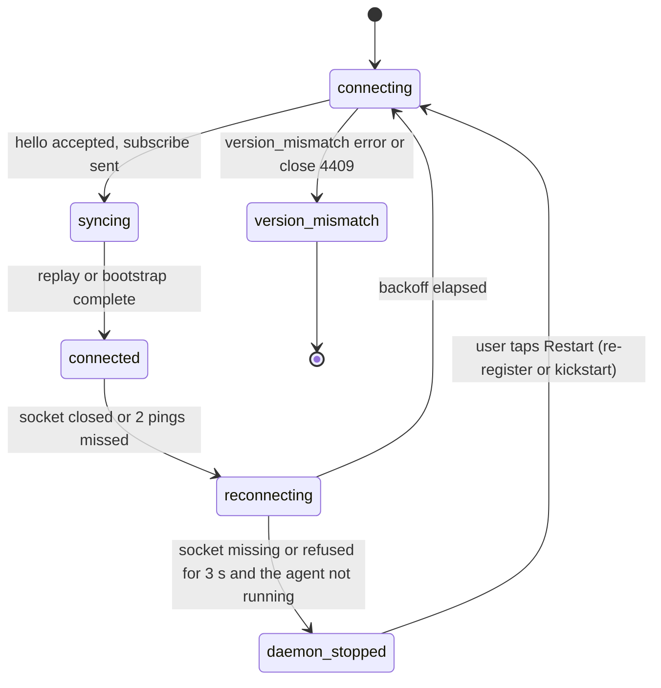
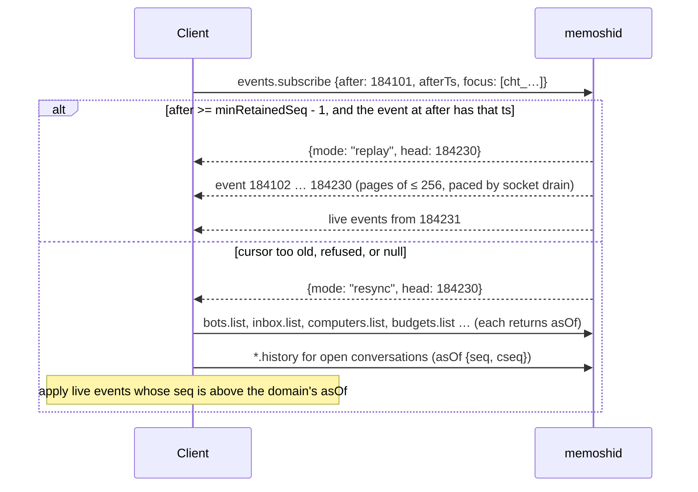
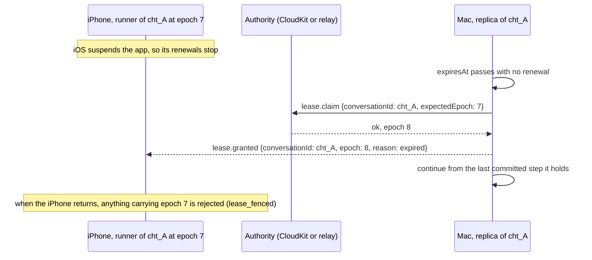

# Protocol: clients, the engine and paired devices

**Status:** Draft 4 · implementation scope updated 2026-11-06; authenticated Mac and typed in-process bot/Session/chat/task/recovery/provider/review development contracts, distinct from the remaining accepted target catalog · updated on 2026-11-14 for [D134](../plan/decisions.md#d134): Pi_Swift pin `slice-2` (the implementation notes on recovery) · updated on 2026-11-14 for [D138](../plan/decisions.md#d138) (`06d3803`, `71111a6`): the [held-step settlement](#current-step-settlement) · updated on 2026-11-18 for the review fixes (`754cca2..8b9b170`; covered by [`canonical-ci-15`](../../../evidence/2026-11-13-memoshi-canonical-s2/canonical-ci-15/README.md) on `a2ac274`, see [HANDOFF, deep review](../HANDOFF.md#deep-review-2026-11-18)): schema 15 in the [development profile](#current-text-chat-profile), `chats.abort`'s recorded Stop, the [held-step settlement](#current-step-settlement) and Run again under the current policy, the ordering and cancellation rules ([§4](#4-conventions), [§5.1](#51-system-and-events)), the client's event buffer and the in-flight limit ([§11](#11-backpressure-and-limits)), the relay's mailbox drop and the transport store's erasure ([§12.5](#125-revocation)), and the pairing hello ([§12.15](#1215-ways-out-of-the-two-device-holds)) · updated on 2026-11-13 for [D106](../plan/decisions.md#d106)–[D122](../plan/decisions.md#d122): the target catalog gains staged families for views, App panes and App functions, the connector catalog, mail accounts and capability providers, Goals, voice calls, plugin developer mode, Cloud computers and desktop live view, and external coding agents with team mode ([§5.12](#512-views-app-panes-and-app-functions)–[§5.18](#518-external-coding-agents-and-team-mode), [§12.14](#1214-computer-live-view-across-devices)), with a capability per family ([§3.5](#35-versioning-and-capabilities)); Groups, external coding agents, Bot computers, Remote machines and takeover from iPhone and iPad are restaged into v1.0; these families change no Phase 0 method, event, field, error or fixture, and the same day's code fixes added the `system.cancel` notification's fixture, limited `session.purged`'s `by` and made `retryable` follow from the error kind ([§10](#10-errors), [§14](#14-schema-codegen-and-fixtures)) · updated the same day through [D131](../plan/decisions.md#d131): [D124](../plan/decisions.md#d124) names the two device holds ([§12.15](#1215-ways-out-of-the-two-device-holds)), and [D130](../plan/decisions.md#d130) sets the socket fallback in the user's private temporary folder ([§2.1](#21-socket)), the host-call slot rule ([§6](#6-host-capability-methods-daemon-to-app)), the schema's per-kind `retryable` ([§10](#10-errors)), `trash.emptied`'s `by` and Empty Trash in one request ([§5.11](#511-trash)), and two items first left for Phase 1; [D131](../plan/decisions.md#d131) then had those items and [D124](../plan/decisions.md#d124)'s two changes built now: `logId` in the hello with `afterTs` and `headTs` on `events.subscribe` ([§3.3](#33-handshake), [§8](#8-replay-and-snapshots)), the app's `timeout` answer once its handler has ended ([§6](#6-host-capability-methods-daemon-to-app)), the ways out of the two device holds ([§12.15](#1215-ways-out-of-the-two-device-holds)), the relay-route handshake deadline ([§12.3](#123-links)) and the CloudKit de-duplication mark ([§12.1](#121-peers-and-keys))
**Owns:** The wire protocol between the engine and its clients (the typed API and its transport, handshake and peer authentication, versioning and capabilities, the method catalog, daemon-to-app host methods, program frames, event delivery, replay and snapshots, idempotency, errors, limits) and between paired devices (pairing and the device group, links, encryption, revocation, leases per conversation, replication, versions, lanes, budget slices, cookie sync, browser live view and cross-device tool calls).
**Depends on:** [../plan/decisions.md](../plan/decisions.md) ([D13](../plan/decisions.md#d13), [D46](../plan/decisions.md#d46), [D48](../plan/decisions.md#d48), [D49](../plan/decisions.md#d49), [D58](../plan/decisions.md#d58), [D72](../plan/decisions.md#d72)–[D83](../plan/decisions.md#d83), [D87](../plan/decisions.md#d87), [D88](../plan/decisions.md#d88), [D106](../plan/decisions.md#d106)–[D122](../plan/decisions.md#d122), [D124](../plan/decisions.md#d124), [D130](../plan/decisions.md#d130), [D131](../plan/decisions.md#d131)) · [../plan/AMENDMENT_2026-11-13.md](../plan/AMENDMENT_2026-11-13.md) · [../plan/04-architecture.md](../plan/04-architecture.md) · [events.md](events.md) · [object-model.md](object-model.md) · [policy.md](policy.md) · [cards.md](cards.md) · [../plan/06-computers-and-browsers.md](../plan/06-computers-and-browsers.md) · [../plan/07-coding.md](../plan/07-coding.md) · [../plan/08-security-and-privacy.md](../plan/08-security-and-privacy.md) · [../plan/09-platform-macos.md](../plan/09-platform-macos.md)

The key words MUST, SHOULD and MAY are used as in RFC 2119.

<a id="current-implementation-scope"></a>
**Current implementation, not the whole catalog (2026-11-06):** the infrastructure profile supports `system.hello/status/ping`, `events.subscribe/focus/unsubscribe`, `tasks.get`, `approvals.list` and `cards.list/get`, with scheduler `off` and host disconnected. The opt-in development runtime adds the bot/Session/chat/model/task subset below, fenced user-only `cards.respond`, local folder management and an exclusive get-only Keychain host. Only the authenticated signed `app` role exists on the Mac carrier; no production CLI client, other host service or paired-device RPC domain is installed. The separate [S2 loopback qualification prototype](../../Packages/MemoshiDaemon/Sources/MemoshiQualification/README.md#s2-durable-device-and-authority-qualification-prototype) is not that production device layer. Unimplemented methods return `method_not_found`; `ready` is not full engine qualification. Normal app/helper composition installs no tools, MCP, Code Mode, environments or subagents and has no RPC/environment tool-enabling switch. [HANDOFF](../HANDOFF.md) owns dated native proof and remaining gates.

<a id="current-text-chat-profile"></a>
**Current development profile.** `--development-chat` is opt-in for an authenticated helper at a separate data root. [`MemoshiStore`](../../Packages/MemoshiCore/Sources/Store/Migrations.swift) is at SQLite schema **15**. Schema 9 added real bots/conversations, schema 10 added immutable runtime-child bindings, schema 11 added local Session lifecycle, schema 12 added gateway audit summaries, schema 13 added the event log's identity (`logId`, [D131](../plan/decisions.md#d131)), schema 14 added `resume_steps`, which binds each Resume card to its held tool step ([D138](../plan/decisions.md#d138), [held-step settlement](#current-step-settlement)), and schema 15 added the S4 sandbox attribution tables: Seatbelt invocations, kernel denial reports and reader gaps ([`015_sandbox_attribution.sql`](../../Packages/MemoshiCore/Sources/Store/Migrations/015_sandbox_attribution.sql)). Schemas 14 and 15 came in `71111a6`. None adds a second transcript. Chat types live in [`ChatRuntimeMethods.swift`](../../Packages/MemoshiProtocol/Sources/MemoshiProtocol/Methods/ChatRuntimeMethods.swift), task inspection in [`TaskInspectionMethods.swift`](../../Packages/MemoshiProtocol/Sources/MemoshiProtocol/Methods/TaskInspectionMethods.swift), folder types in [`FolderGrantMethods.swift`](../../Packages/MemoshiProtocol/Sources/MemoshiProtocol/Methods/FolderGrantMethods.swift), and review types in [`CardQueries.swift`](../../Packages/MemoshiProtocol/Sources/MemoshiProtocol/Methods/CardQueries.swift) and the existing work methods. Canonical fixtures and generated schema describe these types, not unimplemented services.

The iPhone/iPad [`InProcessEngine`](../../Packages/MemoshiCore/Sources/Runtime/InProcessEngine.swift) serves the implemented bot/Session/chat/provider/task/review methods as Swift values through the same `MemoshiAPI`, without JSON, a socket or `system.hello`. Both hosts use [`RuntimeRPCError`](../../Packages/MemoshiCore/Sources/Runtime/RuntimeRPCError.swift) for the same known safe refusal kinds and messages: malformed inputs, missing records, stale revisions, idempotency conflicts, busy/recovery state and unavailable providers. A reconciliation failure maps to `storage_failed`, never success. Unknown failures are not exposed as raw provider/filesystem/SDK text: the socket route propagates them to its fail-closed transport path, while the in-process route returns `internal_error` with an incident ID. Swift cancellation remains cancellation. Handshake/socket-only methods remain unavailable in-process.

Bot identity, job, persona, model and effort are read for the next request in each of that bot's conversations; editing a profile does not rewrite history, restart a store or reconfigure an already running request. A request's model/effort overrides the corresponding bot default. `default` resolves to an available local model, never an implicit paid fallback. Effort reaches the provider only when its SDK descriptor advertises reasoning support; the pinned local-discovery descriptors deliberately do not, so a saved effort is **unsupported locally**, not proof that a local server received it.


| Implemented method | Bounded current contract |
|---|---|
| `chats.list` | No params; `{items: ChatSummary[], asOf}`: every real conversation, the Assistant's Chat first, then other bots' Chats, then Sessions, each with `kind: assistant \| bot \| session`. Not the preview roster. |
| `chats.history`, `chats.send`, `chats.abort` scope | `chatId` takes any local conversation ID, a Chat's `cht_` or a Session's `ses_`; this profile has no separate `sessions.history/send/abort`. Each conversation has its own lazy-open Pi store. Ten-minute idle closure requires no turn, nonterminal child/task, queued input, pending card/approval or recovery hold; unfinished work is reconciled on startup. Idle expiry and live deletion are not measured by the current S1 CLI. |
| `bots.list`, `bots.get` | `{includeArchived?}` → `{items: Bot[], asOf}`; `{botId}` → `{bot, asOf}`. `Bot` is the development subset `{id, role, name, job, persona, model: {ref, effort?}, revision, chatId, createdAt, updatedAt}`. Archive is not implemented, so `includeArchived` does not change the current result. |
| `bots.create` **M** | `{requestId, name}` → `{bot, chatId, replayed?}`: a bot, its one Chat, audited `bot.created` and durable `chat.created` in one transaction. Names are one line without control/bidi characters, 1…40 characters, unique ignoring case (`conflict`). No template, definition, Computer, Browser or avatar yet. |
| `bots.update` **M** | `{requestId, botId, patch: {name?, job? ≤280, persona? ≤4,000, model?}, expectedRevision}` → `{bot, replayed?}`. A stale revision is `conflict`; an actual change advances `revision` and commits audited `bot.updated {changed, revision}` atomically. No event on no-op, replay or refused mutation. The next request renders the current identity/persona/job and applies the selected model and supported thinking level; section bodies do not enter events. No revision-history UI yet. |
| `sessions.create` **M** | `{requestId, leadBotId, title? ≤120}` → `{session: {id, leadBotId, title, createdAt}, replayed?}`. A project-less Session has its own Pi store and durable `session.created {leadBotId, origin}` at `cseq: 1`; subsequent requests inherit its lead bot's current profile/defaults independently of that bot's Chat. |
| `chats.history` | `{chatId, before?: MessageID, limit: 1…200}` → `{items: ChatMessage[], live?, nextBefore?, asOf, recovery?, queued?}`. Committed text resolves immutable Pi entries; `live`, the whole-conversation recovery hold and unsent queued inputs are separate. `recovery.steps` carries real task/optional interrupted-step metadata, not an inferred successful outcome. Queued original content is not canonical transcript text. Since 2026-11-20 a bot `ChatMessage` and `live` carry an optional `resumedAfterInterruption: true` when a restart, or since [D139](../plan/decisions.md#d139) a graceful close, cut the turn off and the runtime continued it by itself (`task.resumed` with `by: system`, [events.md §5.5](events.md#55-task)); `live` carries it before the continued reply streams. It is absent otherwise. The Mac and iPhone transcripts show "Interrupted · continued after a restart" under such a reply ([`ResumedReply.swift`](../../Packages/MemoshiApp/Sources/AppCore/ResumedReply.swift)). A canceled turn whose replies all called tools (for example a Stop while its Card was pending) has a bot `ChatMessage` with empty text and `stopReason: aborted`, made from its last reply, and `message.completed {stopReason: aborted}` (since a second 2026-11-20 fix; before, history held only the user message). The Mac and iPhone show no bubble for it, only its "Stopped" caption. Since D139 the apps show the end state (Stopped, Response failed, Interrupted · continued) of a reply that has Cards after the turn's last Card, not in its bubble ([`TranscriptLayout.swift`](../../Packages/MemoshiApp/Sources/AppCore/TranscriptLayout.swift)); the wire shapes are unchanged. |
| `chats.send` **M** | Existing request/receipt shape. Text only; ordinary sends use the request's model, else the bot's configured model, else the first local model, with `whenBusy` absent/`reject` and `surface` absent/`ui`. During a recovery hold that configured model reference and the exact original request are durably queued without discovery, submission or model/tool execution. At most 32 inputs and 262,144 encoded UTF-8 request bytes per conversation; overflow is atomic. Reuse returns original IDs; conflicting reuse is refused. A send with no request or bot model stays local, never a paid fallback. |
| `chats.abort` **M** | `{requestId, chatId, includeBackground?: false, queuedRequestId?: ULID}` → `{}`. Without a queue target, captures the original active send and acts only when no recovery hold exists: it first records the Stop durably (`Store.recordStop`: the turn's task gets `cancelRequestedAt` and `task.cancel_requested` with `by: user`), then cancels actual Pi work, so a kill before Pi's abort ends the work still finds the Stop ([`RuntimeAdapter.swift`](../../Packages/MemoshiCore/Sources/Runtime/RuntimeAdapter.swift), 2026-11-18). With a queue target, cancels only that accepted, still-unsubmitted input, preserving the unknown step and other inputs. Replaying an old cancellation cannot target a later turn. Stop never settles or undoes an uncertain effect. In the model's context (since 2026-11-20, [`RuntimeAdapter+StoppedReplies.swift`](../../Packages/MemoshiCore/Sources/Runtime/RuntimeAdapter+StoppedReplies.swift)): Pi leaves every aborted reply out, so every later request puts a stopped reply back where it was as a finished reply, its text followed by the note `<harness>\n[stopped] The user stopped this reply before it finished. Answer the user's latest message.\n</harness>`. A turn stopped before any of its reply reached the model, or whose stopped reply was calling a tool, is followed by an assistant message holding only that note, so a Stop never leaves two user messages in a row. A turn Memoshi recorded as canceled that ends with a tool call and its result (for example `[error] Tool … was aborted` after a Stop with a pending Card) gets, after that last tool result and before the next user message, an assistant message holding `<harness>\n[stopped] The user stopped this turn before it finished. Answer the user's latest message, and call a tool again if that message needs one.\n</harness>` (`stoppedTurnNote`, since a second 2026-11-20 fix); it is left out when a stopped text reply already ends there with the note. Only the request changes; Pi's entries and history do not. A graceful close is not a Stop ([D139](../plan/decisions.md#d139)): it records no Stop and makes no stopped reply and no note; at the next open Pi regenerates the reply, which `chats.history` flags `resumedAfterInterruption`. Not covered: partials a crash left before Pi's retry carry no note, turns a crash cut off get no `stoppedTurnNote`, and Stop in a subagent's conversation is not handled. |
| `tasks.get` | `{taskId}` → `{task, children, asOf}`. Real persisted task records, including projected child work; a child is `kind: subagent`, not a new root turn or Session. |
| `tasks.graph` | `{conversationId}` → `{nodes: Task[], asOf}`. Persisted root/child tasks for that app conversation, including settled records; live state is reconciled against Pi's graph and terminal task/submission receipts. |
| `tasks.history` | `{taskId, before?: string, limit: PageLimit (1…200, required)}` → `{task, background, items: [{entryId, role, text, stopReason?}], liveText?, nextBefore?, asOf}`. Read-only attachment to a verified task-owned child; text resolves Pi entries, with uncommitted `liveText` separate. `before`/`nextBefore` and `entryId` are opaque references; no Session, input or new ownership is created. Root history remains `chats.history`. |
| `tasks.abort` **M** | `{requestId, taskId, surface?}` → `{task, writtenSeq, replayed?}`; `surface` absent/`ui` only. No `includeBackground` field. Captures that immutable root turn or child owner, not whichever turn later becomes active. Its durable cancellation request may precede actual terminal state; replay cannot stop a sibling background child or a later root turn. Recovery holds refuse it rather than resolving an uncertain effect. |
| `models.providers.list` | No params; `{items: ModelProviderConfiguration[], asOf}`, without credential values. |
| `models.providers.configure` **M** | `{requestId, providerId: "local" \| "openai" \| "anthropic" \| "openrouter", baseUrl, secretRef?}` → `{provider, writtenSeq, replayed?}`. Local accepts only loopback HTTP(S), optionally with `kc_<UUID>`. Fixed endpoints are OpenAI `https://api.openai.com/v1`, Anthropic `https://api.anthropic.com`, OpenRouter `https://openrouter.ai/api/v1`; all require an explicit API-key reference. Only OpenAI also accepts a `cg_<UUID>` ChatGPT reference. Only references persist; replay cannot roll back a newer setting. |
| `models.list` | No params; `{items: AvailableModel[], unavailableProviders?: string[]}`. Local uses actual PiAI compatibility discovery. Configured cloud providers use PiAI's matching API/catalog only when their credential/availability checks succeed: OpenAI Responses/Bearer, Anthropic Messages/`x-api-key`, OpenRouter OpenAI-compatible/Bearer. Credentials are origin/header-bound and unavailable/revoked credentials exclude cached models. This is not E31's full signed/priced catalog, proof of a subscription's model entitlement or new live-cloud qualification. |
| `host.keychain.get` (daemon → app) | `{secretRef, purpose: "model:<providerId>"}` → `{value, ttlMs}` on the existing authenticated carrier. Only one successful app hello can claim negotiated `host.keychain.v1`; another app remains UI-only. The app revalidates the same FD before the OS read and immediately before sending a result with the original daemon request ID. App releases last 60 seconds; the runtime rejects malformed releases or TTLs outside `1…600000` ms and checks the lease again before every HTTP attempt. |
| `cards.list` | `{conversationId?, status?, cursor?: CardID, limit: 1…200}` → `{items: Card[], nextCursor?, asOf}`. Ascending CardID keyset order; exclusive cursor and each page's actual read watermark. |
| `cards.get` | `{cardId}` → `{card, asOf}` from one current-record snapshot; missing cards return `not_found`. |
| `cards.respond` **M** | Existing idempotent request; `surface` absent/`ui`, actual authenticated user authority, current local conversation fence. This profile supports `allow_once` and `deny` only. The first valid answer wins; original-request replay returns the original card/effects/sequence with `replayed: true`. Exact-deadline expiry commits before `card_expired` is returned. Since 2026-11-20 a graceful close (Quit of the app-owned helper, `system.shutdown`, `InProcessEngine.close`) keeps a pending approval and its Card, as a kill does ([policy.md §10.1](policy.md#101-lifecycle)): at the next open the turn continues (`task.resumed` with `by: system`), `beforeTool` reruns and waits on the same approval and Card, and the Card can be answered once. One whose deadline passed while closed is expired at reopen and cannot be answered. User Stop, the kill switch and a revoked grant still cancel. Since [D139](../plan/decisions.md#d139) this includes a foreground subagent child waiting on a Card: the child and its parent continue after the next open. |
| `bots.grants.list` | Negotiated `bots.grants.folder.v1`; `{botId}` → `{items: FolderGrantSummary[], asOf}`. Local Chat bot only. All active folder grants plus the latest ended records, at most 200 total, sorted by GrantID; no standing rules or pagination. |
| `bots.grants.update` **M** | Same capability; `{requestId, botId, grant: FolderGrantChange}` → `{grant: FolderGrantSummary, writtenSeq, replayed?}`. Create or change one local folder grant, with daemon-derived user authority and a durable original receipt. At most 64 active grants per bot. |
| `bots.grants.revoke` **M** | Same capability; `{requestId, grantId}` → `{}`. Terminal local revocation and dependent pending-card cancellation commit together; repeating the original request does not change later authority. |

Reverse calls have a ten-second deadline and at most eight owned app workers; a canceled noncooperative handler keeps its slot until it actually ends. Since 2026-11-13 ([D130](../plan/decisions.md#d130)) the daemon's deadline sends `system.cancel` instead of closing the app connection, the app answers a canceled call with `canceled`, and one that passed the app's own deadline with `timeout` ([D131](../plan/decisions.md#d131)), once its handler has ended, and the daemon keeps that call's slot until the answer arrives ([§6](#6-host-capability-methods-daemon-to-app) rule 3). Stop cancels a pending Pi credential lookup; `system.cancel`, disconnect, host replacement and generation changes fence late results without blocking ordinary replies/events. A disconnected broker is unavailable, never an implicit keyless retry. Keychain put/delete are native app operations, not implemented reverse RPCs. The daemon has no secret access group, and the app uses only the explicit data-protection Keychain group, without an ambient/legacy fallback.

The native Mac ChatGPT sign-in host runs PiAI's permitted dynamic-agent flow, with a stable installation UUID and Memoshi attribution, outside the daemon. Each `cg_` reference binds a separate app-owned SDK Keychain service. PiAI serializes and persists refresh-token rotation before the host releases an access token; refresh tokens never cross `host.keychain.get`. This development host explicitly uses device-only storage, not qualified iCloud sync. API keys and ChatGPT accounts are never imported from Pi/Codex files or process credentials, and one does not silently replace the other.

Recovery holds are checked on admission, before generation and before tool dispatch, including direct observation of actual nested results when live-event delivery is stalled. An uncertain dispatch remains held across normal reopen; inspection-only opens do not start Pi's scheduler. Queue draining reuses the exact original parameters/IDs only after authoritative recovery state clears. This is not full D88/D73 offline forwarding, SDK transaction fencing or kill/resume qualification.

<a id="current-step-settlement"></a>
**Settling a held step (Run again / Skip / Mark as done, [D51](../plan/decisions.md#d51), [D134](../plan/decisions.md#d134), [D138](../plan/decisions.md#d138)):** when a step becomes held (a dispatch whose outcome is unknown, a stale dispatch found at reopen, an unaccounted interrupted step, a step Memoshi recorded as completed (`completion_seq`) whose result Pi then lost, as a Pi rollback after an OS crash or power loss can, or a replay-safe step that waits on a decision because its tool is no longer registered as replay-safe), the Store creates in the same transaction one `resume` card and its `resume_steps` row (migration 14) and appends the audited `tool.interrupted` (`replay: unsafe`, `effect: resume_card`) and `card.created`. Neither of the last two kinds is ever settled as not dispatched. No outcome check runs yet. The card payload is `{toolCallId, tool, actions}`. `actions` is `run_again`, `skip`, `mark_done` only while Pi's call is still open (a kill or crash); a step held because its execution was stopped or returned an unknown outcome offers only `skip` and `mark_done`, because Pi has already ended that call (the user sends a new message to try again). Withholding Run again from a returned unknown outcome narrows D138's "Other interrupted steps offer all three choices"; it awaits the owner's decision ([HANDOFF, proposed decisions](../HANDOFF.md#proposed-decisions-2026-11-18)). A step whose own task or whose root turn's task the user stopped (`cancelRequestedAt`, recorded by `tasks.abort` and `chats.abort`) never offers Run again, also when a kill overtook the stopped execution before it returned. A step whose result Pi lost after Memoshi recorded it as completed offers only `skip` and `mark_done` too: it ran. A card that still offers Run again loses it when Pi's result is projected, announced by `card.updated`. A working-copy export step never offers Run again, even one killed before its export record, and its answer leaves the source files as they are. The user answers through the existing `cards.respond` (no method added; `cards.respond` re-checks the offered actions). One Store transaction records the answer, resolves the card, appends audited `tool.interruption_resolved` then `card.resolved`, and releases the hold. The runtime then answers Pi's decision wait with `harness.settle` (request ID `memoshi.resume:<cardId>`), at open and on every task-graph change; a call Pi had already ended gets only Memoshi's note to the model, which says the call did not run again: after Skip, after Mark as done and, since 2026-11-21, after a Run again that found no wait ("Tool X may have partially run; the user chose Run again, but the call had already ended, so it did not run again."). A Skip or Mark as done noted on such a call still reaches Pi if Pi waits on that call (the lost result above). A retried `cards.respond` for a Resume card hands the answer to Pi again while its conversation is open; Pi settles each request ID once, so a repeat changes nothing. Memoshi's dispatch gate lets one Run again through at most once, whatever Pi replays. The Mac and iPhone show only the offered choices under the hold notice; the Inbox and notification surfaces of the Resume card are not built.

**Run again and the dispatch record (2026-11-18, `ec23475`):** Pi runs no hook before it executes a call again, so the engine's tool policy ([`PolicyHooks.enginePolicy`](../../Packages/MemoshiCore/Sources/Runtime/PolicyHooks.swift)) admits a Run again of a replay-unsafe call with the same admission as `beforeTool`, under the policy and permission mode in force at that moment. When the policy asks, that execution needs a new approval card of its own; a denied or expired one blocks the rerun, and the model reads that the call did not run again. The dispatch-time recheck accepts only the approval of its own execution. A replay-safe rerun repeats the same idempotent call and reuses the original approval. This reading of [D51](../plan/decisions.md#d51) and [D52](../plan/decisions.md#d52) awaits the owner's decision ([HANDOFF, proposed decisions](../HANDOFF.md#proposed-decisions-2026-11-18)). A replay-unsafe step that Pi reports interrupted, with neither Memoshi's dispatch record nor a result Memoshi projected, was cut off before Memoshi dispatched it: Memoshi answers Pi's wait with Skip in its own name, and the model reads that it did not run ([events.md §8](events.md#8-pi-projection)). That dispatch record is a durable commit: `synchronous = FULL` syncs the WAL, then Memoshi issues `F_FULLFSYNC` on a descriptor of the store's directory; a refused drain deletes the row and fails the dispatch, so the effect never starts ([`SQLite.swift`](../../Packages/MemoshiCore/Sources/Store/SQLite.swift), [`Store+ToolDispatch.swift`](../../Packages/MemoshiCore/Sources/Store/Store+ToolDispatch.swift)). Tests: [`RuntimeRunAgainPolicyTests`](../../Packages/MemoshiCore/Tests/MemoshiRuntimeTests/RuntimeRunAgainPolicyTests.swift), [`RuntimeResumeChoiceTests`](../../Packages/MemoshiCore/Tests/MemoshiRuntimeTests/RuntimeResumeChoiceTests.swift), [`RuntimeInterruptedDispatchTests`](../../Packages/MemoshiCore/Tests/MemoshiRuntimeTests/RuntimeInterruptedDispatchTests.swift) and [`DurableCommitTests`](../../Packages/MemoshiCore/Tests/MemoshiStoreTests/DurableCommitTests.swift); covered by [`canonical-ci-15`](../../../evidence/2026-11-13-memoshi-canonical-s2/canonical-ci-15/README.md) on `a2ac274` ([HANDOFF, deep review](../HANDOFF.md#deep-review-2026-11-18)).

<a id="current-child-task-profile"></a>
**Trusted child composition only:** [`RuntimeExtensionComposition.subagents`](../../Packages/MemoshiCore/Sources/Runtime/RuntimeExtensionComposition.swift) opts a development/qualification host into real `subagent` and `subagent_background` tools. The model supplies only a bounded task body (1…32,768 characters), never a model, prompt, tool set or background privilege. A foreground child is task-owned by its invoking Pi tool, so parent Stop cascades. A background child is owned by a conversation-owned background anchor with persisted `run`/`report` checkpoints and an idempotent submission key; ordinary parent Stop does not stop it. Targeted `tasks.abort` stops that anchor and its own child only. This is not the routine/watch scheduler, cross-bot handoff or an app-created Session.

[`RuntimeTaskScope`](../../Packages/MemoshiCore/Sources/Runtime/RuntimeTaskScope.swift) corroborates immutable Pi ownership, the host-authored identity entry, the original assistant tool call and original app turn. Children inherit the invoking model/effort and trusted prompt sections; their tool set can only narrow the original parent ceiling, removes delegation, and every call still passes current mandatory policy/grant checks. Child-supplied IDs, current active-turn IDs or a call-ID prefix cannot confer ownership. No child can delegate or gain later-added parent capabilities.

The child watcher emits only content-free `task.progress` refresh hints, at most 1 Hz per child, scoped to the owning app conversation and child task. The authenticated Mac carrier applies conversation focus to these scoped UI-only frames; the in-process consumer filters scope locally. Child text is read through `tasks.history`, never projected as root `message.delta`/history rows or copied into durable events/preferences; the parent's eventual answer remains its own provider result. Task terminal facts follow real settled owner/submission state **after** pending tool outcomes are drained. The Mac Tasks inspector uses the existing single event consumer and coalesced event-driven graph/history refresh, not polling or a second subscription; its Stop preserves the selected task's original request. Root UI projections corroborate task ID, `kind: turn`, conversation and snapshot watermark before accepting state/text.

**Recovery limitation, H1/E20:** a completed nested `pi.tool` at candidate `892585fc`, the pin until [D134](../plan/decisions.md#d134), retains only `{kind: "nested"}` in its terminal receipt. `slice-2` also keeps a completed nested result that does not retire with its caller (`Harness.completedNestedCalls`), but Memoshi does not read it yet, so the rule below still applies. The full result lives in a parent-task-scoped document retired with its owner. If the process dies after retirement but before Memoshi stores the authoritative completion receipt, recovery can no longer prove that result; Memoshi fails closed with `projectionFailed`/`storage_failed`, not a fabricated completion or blind effect retry. The [consumer observation](../research/spikes/2026-11-02-pi-swift-consumer-handoff.md#24-consumer-observation-nested-result-retirement-2026-11-03) remains under existing H1/E20 (H4 is Code Mode). Separate [Core foreground/background SIGKILL tests](../../Packages/MemoshiCore/Tests/MemoshiRuntimeTests/SubagentKillResumeTests.swift) cut after an immutable **model-tool child checkpoint**, not this nested-retirement window; their [retained results](../../../evidence/2026-11-03-memoshi-wave3-integration/native/runtime-child-conversation-tests.txt) do not close all-call audit/kill acceptance.

**iOS lifetime boundary:** [`MobileEngineHost`](../../apps/ios/MemoshiMobile/MobileEngineHost.swift) persists the real engine/Pi stores in its private backup-excluded container. [`InProcessChatModel`](../../Packages/MemoshiApp/Sources/AppCore/InProcessChatModel.swift) keeps original send/Stop identity and scopes background cancellation to the matching original request, so a late expiration cannot stop a later turn. [`ContinuedTurnProcessing`](../../apps/ios/MemoshiMobile/ContinuedTurnProcessing.swift) requests OS continued-processing time, reports observed units without an invented percentage and stops that request on an actual grant's expiration/Cancel. Registration, submission or Home/return is not a grant; refusal leaves the foreground turn unaffected. The [retained simulator log](../../../evidence/2026-11-03-memoshi-wave3-integration/native/ios-final-continued-task-log.txt) records refusal code 1, not granted time, expiration or physical-device/S1.18 qualification. An app-switcher kill has no expiration callback; durable unfinished work is inspected/resumed on next launch.

The Mac applies message/task facts and focused deltas, checks UTF-16 offsets and resolves gaps through history. Finished transcript text is not copied into events or UI preferences. One shared approval/card projection loads all snapshot pages and applies changes before acknowledging receipts; domain watermarks do not replace other projections' positions. Since 2026-11-20 the projection reloads its snapshot by itself, once, when it reconnects with a stale state, as Reload Review does; it does not retry, and a failed reload keeps its error and Reload Review ([`LiveApprovalModel`](../../Packages/MemoshiApp/Sources/AppCore/LiveApprovalModel.swift)). While it is not synchronized, each pending Card on the Mac and iPhone says why its decisions are disabled: not connected, reloading, or not synchronized. Uncertain sends, provider configurations and approval answers retain their original request IDs, not a full D88/D73 offline queue. Approval preferences contain only opaque request/Card IDs and action. Provider diagnostics and opaque metadata are stripped before Pi persistence; both tool-result representations pass mandatory output scrubbing. Production tools, Code Mode/MCP/environment/subagent enablement and paired-device carriers remain outside normal composition; the typed iOS engine is implemented, not device/BG/release acceptance. The S1 [private-pipe report](../../../evidence/2026-11-03-memoshi-wave3-integration/s1/s1-measurements.json) remains separate from the parent's later [genuinely signed text-only protocol smoke](../../../evidence/2026-11-03-memoshi-wave3-integration/native/signed-protocol-final/result.json): same-FD authentication/hello/Unix WebSocket/RPCSession, five live conversations, one owned helper SIGKILL, automatic reconnect, original-receipt replay and isolated settled histories were observed. That normal `.none` helper run is not signed `cards.respond`, approval-over-kill, child/nested-retirement, full chaos-matrix or SMAppService qualification. Fresh S2 validation remains pending.

<a id="current-folder-management"></a>
**Current folder-management details:** `FolderGrantSummary` contains `id, botId, path, deviceId, access: read|write, status: active|revoked|expired, revision, expiresAt?, createdAt, updatedAt, available`. Availability is a best-effort current physical-root/bookmark observation, not a stored permission or a new binding. No bookmark bytes or source contents cross this API. Only the composed development backend advertises `bots.grants.folder.v1`; the signed app must offer and negotiate it. An unsupported helper returns `method_not_found`, missing negotiation returns `capability_missing`, and the native UI reports unavailable support rather than an empty list.

`FolderGrantChange` contains `id?, path, access, expectedRevision?, confirmationText?, expiresAt?, selectionIdentity?`. A new grant requires no ID/revision and the native picker's `selectionIdentity: {device, inode}`, both canonical unsigned-decimal strings. The helper compares it against its own no-follow root capture before committing. Merely choosing/reviewing a folder creates no authority; broad protected-home subfolders require the exact physical path as typed confirmation. An existing change requires its ID, unchanged path and current revision, without a selection identity or a changed expiry. It cannot retarget or revive a terminal grant. Widening re-proves the original root; narrowing and revocation remain available when that root is missing. This profile does not edit an existing expiry or run a background expiry sweeper.

Malformed shapes/unknown access/retargeting return `invalid_params`; non-grantable roots return `forbidden`; missing exact confirmation returns `typed_confirmation_mismatch`; stale, duplicate, unavailable or replaced roots and active-limit failures return `conflict`; unknown local bots/grants return `not_found`. Reusing an ID with changed known params or another method returns `idempotency_conflict`. Unknown fields retain §3.5's compatibility behavior, never new authority. Original receipt replay precedes current filesystem checks and cannot restore access later narrowed or revoked.

The native folder projection loads its snapshot before bootstrap/replay acknowledgment and refreshes on grant facts/reconnect. Uncertain updates/revokes retain the exact metadata request and original ID for explicit Retry, not automatic mutation retries. Historical receipts are not optimistically applied as current authority. These local grants neither register tools nor implement replicated grants, standing `tool_rule` grants, high-risk owner verification or the full catalog below.

---

## 1. Overview

- **Framing.** Swift types are the protocol's source of truth ([§14](#14-schema-codegen-and-fixtures), [D78](../plan/decisions.md#d78)). On the Mac the typed API is carried as JSON-RPC 2.0 ([spec](https://www.jsonrpc.org/specification)) in both directions over **one WebSocket per client process** on a **Unix domain socket** to memoshid ([D13](../plan/decisions.md#d13)). On iPhone and iPad there is no daemon: the engine runs inside the app ([D46](../plan/decisions.md#d46)), and the UI calls it through the same typed Swift API in process, with no JSON, socket, token or peer check ([D78](../plan/decisions.md#d78)).
- **Authority.** The engine is authoritative. Clients render state and send intents; they never make policy decisions ([D9](../plan/decisions.md#d9)).
- **Events.** Every durable change reaches clients as an `event` notification with a **sequence number** (`seq`) on its device's log, written in the same SQLite transaction as the change. One multiplexed stream serves every conversation. Draft 3 streamed only the selected session and polled the rest every 12 s.
- **Host capabilities.** On the Mac, the same connection carries daemon-to-app requests (`host.*`) for the capabilities that only Memoshi.app can provide: WebKit, Foundation Models, notifications and the Keychain broker, from Phase 1 the Calendar, Reminders and Contacts tools and page Apps' web views ([D114](../plan/decisions.md#d114), [D116](../plan/decisions.md#d116)), and from the end of Phase 2 the VMs of Bot computers ([D113](../plan/decisions.md#d113)). CloudKit and push are not among them: memoshid uses them itself ([D58](../plan/decisions.md#d58), [§6](#6-host-capability-methods-daemon-to-app) rule 4).
- **No transcript text in durable events.** Transcript text lives only in Pi storage ([D7](../plan/decisions.md#d7)). Clients read it with `*.history` and receive it live through frames attached to focused conversations ([§7](#7-events)).
- **Devices.** Paired devices talk through the device layer ([§12](#12-device-layer)): pairing and the device group, links, leases per conversation, replication, versions, handoff lanes, budget slices, cookie sync and cross-device tool calls ([D48](../plan/decisions.md#d48), [D49](../plan/decisions.md#d49), [D74](../plan/decisions.md#d74)–[D76](../plan/decisions.md#d76)).
- **Staged families.** The decisions of 2026-11-13 ([D106](../plan/decisions.md#d106)–[D122](../plan/decisions.md#d122)) add methods, host calls, frames and device messages for views and App panes, App scope and functions, the connector catalog, mail accounts and capability providers, Goals, voice calls, plugin developer mode, Cloud computers, desktop live view, external coding agents and team mode ([§5.12](#512-views-app-panes-and-app-functions)–[§5.18](#518-external-coding-agents-and-team-mode), [§12.14](#1214-computer-live-view-across-devices)). Each is a new entry marked with the phase that ships it and guarded by a capability ([§3.5](#35-versioning-and-capabilities)). None changes a Phase 0 method, event, field or error, and an engine that has not built a family answers `method_not_found`.
- **Out of scope.** The loopback webhook receiver ([04 §3](../plan/04-architecture.md#3-memoshid-module-map), `ingress/`) is not part of this protocol and carries no control methods.

Adapted from Draft 3 `specs/events.md` (envelope, idempotency, fixtures) and `docs/02-architecture.md` §6. The transport, cursor model and peer authentication are new.

## 2. Transport

### 2.1 Socket

| Item | Value |
|---|---|
| Path | `~/Library/Application Support/Memoshi/run/memoshid.sock` |
| Permissions | Socket `0600`, `run/` `0700`, `Memoshi/` `0700` |
| Binding (2026-11-13) | The daemon never binds the public name directly. It binds a new socket at a transient staging entry beside it, the same name with the extension `bind` (`run/memoshid.bind`; `memoshid-<digest>.bind` under the fallback path below), checks that the entry is its own socket with one link, sets it to mode `0600` and checks it again, and only then renames it to `memoshid.sock` with an exclusive rename (`renameatx_np` with `RENAME_EXCL`), which fails instead of replacing an entry that appeared meanwhile. It accepts no connection until the socket has its public name, so that name never carries the umask mode. A daemon killed between bind and rename leaves only the staging entry, which was never an endpoint; the next start removes it if it is the user's own socket and refuses to start otherwise. When a listener closes, it removes its entry only while that entry is still the same inode, so it never unlinks a replacement listener's socket. Unchanged: the public name and its mode; a stale socket at the public name is removed at start only if it is the user's own `0600` socket with one link and nothing answers a connection to it (a live listener means the address is in use); and an entry there with any other owner, type or mode is refused, not repaired ([`SocketLease`](../../Packages/MemoshiIPC/Sources/MemoshiTransport/SocketLease.swift), [`LocalWebSocket`](../../Packages/MemoshiIPC/Sources/MemoshiTransport/LocalWebSocket.swift)) |
| Path limit | macOS `sun_path` is 104 bytes ([Apple forums 756756](https://developer.apple.com/forums/thread/756756)); NIO does not change that kernel limit. If `<root>/run/memoshid.sock` would exceed 100 bytes, both sides use `<T>/memoshid-<digest>.sock`, directly in `T`, the user's private temporary folder ([D130](../plan/decisions.md#d130)): the folder macOS keeps for that user alone (`confstr(_CS_DARWIN_USER_TEMP_DIR)` with symlinks resolved, for example `/var/folders/…/T`), so another account on the Mac cannot create an entry there and block start-up. `<digest>` is the first 16 hex digits of the SHA-256 of the canonical data-root path, so two data roots never share an endpoint. The staging entry is `<T>/memoshid-<digest>.bind`, and the token stays in `<root>/run/memoshid.token`. Neither side creates or repairs `T`. Both refuse unless `T` is a directory, not a symlink, owned by the user with mode exactly `0700`, and the full socket path is at most 103 bytes; both also refuse when the folder cannot be resolved. `/tmp/memoshi-<uid>` is no longer used or read |
| Per-VM sockets (end of Phase 2, with Bot computers, [D113](../plan/decisions.md#d113)) | `run/v<8 hex>-ssh.sock`, `-cdp.sock`, `-net.sock`: data planes outside this protocol ([06](../plan/06-computers-and-browsers.md)) |
| Token file | `run/memoshid.token` (`0600`): 32 random bytes, hex, minted at every daemon start |
| Lock | `run/memoshid.lock`, an exclusive `flock` held by the running daemon |

### 2.2 WebSocket over the Unix socket

- **Upgrade.** Only after same-connected-socket peer authentication (§3.2), a client opens an HTTP/1.1 upgrade. The request path MUST remain `/`; this wire contract is unchanged by [D95](../plan/decisions.md#d95). The daemon accepts any `Host` header and ignores `Origin`, since browsers cannot reach a Unix socket.
- **Subprotocol.** `Sec-WebSocket-Protocol: memoshi.v1` is optional. Versioning happens in `system.hello` ([§3.5](#35-versioning-and-capabilities)).
- **Frames.** Every message is a UTF-8 JSON text frame. Binary frames are reserved, and v1 rejects them with close code 4400.
- **Compression.** `permessage-deflate` is off for local clients.
- **Keepalive.** The daemon pings every 15 s. Two missed pongs close the connection; the shared NIO transport handles ping/pong.
- **Implementation.**
  - Both the signed app-shaped memoshid helper ([D46](../plan/decisions.md#d46), [D58](../plan/decisions.md#d58)) and Mac client use NIOPosix Unix sockets/NIOWebSocket from **SwiftNIO exactly 2.104.0**, shared through [`Packages/MemoshiIPC`'s `MemoshiTransport`](../../Packages/MemoshiIPC/Package.swift). [D95](../plan/decisions.md#d95) supersedes D82's Network-only/backpressure-only fallback: public Network.framework has no credential seam that meets the required pre-HTTP same-socket checks.
  - `autoRead` is disabled from channel creation. [`LocalWebSocket`](../../Packages/MemoshiIPC/Sources/MemoshiTransport/LocalWebSocket.swift) authenticates the actual connected descriptor via `withUnsafeTransportIfAvailable(of: NIOBSDSocket.Handle.self)` before installing HTTP handlers or reading/writing any protocol bytes. The client validates the daemon before token read on every connect. No second socket or PID/path-only credential substitute is used.
  - The peer check runs in two parts (2026-11-21). The part bound to the connected descriptor (the peer's uid, its audit token and the running code the token selects, `MMSCopyPeerGuest`) runs on the event loop; the signature check (`SecCodeCheckValidity` against the requirement, then the signing-information checks, `MMSCopyGuestSigningInformation`) runs on a concurrent validation queue ([`PeerAuthentication`](../../Packages/MemoshiIPC/Sources/MemoshiTransport/PeerAuthentication.swift)), so a slow check holds neither the loop nor other connections. The audit token never leaves C. HTTP handlers are installed and reads start only after both parts pass. Closing the listener waits for every check in progress, and `LocalConnection.revalidatePeer` uses the same split.
  - Senders use minimal WebSocket length encodings. The pinned NIO receiver accepts some non-minimal extended-length encodings; stricter rejection is not claimed.

## 3. Connection lifecycle

### 3.1 Client connection states

These names are agreed with [02-experience.md](../plan/02-experience.md).



| State | Meaning | UI rule |
|---|---|---|
| `connecting` | The socket is opening or the handshake is in progress | Show the last in-memory state |
| `syncing` | Replaying after the client's cursor, or bootstrapping from snapshots | Read-only; Send and card actions disabled |
| `connected` | Protocol live after applied replay/bootstrap | Enable only implemented, domain-ready actions; transport liveness alone does not enable models, tools or host capabilities |
| `reconnecting` | The socket is down; exponential backoff from 100 ms to 5 s with jitter | Read-only from memory |
| `daemon_stopped` | The LaunchAgent is not running ([04 §2.2](../plan/04-architecture.md#22-registration)) | A Restart action |
| `version_mismatch` | No common protocol version | An update notice |

These states apply to clients of memoshid on the Mac. On iPhone and iPad the UI and the engine share a process [INFERENCE]. They do not describe the reachability of another device's runner or a model: a locally connected client may still show a persistent unsent message as **Waiting for connection** under [D88](../plan/decisions.md#d88) (§5.3, §9), without inventing a daemon connection state or a successful send.

### 3.2 Peer authentication

On the Mac, memoshid checks a connecting peer on the **same actual accepted descriptor before HTTP**, while `autoRead` remains disabled and before any byte-consuming HTTP/WebSocket handler or protocol write ([D95](../plan/decisions.md#d95)):

1. **User.** `getpeereid()` MUST return memoshid's own uid.
2. **Code signature.** memoshid reads that connection's audit token with `getsockopt(SOL_LOCAL, LOCAL_PEERTOKEN)` and uses audit-selected **dynamic** code from `SecCodeCopyGuestWithAttributes(kSecGuestAttributeAudit)`, not a PID lookup or a static bundle/path assertion. The requirement checks the Apple anchor, our Team ID and the sealed expected app identifier (the CLI identifier only when an actual CLI is introduced), plus hardened runtime. Ad-hoc, unsigned, debug-entitled or hardening-relaxed code is refused.
3. **Token.** The first frame MUST be `system.hello` within 5 s, carrying the token from `run/memoshid.token`. The daemon compares it in constant time. The token alone is not enough: any same-user process can read a `0600` file. This is why checks 1 and 2 exist.

Memoshi.app checks the daemon the same way **on every connect, before reading the token file or sending HTTP**:

1. **User.** The uid matches.
2. **Code signature.** The same descriptor's audit-selected dynamic code matches the Apple anchor, our Team ID and memoshid helper's sealed identifier ([D58](../plan/decisions.md#d58)), with hardened runtime and no forbidden signing relaxations.

memoshid is a signed Swift executable with no interpreter, packaged as an app-shaped helper at `Memoshi.app/Contents/Helpers/memoshid.app` ([D58](../plan/decisions.md#d58)), so its code signature identifies the code that runs. The checks of the executable path, the launchd PID and the arguments, and the native addon that read the audit token, guarded a general-purpose interpreter; they are dropped ([D46](../plan/decisions.md#d46)).

Until both checks pass, the Keychain broker releases nothing ([§6](#6-host-capability-methods-daemon-to-app)).

A failed pre-HTTP peer check closes the raw socket without an HTTP upgrade or WebSocket response. After upgrade, a bad hello token closes with 4401 and a forbidden role with 4403. Repository default ad-hoc builds fail closed with **signing required**, not an auth bypass. Separate Apple Development-signed proof is not Developer ID/provisioning/notarization acceptance ([foundation record](../HANDOFF.md#foundation-implementation-proof)).

On iPhone and iPad the UI and the engine share one process, so no peer check applies. Paired devices authenticate each other with their device keys ([§12.1](#121-peers-and-keys)).

### 3.3 Handshake

The first frame on a connection is `system.hello`:

```json
{"jsonrpc":"2.0","id":"c:1","method":"system.hello","params":{
  "token":"5f2c8e1a9b7d4c3e6f0a2b8d1c9e7f4a3b6d0e2c8a1f5b9d7e3c0a4f6b2d8e1c",
  "client":{"name":"Memoshi","version":"1.0.0","build":"412","role":"app"},
  "protocol":{"min":1,"max":1},
  "capabilities":["events.focus.v1","host.browser.v1","host.fm.v1","host.notify.v1","host.keychain.v1"],
  "locale":"en-US","timeZone":"Europe/Istanbul"}}
```

The response:

```json
{"jsonrpc":"2.0","id":"c:1","result":{
  "connectionId":"conn-3f9a",
  "daemon":{"version":"1.0.0","build":"412","pid":4211,"startedAt":1792490000000},
  "protocol":1,
  "capabilities":["events.focus.v1","host.browser.v1","host.fm.v1","host.notify.v1","host.keychain.v1"],
  "head":184230,"minRetainedSeq":120001,"serverTime":1792497600123,
  "logId":"8f3c1a9e5b7d42c6a0e4f1b2d3c5e7a9",
  "schemaHash":"sha256:9c1e04b2",
  "limits":{"maxInboundBytes":1048576,"maxOutboundFrameBytes":4194304,"maxBatchEvents":256,
            "maxInFlightRequests":64,"maxFocus":8}}}
```

The token is the 64 hex characters of `run/memoshid.token`, written in lowercase [INFERENCE: Phase 0 implementation choice, 2026-10-23]; the one above is illustrative. The two frames are the golden fixtures `methods/system.hello.request.json` and `methods/system.hello.result.json` ([§14](#14-schema-codegen-and-fixtures)).

Rules:

1. **Order.** Any frame before a successful `system.hello` closes the connection with 4400.
2. **One host.** A connection with role `app` that offers `host.*` capabilities becomes **the host connection**. At most one exists. A second gets `capability_missing` for `host.*` but stays connected for UI use.
3. **Then subscribe.** The client calls `events.subscribe` next ([§8](#8-replay-and-snapshots)).
4. **Log identity** ([D131](../plan/decisions.md#d131)). `logId` is the identity of the daemon's event log: an opaque string, minted once by the store and compared for equality only; a copy restored from a backup keeps it. A client that holds a cursor from a log with another `logId` sends no cursor and reloads, as on a cold launch ([§8](#8-replay-and-snapshots) rule 8).

### 3.4 Roles

| Capability | `app` (Memoshi.app) | `cli` (bundled signed `memoshi` CLI) |
|---|---|---|
| Read methods | All | `system.*`, `bots.list/get`, `routines.list/get`, `tasks.get`, `events.subscribe` (type-filtered) |
| Send in Chats and Sessions (and Groups, Phase 2, [D109](../plan/decisions.md#d109)) | Yes | No |
| `cards.respond`, and approving a program's permission list ([§5.10](#510-live-cards-and-mini-apps)) | Yes | No |
| Views, App settings and scope, mail accounts and providers, Goals, voice calls, plugin developer mode and Full access on this Mac, Cloud computers and the landing gate ([§5.12](#512-views-app-panes-and-app-functions)–[§5.18](#518-external-coding-agents-and-team-mode)) | Yes | No |
| `routines.trigger` | Yes, with `surface: "intent"` for App Intents | Yes, as a local trigger origin |
| Settings, grants, computers, connectors, secrets, devices, Trash, export, audit export, `system.shutdown` | Yes | No |
| Serve `host.*` | Yes (the host connection only) | No |

There is no `remote` role: iPhone and iPad run their own engine and reach other devices through the device layer ([§12](#12-device-layer)).

**Request surface.** Mutating methods accept an optional `surface`: `ui` (the default), `notification`, `menu_bar`, `intent` or `cli`. Policy and audit use it to derive the request's origin. An App Intent therefore never escalates ([D41](../plan/decisions.md#d41), [AP-05](../plan/feature-catalog.md)), and a CLI trigger behaves like a webhook origin ([D23](../plan/decisions.md#d23)).

### 3.5 Versioning and capabilities

| Mechanism | Rule |
|---|---|
| `protocol` | An integer major version. Each side declares `{min, max}`, and the chosen version is the highest one both support. The daemon supports N and N-1 for at least one release, so Sparkle can update the app and the daemon in either order |
| Additive changes | New optional fields, methods, event types and enum values do not bump `protocol`. Receivers MUST ignore unknown fields. Swift enums decode unknown values as `.unknown(…)` in clients, and the engine rejects them (decoding modes, below; [04 §7.3](../plan/04-architecture.md#73-generated-protocol-types)) |
| Breaking changes | Removing or renaming a field, changing a type, making an optional field required, or changing semantics bumps `protocol` |
| `typeVersion` | Per event type; bumped when a payload changes incompatibly ([events.md](events.md)) |
| Capabilities | `name.vN` strings. A method guarded by a capability the client did not offer fails with `capability_missing`. Examples: `events.focus.v1` and `host.computer.v1` |
| `schemaHash` | The SHA-256 of the canonical `protocol.schema.json`, informational only. Diagnostics show it, and a mismatch within one `protocol` version is normal |
| Devices | Paired devices state their app and protocol versions when they connect, in `device.hello`, the first message on every link connection ([§12.9](#129-versions-between-devices)) [INFERENCE: Phase 0 implementation choice, 2026-10-23]. The newest app version among them and the one before it read, write and take leases; anything older is a read-only replica ([§12.9](#129-versions-between-devices), [D74](../plan/decisions.md#d74)) |

If no version is common, the daemon answers `version_mismatch` with `data: {daemon: {min, max}, client: {min, max}, action: "update_app" | "restart_daemon"}` and closes with 4409. If the app is newer than the running daemon (the update case, [04 §2.5](../plan/04-architecture.md#25-updates)), the app calls `system.shutdown {reason: "update"}` instead, and launchd restarts the daemon from the new bundle.

**Decoding modes** [INFERENCE: Phase 0 implementation choice, 2026-10-23]. The Swift types decode in one of two modes, chosen through `JSONDecoder.userInfo` (`ProtocolCoding.makeDecoder`, [§14](#14-schema-codegen-and-fixtures)):

- **Clients decode leniently.** An event or device message whose type, `typeVersion` or payload this build cannot read, an unknown content part, error kind or device address kind, and an unknown enum value become explicit `.unknown` values that keep the raw JSON and re-encode it unchanged, up to number normalization (below). Each unreadable event or device message is also reported to the diagnostics sink the client passes in (`ProtocolDiagnosticsSink`), so it is counted and surfaced, never dropped ([events.md §10](events.md#10-compatibility-and-versioning)). A value outside its field's limit ([§4](#4-conventions), Field limits) is kept as received and reported with reason `constraint_violated`.
- **The engine decodes strictly.** The same input fails with an error instead (for a request, `invalid_params`, [§10](#10-errors)), because the engine must not act on what it cannot interpret. A value outside its field's limit fails too.
- **Both modes ignore unknown fields**, as the table requires: a receiver drops them, so they do not survive a re-encode.
- **Number normalization.** Values inside free-form JSON fields (such as a card's `payload`, an approval's `argsPreview`, a replicated record's `value` or a forwarded intent's `params`) and inside `.unknown` values re-encode unchanged except for numbers: `1.0` may come back as `1`, and an integer beyond 64 bits loses precision, because the decoder reads every number as a 64-bit integer or a double.

**One required addition inside version 1** ([D131](../plan/decisions.md#d131)). `afterTs` and `headTs` on `events.subscribe` are additive optional fields: an older daemon ignores `afterTs` and omits `headTs`. `logId` in the `system.hello` result is required. An older client ignores it, but a newer client cannot read an older daemon's hello, so it is not additive by the table above. It is taken inside `protocol` 1 only because version 1 has no release yet; after the first release such a change bumps `protocol`.

So a sender adopts an additive change only when its peer can read it: it uses a new method, a new enum value in a request or a new device-message type only once the peer's protocol version or capabilities show that the peer understands it, since an older engine or an N-1 device rejects it. Between devices, the peer's `device.hello` states both ([§12.9](#129-versions-between-devices)).

**Staged families and their capabilities** ([D106](../plan/decisions.md#d106)–[D122](../plan/decisions.md#d122)) [INFERENCE: each capability's name is set in the phase that ships its family]. Every family added on 2026-11-13 has a capability. The engine lists it in the `system.hello` result once it serves the family, and a device states it in `device.hello` ([§12.9](#129-versions-between-devices)), so a client reads the list to tell which staged families this engine supports. A method whose family the engine has not built returns `method_not_found`; one whose capability the client did not offer returns `capability_missing`, as `bots.grants.folder.v1` does today. On iPhone and iPad there is no hello: the app and its in-process engine are one build [INFERENCE].

| Capability | Guards | Phase |
|---|---|---|
| `views.v1` | `views.*`, the `selection` part of a send, `view.*` events and frames ([§5.12](#512-views-app-panes-and-app-functions)) | 1 on the Mac; 3 on iPhone and iPad |
| `apps.v1` | `miniApps.update`, `miniApps.setScope` with `all_bots`, exported functions and the `function` trigger ([§5.12](#512-views-app-panes-and-app-functions)) | 1; 3 |
| `apps.project.v1` | `miniApps.setScope` with `project`, `miniApps.trust` ([§5.12](#512-views-app-panes-and-app-functions)) | 2 |
| `cards.stream.v1` | `card.delta` frames for streamed JSON cards ([§5.4](#54-projects-and-coding), [§7.4](#74-ui-only-frames)) | 1; 3 |
| `connectors.catalog.v1` | `connectors.connect` with a `catalogKey` ([§5.13](#513-connector-catalog-mail-accounts-and-providers)) | 1 |
| `mail.accounts.v1` | `connectors.accounts.add`, `.update`, `.undoChanges`, `bots.setMailSendByItself` ([§5.13](#513-connector-catalog-mail-accounts-and-providers)) | 1 on the Mac; 3 on iPhone and iPad |
| `providers.v1` | `providers.*` ([§5.13](#513-connector-catalog-mail-accounts-and-providers)) | 1 |
| `models.claudecode.v1` | `models.providers.setEnabled`, the `routes?` member of `models.providers.list` and `claude_code/<model>` in `models.list` ([§5.13](#513-connector-catalog-mail-accounts-and-providers)) | 1, Mac only |
| `usage.plans.v1` | `usage.plans`, `bots.resumeAll` ([§5.13](#513-connector-catalog-mail-accounts-and-providers)) | 1 |
| `groups.v1` | `groups.*` and the `group.*` events ([§5.3](#53-conversations-chats-sessions-groups)) | 2 |
| `goals.v1` | `goals.*` ([§5.14](#514-goals)) | 2 on the Mac; 3 on iPhone and iPad |
| `voice.v1` | `voiceCalls.*`, `speech.*`, `voiceCallId` on a send ([§5.15](#515-voice-calls)) | 2 on the Mac; 3 on iPhone and iPad |
| `plugins.v1` | `devices.setDeveloperMode`, `plugins.*`, `fullAccess.*` ([§5.16](#516-plugin-developer-mode)) | 2, Mac only |
| `computers.cloud.v1` | `kind: cloud`, `computers.costPreview`, `computers.watch` for a Cloud computer ([§5.17](#517-cloud-computers-and-desktop-live-view)) | 2 |
| `computers.desktop.v1` | `computers.watch`, `.unwatch`, `.input` for a computer on another device; `host.computer.stream`, `.input` ([§5.17](#517-cloud-computers-and-desktop-live-view), [§12.14](#1214-computer-live-view-across-devices)) | 3 |
| `agents.v1` | `agents.list` and `actor.kind = external_agent` ([§5.18](#518-external-coding-agents-and-team-mode)) | 2, Mac only |
| `team.v1` | `Project.teamMode`, `landingId` from `git.merge`, `Task.kind = landing`, `Task.teamRole`, `sessions.createAttempts`, `sessions.keepAttempt` ([§5.18](#518-external-coding-agents-and-team-mode)) | 2, Mac; shown on iPhone and iPad in 3 |
| `host.apple.v1`, `host.page.v1`, `host.program.v1` | `host.apple.call`, `host.page.call` and `host.program.snapshot` ([§6](#6-host-capability-methods-daemon-to-app)) | 1 |
| `host.computer.v1` | `host.computer.*`, except `host.computer.stream` and `host.computer.input`, which `computers.desktop.v1` guards ([§6](#6-host-capability-methods-daemon-to-app)) | End of Phase 2 |

### 3.6 Close codes

| Code | Meaning |
|---|---|
| 4400 | Handshake failed: first frame not `hello`, timeout, binary frame |
| 4401 | Unauthorized: bad or stale token |
| 4403 | Peer check failed |
| 4409 | Version mismatch |
| 4429 | Backpressure overflow: the client is too slow, and replays from its cursor on reconnect ([§11](#11-backpressure-and-limits)) |
| 4500 | Internal error |
| 4503 | Daemon shutting down or restarting (update, safe mode) |

## 4. Conventions

| Topic | Rule |
|---|---|
| Method names | `<namespace>.<verb>` with camelCase verbs, for example `chats.send` and `computers.takeOver`. Object namespaces are plural (`bots`, `routines`). Infrastructure namespaces are `system`, `events`, `memory`, `inbox`, `usage`, `settings`, `export`, `policy`, `audit` and `git`. Daemon-to-app methods are `host.<service>.<verb>`. The `rpc.` prefix is reserved by JSON-RPC and never used |
| Request `id` | A string unique per direction on a connection. Clients use `c:<n>` and the daemon uses `d:<n>`, where `<n>` is a decimal number |
| Params | Every request carries `params`; a method that takes none sends `{}` [INFERENCE: Phase 0 implementation choice, 2026-10-23] |
| `requestId` | Every mutating method takes `requestId`, a ULID. See [§9](#9-idempotency) |
| Object IDs | `<prefix>_<ULID>` ([object-model.md](object-model.md)). Pi IDs never appear on the wire |
| Encoding | Keys are camelCase. Timestamps are Unix milliseconds. Durations are milliseconds. Money is integer micro-USD, in fields ending in `MicroUsd` ([object-model.md §1.2](object-model.md#12-types-and-notation)). Enums are lower snake case |
| Absent and `null` | An optional field with no value is left out, never sent as `null`: the schema rejects `null` there, and decoders read `null` as absent. Four fields are required and may be `null`, because `null` says something: an event's `seq` (a UI-only frame), `events.subscribe`'s `after` (no cursor), `lease.claim`'s `expectedEpoch` (a first claim) and an error response's `id` (the request's ID could not be read) [INFERENCE: Phase 0 implementation choice, 2026-10-23] |
| Pagination | `{cursor?, limit}` with `limit ≤ 200` (`≤ 100` for `*.history`) and at least 1 [INFERENCE: Phase 0 implementation choice, 2026-10-23]. The result is `{items, nextCursor?, asOf}` |
| Snapshots | Every list and get result carries `asOf: {seq, cseq?}` ([§8](#8-replay-and-snapshots)) |
| Mutation results | Return the changed object(s) plus `writtenSeq`, the highest `seq` the request wrote. Each result also has an optional `replayed`, `true` when it is the stored result for a repeated `requestId` ([§9](#9-idempotency)) [INFERENCE: Phase 0 implementation choice, 2026-10-23] |
| Ordering | On a subscribed connection, the events a request wrote are sent **before** its response, a result and an error alike, because both share one ordered send queue. The daemon applies this to mutating methods and to `bots.grants.list`, which can durably end grants whose deadline passed; a result too large to send is refused (`payload_too_large`) only after its events ([`RPCSession.swift`](../../Packages/MemoshiDaemon/Sources/MemoshiDaemon/RPCSession.swift)). Known gap: reads that can write events are not ordered. `chats.history`, `tasks.graph` and `tasks.history` open a conversation, whose lease claim can commit pending gateway audit events and whose open can commit `ensureBotPolicy` events, and `tasks.graph` also reconciles outcomes; whether they wait for those events awaits the owner's decision ([HANDOFF, proposed decisions](../HANDOFF.md#proposed-decisions-2026-11-18)) |
| Cancellation | The `system.cancel {id}` notification, in either direction. The target cancels the matching in-flight request and answers `canceled` (−32021) once the handler ends ([§5.1](#51-system-and-events)) |
| Long work | Long-running operations return early, for example with a `taskId` or `jobId`, and report progress through events, never through partial responses |
| Batches | The daemon accepts client batches of up to 32 requests and runs them in order. It sends batch arrays only for `event` notifications ([§7.1](#71-delivery)) |

**Field limits** [INFERENCE: Phase 0 implementation choice, 2026-10-23]. Each limited field has a small Swift value type that declares its limit once ([§14](#14-schema-codegen-and-fixtures)). Its throwing initializer and strict decoding enforce the limit, so the engine builds and accepts only valid values; a lenient decoder keeps an out-of-limits value as received and reports `constraint_violated` ([§3.5](#35-versioning-and-capabilities)); and the generated schema carries the same limit under the type's name. A length counts Unicode scalars, the unit of JSON Schema's `maxLength`, and "one line" means no carriage return or line feed.

| Schema type | Fields | Limit | Source |
|---|---|---|---|
| `EnvelopeVersion` | An event's `v` | Exactly `1` | [events.md §2](events.md#2-envelope) |
| `JSONRPCID` | A request's and a response's `id` | `c:<n>` or `d:<n>` | Request `id`, above |
| `HelloToken` | `system.hello`'s `token` | 64 lowercase hex characters | [§3.3](#33-handshake) |
| `LogID` | `system.hello`'s `logId` | 1–64 characters of `A–Z`, `a–z`, `0–9`, `_` and `-` | [§3.3](#33-handshake), [D131](../plan/decisions.md#d131) |
| `Capability` | `capabilities` in `system.hello` and `device.hello` | `name.vN`: lowercase dotted names, then `.v` and a version from 1 | [§3.5](#35-versioning-and-capabilities) |
| `PageLimit` | `approvals.list`'s `limit` | 1–200 | Pagination, above |
| `FocusList` | `events.subscribe`'s `focus` | At most 8 conversations | [§5.1](#51-system-and-events), [§11](#11-backpressure-and-limits) |
| `Tier` | `tier` of an approval and of `approval.requested` | 0–5 | [object-model.md §4.19](object-model.md#419-approval-apr_) |
| `Hops` | `origin.hops` | 0–8 | [object-model.md §3.3](object-model.md#33-origin-and-regime) |
| `Title` | A Task's and a Card's `title`, also in `task.created` and `card.created` | At most 120 characters, one line | [object-model.md §4.7](object-model.md#47-task-tsk_), [§4.18](object-model.md#418-card-crd_) |
| `Summary` | A Task's `summary`, also in `task.finished` | At most 500 characters, one line | [object-model.md §4.7](object-model.md#47-task-tsk_) |
| `DeviceName` | `name` in `pair.hello` and in the signed device list | At most 60 characters, one line | [object-model.md §4.26](object-model.md#426-device-dev_) |
| `ModelName` | `ModelRef.ref` | `provider/model`, or `default` | [object-model.md §4.3](object-model.md#43-bot-bot_) |
| `Percent` | `task.progress`'s `percent` | 0–100 | This table |
| `Base64Bytes` | MLS key packages, Welcomes and commits, public keys, signatures, `piChanges` and `piSnapshot` | Standard base64 with padding | [§12.1](#121-peers-and-keys) |

Object IDs and ULIDs keep their own patterns ([object-model.md](object-model.md)). Limits on methods and fields Phase 0 does not model yet (`*.history`'s `limit ≤ 100`, `routines.trigger`'s 64 KiB payload, `artifacts.read`'s 1 MiB) arrive with their types. The size limits of [§11](#11-backpressure-and-limits) (an inbound message of 1 MiB, an event payload of 64 KiB) apply to whole frames and payloads, which the transport and the event writer check, not to one field.

## 5. Method catalog

**M** marks a mutating method, which requires `requestId`. Parameter and result fields are shown by key. Exact schemas are in the protocol's JSON Schema ([§14](#14-schema-codegen-and-fixtures)) and object fields in [object-model.md](object-model.md).

This is the **full accepted target catalog**, not a list of installed services. The bounded implemented signatures above take precedence when calling the current development profile; broader fields and future namespaces below retain their accepted scope. Adding the current read-only child inspector does not amend the plan's recovery, policy, device or release gates.

**Stages** ([D117](../plan/decisions.md#d117), [D122](../plan/decisions.md#d122)). A note that says Phase 1, 2 or 3 names when a method ships; v1.0 is M3 passed, and Drop 1, Drop 2 and v1.1 keep what [D106](../plan/decisions.md#d106)–[D116](../plan/decisions.md#d116) did not move. The families of [§5.12](#512-views-app-panes-and-app-functions)–[§5.18](#518-external-coding-agents-and-team-mode) were added on 2026-11-13. Each states its phase, its caller, the policy class that applies ([policy.md §3.1](policy.md#31-operation-classes)) and the error kinds it returns. Unless a row says otherwise, they are role `app` methods, every **M** method is idempotent by `requestId` ([§9](#9-idempotency)), and their names are [INFERENCE: set in the phase shown]. Tool calls stay tool calls: a bot's `view.*`, `mail.*`, `web_search`, `x_search`, media and `computer_*` tools are decided by policy on the runner and are not methods of this protocol.

### 5.1 `system.*` and `events.*`

| Method | Params | Result | Notes |
|---|---|---|---|
| `system.hello` | `token, client, protocol, capabilities, locale, timeZone` | `connectionId, daemon, protocol, capabilities, head, minRetainedSeq, serverTime, logId, schemaHash, limits` | [§3.3](#33-handshake). `logId` identifies the daemon's event log ([D131](../plan/decisions.md#d131)) |
| `system.ping` | — | `serverTime` | Liveness above WebSocket ping |
| `system.status` | — | `state: starting \| ready \| quiescing \| safe_mode, scheduler: running \| paused \| held \| off, hostConnected, openThreads, liveRuns, crashLoop?: {crashes, windowMs, lastCrashAt}` | Current scheduler `off`, `hostConnected: false`; the text profile reports actual open Pi stores and nonterminal turns, while the infrastructure-only profile reports zero. `ready` does not certify full engine/policy readiness. Target lifecycle: scheduler `paused` during sleep, `held` while quiescing, `off` without a scheduler/in safe mode; `crashLoop` accompanies safe mode ([04 §2.3](../plan/04-architecture.md#23-lifecycle)) |
| `system.power` | `state: will_sleep \| did_wake \| on_battery \| on_ac` | (notification) | From the app to the daemon ([04 §2.3](../plan/04-architecture.md#23-lifecycle)) |
| `system.prepareForUpdate` **M** | `targetVersion` | `ready, quiescedAt` | Role `app` only |
| `system.resume` **M** | — | `state` | Cancels a quiesce when an update is abandoned |
| `system.exitSafeMode` **M** | — | `state` | The explicit Resume after a crash loop |
| `system.shutdown` **M** | `reason: update \| version_mismatch \| user \| test` | `{}`, then close 4503 | Role `app` only |
| `system.cancel` | `id` | (notification) | Either direction. Cancels the matching in-flight request (`c:<n>` in the daemon, `d:<n>` in the app) and answers `canceled` (−32021) once the handler ends. Like every notification it holds no in-flight slot ([§11](#11-backpressure-and-limits)) |
| `events.subscribe` | `after: seq \| null, afterTs?, focus?: conversationId[]` (at most 8) | `mode: replay \| resync, head, headTs?, minRetainedSeq` | [§8](#8-replay-and-snapshots). `afterTs` is the `ts` of the event at `after`, allowed only with a non-null `after`; `headTs` is the `ts` of the durable event at `head`, absent when the log is empty or that event is no longer kept ([D131](../plan/decisions.md#d131)) |
| `events.focus` | `conversationIds` (at most 8) | `{}` | Chooses which conversations get UI-only content frames ([§7.4](#74-ui-only-frames)) |
| `events.unsubscribe` | — | `{}` | |

### 5.2 Bots and the Assistant

| Method | Params | Result | Notes |
|---|---|---|---|
| `bots.list` | `includeArchived?` | `items, asOf` | |
| `bots.get` | `botId` | `bot, asOf` | |
| `bots.assistant` | — | `bot` | The pinned Assistant ([D20](../plan/decisions.md#d20)) |
| `bots.create` **M** | `templateId? \| definition?, name, avatar?` | `bot, chatId` | User only. Bots and the Assistant propose new bots through cards ([D21](../plan/decisions.md#d21)) |
| `bots.update` **M** | `botId, patch, expectedRevision` | `bot` | A persona edit creates a `rev_` revision. `patch.model.fallback` sets the allowed preference while the bot's Mac-local model is unreachable: the device's open model (the default preference; MOD-09, Drop 2), Apple's on-device model where available, a user-chosen cloud model, or waiting ([D74](../plan/decisions.md#d74), [D80](../plan/decisions.md#d80), [D87](../plan/decisions.md#d87), [object-model.md §4.3](object-model.md#43-bot-bot_)). A preference does not install a model: no reachable runner or allowed model means the local unsent queue, not an answer ([D88](../plan/decisions.md#d88)). The permission mode changes only through `bots.setPermissionMode` |
| `bots.setPermissionMode` **M** | `botId, permissionMode: ask_first \| auto \| bypass, confirmBypass?, applyToPending?` | `bot` | User only, never from a run or a bot ([D52](../plan/decisions.md#d52)). `bypass` requires `confirmBypass: true`, sent after the confirmation sheet that names the risks. Audited as `bot.permission_mode_changed`. When the bot moves to Auto or Bypass with cards pending, the app asks once ("Apply Auto to 3 pending cards?"): `applyToPending: true` decides them under the new mode, `false` leaves them pending ([D78](../plan/decisions.md#d78), [policy.md §4.1](policy.md#41-definitions)) [INFERENCE: names in Phase 2] |
| `bots.revisions` | `botId, cursor?` | `items` | |
| `bots.archive`, `bots.restore` **M** | `botId` | `bot` | `restore` brings a bot back from archive; a bot in Trash comes back with `trash.restore` ([§5.11](#511-trash)) |
| `bots.delete` **M** | `botId` | `{}` | Moves the bot, with its Chat and lanes, to Trash on every device for 30 days ([§5.11](#511-trash), [D74](../plan/decisions.md#d74)); the purge deletes its conversations' files everywhere, subject to reference counts ([04 §6.8](../plan/04-architecture.md#68-pi-storage-placement)) |
| `bots.pause`, `bots.resume` **M** | `botId` | `bot` | Covers routines, wakes, watches and new runs |
| `bots.stopAll` **M** | `reason` | `canceledTasks, canceledApprovals, pausedRoutines` | The kill switch ([SEC-22](../plan/feature-catalog.md)). Global: pressed on any device, it stops every bot on every device, and it wins over concurrent offline edits ([D75](../plan/decisions.md#d75)) |
| `bots.grants.list` | `botId` | `items` | Includes standing `tool_rule` grants ([policy.md](policy.md)) |
| `bots.grants.update` **M** | `botId, grant` | `grant` | User origin only; never from a run |
| `bots.grants.revoke` **M** | `grantId` | `{}` | Applies from the next call |
| `bots.exportDefinition` | `botId, includeMemory` (default `false`) | `content` (a `bot.md` file) | [D26](../plan/decisions.md#d26), [bot-definition.md](bot-definition.md) |
| `bots.importDefinition` **M** | `content` | `bot, proposals, warnings` | Imported grants and routines arrive as proposals ([EXP-01](../plan/feature-catalog.md)), and the bot starts in Ask first ([D52](../plan/decisions.md#d52), [bot-definition.md](bot-definition.md)) |

### 5.3 Conversations: `chats.*`, `sessions.*`, `groups.*`

The three namespaces share these shapes, where `id` is the `chatId`, `sessionId` or `groupId` (`groups.*` arrive with Groups in Phase 2; [D109](../plan/decisions.md#d109) moved them from v1.1):

- `<ns>.history {id, before?, limit, include?: ["thinking", "tools"]}` → `{items: Message[], live?: LiveState, nextBefore?, asOf: {seq, cseq}}`. Text comes from Pi entries. `live` holds the in-flight message, running tools and admitted queued inputs, not the client's local unsent messages ([D88](../plan/decisions.md#d88)).
- `<ns>.send` **M** `{id, content: Part[], whenBusy?: "follow_up" | "steer" | "reject", model?: ModelRef}` → `{messageId, taskId, writtenSeq, sideThreadId?}` on admission. `model` is a per-turn override ([MOD-04](../plan/feature-catalog.md)). A `Part` is text, a mention, or an attachment reference. There is no per-turn mode: the permission mode is the bot's ([D52](../plan/decisions.md#d52)). On a device that is not the conversation's runner, the message is forwarded to a reachable runner, which answers it and streams the answer back; the lease moves only when the runner cannot be reached, or to rebalance an idle conversation to an awake Mac ([§12.6](#126-leases-and-hand-over), [D73](../plan/decisions.md#d73), [D74](../plan/decisions.md#d74)). If the device can neither reach the runner nor take the lease, a real turn may run in a side thread only with an available allowed model; then `sideThreadId` is set ([D49](../plan/decisions.md#d49), [D88](../plan/decisions.md#d88)).
- `<ns>.abort` **M** `{id, includeBackground?: false}` → `{}`.

**Wire shapes** [INFERENCE: Phase 0 implementation choice, 2026-10-23]. On the wire, `id` is the namespace's own key: `chatId`, `sessionId` or `groupId`, as in §13's `chats.send` (Phase 0 models `chats.send`). A send also takes `requestId` and the optional `surface` ([§3.4](#34-roles)). A `Part` is tagged by `type`: `{type: "text", text}`; `{type: "mention", kind, id, label}`, with `kind` one of `bot`, `project`, `file`, `task`, `card` or `memory` and, for a file, its path as `id`; or `{type: "attachment", attachmentRef, name, mimeType, sizeBytes}`, with the reference from `attachments.register` ([§5.8](#58-budgets-usage-settings-export-policy-audit-artifacts)). A `ModelRef` is `{ref, effort?}`: the bot's `model` without its `fallback` ([object-model.md §4.3](object-model.md#43-bot-bot_)), where `ref` is `provider/model` or `default` ([§4](#4-conventions), Field limits).

**No-model local pending state** ([D88](../plan/decisions.md#d88)). When neither the runner nor an available allowed model can be reached, the client persists the input and original `requestId` in its existing unsent queue (§9), survives restart and shows **Waiting for connection**. This is not a successful RPC admission: there is no fabricated `messageId`, `taskId`, `sideThreadId`, assistant reply or summary, and no authoritative conversation write, lease acquisition, tool call or effect. Canceling before delivery removes the local pending send, not a Pi task. Reconnect forwards uncanceled messages to the current confirmed runner with the same `requestId`, under the current grants, budgets and recovery hold. This path applies to user-message entry points such as a card's confirmed message or `miniApps.requestChange`, not only the composer; it adds no second scheduler or send protocol. Runner and internet reachability are distinct: a reachable allowed model can still serve a real side thread, but a fully disconnected answer needs an available on-device model.

| Method | Params | Result | Notes |
|---|---|---|---|
| `chats.list`, `chats.get` | `chatId` for get | `items` or `chat`, plus `asOf` | One Chat per bot |
| `chats.history`, `chats.send` **M**, `chats.abort` **M** | Shared shapes | | |
| `chats.reset` **M** | `chatId, note?` | `{}` | "Start fresh": a Pi reset with a handoff note, only while idle ([04 §4.12](../plan/04-architecture.md#412-compaction-and-resethandoff)). User only: nothing resets a Chat automatically, and after at least 6 idle hours the app offers it with a **Start fresh?** chip ([D78](../plan/decisions.md#d78)) |
| `chats.markRead` **M** | `chatId, upToMessageId` | `{}` | |
| `sessions.list` | `projectId? \| noProject?, status?` | `items, asOf` | `noProject` lists the sidebar's **Sessions** section |
| `sessions.create` **M** | `projectId?, leadBotId, title?, computerId?, worktree?, plan?` | `session` | `plan` is the `/plan` option ([D52](../plan/decisions.md#d52)) |
| `sessions.get`, `sessions.history`, `sessions.send` **M**, `sessions.abort` **M** | Shared shapes | | |
| `sessions.update` **M** | `sessionId, patch: {title, leadBotId, computerId, plan}` | `session` | A computer change applies at the next run boundary |
| `sessions.fork` **M** | `sessionId, atMessageId? \| taskId?, title?` | `session` | Creates a new Session, a conversation with its own store and its own lease, whose history starts as the parent's history up to the fork point (`atMessageId`, or the turn's checkpoint position for `taskId`); the parent is unchanged, and the two may run on different devices ([D80](../plan/decisions.md#d80), [object-model.md §4.6](object-model.md#46-session-ses_)). The device that forks takes the new lease, as for any new conversation (§12.6). From a coding turn (`taskId`, "Fork from here"), the new session also gets that turn's checkpoint files, in a worktree of its own ([D77](../plan/decisions.md#d77), [07 §6.2](../plan/07-coding.md#62-diff-pipeline)) |
| `sessions.restoreCheckpoint` **M** | `sessionId, taskId, scope: files \| conversation \| both` | `session` | Restores a coding turn's checkpoint ([D77](../plan/decisions.md#d77), [07 §6.2](../plan/07-coding.md#62-diff-pipeline)): its files byte for byte, its conversation (the bot carries on from that turn and no longer sees later messages, which stay readable), or both. It first takes a checkpoint of the current state, so the restore can be undone. User only; audited (`git.checkpoint_restored`). Replaces `sessions.undoTurn` [INFERENCE: names in Phase 2] |
| `sessions.archive`, `sessions.delete` **M** | `sessionId` | `{}` | `delete` moves the session to Trash ([§5.11](#511-trash), [D74](../plan/decisions.md#d74)) |
| `groups.list`, `groups.get`, `groups.history`, `groups.send` **M**, `groups.abort` **M** | Shared shapes | | |
| `groups.create` **M** | `name, leadBotId, memberBotIds, goal, projectId?` | `group` | 2–6 bots including the lead, at most 4 rounds per user message and 8 bot-to-bot hops per thread ([D24](../plan/decisions.md#d24)). Groups are Phase 2 ([D109](../plan/decisions.md#d109); GR-01 to GR-03, GR-05, GR-07, GR-09 to GR-11); shared rooms with other people (GR-12) stay in v1.1. A Group's `goal` is its shared purpose, not a Goal ([§5.14](#514-goals)) |
| `groups.update` **M** | `groupId, patch` | `group` | Lead and member changes apply from the next round |
| `groups.archive`, `groups.delete` **M** | `groupId` | `{}` | `delete` moves the group to Trash ([§5.11](#511-trash)) |

### 5.4 Projects and coding

The coding methods are owned by [07-coding.md](../plan/07-coding.md), which defines their semantics.

| Method | Params | Result | Notes |
|---|---|---|---|
| `projects.list`, `projects.get` | `projectId` for get | `items` or `project`, plus `asOf` | |
| `projects.add` **M** | `path, trust` | `project` | Grants a folder |
| `projects.update` **M** | `projectId, patch: {name, trust, defaultBotId}` | `project` | |
| `projects.remove` **M** | `projectId` | `{}` | Revokes grants; never deletes the folder |
| `projects.bots.attach`, `projects.bots.detach` **M** | `projectId, botId` | `project` | |
| `changes.list`, `changes.diff` | `sessionId, scope, path?, contextLines?` | File summaries or hunks | |
| `changes.accept`, `changes.reject` **M** | `sessionId, target` | `changes` | `target` is hunks, a file, or all |
| `changes.comments.add`, `.update`, `.delete` **M** | `sessionId, path, side, line, contextHash, body` | `comment` | Queued into the next message |
| `git.suggestMessage` | `sessionId` | `message` | A Foundation Models job with a fallback |
| `git.commit`, `git.merge`, `git.discard` **M** | Per [07](../plan/07-coding.md) | | Pushes and pull requests are T4 Drafts |
| `worktrees.list`, `worktrees.remove` **M** | `projectId` / `sessionId, keepBranch` | | |
| `files.list`, `files.read`, `files.write` **M** | `sessionId \| projectId, path` | | The user's own edits, realpath-guarded |
| `processes.start` **M**, `.stop` **M**, `.list`, `.logs` | `sessionId, command \| commandName` | | `processes.start` is a T2 decision |
| `terminals.open` **M** | `sessionId, kind: user \| bot, cols, rows` | `terminalId, host: app \| computer` | With `host: app`, the app runs the PTY and its output never transits memoshid |
| `terminals.write`, `.resize` | `terminalId, data` / `terminalId, cols, rows` | `{}` | Only when `host` is `computer` |
| `terminals.close` **M** | `terminalId` | `{}` | Audited; keystrokes are not |
| `notebooks.open`, `notebooks.runCell` **M**, `notebooks.save` **M** | `path \| notebookId` / `notebookId, cellId, device?` / `notebookId, cells` | `notebook` / `{runId}` / `notebook` | Python notebooks ([D60](../plan/decisions.md#d60), PY-02, PY-04). A cell run is a T2 decision; with `device` set to another device it runs as a cross-device tool call (§12). Final names and payloads are set in Phase 2 [INFERENCE] |

Posting a live card needs no new method: the bot's card tool takes a `format` (`json` or `swift`) and the text, and stores a JSON card's validated JSON, or a live card's source with `sourceFormat`, `sourceText` and its permission list ([object-model.md §4.18](object-model.md#418-card-crd_), [cards.md §11](cards.md#11-the-swift-engine)) [INFERENCE: argument names]. v1.0 devices compile the source locally. From Drop 1 the runner also signs bytecode and keeps it beside the source as a cache ([D87](../plan/decisions.md#d87)). Running live cards and Apps uses §5.10.

**Streamed cards** ([D115](../plan/decisions.md#d115); CH-19, CH-25; Phase 1). A JSON card streams as the model writes it: the runner's runtime emits the partial card as UI-only `card.delta` frames to the connections that focus the conversation, and the app validates each against the block catalog as it arrives and draws it ([§7.4](#74-ui-only-frames), [events.md](events.md)). `card.created` stays the one durable fact and carries the final payload the runner validated, so replay and `cards.get` never depend on a delta. A bot can also change a JSON card it posted in place, with the card tool's `update` operation ([cards.md §2.2](cards.md#22-updating-a-card-in-place)): the card keeps its `id` and its place, the runner validates the result whole, stores the new payload and emits the durable `card.updated`, and the update streams as `card.delta` frames for the same `cardId` [INFERENCE: the operation is set in Phase 1]. No method is added.

### 5.5 Work: `tasks.*`, `handoffs.*`, `routines.*`, `watches.*`, `wakes.*`

| Method | Params | Result | Notes |
|---|---|---|---|
| `tasks.list` | `conversationId?, botId?, status?, origin?, cursor?` | `items, asOf` | |
| `tasks.get` | `taskId` | `task, children, asOf` | |
| `tasks.graph` | `conversationId` | `nodes, asOf` | The Tasks inspector |
| `tasks.history` | `taskId, before?, limit` | `task, background, items, liveText?, nextBefore?, asOf` | Implemented read-only child attachment; required `PageLimit` and exact development shape [above](#current-child-task-profile). No child input or new Session |
| `tasks.abort` **M** | `taskId` | `task, writtenSeq` | `task` is the task once the abort is requested: often still `running`, with `cancelRequestedAt` set, because the abort runs bottom-up [INFERENCE: Phase 0 implementation choice, 2026-10-23] |
| `tasks.retry` **M** | `taskId` | `task` (new) | Resubmits the original input with a derived `requestId` |
| `handoffs.list`, `handoffs.get` | `status?, botId?` / `handoffId` | | |
| `handoffs.create` **M** | `toBotId, goal, contextRefs, expectedOutput, acceptanceCriteria, deadline?, fromConversationId?, budget?: {limitTokens?, limitMicroUsd?}` | `handoff` | A handoff from the user to one bot (Phase 1). The work runs in a lane of the receiving bot, with its own store and lease ([§12.10](#1210-handoff-lanes), [D74](../plan/decisions.md#d74)). `budget` is the optional per-handoff cap, clamped to the receiving bot's remaining budget; it is accepted from Phase 3 (BU-03), and until then the work counts against the receiving bot's budget floor ([D25](../plan/decisions.md#d25)). Accept, revise and decline go through `cards.respond` |
| `handoffs.cancel` **M** | `handoffId` | `handoff` | |
| `routines.list`, `routines.get` | `botId?` / `routineId` | | |
| `routines.create`, `routines.update` **M** | `routine` / `routineId, patch` | `routine` | For bot proposals, `cards.respond` creates the routine |
| `routines.enable`, `routines.disable`, `routines.delete` **M** | `routineId` | | |
| `routines.runNow` **M** | `routineId` | `taskId` | |
| `routines.trigger` **M** | `routineId, payload` (at most 64 KiB) | `taskId` | Roles `app` (intent) and `cli` |
| `routines.preview` | `routineId \| routine` | `estimate: {perRunMicroUsd, perMonthMicroUsd, basis}` | Cost preview, Phase 3 ([D25](../plan/decisions.md#d25)) |
| `routines.runs` | `routineId, before?, limit` | `items` (tasks) | The only place quiet `no_update` runs appear |
| `watches.list`, `.get`, `.create` **M**, `.update` **M**, `.pause` **M**, `.resume` **M**, `.delete` **M** | | | |
| `watches.checkNow` **M** | `watchId` | `result: changed \| unchanged \| error` | |
| `wakes.list`, `wakes.cancel` **M** | `botId?` / `wakeId` | | |

Routine and watch runs work in their own lanes, each under its own lease, and a wake's run in the conversation that set it ([object-model.md §4.33](object-model.md#433-lane-lan_), [D83](../plan/decisions.md#d83)). On a device that is not a lane's runner, `routines.runNow`, `routines.trigger` and `watches.checkNow` are forwarded to that runner, like any intent ([§12.6](#126-leases-and-hand-over)) [INFERENCE].

**Bot-to-bot messages** ([D109](../plan/decisions.md#d109); GR-06, Phase 1). A bot's message to another bot is a Handoff whose `from.kind` is `bot` ([object-model.md §4.8](object-model.md#48-handoff-hnd_)). The bot sends it with its handoff tool (class `bot.handoff`, T0, [policy.md §3.1](policy.md#31-operation-classes)), so no client method is added. It needs the sender's `bot_messaging` grant for the receiver, which only the user gives (`bots.grants.update`). The receiving run has origin kind `bot`, the strictest regime in its chain and only its own grants; the 9th bot-to-bot hop without a user message is refused by policy (`origin.hop_cap`, [policy.md §5.1](policy.md#51-origins-and-regimes)), and the bot must ask the user. Clients see these Handoffs through `handoffs.list`, `handoffs.get` and the `handoff.*` events, and their work runs in lanes ([§12.10](#1210-handoff-lanes)). A Group lead's assignments follow in Phase 2, with Groups.

**The Tasks view** (IN-08, Phase 1) reads `tasks.list` with no conversation or bot filter, together with `handoffs.list`; no method is added [INFERENCE].

### 5.6 Memory, decisions and the Inbox

| Method | Params | Result | Notes |
|---|---|---|---|
| `memory.search` | `query, scopes?, botId?, projectId?, limit` | `items` (hits with provenance) | FTS5 ([D22](../plan/decisions.md#d22)) |
| `memory.list`, `memory.get` | `scope, ownerId, status?, cursor?` / `memoryId` | | |
| `memory.create`, `memory.update` **M** | `scope, ownerId, content, validFrom?, validTo?, visibility` / `memoryId, patch, expectedRevision` | `memory` | Memory the user writes |
| `memory.forget` **M** | `memoryId, mode: invalidate \| delete` | `{}` | `invalidate` ends the validity window; `delete` removes the entry |
| `memory.consolidation.status`, `.run` **M** | `scope?` | `status` / `taskId` | Proposer, adversary, judge; the result is a reviewable diff |
| `approvals.list`, `approvals.get` | `status?, botId?, cursor?, limit` / `approvalId` | `items, nextCursor?, asOf` for list | Read-only; decisions use `cards.respond`. List paging follows [§4](#4-conventions), with `limit` from 1 to 200 [INFERENCE: Phase 0 implementation choice, 2026-10-23] |
| `drafts.list`, `drafts.get` | `status?` / `draftId` | | |
| `drafts.update` **M** | `draftId, patch, expectedRevision` | `draft` | Edit before sending |
| `cards.list`, `cards.get` | `conversationId?, status?, cursor?, limit` / `cardId` | `items, nextCursor?, asOf` / `card, asOf` | Read-only current records; ascending CardID/exclusive cursor, limit 1–200 and per-page snapshot watermark [INFERENCE: Phase 0 implementation choice, 2026-10-26]. Card kinds per [object-model.md](object-model.md) |
| `cards.respond` **M** | `cardId, action, payload?, deviceAuth?` | `card, effects?, writtenSeq, queued?` | **The only method that decides a card**; a program's permission list is approved with §5.10's methods. A T4 or T5 decision carries `deviceAuth`: proof that this device checked its owner with Face ID, Touch ID or the passcode ([D75](../plan/decisions.md#d75), [policy.md §10.1](policy.md#101-lifecycle)) [INFERENCE: names in Phase 2]. It is `{method: face_id \| touch_id \| passcode, deviceId, checkedAt, signature}`, the device's signature over the decision [INFERENCE: Phase 0 implementation choice, 2026-10-23] |
| `cards.checkNow` **M** | `cardId` | `card` | For a T4 or T5 card whose arguments come only from memory ("From memory, not re-checked"): runs a fresh read of the source on the runner of the card's conversation, a T0 read under policy, and updates the card before the user decides ([D78](../plan/decisions.md#d78), [policy.md §10.3](policy.md#103-card-actions)) [INFERENCE: names in Phase 2] |
| `inbox.list` | `filter?: needs_you \| news \| failures, cursor?` | `items, counts, asOf` | A projection over cards |
| `inbox.counts` | — | `needsYou, news, failures` | |
| `inbox.dismiss`, `inbox.markSeen` **M** | `itemId` | `{}` | |

Each card declares its actions. The approval actions are fixed by [policy.md](policy.md); the table below is illustrative for the other kinds, and [object-model.md](object-model.md) is authoritative.

| Card | Actions (payload) |
|---|---|
| Approval, T1–T3 | `allow_once` · `allow_task` · `always_allow {scope: session \| project \| routine \| bot, expiresInDays: 1 \| 7 \| 30 \| 90, pattern?}` · `deny {note?}` |
| Approval, T5 | `allow_once {typedConfirmation}` (it must match `Approval.confirmationText`; the response carries `deviceAuth`) · `deny {note?}` |
| Expired approval (tiers 1–3) | `always_allow {…}` only. It affects future calls, never the expired one. T5 approvals always expire after 10 minutes and offer no standing rule ([policy.md §10.1](policy.md#101-lifecycle)) |
| Draft | `send` (with `deviceAuth`, [D75](../plan/decisions.md#d75)) · `discard`. Edits go through `drafts.update` before `send` |
| Question or form | `answer {value}` or `submit {values}` |
| Proposal (routine, memory, bot) | `accept {edits?}` · `reject {note?}` |
| Delivered Handoff | `accept` · `revise {note}` · `decline {note?}` |
| Resume (`resume` card: an interrupted step, [D42](../plan/decisions.md#d42), [D51](../plan/decisions.md#d51)) | `run_again` · `skip` · `mark_done`. Shown in every mode, Bypass included ([D52](../plan/decisions.md#d52)) |
| Generated card ([D53](../plan/decisions.md#d53)) | The ID of the button's declared action ([cards.md §5](cards.md#5-actions)): a tool call, which passes policy like any other call, a message to the bot, or an open. A money or credential action opens a native `purchase` or `sign_in` card instead |

In the same transaction, `cards.respond` writes the domain event (for example `approval.resolved`, `draft.sent`, `handoff.status_changed` or `tool.interruption_resolved`) and then `card.resolved` ([events.md](events.md)). On a device that is not the runner of the card's conversation, `cards.respond` forwards the answer to that runner ([§12.6](#126-leases-and-hand-over)) and returns once the runner has applied it. If the runner cannot be reached, it returns `queued: true`, and the answer waits only until its card expires: it applies if the card is still pending when the runner, or the next runner, receives it; otherwise it is dropped and the user is told (`card.answer_lapsed`, [D73](../plan/decisions.md#d73)). A second answer, from any device, gets `card_resolved` (DEV-11). A T4 or T5 answer without a valid `deviceAuth` gets `device_auth_required` and changes nothing.

**The result** [INFERENCE: Phase 0 implementation choice, 2026-10-23]. `card` is the whole Card of [object-model.md §4.18](object-model.md#418-card-crd_) after the answer. Its `outcome` is `{action, payload?}`, the action and payload the answer carried, beside `resolvedBy` and `resolvedAt`. For an approval or purchase card, `effects` is `{approvalId, status, scope?, grantId?}`: what the answer did to the approval. `queued` is `true` only for an answer waiting for an unreachable runner, as above.

**Bounded development support (2026-10-26):** the current Mac adapter implements only UI-origin `allow_once`/`deny` for its memo-bound approval cards. `allow_task`/`always_allow` cannot create grants or standing rules here (`capability_missing`); T4/T5 answers are refused with `device_auth_required`, even if a client claims proof. Expired calls never execute. No notification producer, cross-device forwarding or unreachable-runner answer queue is installed. These restrictions describe implemented support, not changes to the broader target actions above.

### 5.7 Computers, browsers, connectors, skills, models

| Method | Params | Result | Notes |
|---|---|---|---|
| `computers.list`, `computers.get` | `computerId` for get | | `state` is one of `provisioning \| stopped \| starting \| awake \| saving \| sleeping \| unreachable \| error`, with `stateReason`, `control: bot \| user` and `controlSince` |
| `computers.create`, `.update`, `.delete` **M** | `kind: mac_sandbox \| in_app \| linux_emulated \| bot_vm \| cloud \| remote_ssh, botId?, spec?, remote?` | `computer` | [06](../plan/06-computers-and-browsers.md). Each device creates its own `mac_sandbox` or `in_app` computer per bot; an iPhone or iPad adds `linux_emulated` (iSH) after its typed `computer_level` grant, from Phase 3 ([D69](../plan/decisions.md#d69)); `bot_vm` arrives at the end of Phase 2, `cloud` in Phase 2 after it and `remote_ssh` in Phase 3 ([D113](../plan/decisions.md#d113); [§5.17](#517-cloud-computers-and-desktop-live-view)) |
| `computers.start`, `.stop`, `.sleep`, `.wake` **M** | `computerId` | `computer` | |
| `computers.takeOver`, `computers.handBack` **M** | `computerId` / `computerId, note?` | `computer` | `takeOver` sets `control: user` and holds the bot's next computer or browser call. A call already in flight is canceled after 2 s and reported `outcome_uncertain`. `handBack` releases control with the note plus a change summary, which the bot's next turn receives. Held calls time out after 30 min with `user_in_control`. Takeover never aborts the run unless the user presses Stop; whether Pi_Swift can pause a run is re-checked in S1 ([D19](../plan/decisions.md#d19), [D46](../plan/decisions.md#d46), [06](../plan/06-computers-and-browsers.md)) |
| `computers.snapshot` **M**, `.listSnapshots`, `.revert` **M** | `computerId, name?` / `computerId` / `computerId, snapshotId` | | End of Phase 2, with Bot computers (CMP-19, [D113](../plan/decisions.md#d113)). Snapshot IDs are `snp_` |
| `computers.setShares` **M** | `computerId, shares: [{projectId, mode: ro \| rw}]` | `computer` | End of Phase 2, with Bot computers (CMP-10, [D113](../plan/decisions.md#d113)): virtiofs per grant |
| `computers.forwardPort` **M** | `computerId, port` | `hostPort` | Phase 2 (CMP-18, [D113](../plan/decisions.md#d113)), for Preview from a Bot computer, and from Phase 3 from a Remote machine ([07](../plan/07-coding.md)). memoshid runs a separate `ssh -N -L` because pi-env's ssh sets `ClearAllForwardings` |
| `browsers.list`, `browsers.get` | | | |
| `browsers.clearData` **M** | `browserId, scope: cookies \| all` | `{}` | A bot's cookies sync between its profiles, so clearing them clears them on every device ([§12.12](#1212-browser-cookies), [D75](../plan/decisions.md#d75)); other site data clears on this device only [INFERENCE] |
| `browsers.takeOver`, `browsers.handBack` **M** | `browserId` / `browserId, note?` | `browser` | Same semantics as `computers.takeOver`. Any device can take over: on a device that does not host the browser, both are forwarded to the host, which then applies the input that device sends ([§12.13](#1213-browser-live-view-across-devices), [D83](../plan/decisions.md#d83)) |
| `browsers.watch` | `browserId` | `watchId` | A live view of a browser hosted on another device: the host streams its screen as UI-only `browser.frame` frames to this connection until `browsers.unwatch {watchId}` or the connection closes ([§7.4](#74-ui-only-frames), [§12.13](#1213-browser-live-view-across-devices), [D83](../plan/decisions.md#d83)) [INFERENCE: names in Phase 3] |
| `browsers.input` | `browserId, events` | `{}` | The user's pointer, touch, scroll and key events during a takeover from a device that does not host the browser (`controlDeviceId` is this device), forwarded to the host ([§12.13](#1213-browser-live-view-across-devices), [D83](../plan/decisions.md#d83)) [INFERENCE: names in Phase 3] |
| `connectors.catalog`, `.list`, `.get` | | | |
| `connectors.add`, `.update` **M** | `kind: mcp_stdio \| mcp_http, name, config` | `connector` | |
| `connectors.remove` **M** | `connectorId` | `{}` | Cancels dependent runs and approvals first |
| `connectors.connect` **M** | `connectorId` | `cardId` | Starts OAuth through a sign-in card |
| `connectors.accounts.list`, `.remove` **M** | `connectorId` / `accountId` | | |
| `connectors.tools` | `connectorId` | `items: [{name, verb, tier, enabled}]` | [CON-05](../plan/feature-catalog.md) |
| `connectors.test` **M** | `connectorId` | `ok, latencyMs, toolCount` | |
| `skills.list`, `.get`, `.install` **M**, `.update` **M**, `.remove` **M** | `source: path \| url + sha, scope` | | Installing shows a review card first ([CON-10](../plan/feature-catalog.md)) |
| `models.list` | — | Catalog with prices and capabilities | Each provider's own model list says which models are available; prices and limits come from a catalog that CI builds daily from upstream Pi and signs ([D79](../plan/decisions.md#d79), Pi_Swift E31) |
| `models.refreshCatalog` **M** | — | `catalogVersion, fetchedAt` | Fetches the newest signed catalog and each configured provider's model list now, instead of on the daily schedule; a catalog whose signature fails is ignored and the last good one stays [INFERENCE: names in Phase 2] |
| `models.providers.list` | — | Configured providers and their state | From Phase 1, on a Mac, the result gains an optional `routes?` member for Claude through Claude Code, which has no key and no sign-in in the app; `items` keep their Phase 0 shape ([D108](../plan/decisions.md#d108), [§5.13](#513-connector-catalog-mail-accounts-and-providers)) |
| `models.providers.configure` **M** | `providerId, secretRef?, baseUrl?` | `provider` | The app stores the key in Keychain first and passes only `secretRef`; the key syncs to the user's other devices unless it is marked this device only ([D75](../plan/decisions.md#d75)) |
| `models.providers.remove` **M** | `providerId` | `{}` | |
| `models.status` | — | Reachability per provider | See also the `model.status_changed` event |
| `models.test` **M** | `providerId, modelId` | `ok, firstTokenMs` | |
| `models.setDefault` **M** | `role: bot_default \| utility, model` | `{}` | |
| `secrets.list` | — | `items` | Secret entries: label, kind and the this-device-only flag, never values ([object-model.md §4.35](object-model.md#435-secret-entry)) [INFERENCE: names in Phase 2] |
| `secrets.setDeviceOnly` **M** | `secretRef, thisDeviceOnly` | `secret` | Moves the Keychain item between its synchronizable and its this-device-only form; turning it on removes the synced copies from other devices. User only; audited (`secret.scope_changed`) ([D75](../plan/decisions.md#d75)) [INFERENCE: names in Phase 2] |

### 5.8 Budgets, usage, settings, export, policy, audit, artifacts

| Method | Params | Result | Notes |
|---|---|---|---|
| `budgets.list`, `budgets.get` | `ownerKind?` / `budgetId` | | Spend, reservations and open slices per budget ([§12.11](#1211-budget-slices), [D76](../plan/decisions.md#d76)) |
| `budgets.set` **M** | `ownerKind: bot \| routine \| group, ownerId, period, limitTokens?, limitMicroUsd?` | `budget` | Phase 1 has a per-run cap for unattended runs and a monthly stop per bot; routine and handoff budgets arrive in Phase 3 (BU-03), and group budgets with Groups in Phase 2 ([D25](../plan/decisions.md#d25), [D109](../plan/decisions.md#d109)) |
| `budgets.remove` **M** | `budgetId` | `{}` | |
| `usage.summary` | `groupBy: bot \| routine \| group \| model \| day, from, to` | Rows | `group` from Phase 2, with Groups ([D109](../plan/decisions.md#d109)) |
| `usage.list` | `filters, cursor?` | Ledger rows | |
| `settings.get`, `settings.update` **M** | — / `patch, expectedRevision` | `settings` | Applies without a restart ([SH-11](../plan/feature-catalog.md)) |
| `export.data` **M** | `include, destination` | `jobId` | [EXP-06](../plan/feature-catalog.md) |
| `export.status` | `jobId` | `progress, path?` | |
| `export.diagnostics` **M** | — | `path` | Contains no content ([SEC-17](../plan/feature-catalog.md)) |
| `policy.evaluate` | `botId, conversationId?, tool, args, origin?` | `decision, tier, ruleId, explanation` | A dry run with no side effects ([policy.md](policy.md)) |
| `audit.list` | `filters, cursor?` | `items` | |
| `audit.export` **M** | `range, format: csv \| json` | `path` | Merges the chains this device holds: its own and its read-only copies of the user's other devices' chains ([policy.md §14.4](policy.md#144-retention-purge-and-export), [D81](../plan/decisions.md#d81)) |
| `audit.verify` | `range?` | `ok, chains: [{ deviceId, ok, brokenAt? }]` | Checks every chain this device holds: its own hash chain ([SEC-20](../plan/feature-catalog.md)), and its read-only copies of the other devices' chains against their hashes and signed heads ([policy.md §14.3](policy.md#143-tamper-evidence), [D82](../plan/decisions.md#d82)) [INFERENCE: names in Phase 2] |
| `artifacts.list`, `.get`, `.delete` **M** | | | |
| `artifacts.read` | `artifactId, path, offset, length` (at most 1 MiB) | `dataBase64, eof` | For clients without file access; the local app reads files directly |
| `attachments.register` **M** | `path` (inside `attachments/`) | `attachmentRef` | The app copies the file first; v1.1 adds a chunked upload |

### 5.9 Devices and side threads

Local methods over the device layer ([§12](#12-device-layer)).

| Method | Params | Result | Notes |
|---|---|---|---|
| `devices.list` | — | `items, asOf` | Paired devices with their link states and app versions, the device group's epoch, each conversation's lease (runner and epoch), and this device's replica state per conversation |
| `devices.pairStart` **M** | — | `qr, expiresAt` | This device shows a one-time key as a QR code; the key expires after 5 minutes, or as soon as the QR screen closes ([§12.2](#122-pairing), [D82](../plan/decisions.md#d82)) |
| `devices.pairJoin` **M** | `qr` | `device` | On the new device, after scanning |
| `devices.rename` **M** | `deviceId, name` | `device` | |
| `devices.revoke` **M** | `deviceId` | `{}` | Any paired device may revoke another; audited ([§12.5](#125-revocation)) |
| `sideThreads.list` | `botId?, status?` | `items, asOf` | Side threads held on this device ([object-model.md §4.29](object-model.md#429-side-thread-sth_)) |
| `sideThreads.history` | `sideThreadId, before?, limit` | As `<ns>.history` ([§5.3](#53-conversations-chats-sessions-groups)) | Messages go to an open side thread through `chats.send` or `sessions.send` |

The relay and iCloud links are turned on or off with `settings.update` (`User.links`, [D48](../plan/decisions.md#d48)).

<a id="510-live-cards-and-mini-apps"></a>
### 5.10 Live cards and Apps

Methods for live cards and Apps ([D68](../plan/decisions.md#d68), [D71](../plan/decisions.md#d71), [D114](../plan/decisions.md#d114); [cards.md §11](cards.md#11-the-swift-engine), [§12](cards.md#12-swift-mini-apps)) [INFERENCE: final names in Phase 1 for the methods page Apps use, in Phase 2 for the rest]. Bots post live cards with the card tool and edit and publish Apps with the `mini_app` tool; these methods serve the app, which opens, runs and changes them. A program belongs to a conversation: a live card to the one it was posted in, an App to its `conversationId` ([object-model.md §4.32](object-model.md#432-mini-app-app_)). On a device that is not that conversation's runner, mutating methods are forwarded to its runner, as `cards.respond` is (§5.6).

**Release scope** ([D87](../plan/decisions.md#d87)). v1.0 uses source, locally compiled on each device. The optional signed `bytecode` payloads, background jobs (`jobs`, trigger `job`) and `miniApps.widgetData` arrive in Drop 1; their future contracts below are not v1.0 requirements.

**Stages** ([D114](../plan/decisions.md#d114), [D115](../plan/decisions.md#d115), [D119](../plan/decisions.md#d119)). An App is a **page App**, a sandboxed web page with the same tool bridge and permission list (CH-37; Phase 1 on the Mac), or a **Swift App**, run by the Swift engine (Phase 2 on the Mac; Phase 3 on iPhone and iPad, where page Apps and panes arrive with it). Live cards arrive with the engine. The `miniApps.*` methods serve both kinds and keep their names ([D119](../plan/decisions.md#d119)). Page Apps use `miniApps.list`, `.get`, `.open`, `.versions`, `.approvePermissions`, `.restoreVersion`, `.requestChange`, `.saveData`, `.callTool`, `.archive`, `.restore` and `.delete` from Phase 1; `cards.callTool`, `cards.approvePermissions` and the `program.*` frames arrive with the Swift engine in Phase 2. Panes, views, selection, App settings, scope and exported functions are in [§5.12](#512-views-app-panes-and-app-functions), and plugin developer mode in [§5.16](#516-plugin-developer-mode).

| Method | Params | Result | Notes |
|---|---|---|---|
| `miniApps.list` | `botId?, includeArchived?` | `items, asOf` | For the bot's Library and ⌘K, and, without `botId`, for the sidebar's Apps section, which lists every bot's Apps ([D81](../plan/decisions.md#d81)) |
| `miniApps.get` | `appId` | `miniApp, asOf` | The record without its saved data; from Drop 1 it includes its jobs' state ([D87](../plan/decisions.md#d87), [cards.md §12.4](cards.md#124-background-jobs)) |
| `miniApps.open` | `appId, version?` | `files, sourceHash, engineVersion, kitVersion, bytecode?, permissions, savedData, savedDataRevision` | What the device needs to run a version, by default the current one. In v1.0 the device compiles `files` locally; from Drop 1 it may use the runner's signed bytecode for its engine version after checking it, otherwise compiling the files ([D87](../plan/decisions.md#d87), [cards.md §11.12](cards.md#1112-signed-bytecode-cache)). An earlier version opens as a preview on a copy of the saved data |
| `miniApps.versions` | `appId, cursor?` | `items` | Each version's number, note, authoring task, exposure, permission list and date; the files on request |
| `miniApps.approvePermissions` **M** | `appId, version, listHash` | `miniApp` | The user approves a version's permission list in the App's chrome, when it first appears or when the version adds to it ([cards.md §11.11](cards.md#1111-permission-lists)). For a version written after untrusted content, the same call, from the sheet that also shows what changed, approves its first run ([D72](../plan/decisions.md#d72), [cards.md §12.2](cards.md#122-versions-and-ask-the-bot-to-change-it)) [INFERENCE: one call for both]. User only; a `listHash` that no longer matches the version's list returns `conflict`; audited (`mini_app.permissions_approved`) |
| `miniApps.restoreVersion` **M** | `appId, version, restoreData?` | `miniApp` | Publishes that version's files again as a new version; `restoreData` also brings back its data snapshot |
| `miniApps.requestChange` **M** | `appId, version, text` | `messageId, taskId` on admission | The "Ask the bot to change it" box: sends `text` as the user's message in the App's conversation, with a reference to the App and the version. When neither its runner nor an allowed model is reachable, the client uses §5.3's persistent local unsent path and keeps its original `requestId`; it returns no fabricated admission result ([D88](../plan/decisions.md#d88)). When the bot publishes the version that answers it (`changeRequestMessageId`), a device that has the App open switches to it ([cards.md §12.2](cards.md#122-versions-and-ask-the-bot-to-change-it), [D81](../plan/decisions.md#d81)) |
| `miniApps.saveData` **M** | `appId, writes: [{ key, value }], baseRevision` | `savedDataRevision` | `@Saved` writes. They apply at once on this device, offline included, and merge per item and per field with other devices' writes, since saved data is a CRDT ([D73](../plan/decisions.md#d73), [cards.md §12.3](cards.md#123-saved-data)) |
| `miniApps.callTool` **M** | `appId, version, tool, args, trigger: gesture \| appear \| change \| timer \| job \| function, gestureId?, callId?` | `result`, or an error | One bridge call ([policy.md §10.7](policy.md#107-live-cards-and-mini-apps)). The runner of the App's conversation decides it; an `ask` or `draft` waits for its native card, and a denial returns `policy_denied` with `ruleId` (for example `bridge.not_approved` for a call outside the version's approved permission list). `gesture` needs a `gestureId` that the app issued for the user's input (below). `job` calls come only from that runner's own engine (below). The engine turns an error into the program's `ToolError`, whose stable code is the error's `kind` and, for a denial, its `ruleId` ([cards.md §11.6](cards.md#116-the-tool-bridge), [D81](../plan/decisions.md#d81)) [INFERENCE] `function` (Phase 1, [§5.12](#512-views-app-panes-and-app-functions)) needs the `callId` of the function call it belongs to |
| `miniApps.widgetData` | `appId` | `version, widgets, savedData, savedDataRevision, bytecode?` | Drop 1: what a device copies to its widget extension when `mini_app.data_saved` or `mini_app.version_published` arrives, before it asks WidgetKit to reload ([D87](../plan/decisions.md#d87), [cards.md §12.5](cards.md#125-widgets)) [INFERENCE] |
| `miniApps.archive`, `miniApps.restore`, `miniApps.delete` **M** | `appId` | `miniApp` or `{}` | User only; `delete` is audited |
| `cards.callTool` **M** | `cardId, tool, args, trigger, gestureId?` | As `miniApps.callTool` | A live card's bridge call |
| `cards.approvePermissions` **M** | `cardId, listHash` | `card` | The same approval for a live card, in its frame, when it first appears or when a newer card adds to the list, and for a card posted after untrusted content, of its first run; audited (`card.permissions_approved`) |

No method runs a program. The client gets the source and permission list from `cards.get` for a live card or from `miniApps.open`, and compiles the source locally in v1.0. From Drop 1 these methods may also return the signed-bytecode cache for the client's engine version, which runs only after its checks pass; otherwise the device compiles the source ([D87](../plan/decisions.md#d87), [cards.md §11.12](cards.md#1112-signed-bytecode-cache)) [INFERENCE: live-card result fields]. Where it runs ([D78](../plan/decisions.md#d78)): on the Mac every live card and App runs in a sandboxed engine helper, one per bot, with no secrets, files or network, which memoshid starts and to which it relays; the app draws the component tree the helper sends and returns the user's input, through the frames below. A helper crash stops only that bot's programs. On iPhone and iPad each program runs in the app in its own interpreter instance, and the same frames are in-process calls. A page App runs in a sandboxed web view that the app owns, on every device: its bridge calls are `miniApps.callTool`, its saved-data writes `miniApps.saveData`, and it uses no `program.*` frame ([D114](../plan/decisions.md#d114)) [INFERENCE]. From Drop 1 an App's background jobs run on the runner of its conversation ([cards.md §12.4](cards.md#124-background-jobs)): on the Mac in the bot's helper, which exchanges the job's bridge calls and saved-data writes with memoshid over its pipes in the shapes of `miniApps.callTool` and `miniApps.saveData`, and on iPhone and iPad in process. The helper is not a client of this protocol [INFERENCE] ([09 §9.7](../plan/09-platform-macos.md#97-the-engine-helpers-sandbox-d71)). Switching tabs in a `tabs` block needs no method ([cards.md §3](cards.md#3-block-catalog-version-1)).

| Frame | From → to | Purpose |
|---|---|---|
| `program.render {programId, revision, tree}` | memoshid (from the bot's helper) → the app | The component tree the program built, whole or as a diff from the last revision [INFERENCE] |
| `program.input {programId, revision, target, event, value?, gestureId}` | The app → memoshid → the helper | The user's input on a component. Calls the program's handler makes for it carry its `gestureId` and count as gestures ([policy.md §10.7](policy.md#107-live-cards-and-mini-apps)) |
| `program.ask {programId, gestureId, text, untrusted}` | memoshid (from the bot's helper) → the app | A `bot.ask` from a gesture handler: the app shows its confirm sheet with the exact text, **Send** and **Edit**, and the exposure note when `untrusted` is set; **Send** posts the text as the user's message in the program's conversation ([cards.md §11.6](cards.md#116-the-tool-bridge), [D81](../plan/decisions.md#d81)) [INFERENCE: names in Phase 2] |
| `program.stopped {programId, reason: closed \| crashed \| limit}` | memoshid → the app | The program stopped; after a crash the app shows the program's error state and offers to reopen it [INFERENCE] |

`programId` names one running instance: a live card, or an App version, open on this device [INFERENCE: names in Phase 2].

### 5.11 Trash

Deleted conversations and bots stay in Trash on every device for 30 days, and any device can restore them; **Empty Trash** purges them everywhere ([D74](../plan/decisions.md#d74), [object-model.md §4.34](object-model.md#434-trash)) [INFERENCE: names in Phase 2].

| Method | Params | Result | Notes |
|---|---|---|---|
| `trash.list` | — | `items, asOf` | Deleted bots, sessions and groups: kind, title, bot, `deletedAt`, `purgeAfter` |
| `trash.restore` **M** | `kind, id` | The restored object | From any device; a bot comes back with its Chat and lanes |
| `trash.empty` **M** | `ids?` | `{}` | Purges everything in Trash, or only `ids`, on every device ([§12.7](#127-replication-and-catch-up)). With no `ids`, one request purges everything that is in Trash, however much that is; the engine works through it in batches ([D130](../plan/decisions.md#d130)). User only, after a confirmation that names any bot home folders it deletes; audited (`trash.emptied`, whose `by` is `user` or `system`, like `session.purged`'s; [D130](../plan/decisions.md#d130)) |

### 5.12 Views, App panes and App functions

Phase 1 on the Mac; iPhone and iPad in Phase 3 ([D114](../plan/decisions.md#d114); CH-33 to CH-36, CH-39, CH-40). Capabilities `views.v1` and `apps.v1` ([§3.5](#35-versioning-and-capabilities)) [INFERENCE: names set in Phase 1]. A **View** is something open beside a conversation, such as an App's pane in the side panel, and the layout of a conversation's views is kept per device ([object-model.md §4.37](object-model.md#437-view-viw_)). The methods below are the user's own acts in the app: they are not tool calls, take no policy class and never ask. A bot changes what is shown with the view tools `view.open`, `view.close`, `view.arrange` and `view.list`, which are tool calls of class `self.state` (T0, [policy.md §10.7](policy.md#107-live-cards-and-mini-apps)) and not protocol methods.

| Method | Params | Result | Notes |
|---|---|---|---|
| `views.list` | `conversationId` | `items: View[], layout: ViewLayout, asOf` | The conversation's open views and this device's layout of them. A closed view is not listed |
| `views.open` **M** | `conversationId, item: {kind, id}, place?` | `view, layout, writtenSeq` | The user opens a view. For an App's pane `item` is `{kind: "app", id}` with the `app_` ID, and the client then runs the App as [§5.10](#510-live-cards-and-mini-apps) says. An item that is already open returns its view. On a device that is not the conversation's runner the call is forwarded to the runner, as `cards.respond` is ([§5.6](#56-memory-decisions-and-the-inbox)), and the view shows at once on this device. `not_found` for an unknown conversation or item; `conflict` for an archived App, or a project-scoped App whose trust prompt is unanswered (below) |
| `views.close` **M** | `viewId` | `{}` | Sets `closedAt`; forwarded like `views.open`. Closing a closed view succeeds |
| `views.arrange` **M** | `conversationId, arrangement: [{viewId, place, order, size?}], activeViewId?` | `layout` | Writes this device's `ViewLayout` only. Layout is device-local, so the call is never forwarded or replicated and writes no durable event. A `viewId` that is not open returns `conflict` |

**How a view tool reaches the app** [INFERENCE: set in Phase 1; [04 §2.9](../plan/04-architecture.md#29-where-the-added-parts-run) leaves it to this spec]. `view.open` and `view.close` change the conversation's records on its runner and reach every device that shows the conversation as the durable `view.opened` and `view.closed` events ([events.md §5.20](events.md#520-views-app-functions-scope-and-plugin-developer-mode)). `view.arrange` reaches the device whose layout changes as the UI-only `view.arranged` frame, and that device applies it to its own `ViewLayout`. `view.list` answers from the runner's records. No daemon-to-app request is needed, and a voice call opens views through the same tools ([§5.15](#515-voice-calls)). A view never covers or replaces approval, draft, sign-in or purchase cards, permission sheets, the composer or the title bar; the app enforces this when it draws ([policy.md §10.7](policy.md#107-live-cards-and-mini-apps) item 15).

**Selection carry** (CH-36). The user's selection in a view travels with the next message they send in that conversation, once, behind a removable chip. On the wire it is one more `Part` of that send ([§5.3](#53-conversations-chats-sessions-groups)): `{type: "selection", viewId, item, summary, content}`, where `summary` has at most 200 characters ([object-model.md §4.37](object-model.md#437-view-viw_), Selection). Until the send is admitted the selection lives only in the app on that device, and a removed chip sends nothing. The part's exposure labels are those of the values that were selected. A program cannot set them, so text selected in a mail or on a web page enters the conversation as untrusted content ([policy.md §6](policy.md#6-exposure-rule), [policy.md §10.7](policy.md#107-live-cards-and-mini-apps) item 14, [cards.md §12.9](cards.md#129-the-app-contract-panes-places-functions-and-selection)) [INFERENCE: how the labels of a program's values reach the runner with the send is set in Phase 1]. It writes `message.selection_attached` with the message. A client sends the part only to an engine that lists `views.v1`, as [§3.5](#35-versioning-and-capabilities) requires for a new kind in a request.

**App settings and scope.**

| Method | Params | Result | Notes |
|---|---|---|---|
| `miniApps.update` **M** | `appId, patch: {presentation?, pinned?, symbol?, color?}` | `miniApp` | Phase 1. The user's own settings of an App: its opening preference (`pane`, `sheet`, `window` or `full_screen`; iPhone shows a pane full screen), pinning and icon ([D82](../plan/decisions.md#d82), [D85](../plan/decisions.md#d85), [D114](../plan/decisions.md#d114)). User only; emits `mini_app.updated` |
| `miniApps.setScope` **M** | `appId, scope: {kind: bot \| all_bots \| project, projectId?}` | `miniApp, writtenSeq` | Which bots see the App and may call its functions ([object-model.md §4.32](object-model.md#432-mini-app-app_), `scope`). `all_bots` (CH-39, Phase 1) is the user's grant of the App to all their bots; `project` (CH-43, Phase 2) keeps its files in that project's folder. User only and never from a run: a bot can only ask (`forbidden`). Audited (`mini_app.scope_changed`). Narrowing applies from the next call. A built-in App stays `all_bots` (`conflict`) |
| `miniApps.trust` **M** | `appId, sourceHash, trusted` | `miniApp, writtenSeq` | Phase 2 (CH-43): the user's answer to a project-scoped App's trust prompt. Until the answer is `true` the App loads nothing, exports no functions and its calls are refused. A `sourceHash` that no longer matches the files in the project folder returns `conflict`, and the prompt shows again. User only; audited (`mini_app.trust_changed`) [INFERENCE: whether the answer is per App, as here, or the project's own trust is [object-model.md](object-model.md#open-questions) open question 22] |

- From Phase 2 `miniApps.list` also takes `projectId?` and returns that project's Apps, with whether each is trusted [INFERENCE].
- **Built-in Apps** (Mail, Calendar, Reminders merged with Tasks, Contacts, Notes, Files with the Library; AP-15 to AP-20, and AP-21 on iPhone and iPad in Phase 3) appear in `miniApps.list` with `source: built_in` and their `builtInKey`, and they open as views like any App ([cards.md §12.10](cards.md#1210-built-in-apps)). They have no conversation and no bot-written versions, so `miniApps.versions`, `.restoreVersion`, `.requestChange`, `.approvePermissions`, `.archive` and `.delete` return `conflict` for one [INFERENCE: whether a built-in App has an `app_` record at all is [object-model.md](object-model.md#open-questions) open question 26].

**App functions** ([D114](../plan/decisions.md#d114), [D121](../plan/decisions.md#d121); CH-34, CH-40). An App version exports functions to the bots inside its scope as a Code Mode namespace. A bot's call to one is a nested tool call in its own task (class `app.call`, T0), not a protocol method; every tool call the function makes is classified on its own, inside the version's approved permission list ([policy.md §10.7](policy.md#107-live-cards-and-mini-apps) item 13). The protocol carries three things for it:

1. `miniApps.open` and `miniApps.versions` return a version's `kind` (`page` or `swift`), `functions` and `places` ([object-model.md §4.32](object-model.md#432-mini-app-app_)). A page App's `files` are its page's sources, and it has no `engineVersion`, `kitVersion` or `bytecode` [INFERENCE].
2. Where a page App's function body runs in its web view in the app, memoshid asks for it with the host call `host.page.call` ([§6](#6-host-capability-methods-daemon-to-app)). A Swift App's function runs where its other code runs: in the bot's engine helper on the Mac, over the helper's pipes, and in process on iPhone and iPad, outside this protocol [INFERENCE: the dispatch, and whether a page App's functions need its web view open, are set in Phase 1].
3. A tool call that a function's body makes from the app comes back as `miniApps.callTool` with `trigger: "function"` and the `callId` of the function call it belongs to, in place of a `gestureId` [INFERENCE: names set in Phase 1]. The runner decides it as the calling bot's call, in the calling task's origin and regime, never as origin `app`; a call without a live `callId` is refused.

How a function call looks in the transcript may come from the App (`places`, `function_call_look`). That look is display only: the call's chip, its decision and any card it raised come from the runner's records.

**Self-check snapshots** ([D110](../plan/decisions.md#d110); CH-38, Phase 1). Before it reports done, a bot looks at a rendered snapshot of the App or card it made. memoshid asks the app for the picture with `host.program.snapshot` ([§6](#6-host-capability-methods-daemon-to-app)) and returns it to the bot as a tool result [INFERENCE: the bot's tool is set in Phase 1].

### 5.13 Connector catalog, mail accounts and providers

Phase 1 on the Mac unless a row says otherwise; the mail rows reach iPhone and iPad in Phase 3 (CON-20) ([D108](../plan/decisions.md#d108), [D112](../plan/decisions.md#d112), [D116](../plan/decisions.md#d116), [D118](../plan/decisions.md#d118), [D120](../plan/decisions.md#d120)). The tools themselves (`web_search`, `x_search`, the `mail.*` tools, image and video generation) are tool calls under [policy.md §3.1](policy.md#31-operation-classes), not protocol methods; this section holds only what the user sets up. Capabilities `connectors.catalog.v1`, `mail.accounts.v1`, `providers.v1`, `models.claudecode.v1` and `usage.plans.v1` [INFERENCE: names set in Phase 1].

| Method | Params | Result | Notes |
|---|---|---|---|
| `connectors.catalog` | — | `items: [{catalogKey, name, summary, kind, connectorId?}], asOf` | CON-14: the built-in catalog over MCP ([D112](../plan/decisions.md#d112)). `connectorId` is set once an entry is connected. The method is [§5.7](#57-computers-browsers-connectors-skills-models)'s; this row gives its result |
| `connectors.connect` **M** | `catalogKey`, in place of `connectorId` | `cardId, connector` | One tap: creates the Connector with its `catalogKey` in `needs_auth` and posts the connect card, a `sign_in` card with `variant: connector`, which resolves with `connector.authorized` ([object-model.md §4.16](object-model.md#416-connector-con_)). Tokens stay in Keychain by reference. An entry that is already connected returns its connector, with a new card only if it needs sign-in |
| `connectors.accounts.add` **M** | `connectorId, provider: gmail \| microsoft_365 \| imap, label?, externalId?, settings?, secretRef?` | `account?, cardId?, writtenSeq` | A mail account: a ConnectorAccount of the built-in mail Connector (`ref: mail`, `kind: builtin`), one per mailbox, several at once ([D116](../plan/decisions.md#d116); CON-08). `gmail` and `microsoft_365` sign in through a connect card (`cardId`), and the account exists once it resolves. `imap` takes the address as `externalId`, the server `settings` and a `secretRef`: the app stores the password in Keychain first and passes only the reference, as for a model key. User only. Adding an account gives no bot anything: a bot reaches it through an `account` grant (`bots.grants.update`) |
| `connectors.accounts.update` **M** | `accountId, patch: {label?, settings?, secretRef?}` | `account` | User only. `connectors.test` takes `accountId?` to check one account's sign-in and server settings [INFERENCE] |
| `connectors.accounts.undoChanges` **M** | `accountId, auditIds` | `undone, failed` | Undoes `mail.organize` changes that a bot made, by their audit entries ([D118](../plan/decisions.md#d118): every change is audited and can be undone). It is the user's own action, so it is not a bot's call and never asks. A change the mailbox no longer lets Memoshi undo comes back in `failed`. Audited (`mail.organize_undone`) [INFERENCE: set in Phase 1, with the form of the audit payload, [policy.md §14.2](policy.md#142-what-is-audited)] |
| `bots.setMailSendByItself` **M** | `botId, enabled` | `bot` | The per-bot **Send mail by itself** setting (`Bot.mailSendByItself`; [D116](../plan/decisions.md#d116), [policy.md §11.3](policy.md#113-mail-drafts-and-send-mail-by-itself)). User only, like `bots.setPermissionMode`: never from a run, a bot, a proposal or an import (`forbidden`). Audited (`bot.mail_send_by_itself_changed`). It never applies to a run started by incoming mail or other outside content ([D57](../plan/decisions.md#d57)) |
| `providers.list` | `capability?` | `items: [{capability, providerId, configured, selected, state}], asOf` | Provider settings ([object-model.md §4.39](object-model.md#439-provider-setting)), one per capability and provider ([D120](../plan/decisions.md#d120)): `web_search` and `x_search` in Phase 1; `voice_cloud`, `voice_on_device`, `image`, `video` and `cloud_computer` in Phase 2. Never credential values |
| `providers.configure` **M** | `capability, providerId, secretRef?` | `provider` | The app stores the key in Keychain first and passes only `secretRef`, as `models.providers.configure` does. User only |
| `providers.select` **M** | `capability, providerId` | `provider` | Chooses the capability's provider, at most one per capability. User only. Configuring, selecting and removing are audited (`provider.changed`) |
| `providers.remove` **M** | `capability, providerId` | `{}` | Forgets the configuration; the app removes the Keychain item. If the provider was selected, the capability falls back to its default [INFERENCE]. User only |
| `usage.plans` | — | `items: [{providerId, used?, remaining?, resetsAt?}], asOf` | BU-08: the allowance a subscription plan reports (a ChatGPT plan, Claude Code). Plan usage is price unknown, never free ([D108](../plan/decisions.md#d108)) |
| `bots.resumeAll` **M** | — | `bots` | BU-09: when a provider reports a rate limit, every bot pauses; this is the one **Play** that resumes the bots that pause stopped. It resumes no bot the user paused and nothing that Stop All Bots stopped |

- **Mail classes** ([D118](../plan/decisions.md#d118), [policy.md §3.1](policy.md#31-operation-classes)). `mail.read`, `mail.stage` and `mail.organize` are T3. `mail.send` is T4 and a Draft, except where the user let that bot send mail by itself ([D116](../plan/decisions.md#d116)). `mail.destroy` is T5. Their approvals and Drafts are answered with `cards.respond` ([§5.6](#56-memory-decisions-and-the-inbox)) like any other. The user's own actions in the Mail pane are the user's, not a bot's, and never ask.
- **Standing rules for `mail.organize`.** A `mail.organize` approval's `always_allow {scope, expiresInDays}` creates a `tool_rule` Grant for that bot, constrained to the approval's own mail account (`{accountId}`), for 1, 7, 30 or 90 days; the client does not choose the account. In a run started by arriving mail or other outside content, the blocked item offers `always_allow {scope: "routine"}`, for that trigger only ([policy.md §8](policy.md#8-standing-rules)). These rules are listed with `bots.grants.list`, changed or renewed with `bots.grants.update` and revoked with `bots.grants.revoke`, like every standing rule. No rule covers `mail.send` or `mail.destroy`.
- **Provider IDs** ([D120](../plan/decisions.md#d120)). `e2b`, `orgo` and `daytona` for `cloud_computer`, and `xai` and `openai` for `voice_cloud`, as [object-model.md §4.39](object-model.md#439-provider-setting) names them; the others are set with their tools [INFERENCE: Phase 1 for search, Phase 2 for voice, image and video]. Web search uses the bot's own model's built-in search when it has one, and otherwise the selected provider. The keys are the user's own. They stay in Keychain by reference, are used host-side through the egress gateway, and never enter a computer, a program or a plugin ([policy.md §13](policy.md#13-secrets-in-policy)).
- **Composio** (CON-19, Phase 2) is off by default. Turning it on is a user-only settings change (`settings.update`), made after the notice that Composio holds the user's tokens on its servers ([D112](../plan/decisions.md#d112)) [INFERENCE: the setting's name, and how a connector reached through it is marked, are set in Phase 2].
- **Claude through Claude Code** ([D108](../plan/decisions.md#d108); MOD-11, Phase 1, Mac only). The route is turned on or off with a staged method of its own, `models.providers.setEnabled` **M** `{providerId: "claude_code", enabled}` → `{route}` [INFERENCE: name set in Phase 1]. It carries no `secretRef` and no `baseUrl`, because no method of this protocol starts an Anthropic sign-in, and Memoshi never reads, stores or forwards Claude credentials: the user signs in outside the app, with the program's own `claude auth login`. `models.providers.configure` keeps its Phase 0 shape and does not accept `claude_code`, and the `items` of `models.providers.list` keep theirs. On a Mac that result gains one optional, staged member, `routes?: [{providerId, enabled, installed, version?, signedIn?}]`, with what the installed program reports [INFERENCE: names set in Phase 1]. While the route is on, `models.list` offers its models as `claude_code/<model>` ([bot-definition.md](bot-definition.md)) [INFERENCE: the ID is set in Phase 1]. A bot with such a model has the Mac as its runner. From iPhone and iPad its messages forward to the Mac and wait while the Mac is unreachable ([§5.3](#53-conversations-chats-sessions-groups), [D73](../plan/decisions.md#d73), [D88](../plan/decisions.md#d88)). Its usage is recorded with `costKnown: false`.
- **Model roles** (MOD-12, Phase 2). `models.setDefault` gains `fallbacks?`, an ordered list of `ModelRef` for the role [INFERENCE: set in Phase 2].

### 5.14 Goals

Phase 2 on the Mac; shown and followed on iPhone and iPad in Phase 3 (IOS-07) ([D109](../plan/decisions.md#d109), [D121](../plan/decisions.md#d121); GR-13). Capability `goals.v1` [INFERENCE: names set in Phase 2, with the Goal's fields, [object-model.md §4.36](object-model.md#436-goal-gol_)]. A Goal is an outcome with criteria that a bot works toward hands-off, keeping a log of each decision it took. These methods are the user's acts and take no policy class. A Goal's runs are Tasks with origin kind `goal`, under the unattended regime ([policy.md §5.1](policy.md#51-origins-and-regimes)): they pass the normal policy, ask through Cards and spend inside the owning bot's budgets.

| Method | Params | Result | Notes |
|---|---|---|---|
| `goals.list` | `botId?, status?, cursor?, limit` | `items, nextCursor?, asOf` | |
| `goals.get` | `goalId` | `goal, asOf` | |
| `goals.create` **M** | `botId, outcome, criteria: [{text}], projectId?, budgetId?` | `goal, writtenSeq` | User only: a Goal never starts on a bot's word alone (`forbidden` from a run). A bot's or the Assistant's proposal is accepted with `cards.respond` [INFERENCE: which card carries it is [object-model.md](object-model.md#open-questions) open question 24]. At least one criterion |
| `goals.update` **M** | `goalId, patch: {outcome?, criteria?, budgetId?}` | `goal` | User only. `conflict` once the Goal is `achieved`, `stopped` or `archived` |
| `goals.pause`, `goals.resume` **M** | `goalId` | `goal` | From any device. The Goal is a bot-wide record, so these merge, and a pause or a stop beats a concurrent resume ([object-model.md §3.4](object-model.md#34-runner-replicas-and-record-ownership)). `resume` returns `budget_exhausted` while a budget the Goal charges is exhausted [INFERENCE] |
| `goals.stop` **M** | `goalId, note?` | `goal` | Ends it (`stopped`) and aborts its running run, as `tasks.abort` does |
| `goals.archive` **M** | `goalId` | `goal` | |
| `goals.decisions` | `goalId, before?, limit` | `items: GoalDecision[], nextBefore?, asOf` | The decision log. It is append-only: the runner of the run that took a decision writes it, and no method edits or removes an entry |
| `goals.runs` | `goalId, before?, limit` | `items` (tasks) | As `routines.runs` |

Stop All Bots (`bots.stopAll`) stops a Goal's runs with everything else. A Goal's runs without a project work in the Goal's own lane ([§12.10](#1210-handoff-lanes)) [INFERENCE: [object-model.md §4.36](object-model.md#436-goal-gol_) assumes the lane]. `budgets.set` takes no `ownerKind: goal`: whether a Goal has a cap of its own is not decided ([object-model.md](object-model.md#open-questions) open question 24).

### 5.15 Voice calls

Phase 2 on the Mac (V2-09, VO-01 to VO-04); Phase 3 on iPhone and iPad (VO-05, VO-06) ([D111](../plan/decisions.md#d111), [D120](../plan/decisions.md#d120), [D121](../plan/decisions.md#d121)). Capability `voice.v1` [INFERENCE: names set in Phase 2]. Audio capture and playback, and Apple's speech recognition and voices, run in the app's voice service; memoshid never opens the microphone. A voice session only listens and speaks. It is a client of the conversation's queue, like the composer, and adds no run path ([04 §2.9](../plan/04-architecture.md#29-where-the-added-parts-run)).

| Method | Params | Result | Notes |
|---|---|---|---|
| `voiceCalls.start` **M** | `conversationId, engine?: cloud \| on_device, provider?` | `voiceCall, session?, writtenSeq` | Opens a Voice call (`vcl_`, [object-model.md §4.38](object-model.md#438-voice-call-vcl_)) with status `active`. `engine` defaults to the bot's `voice` setting. One call at a time: a second start returns `conflict`. `on_device` is T0 and needs no grant. `cloud` is the class `voice.cloud` (T3), decided by the conversation's runner. It needs the bot's cloud-voice grant: without it the call waits for its `grant_request` card, which says that audio leaves the device, and a denial returns `policy_denied` with `ruleId` [INFERENCE: whether a call the user starts also passes the T3 cell is [policy.md §18](policy.md#18-open-questions) item 22]. `budget_exhausted` while a budget the session charges is exhausted. On a device that is not the runner the call is forwarded, as `cards.respond` is; with the runner unreachable it returns `device_unreachable` and no call starts [INFERENCE]. From Phase 3 the Action Button and the Start Voice Chat intent call it with `surface: "intent"`; the intent carries no prompt |
| `voiceCalls.end` **M** | `voiceCallId, reason: user \| error, transcript?: [{speaker: user \| bot, text, atMs}], error?` | `voiceCall, cardId?, writtenSeq` | Ends the call: `ended`, or `failed` with `error`. The runner writes the transcript once, as an entry in the conversation's Pi store, and posts the card the finished call leaves, with its length and transcript ([cards.md §8.3](cards.md#83-the-call-card)): a native display card of kind `voice_call`, the 22nd card kind beside today's 21 [INFERENCE: set in Phase 2]. No audio crosses this protocol, and none is stored. The engine ends a call as `failed` when its device's connection closes without an end [INFERENCE] |
| `voiceCalls.list`, `voiceCalls.get` | `conversationId?, botId?, status?, cursor?, limit` / `voiceCallId` | `items, nextCursor?, asOf` / `voiceCall, asOf` | |
| `speech.start` **M** | `conversationId, messageId? \| text?, purpose: read_aloud \| narrator` | `speechId, session` | Only for speech on a **cloud** voice (VO-01, VO-04). The text leaves the device, so it is `voice.cloud`, with the same grant, budget rule and errors as a cloud call, and it is audited (`voice.speech_sent`). Reading aloud on the on-device voice happens in the app and needs no method |
| `speech.stop` **M** | `speechId` | `{}` | |

1. **Handing work over.** What the user says is sent with the conversation's ordinary `<ns>.send` ([§5.3](#53-conversations-chats-sessions-groups)), with `surface: "ui"` and one added field, `voiceCallId` [INFERENCE: name]. The runner admits it as the user's own message (origin `user`, attended), adds its task to the call's `taskIds` and emits `voice.turn_handed_over`. Policy, Cards, budgets, forwarding to the runner and the unsent queue of [D88](../plan/decisions.md#d88) apply unchanged. Nothing runs inside the voice session itself.
2. **Speaking the result.** The voice service speaks the answer from the focused conversation's ordinary `message.delta` and `message.completed` frames ([§7.4](#74-ui-only-frames)); no method returns speech. A bot that opens views during a call uses the view tools ([§5.12](#512-views-app-panes-and-app-functions)), and it reads an answer back before it commits it (VO-03).
3. **A spoken answer decides nothing.** `cards.respond` stays the only way to answer an approval, a Draft or any other card ([§5.6](#56-memory-decisions-and-the-inbox), [policy.md §5.1](policy.md#51-origins-and-regimes)), and T4 and T5 answers still need the device owner's check.
4. **The cloud session and its key.** `session` is present for `engine: cloud` and for `speech.start`: `{provider, expiresAt}` plus what the voice service needs to open the realtime connection. The key is released only after the `voice.cloud` decision, through the Keychain broker, for a stated purpose, and the release is logged ([§6](#6-host-capability-methods-daemon-to-app) rule 1, [policy.md §13](policy.md#13-secrets-in-policy)). The provider key never appears in an event, a log, a `program.*` frame, a bridge result or any other method's result, so it reaches no window, pane, page App, Swift App or plugin [INFERENCE: which process holds the realtime connection, whether its traffic passes the egress gateway, and whether the voice service receives the provider key or a short-lived session credential are set in Phase 2; [04](../plan/04-architecture.md#open-questions) open question 36].
5. **The live transcript** reaches the connections that focus the conversation as UI-only `voice.transcript` frames, for the call's live caption. It is never stored and never in a durable event's payload ([§7.4](#74-ui-only-frames), [events.md §5.22](events.md#522-voice)) [INFERENCE: whether the voice service reports the segments it hears while the call runs, or the engine produces them, follows rule 4's open question].
6. **Voice memos** (VO-02). A bot sends one with a tool. It arrives as a message in its conversation (`voice.memo_created`), with its text for VoiceOver and search. No method is added [INFERENCE: whether a memo stores audio, read by reference like an artifact, or only its text, spoken when it is played, is set in Phase 2].
7. **The narrator** (VO-04) is off until the user turns it on with `settings.update`. The app speaks background events from the events it already receives [INFERENCE: the setting's name is set in Phase 2].
8. **Settings.** The bot's engine is `Bot.voice` (`bots.update`). The providers are [§5.13](#513-connector-catalog-mail-accounts-and-providers)'s `voice_cloud` and `voice_on_device`. The cloud-voice grant is given with `bots.grants.update` and revoked with `bots.grants.revoke`.

### 5.16 Plugin developer mode

Phase 2, on the Mac only ([D114](../plan/decisions.md#d114), [D121](../plan/decisions.md#d121); CH-44). Capability `plugins.v1` [INFERENCE: names set in Phase 2; the plugin interface is designed then, [amendment §8](../plan/AMENDMENT_2026-11-13.md#8-open-items) item 10]. Plugin developer mode is [D114](../plan/decisions.md#d114)'s Mac-only setting for compiled Swift plugins. It is not the Guided or Developer interface level of [D3](../plan/decisions.md#d3). It is off by default, and nothing in this section exists on iPhone or iPad, whose in-process engine has none of these methods (`method_not_found`).

| Method | Params | Result | Notes |
|---|---|---|---|
| `devices.setDeveloperMode` **M** | `enabled` | `device` | Sets `Device.developerMode` for **this** Mac ([object-model.md §4.26](object-model.md#426-device-dev_)). User only, from the app on that Mac with `surface: "ui"`: never from a run, a bot, an App, a plugin, the CLI, an intent or another device (`forbidden`). Turning it off disables every plugin on this Mac and turns off every Full access on this Mac switch [INFERENCE]. Audited (`device.developer_mode_changed`) |
| `plugins.list`, `plugins.get` | `botId?` / `pluginId` | `items, asOf` / `plugin, asOf` | The plugins built in plugin developer mode (`plg_`, [object-model.md §4.32](object-model.md#432-mini-app-app_)). A plugin is a device record of the Mac that built it: other devices see it read-only, and it loads on none of them |
| `plugins.disable`, `plugins.enable` **M** | `pluginId` | `plugin` | The user can disable a plugin on that Mac, which ends its helper process, and enable it again. A re-enabled plugin loads again only after the same validation as an install [INFERENCE: set in Phase 2]. User only; audited (`plugin.status_changed`) |
| `plugins.remove` **M** | `pluginId` | `{}` | Removes the plugin and its Full access on this Mac switch. User only; audited (`plugin.removed`) |
| `fullAccess.list` | — | `items: [{subject: {kind: mini_app \| plugin, id}, deviceId, enabledAt}], asOf` | Every App and plugin that the user switched to Full access on this Mac, on each of the user's Macs, so that every device can show its badge |
| `fullAccess.set` **M** | `subject: {kind: mini_app \| plugin, id}, enabled, typedConfirmation?` | `{}` | Switches one App or plugin to Full access on this Mac, or back. User only, on that Mac, from the app with `surface: "ui"`: no tool, bot, App or plugin can call it, and no card proposes it (`forbidden`). Turning it on needs plugin developer mode on (`conflict` otherwise) and `typedConfirmation`, the App's or plugin's name, sent after the sheet that names the risks (`typed_confirmation_mismatch`, [policy.md §10.4](policy.md#104-typed-confirmation)). Turning it off needs neither. It applies to this Mac only. Audited (`full_access.granted`, `full_access.revoked`) |

- **Building and loading a plugin** is a bot's tool call of class `plugin.install` (T5): attended only, with typed confirmation, and denied while plugin developer mode is off. The user answers its approval card with `cards.respond` (`allow_once {typedConfirmation}` with `deviceAuth`, [§5.6](#56-memory-decisions-and-the-inbox)). No method of this protocol builds a plugin. The events are `plugin.installed` and `plugin.loaded` ([events.md §5.20](events.md#520-views-app-functions-scope-and-plugin-developer-mode)).
- **Where a plugin runs.** In a separate helper process, never in memoshid or the app. The helper is not a client of this protocol. A plugin reaches Memoshi's tools only through the tool bridge, within the permission list the user approved for that version ([policy.md §10.7](policy.md#107-live-cards-and-mini-apps) item 16).
- **Full access on this Mac is not a permission mode,** and it is not a Grant. The permission modes stay Ask first, Auto and Bypass ([D52](../plan/decisions.md#d52)). With it on, an App's or plugin's bridge calls still pass policy ([policy.md §10.7](policy.md#107-live-cards-and-mini-apps) item 17).

### 5.17 Cloud computers and desktop live view

[D113](../plan/decisions.md#d113), [D120](../plan/decisions.md#d120), [D121](../plan/decisions.md#d121). Bot computers (`bot_vm`; CMP-06 to CMP-12, CMP-15 to CMP-20, BRW-11, BRW-12) arrive at the end of Phase 2 on the Mac, with the `computers.*` methods of [§5.7](#57-computers-browsers-connectors-skills-models) and the `host.computer.*` methods of [§6](#6-host-capability-methods-daemon-to-app). Cloud computers (`cloud`; V2-02) follow in Phase 2 behind the same seam. Remote machines (`remote_ssh`; CMP-13, CMP-14) and watching and taking over from iPhone and iPad (BRW-15) are Phase 3. Capabilities `computers.cloud.v1` and `computers.desktop.v1` [INFERENCE: names set in Phase 2 and Phase 3].

| Method | Params | Result | Notes |
|---|---|---|---|
| `computers.create` **M** | `kind: cloud, botId, provider?, spec?` | `computer` | Phase 2. A Cloud computer at the selected `cloud_computer` provider ([§5.13](#513-connector-catalog-mail-accounts-and-providers)): `e2b` by default, `orgo` and `daytona` selectable. User only; it needs the bot's `computer_level` grant for `cloud`. Creating one starts nothing [INFERENCE] |
| `computers.costPreview` | `computerId \| {provider, spec}` | `preview: {microUsdPerHour, basis}, spentMicroUsd?, costKnown` | Phase 2. The cost shown before a Cloud computer starts and while it runs (`Computer.cost`, [object-model.md §4.13](object-model.md#413-computer-cmp_)). A read with no effect |
| `computers.start`, `computers.wake` **M** | `computerId` of a `cloud` computer | `computer` | The methods of [§5.7](#57-computers-browsers-connectors-skills-models). The cost estimate is always shown before a Cloud computer starts. When a bot's run starts one it is the class `computer.cloud_start` (T3): where the mode asks, the approval card carries the estimate; otherwise the estimate shows as a non-blocking notice. When the user starts one, the client shows `computers.costPreview` first. The budget gate applies in every mode: `budget_exhausted` while a budget the bot charges is exhausted, and the provider's charges count against the bot's budget. `computer_unavailable` when the provider cannot start it [INFERENCE: whether waking a paused Cloud computer counts as a start is [policy.md §18](policy.md#18-open-questions) item 21] |
| `computers.stop`, `computers.sleep` **M** | `computerId` | `computer` | Stopping or pausing one is `self.state` for a bot. A budget stop pauses the Cloud computer so that it stops charging [INFERENCE: set in Phase 2] |
| `computers.watch` | `computerId` | `watchId, stream?` | A live view of a computer's desktop that this app cannot draw itself. A Bot computer on the Mac that hosts it needs none: the app shows the VM's own view. For a Cloud computer (Phase 2) the desktop is the provider's stream; for a Bot computer hosted on another device (Phase 3, BRW-15) the host streams it ([§12.14](#1214-computer-live-view-across-devices)). Frames arrive as UI-only `computer.frame` frames until `computers.unwatch {watchId}` or the connection closes [INFERENCE: whether a Cloud computer's desktop reaches the app as relayed frames or as a short-lived `stream` address is set in Phase 2; either way the provider key stays in the engine] |
| `computers.input` | `computerId, events` | `{}` | The user's pointer, scroll and key events during a takeover of a computer that this app does not host (`controlDeviceId` is this device), forwarded to its host or provider. Refused unless `control = user` |

- **Choosing a computer** is the user's act: `bots.update {patch: {computerId}}` chooses among This Mac (sandboxed), the bot's Bot computer and its Cloud computer, and from Phase 3 a Remote machine. A Session or Routine may override it. A bot can only propose the change, and the bot keeps its home and browser profile when it moves ([D113](../plan/decisions.md#d113)).
- **Takeover.** `computers.takeOver` and `computers.handBack` ([§5.7](#57-computers-browsers-connectors-skills-models)) cover a Bot computer and a Cloud computer, and a computer takeover includes its browser. From Phase 3 any paired device may take over (`controlDeviceId`), as for a browser ([§12.14](#1214-computer-live-view-across-devices)).
- **GUI computer use** (R11-12, Phase 2) is the bot's tool calls of class `computer.input` (T2) inside a Bot computer or a Cloud computer. They are not protocol methods.
- **Policy for a Cloud computer.** It is treated like a Bot computer only for a provider whose egress control Memoshi has verified; otherwise the Remote machine rules apply ([policy.md §3.7](policy.md#37-network)).
- **Nothing is recorded.** Desktop frames are UI-only and never stored, and the `takeover.*` events are audited as usual.

### 5.18 External coding agents and team mode

Phase 2, on the Mac only ([D108](../plan/decisions.md#d108), [D110](../plan/decisions.md#d110), [D117](../plan/decisions.md#d117); R11-08 to R11-10, R11-15, CODE-18 to CODE-20). Capabilities `agents.v1` and `team.v1` [INFERENCE: names set in Phase 2]. [07-coding.md](../plan/07-coding.md) owns the behaviour.

| Method | Params | Result | Notes |
|---|---|---|---|
| `agents.list` | — | `items: [{agentId, name, installed, version?, compatibility: tested \| untested \| unsupported}], asOf` | The external coding agents this Mac can run: Codex app-server, Claude Code and ACP agents ([07 §11.5](../plan/07-coding.md#115-install-versions-quota)). Memoshi detects the programs the user installed and never installs or updates one. It reads no credential file, so the user signs in to each vendor's CLI outside the app. An agent whose kit needs a JavaScript runtime is not listed ([D46](../plan/decisions.md#d46)) |
| `projects.update` **M** | `projectId, patch: {teamMode}` | `project` | Team mode for this project, beside direct sessions (`Project.teamMode`; CODE-18). User only |
| `git.merge` **M** | `sessionId`, in a project with team mode on | `landingId, task, writtenSeq` | The user's **Merge into `<base>`** starts the landing gate (CODE-19) and returns at once. A run of the gate is a Task with `kind = landing` in that Session, and `landingId` is its `tsk_` ID; a landing has no record or prefix of its own ([object-model.md §4.7](object-model.md#47-task-tsk_), invariant 11). The gate is a program in the engine, not a model. Its steps arrive as events: `landing.started`, one `landing.step_completed` for each step (`merge`, `check`, `rerun`, `fast_forward`), and `landing.finished` with its result: `landed`, `conflict`, `checks_failed` or `canceled` ([events.md §5.24](events.md#524-team-mode-and-external-coding-agents)). Nothing lands with a check unrun. With team mode off, `git.merge` is unchanged |
| `tasks.get`, `tasks.abort` **M** | `taskId`: the `landingId` | As [§5.5](#55-work-tasks-handoffs-routines-watches-wakes) | No landing method is added. `tasks.get` returns the gate's state in `Task.landing` (`step`, `attempts`, `result?`, `landedSha?`, `failedChecks?`) for a client that was not subscribed. `tasks.abort` stops a gate that has not fast-forwarded: the result is `canceled`, and the base branch is untouched |
| `sessions.createAttempts` **M** | `projectId, content, attempts: [{leadBotId, model?}]` (2–4) | `attemptGroupId, sessions` | Attempts (R11-15, [07 §4.6](../plan/07-coding.md#46-attempts-phase-2)): the same prompt in two to four worktree sessions. If one fails to start, all are rolled back |
| `sessions.keepAttempt` **M** | `sessionId` | `session` | **Keep this one**: the other attempts are archived, and their branches are kept for 7 days |

- **An external agent in a session** ([07 §11](../plan/07-coding.md#11-external-coding-agents-phase-2-on-the-mac)). It works as a delegated worker inside a Memoshi session, as a child process in the bot's computer. Every tool call it makes is routed back through policy by the agent's own permission protocol and maps to the existing operation classes ([D11](../plan/decisions.md#d11), [D121](../plan/decisions.md#d121)). Its approvals are ordinary cards, answered with `cards.respond`, and its events and audit rows carry `actor.kind = external_agent` ([§7.2](#72-envelope)). The adapter's link to the agent is not part of this protocol. A session that uses one keeps its runner on the Mac, and other devices forward to it ([§12.6](#126-leases-and-hand-over)) [INFERENCE: how a session names its agent, a field of `sessions.create` and `sessions.update`, is set in Phase 2; [object-model.md](object-model.md) has no field for it yet].
- **Claude Code has two roles** ([D108](../plan/decisions.md#d108)): a worker here, from Phase 2, and a bot's model from Phase 1 ([§5.13](#513-connector-catalog-mail-accounts-and-providers)). Neither adds a sign-in method.
- **Leads, helpers and reviewers** (CODE-18, CODE-20; [07 §9.5](../plan/07-coding.md#95-team-mode-phase-2-optional-per-project)). A lead's work is a worktree Session (`sessions.create` with `worktree`). Helpers and reviewers are tasks under it with `Task.teamRole` set to `helper` or `reviewer` (a reviewer's lens is its `title`; the lead needs no value), seen through `tasks.graph` and the `team.task_assigned` and `team.verdict_recorded` events. The reviewers' one verdict informs the user and decides nothing in policy; its findings arrive as line comments ([§5.4](#54-projects-and-coding)).
- **Landing leaves review unchanged.** In Ask first and Auto the gate starts only from the user's merge, and push and pull request remain T4 Drafts [INFERENCE: whether a verdict may start the gate without the user is [07](../plan/07-coding.md#open-questions) open question 13].
- **iPhone and iPad** show and follow team mode in Phase 3 (IOS-07); the work runs on the Mac.

## 6. Host capability methods (daemon to app)

memoshid sends these requests only to the host connection ([§3.3](#33-handshake)). Their behavior is defined in [06](../plan/06-computers-and-browsers.md) (computers and browsers) and [09](../plan/09-platform-macos.md) (Apple services). Mutating host calls carry an `opId` (a ULID), so a call the app already handled is not repeated after a reconnect. The `host.computer.*` methods serve Bot computers and arrive with them at the end of Phase 2 ([D113](../plan/decisions.md#d113), which moved them from v1.1). On iPhone and iPad these capabilities are in-process calls inside the app, not protocol methods [INFERENCE].

| Method | Params (key fields) | Result | Default timeout |
|---|---|---|---|
| `host.computer.create` | `computerId, image, vcpus, memoryMiB, diskGiB, shares` | `state, sockets: {net}` | 120 s |
| `host.computer.start`, `.stop`, `.save`, `.restore` | `computerId, opId` | `state, stateReason` | 120 s |
| `host.computer.status` | `computerId` | `state, stateReason, control, memoryMiB` | 5 s |
| `host.computer.connect` | `computerId` | `sockets: {ssh}` (a path in `run/`, bridged to guest vsock port 22) | 30 s |
| `host.computer.cdpConnect` | `computerId` | `sockets: {cdp}` | 30 s |
| `host.computer.snapshot`, `.revert`, `.setShares`, `.delete` | `computerId, opId, …` | Per [06](../plan/06-computers-and-browsers.md) | 120 s |
| `host.browser.open`, `.close` | `browserId` | `tabs` | 30 s |
| `host.browser.navigate` | `browserId, tabId?, url` | `url, title, status` | 60 s |
| `host.browser.snapshot`, `.read` | `browserId, tabId?` | An accessibility tree with element refs / readable text | 30 s |
| `host.browser.act` | `browserId, ref, verb: click \| type \| fill \| select \| press \| hover \| scroll \| upload \| dialog \| back \| forward \| reload, value?` | `ok, navigation?` | 60 s |
| `host.browser.wait`, `.tabs`, `.downloads`, `.screenshot` | Per [06](../plan/06-computers-and-browsers.md) | | 60 s |
| `host.browser.stream` | `browserId, watchId, maxFps` / `watchId, stop: true` | `{}`; frames of the visible view follow as `browser.frame` notifications from the app ([D83](../plan/decisions.md#d83)) [INFERENCE: names in Phase 3] | 5 s |
| `host.browser.input` | `browserId, events` | `{}`: the app applies input forwarded from another device during a takeover ([D83](../plan/decisions.md#d83)) [INFERENCE: names in Phase 3] | 5 s |
| `host.browser.fillCredential` | `browserId, ref, secretRef` | `ok` (the value stays in the app) | 30 s |
| `host.browser.configure`, `.clearData` | `browserId, proxy, contentRules, sitePolicy` / `browserId, scope` | `{}` | 30 s |
| `host.fm.availability` | — | `available, reason?` | 2 s |
| `host.fm.generate` | `task, instructions, input, schema?, maxTokens` | `output, usage?` | 60 s |
| `host.notify.post` | `notificationId, title, body, threadId, actions, cardId?` | `{}` | 5 s |
| `host.notify.withdraw` | `notificationIds` | `{}` | 5 s |
| `host.notify.authorization` | — | `status` | 5 s |
| `host.keychain.get` | `secretRef, purpose` | `value, ttlMs` | 10 s |
| `host.keychain.put` | `secretRef?, label, kind, value` | `secretRef` | 10 s |
| `host.keychain.delete` | `secretRef` | `{}` | 10 s |
| `host.keychain.list` | `kind?` | Metadata only, never values | 10 s |

**Host methods added by [D106](../plan/decisions.md#d106)–[D122](../plan/decisions.md#d122)** [INFERENCE: names and timeouts are set in the phase shown; [04 §8](../plan/04-architecture.md#8-host-capability-interfaces) leaves them to this spec]. Each is offered under its capability ([§3.5](#35-versioning-and-capabilities)).

| Method | Params (key fields) | Result | Phase | Default timeout |
|---|---|---|---|---|
| `host.apple.call` | `tool, args, opId` | `result` | 1 for the Calendar, Reminders and Contacts tools (AP-14, [D116](../plan/decisions.md#d116)); 2 for the other Apple framework tools (AP-10) | 30 s |
| `host.page.call` | `appId, version, callId, function, args` | `result`, or the function's error | 1 (CH-34, CH-37) | 60 s |
| `host.program.snapshot` | `target: {kind: mini_app \| card, id, version?}, width?, height?` | `imageRef, width, height` | 1 (CH-38) | 30 s |
| `host.computer.stream` | `computerId, watchId, maxFps` / `watchId, stop: true` | `{}`; frames of the desktop follow as `computer.frame` notifications from the app | 3 (BRW-15) | 5 s |
| `host.computer.input` | `computerId, events` | `{}`: the app applies input forwarded from another device during a takeover | 3 (BRW-15) | 5 s |

Rules:

1. **Keychain releases.** The broker releases a value only after the peer checks of [§3.2](#32-peer-authentication) pass. memoshid first checks that an `account` grant is active and emits `secret.used` for every release to a computer or browser.
   - `purpose` is one of: `model:<providerId>`, `egress:<host>`, `mcp:<server>`, `exec:<ENV>:<argsHash>`, `git:<remote host>` ([policy.md §13](policy.md#13-secrets-in-policy)).
   - Values are never logged, and never written to events or disk.
2. **Notification actions** call `cards.respond` from the app with `surface: "notification"`. They never go through a `host.*` reply.
3. **Cancellation.** If a tool call is aborted, or a pending host call passes its deadline, memoshid sends `system.cancel {id}` for that call, but only if the request frame was actually written. memoshid's own caller fails at once with `host_unavailable`. When the host connection drops, every pending host call fails with `host_unavailable`.
   - **Slots** ([D130](../plan/decisions.md#d130)). At most eight host requests are unanswered on one connection. After a `system.cancel`, memoshid keeps the slot of that `d:<n>` taken until a response frame with that id arrives or the connection closes, so it sends no ninth request while eight are held, and a slow handler can no longer end the connection. Whatever that response contains is discarded: a success that crossed the cancel on the wire is never used. A response for an id memoshid no longer tracks is ignored.
   - **The app's answer.** On `system.cancel` the app cancels the handler and drops the id first, so no success can follow. Once the request's worker has ended (the handler, or the peer check before it when the handler never started), the app sends exactly one answer for that id: the error `canceled` (−32021), with a fixed message, no result and no secret. Nothing is sent for a request whose connection has ended.
   - **The app's own deadline** ([D131](../plan/decisions.md#d131)). When the app's own 10-second deadline for a host request passes, the app drops the request's id first, so no success can follow, cancels the handler, and sends the error `timeout` (fixed message, no result, no secret) only once the request's worker has ended: the handler, or the peer check before it. A deadline that passes during that initial peer check is therefore answered when the check returns, not at once. Until that answer is handed to the connection, the request counts as unanswered on the app's side, exactly as for `canceled`, so a handler that ignores cancellation keeps its worker and its slot until it ends.
   - **One answer per request.** If memoshid's `system.cancel` arrived first, the answer is `canceled`; if the app's deadline passed first, it is `timeout`; the later of the two is ignored. A success whose write had already begun before the deadline stays the only answer. For memoshid a `timeout` answer frees the slot as `canceled` does, and its content is never used. Within one connection the two sides therefore always agree on which slots are free.
   - **Limits on the app's side.** More than eight unanswered host requests on one connection is a protocol violation, which a conforming daemon cannot cause. When all eight workers are still held by handlers left over from an earlier connection that ignore cancellation, the app answers a new `host.keychain.get` with `host_unavailable`, and the connection stays open.
4. **CloudKit and push on the Mac.** Settled by [D58](../plan/decisions.md#d58): memoshid is an app-shaped helper with its own provisioning profile, so it uses CloudKit and APNs itself, and neither is a host method. The only host involvement is the push fallback. If a windowless helper cannot register for push, Memoshi.app receives the pushes and forwards each one to memoshid over its connection, as an app-to-daemon call whose method name is chosen in spike S5 [INFERENCE], and an awake Mac keeps its live relay connection. CloudKit stays in memoshid either way ([§12.3](#123-links), [09](../plan/09-platform-macos.md)).
5. **Browser live view across devices** ([D83](../plan/decisions.md#d83)). For a live view or a takeover on another device, memoshid asks the app for frames with `host.browser.stream` and relays them over the device layer ([§12.13](#1213-browser-live-view-across-devices)), and hands the input forwarded from that device to `host.browser.input`. Frames are never stored, and nothing is recorded ([06 §9.6](../plan/06-computers-and-browsers.md#96-audit)).
6. **Apple framework tools.** `host.apple.call` carries one typed tool call that needs the app's permissions, such as EventKit or Contacts. Policy has decided the call on the runner before memoshid sends it (`apple.read`, `apple.write`, [policy.md §3.1](policy.md#31-operation-classes)), and a mutating call carries `opId` [INFERENCE: one method that carries the tool's name, or one per framework, is set in Phase 1].
7. **Pages and snapshots.** `host.page.call` runs one exported function of a page App in its sandboxed web view, which the app opens without showing it when the pane is closed ([§5.12](#512-views-app-panes-and-app-functions)). Tool calls the function makes come back as `miniApps.callTool` with `trigger: "function"`. `host.program.snapshot` draws the App or card where it is normally drawn and returns the picture by reference, never inline ([§11](#11-backpressure-and-limits)). Neither call carries a secret.
8. **No host call for views or voice.** View changes reach the app as events and frames ([§5.12](#512-views-app-panes-and-app-functions)), and the voice service is a client of the conversation's queue ([§5.15](#515-voice-calls)), so neither needs a daemon-to-app request.
9. **Desktop live view across devices** ([D113](../plan/decisions.md#d113); Phase 3). For a Bot computer watched or taken over from another device, memoshid asks the app for frames with `host.computer.stream` and hands forwarded input to `host.computer.input`, as rule 5 does for a browser ([§12.14](#1214-computer-live-view-across-devices)). Frames are never stored.

## 7. Events

### 7.1 Delivery

- **Shape.** Each event is a JSON-RPC notification with method `event` and the envelope as `params`. The daemon MAY coalesce several notifications into one JSON-RPC batch array per frame, up to `limits.maxBatchEvents`.
- **Order.** Durable events are delivered in `seq` order without gaps. The only exception is the low end of the retention window after pruning ([§8](#8-replay-and-snapshots)).
- **No uncommitted events.** The daemon publishes only after commit. A client never sees an event whose change was rolled back (the same rule as measured in Grok Bot, [http.md](../research/prior/grok-bot-measured/http.md)).

### 7.2 Envelope

The envelope is owned by [events.md](events.md):

```
{ v, seq, cseq, ts, type, typeVersion, deviceId,
  actor   { kind: user | assistant | bot | trigger | system | external_agent (Phase 2, Mac only), id? },
  subject { kind, id },
  scope   { botId?, conversationId?, projectId?, taskId? },
  origin? { kind, id?, rootKind, hops },
  payload }
```

- `seq` is per device: each device's log assigns it in the change's transaction (`AUTOINCREMENT`, never reused).
- `cseq` counts per conversation (`cht_` / `ses_` / `lan_` / `grp_` / `sth_`) without gaps. The conversation's runner, or the device that holds a side thread, assigns it, so it is the same on every device. Child work (subagents and wake runs) rides its thread, with `scope.taskId` set; routine and watch runs have lanes of their own ([D83](../plan/decisions.md#d83)).
- `deviceId` names the device that made the change ([events.md §2](events.md#2-envelope)).
- UI-only frames have `seq: null`, carry `after` (the last durable `seq`), and have no `cseq`. Durable and audited events carry an integer `seq` and no `after`; [events.md §2](events.md#2-envelope) says how a decoder treats a frame that breaks these rules.

### 7.3 Durable events

The catalog, payloads and `typeVersion` values are in [events.md](events.md). The families are:

- conversation: `message.*`, `tool.*`, `codemode.*`;
- work: `task.*`, `handoff.*`, `routine.fired`, `routine.skipped`, `routine.webhook_rejected`, `watch.*`, `wake.*`;
- devices: `device.paired`, `device.pairing_failed`, `device.updated`, `device.revoked`, `device.group_epoch_changed`, `lease.*`, `replica.caught_up`, `side_thread.*`;
- Trash: `trash.emptied`, with each object's `*.deleted`, `*.restored` and `*.purged`;
- decisions: `approval.*`, `card.*`, `draft.*`;
- Apps: `mini_app.*`;
- memory: `memory.*`;
- computers and browsers: `computer.state_changed`, `browser.state_changed`, `browser.cookies_synced`;
- money: `budget.warned`, `budget.exhausted`, `usage.recorded`;
- models and secrets: `model.status_changed`, `model.fallback_started`, `model.fallback_ended`, `secret.used`, `secret.scope_changed`;
- coding: `review.*`, `git.*` (checkpoints included), `process.*`, `terminal.exited`;
- system: `system.storage_recovered`.

Families staged by [D106](../plan/decisions.md#d106)–[D122](../plan/decisions.md#d122) ([events.md §5.26](events.md#526-types-added-on-2026-11-13-by-phase)), each from the phase that ships its feature:

- views and selection (Phase 1): `view.opened`, `view.closed`, `message.selection_attached`;
- Apps: `mini_app.updated` and `mini_app.scope_changed` (Phase 1), `mini_app.trust_changed` (Phase 2);
- providers: `provider.changed` (Phase 1 for search, Phase 2 for the others);
- mail (Phase 1): `mail.organized`, `mail.organize_undone`, `bot.mail_send_by_itself_changed`;
- Groups (Phase 2): `group.*`; bot-to-bot messages are `handoff.*` from Phase 1;
- Goals (Phase 2): `goal.*`;
- voice (Phase 2): `voice.call_started`, `voice.call_ended`, `voice.turn_handed_over`, `voice.memo_created`, `voice.speech_sent`;
- plugin developer mode (Phase 2, Mac only): `device.developer_mode_changed`, `plugin.*`, `full_access.granted`, `full_access.revoked`;
- Cloud computers (Phase 2): `computer.cloud_started`, `computer.cloud_stopped`;
- team mode (Phase 2): `team.task_assigned`, `team.verdict_recorded`, `landing.*`.

App function calls, search, media, the other mail classes and GUI input add no type: they are `policy.decided` and `tool.*` like every tool call, and standing rules are `grant.*` ([events.md](events.md)).

Rules for durable payloads:

- They never contain transcript text or secrets.
- `message.completed` is metadata only. On **live** delivery to a connection that focuses the conversation, `payload.content` is attached; it is stripped before persistence and absent on replay.

### 7.4 UI-only frames

| Frame | Sent to | Rule |
|---|---|---|
| `message.delta` | Connections focusing the conversation | `payload: {messageId, channel: text \| thinking, offsetUtf16, text}` |
| `tool.output`, `codemode.output`, `terminal.output` | Connections focusing the conversation or terminal | Use the same offset scheme over the retained window, plus `trimStart` when Pi trims the tail window |
| `session.changes_updated` | Connections focusing the session | A change summary only; the client refetches with `changes.list` and `changes.diff` ([07](../plan/07-coding.md)) |
| `task.progress` | Target: every subscribed connection; current child hints: only the owning conversation's focused Mac connection | At most 1 Hz per task. The development child hint is content-free and conversation/task-scoped, not a root message or a global text stream ([current subset](#current-child-task-profile)) |
| `inbox.changed` | Every subscribed connection | Counts only |
| `device.links_changed`, `replica.state_changed` | Every subscribed connection | Link and sync state for the UI ("Syncing…", "Offline", "Waiting for your Mac") |
| `browser.frame` | The connection that opened `browsers.watch` | `payload: {watchId, browserId, seq, width, height, image}`: one compressed frame of a browser's visible view on another device, coalesced to what the link carries; never stored ([§12.13](#1213-browser-live-view-across-devices), [D83](../plan/decisions.md#d83)) [INFERENCE: shape] |
| `card.delta` | Connections focusing the conversation | Phase 1 ([D115](../plan/decisions.md#d115)): `payload: {cardId, toolCallId, rev, set?, blocks?, actions?}`, whole blocks of a JSON card that is still streaming, for a first post or for an in-place `update` ([cards.md §2.2](cards.md#22-updating-a-card-in-place)), ordered by a gapless `rev` per card. A receiver that misses one waits for the durable `card.created` or, for an update, `card.updated`, whose payload replaces what it assembled ([cards.md §2.1](cards.md#21-streaming), [events.md §5.25](events.md#525-streamed-cards)) |
| `view.arranged` | The device whose layout changes | Phase 1 ([D114](../plan/decisions.md#d114)): `payload: {arrangement, activeViewId?, byTaskId}`, a bot's `view.arrange`. Never stored or replicated ([§5.12](#512-views-app-panes-and-app-functions)) |
| `voice.transcript` | Connections focusing the conversation | Phase 2 ([D111](../plan/decisions.md#d111)): `payload: {voiceCallId, segmentId, speaker, offsetUtf16, text, final}`, the call's live caption, under the offset rule below within a segment. Never stored; between devices only over direct and relay links ([§5.15](#515-voice-calls)) |
| `computer.frame` | The connection that opened `computers.watch` | `payload: {watchId, computerId, seq, width, height, image}`: one compressed frame of a computer's desktop, as `browser.frame` is for a browser; never stored ([§5.17](#517-cloud-computers-and-desktop-live-view), [§12.14](#1214-computer-live-view-across-devices)) [INFERENCE: shape set in Phase 3] |
| `system.resync_required` | One connection | `payload: {scope?, reason}` ([§8](#8-replay-and-snapshots)) |

**The offset rule**, adopted from the measured Grok behavior ([http.md](../research/prior/grok-bot-measured/http.md)):

- `offsetUtf16` is the message's length in UTF-16 code units before this append. That unit matches `NSString` and `NSTextStorage` indices.
- A receiver drops any overlap it already has, appends only text it has not seen, and fetches `*.history` or the `live` state only on a real gap.
- A late delta never regresses a message that `message.completed` has finished.
- UI-only frames may be dropped under backpressure ([§11](#11-backpressure-and-limits)). Correctness depends only on durable events and this rule.

## 8. Replay and snapshots



1. **Cursor and application receipts.** The cursor is the last durable `seq` the real consumer **applied and explicitly acknowledged**, not the last decoded, enqueued or delivered event. It lives in memory only; no canonical on-disk client cache exists. Cold launch subscribes with `after: null`, which always means `resync`. [`MemoshiClient.acknowledgeApplied`](../../Packages/MemoshiClient/Sources/MemoshiClient/ClientEvents.swift) accepts only the outstanding delivery receipt; stale or out-of-order receipts cannot move the cursor.
2. **Replay** covers every durable event after that cursor. The current store atomically captures the replay head and live-observation boundary, then pages replay in batches ≤256 while later commits are buffered, so no replay/live gap is introduced by actor reentry.
3. **Resync uses list-then-watch with an explicit completion barrier.** Every list/get result carries `asOf`; consumers apply real snapshots, retain each store's watermark and apply only later events to it. Live events are not paused: bounded client buffering preserves them during bootstrap. Only after those snapshots cover the exact subscribe barrier may the consumer call `completeResync(request, appliedThrough: request.head)`. Hello, status, receipt of a resync request or merely enumerating events is **not** bootstrap completion. Today's separate Mac daemon-status consumer does not fabricate canonical preview stores or acknowledge a bootstrap it did not apply.
4. **Mid-stream resync.** The daemon sends `system.resync_required` when it had to drop durable frames for this connection (after an overflow it closes with 4429 instead) or when retention outran a slow replay. The client then bootstraps again.
5. **Gap check.** A durable `seq` that is not `last + 1` makes the client call `events.subscribe {after: last}` again, since gaps are never expected. Each conversation's `cseq` gives the same check per open transcript.
6. **Retention.** The daemon keeps 30 days of events by default (a Developer setting allows 7–365) and at least 200,000 events, whichever retains more ([04 §6.5](../plan/04-architecture.md#65-retention-and-pruning)). The bound is reported as `minRetainedSeq`.
7. **Devices.** Replay and resync run between a client and its own device's engine. Devices catch up with each other through the replication stream ([§12.7](#127-replication-and-catch-up)).
8. **Restored history** ([D131](../plan/decisions.md#d131)). A log restored from an older copy can later grow past a client's cursor with different events. Two checks keep a client from replaying a different history from its cursor.
   - **The cursor.** The client's cursor is three things, in memory only: the log's identity, the last applied `seq`, and the `ts` of the event there. It changes only when the consumer acknowledges an applied event (`ts` is that event's) or completes a resync (`seq` is the barrier's `head`, `ts` that result's `headTs`, and the identity the hello's `logId`).
   - **Identity.** `logId` in the hello result ([§3.3](#33-handshake)) is minted once by the store. After the hello the client sends no cursor (`after: null`, no `afterTs`) when the hello's `logId` differs from its cursor's, or when its cursor is above the hello's `head`; the daemon then answers `mode: "resync"`, as for any null cursor. Otherwise the client sends `after` and, when it knows it, `afterTs`.
   - **Time.** A copy restored from a backup keeps its identity, so the daemon also checks the time. For a replayable `after` above 0 with `afterTs`, it answers `mode: "resync"` with `head`, `headTs` and `minRetainedSeq`, and replays nothing, in two cases: the event it holds at `after` has another `ts`; or it cannot check the stated time, because it no longer holds the event at `after` (retention pruned exactly up to the cursor, `after` = `minRetainedSeq` − 1). A stated time that cannot be verified is refused like one that differs. Without `afterTs` the daemon behaves as before at every position, and `after` 0 is never checked, since no event was ever there.
   - **No new mode or error.** A refused cursor is a resync, like a cursor that is too old. The client's applied cursor stays as it was until the consumer completes that resync (rule 3). `afterTs` without a non-null `after` does not decode (`invalid_params`). The daemon's own answer to an `after` above its `head`, or a negative one, is unchanged: `invalid_params`, with no subscription. On its first subscribe after a hello a conforming client never sends such a cursor; it sends `after: null` and resyncs. Later on the same connection the hello's `head` is stale, so a client that unsubscribes and subscribes again before that resync is complete can still send one; the `invalid_params` answer then makes it reconnect and resync, and it never replays another history.

## 9. Idempotency

| Rule | Detail |
|---|---|
| Every mutating method takes `requestId` | A ULID generated by the client. The daemon stores `(requestId, method, paramsHash, result, writtenSeq)` in the same transaction as the change |
| Repeated `requestId`, same params | Returns the stored result with `replayed: true` and re-executes nothing |
| Repeated `requestId`, different params | `idempotency_conflict` |
| Which outcomes are stored | Successes and domain errors (for example `card_resolved`). Transient failures (`storage_failed`, `shutting_down`, `timeout`) are not, so a retry executes |
| Retention | 7 days |
| Sends | `chats.send`, `sessions.send` and `groups.send` pass `requestId` to Pi, which returns the existing submission for a repeated ID (verified in the pi-durable README "Persist and Resume"; re-checked on Pi_Swift, [D46](../plan/decisions.md#d46)). A send retried after an engine crash therefore never runs twice |
| Host calls | Mutating `host.*` calls carry `opId`, and the app keeps a 10-minute `opId` cache |
| Clients | A client MUST reuse the same `requestId` after reconnect or app restart. The existing device-local unsent queue persists each message and that ID until normal admission or cancellation before delivery; no-model entries show **Waiting for connection** and execute nothing. Reconnect routes uncanceled sends through normal forwarding/idempotent submission to the current confirmed runner, respecting current grants, budgets and recovery holds ([D88](../plan/decisions.md#d88), [04 §7.4](../plan/04-architecture.md#74-event-pipeline)). Local persistence is not `message.queued` (Pi's admitted inbox) or a successful RPC result |
| Device messages | Each carries a `msgId` and applies once, whichever link delivers it. Forwarded intents keep the client's `requestId`, and `env.call` results are kept by `callId` ([§12](#12-device-layer)) |

## 10. Errors

Errors use JSON-RPC's `error` object. `error.data.kind` is the stable discriminator: clients branch on `kind`, not on `message`. Numeric codes follow JSON-RPC: −32700 to −32600 are standard, and Memoshi uses the server range −32000 to −32099.

```json
{"code": -32010, "message": "Atlas has reached its monthly budget.",
 "data": {"kind": "budget_exhausted", "retryable": false, "budgetId": "bud_01JB8Z9K2M3N4P5Q6R7S8T9V0W",
          "scope": {"kind": "bot", "id": "bot_01JB8Z3M4X7K2Q9V0W5T6R1Y8E"}, "resetsAt": 1793664000000}}
```

This is the `error` member of the fixture `errors/budget_exhausted.json`.

| Code | `kind` | Meaning | Retry |
|---|---|---|---|
| −32700 | `parse_error` | Invalid JSON | No |
| −32600 | `invalid_request` | Not a valid JSON-RPC request | No |
| −32601 | `method_not_found` | Unknown method | No |
| −32602 | `invalid_params` | The params do not decode strictly: a field is missing or malformed, or a value is unknown or outside its limit; `data.issues` lists the problems | No |
| −32603 | `internal_error` | A bug; `data.incidentId` points into the logs | Maybe |
| −32000 | `unauthorized` | Bad token or failed peer check | Reconnect |
| −32001 | `version_mismatch` | No common protocol version | No |
| −32002 | `forbidden` | The role or origin may not do this (for example a run trying to change grants) | No |
| −32003 | `not_found` | Unknown object ID | No |
| −32004 | `conflict` | `expectedRevision` is stale, or a state precondition failed | After a refresh |
| −32005 | `busy` | The conversation is busy and `whenBusy` was `reject` | Yes |
| −32006 | `idempotency_conflict` | `requestId` reused with different params | No |
| −32007 | `card_resolved` | The card was already resolved | No |
| −32008 | `card_expired` | The card expired; only `always_allow` is accepted, for tiers 1–3 | No |
| −32009 | `policy_denied` | Policy denies the request; `data.ruleId` names the rule | No |
| −32010 | `budget_exhausted` | A budget hard stop | No |
| −32011 | `host_unavailable` | No host connection, or it dropped mid-call | Yes |
| −32012 | `computer_unavailable` | The computer is not awake or not reachable | Yes |
| −32013 | `provider_error` | A model provider failed during a synchronous call (`models.test`) | Yes |
| −32014 | `rate_limited` | Too many requests in flight; `data.retryAfterMs` | Yes |
| −32015 | `payload_too_large` | Over a limit in [§11](#11-backpressure-and-limits) | No |
| −32016 | `invalid_state` | For example a VM that is `saving` | Yes |
| −32017 | `storage_failed` | A storage error; the affected store is being reopened | Yes |
| −32018 | `shutting_down` | The daemon is quiescing | Yes |
| −32019 | `capability_missing` | The client did not negotiate this capability | No |
| −32020 | `timeout` | The deadline was exceeded | Yes |
| −32021 | `canceled` | Canceled through `system.cancel` | No |
| −32022 | `typed_confirmation_mismatch` | The T5 confirmation text did not match | No |
| −32023 | `lease_fenced` | A write or call carried an older lease epoch ([§12.6](#126-leases-and-hand-over)) | No |
| −32024 | `device_unreachable` | No link reaches the device the request needs. A cross-device call that waited out its expiry returns it: the call was never dispatched, and it is not a denial ([§12.8](#128-cross-device-tool-calls)) | Yes |
| −32025 | `device_revoked` | The device was revoked | No |
| −32026 | `pairing_failed` | The one-time key was expired (after 5 minutes, or when its QR screen closed), reused or wrong | No |
| −32027 | `device_grant_missing` | The executing device's grants do not allow the call ([§12.8](#128-cross-device-tool-calls)) | No |
| −32028 | `update_required` | This device's app is older than the previous release, so it is a read-only replica until Memoshi updates ([§12.9](#129-versions-between-devices)) [INFERENCE: name] | No |
| −32029 | `device_auth_required` | A T4 or T5 answer lacked a valid device owner proof (Face ID, Touch ID or the passcode, [policy.md §10.1](policy.md#101-lifecycle)) [INFERENCE: name] | After the check |

**Details and `retryable`** [INFERENCE: Phase 0 implementation choice, 2026-10-23]. `data` always has `kind` and `retryable`, plus exactly the details its kind defines, side by side in one flat object: `invalid_params` has `issues: [{path, message}]`, each `path` a JSON Pointer into the request; `internal_error` has `incidentId`; `version_mismatch` has `daemon`, `client` and `action` ([§3.5](#35-versioning-and-capabilities)); `policy_denied` has `ruleId`; `card_resolved` has `cardId` and `resolution`, the action that resolved the card first; `card_expired` has `cardId`; `budget_exhausted` has `budgetId`, `scope` (the `{kind, id}` the budget applies to) and `resetsAt`; `rate_limited` has `retryAfterMs`; `lease_fenced` has `currentEpoch`. Every other kind has no details. A kind's details are required, and no other kind's are allowed: the schema's `RPCErrorData` is a `oneOf` by `kind`, one definition per kind (`RPCErrorDataBudgetExhausted` and so on, [§14](#14-schema-codegen-and-fixtures)), and in Swift `RPCErrorData` holds `details`, an enum with one case per kind, carrying that kind's fields. Its `retryable` is not stored: it is derived from the error kind (`RPCErrorKind.retryable`, the Retry column above), so a sender cannot state a value that contradicts its kind. The schema states each known kind's `retryable` value, the Retry column's, and the decoder stays tolerant: in either mode it accepts a frame whose value contradicts its kind and reports the kind's value ([D130](../plan/decisions.md#d130)); for a kind this build does not know, it is the value received. The wire still requires the member (updated 2026-11-13). A known kind without its details fails to decode in both modes; a kind this build does not know decodes as `.unknown`, keeping the whole `data` object, when decoding leniently, and fails when decoding strictly ([§3.5](#35-versioning-and-capabilities)). `retryable` says whether sending the same request again may succeed: the Retry column's Yes and Maybe are `true`, while No, Reconnect, After a refresh and After the check are `false`, because the request must change or the client must act first. A `parse_error` answers with `id: null`, since the request's ID could not be read. Each kind has a fixture, `errors/<kind>.json` ([§14](#14-schema-codegen-and-fixtures)).

**No kind added on 2026-11-13.** The families of [§5.12](#512-views-app-panes-and-app-functions)–[§5.18](#518-external-coding-agents-and-team-mode) return the kinds above, as their rows say: `forbidden` for a user-only method called from anything but the user's app, `conflict` for a failed state precondition (a second voice call, plugin developer mode off, an untrusted project-scoped App), `typed_confirmation_mismatch` for Full access on this Mac, `policy_denied` and `budget_exhausted` for a cloud voice session or a Cloud computer start, and `method_not_found` or `capability_missing` for a family this engine or client lacks ([§3.5](#35-versioning-and-capabilities)). A new kind would need its own fixture and `oneOf` entry ([§14](#14-schema-codegen-and-fixtures)); none is needed [INFERENCE: re-checked with each family's tickets].

## 11. Backpressure and limits

| Limit | Value | When exceeded |
|---|---|---|
| Inbound message | 1 MiB | `payload_too_large`. Attachments travel by reference |
| Outbound frame | 4 MiB | Results are paged by count and bytes |
| Event payload | 64 KiB | Larger data travels by reference, for example `outputRef` |
| Events per batch | 256 | — |
| In-flight requests per connection | 64 | `rate_limited` for each request over the limit, with `retryAfterMs` 1,000 ([D130](../plan/decisions.md#d130)); the connection stays open. Notifications, such as `system.cancel`, hold no slot, so the limit never refuses one |
| Focused conversations | 8 | `invalid_params` |
| Send queue per connection | 8 MiB or 10,000 frames | First, UI-only frames are merged: the pending `message.delta` frames of one message and channel that continue each other are concatenated at the first one's position, carrying the latest `after`; a merge never crosses a durable event, never touches a frame already being written and stays within the 64 KiB event payload limit. Superseded output windows are to be replaced the same way once `tool.output`, `codemode.output` and `terminal.output` exist as frame types (none does yet). Then the oldest UI-only frames are dropped. Durable events and `system.resync_required` are never merged or dropped. If durable frames alone still overflow, the connection closes with 4429 and the client replays from its cursor ([`EventSendQueue`](../../Packages/MemoshiDaemon/Sources/MemoshiDaemon/EventSendQueue.swift), 2026-11-21) |
| Client event buffer ([`MemoshiClient`](../../Packages/MemoshiClient/Sources/MemoshiClient/ClientEvents.swift), 2026-11-18) | 10,000 events or 8 MiB | The oldest undelivered UI-only frames are dropped first; a UI-only frame that finds only durable events buffered is itself dropped, and UI-only frames that arrive while a subscribe is pending are staged apart and can be dropped the same way. A durable event or a `system.resync_required` that still does not fit raises `eventBufferOverflow`: the client closes the carrier and reconnects, replaying from the last acknowledged cursor, after a delay that starts at 100 ms and doubles to the 5 s cap, with jitter, and returns to 100 ms once the consumer catches up. While it reconnects, its status shows `failure: .eventBufferOverflow` ([`ClientReviewRegressionTests`](../../Packages/MemoshiClient/Tests/MemoshiClientTests/ClientReviewRegressionTests.swift)) |
| Replay pacing | Pages of 256 events | The next page waits for the socket to drain, so a replay cannot overflow the queue |
| Host call timeouts | Per method ([§6](#6-host-capability-methods-daemon-to-app)) | memoshid sends `system.cancel`, and its caller fails with `host_unavailable`; the app answers once the handler has ended: `canceled`, or `timeout` when its own deadline passed first ([§6](#6-host-capability-methods-daemon-to-app) rule 3, [D130](../plan/decisions.md#d130)) |

## 12. Device layer

Paired devices talk to each other through this layer ([D48](../plan/decisions.md#d48), [D49](../plan/decisions.md#d49)). A peer is a device's engine: memoshid on a Mac, the app on an iPhone or iPad ([D46](../plan/decisions.md#d46)). Pi_Swift's remote environment (requirements E9b) runs over it ([§12.8](#128-cross-device-tool-calls)). Webhooks from the internet through the relay stay in v1.1 ([D23](../plan/decisions.md#d23), R11-14). Pi's own `pi-server`, `pi-client` and `pi-protocol` stopped at 1.1.0 and are not used ([harnesses](../research/agentic-workspace-landscape/landscape/agent-harnesses.md#pi)).

### 12.1 Peers and keys

- Every device has its own keys: one to sign and one for key agreement. The private halves stay in the device's Keychain and never sync ([D48](../plan/decisions.md#d48), [D75](../plan/decisions.md#d75)).
- The user's devices form one MLS group (RFC 9420), the **device group** ([object-model.md §4.26](object-model.md#426-device-dev_), [D75](../plan/decisions.md#d75)). Each device's signing key is its credential in the group [INFERENCE], and every device keeps the group's signed member list.
- Device messages are typed like local ones ([§14](#14-schema-codegen-and-fixtures)) and travel encrypted to the group on every link ([§12.4](#124-encryption-and-what-the-services-see)).
- Each message names its sender and recipient devices and carries a `msgId` (a ULID). A message that arrives twice, or over two links, applies once. The history that makes this so is not kept for ever: in the CloudKit transport an old entry is retired only below a saved mark under which every message is refused anyway, so a retired entry can never let a replay in ([D131](../plan/decisions.md#d131)).
- **The envelope** [INFERENCE: Phase 0 implementation choice, 2026-10-23]. A device message is `{msgId, type, from, to, sentAt, payload}`. `from` and `to` are each an address tagged by `kind`: `{kind: "device", deviceId}` names one device, while `{kind: "group"}`, `{kind: "authority"}` and `{kind: "relay"}` name no device. The lease authority answers `from: {kind: "authority"}`, and a message for every device goes `to: {kind: "group"}`. The schema's `DeviceAddress` is a `oneOf` by `kind`, one definition per kind (`DeviceAddressDevice` and so on), so a `device` address requires `deviceId` and the other kinds allow none; in Swift, `DeviceAddress` is an enum with the same cases. The schema's `DeviceMessage` is the union of one `<Type>Message` definition per message type, such as `LeaseClaimMessage`, and each payload is the `$defs` entry named after its message, such as `LeaseClaim` for `lease.claim` ([§14](#14-schema-codegen-and-fixtures)); this spec does not repeat their field lists. Binary values (MLS key packages, Welcomes and commits, public keys, signatures, and Pi change-feed entries and snapshots) travel as standard base64 strings with padding (`$defs/Base64Bytes`, [§4](#4-conventions)). As with events, a lenient decoder keeps a message whose type or payload it cannot read, and an address of a kind it does not know, as `.unknown` and reports the message, and a strict one rejects them ([§3.5](#35-versioning-and-capabilities)).

### 12.2 Pairing

Kept from [D38](../plan/decisions.md#d38) ([D48](../plan/decisions.md#d48)): a one-time key in a QR code, mutually authenticated and never reusable. Pairing adds the new device to the device group, authenticated by that key ([D75](../plan/decisions.md#d75)).

```mermaid
sequenceDiagram
  participant A as Paired device
  participant Au as Authority (CloudKit or relay)
  participant B as New device
  A->>A: devices.pairStart: mint a one-time key
  A-->>B: QR code: the key, A's device ID and public keys, link hints
  B->>A: pair.hello over a direct link or the relay, proving the key, with B's MLS key package
  A->>Au: group.commit {add B, from group epoch n}: compare-and-swap on the group epoch
  Au-->>A: ok, group epoch n + 1
  A->>B: pair.welcome: the MLS Welcome and the signed device list, proving the key
  B->>A: pair.confirm: B's public keys, signed, under group epoch n + 1
  A->>A: retire the key; device.paired, device.group_epoch_changed
```

- Both sides prove they hold the one-time key, so a relay that swaps keys fails pairing (DEV-02). The exchange is a Noise IKpsk2 handshake with the QR code's key as its pre-shared key, and no PAKE: the code carries a full-entropy key and A's public key, so B starts the handshake knowing A's static key. B's MLS key package travels inside it, so the handshake authenticates adding B to the device group, and only the device that scanned the code can join ([D82](../plan/decisions.md#d82)) [INFERENCE: message names in Phase 2].
- The key works once, expires after 5 minutes, and is void as soon as its QR screen closes ([D82](../plan/decisions.md#d82)). A reused, expired, void or wrong key fails with `pairing_failed` and emits `device.pairing_failed`.
- Every other device applies the commit, moves to the new group epoch, and learns the new device's keys from the signed list.
- **Recovery-key join** ([D79](../plan/decisions.md#d79)). When no old device is left, a new device joins with the recovery key kept in iCloud Keychain instead of a QR code: the key is a joining credential for the device group, so the new device commits its own add through the authority, at a new group epoch, and then reads the iCloud sync log [INFERENCE: how the key is bound to the group is set with spike S2]. Every device that comes back later sees the commit and the new member. Bot stores are excluded from device backups, so a device restored from a backup also re-syncs instead of reusing old leases ([object-model.md §4.26](object-model.md#426-device-dev_)). The exception is the user's only device with iCloud and the relay both off, whose backups include its stores, because there is no other copy and no lease that could go stale ([D80](../plan/decisions.md#d80)).
- **Payloads** [INFERENCE: Phase 0 implementation choice, 2026-10-23]. The messages above are `$defs/PairHello`, `PairWelcome` (carrying a `SignedDeviceList`), `PairConfirm` and `GroupCommit`. The authority answers a `group.commit` with **`group.commitResult`** (`$defs/GroupCommitResult`): whether the compare-and-swap won, and the group epoch it now holds, on which a losing commit is rebuilt (§12.4). The device group's `groupId` is an opaque string, not a prefixed ULID.
- **Large pairing messages** (2026-11-13; [`DeviceLink`](../../Packages/MemoshiIPC/Sources/MemoshiDevice/DeviceLink.swift), [`Pairing`](../../Packages/MemoshiIPC/Sources/MemoshiDevice/Pairing.swift)). `pair.welcome` carries the MLS Welcome and the signed device list, so it grows with every member: about 1,447 bytes each, measured. A Noise transport message holds at most 65,519 bytes of plaintext, which one `pair.welcome` passed at the 45th member. After the handshake, `pair.hello`, `pair.welcome` and `pair.confirm` therefore travel like this:
  1. **Small messages are unchanged.** A message whose encoding is at most 65,519 bytes is one Noise transport message whose plaintext is the message's JSON, exactly as before.
  2. **Fragments.** A larger message is sent as fragments, each one Noise transport message. A fragment's plaintext is `0x22`, the SHA-256 of the whole encoded message (32 bytes), the total length (4 bytes), the fragment's index (2 bytes), the fragment count (2 bytes) and a chunk; integers are big-endian. Every chunk has 61,440 bytes except the last, the count is the total divided by 61,440 and rounded up, and the index runs from 0.
  3. **Bound.** A pairing message has at most 262,144 bytes (256 KiB, 5 fragments). The sender refuses a larger one before it sends anything, and the receiver refuses it at its first fragment, before it buffers anything; both with the typed refusal `oversizedMessage`. A receiver never buffers more than the announced total.
  4. **Receiver checks.** Each of these is a refusal that ends the pairing channel with nothing delivered: a total outside 65,520–262,144, so a message that fits one Noise message is never accepted in fragment form; a count, index or chunk length that is not as in item 2; a fragment whose digest, total or count differs from the first fragment's; an index that is not the next one; a non-fragment message before the last fragment; and assembled bytes whose SHA-256 differs from the header's.
  5. **The handshake's guarantees hold.** Nothing in the handshake changed: no PAKE, the QR key as the pre-shared key, 5 minutes, one use ([D82](../plan/decisions.md#d82)). Fragments are ordinary transport messages of that session, so each is authenticated and bound to its position by Noise's counter, and a dropped, repeated, reordered or foreign fragment fails decryption. The length is inside the encrypted fragment, so it is authenticated too.
  6. **A connection lost between fragments** is a failed pairing like any other: the joiner discards its unconfirmed join, the inviter discards the staged add, nothing is committed, and both can pair again with a new code.
- **Group size.** A device group holds at most 64 devices, the limit of the MLS layer in use. The inviter refuses a 65th with the typed refusal `groupFull` before it stages anything. Since 2026-11-18 the authority refuses one too: a signed add into a group that already has 64 members is counted as denied and leaves the epoch unchanged ([`RelayLeaseAuthority`](../../Packages/MemoshiIPC/Sources/MemoshiDevice/RelayLeaseAuthority.swift); before, it accepted a 65th device, which then failed closed at the native roster and left the group stuck). A full group's `pair.welcome` is about 94 KB, two fragments.
- **A full group** ([D133](../plan/decisions.md#d133); [`DeviceNode`](../../Packages/MemoshiIPC/Sources/MemoshiDevice/DeviceNode.swift), [`Pairing`](../../Packages/MemoshiIPC/Sources/MemoshiDevice/Pairing.swift), [`DeviceLink`](../../Packages/MemoshiIPC/Sources/MemoshiDevice/DeviceLink.swift)). A pairing that cannot succeed uses up no code, and both sides learn why:
  1. **No code.** A device whose group already has 64 devices shows no pairing code: issuing one fails with `groupFull`, and the app shows that reason.
  2. **A refusal notice.** A joiner can still reach a full group, with a code shown while the group had room. The inviter checks the group size after it has checked `pair.hello` and before it reserves the code. If the group is full, it sends the joiner one refusal notice on the pairing channel and then closes the channel. The notice is one Noise transport message of that session, so it is authenticated like `pair.welcome`. Its plaintext is `0x23` followed by one reason byte; the only reason code is `0x01`, `groupFull`. A refusal without a reason code sends no notice, and sending it is best effort.
  3. **The joiner.** A joiner that receives the notice ends the pairing with the typed refusal: `groupFull` for `0x01`, and a general invalid-message refusal for any other reason byte or none. It closes the channel and has joined nothing.
  4. **The code.** The inviter did not reserve the code, so it is not used up: it stays valid until it is used, expires or its screen closes, as in the rules above. The group, its epoch and its members are unchanged, and the inviter records the refusal with the reason `groupFull`.
- **An add in progress** ([D133](../plan/decisions.md#d133); [`DeviceNode`](../../Packages/MemoshiIPC/Sources/MemoshiDevice/DeviceNode.swift)). A send during an unfinished add waits, or is refused with the retryable `membershipChangePending`, while the node finishes the add itself with its backoff. Since 2026-11-18 that covers both halves: the node retries the host's completion of an accepted add, and when the authority's reply to the add was lost it reads the authority's membership and recovers the pending commit (installed if it was ordered, discarded if it was refused at its base epoch), so a later send succeeds without `recover()`. Before, only the host's completion was retried on the send path.

### 12.3 Links

| Link | How | Carries | Wake-ups |
|---|---|---|---|
| `direct` | Bonjour on the same network, or an address the user already reaches, such as a tailnet or VPN name | Live streaming | — |
| `relay` | Memoshi's relay: self-hostable, with a hosted instance we run ([O11](../plan/decisions.md#open-decisions)) | Live streaming, and store-and-forward away from home | Our own APNs sender, with content-free payloads |
| `icloud` | The user's CloudKit private database, as a mailbox and sync log; payloads encrypted to the device group, inside `encryptedValues` | Store-and-forward and the log; no Memoshi server is involved | CloudKit subscriptions, with content-free alerts |

- **Order.** Direct first, then the relay, then iCloud. A device races the links Happy Eyeballs-style (RFC 8305): it starts them in this order, each a short delay after the one before without waiting for it to fail, uses the first that connects, and moves to a direct link as soon as one appears. A message that arrives over two links applies once, by `msgId` (§12.1) ([D82](../plan/decisions.md#d82)).
- **Handshake deadline** ([D130](../plan/decisions.md#d130), [D131](../plan/decisions.md#d131)). A link's handshake has three frames: the initiation, the response, and the initiator's key confirmation, which is its first transport frame. The responder allows 10 s for the confirmation, counted from the arrival of the initiation, on both routes; waiting for the initiation itself has no limit, so on the relay route the limit no longer runs from when the listener starts. On the relay route a responder that gives up first sends one `abandoned` link frame (kind `0x04`) on the stream. Any frame that is not a transport frame ends a link, so an initiator that reads the stored response later ends its link at once. That notice is best effort, since the responder may be offline. A relay responder therefore also answers `abandoned` to a transport frame that opens a new relay stream, that is, a frame of a link it gave up or lost, also after a restart of the responder, and closes that stream. It answers only transport frames, so two devices never answer each other.
- **Message sizes on a link** ([`DeviceLink`](../../Packages/MemoshiIPC/Sources/MemoshiDevice/DeviceLink.swift)). Application messages on a link are fragmented in the same form as large pairing messages (§12.2), with the marker `0x21` and a total of 1–131,072 bytes. No other message on a device link can exceed one Noise message: the handshake frames, the key confirmation, `abandoned`, `pair.hello` (about 1.9 KB), `pair.confirm` (about 0.5 KB) and the pairing refusal notice (2 bytes, §12.2) have fixed sizes. On the relay, a frame has at most 70,000 bytes; with 64 members the largest are the membership answer (about 40 KB) and `group.commit` (about 35 KB), measured.
- **Either is enough.** The relay and iCloud each carry everything a device needs to catch up.
- **Settings.** The user can turn the relay or iCloud off (`User.links`). With both off, devices sync only while directly connected.
- **Pushes are hints.** A push carries no content; the device wakes, connects and catches up ([§12.7](#127-replication-and-catch-up)). APNs tokens belong to one bundle ID, so our sender addresses a Mac by memoshid's bundle ID and an iPhone or iPad by the app's ([D58](../plan/decisions.md#d58)).
- **Apple setup.** A Developer ID Mac app can use CloudKit and push with a Developer ID provisioning profile ([Apple](https://developer.apple.com/developer-id/)). Spike S5 creates two, the app's and memoshid's, both with iCloud (CloudKit) and push ([D56](../plan/decisions.md#d56), [D58](../plan/decisions.md#d58)). On the Mac, CloudKit and push run in memoshid, with the push fallback of [§6](#6-host-capability-methods-daemon-to-app) rule 4.

### 12.4 Encryption and what the services see

- **One group** ([D75](../plan/decisions.md#d75)). Everything that crosses devices, on every link, is an MLS application message of the device group (RFC 9420): live streams, cross-device calls, the relay's store-and-forward mailbox and the iCloud sync log alike. MLS gives forward secrecy, and the group moves to a new epoch whenever a device joins or is revoked, so a removed device can read nothing sent afterwards [INFERENCE, as D75 notes: through `awslabs/mls-rs` (Apache-2.0 OR MIT) and its UniFFI Swift bindings with a CryptoKit backend; mls-rs has no third-party audit yet (Claim, its README)].
- **Commits are ordered by the lease authority.** A commit that changes the group (an add, a removal or a key update) applies only through a compare-and-swap on the group epoch at the authority, the user's CloudKit database or the relay, as leases do (§12.6) [INFERENCE: names in Phase 2]. A commit that loses the race is rebuilt on the new epoch [INFERENCE]. With iCloud and the relay both off, the group cannot change until one is back (Open questions).
- **Group epochs are not lease epochs.** The group epoch counts membership changes; each conversation's lease epoch fences that conversation's writes (§12.6).
- **At rest.** A device's replicas are encrypted under data keys it gets through the group, which is how revocation erases them (§12.5) [INFERENCE: how the keys are derived and renewed is set in Phase 3].
- **Metadata.** Neither our relay nor Apple can read content. Both see timing, sizes and device identifiers ([D48](../plan/decisions.md#d48)).

### 12.5 Revocation

- Any paired device can revoke a lost one ([D48](../plan/decisions.md#d48)). The revoking device removes it from the device group with a commit that the authority orders (§12.4), at a new group epoch, and signs the revocation, which travels over every link, including the relay and iCloud ([D75](../plan/decisions.md#d75)).
- Every device then drops the revoked device's keys and closes its links. The relay gives it no session (on the relay route it may connect only to read its own removal, below), and nothing sent after the new group epoch is readable to it.
- **A removed device learns of its removal** ([D133](../plan/decisions.md#d133); [`Relay`](../../Packages/MemoshiIPC/Sources/MemoshiDevice/Relay.swift), [`RelayLeaseAuthority`](../../Packages/MemoshiIPC/Sources/MemoshiDevice/RelayLeaseAuthority.swift), [`DeviceGroup`](../../Packages/MemoshiIPC/Sources/MemoshiDevice/DeviceGroup.swift), [`DeviceNode`](../../Packages/MemoshiIPC/Sources/MemoshiDevice/DeviceNode.swift)). On the relay route, a device that was offline or connected when it was removed learns of it from proof it checks itself, and then deletes the messages and secrets it got through the group:
  1. **The record.** When the authority orders a commit that removes a device, it keeps, in the same `membership` journal record, the group as of that removal: the epoch the removal made, the roster after it, the commit's native group context and the devices removed by then. The field (`removals`) is optional, so older journals open unchanged.
  2. **The relay's answer.** The relay authenticates a removed device whose removal the authority recorded as it does any device: hello, `challenge`, and a `proof` signed with the device's enrolled signing key. It then answers `refused` (`0x05` followed by the UTF-8 text `revoked`), never `ready`, and counts a refusal. The connection is now a *removal reading*. A removed device whose removal was not recorded, because it was removed before this change, is refused as before: the relay closes the connection after the hello, without a challenge.
  3. **What a reading carries.** The relay answers only `control` frames (`0x22`) whose operation is `group`, each with a `controlReply` (`0x23`). It never serves an application message of any epoch: no `applicationPage` or `applicationChunk`. The authority itself refuses every feed read, page or chunk, by a revoked reader, on any connection and whatever cursor, pinned boundary or locator it presents. Any other frame or operation ends the reading. A reading is no session: no routing, no mailbox, no `membership` (`0x24`) or `applicationChanged` (`0x25`) pushes, no `authority` (`0x20`) messages and no leases.
  4. **Limits of a reading.** A removed device has one reading at a time: a new one closes the old. It may begin at most 8 per rolling minute; beyond that the relay closes the connection after the proof, without `refused`, and counts a refusal. One reading carries at most 1,024 answers and 64 MiB. It ends at the first request after the answer that reached the removal (no commits, or a last commit whose target epoch is at least the removal's epoch), or after an answer that carries no group.
  5. **Removed during a session.** The device gets the `membership` push (`0x24`) as before, then `refused` with `revoked`, and the relay closes the connection. To read its removal, the device connects again and gets a reading.
  6. **The relay checks again.** The relay checks revocation again when it admits a session and when it delivers. A device revoked after its hello passed and before its admission gets no `ready`, no mailbox frame and no session: the attempt is closed and counted as a refusal. The relay never routes, queues or sends live a frame to a revoked device, whenever the sender was checked. Mailbox entries for that device are dropped: the relay checks revocation again after queuing a frame, drops a revoked device's mailbox when it processes the removal, and at start drops the mailboxes of devices revoked while no relay heard it; the mailbox journal records each with a `drop` record ([`Relay`](../../Packages/MemoshiIPC/Sources/MemoshiDevice/Relay.swift), [`RelayMailbox`](../../Packages/MemoshiIPC/Sources/MemoshiDevice/RelayMailbox.swift), 2026-11-18).
  7. **The proof.** For the removed device, `group(id, afterEpoch)` answers the stored record with at most one ordered commit: the first whose target epoch is above `afterEpoch` and at most the removal's epoch. The device pages through them, one commit per page and at most 1,024 pages.
  8. **The device.** The device copies its native group state and applies the ordered commits to the copy only. Until the proof is complete, nothing of its group changes; it drains no feed and reads nothing else for it. Only if the copy shows this device removed does it install the removal: its roster no longer holds it, and the group is inactive.
  9. **What a proven removal deletes.** After a verified removal the device deletes, durably, every message and secret it got through the group. Its group state becomes a tombstone snapshot with no native MLS state (its own leaf signer included), no record keys, no messages and no consumed history; `membership/group-history.jsonl` is deleted after the tombstone is written. The tombstone keeps only metadata, no content or secrets: the anchor with the MLS group context, the roster without this device, the epoch, the revoked devices, the per-sender feed cursors (`received`) and their 32-byte chain digests (`receivedDigests`), the application ordinals, and that the group is inactive; the group reopens as removed. The replica journal (`replicas/replicas.jsonl`) is rewritten, replaced and synchronized as one `removed` marker with no group content, and every later record is refused; the in-memory replicas are dropped. `DeviceNode.deletedRemovedData` is then true, also after a restart, and the node reports `removedDataDeleted`. A restarted device whose deletion was cut short finishes it at `recover()`, which then fails with `unknownPeer`, or at its next relay connect.
  10. **Afterwards.** `DeviceNode.membership` is `removed`, also after a restart. The node reports `removedFromGroup` once per run and closes its relay client, so later calls on that client fail with `closed`, `relayOnline()` in the same run included. Only a new `connectRelay` fails with `unknownPeer`.
  11. **No proof, no change.** If the proof fails (forged, relabelled, truncated, altered, replayed or withheld commits), nothing in the group changes and the device deletes nothing. It drops the reading, reports `removalUnproven`, and the connect fails as before with `protocolViolation` ("relay refused the connection"). A roster without the device that it was shown still fences its writing. That refusal to write lasts for this run only, but its effects are durable: lease records are saved with no runner, and held leases are released in the store.
  12. **What the hosts delete and keep.** The device layer leaves the host's conversation store and its offline-approval answers to the host, which deletes them when `membership` is `removed`. The CloudKit host ([`CloudKitDeviceHost`](../../Packages/MemoshiIPC/Sources/MemoshiDeviceApple/CloudKitDeviceHost.swift) `eraseAfterRemoval()`, called by the apps' host) acts only when its own group state no longer lists the device. It stops the mailbox, the wake reader and the inbox pass and closes every component. It then replaces the state authority's checkpoint (`<zone>/authority/state-authority.jsonl`) with one erased checkpoint, without the re-key plaintext or the index pins; no state authority opens from it again. It replaces the spool (`<zone>/mailbox/cloudkit.jsonl`, [`CloudMailboxStore`](../../Packages/MemoshiIPC/Sources/MemoshiDeviceApple/CloudMailboxStore.swift) `erase()`) with one erased snapshot: no inbox or outbox frames, handled positions, retirement marks, CloudKit engine state, fetch token or account binding; every later use fails with `revoked`, also after a reopen. It replaces the group's transport store ([`DeviceTransportStore`](../../Packages/MemoshiIPC/Sources/MemoshiDeviceApple/DeviceTransportStore.swift), `<zone>/transport/transport.jsonl`, the directory `CloudKitDeviceHost.transportStoreDirectory()` names) with one erased snapshot as well; every later use of it fails with `revoked`, also after a reopen. No app constructs that store yet, and its location awaits the owner's decision ([HANDOFF, proposed decisions](../HANDOFF.md#proposed-decisions-2026-11-18)). Each store is replaced without being read. `eraseAfterRemoval()` tries every store: one that fails does not stop the others, and it then throws `CloudRemovalErasureFailure`, which lists every failure; the next call tries again. From then on no component opens for the group, so nothing is uploaded, fetched or woken for it. Kept: the Keychain identity, the key of the group state, and the CloudKit enrollment files (`cloud-enrollment-intent.jsonl`, `<zone>/cloud-enrollment.jsonl`), which hold the device ID, the group ID, the enrollment phase and the iCloud account ID, and no content or secret.
  13. **What a relay can and cannot do.** Commits are MLS private messages, signed by a member's leaf, encrypted under the epoch's secrets and bound to the group ID and their base epoch, so nobody can forge one. A removed identity can never be added again, so a device paired again is a new identity at a later epoch, and an old proof does not apply to it. The limit: the relay is also the authority that orders commits, and it may hold member-signed commits it never ordered, such as a removal that lost a race at the same base epoch. It can show one to a device that is behind. The device cannot tell such a commit from an ordered one (authority equivocation), so it would install that member's real removal of it. The trust model is unchanged: any member may remove any device.
  14. **Clients and what the wire shows.** A relay client opts in with `RelayClient.connect(onRemoved:)`; `DeviceNode` always does. Without it, a refused hello still fails the connect. On the wire, a removed device whose removal was recorded now gets a challenge and then `refused`, instead of a close after the hello. So whoever presents its device ID and public signing key learns that its removal is recorded.
- **Revoke-erase** ([D75](../plan/decisions.md#d75)). Revocation withdraws the device's data keys, which erases its replicas: it can renew no keys through the group [INFERENCE: a device that stays offline keeps its keys until they lapse; the lapse time is set in Phase 3]. When it next runs, it also deletes its bots' WebKit data stores [INFERENCE].
- Each lease it held moves to a new lease epoch in the same `membership` record that removes it: the next epoch, with no runner, `reason: revoked`, and the removal's time as its deadline. Anything it writes later is fenced (§12.6). The first claim after that is granted that same epoch, not one above it, and the authority's grant record and the claimant's `lease.granted` carry `reason: revoked`; the next ordinary claim moves up by one as usual (2026-11-18, [`RelayLeaseAuthority`](../../Packages/MemoshiIPC/Sources/MemoshiDevice/RelayLeaseAuthority.swift), [`DeviceNode`](../../Packages/MemoshiIPC/Sources/MemoshiDevice/DeviceNode.swift)). Before, the authority only set the revoked runner's leases to expire at the removal, and the epoch moved at the next claim. Its open budget slices lapse (§12.11).
- It reads and writes nothing afterwards (DEV-02). To come back, it pairs again as a new device. Not built: the host keeps the removed device's Keychain identity (item 12 above), so creating a new identity fails as a duplicate and the unenrolled-identity removal refuses an enrolled one; the lab has no way back. Whether the identity is kept or removed after a verified removal awaits the owner's decision ([HANDOFF, proposed decisions](../HANDOFF.md#proposed-decisions-2026-11-18)).

### 12.6 Leases and hand-over

The lease ([object-model.md §4.27](object-model.md#427-lease)) decides which device runs a conversation. Each conversation (a Chat, a Session, a lane; a Group from Phase 2, [D109](../plan/decisions.md#d109)) has its own lease, so one bot's conversations may run on different devices at once ([D74](../plan/decisions.md#d74)). Every lease message names the conversation and a lease epoch.

| Message | From → to | Purpose |
|---|---|---|
| `lease.request {conversationId, expectedEpoch, reason: rebalance}` | The bot's home Mac, or another awake Mac while it is away → the runner | Ask the runner of an idle conversation to hand it to that Mac ([D74](../plan/decisions.md#d74), [D83](../plan/decisions.md#d83)) [INFERENCE: names in Phase 2]. The receiver requires the same still-live authority epoch and itself as runner; delayed requests never move a newer lease. Since [D73](../plan/decisions.md#d73) a message sent on another device is forwarded instead and moves no lease |
| `lease.handOver {conversationId, epoch, toDeviceId, lastRseq}` | Runner → the device taking over | The runner finished its step, stopped writing and published every change up to `lastRseq` |
| `lease.claim {conversationId, expectedEpoch, expiresAt}` | A device → the authority | Compare-and-swap: succeeds only while the authority still holds `expectedEpoch`; the new epoch is `expectedEpoch + 1`, except for an epoch a removal moved the lease to (§12.5), which is granted as it is, with `reason: revoked`. A new conversation's first claim expects no record [INFERENCE] |
| `lease.claimResult` (`$defs/LeaseClaimResult`) | The authority → the claimant | Whether the compare-and-swap won, with the epoch, runner and expiry the authority now holds |
| `lease.renew {conversationId, epoch, expiresAt}` | Runner → the authority | Keeps the lease; fails once the epoch has moved on |
| `lease.renewResult` (`$defs/LeaseRenewResult`) | The authority → runner | Whether the renewal applied; `false` means the epoch moved on, so the runner is fenced |
| `lease.release` (`$defs/LeaseRelease`) | Runner → the authority | Gives the lease up with no successor named, after publishing every change up to `lastRseq`, so the next claim need not wait for expiry |
| `lease.granted {conversationId, epoch, runnerDeviceId, expiresAt, reason}` | New runner → every device | Announces the conversation's new runner |
| `message.forward {conversationId, content, requestId, surface}` | A device → the conversation's runner | A message the user sent on a device that is not the runner; the runner answers it and streams the answer back ([D73](../plan/decisions.md#d73)) [INFERENCE: names in Phase 2] |
| `message.forwardResult` (`$defs/MessageForwardResult`) | Runner → the forwarding device | The admission (`messageId`, `taskId`) or the error, keyed by the forwarded message's `requestId` |
| `intent.result` (`$defs/IntentResult`) | Runner → the device that sent an `intent.forward` | The applied intent's result or error, keyed by its `requestId` (below) |
| `lease.confirmed {conversationId, epoch, authority}` | The authority's record → the runner and every device | Confirms a lease taken by direct hand-over; until then the runner is provisional ([D73](../plan/decisions.md#d73)) [INFERENCE: names in Phase 2] |
| `effect.intent {conversationId, epoch, taskId, callId, intentHash}` | Runner → another device or the relay | A write-ahead copy of an external effect's intent, acknowledged before the effect runs ([D73](../plan/decisions.md#d73)) [INFERENCE: names in Phase 2] |
| `effect.ack` (`$defs/EffectAck`) | The holder of the copy → runner | The intent copy is stored, so the effect may run |
| `lease.fenced` (`$defs/LeaseFenced`) | A store's device, a replica or an executing device → the stale sender | It was fenced: the stale and current epochs, the current runner and what was rejected. The `lease.fenced` event records the same fact on the rejecting device ([events.md §5.18](events.md#518-devices-leases-replication-and-side-threads)) |

Phase 0 added seven of these messages, the rows that name a `$defs` entry: `lease.claimResult`, `lease.renewResult`, `lease.release`, `message.forwardResult`, `intent.result`, `effect.ack` and `lease.fenced` [INFERENCE: Phase 0 implementation choice, 2026-10-23]. Their fields are in those entries, and every other message's payload is in the entry named after it, such as `LeaseClaim` for `lease.claim` (§12.1).



The example shows the one case besides rebalancing in which a lease moves: its runner cannot be reached ([D73](../plan/decisions.md#d73)). Each of the iPhone's other conversations keeps its own lease until it lapses the same way.

- **Authority.** The user's CloudKit database when iCloud is on (a `CKModifyRecordsOperation` save with `savePolicy = .ifServerRecordUnchanged`, which fails if the record changed since it was read), otherwise the relay ([D49](../plan/decisions.md#d49)). It keeps one record per lease. Logical conversation leases remain independent, but the development CloudKit implementation also atomically changes a shared membership/feed fence, so contention-free claims across conversations are not established. That additional contention must be included in the still-unqualified O10 load measurements; local secured runs are not deployed capacity. When neither authority is reachable, a lease moves only between directly connected devices: the runner hands over at `epoch + 1` directly, and the authority's record catches up later [INFERENCE; reconciling this is part of spike S2].
- **A stable runner** ([D73](../plan/decisions.md#d73), superseding D49's "the runner follows the user"). An awake, reachable runner keeps its conversation. A device that is not the runner forwards the user's messages to it (`message.forward`) and streams the answer. The lease moves only when the runner cannot be reached, by expiry and hand-over, or to rebalance. A free lease, a new conversation's included, goes to an awake Mac first [INFERENCE: how the preference is applied].
- **Rebalancing** ([D74](../plan/decisions.md#d74), [D83](../plan/decisions.md#d83)). When a conversation is idle and the bot's home Mac ([object-model.md §4.3](object-model.md#43-bot-bot_)) is awake and reachable, the home Mac sends `lease.request {expectedEpoch, reason: rebalance}` using its observed authority epoch. The runner requires the same unexpired epoch and itself as the authoritative runner before it answers with `lease.handOver`; an unknown epoch is not inferred and a delayed request cannot move a newer lease. The Mac claims the next epoch, and `lease.granted` carries `reason: rebalanced`. While the home Mac is away, another awake Mac asks instead, picked by device selection: the one on mains power first ([object-model.md §3.4](object-model.md#34-runner-replicas-and-record-ownership), [D82](../plan/decisions.md#d82)). Routines and Mac tools then run on the Mac again, and other devices forward to it. A runner with a task running in the conversation hands over once it is idle [INFERENCE].
- **Expiry.** A runner that stops renewing loses the lease at `expiresAt`. Another device may then claim it, an awake Mac first, and continue from the last committed step it holds; steps in flight follow [D42](../plan/decisions.md#d42) and [D51](../plan/decisions.md#d51). The lease timeout, hand-over time and replica lag are set by the devices spike ([O10](../plan/decisions.md#open-decisions)).
- **Fencing.** Every store write, replicated change and cross-device call carries its conversation's lease epoch. Stores, replicas and executing devices reject anything older with `lease_fenced` and emit `lease.fenced`.
- **Intents from a replica.** A card answer, a stop or an edit made on a device that is not the runner travels to the runner of the conversation it touches as `intent.forward {conversationId, method, params, requestId}` and is applied there once, keyed by the client's `requestId` ([§9](#9-idempotency)). If the runner is unreachable, the intent waits in the mailbox, and the next runner applies it if the lease expires first [INFERENCE]. A card answer waits only until its card expires: it applies if the card is still pending; otherwise it is dropped and the user is told (`card.answer_lapsed`, [D73](../plan/decisions.md#d73)). Bot-wide edits (settings, grants, routines and the rest) need no runner: they merge field by field on every device, restrictive changes winning ([object-model.md §3.4](object-model.md#34-runner-replicas-and-record-ownership)). So does "Stop all bots", which stops every bot on every device ([D75](../plan/decisions.md#d75)).
- **Forwarded payloads** [INFERENCE: Phase 0 implementation choice, 2026-10-23]. `intent.forward`'s `params` are the method's own params as JSON, `requestId` and `surface` included; the device-message schema leaves them open, and the runner decodes them by `method` and answers with `intent.result`. `message.forward` carries the original send's `surface` ([§3.4](#34-roles)), required: the runner derives the message's origin from it exactly as for a local request, and a forwarder cannot raise a message's trust by leaving it out, as an absent `surface` on a local request would mean `ui`. It also carries the original send's `whenBusy` and `model`, and the runner answers with `message.forwardResult`.
- **Provisional runners** ([D73](../plan/decisions.md#d73)). A runner that took a lease by a direct hand-over, while iCloud and the relay were unreachable, is provisional: it may read, think and draft, but makes no external effect until `lease.confirmed` arrives, and it spends only the budget slices it already holds ([§12.11](#1211-budget-slices), [policy.md §2](policy.md#2-where-policy-runs-and-what-it-sees)).
- **Write-ahead intents** ([D73](../plan/decisions.md#d73)). Before any external effect runs, the runner sends `effect.intent` to another device or the relay and waits for its acknowledgement, so a runner that takes over after a failure runs the step's outcome check ([D51](../plan/decisions.md#d51)) instead of repeating the effect.
- **Older app versions.** A device older than the previous release never claims a lease (§12.9).
- **Side threads and no-model messages** ([D88](../plan/decisions.md#d88)). If a device can neither reach a conversation's runner nor claim its lease, it may execute a real side thread only with an available allowed model, one per parent conversation ([object-model.md §4.29](object-model.md#429-side-thread-sth_)). If neither runner nor model is reachable, §5.3's persistent local unsent path applies without a lease claim or execution. On reconnect, an available allowed model summarizes the real side thread; if no allowed model is available, summary generation waits. The device sends `sideThread.join {sideThreadId, summary, effects, results}` to the parent conversation's current confirmed runner, which writes the summary with the exact effect list from the side thread's records and its exposure flags, and replies with `messageId`. Once joined, the side thread replicates read-only like other conversations. Unsent messages use ordinary idempotent submission, never `sideThread.join`. Steps a runner committed but had not replicated when its lease lapsed rejoin like a real side thread ([object-model.md §4.27](object-model.md#427-lease) invariant 10, [D82](../plan/decisions.md#d82)).

### 12.7 Replication and catch-up

- **Change feed.** Each conversation's runner turns every committed change to that conversation's records and Pi store into one replicated change, `{conversationId, epoch, rseq, records, events, piChanges}`, built from Pi_Swift's snapshots and change feed ([D49](../plan/decisions.md#d49), [D74](../plan/decisions.md#d74); requirements E17). `rseq` is gapless per conversation and keeps rising across that conversation's epochs.
- **The change message** [INFERENCE: Phase 0 implementation choice, 2026-10-23]. Each change travels as `replica.change` (`$defs/ReplicaChange`). `records` is a list of `{kind, id, op: upsert | delete, value?}`, where `kind` is an object name from [object-model.md](object-model.md) and `value` is the record as written, absent for a delete. `events` are whole envelopes ([events.md §2](events.md#2-envelope)) with the runner's `deviceId` and `cseq`; the replica gives each its own `seq`. `piChanges` are Pi_Swift change-feed entries, base64. `replica.snapshot` (`$defs/ReplicaSnapshot`) carries every record and the Pi store's snapshot as base64 `piSnapshot`.
- **Merged records.** Bot-wide and user-level records (settings, revisions, grants, routines, watches, skills, secret entries, the kill switch, Trash state) travel as merge changes stamped with hybrid logical clocks, from whichever device made them, and every device merges them on arrival ([object-model.md §3.4](object-model.md#34-runner-replicas-and-record-ownership)) [INFERENCE: shape]. The counters for runs per day and pending wakes travel the same way. Budget spend does not: it moves through slices (§12.11).
- **Live.** Devices that are online get each change as it commits, over a direct or relay link.
- **Log.** The device that writes a change also appends it to the relay mailbox and the iCloud sync log, whichever are on, encrypted to the device group, so a device that was offline catches up from either.
- **Catch-up.** A device asks with `replica.subscribe {conversationId, afterRseq}` and gets the missing changes in order. When the log no longer reaches back that far, it first gets `replica.snapshot {conversationId, epoch, rseq, …}`, then the changes after it. Merge changes catch up from the log by clock [INFERENCE].
- **Apply.** A replica applies each change in one transaction, in `rseq` order, writes its events into its own log with a local `seq` ([events.md §2](events.md#2-envelope)), and acknowledges with `replica.ack {conversationId, rseq}`. It rejects a change from an epoch older than one it has applied. A device older than the previous release applies only what it can read (§12.9).
- **Memory** syncs entry by entry, merging validity windows, statuses and deletions; a whole scope is never overwritten ([D49](../plan/decisions.md#d49), DEV-10).
- **Trash and purges** ([D74](../plan/decisions.md#d74)). Deletions and restores merge like bot-wide records. A purge travels as a content-free tombstone, so every device deletes its copy, the offline ones when they return ([§5.11](#511-trash)) [INFERENCE].
- **Clients** read their own device's copy through the methods in [§5](#5-method-catalog); replication never changes the client protocol.

### 12.8 Cross-device tool calls

A runner calls a tool that lives on another device (the tool's `location`, [object-model.md §4.30](object-model.md#430-tool-definition)) through Pi's remote environment over these links (Pi_Swift requirements E9b, [D49](../plan/decisions.md#d49)). A bot's local model on the Mac is reached the same way [INFERENCE].

| Message | Purpose |
|---|---|
| `env.call {callId, conversationId, epoch, tool, args, argsHash, deadline}` | Run one typed call on the target device, for the calling conversation at its lease epoch |
| `env.output {callId, offsetUtf16, text}` | Streamed output, over live links only |
| `env.result {callId, ok, result?, error?}` | The outcome. The executing device keeps it by `callId`, so a retry over another link never runs the call twice |
| `env.cancel {callId}` | Abort the call |

- **Policy** decides on the calling conversation's runner. The executing device re-checks its own grants before running and refuses with `device_grant_missing` if they do not allow the call; both decisions are audited ([D49](../plan/decisions.md#d49), SEC-27).
- **Fencing.** The executing device refuses a call whose epoch is older than the newest it has seen for that conversation (`lease_fenced`).
- **Which device.** When more than one device could run the call, the runner picks the awake, reachable one that holds the data and the grant, preferring the bot's home Mac for Mac work (the user's pin, [D83](../plan/decisions.md#d83)), then a device on mains power ([object-model.md §3.4](object-model.md#34-runner-replicas-and-record-ownership), [D82](../plan/decisions.md#d82)).
- **Unreachable device.** The step waits (`waitingOn = device`: "Waiting for your Mac") under the normal approval expiry ([D49](../plan/decisions.md#d49)). When that expires, the call returns `device_unreachable` to the model: it was never dispatched, and it is not a denial, so the bot can retry, reschedule or ask ([D82](../plan/decisions.md#d82)). A request to a local model on an unreachable Mac follows the bot's allowed local-model fallback only when available: the device's open model (MOD-09, Drop 2), Apple's on-device model or the chosen cloud model; `wait` holds an already admitted turn ([D74](../plan/decisions.md#d74), [D80](../plan/decisions.md#d80), [D87](../plan/decisions.md#d87), [object-model.md §4.3](object-model.md#43-bot-bot_)). If neither runner nor allowed model is reachable, new messages remain local unsent inputs under §5.3, not a model call that returns an answer ([D88](../plan/decisions.md#d88)).
- **Lost result.** A call whose result never arrived is an interrupted step: it gets its tool's outcome check or a Resume card ([D51](../plan/decisions.md#d51)).
- Secrets and files stay on the executing device; results come back redacted, like any tool result.

### 12.9 Versions between devices

Settled by [D74](../plan/decisions.md#d74): store migrations expand, then contract, so the previous app version can still read and run.

- **Hello** [INFERENCE: Phase 0 implementation choice, 2026-10-23]. The first message on every link connection, in each direction, is `device.hello` (`$defs/DeviceHello`, fixture `device/device.hello.json`): `{appVersion, appBuild, protocol: {min, max}, capabilities, oldestRunnableAppVersion}`. `protocol` holds the device protocol versions the sender supports, as in [§3.5](#35-versioning-and-capabilities); `capabilities` are `name.vN` strings for device-layer features; and `oldestRunnableAppVersion` is the oldest app version that can still read and run the sender's stores. The peers use the highest protocol version both support. The hello is what §3.5's additive rule checks between devices: a sender uses a new device-message type or a new enum value only once the peer's hello shows that the peer understands it.
- **N and N−1 run.** A device on the newest app version among the user's devices (N), or on the one before it (N−1), reads and writes every store, replicates, and may take leases.
- **Older devices are read-only replicas.** A device older than N−1 gets `update_required`: it keeps its replicas read-only, as of the last change it could read, shows **Update Memoshi**, sends no intents and never claims a lease. Its peers refuse its claims and intents with `update_required` [INFERENCE].
- **Contracting.** Release N removes only what N−1 no longer reads, so N−1 keeps running; N−2 and older become read-only replicas [INFERENCE].

### 12.10 Handoff lanes

A Handoff's work runs in a lane: a conversation of the receiving bot with its own store and lease, so it runs under that bot's lease, with its own memory, tools and grants ([D74](../plan/decisions.md#d74), [object-model.md §4.33](object-model.md#433-lane-lan_)) [INFERENCE: names in Phase 2]. Each routine and each watch has a lane of its own too ([D83](../plan/decisions.md#d83); below).

| Message | From → to | Purpose |
|---|---|---|
| `lane.open {laneId, kind, botId, handoffId?, routineId?, watchId?, issuingConversationId?, contract?}` | The issuing conversation's runner, or for a routine or watch the device that enables it → an awake Mac, the bot's home Mac first | Create the lane in its bot's name on that Mac, which claims its first lease (`reason: created`). With no awake Mac reachable, the creating device creates the lane and claims it itself |
| `handoff.report {handoffId, laneId, status, evidence?, result?}` | The lane's runner → the issuing conversation's runner | Status, evidence and the result. The issuing runner updates the Handoff record and writes the result as one `handoff_result` entry, posted as a follow-up input keyed `hnd_<id>:report` |
| `handoff.revise {handoffId, laneId, note}` | The issuing conversation's runner → the lane's runner | The issuer's revision request; the work continues in the same lane |
| `handoff.close {handoffId, laneId, status}` | The issuing conversation's runner → the lane's runner | Accepted, declined, canceled or expired: the lane stops taking work and stays readable |
| `run.report {laneId, taskId, requestId, summary, exposure}` | A routine's or a watch's lane runner → the runner of the bot's Chat | A run with news: the Chat's runner writes the run's one summary line there, keyed by its `requestId`, so nothing posts twice ([object-model.md §4.33](object-model.md#433-lane-lan_), [D83](../plan/decisions.md#d83)) |

- **Two runners, two stores.** The issuing conversation and the lane may run on different devices, and neither writes the other's store. Each message applies once, by `msgId`, and the report keeps its request ID, so nothing posts twice ([§9](#9-idempotency)).
- **Decided as the receiving bot.** The lane's runner decides the lane's calls with the receiving bot's grants, under the strictest mode and regime in the Handoff's chain ([policy.md §5.1](policy.md#51-origins-and-regimes)).
- **Unreachable runner.** Reports, revisions and closes wait in the mailbox for the other runner, like any intent (§12.6).
- The receiving bot's Chat gets a `handoff_note` entry linking to the lane, written by the Chat's runner.
- **Routine and watch lanes** ([D83](../plan/decisions.md#d83)). Each routine and each watch has one lane, created when it is first enabled; its runs without a project work there, under the lane's own lease, so they may run on another device than the bot's Chat. The lane's runner claims each firing in that lane's store; the Chat's runner writes only the idempotent `run.report`. An idle lane's lease returns to the bot's home Mac (§12.6). Wakes have no lane: a wake's run stays in the conversation that set it.
- **Goal lanes** ([D109](../plan/decisions.md#d109); Phase 2). A Goal's runs without a project work in a lane of its own, opened with `lane.open {kind: "goal", goalId}` when the Goal is created and run under that lane's lease like a routine's ([§5.14](#514-goals)) [INFERENCE: set in Phase 2; [object-model.md §4.36](object-model.md#436-goal-gol_) assumes the lane]. A bot-to-bot message (Phase 1) is a Handoff and uses the handoff messages above unchanged.

### 12.11 Budget slices

Settled by [D76](../plan/decisions.md#d76): each active runner reserves a slice of a bot's remaining budget through the lease authority, spends locally within it, renews it as needed, and returns the unspent part when its conversation goes idle or its lease ends ([object-model.md §4.23](object-model.md#423-budget-bud_)) [INFERENCE: names in Phase 2].

| Message | From → to | Purpose |
|---|---|---|
| `slice.reserve {budgetId, conversationId, epoch, wantTokens?, wantMicroUsd?}` | A runner → the authority | A compare-and-swap on the budget's record: grants what fits under the limit, at most what was asked, and records it as reserved. The answer carries the grant and the budget's totals |
| `slice.renew {budgetId, conversationId, epoch, spentTokens, spentMicroUsd, wantTokens?, wantMicroUsd?}` | A runner → the authority | Reports the spend so far and asks for more before the slice runs out |
| `slice.return {budgetId, conversationId, epoch, spentTokens, spentMicroUsd}` | A runner → the authority | Reports the final spend and releases the unspent part, when the conversation goes idle or its lease ends |

- **At most one in-flight call.** Before each model request, the runner checks the request's reservation against its own slice, not against a total that another device may be changing, so a bot overruns a cap by at most one in-flight model call per runner ([policy.md §12](policy.md#12-budgets)). The runner replicates the totals it gets back, so every device shows current spend [INFERENCE].
- **Provisional runners** spend only the slice they already hold; they neither reserve nor renew until `lease.confirmed` arrives (§12.6).
- **Unreachable authority.** A runner that cannot renew spends what its slice still holds, then waits (`waitingOn = budget`) until the authority answers [INFERENCE].
- **Lapsed slices.** A slice whose lease ends without a `slice.return`, a revoked device's included, counts as fully spent until that device's usage rows arrive and settle it [INFERENCE].
- **Thresholds.** The device whose reserve or report crosses 80% or 100% emits `budget.warned` or `budget.exhausted` ([events.md §5.14](events.md#514-budget-usage-and-model)) [INFERENCE].
- **Code Mode scripts** ([D83](../plan/decisions.md#d83)). A script's model calls (`models.*`) are model requests like any other: they draw on the runner's slice, and each script also stops at its own spend cap ([object-model.md §4.23](object-model.md#423-budget-bud_)).

### 12.12 Browser cookies

From Drop 2 ([D87](../plan/decisions.md#d87)), as settled by [D75](../plan/decisions.md#d75): each bot's browser cookies sync end to end encrypted between the user's devices, under the device group, so a bot signed in on one device is signed in on all ([object-model.md §4.14](object-model.md#414-browser-brw_)) [INFERENCE: field names]. The contract below is retained for that release, not a v1.0 prerequisite.

| Message | From → to | Purpose |
|---|---|---|
| `cookies.changed {botId, changes: [{domain, path, name, value?, expiresAt?, secure, httpOnly, sameSite, deleted?}], clock}` | The device whose WebKit profile changed → every device | A batch of cookie changes in the bot's profile, observed through WebKit's cookie store [INFERENCE: coalesced per bot every few seconds] |
| `cookies.snapshot {botId, cookies, clock}` | Any device → a device catching up | The bot's whole cookie set, when the log no longer reaches back |

- **Merge.** Each cookie is keyed by domain, path and name and merges by hybrid logical clock. A deletion is a change like any other, so clearing a bot's cookies on one device clears them everywhere ([§5.7](#57-computers-browsers-connectors-skills-models)) [INFERENCE].
- **Cookies only.** Local storage, caches and other site data stay on each device, so a site that keeps its sign-in elsewhere stays signed in only where it was [INFERENCE].
- **Group traffic.** A revoked device gets no cookie changes after its removal (§12.5). Values never reach events, logs or the audit log; `browser.cookies_synced` carries counts and hosts only ([events.md §5.13](events.md#513-computer-browser-and-takeover)).

### 12.13 Browser live view across devices

From Phase 3 (BRW-15; [D113](../plan/decisions.md#d113) moved it from Drop 2 into v1.0), as settled by [D83](../plan/decisions.md#d83): the user can watch and take over a bot's browser from any of their devices, an iPhone or iPad included, not only the one that hosts it. The host streams the browser's screen to the watching device, and during a takeover from there it applies the input that device forwards ([object-model.md §4.14](object-model.md#414-browser-brw_)) [INFERENCE: field names]. A bot's computer is watched and taken over the same way ([§12.14](#1214-computer-live-view-across-devices)).

| Message | From → to | Purpose |
|---|---|---|
| `browser.watch {browserId, watchId, maxFps}` | A device opening the live view → the host | Start streaming frames of the browser's visible view; `browser.unwatch {watchId}` stops it |
| `browser.frame {watchId, seq, width, height, image}` | The host → the watching device | One compressed frame, over live links only (direct or relay), coalesced to what the link carries; a late frame is dropped |
| `browser.input {browserId, events}` | The device in control → the host | Pointer, touch, scroll and key events in view coordinates, applied only while `control = user` and `controlDeviceId` is the sender |

- **Takeover.** `browsers.takeOver` and `browsers.handBack` made on another device reach the host as intents (§12.6). The host sets `control = user` with `controlDeviceId` and holds the bot's next browser call, as for a takeover on the host itself ([§5.7](#57-computers-browsers-connectors-skills-models)), and refuses input from any other device.
- **Never recorded.** Frames are UI-only: they are never stored or logged ([06 §9.6](../plan/06-computers-and-browsers.md#96-audit)). The `takeover.*` events are audited as usual.
- **Links.** Frames need a live link; over iCloud alone, the live view says it needs a direct or relay link [INFERENCE].

### 12.14 Computer live view across devices

From Phase 3 ([D113](../plan/decisions.md#d113); BRW-15): the user can watch and take over a bot's computer, not only its browser, from any of their devices, an iPhone or iPad included ([object-model.md §4.13](object-model.md#413-computer-cmp_), `controlDeviceId`). [INFERENCE: [D83](../plan/decisions.md#d83) specified the browser. The message names, and how a Bot computer's desktop stream and a Cloud computer's reach the other device, are set in Phase 3 ([06 §13](../plan/06-computers-and-browsers.md#13-open-questions), question 21).]

| Message | From → to | Purpose |
|---|---|---|
| `computer.watch {computerId, watchId, maxFps}` | A device opening the live view → the host | Start streaming frames of the computer's desktop; `computer.unwatch {watchId}` stops it |
| `computer.frame {watchId, seq, width, height, image}` | The host → the watching device | One compressed frame, over live links only (direct or relay), coalesced to what the link carries; a late frame is dropped |
| `computer.user_input {computerId, events}` | The device in control → the host | The user's pointer, scroll and key events in view coordinates, applied only while `control = user` and `controlDeviceId` is the sender. It is not the policy class `computer.input`, which is a bot's GUI input [INFERENCE: name set in Phase 3] |

- **Host.** A Bot computer's host is the Mac that runs its VM: memoshid asks the app for frames with `host.computer.stream` and hands the input forwarded in `computer.user_input` to `host.computer.input` ([§6](#6-host-capability-methods-daemon-to-app)). A Cloud computer has no host device: the device that watches it uses the provider's stream ([§5.17](#517-cloud-computers-and-desktop-live-view)) [INFERENCE].
- **Takeover.** `computers.takeOver` and `computers.handBack` made on another device reach the host as intents (§12.6). The host sets `control = user` with `controlDeviceId`, holds the bot's next computer or browser call, and refuses input from any other device. A computer takeover includes its browser.
- **Never recorded.** As in §12.13: frames are never stored or logged, and the `takeover.*` events are audited as usual.
- **Links.** Frames need a live link; over iCloud alone, the live view says it needs a direct or relay link [INFERENCE].

<a id="1215-phase-1-changes-to-the-two-device-holds"></a>
### 12.15 Ways out of the two device holds

Two holds in the device layer keep data safe but could leave a device or a conversation stuck for good. [D124](../plan/decisions.md#d124) gave each a way out and staged it for Phase 1; [D131](../plan/decisions.md#d131) supersedes that timing: both are built now, before the S2 rerun ([D123](../plan/decisions.md#d123)), so that the new record measures the code as it is. The rules below are those of the implementation in `Packages/MemoshiIPC` (`MemoshiDevice`); they belong to the device and authority transport under the typed device messages of §12.1.

| Hold | Before | Rule ([D124](../plan/decisions.md#d124), [D131](../plan/decisions.md#d131)) |
|---|---|---|
| A message sealed for an old group state | If the device group changed before the authority accepted a message that a device had sealed, the device stopped at that group state. The unaccepted message held recovery; it was neither dropped nor sealed again | The device seals the same message again for the new group state under the same operation ID and retires the old seal, so the message is delivered once and never twice |
| A reservation that is never released | A device's reservation at the authority stayed unresolved when its work did not complete. It survived an authority restart and refused every successor, the reserving device included | Two ways out: the reserving device may cancel its reservation when its own save failed before anything was written; and a removed device's reservation ends together with its leases (§12.5) |

**Sealing again for the new group state.**

1. **The closed boundary.** The authority closes a group epoch when it orders a membership commit (§12.4). The closed boundary lists, for each sender, the last accepted seal ordinal and a digest of the accepted prefix. A closed epoch accepts no new publication (`unacceptedOldEpoch`).
2. **Read before install.** A device reads that boundary before it installs the next commit. Its own seals at or below its cutoff were accepted, also when the reply was lost, and are never sealed again.
3. **Retiring.** Its own seals above the cutoff are retired: they leave the device's publication feed, and the device's own cursor and digest return to the boundary. It first checks that the boundary's digest, extended by the retired seals, equals its own digest; if not, it fails closed. The plaintext stays held.
4. **Sealing again.** After the next epoch is installed, the device seals the same plaintext again under the same operation ID, in the original order and before any newer seal, and publishes that. The held copy is dropped in the checkpoint of the new seal.
5. **Once, never twice.** Publication still precedes emission, so a retired seal reached no receiver, and the message is delivered once. This holds for every sender in the tree, the pairing hello included ([`Pairing`](../../Packages/MemoshiIPC/Sources/MemoshiDevice/Pairing.swift), [`DeviceGroup`](../../Packages/MemoshiIPC/Sources/MemoshiDevice/DeviceGroup.swift), [`DeviceD131RegressionTests`](../../Packages/MemoshiIPC/Tests/MemoshiDeviceTests/DeviceD131RegressionTests.swift), 2026-11-18). Once the authority has accepted an add, the inviter reports the pairing as a success. When the inviter's host has completed the add, the inviter sends the joiner's final hello on the pairing link when the authority accepted that hello's seal, or the seal of the same hello sealed again in a later group state because its own epoch closed first; otherwise it ends the link, and a retired hello is never emitted. When the host's completion of the accepted add fails, the inviter reports the pairing as pending (`PairingResult.completionPending`; the node's `paired` event reads "completion pending"), ends the link without the hello, and the node completes the add on its retry and then delivers the hello. Another member's commit no longer drops an owed hello: the inviter seals it in the current group state. The joiner accepts the inviter's final hello opened in the add's epoch or a later one, and completes its join from the link or from the group's feed. The inviter reports failure only when the add was not committed. This differs from [D131](../plan/decisions.md#d131)'s "the pairing is refused and started again"; the outcome sentence awaits the owner's decision ([HANDOFF, proposed decisions](../HANDOFF.md#proposed-decisions-2026-11-18)). On the receiving side, a device that has recorded an epoch's closed boundary refuses, without opening it, any peer seal of that epoch whose ordinal is above that sender's cutoff (`conflictingPublication`).
6. **What is sealed again, and what is not.**
   - **By the group itself.** The group seals again only node messages, when the recipient is still a member or the message is for the whole group, and raw seals, each with the held plaintext. A group broadcast is always sealed again.
   - **Host-ordered seals.** A seal ordered by a host, such as the CloudKit transport's envelopes, is not sealed again by the group. It waits until its host seals that operation ID again, and the host may supply a new plaintext then, since its envelope can name the epoch.
   - **A recipient that left.** A message whose only recipient left the group is not sealed again. It is held on the sender only until the sender consumes it locally, which the node does on its next inbox pass (an unanswered `message.forward` stays), or until the sender itself is removed: a device that installs its own removal drops the plaintext of all its retired seals in that same checkpoint, with every other message it held for the group ([§12.5](#125-revocation)).
   - **The sender's call tells the truth.** A send addressed to one device fails with `unknownPeer` when the seal was retired and its recipient left with that change: nothing was sent.

**Ending a reservation.**

1. **Cancel.** A control operation at the authority, `cancelReservation(conversation, operationID)`, is accepted from an active member of the conversation's group in two cases: for its own pending, unpublished operation; or for an operation ID the authority has no record of (never reserved, published or cancelled), when the conversation has a lease record. In the second case the ID is journaled as cancelled by that device, so a reserve for it that arrives later is refused. It is refused for a published operation, and for an operation that is pending or cancelled for another device. A repeat by the same device is confirmed, and a cancelled operation ID can never be reserved or published.
2. **When the runner sends it.** Whenever its store was not called under that operation, or refused at the fence before writing anything: the reserve call failed, was refused or lost its reply; the node was stopping before the store call; the store answered a fence error; or, after a restart, the node's journal shows that the reservation was requested and the store call had not begun. That journal record is set before the reserve is sent and cleared, durably, before the store is called. Once the store call has begun, any other failure leaves the reservation in place as before. The runner journals the intent to cancel first and repeats the cancel until it is confirmed.
3. **Removal.** A membership removal ends the removed device's pending reservations together with its leases, in the same membership record (§12.5); their operation IDs are dead likewise.
4. **Unchanged.** The rules for claim, renew, reserve and publish are otherwise as before, and fail-closed stays the default: outside these ways out an unresolved reservation holds, and nothing is dropped on a timer.

## 13. Examples

The IDs below are illustrative ULIDs. Each example that has a golden fixture matches it, and the fixture paths, under `protocol/fixtures/` ([§14](#14-schema-codegen-and-fixtures)), follow the example; an event's fixture is the notification's `params`.

**Subscribe and replay.** The daemon coalesces two events into one batch frame:

```json
{"jsonrpc":"2.0","id":"c:2","method":"events.subscribe","params":{"after":184228,"afterTs":1792497598940,"focus":["cht_01JB8Z5Q2W9R4T7Y6E3K1M0N8P"]}}
```
```json
{"jsonrpc":"2.0","id":"c:2","result":{"mode":"replay","head":184230,"headTs":1792497599050,"minRetainedSeq":120001}}
```
```json
[{"jsonrpc":"2.0","method":"event","params":{"v":1,"seq":184229,"cseq":911,"ts":1792497599012,"type":"task.started","typeVersion":1,"deviceId":"dev_01JB8Z0D1E2F3G4H5J6K7M8N9P",
   "actor":{"kind":"bot","id":"bot_01JB8Z3M4X7K2Q9V0W5T6R1Y8E"},"subject":{"kind":"task","id":"tsk_01JB8Z6A1B2C3D4E5F6G7H8J9K"},
   "scope":{"botId":"bot_01JB8Z3M4X7K2Q9V0W5T6R1Y8E","conversationId":"cht_01JB8Z5Q2W9R4T7Y6E3K1M0N8P","taskId":"tsk_01JB8Z6A1B2C3D4E5F6G7H8J9K"},
   "origin":{"kind":"user","rootKind":"user","hops":0},"payload":{"taskId":"tsk_01JB8Z6A1B2C3D4E5F6G7H8J9K","status":"running"}}},
 {"jsonrpc":"2.0","method":"event","params":{"v":1,"seq":184230,"cseq":912,"ts":1792497599050,"type":"message.created","typeVersion":1,"deviceId":"dev_01JB8Z0D1E2F3G4H5J6K7M8N9P",
   "actor":{"kind":"user"},"subject":{"kind":"message","id":"msg_01JB8Z6A1B2C3D4E5F6G7H8J9H"},
   "scope":{"botId":"bot_01JB8Z3M4X7K2Q9V0W5T6R1Y8E","conversationId":"cht_01JB8Z5Q2W9R4T7Y6E3K1M0N8P","taskId":"tsk_01JB8Z6A1B2C3D4E5F6G7H8J9K"},
   "payload":{"messageId":"msg_01JB8Z6A1B2C3D4E5F6G7H8J9H","role":"user","kind":"text","requestId":"01JB8ZB2C3D4E5F6G7H8J9K0M1","attachments":[]}}}]
```

Fixtures: `methods/events.subscribe.request.json`, `methods/events.subscribe.result.json`, `events/task.started@1.json` and `events/message.created@1.json`.

**Send a message.** The events precede the response ([§4](#4-conventions)):

```json
{"jsonrpc":"2.0","id":"c:7","method":"chats.send","params":{"requestId":"01JB8ZB2C3D4E5F6G7H8J9K0M1",
  "chatId":"cht_01JB8Z5Q2W9R4T7Y6E3K1M0N8P","content":[{"type":"text","text":"Why is CI red?"}]}}
```
```json
{"jsonrpc":"2.0","id":"c:7","result":{"messageId":"msg_01JB8Z6A1B2C3D4E5F6G7H8J9H","taskId":"tsk_01JB8Z6A1B2C3D4E5F6G7H8J9K","writtenSeq":184230}}
```

Fixtures: `methods/chats.send.request.json` and `methods/chats.send.result.json`.

**Streaming.** A UI-only delta, then a durable completion with content attached for the focusing connection:

```json
{"jsonrpc":"2.0","method":"event","params":{"v":1,"seq":null,"after":184230,"ts":1792497601120,"type":"message.delta","typeVersion":1,"deviceId":"dev_01JB8Z0D1E2F3G4H5J6K7M8N9P",
  "actor":{"kind":"bot","id":"bot_01JB8Z3M4X7K2Q9V0W5T6R1Y8E"},"subject":{"kind":"message","id":"msg_01JB8Z6A1B2C3D4E5F6G7H8J9M"},
  "scope":{"botId":"bot_01JB8Z3M4X7K2Q9V0W5T6R1Y8E","conversationId":"cht_01JB8Z5Q2W9R4T7Y6E3K1M0N8P","taskId":"tsk_01JB8Z6A1B2C3D4E5F6G7H8J9K"},
  "payload":{"messageId":"msg_01JB8Z6A1B2C3D4E5F6G7H8J9M","channel":"text","offsetUtf16":118,"text":" The failing test is auth.spec.ts."}}}
```
```json
{"jsonrpc":"2.0","method":"event","params":{"v":1,"seq":184238,"cseq":918,"ts":1792497603400,"type":"message.completed","typeVersion":1,"deviceId":"dev_01JB8Z0D1E2F3G4H5J6K7M8N9P",
  "actor":{"kind":"bot","id":"bot_01JB8Z3M4X7K2Q9V0W5T6R1Y8E"},"subject":{"kind":"message","id":"msg_01JB8Z6A1B2C3D4E5F6G7H8J9M"},
  "scope":{"botId":"bot_01JB8Z3M4X7K2Q9V0W5T6R1Y8E","conversationId":"cht_01JB8Z5Q2W9R4T7Y6E3K1M0N8P","taskId":"tsk_01JB8Z6A1B2C3D4E5F6G7H8J9K"},
  "payload":{"messageId":"msg_01JB8Z6A1B2C3D4E5F6G7H8J9M","stopReason":"stop",
             "usage":{"inputTokens":1840,"outputTokens":212,"cacheReadTokens":1536,"cacheWriteTokens":0,"costMicroUsd":4120,"costKnown":true},
             "content":[{"type":"text","text":"CI is red because auth.spec.ts times out after the token change."}]}}}
```

Fixtures: `events/message.delta@1.json` and `events/message.completed@1.live.json`; the persisted form, without `content`, is `events/message.completed@1.json`.

**An approval.** The daemon emits the request; the user answers; both events precede the response:

```json
{"jsonrpc":"2.0","method":"event","params":{"v":1,"seq":184233,"cseq":915,"ts":1792497602010,"type":"approval.requested","typeVersion":1,"deviceId":"dev_01JB8Z0D1E2F3G4H5J6K7M8N9P",
  "actor":{"kind":"system"},"subject":{"kind":"approval","id":"apr_01JB8Z7N3P4Q5R6S7T8V9W0X1Y"},
  "scope":{"botId":"bot_01JB8Z3M4X7K2Q9V0W5T6R1Y8E","conversationId":"cht_01JB8Z5Q2W9R4T7Y6E3K1M0N8P","taskId":"tsk_01JB8Z6A1B2C3D4E5F6G7H8J9K"},
  "origin":{"kind":"user","rootKind":"user","hops":0},
  "payload":{"approvalId":"apr_01JB8Z7N3P4Q5R6S7T8V9W0X1Y","cardId":"crd_01JB8Z7N3P4Q5R6S7T8V9W0X1Z","toolCallId":"call_5d1e","tool":"bash","tier":2,
             "permissionMode":"ask_first","attendance":"attended","exposure":{"untrusted":false,"privateData":false},"computerKind":"mac_sandbox",
             "deviceId":"dev_01JB8Z0D1E2F3G4H5J6K7M8N9P","targets":["~/Projects/acme"],"argsHash":"sha256:7a1f3c9e","argsPreview":{"command":"npm test"},
             "ruleId":"matrix.ask","reasonCode":"exec_requires_approval","policyVersion":"1","expiresAt":1792499402010,"confirmationRequired":false}}}
```
```json
{"jsonrpc":"2.0","id":"c:9","method":"cards.respond","params":{"requestId":"01JB8ZC3D4E5F6G7H8J9K0M1N2",
  "cardId":"crd_01JB8Z7N3P4Q5R6S7T8V9W0X1Z","action":"allow_once","surface":"ui"}}
```
```json
{"jsonrpc":"2.0","id":"c:9","result":{"card":{"id":"crd_01JB8Z7N3P4Q5R6S7T8V9W0X1Z","kind":"approval","conversationId":"cht_01JB8Z5Q2W9R4T7Y6E3K1M0N8P",
  "messageId":"msg_01JB8Z7P4Q5R6S7T8V9W0X1Y2Z","botId":"bot_01JB8Z3M4X7K2Q9V0W5T6R1Y8E","taskId":"tsk_01JB8Z6A1B2C3D4E5F6G7H8J9K",
  "subject":{"kind":"approval","id":"apr_01JB8Z7N3P4Q5R6S7T8V9W0X1Y"},"status":"resolved","outcome":{"action":"allow_once"},
  "inbox":true,"needsYou":true,"title":"Run npm test?","payload":{"tool":"bash","tier":2,"argsPreview":{"command":"npm test"}},
  "expiresAt":1792499402010,"resolvedBy":{"kind":"user"},"resolvedAt":1792497605230,"createdAt":1792497602010},
  "effects":{"approvalId":"apr_01JB8Z7N3P4Q5R6S7T8V9W0X1Y","status":"allowed"},"writtenSeq":184236}}
```

Fixtures: `methods/cards.respond.request.json` and `methods/cards.respond.result.json`. The approval is the one `methods/approvals.list.result.json` lists; the `events/approval.requested@1.json` fixture uses [events.md §2](events.md#2-envelope)'s example instead.

A second answer to the same card returns an error:

```json
{"jsonrpc":"2.0","id":"c:10","error":{"code":-32007,"message":"This card was already answered.",
  "data":{"kind":"card_resolved","retryable":false,"cardId":"crd_01JB8Z7N3P4Q5R6S7T8V9W0X1Z","resolution":"allow_once"}}}
```

Fixture: `errors/card_resolved.json`.

**Host calls** from the daemon to the app:

```json
{"jsonrpc":"2.0","id":"d:913","method":"host.keychain.get","params":{"secretRef":"kc_5b0e3c1a-7d2f-4e8b-9a61-2c4d8f0b7e13","purpose":"model:openai"}}
```
```json
{"jsonrpc":"2.0","id":"d:913","result":{"value":"<redacted in this document>","ttlMs":600000}}
```
```json
{"jsonrpc":"2.0","id":"d:914","method":"host.browser.navigate","params":{"browserId":"brw_01JB8ZA0B1C2D3E4F5G6H7J8K9","url":"https://example.org/docs"}}
```
```json
{"jsonrpc":"2.0","id":"d:914","result":{"url":"https://example.org/docs","title":"Docs","status":200}}
```

**Resync after a long absence:**

```json
{"jsonrpc":"2.0","id":"c:2","result":{"mode":"resync","head":184230,"headTs":1792497599050,"minRetainedSeq":120001}}
```
```json
{"jsonrpc":"2.0","id":"c:3","result":{"items":[{"id":"bot_01JB8Z3M4X7K2Q9V0W5T6R1Y8E","name":"Atlas","status":"working"}],
  "asOf":{"seq":184230}}}
```

**An idempotent retry after a reconnect.** The client sends the same `requestId` again and gets the same result:

```json
{"jsonrpc":"2.0","id":"c:4","result":{"messageId":"msg_01JB8Z6A1B2C3D4E5F6G7H8J9H","taskId":"tsk_01JB8Z6A1B2C3D4E5F6G7H8J9K",
  "writtenSeq":184230,"replayed":true}}
```

## 14. Schema, codegen and fixtures

```
Packages/MemoshiProtocol/               the Swift package; swift test --package-path Packages/MemoshiProtocol runs its tests
├── Sources/MemoshiProtocol/            the wire types, the source of truth: JSON-RPC frames, methods (params, results), events, device messages, errors
├── Sources/MemoshiProtocolSchema/      derives the JSON Schema from the wire types
├── Sources/MemoshiProtocolSchemaTool/  memoshi-protocol-schema: prints the schema
└── Tests/MemoshiProtocolTests/         fixture, schema and decoding tests
protocol/
├── protocol.schema.json                JSON Schema (Draft 2020-12), generated from the Swift types and committed
└── fixtures/
    ├── methods/<method>.request.json  <method>.result.json
    ├── events/<type>@<typeVersion>.json  (and <type>@<typeVersion>.live.json for a live form, events.md §11)
    ├── device/<message>.json
    └── errors/<kind>.json
scripts/protocol-schema.sh              rewrites protocol.schema.json; --check fails, with a diff, when it is stale
```

Host methods and program frames join `Sources/MemoshiProtocol/` with the tickets that build them.

- **Source of truth** ([D78](../plan/decisions.md#d78)). The Swift types in `Packages/MemoshiProtocol`, written from these specs and shared by memoshid, Memoshi.app and the iPhone and iPad app ([phase-0.md §2](../plan/phase-0.md#repo-layout)). The JSON Schema is generated from them for tests and documentation, so no target keeps hand-copied models. Draft 3's protocol package is a reference for shapes only ([04 §13](../plan/04-architecture.md#13-port-plan-from-the-draft-3-build)).
- **One API, two carriers** ([D78](../plan/decisions.md#d78)). The typed Swift API is `MemoshiAPI`: one generic `call` for any `RPCMethod`, the descriptor that names a method, its `Params` and `Result`, and whether it mutates; `MethodRegistry` lists the methods. The iPhone and iPad app's in-process engine implements it, with no JSON inside the process. The Mac uses the same API over its socket, encoded as JSON-RPC 2.0 by `JSONRPCCodec`, which owns no transport ([§1](#1-overview), [D13](../plan/decisions.md#d13)).
- **Decoding modes** ([§3.5](#35-versioning-and-capabilities)). `ProtocolCoding.makeDecoder(diagnostics:)` decodes leniently, as clients do, and reports what it keeps as `.unknown` to a `ProtocolDiagnosticsSink`; `makeDecoder(strict: true)` decodes as the engine does.
- **How the schema is built** [INFERENCE: Phase 0 implementation choice, 2026-10-23]. No definition is written by hand. The generator runs each struct's `init(from:)` against a recording decoder, which learns its properties, which of them are required, and its arrays, string-keyed maps and nested types. Leaf types describe themselves: constants, open enums with their known values (the schema lists only those, since the engine writes no others), prefixed IDs and ULIDs as patterns, the limited values of [§4](#4-conventions) with their limits (`const` for a single allowed value, such as an event's `v`, and otherwise `minimum` and `maximum`, `maxLength`, `pattern` or `maxItems`), and free-form JSON as `{}`. Small tagged unions describe themselves too: a message's `Part` by `type`, and a device address and error data by `kind`. Each variant is its own definition, named for the union and the tag (`ContentPartText`, `DeviceAddressDevice`, `RPCErrorDataBudgetExhausted`), and the union is a `oneOf` of them. The unions over the registries are built explicitly: `Request` (every request frame, discriminated by `method`), `MethodResult` (each result tagged as `{method, result}`, since a response carries only its `id`), `EventEnvelope` (one `<Type>Event` per event type, by `type`, with `typeVersion` as a constant and the class's `seq` rule, [events.md §2](events.md#2-envelope)) and `DeviceMessage` (one `<Type>Message` per message type, by `type`, §12.1). Every object definition is closed (`additionalProperties: false`): it lists exactly what this build writes, while receivers, the engine included, still ignore unknown fields (§3.5). Each type has its own `$defs` entry. A frame is named for its method (`ChatsSendRequest`, `ChatsSendResponse`), and the Swift type `MemoshiTask` is `Task` in the schema; its Swift name keeps it from shadowing Swift's `Task`. The output is canonical, with sorted keys, two-space indents and a trailing newline, and byte-identical from run to run.
- **No validator at run time** [INFERENCE: Phase 0 implementation choice, 2026-10-23]. Nothing validates frames against the schema while Memoshi runs. The engine reads every input with the strict decoder and builds every value it writes through the Swift types, whose decoders and throwing initializers enforce the same rules as the schema: required fields, known enum values and union kinds, and field limits. The schema checks the fixtures in CI and documents the wire.
- **Drift.** `scripts/protocol-schema.sh` rewrites `protocol/protocol.schema.json`. `scripts/protocol-schema.sh --check` fails with a diff when the committed file differs from what the types generate. CI invokes that check separately from package tests. `SchemaTests` checks deterministic/canonical generation, closed committed definitions and resolved references. It does not assert generated-versus-committed equality, so `swift test` does not replace the CLI drift check.
- **Fixtures** [INFERENCE: Phase 0 implementation choice, 2026-10-23]. Each fixture kind has one Swift type and one `$defs` entry:

  | Fixture | Swift type | `$defs` entry |
  |---|---|---|
  | `methods/<method>.request.json` | `JSONRPCRequest<Method>` | `<Method>Request`, such as `ChatsSendRequest` |
  | `methods/<method>.result.json` | `JSONRPCSuccessResponse<Method>` | `<Method>Response`: the whole success frame |
  | `events/<type>@<typeVersion>.json` and `.live.json` | `EventEnvelope` | `<Type>Event`, such as `MessageCreatedEvent` |
  | `device/<message>.json` | `DeviceMessage` | `<Type>Message`, such as `LeaseClaimMessage` |
  | `methods/system.cancel.notification.json` | `SystemCancelNotification` | `SystemCancelNotification`: the cancellation notification of [§4](#4-conventions), whose `params` (`SystemCancelParams`) hold the `id` of the request to cancel, a `JSONRPCID` (added 2026-11-13) |
  | `errors/<kind>.json` | `JSONRPCErrorResponse` | `JSONRPCErrorResponse` |

- **CI checks** (adapted from Draft 3 `specs/events.md` §8):
  1. Every fixture validates against its definition, and against its union, with a Swift-native Draft 2020-12 validator (`ajevans99/swift-json-schema`, MIT, a test-only dependency), so the repository needs no Node ([D46](../plan/decisions.md#d46), [D83](../plan/decisions.md#d83)).
  2. Every fixture decodes in Swift, strictly, and re-encodes to the same bytes. Fixtures write every number in the form the decoder gives back (§3.5, number normalization).
  3. A Swift sample re-encodes to the fixture.
  4. `scripts/protocol-schema.sh --check` verifies that regenerating the committed schema produces no diff.
  5. A schema diff against the last release flags breaking changes that lack a `protocol` bump ([SH-02](../plan/feature-catalog.md)).
  6. Removing any required property, at any depth, makes both decoding and validation fail.
  7. Each wire rule has a breach test [INFERENCE: Phase 0 implementation choice, 2026-10-23]: a narrowed enum, the fields of each address and error kind, each field limit, and `message.forward`'s `surface`. A fixture changed to break the rule fails validation. Strict decoding rejects it too, with two exceptions that both decoding modes accept: an extra field, which they ignore (§3.5), and an error's `retryable` that contradicts its kind, where they report the kind's value ([§10](#10-errors), [D130](../plan/decisions.md#d130)). A lenient decoder never takes any other breach silently: it rejects the frame, or keeps the breach visibly, as `.unknown` or with a `constraint_violated` diagnostic.
- **Golden rule.** Every method and event has a fixture, and every fixture renders or decodes without a crash. Phase 0's tests hold every method, event type and device message in the registries, and every error kind, to it; the registries grow with the tickets that add types.
- **Staged families** ([D106](../plan/decisions.md#d106)–[D122](../plan/decisions.md#d122)). The methods, host calls, frames and device messages of [§5.12](#512-views-app-panes-and-app-functions)–[§5.18](#518-external-coding-agents-and-team-mode), [§6](#6-host-capability-methods-daemon-to-app) and [§12.14](#1214-computer-live-view-across-devices) have no Swift types, registry entries, schema definitions or fixtures yet. Each gets them with the tickets that build it, in the phase its section names, under the golden rule above. None of them is in `Packages/MemoshiProtocol`, `protocol.schema.json` or the fixtures yet. What did change there on 2026-11-13 came from code fixes, not from these families: the `system.cancel` notification gained its type, schema entries (`SystemCancelNotification`, `SystemCancelParams`) and the fixture above; and `session.purged`'s `by` is limited to `user` or `system` (`PurgedBy`), as [events.md](events.md) already stated. By [D130](../plan/decisions.md#d130) the schema also states each error kind's `retryable` value ([§10](#10-errors)) and limits `trash.emptied`'s `by` to `user` or `system`. By [D131](../plan/decisions.md#d131) the hello result gains the required `logId` (`LogID`), and `events.subscribe` gains `afterTs` and `headTs`, with their fixtures ([§3.3](#33-handshake), [§8](#8-replay-and-snapshots), [§13](#13-examples)). The regenerated schema, and so `schemaHash`, differ from the day before by these changes only.
- **D88 delivery scenarios.** Phase 3 DEV-09 stays P0: on the reference iPhone without an offline model, airplane mode must preserve unsent inputs and `requestId`s across restart, support cancellation, perform no queued execution, then deliver each uncanceled input once after reconnect to the current confirmed runner. A separate model-available scenario exercises real side-thread reconciliation and its exact effect list. Drop 2 MOD-09 additionally proves downloaded-model offline answers and the same queue fallback without a model. These are acceptance obligations, not results.

## Open questions

1. **N-1 support.** Settled for paired devices by [D74](../plan/decisions.md#d74) (§12.9), and for the app and memoshid on one Mac by [D82](../plan/decisions.md#d82): the daemon supports protocol N and N-1 for at least one release, and an app newer than the running daemon restarts it from the new bundle ([§3.5](#35-versioning-and-capabilities)).
2. **Retention.** Is 30 days / 200,000 events right for a team of 10 bots with chatty routines? Phase 1 dogfooding measures the rate ([04 §6.5](../plan/04-architecture.md#65-retention-and-pruning)).
3. **Terminal transport.** Do terminal output frames for bot terminals need a binary channel for throughput, or are UTF-8 JSON frames at 60 Hz enough ([07](../plan/07-coding.md))?
4. **Direct-only hand-over.** How is a hand-over made while neither iCloud nor the relay is reachable reconciled with the authority later, and what if the authority granted the lease elsewhere meanwhile ([§12.6](#126-leases-and-hand-over))? [INFERENCE] Spike S2.
5. **Revocation and iCloud.** Settled by [D75](../plan/decisions.md#d75): iCloud payloads are encrypted to the device group, so a revoked device that is still signed in to the iCloud account reads nothing written after its removal ([§12.4](#124-encryption-and-what-the-services-see), [§12.5](#125-revocation)).
6. **CloudKit and push on the Mac.** Settled by [D58](../plan/decisions.md#d58): memoshid is an app-shaped helper with its own provisioning profile and uses CloudKit and APNs itself ([§6](#6-host-capability-methods-daemon-to-app) rule 4, [09](../plan/09-platform-macos.md)). Spike S5 still checks that the windowless helper can register for push; if it cannot, Memoshi.app forwards the pushes to memoshid.
7. **Pairing handshake.** Settled by [D82](../plan/decisions.md#d82): a Noise IKpsk2 handshake with the QR key as its pre-shared key, no PAKE; the key lives 5 minutes and is void once its QR screen closes ([§12.2](#122-pairing)).
8. **In-process API on iPhone and iPad.** Settled by [D78](../plan/decisions.md#d78): Swift types are the source of truth, and the app calls its engine through a typed Swift API with no JSON in the process ([§14](#14-schema-codegen-and-fixtures)).
9. **Group changes with no authority.** With iCloud and the relay both off, who orders device group commits, so that a lost device can still be revoked ([§12.4](#124-encryption-and-what-the-services-see))? [INFERENCE: the revoking device, while every other device is directly connected]
10. **The MLS library.** `awslabs/mls-rs` has no third-party audit yet ([D75](../plan/decisions.md#d75)). Is one commissioned before a public release, and which cipher suite ships? [INFERENCE]
11. **Program frames.** How large do component trees get, and are diffs needed between revisions to keep `program.render` within the frame limits of §11 ([§5.10](#510-live-cards-and-mini-apps))? [INFERENCE] Measure with the Swift engine probe.
12. **View tools across devices.** Which device applies a bot's `view.arrange` when several show the conversation, whether the frame needs an answer, and what a device shows for a view opened while the runner is unreachable ([§5.12](#512-views-app-panes-and-app-functions); [object-model.md](object-model.md#open-questions) open question 25). Phase 1. [INFERENCE]
13. **App function dispatch.** Where a page App's function body runs, whether it needs its web view (`host.page.call`), and how a Swift App's helper receives the call ([§5.12](#512-views-app-panes-and-app-functions), [§6](#6-host-capability-methods-daemon-to-app); [04 §2.9](../plan/04-architecture.md#29-where-the-added-parts-run)). Phase 1. [INFERENCE]
14. **The built-in panes' own data path.** The user's own actions in the Mail pane and the other built-in panes never ask ([D118](../plan/decisions.md#d118)), but no decision says how a pane reads and changes the user's data on the user's behalf: with methods of its own, as `files.*` serve the Files tab, or through the App contract's bridge with origin `user`. Nor is it decided whether a local mail cache exists ([object-model.md](object-model.md#open-questions) open questions 21 and 26). Until it is, this spec adds no such method. Phase 1. [INFERENCE]
15. **The cloud voice connection.** Which process holds the realtime connection, what `voiceCalls.start`'s `session` carries, and who produces `voice.transcript` ([§5.15](#515-voice-calls) rules 4 and 5; [04](../plan/04-architecture.md#open-questions) open question 36). Phase 2. [INFERENCE]
16. **Team mode's verdict and gate.** The landing's record is settled: a landing is a Task with `kind = landing`, and `landingId` is its `tsk_` ID ([object-model.md §4.7](object-model.md#47-task-tsk_), invariant 11). Open: the record of the reviewers' merged verdict, and whether a verdict may start the gate without the user ([§5.18](#518-external-coding-agents-and-team-mode); [07](../plan/07-coding.md#open-questions) open question 13). Phase 2. [INFERENCE]
17. **A Cloud computer's desktop.** Relayed frames or a short-lived stream address on the Mac (Phase 2), and how it reaches an iPhone or iPad (Phase 3) ([§5.17](#517-cloud-computers-and-desktop-live-view), [§12.14](#1214-computer-live-view-across-devices); [06 §13](../plan/06-computers-and-browsers.md#13-open-questions), question 21). [INFERENCE]
18. **Naming a session's external agent.** Which field of `sessions.create` and `sessions.update` chooses the agent, and where it is recorded ([§5.18](#518-external-coding-agents-and-team-mode)). Phase 2, with [07](../plan/07-coding.md). [INFERENCE]
19. **Group read state and pause.** [events.md](events.md) has `group.read` and `group.paused`, but `groups.*` has no `markRead` or `pause` method. Add them with Groups in Phase 2. [INFERENCE]
20. **A log identity in `system.hello`.** Settled by [D131](../plan/decisions.md#d131): the hello result carries `logId`, and a resuming client states `afterTs`; a cursor the daemon cannot vouch for is answered `resync` ([§3.3](#33-handshake), [§8](#8-replay-and-snapshots) rule 8). [D130](../plan/decisions.md#d130) had left it for Phase 1.
21. **A relay-route deadline for the last handshake frame.** Settled by [D131](../plan/decisions.md#d131): the 10 s limit starts when the other device's first handshake frame arrives through the relay ([§12.3](#123-links)). [D130](../plan/decisions.md#d130) had left it for Phase 1.

## Sources

- JSON-RPC 2.0: [specification](https://www.jsonrpc.org/specification).
- Apple: [Network.framework WebSocket over a Unix endpoint, and the path limit](https://developer.apple.com/forums/thread/756756); [SMAppService](https://developer.apple.com/documentation/servicemanagement/smappservice); [Developer ID](https://developer.apple.com/developer-id/) (CloudKit and push for Developer ID apps); [signing a daemon with a restricted entitlement](https://developer.apple.com/documentation/xcode/signing-a-daemon-with-a-restricted-entitlement) (memoshid's app-shaped helper). `LOCAL_PEERTOKEN` and the code-signature check are described in [09](../plan/09-platform-macos.md).
- pi-durable 1.3.0 README, "Persist and Resume" (`requestId` dedupe) and "Watching a Conversation" (watches replay nothing, so the engine owns replay), at [github.com/earendil-works/pi](https://github.com/earendil-works/pi/blob/main/packages/durable/README.md), checked against the local 1.3.0 package; Pi_Swift ports the same behavior ([D44](../plan/decisions.md#d44)).
- Decisions [D46](../plan/decisions.md#d46), [D48](../plan/decisions.md#d48), [D49](../plan/decisions.md#d49), [D58](../plan/decisions.md#d58), [D72](../plan/decisions.md#d72)–[D83](../plan/decisions.md#d83), [D87](../plan/decisions.md#d87) and [D88](../plan/decisions.md#d88); on fencing tokens for a single writer, M. Kleppmann, "How to do distributed locking" (2016), as cited in D49.
- Decisions [D124](../plan/decisions.md#d124), [D130](../plan/decisions.md#d130) and [D131](../plan/decisions.md#d131) (2026-11-13, from the code review of that day).
- Decisions [D106](../plan/decisions.md#d106)–[D122](../plan/decisions.md#d122) (2026-11-13) and the [scope amendment](../plan/AMENDMENT_2026-11-13.md), [amendment §6](../plan/AMENDMENT_2026-11-13.md#6-where-the-new-parts-run) (where the new parts run) and [amendment §8](../plan/AMENDMENT_2026-11-13.md#8-open-items) (open items); catalog IDs are those of [feature-catalog.md](../plan/feature-catalog.md) as revised that day.
- MLS: [RFC 9420](https://www.rfc-editor.org/rfc/rfc9420); [awslabs/mls-rs](https://github.com/awslabs/mls-rs) (Apache-2.0 OR MIT), as cited in [D75](../plan/decisions.md#d75).
- Draft 3 (superseded, adapted): `~/Documents/Memoshi-Plan/specs/events.md` (§4.3 idempotency, §5 ordering, §6 versioning, §8 fixtures), `docs/02-architecture.md` §6; the [Draft 3 build audit](../research/agentic-workspace-landscape/landscape/in-house-assets.md#draft-3-build) (transport, replay, heartbeat and auth verdicts).
- [Grok Bot measured HTTP rules](../research/prior/grok-bot-measured/http.md) (publish after commit, `offsetUtf16`, cancel dependent runs on disconnect). These are behavior references only; no assets or code were copied.
- [Agent harnesses: Pi](../research/agentic-workspace-landscape/landscape/agent-harnesses.md#pi) (inactive `pi-server` / `pi-protocol`).
